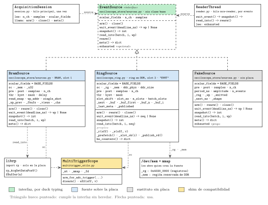
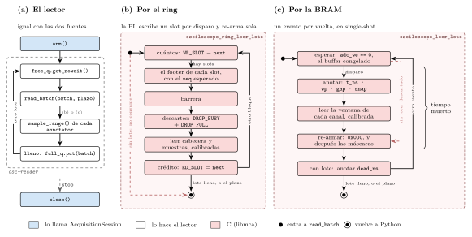
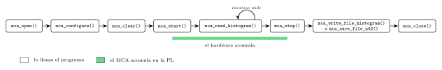
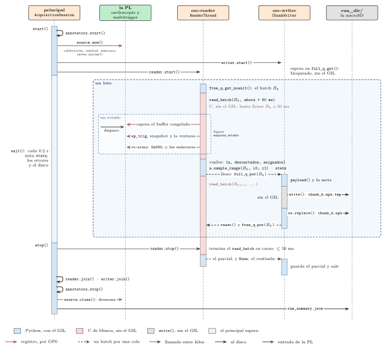
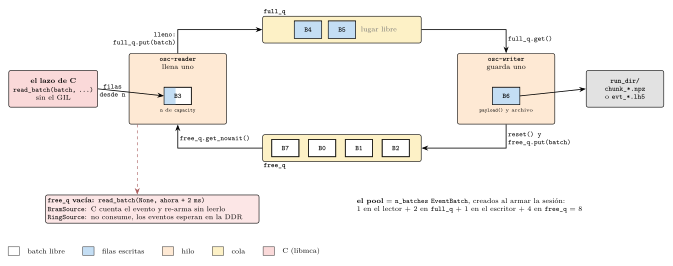
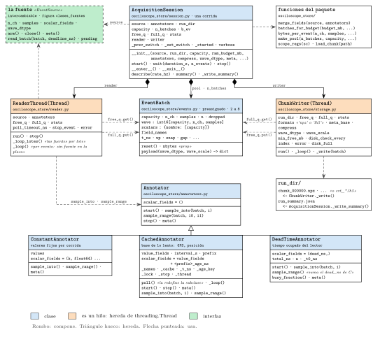

# La adquisición de eventos y la sesión

**Código:** [`software/API/osciloscope_store/`](../../software/API/osciloscope_store/) · [`osciloscope_ring.py`](../../software/API/osciloscope_ring.py) (`RingSource`)
**Figuras:** [`clases_fuentes`](figuras/clases_fuentes.svg) · [`maquinas_estados`](figuras/maquinas_estados.svg) · [`corrida_mca`](figuras/corrida_mca.svg) · [`hilos_captura`](figuras/hilos_captura.svg) · [`pool_batches`](figuras/pool_batches.svg) · [`clases_sesion`](figuras/clases_sesion.svg)
**Tests:** [`test_mca_pipeline.py`](../../software/API/tests/test_mca_pipeline.py) · [`test_bram_source.py`](../../software/API/tests/test_bram_source.py) · [`test_ring_source.py`](../../software/API/tests/test_ring_source.py)

Este documento describe **cómo se adquieren y se guardan los eventos del
osciloscopio**: una forma de onda por disparo, con sus columnas, a un directorio de
corrida. Es lo que arma `AcquisitionSession`. El MCA no pasa por acá: histogramea en la
FPGA y guarda un espectro por medición (§2).

Se apoya en libmca: el lazo por evento, la lectura de la ventana y el re-armado corren
en C, adentro de una sola llamada por lote. Cómo están hechos esos lazos está en
[`libmca.md`](libmca.md) §4; acá está lo que los usa:

1. las fuentes de eventos, y la interfaz que cumplen (§1);
2. lo que pasa en una corrida, como máquina de estados (§2);
3. los hilos, y qué corre en cada uno con el GIL y sin él (§3);
4. el pool de batches que se pasan los hilos (§4);
5. la sesión, que arma y cierra todo (§5);
6. qué guarda cada evento (§6), y los annotators (§7).

Los números de rendimiento, el formato del archivo (`.npz` o LH5) y los pasos futuros
están en [`arquitectura_adquisicion_software.md`](arquitectura_adquisicion_software.md).

---

## 1. Las fuentes: una interfaz por lote



*`AcquisitionSession` lee la forma del evento y llama `arm`, `close` y `meta` una vez
por corrida, y al parar `detener` y `vaciado` si la fuente los tiene; `ReaderThread` llama `read_batch` una vez por lote. `BramSource` y
`RingSource` cumplen la interfaz sin heredar, y cada una tiene su lazo de C (`Lector`
o `LectorRing`). Las dos arman el disparo con el shim `MultiTriggerScope`.*

**Por qué una interfaz.** Para poder cambiar **de dónde salen los eventos** —la BRAM
del scope, el ring en DDR— tocando sólo esta capa. El lector y la sesión no saben qué
fuente tienen: `RingSource` reemplaza a `BramSource` sin cambiar una línea del lector.

**El contrato es por lote.** Desde el lazo de C (Parte 6 de libmca), una fuente no
entrega eventos de a uno: llena un batch.

| Parte | Quién la usa | Qué es |
|---|---|---|
| `scalar_fields`, `n_ch`, `samples`, `wave_dtype` | la sesión, al armar el pool | la forma de un evento: las columnas que aporta, los canales, las muestras, el tipo de la onda |
| `arm()`, `close()`, `meta()` | la sesión, una vez por corrida | dejar el hardware listo para disparar, desarmarlo, y lo que va a la metadata |
| `detener()`, `vaciado()` (opcionales) | la sesión, al parar | cortar el estímulo con el hardware corriendo, y decir si quedó algo en vuelo o sin leer (§5). Sólo `RingSource` |
| `read_batch(batch, deadline_ns)` | el lector, una vez por lote | llenar `batch` desde `batch.n` hasta llenarlo o hasta el plazo. Devuelve `(nuevos, descartados, asignados)` |
| `pending` | el lector, al cerrar | los descartados que no fueron a ningún `gap`: los del final de la corrida |

`read_batch` no toca `batch.n`: escribe las filas y el lector avanza el contador. Con
`batch=None` no hay dónde guardar, y cada fuente decide qué hacer (§4).

**Por qué sin clase base.** Las implementaciones no comparten código:

| Fuente | Cómo detecta un evento | Cómo lee la ventana | Quién re-arma |
|---|---|---|---|
| `BramSource` | el lazo de C polea `adc_we` hasta que la FSM congela el buffer | de a una palabra, calibrada, en C | el mismo lazo de C, después de leer |
| `RingSource` | el lazo de C lee `WR_SLOT` y valida el footer de cada slot en la DDR | copia el slot, des-intercala y calibra, en C | nadie desde el PS: la PL, sola |

No hay nada que heredar. El contrato está escrito en el docstring de
[`sources.py`](../../software/API/osciloscope_store/sources.py), y cada clase lo
cumple por su cuenta.

**El re-armado ya no es parte de la interfaz.** Hasta la Parte 6 la interfaz era por
evento —`wait_event()`, `snapshot()`, `read_into()` y `rearm()`—, y `rearm()` era un
método aparte para que el lector re-armara también al descartar: cuando estaba
adentro de `read_into()`, el camino de descarte no re-armaba y se contaban eventos
fantasma (14 996 vistos contra 10 251 generados). Hoy esa regla la cumple C: el lazo
de la BRAM re-arma después de cada evento y también cuando no hay batch. El lector
conserva el camino por evento (`ReaderThread._loop`), pero ninguna fuente sobre la
placa lo usa: sólo el sustituto de prueba
([`diseno_de_clases.md`](diseno_de_clases.md) §5.1).

**Por qué reciben un `MultiTriggerScope`.** Las dos arman el trigger con el scope
(`arm_for_adc_trigger()`, `disarm()`), y reciben la clase del shim porque son
anteriores a la partición en `Osciloscope` y `MultiTrigger`. Migrarlas a
`multitrigger_arm(osc, mt)` está pendiente. `BramSource` le pasa al lazo de C los dos
handles: la FSM y `wp_trig` en el slot 1 (`sc`), las máscaras y el snapshot en el
slot 3 (`sc.mt`). `RingSource` usa el scope sólo para armar el disparo; lee con su
propio handle, `OsciloscopeRing`.

**Lo que el ring agrega al esquema.** `scalar_fields` suma `ts_hw` (la marca de la
cabecera: ciclos de 8 ns desde que arrancó el ring) y `seq`. `wp` es -1, porque el
ring no tiene `wp_trig`, y `dead_ns` es 0, porque el PS no está en el re-armado. El
`gap` es por bloque, no por evento: el slot no dice cuántos disparos se perdieron
antes de él, así que los descartes que cuenta el hardware van al primer evento leído
después. El total (`batch.dropped`, `trailing_dropped`) es exacto.

> ⚠️ **El precio del duck typing, con dos casos reales.** Nada verifica que una fuente
> cumpla el contrato. Hasta la Parte 7, `RingSource` no lo cumplía entero: no tenía
> `meta()`, así que `AcquisitionSession(RingSource(...))` fallaba al construirse; y
> tomaba el snapshot recién en `read_into()`, cuando el contrato implícito era
> `snapshot()` antes, así que con el lector real la columna `snap` quedaba corrida un
> evento. Sus tests llamaban a los métodos en otro orden y sin sesión, y no lo veían.
> Los dos se fueron con el lector por lote, y `test_sesion_completa` de
> `test_ring_source.py` pasa ahora la fuente por la sesión real. Falta lo general: un
> `typing.Protocol` y el mismo test para cada fuente
> ([`diseno_de_clases.md`](diseno_de_clases.md) §8).

---

## 2. Lo que pasa en una corrida



*(a) El lazo del hilo lector, el mismo con las dos fuentes: `arm()` una vez,
`read_batch()` una vez por lote y `close()` una vez, al cortar. Lo que pasa adentro de
`read_batch` depende de la fuente. (b) Con el ring, un bloque de slots por vuelta: la
PL escribe un slot por disparo mientras tenga créditos y cuenta lo que descarta, y
nadie re-arma desde el PS. Sin lote no se consume nada, y los eventos esperan en la
DDR. (c) Con la BRAM en single-shot, un evento por vuelta, y el re-armado es uno de
esos pasos, no una llamada de la API. Entre el disparo y el re-armado el scope no
puede disparar: ese tramo es el tiempo muerto, y C lo anota en `dead_ns`. Sin lote, el
evento se cuenta como descartado y se re-arma sin leer.*

**El lector no sabe por qué camino llegan los datos.** La parte (a) es la misma con
las dos fuentes: lo que la API abstrae está detrás de `read_batch`, y lo que cambia
son tres cosas. Quién re-arma: C después de cada evento con la BRAM, nadie con el
ring. Quién cuenta los descartes: C, con la BRAM, cuando no hay lote; la PL, con el
ring, en `DROP_BUSY` y `DROP_FULL`, que C lee una vez por bloque. Y qué pasa sin
batch libre: con la BRAM el evento se cuenta como descartado y se pierde; con el ring
espera en la DDR, y recién cuando el ring se llena descarta la PL.

**El re-armado del osciloscopio no se llama desde la API.** Con la BRAM en
single-shot sigue haciendo falta —la FSM congela el buffer en cada disparo y no
vuelve a escribir hasta el próximo arm—, pero lo hace `osciloscope_leer_lote`, en C,
apenas copia la ventana: primero `0x000` en el slot 1 y después las máscaras del
slot 3, en ese orden
([`orden_arm_trigger_captura.md`](../osc/orden_arm_trigger_captura.md), Parte 2). Quien usa la
fuente sólo ve `arm()`, `read_batch()` y `close()`. Con el ring ni siquiera existe:
el `trigger_shield` y la máscara con `we_keep` dejan el disparo armado, y la PL escribe
un slot por disparo mientras tenga créditos.

**El lazo del lector vuelve a `read_batch()`, no a `arm()`.** `arm()` se llama una sola
vez, al abrir la corrida, y `close()` una vez al cerrarla; las dos las llama
`AcquisitionSession` desde el hilo principal. Entre dos llamadas a `read_batch` el
lector corre Python —los annotators, la cola—, y mientras tanto el scope queda
armado: el primer disparo que llegue queda congelado en la BRAM y lo lee la llamada
siguiente. Con el ring, los slots esperan en la DDR.



*El MCA es lineal porque el hardware acumula el histograma solo, entre `mca_start()` y
`mca_stop()`. Leerlo no lo vacía: el programa lo lee las veces que quiera mientras
mide, y al final lo guarda en csv o en N42.42.*

**El MCA es más corto porque el hardware acumula solo**: se configura, se limpia, se
arranca, y la lectura es de un espectro ya formado. Eso es lo que saca la tasa de
eventos del cuello de botella del bus, y por eso el MCA no tiene sesión, ni hilos, ni
pool: guarda **un espectro por medición** con su metadata (configuración, contadores,
geometría, sello de tiempo e implementación, `mca_get_metadata`), en N42.42 o en
texto.

---

## 3. Los hilos de la captura



*Una corrida con `BramSource`, de `start()` a `stop()`, sin escala. El color sobre
cada hilo dice qué corre y si tiene el GIL. El lector pasa casi todo el tiempo en C
(rojo, sin el GIL) y vuelve a Python (azul) una vez por lote; el escritor pasa su
tramo largo en el `write()` (gris, también sin el GIL). Por eso no se frenan: el
escritor guarda Bₖ mientras el lector ya llena Bₖ₊₁. Con `RingSource` el tramo
de C es `osciloscope_ring_leer_lote` y los mensajes a la PL son los del ring; el resto
no cambia.*

Libmca no agrega hilos: los lazos corren en el hilo que los llama. Lo que cambió con C
es **qué corre** el lector, y con eso cuánto se pisa con el escritor.

| Hilo | Clase | Nombre | Qué corre | El GIL |
|---|---|---|---|---|
| principal | `AcquisitionSession` | — | `start()`, `wait()` (mira las estadísticas cada 0.2 s), `stop()` | lo toma un instante cada 0.2 s |
| lector | `ReaderThread` | `osc-reader` | `read_batch()` en C; al volver, los annotators, las estadísticas y la cola | lo suelta en C; lo toma una vez por lote |
| escritor | `ChunkWriter` | `osc-writer` | arma el payload y la metadata, escribe el archivo, `os.replace` | lo suelta en el `write()` |
| annotator | `CachedAnnotator._thread` | `annot-<prefijo>` | `poll()` de un sensor lento (GPS, temperatura) | el que use su `poll()` |

**Un único dueño por recurso.** El lector es el único hilo que toca la fuente, y por
ella la PL; el escritor, el único que toca el directorio de la corrida. Los dos sólo se
hablan por las colas (§4), y lo único que comparten es el dict `stats`, que escribe el
lector.

**Por qué dos hilos y no uno.** El lector no puede esperar al disco: si lo hiciera, el
tiempo muerto pasaría a depender de la microSD y dejaría de ser una constante del
hardware, que es justo lo que rompe la estadística de conteo.

**El lector, por lote.** `ReaderThread._loop_lotes()` hace, en cada vuelta:

1. toma un batch libre de `free_q`, sin esperar (`get_nowait`);
2. llama a `read_batch(batch, ahora + 50 ms)` —o `read_batch(None, ahora + 2 ms)` si
   no había batch—: C llena filas hasta llenarlo o hasta el plazo, sin el GIL;
3. al volver, con el GIL: suma los descartados a `stats`, corre los annotators sobre el
   rango recién llenado (`sample_range(batch, i0, i1)`), y si el batch se llenó, lo pone
   en `full_q`.

El plazo de 50 ms existe para que `stop()` responda: el lector mira su evento de parada
una vez por vuelta. Con 2 ms sin batch, vuelve pronto a buscar el primero que devuelva
el escritor.

**El GIL, antes y ahora.** Con el lazo en Python, el lector necesitaba el GIL en cada
evento, y el escritor se lo quitaba: el stall máximo medido era de **5288 µs**, que es
exactamente el `sys.getswitchinterval()` por defecto. Por eso la sesión lo baja a
1 ms al arrancar, y lo sigue haciendo. Con el lazo en C el lector toma el GIL una vez
por lote, no por evento: lo que el escritor le puede quitar es el tramo de Python entre
dos llamadas, y en ese tramo el scope sigue armado (§2). Medido en la placa el
2026-11-08: el tiempo muerto por evento bajó de 252.7 µs a 18.2 µs de mediana, y
`.npz` y LH5 dejaron de distinguirse (con el lector de Python, `h5py` lo frenaba hasta
11.2 ms por lote, contra 3.1 ms de `.npz`).

**Los invariantes del carril.** Son los que hay que no romper al tocar el pipeline:

- **Descartar y contar, nunca bloquear.** Si el lector esperara un batch libre, el
  tiempo muerto pasaría a depender del disco.
- **Re-armar siempre, también al descartar.** Lo hace el lazo de C de la BRAM; sin
  eso, el buffer queda congelado y el contador se llena de fantasmas.
- **`sys.setswitchinterval(0.001)`.** El stall máximo del lector medido era de
  5288 µs, que es exactamente el default.
- **Sin comprimir.** `savez` 86 ms contra `savez_compressed` 628 ms para el mismo chunk:
  7.3× de costo por un 12 % de tamaño. Y comprimir es CPU con el GIL, mientras que
  escribir es I/O sin él.
- **Cierre por centinela.** El lector pone el batch parcial y después `None` en
  `full_q`, y el escritor drena antes de salir; sin eso, el último chunk se pierde.

---

## 4. El pool de batches



*Un instante cualquiera de una corrida con los valores por defecto. No es un batch:
son `n_batches` objetos `EventBatch`, creados una vez al armar la sesión, que circulan
siempre los mismos. El lector llena uno (C escribe las filas desde `batch.n`), lo pone
en `full_q`, el escritor lo guarda, lo resetea y lo devuelve a `free_q`. Si `free_q`
está vacía, el lector llama a `read_batch(None, …)` y la fuente decide qué pasa con
los eventos.*

**Sí es un pool.** Un `EventBatch` es un bloque de `capacity` eventos (4096 por
defecto) con todos sus arreglos ya reservados: la onda `[capacity, n_ch, samples]` y una
columna por campo. La sesión crea `n_batches` de ellos al arrancar
(`make_pool`), los pone todos en `free_q`, y a partir de ahí **circulan siempre los
mismos objetos**: nadie crea ni libera memoria durante la corrida. En cada instante,
uno está en el lector, otro en el escritor y el resto en las dos colas.

**Cuántos.** `batches_for_budget(ram_budget_mb, …)` lo deriva de un presupuesto de RAM
y lo acota entre 2 y 8. Con dos canales de 32 muestras en `int16` y las cuatro columnas
de siempre, un evento ocupa 145 B y un batch 0.57 MB; los 64 MB por defecto darían 113,
y el techo los deja en **8**: 32 768 eventos en vuelo, 4.5 MB. A 34 kev/s, lo más que
se guardó en la placa, eso es casi un segundo de margen para el escritor.
`AcquisitionSession.describe(rate_hz)` imprime esa cuenta al arrancar.

**Por qué no uno.** Con un solo batch, el lector se queda sin destino cada vez que el
escritor toma el suyo, y descarta durante toda la escritura: un `savez` de un chunk de
1 MB tardaba 86 ms en la placa. Con dos ya hay doble buffer: el escritor guarda uno
mientras el lector llena el otro, y ése es el mínimo.

**Por qué no más de 8.** El presupuesto es un techo, no un objetivo. Lo que la cola
tiene que cubrir son las demoras del escritor —un chunk, un stall del page cache, el
GIL—, y 8 batches dan un segundo de margen. Si el escritor no da abasto en promedio,
más profundidad no lo arregla: sólo retrasa el momento en que se empieza a descartar
y el momento en que los datos llegan al disco. Es lo que se midió a 100 kHz: desde
25 kev/s el límite es el escritor, y en 20 s descartó 41.7 k eventos por falta de batch
con `.npz` y 57.5 k con LH5.

**Lo que compra.** La RAM es una constante conocida de antemano, y no crece con la
duración de la corrida: el problema de `guardado_mariana.py`, donde la lista de
eventos crecía hasta el final y un corte se llevaba todo. No hay basura para el GC
entre evento y evento, porque C escribe adentro de arreglos que ya existen. Y descartar
cuesta O(1): no hay nada que liberar.

**Cuando `free_q` está vacía.** El lector no espera: llama a `read_batch(None, ahora +
2 ms)`, cuenta lo que vuelve como descartado y vuelve a mirar la cola. Lo que pasa con
los eventos depende de la fuente:

- **`BramSource`**: C ve el disparo, lo cuenta como descartado y re-arma sin leer la
  ventana. El conteo va al `gap` del próximo evento guardado (saturado en 255), y el
  total exacto a `batch.dropped`.
- **`RingSource`**: C no consume nada. Los eventos esperan en la DDR, que es un segundo
  buffer mucho más grande que el pool; si el ring se llena, el hardware los descarta y
  los cuenta (`DROP_FULL`).

---

## 5. La sesión: una clase que compone



*`AcquisitionSession` recibe la fuente —cualquiera que cumpla la interfaz de §1— y los
annotators, deriva el esquema y el pool, y compone los dos hilos. Al medio, el lector y
el escritor pasándose los `EventBatch` por las dos colas. Abajo, los annotators y lo
que queda en disco. Naranja quiere decir que la clase es un hilo.*

**`AcquisitionSession` es dueña del ciclo de vida de una corrida.** Recibe la fuente y
los annotators, arma el esquema (`merge_fields()`), dimensiona el pool (§4) y crea las
colas y los dos hilos. Lo importante es el **orden**, y por eso vive en un solo lugar:

```
start():  switchinterval → annotators → source.arm() → escritor → lector
stop():   [source.detener() → hasta source.vaciado()] → lector → (batch parcial, centinela)
          → escritor → annotators → source.close() → run_summary.json
```

El escritor arranca antes que el lector para que el primer batch lleno ya tenga quien
lo reciba, y el lector para antes que el escritor para que el escritor drene todo lo
que el lector alcanzó a poner.

**Con el ring, el estímulo se corta antes que el lector.** Si el lector para primero,
lo que el hardware captura hasta `source.close()` queda en la DDR, y con el ring parado
`WR_SLOT` vuelve a 0: ya no se lee. En la placa eran unos 40 ms de disparos (431 de
39 301 a 10 k/s, el 2026-11-13). Por eso, si la fuente tiene `detener` y `vaciado`, la
sesión:

1. llama a `detener()` con el ring corriendo. Con el generador escribe N ← 1, y el
   motor, que ya pasó de N, no dispara más. Con el disparo del ADC pone la máscara OR
   en 0, el armado al revés, y el resto del desarme queda para `close()`;
2. espera a que `vaciado()` dé True dos veces seguidas: `WR_SLOT = EV_CNT` (ninguna
   ventana en vuelo) y `WR_SLOT` = el próximo slot que lee el lector. Dos veces
   porque entre una ventana que termina y la siguiente puede dar True un instante;
3. recién ahí para el lector, y `close()` para el ring sin nada en vuelo.

Deja `stats['vaciado']`, que es False si vencieron los 5 s de `VACIAR_S` (sin batch
libre el lector del ring no consume, así que un escritor trabado lo hace vencer) o si
el lector se cayó. Si el lector ya no corre, no corta nada: lo que quedó no lo lee nadie,
y `close()` destraba el ring si quedó lleno. Con el ring lleno, el vaciado además
evita destrabarlo, porque el lector devuelve los créditos que la ventana en vuelo
está esperando.

**Compone y no hereda** porque **no es un hilo**: orquesta dos. Es *context manager*
para que `stop()` ocurra aunque la corrida termine con una excepción. `wait()` devuelve
el motivo del corte: duración, eventos, disco lleno, error, o una fuente que se agotó.
`motivo()` es lo mismo sin bloquear (`None` mientras corre, o `'error'`, `'disk'`,
`'source'`): lo usa quien no se puede quedar esperando, como el servidor entre dos
pedidos.

**`AdquisicionRing` (en `API/osciloscope_ring.py`) compone la sesión con un
`RingSource`.** Recibe argumentos que viajan en JSON y tiene `iniciar()`, `estado()` y
`parar()`. Es lo que corren las ops `ring.*` del servidor
([`../APP/protocolo.md`](../APP/protocolo.md)), y la etapa C de la campaña del ring.
`run_dir` puede ser un directorio de la PC montado en la placa: así llegan los archivos a
la PC sin una capa de datos propia. El `meta` de cada archivo trae `fs`, el sistema de
archivos donde se escribió.

**Qué es un hilo y qué no.** En la figura, naranja quiere decir que la clase **es** un
hilo: hereda de `threading.Thread`. Son sólo dos, `ReaderThread` y `ChunkWriter`. Las
demás corren en el hilo que las llama: la sesión, en el del programa; los annotators,
en `sample_range()`, dentro del lector. `CachedAnnotator` no es un hilo, pero lanza uno
propio para `poll()`: es el atributo `_thread`.

**`EventBatch` no tiene `__slots__`** porque **las columnas se deciden en runtime**: las
que declare la fuente más las de cada annotator. El esquema completo, y cómo se agregan
columnas, están en
[`arquitectura_adquisicion_software.md`](arquitectura_adquisicion_software.md) Parte 2.

**`run_summary.json` cierra las cuentas.** `gap` cuenta los descartes que ocurrieron
entre dos eventos guardados, así que los del final de la corrida no tienen dónde
anotarse. El invariante completo es
`sum(gap) + trailing_dropped == n_dropped`, y `trailing_dropped` sale de `pending` y
va al resumen.

---

## 6. Qué guarda cada evento

Un evento es **un disparo**. La máscara OR del multitrigger decide qué fuentes pueden
darlo: por defecto, el flanco positivo de IN1 (`BIT_ADC_P0`). Cualquiera de las fuentes
de la máscara arranca la captura; no hace falta que disparen todos los canales.

Con ese disparo se guarda la ventana de los `n_ch` canales en las mismas muestras:
`wave[i]` es `[n_ch, samples]`, en cuentas calibradas (`int16`), y la columna `snap` dice
qué fuente disparó. El arreglo es denso, sin huecos. Si IN2 no tiene señal, su fila es
la línea de base con su ruido. En la práctica:

- **Con un solo detector se usa `--channels 1`** (`n_ch=1`), en `run_acquire.py` y
  `run_poisson_loss.py`: lee y guarda sólo IN1.
- **`n_ch = 2` sigue siendo el default** de `BramSource`, `RingSource` y de los dos
  scripts. Con un default de 1, un segundo canal conectado se perdería sin aviso.
- **Cuánto ahorra con la BRAM.** Con el lazo de Python, el segundo canal costaba unos
  86 µs de los 252.7 µs del ciclo. Con el de C, cada canal es una lectura de
  `pre + post` palabras de a una: con 32 muestras, unos 7.5 µs de los 18.2 µs medidos
  con dos canales (es una cuenta con los 0.235 µs por palabra, no una medición). En
  disco, sin comprimir y con 32 muestras, un evento ocupa 81 B en vez de 145 B.
- **El ring escribe siempre los `N_CH` canales** intercalados en cada slot, por decisión
  del RTL ([`../event_ring/diseno_y_register_map.md`](../event_ring/diseno_y_register_map.md)).
  `RingSource(n_ch=1)` entrega sólo IN1, pero el slot y la copia desde DDR son los de
  dos canales: ahorra disco, no ancho de banda.
- **Hay un solo stream de eventos.** El multitrigger junta los disparos de los canales
  en un OR, y ese evento va a la captura de todos
  ([`mt_event_logic.v`](../../modulos/mt/rtl/mt_event_logic.v)). Un pulso en IN1
  congela también IN2. Dos detectores independientes compartirían el tiempo muerto, y
  `n_ch` no cambia eso: separarlos pide tocar el RTL.
- **El canal sin señal sí sirvió una vez.** En la campaña del 2026-05-28, IN2 en vacío
  dio 3.6 millones de muestras de línea de base pura. Con ellas, `ruido.py` midió el
  espectro del ruido y el crosstalk entre canales, en −56.5 dB
  ([`../ruido_del_sistema.md`](../ruido_del_sistema.md)).

---

## 7. Los annotators

Un annotator agrega columnas a cada evento sin definir cuándo ocurre: un GPS no
dispara, *anota*, y va tres o cuatro órdenes de magnitud más lento que los eventos.
Por eso son un concepto aparte de las fuentes, y acá **sí hay clase base**, porque hay
código que compartir:

- `Annotator` trae `start()`, `stop()`, `meta()` y un `sample_range()` que llama a
  `sample_into()` fila por fila.
- `ConstantAnnotator` pone valores fijos por corrida.
- `CachedAnnotator` trae el hilo, la caché y el campo `<prefijo>_age_ns` que todo
  annotator lento necesita: sin él, un GPS que perdió el fix hace diez minutos escribe
  coordenadas plausibles y silenciosamente falsas en cada evento.
- `DeadTimeAnnotator` declara la columna `dead_ns`. Ya no mide: el valor lo escribe C,
  donde se medía, y el annotator sólo suma el tiempo ocupado (`busy_fraction()`).

La regla que no se negocia es que **no pueden hacer I/O** en el lector: corren con
`sample_range(batch, i0, i1)` sobre el rango recién llenado, con el GIL, y sólo copian
un valor ya cacheado. Como corren al volver de C, un valor cacheado puede ser hasta
50 ms más nuevo que el evento, y su `*_age_ns` dar negativo.

---

## Ver también

- [`libmca.md`](libmca.md) §4: los dos lazos por lote, del lado de C
- [`arquitectura_adquisicion_software.md`](arquitectura_adquisicion_software.md): el ciclo de adquisición, el esquema del evento, el formato del archivo y el rendimiento medido
- [`arquitectura_software.md`](arquitectura_software.md): los tres sistemas de concurrencia (pipeline, servidor, GUI) y el filesystem
- [`../osc/orden_arm_trigger_captura.md`](../osc/orden_arm_trigger_captura.md): el orden arm → máscara y la FSM de captura
- [`../event_ring/diseno_y_register_map.md`](../event_ring/diseno_y_register_map.md): el ring, del lado del RTL
- [`guia_de_uso.md`](guia_de_uso.md): recetas, con la captura de eventos
