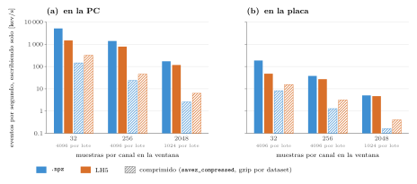
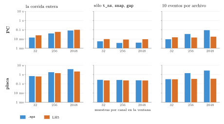
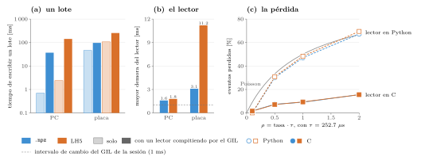

# Arquitectura del software de adquisición — rutinas, rendimiento y pasos futuros

Este documento describe el software del lado del servidor (la Pitaya): el ciclo de
adquisición, la arquitectura del pipeline de lectura y guardado, y **el análisis de
rendimiento medido en la placa**. Complementa a
[`orden_arm_trigger_captura.md`](../osc/orden_arm_trigger_captura.md), que explica el orden
arm→máscara y la FSM de captura, y a
[`register_map_mt.md`](../mt/register_map_mt.md) y
[`../osc/register_map_osc.md`](../osc/register_map_osc.md).

> **Estado:** la Parte 3 (rendimiento) está medida y cerrada. Las Partes 2 y 5
> describen el pipeline; la implementación vive en `software/API/osciloscope_store/`.
> **Desde la Parte 6 del plan de libmca (2026-11-08) el lazo por evento de
> `BramSource` es de C** (`osciloscope_leer_lote`), con la calibración de librp y sin
> `rp` para leer: ver [`libmca.md`](libmca.md) §4. Medido en la placa el
> 2026-11-08: lee lo mismo que `rp`, muestra por muestra, con 18.2 µs de tiempo
> muerto mediano, y la pérdida con Poisson sigue a τ = 20 µs.

---

## Parte 1 — El ciclo de adquisición

Seis fases, y el orden de las tres primeras **no es negociable** (ver
[`orden_arm_trigger_captura.md`](../osc/orden_arm_trigger_captura.md) para el race que
motivó la regla):

```
  ┌─ 1. CONFIG ────────────────────────────────────────────────────┐
  │  acq_base()      0x00 ← 0x0202   adc_rst_do   (reset FSM)      │
  │                  0x94 ← 0x0101   trig_dis_clr (destraba)       │
  │                  0x14/0x114 ← decim                            │
  │                  0x08/0x0C  ← threshold (cuentas, 8192/V)      │
  │                  0x10/0x110 ← set_dly   (>= 1, ver abajo)      │
  │  hyst            0x20/0x24  ← histéresis en cuentas            │
  │  shield     slot3 0x010 ← {dur, dst, src}  (auto re-arm)       │
  └────────────────────────────────────────────────────────────────┘
                     │  la máscara sigue en 0: NADA puede disparar
                     v
  ┌─ 2. ARM ───────────────────────────────────────────────────────┐
  │  0x00 ← 0x0909 (continuo) ó 0x0101 (single-shot)               │
  │  bit0 = arm, bit3 = we_keep, EN LA MISMA ESCRITURA             │
  │  -> adc_we=1, el wp empieza a girar, trg_rd/dly_cnt/we_cnt a 0 │
  └────────────────────────────────────────────────────────────────┘
                     v
  ┌─ 3. HABILITAR FUENTE ──────────────────────────────────────────┐
  │  slot3 0x040/0x044 ← OR_MASK -> new_trg_src -> set_trig_src    │
  │  DESDE ACÁ la ventana de captura está abierta                  │
  └────────────────────────────────────────────────────────────────┘
                     v
  ┌─ 4. ESPERA ──── poll de wp_trig @0x1C (≈2.3 µs por lectura) ───┐
  ┌─ 5. LECTURA ─── ventana alrededor de wp_trig ──────────────────┐
  ┌─ 6. DISARM ──── 0x00←0, shield off, 0x94 clear, 0x00←0x0202 ───┘
```

### Tres detalles que cuestan caro si se ignoran

**`adc_rst_do` no limpia `adc_trg_dis`.** Son registros de módulos distintos: el reset
de la FSM vive en `rp_bram_sm`, y el bit de trigger-protect en
[`mt_trig_src.sv:71`](../../modulos/mt/rtl/mt_trig_src.sv#L71), que sólo baja
con `trig_dis_clr` (0x94) o con el `trigger_shield`. Sin el pulso a 0x94,
`src_mask = set_trig_src & {!adc_trg_dis} = 0` y **no dispara nunca**, con la máscara
aparentemente bien escrita.

**El readback de la OR_MASK miente.** Hay tres copias de la máscara y sólo una dispara:

| Copia | Dónde | Rol |
|---|---|---|
| `trg_src` | [mt_cfg](../../modulos/mt/rtl/mt_cfg.sv#L108) | combinacional, vale sólo el ciclo del write |
| `set_trig_src` | [trig_src:48](../../modulos/mt/rtl/mt_trig_src.sv#L48) | **la que dispara**; se carga sólo con `new_trg_src` |
| `trg_src_stored` | [mt_cfg](../../modulos/mt/rtl/mt_cfg.sv#L135) | **sólo readback**, no drivea nada |

O sea que `0x4030_0040` puede leer `0xFFFFFFFF` mientras la máscara viva está en 0 (auto-limpiada
por un trigger single-shot). Para el estado real hay que mirar `TRG_STATE` @`0x4030_0028` (o el `0x04`
legacy del slot 1, que sigue funcionando).

**`set_dly` nunca puede ser 0.** La condición de parada en
[`rp_bram_sm.v:67`](../../../../rtl/classic/rp_bram_sm.v#L67) compara `adc_dly_cnt == 1`
**exacto**, y el decremento en [`:134`](../../../../rtl/classic/rp_bram_sm.v#L134) no
tiene piso. Con `set_dly=0` el contador nunca vale 1 (arranca en 0 y hace underflow a
`0xFFFFFFFF`), así que `adc_we` no cae nunca: **el buffer no se congela**. Con `decim=1`
quedan ~2³² muestras (~34 s) de post-trigger; con `decim>1` el `adc_dly_do` pulsa y
limpia la máscara. Los dos sabores terminan en deadlock. Usar siempre `delay >= 1`.

> La misma condición está replicada en el camino AXI
> ([`rp_axi_sm.v:114`](../../../../rtl/classic/rp_axi_sm.v#L114)): si algún día se usa
> el modo HP, `set_axi_dly` (0x58) también tiene que ser ≥ 1.

---

## Parte 2 — Arquitectura del pipeline

Productor/consumidor con dos colas y un **pool de batches preasignados**: el hilo lector
llena un `EventBatch` con el lazo de libmca, en C y sin el GIL, y el hilo escritor lo
guarda y lo devuelve. Un solo hilo toca la fuente; el escritor sólo ve arrays de NumPy.
Cómo está armado está en otros dos documentos, y acá no se repite:

| Qué | Dónde |
|---|---|
| las fuentes (`BramSource`, `RingSource`) y su interfaz por lote | [`adquisicion_de_eventos.md`](adquisicion_de_eventos.md) §1 |
| la corrida como máquina de estados, y por qué el re-armado ya no es una llamada de la API | [`adquisicion_de_eventos.md`](adquisicion_de_eventos.md) §2 |
| los hilos en el tiempo, con y sin el GIL, y los invariantes del carril | [`adquisicion_de_eventos.md`](adquisicion_de_eventos.md) §3 |
| el pool: cuántos batches, por qué no uno, qué pasa sin batch libre | [`adquisicion_de_eventos.md`](adquisicion_de_eventos.md) §4 |
| la sesión: el orden de `start()` y `stop()` | [`adquisicion_de_eventos.md`](adquisicion_de_eventos.md) §5 |
| el lazo por evento en C (`osciloscope_leer_lote`) y el del ring | [`libmca.md`](libmca.md) §4 |
| la calibración de librp en C, y por qué `rp_Init()` sigue en los scripts | [`libmca.md`](libmca.md) §3.4 |

Lo que sigue es lo que hace al archivo: el esquema del evento, cómo se agregan columnas
y el formato.

### El esquema de evento

`EventBatch` con arrays C-contiguos preasignados para `capacity` eventos:

| Array | dtype | shape | Origen |
|---|---|---|---|
| `t_ns` | int64 | (C,) | `perf_counter_ns()` — eje temporal largo |
| `wp` | int32 | (C,) | `wp_trig` @0x1C — Δt fino, 8 ns de resolución |
| `snap` | uint32 | (C,) | `trig_snapshot` @slot3 0x018 — qué fuente disparó |
| `gap` | uint8 | (C,) | eventos descartados justo antes de éste |
| `wave` | int16 | (C, n_ch, S) | ventanas en cuentas calibradas (ver nota de dtype) |

**`wave` con el canal como eje**, no como nombres `ch1`/`ch2`: el mismo código sirve
para 2 o 4 canales (la RTL es paramétrica en `N_CH`). Qué canal es cada índice va en
`meta['channels']`.

**`gap` marca el hueco en el evento exacto** donde ocurrió, no a nivel de archivo:
`gap[i] > 0` significa que el Δt contra el evento anterior **no es real** y hay que
excluirlo del análisis. Sin esta columna, un descarte corrompe en silencio toda la
distribución de Δt (dead-time, pileup, estadística de conteo). Es `uint8` saturando en
255 porque lo único que importa por evento es *si* hay hueco; el total exacto vive en
`meta['chunk_dropped']`, que no satura.

**Dos relojes a propósito:** el de SW es monótono pero con jitter de µs; el de HW
(`wp`) da 8 ns pero envuelve cada 16384 muestras. Se guardan los dos crudos y los Δt
salen de un `np.diff` offline.

**Nota de dtype: `int16` de punta a punta desde la Parte 6.** `BramSource` declara
`wave_dtype = int16` y el pool se arma de ese tipo: C escribe las cuentas calibradas y
el escritor no convierte nada. Lo que sigue es el razonamiento de antes, que vale para
`FakeSource` (volts en `float32`, que el escritor pasa a cuentas).

**Antes de la Parte 6 (`float32` en RAM, `int16` en disco).** El ADC es de 14 bits
(`parameter DW = 14`), así que `float32` son 4 bytes para 14 bits de información. Lo
ideal sería `int16` de punta a punta, pero la API del `rp` de esta placa **no lo
permite**: no existen las variantes `*NP`, y `rp_AcqGetDataPosRaw` existe pero su
binding SWIG está roto (espera un `int16_t` escalar donde va el puntero al buffer). La
solución: el lector guarda `float32` (lo que da la API) y **el escritor convierte a
`int16` al escribir**, con la escala en `meta`. La conversión queda fuera del camino
crítico, en el hilo que tiene tiempo de sobra. Cuesta 4.3 MB de RAM extra (irrelevante)
y ahorra la mitad del disco.

> El dtype es una decisión de **almacenamiento, no de velocidad**. El readback entrega
> `{18'h0, dato[13:0]}`: **una palabra de 32 bits del bus por muestra y por canal**, y
> los dos canales viven en regiones separadas (`0x10000` / `0x20000`), no intercalados.
> O sea que la cantidad de transacciones AXI es la misma con `int16` o con `float32` —
> leer "como int32" no trae dos muestras de una. Empaquetar 2×14 bits por palabra
> requeriría cambiar el RTL del readback, y ahorraría ~5 µs de los 45: no paga una
> re-síntesis.

### Cómo se agregan columnas nuevas

El esquema **no está hardcodeado**: se construye en runtime desde
`source.scalar_fields + [a.scalar_fields for a in annotators]`. Un mecanismo cubre los
tres casos futuros:

| Caso                   | Cómo entra                                                    |
| ---------------------- | ------------------------------------------------------------- |
| Features del MCA en HW | `BramSource` declara `altura/area/...` y las lee de registros |
| Posición del sistema   | un `Annotator` que declara `x/y/z`                            |
| GPS                    | un `Annotator` que declara `lat/lon/t_gps_ns/fix_age_ns`      |

`meta['schema_version']` y `meta['fields']` registran qué había en cada corrida, así que
los archivos viejos se siguen leyendo.

### El formato del archivo: `.npz` y LH5

`AcquisitionSession(..., formato='lh5')` escribe un `evt_%06d.lh5` por lote en vez de un
`chunk_%06d.npz`. [LH5](https://legend-exp.github.io/legend-data-format-specs/dev/hdf5)
es el formato HDF5 del experimento LEGEND, y su lector oficial (`legend-lh5io`) lo abre sin
saber nada de este proyecto, y junta varios archivos como una sola tabla:

```
/raw            table{t_ns,wp,snap,gap,<annotators>,waveform_in1[,waveform_in2]}
  waveform_inN  table{t0,dt,values}
    t0, dt      float32, en ns. t0 = −pre·dt: el disparo es el tiempo 0
    values      array_of_equalsized_arrays<1,1>{real}: las cuentas, como wave
/meta           string, JSON
```

`load_chunk` da lo mismo con los dos, y `archivos_de_corrida(dir)` encuentra los de
cualquier formato. El lote en RAM no cambia: sigue siendo la cola entre el lector y el
escritor.

**Quedan los dos** (decisión del 2026-11-08). `.npz` es el default: no necesita más que
numpy y es el que más rápido escribe. LH5 es para los archivos que salen de este
proyecto, o para leer unos pocos eventos de ventanas largas. Los dos guardan el mismo
lote y salen del mismo hilo escritor: cambia sólo cómo se escribe el archivo.

#### Qué da cada uno

| | `.npz` | LH5 |
|---|---|---|
| quién lo abre | numpy | cualquier biblioteca de HDF5 (`h5py`, MATLAB, Julia, C), y el lector de LEGEND, que además entiende la tabla |
| la metadata | un pickle: hace falta Python y `allow_pickle=True`, que puede ejecutar código del archivo | JSON en un string |
| una columna sin la onda | sí: cada array es un miembro del zip, y se lee sin `allow_pickle` | sí: cada columna es un dataset |
| unos pocos eventos | no: `wave` se lee entera | sí: sólo esas filas |
| la corrida como una tabla | `load_chunk`, archivo por archivo | `lh5.read('raw', archivos)`, y `lh5concat` los junta en un archivo |
| la escala de tiempo de la onda | en `meta` | en cada evento: `t0` y `dt`, con `units` |
| compresión | el archivo entero o nada (`savez_compressed`) | por dataset (gzip), y el lector la resuelve solo |
| bytes de más | — | 16 por evento (`t0` y `dt` de los dos canales) y unos 12 KB por archivo |
| lo que necesita en la placa | numpy | `h5py` (3.6.0, de apt) |

#### Lo que cuesta cada uno

`make bench-formatos` (`API/bench/bench_formatos.py`) escribe una corrida de 20 archivos
con el `ChunkWriter` real y la lee de cuatro maneras, con los archivos en el caché: mide
el formato, no el disco. La onda es el ruido de la placa (σ = 4.6 cuentas) más un pulso
por evento, en int16; cuánto se comprime una señal real depende de la señal.



*Cuántos eventos por segundo aguanta el escritor solo, sin un lector compitiendo:
eventos por lote sobre lo que tarda el `ChunkWriter` real en escribir un lote de dos
canales, en escala logarítmica. (a) En la PC, con los archivos en el caché
(`make bench-formatos`, 2026-11-08). (b) En la placa (`make bench-formatos-remoto`, el
mismo día). `.npz` escribe siempre más rápido, pero en la placa la diferencia se achica
con la ventana: 3.9 veces a 32 muestras y casi nada a 2048, donde pesan los datos y no
la estructura de HDF5. Comprimir cuesta uno o dos órdenes de magnitud, y en la placa no
pasa de 16 kev/s: no es para adquirir, sino para archivar después.*



*Lo que cuesta leer una corrida de 20 archivos sin comprimir, con los archivos en el
caché, de tres maneras: entera, como `load_chunk`; sólo las columnas `t_ns`, `snap` y
`gap`, sin la onda; y diez eventos al azar de cada archivo, con su onda. Arriba en la
PC, abajo en la placa, con el mismo eje logarítmico. Las columnas solas cuestan lo mismo
con cualquier ventana. Con ventanas largas, LH5 lee unos pocos eventos mucho más rápido,
porque lee sólo esas filas: 7.8 veces a 2048 muestras en la placa. En la placa, además,
LH5 lee la corrida entera más rápido que `.npz`, al revés que en la PC.*

Los números de las dos figuras están en las tablas que siguen. En la PC (2026-11-08,
`h5py` 3.16, HDF5 2.0, `lh5` 0.3.1), con dos canales y sin comprimir:

| ventana (eventos por lote) | | B/ev | escribir un lote | leer todo | sólo `t_ns`, `snap`, `gap` | 10 eventos por archivo | `lh5.read` |
|---|---|---|---|---|---|---|---|
| 32 (4096) | `.npz` | 145 | 0.8 ms | 14 ms | 5.7 ms | 9.4 ms | — |
| | LH5 | 164 | 2.8 ms | 25 ms | 9.8 ms | 15 ms | 61 ms |
| 256 (4096) | `.npz` | 1041 | 2.9 ms | 40 ms | 3.8 ms | 35 ms | — |
| | LH5 | 1060 | 5.2 ms | 59 ms | 8.8 ms | 15 ms | 121 ms |
| 2048 (1024) | `.npz` | 8211 | 6.0 ms | 84 ms | 4.0 ms | 90 ms | — |
| | LH5 | 8238 | 8.7 ms | 100 ms | 9.4 ms | 18 ms | 155 ms |

Comprimido:

| ventana | | B/ev | ahorra | escribir un lote | leer todo | 10 eventos por archivo |
|---|---|---|---|---|---|---|
| 32 | `.npz` | 104 | 28 % | 28 ms | 71 ms | 60 ms |
| | LH5 | 107 | 35 % | 13 ms | 92 ms | 64 ms |
| 256 | `.npz` | 754 | 28 % | 175 ms | 461 ms | 538 ms |
| | LH5 | 735 | 31 % | 91 ms | 561 ms | 274 ms |
| 2048 | `.npz` | 4889 | 40 % | 401 ms | 1.0 s | 1.1 s |
| | LH5 | 4462 | 46 % | 163 ms | 0.97 s | 0.45 s |

- **Escribir:** `.npz` es siempre el más rápido. LH5 paga 2 a 3 ms fijos por archivo, la
  estructura de HDF5, que con ventanas largas pesan menos: 8.7 contra 6.0 ms a 2048
  muestras. En la placa, a 32 muestras, fue 107 contra 46 ms (abajo).
- **Leer entero o sólo las columnas:** `.npz` es 1.2 a 2.4 veces más rápido. Las columnas
  solas cuestan lo mismo con cualquier ventana, en los dos.
- **Leer unos pocos eventos:** a 32 muestras gana `.npz`; con ventanas largas, LH5, que
  lee sólo esas filas: 2.4 veces más rápido a 256 muestras y 5 a 2048.
- **El lector oficial** trae la corrida entera en una llamada, 1.5 a 2.5 veces más lento
  que leer los archivos uno por uno.
- **Comprimir** ahorra 28 a 46 %, pero escribir se hace 35 a 67 veces más lento con
  `.npz` y 5 a 19 con LH5. A 2048 muestras da 2.6 kev/s con `.npz` y 6.3 con LH5, en la
  PC: no es para adquirir, sino para archivar después. LH5 comprime dos veces más rápido.

**En la placa** (2026-11-08, `make bench-formatos-remoto`: Python 3.10.12, numpy 1.21.5,
`h5py` 3.6.0, HDF5 1.10.7, sin `legend-lh5io`). Los tiempos de lectura son de la corrida
entera, 20 archivos:

| ventana (eventos por lote) | | B/ev | escribir un lote | leer todo | sólo `t_ns`, `snap`, `gap` | 10 eventos por archivo |
|---|---|---|---|---|---|---|
| 32 (4096) | `.npz` | 146 | 22 ms | 685 ms | 270 ms | 317 ms |
| | LH5 | 164 | 86 ms | 625 ms | 231 ms | 308 ms |
| 256 (4096) | `.npz` | 1042 | 108 ms | 1.80 s | 260 ms | 1.43 s |
| | LH5 | 1060 | 151 ms | 1.42 s | 231 ms | 339 ms |
| 2048 (1024) | `.npz` | 8211 | 202 ms | 3.86 s | 239 ms | 2.73 s |
| | LH5 | 8238 | 218 ms | 2.15 s | 228 ms | 352 ms |

Comprimido, en la placa:

| ventana | | escribir un lote | leer todo | 10 eventos por archivo |
|---|---|---|---|---|
| 32 | `.npz` | 498 ms | 1.20 s | 0.80 s |
| | LH5 | 264 ms | 1.41 s | 0.80 s |
| 256 | `.npz` | 3.18 s | 5.57 s | 5.18 s |
| | LH5 | 1.30 s | 5.74 s | 2.50 s |
| 2048 | `.npz` | 6.28 s | 10.2 s | 9.79 s |
| | LH5 | 2.55 s | 9.46 s | 5.66 s |

- **Escribir:** `.npz` sigue siendo el más rápido, pero la diferencia se achica con la
  ventana: 3.9 veces a 32 muestras (22 contra 86 ms por lote), 1.4 a 256 y casi igual a
  2048 (202 contra 218 ms). El costo fijo de LH5 por archivo pesa en el A9 unos 60 ms.
- **Leer:** al revés que en la PC, **LH5 lee más rápido en la placa**: entero, 1.1 veces a
  32 muestras, 1.3 a 256 y 1.8 a 2048; las columnas solas, 1.1 veces. Lo más probable es
  el CRC32 que `zipfile` verifica en cada miembro del `.npz` al leerlo, que en el A9 pesa
  y HDF5 no hace; no está medido aparte.
- **Unos pocos eventos:** igual a 32 muestras; con ventanas largas LH5 es 4.2 veces más
  rápido a 256 y 7.8 a 2048.
- **Comprimir en la placa no sirve:** escribir se hace 23 a 31 veces más lento con
  `.npz` y 3 a 12 con LH5. A 2048 muestras da 0.2 kev/s (`.npz`) y 0.4 (LH5). Se comprime
  después, en la PC.
- Sin `legend-lh5io` en la placa no hay lectura oficial; el archivo es el mismo y se lee
  en la PC.

#### Con la adquisición corriendo

Lo que decide los descartes es otra cosa: escribir un lote mientras el lector compite por
el GIL (`bench_escritura.py`). En la PC:

| 4096 eventos × 2 canales × 32 muestras | `.npz` | `.lh5` |
|---|---|---|
| bytes por evento | 145 | 164: `t0` y `dt` son 16 |
| un lote, solo | 0.7 ms | 2.4 ms |
| un lote, con un lector compitiendo por el GIL | 37 ms | 143 ms |
| mayor demora del lector mientras se escribe | 1.6 ms | 1.8 ms |

Con un lector compitiendo manda el GIL, no el disco: cada vez que el escritor lo suelta,
espera hasta un intervalo de cambio (1 ms) para recuperarlo, y `h5py` lo suelta muchas más
veces que `savez`. **Lo que no se ve es al lector frenado:** `h5py` 3.16 suelta el GIL
durante el I/O. Con cada escritura frenada 50 ms a propósito, la demora del lector no pasó
de 5.5 ms. La versión de la placa puede ser otra, y por eso se vuelve a medir allá:

```bash
make bench-escritura-remoto                  # costo y demora, sin tocar la PL
python3 campanas/run_poisson_loss.py --formato lh5   # los descartes, con el generador
```

**En la placa (2026-11-07), con `h5py` 3.6.0 y HDF5 1.10.7 de apt, no pasa.**

| 4096 eventos × 2 canales × 32 muestras, en la placa | `.npz` | `.lh5` |
|---|---|---|
| bytes por evento | 146 | 164 |
| un lote, solo | 46 ms | 107 ms |
| un lote, con un lector compitiendo por el GIL | 97 ms | 255 ms |
| mayor demora del lector mientras se escribe | 3.1 ms | 11.2 ms |
| lo más que aguanta el disco | 42 kev/s | 16 kev/s |

El disco no se queda atrás: 16 kev/s es cuatro veces la tasa del lector. Pero este `h5py`
retiene el GIL bastante más que el 3.16 de la PC, y eso se ve en los descartes. Con
`run_poisson_loss.py`, la misma semilla y el mismo tren:

| ρ | Poisson | `.npz`, 1.ª | `.npz`, 2.ª | `.lh5` |
|---|---|---|---|---|
| 0.1 | 9.1 % | 0.0 % | 0.0 % | 0.1 % |
| 0.5 | 33.3 % | 29.7 % | 30.5 % | 30.9 % |
| 1 | 50.0 % | 47.6 % | 46.5 % | 48.4 % |
| 2 | 66.7 % | 67.1 % | 67.5 % | 69.5 % |

Entre las dos corridas en `.npz` hay hasta 1.1 pp. LH5 pierde más en las tres tasas
altas, y a ρ = 2 por 2 a 2.4 pp: unos 6 % menos de eventos leídos. Equivale a dejar
ciego al lector unos 120 ms por lote, del orden de lo que tarda escribir uno. Con el
lector de Python, por eso `.npz` quedó de default.

**Con el lector en C (2026-11-08) la diferencia se va.** A las mismas tasas:

| ρ (τ = 252.7 µs) | `.npz` | LH5 |
|---|---|---|
| 0.1 | 1.7 % | 1.6 % |
| 0.5 | 7.4 % | 7.2 % |
| 1 | 9.2 % | 9.4 % |
| 2 | 15.6 % | 15.6 % |

sin ningún descarte por falta de batch. Casi toda esa pérdida es el apilamiento del
estímulo (6 a 8 % de los pulsos). Más arriba, entre 5 y 100 kHz con pulsos de 2 µs, la
pérdida sigue a Poisson con τ = 20 µs a menos de 2.3 pp, y se guardan hasta 34 kev/s.
Desde 25 kev/s el que no da abasto es el escritor: a 100 kHz descartó por falta de batch
41.7 k eventos en 20 s con `.npz` y 57.5 k con LH5, con la pérdida total a 1 pp. Con
esto quedaron los dos, y `.npz` de default (arriba).



*El escritor con la adquisición corriendo, con lotes de 4096 eventos × 2 canales × 32
muestras (`bench_escritura.py`; `h5py` 3.16 en la PC y 3.6.0 en la placa). (a) Escribir
un lote solo y con un lector de Python compitiendo por el GIL, en escala logarítmica:
cada vez que el escritor suelta el GIL, espera hasta un intervalo de cambio para
recuperarlo, y `h5py` lo suelta muchas más veces que `savez`. (b) La mayor demora del
lector mientras se escribe, que es tiempo muerto: en la placa `h5py` lo frena 11.2 ms,
contra 3.1 ms de `.npz`. (c) La pérdida en la placa contra ρ, con la BRAM y el mismo
tren de pulsos (`run_poisson_loss.py`), junto al modelo de Poisson no paralizable,
ρ/(1+ρ). Con el lector en Python, LH5 pierde 2 a 2.4 pp más que `.npz` a ρ = 2 (la de
`.npz` es la media de dos corridas, que difieren hasta 1.1 pp). Con el lector en C, que
espera el disparo sin el GIL, los dos formatos dan lo mismo, y lo que queda es casi todo
apilamiento del estímulo.*

**Con el event_ring (2026-11-09) el lector sale del camino del disparo.** Las mismas
corridas con `--fuente ring`, en `.npz`, con el bitstream del ring que arregla el bus
(`out/v3_event_ring/LEEME.md`):

| tasa    | BRAM + C | ring   | apilamiento del estímulo |
| ------- | -------- | ------ | ------------------------ |
| 396 Hz  | 1.7 %    | 1.6 %  | 0 %                      |
| 1979 Hz | 7.4 %    | 6.6 %  | 7.2 %                    |
| 3957 Hz | 9.2 %    | 6.4 %  | 6.2 %                    |
| 7915 Hz | 15.6 %   | 7.4 %  | 7.6 %                    |
| 5 kHz   | 9.8 %    | 1.2 %  | 0 %                      |
| 25 kHz  | 30.8 %   | 6.7 %  | 8.0 %                    |
| 50 kHz  | 50.9 %   | 16.2 % | 21.9 %                   |
| 100 kHz | 69.6 %   | 31.0 % | 31.1 %                   |

Con el ring, la pérdida no crece con la tasa por sí misma: es la del estímulo, pulsos
del Rigol tan juntos que dan un solo cruce de umbral (la columna de apilamiento cuenta
los que caen a menos de un ancho, y el disparo por nivel separa algunos: por eso a
50 kHz se pierde menos de lo que se apila). El ring no descartó nada hasta 50 kHz, y
lo leído coincide con su `EV_CNT` a ±0.1 %. A 100 kHz se guardaron 77 kev/s (con la
BRAM, 34) y el ring descartó por lleno 24.3 k eventos en 20 s (1.1 %): los mismos que
la sesión contó como falta de batch, o sea que el que no dio abasto fue el escritor.
Datos en `software/datos/placa_ring_20261109/`.

**`EventSource` vs `Annotator`** — la distinción importa. Un GPS no define *cuándo*
ocurre un evento, lo *anota*, y va 3-4 órdenes de magnitud más lento (1-10 Hz contra
decenas de kHz). La regla que hace que no rompa el dead-time: `sample_into()` corre en
el lazo caliente y **no puede hacer I/O** — sólo copiar un valor ya cacheado por el hilo
propio del annotator. Y todo annotator asincrónico declara un `*_age_ns`: sin eso, un
GPS que perdió el fix hace diez minutos escribe coordenadas plausibles y falsas en cada
evento.

---

## Parte 3 — Análisis de rendimiento (medido)

Todo lo que sigue está **medido en la placa**, no estimado:
[`API/bench/bench_reader_budget.py`](../../software/API/bench/bench_reader_budget.py),
`REPS=200`, Pitaya `rp-f08768`, Python 3.10.12, Zynq con 2× Cortex-A9, 461 MB de RAM.
Resultados crudos en `API/bench/bench_reader_budget.npz`.

### Presupuesto del lector, por evento

```
  poll de wp_trig (1 lectura por mmap)      2.3 µs
  leer ventana ch0  (S=32, PosV)           45.6 µs
  leer ventana ch1  (S=32, PosV)           45.6 µs
  ──────────────────────────────────────────────────
  total                                    91.2 µs/evento
                                     TECHO  11.0 kev/s
```

### El costo de leer NO escala con las muestras

Éste es el resultado central, y contradice lo que parecía obvio:

| S (muestras) | µs por canal | µs/muestra |
|---|---|---|
| 8 | 37.2 | 4.64 |
| 16 | 39.6 | 2.47 |
| 32 | 45.6 | 1.42 |
| 64 | 56.6 | 0.88 |
| 128 | 78.9 | 0.62 |

Ajuste: **≈ 35 µs fijos por llamada + 0.35 µs por muestra**. A `S=32`, **35 de los 45 µs
son overhead fijo de `rp_AcqGetDataPosV`** — la ventana en sí cuesta 11 µs.

La consecuencia práctica es contraintuitiva: **achicar la ventana casi no sirve**. Pasar
de 32 a 16 muestras baja el costo apenas 13% (45.6 → 39.6 µs). Lo que sirve es hacer
**menos llamadas**, y con esta API hace falta una por canal y por evento.

### Por qué no se puede saltear la API (dos intentos, los dos fallidos)

La BRAM es visible desde el mmap que `MultiTriggerScope` ya abre: el `casez` la mapea a
`0x10000` (ch0) y `0x20000` (ch1), y `SCOPE_SIZE=0x30000` los cubre. Parece obvio
saltearse la API y leerla directo. Se probaron las dos formas de hacerlo:

**Intento 1 — `np.frombuffer` sobre el mmap + ufuncs.** Funciona y **es exacto**: offset
constante de −64 cuentas (la calibración de EEPROM que la API aplica y el camino directo
no) con residual 0. Pero es **3.6x más lento** (328 vs 84 µs por evento): arrastra ~318 µs
de costo fijo, que es el overhead de despacho de NumPy sobre arrays chicos en este ARM,
operando además contra memoria de dispositivo. Su pendiente sí es mejor (0.24 vs
0.35 µs/muestra), así que el cruce está en ventanas de ~2800 muestras — muy lejos del
régimen del MCA.

**Intento 2 — `mmap[a:b]` (un memcpy) y después NumPy sobre memoria del host.**
Conceptualmente es el camino correcto: una sola operación de Python para traer los datos,
y todo el trabajo aritmético sobre memoria cacheable. **No se puede: cuelga el puerto AXI
y reinicia la placa.**

> ⚠️ **Verificado en hardware (y con costo).** Un `mem[base:base+128]` sobre la región
> de BRAM dejó el proceso colgado sin responder y **la Pitaya se reinició sola**
> (`uptime` confirmó el reboot en el minuto exacto del cuelgue). El script se borró del
> repo a propósito: no conviene tener en `tests/` algo que tumba la placa.

Es exactamente el peligro que ya documenta el comentario de
[`w32`](../../software/API/osciloscope.py#L230): el esclavo AXI de la PL sólo atiende
accesos de 32 bits alineados. `unpack_from` (un load de 4 bytes alineado) es seguro y es
el camino del lazo de polling; un `memcpy` de 128 bytes emite accesos que el esclavo no
reconoce (multi-word `LDM`/`LDRD`, o anchos que no maneja), la transacción no completa,
el core queda trabado en el bus y no hay quién lo destrabe. El comentario de `w32` decía
esto de las **escrituras**; ahora está confirmado que **las lecturas en bloque tienen el
mismo problema**.

**Conclusión: se queda la API del `rp`.** Los ~35 µs fijos por llamada son el precio de
que alguien haga los accesos de a una palabra correctamente, y no hay forma de esquivarlos
desde Python sin arriesgar la placa. Bajar de ahí requiere cambiar el camino de datos
(HP/DDR, Parte 5), no el de control.

### El GIL y los dos núcleos

El Zynq tiene **dos** Cortex-A9 y CPython tiene **un** GIL: dos hilos de Python no
ejecutan bytecode en paralelo por más que sobren núcleos. La pregunta útil no es "¿entran
los hilos?" sino "¿cuánto tiempo pasa cada hilo **fuera** del GIL?".

Medición del lazo del lector, solo y con un escritor de fondo escribiendo chunks sin
parar:

| | mediana | p99 | máx |
|---|---|---|---|
| lector solo | 92.8 µs | 105.4 µs | 141.6 µs |
| lector + escritor | 92.8 µs | 214.9 µs | **5288 µs** |

**La mediana no se mueve (−0.0%). La cola sí: p99 se duplica y aparece un stall de
5.3 ms.** Ese número no es casual — `sys.getswitchinterval()` vale exactamente 5000 µs.
Es la firma de libro del GIL: un hilo que toma el GIL sólo lo suelta al vencer el switch
interval, y el lector se queda esperando ese tiempo completo.

**Por qué importa:** a 11 kev/s, un stall de 5.3 ms son ~58 eventos que el lector no
alcanza a leer. No aparecen en la mediana ni en la tasa promedio; aparecen como
**ráfagas** de `gap > 0` en el archivo. Es exactamente el fenómeno que la columna `gap`
existe para hacer visible.

**Qué hacer, en orden:**

1. **No comprimir.** Medido: `savez` 86 ms para 1.07 MB (12.4 MB/s);
   `savez_compressed` 628 ms para 0.95 MB. **7.3x más tiempo por 12% de espacio.** Con
   `int16` la relación es la misma (49 vs 283 ms). El default es sin comprimir, sin
   discusión.
2. **`sys.setswitchinterval(0.001)` o menos.** Ataca directamente el mecanismo medido:
   acota el stall máximo al valor que se elija. Es una línea y no tiene contras
   relevantes acá (más cambios de contexto, irrelevante con dos hilos).
3. **Afinidad de CPU** (`os.sched_setaffinity`): lector al núcleo 0, resto al 1.
4. **`SCHED_FIFO`** para el lector (hay root en la placa): elimina la preempción por
   jupyter-lab, sshd y el nginx del RP OS.
5. **Escritor como proceso** (`multiprocessing`): elimina el GIL del problema por
   completo. El diseño ya lo deja barato — los batches son arrays preasignados de
   tamaño fijo, así que el pool pasa a `shared_memory` casi sin tocar el resto.

Los escalones 1 y 2 son gratis y hay que hacerlos. Del 3 al 5 sólo si el barrido de tasa
end-to-end muestra que hacen falta.

**Lo que ninguno de los cinco toca:** los 91 µs de la mediana. Ese techo de 11 kev/s es
overhead fijo de la API del `rp`, y las únicas palancas reales son:

| Cambio | Techo |
|---|---|
| *Baseline* (2 ch, S=32, API) | **11.0 kev/s** |
| 1 solo canal | ~22 kev/s (2x — se ahorra una llamada entera) |
| S: 32 → 16 muestras | ~12.6 kev/s (+13%, casi nada) |
| **HP/DDR (streaming)** | la lectura sale del camino crítico (ver Parte 5) |

Nótese que **bajar de 2 canales a 1 da 2x, y achicar la ventana a la mitad da 13%**:
el número de *llamadas* manda, no el de muestras.

### El techo real, medido end-to-end (y por qué no es el de la Fase 0)

El presupuesto de arriba mide las llamadas a la API **aisladas**, sobre un buffer
congelado. El pipeline completo corriendo contra el Rigol da otra cosa. Barrido de
4 s por punto, pulsos de 0→1 V, ventana de 8+24 muestras, 2 canales:

| f del Rigol | tasa leída | eficiencia |
|---|---|---|
| 500 Hz | 500 ev/s | 100 % |
| 1 kHz | 999 ev/s | 99.9 % |
| 2 kHz | 1983 ev/s | 99.1 % |
| 5 kHz | 2473 ev/s | 49.5 % |
| 10 kHz | 3259 ev/s | 32.6 % |
| 20 kHz | 3684 ev/s | 18.4 % |

**Techo real ≈ 3.7 kev/s** (ciclo de ~270 µs), no los 11 kev/s que predecía la Fase 0.
Hasta ~2 kHz la eficiencia es ≥99 %.

> ⚠️ **Ese 99 % es una propiedad del ESTÍMULO, no del equipo.** El Rigol en modo
> PULSE entrega un tren **periódico**, y con arribos deterministas y un solo
> servidor sin cola (K=1) no se pierde nada mientras el período supere el
> servicio. El modelo D/D/1/1 —throughput `1/(⌈τ/T⌉·T)` con τ = 252.7 µs—
> reproduce la tabla de arriba casi exactamente:
>
> | f del Rigol | ⌈τ/T⌉ | predicho D/D/1/1 | medido |
> |---|---|---|---|
> | 2 kHz | 1 | 2000 | 1983 |
> | 5 kHz | 2 | 2500 | 2473 |
> | 10 kHz | 3 | 3333 | 3259 |
> | 20 kHz | 6 | 3333 | 3684 |
>
> El ajuste está en
> [`plot_modelos_tasa.py`](../../software/campanas/plot_modelos_tasa.py) (corre en la PC,
> sin placa). Con τ **constante** el modelo son mesetas discretas y el punto de
> 20 kev/s no lo puede acertar ningún τ: cae justo entre `k=5` (4000) y `k=6`
> (3333). Dejando que el servicio tenga dispersión —que la tiene: `read`,
> `rearm` y `book` no tardan siempre lo mismo— el ajuste da
>
> **τ = 250 ± 2 µs, con 1.1 % de rms y 2.3 % de residuo máximo**
>
> y ese τ coincide con los **252.7 µs** de la atribución por fases, que es una
> medición independiente (cronometrar el ciclo, no ajustar la curva). Que los
> dos caminos den lo mismo es la mejor evidencia de que el modelo K=1 describe
> a esta arquitectura. Los otros dos modelos quedan lejos: Poisson 14.3 % de rms
> y paralizable 17.0 %.
>
> Una fuente radiactiva entrega **Poisson**, y ahí la pérdida de un sistema K=1
> es `P_loss = ρ/(1+ρ)` con `ρ = λτ`: se pierde algo a **cualquier** tasa, y la
> pérdida tiende a ρ cuando ρ→0 (no hay tasa lo bastante baja como para no
> perder). Predicción con τ = 252.7 µs:
>
> | ρ | λ | periódico | Poisson |
> |---|---|---|---|
> | 0.1 | 396 ev/s | 0 % | 9.1 % |
> | 0.5 | 1978 ev/s | 0 % | 33 % |
> | 0.9 | 3562 ev/s | 0 % | 47 % |
>
> O sea: a 2 kev/s la eficiencia real no es 99 % sino ~67 %. **Ninguna medición
> de eficiencia vale hasta rehacerla con arribos Poisson**; para eso está
> [`run_poisson_loss.py`](../../software/campanas/run_poisson_loss.py) (este lector) y
> `testbench_mca.sweep_rate_poisson` (el MCA), los dos con el estímulo de
> [`poisson_train_wave`](../../software/API/rigol_dg4162.py).

Atribución del ciclo, medida por fase (fuente a 1 kHz, el `poll` es sólo espera):

```
  read        172.7 µs    2 × [ 45.6 API  +  ~40 copia numpy al batch ]
  rearm        38.0 µs    3 escrituras de registro (~12 µs cada una)
  book         30.8 µs    4 stores escalares de numpy + contadores
  snap         11.2 µs    1 lectura de registro
  ─────────────────────
  ciclo       252.7 µs    ->  techo 4.0 kev/s   (medido: 3.7)
```

**La causa de fondo: el overhead por operación de Python/NumPy en este A9 a 667 MHz
es de ~10-50 µs**, y el lector hace una decena de operaciones por evento. Es el mismo
efecto que hizo fracasar el intento 1 de saltear la API (~318 µs fijos por unas pocas
ufuncs). O sea que **el cuello de botella no es el bus AXI: es el intérprete**.

### Cuánto daría reescribir el lector en C

> **Hecho en la Parte 6** (ver [`libmca.md`](libmca.md) §4): es lo que recomienda esta
> sección, con el lazo en libmca y el resto en Python. Medido en la placa el
> 2026-11-08: `dead_ns` con disparos por software de 18.2 µs de mediana (p99 19.2), y
> con pulsos reales la pérdida sigue a Poisson con τ = 20 µs; se guardan hasta
> 34 kev/s, y ahí el límite pasa a ser el escritor, no el lector.

Medido, no estimado: [`API/bench/bench_reader_c.c`](../../software/API/bench/bench_reader_c.c)
hace exactamente las mismas transacciones AXI que el lector de Python, sin intérprete
en el medio (20000 repeticiones):

| fase | Python | C | factor |
|---|---|---|---|
| poll | 2.3 µs | 1.25 µs | 1.8x |
| read (2 ch × 32 muestras) | 172.7 µs | **15.0 µs** | 11.5x |
| rearm (3 escrituras) | 38.0 µs | 1.65 µs | 23x |
| book + snapshot | 42.0 µs | 1.28 µs | 33x |
| **ciclo por evento** | **252.7 µs** | **19.2 µs** | **13x** |
| **techo** | **3.7 kev/s** | **~52 kev/s** | **14x** |

Hay **dos** efectos sumados, y conviene no confundirlos:

1. **Se va el overhead del intérprete**, que es la mayor parte.
2. **C puede usar un camino que Python no.** La lectura directa de la BRAM cuesta
   15 µs para los 64 samples (0.235 µs/muestra) contra 91 µs de las dos llamadas a
   `rp_AcqGetDataPosV`: los ~35 µs fijos por llamada están **dentro de librp**, y el
   acceso directo los saltea. Desde Python ese camino era inutilizable — 3.6x más
   lento por el despacho de NumPy, y con `memcpy` **cuelga el puerto AXI y reinicia
   la placa**. En C se controla el ancho de acceso: un `volatile uint32_t` de a una
   palabra es el mismo acceso que hace `struct.unpack_from`, y es seguro.

> ⚠️ La regla de acceso no es negociable ni en C: **sólo loads/stores de 32 bits
> alineados**, uno por vez. Nada de `memcpy`, NEON ni nada que agrupe accesos: el
> esclavo de la PL no los reconoce y la transacción cuelga el core.

Dónde queda el nuevo cuello de botella: de los 19.2 µs, **15 son bus** (64 lecturas de
32 b a 0.235 µs). O sea que ~52 kev/s es casi el piso del camino GP+BRAM, y para
superarlo hay que cambiar el datapath (HP/DDR) o leer menos (1 canal, ventana más
corta). Ojo también con el escritor: 52 kev/s × 145 B = 7.5 MB/s contra los 12.4 MB/s
medidos de `savez` — el disco pasa a estar en el mismo orden de magnitud.

**Recomendación:** no reescribir todo. El lazo caliente en C (una `.so` chica llamada
por `ctypes`, que además suelta el GIL) y dejar en Python el escritor, la metadata y
el análisis, que no están en el camino crítico. Es el 90% de la ganancia con una
fracción del trabajo.

Eso reordena otra vez las prioridades. Las palancas efectivas, en orden:

1. **Menos operaciones de NumPy por evento.** La copia `batch.wave[i,k] = view`
   cuesta ~40 µs — casi tanto como la llamada a la API que la llena. Escribir los
   escalares de a batch en vez de de a evento, y evitar la copia intermedia, es donde
   están los ~200 µs.
2. **Re-arm más barato**: 38 µs en tres `w32`, cada uno con un `struct.pack` y un
   slice de mmap.
3. **Un canal en vez de dos**: ahorra la mitad de `read` (~86 µs).
4. **HP/DDR**: sigue siendo la palanca estructural, pero ahora se ve que por sí sola
   no alcanza si el lazo de Python queda igual.

### Presupuesto de memoria

El pool se preasigna al arrancar y **no crece con la duración de la corrida** — que es
justo el problema de `guardado_mariana.py`, donde la lista de eventos crece hasta el
final y un corte de luz se lleva todo.

```
bytes/evento = n_ch × S × 4 (float32 en RAM) + 17 (t_ns, wp, snap, gap) = 273 B
RAM del pool = n_batches × capacity × bytes/evento            <- CONSTANTE
```

| n_batches | RAM | eventos en vuelo | margen del escritor @11 kev/s |
|---|---|---|---|
| 2 | 2.13 MB | 8 192 | 0.75 s |
| 4 | 4.27 MB | 16 384 | 1.5 s |
| 8 | 8.53 MB | 32 768 | 3.0 s |

La última columna es la que importa: cuánto puede atrasarse el escritor sin perder un
solo evento. Con 4 batches hay 1.5 s de colchón contra chunks que tardan 86 ms — sobra,
incluso con los stalls de 5.3 ms del GIL.

### Otros números medidos

- `rp_Init()` ≈ 540 ms, arm + captura SW ≈ 24 ms (importa para el arranque del servicio).
- Una lectura de registro por mmap: 2.27 µs. **Ese es el piso del lazo de polling**, y es
  casi todo overhead de Python, no de bus.
- `rp_AcqGetDataPosV` **resuelve el wrap circular sola** (`start > end` en una llamada da
  bit a bit lo mismo que partirlo en dos). O sea que
  [`capture_window_np`](../../software/API/osciloscope.py#L450) está bien y el partido
  manual de [`guardado_mariana.py:228`](../../software/campanas/guardado_mariana.py#L228) es
  innecesario. *(Una versión anterior de este bench decía lo contrario; el error estaba en
  el bench: usaba `rp_AcqGetOldestDataV` como referencia, que devuelve el buffer rotado
  para arrancar en la muestra más vieja y por lo tanto no se indexa por posición
  absoluta.)*
- **No existe ninguna variante `*NP`** en este RP OS: `capture_window_np` viene usando su
  fallback. Ojo que `guardado_mariana.py` llama `rp_AcqGetDataPosVNP` directo, así que
  **fallaría en esta placa**.

---

### El modo continuo (`we_keep=1`) NO sirve para leer ventanas por evento

Es la corrección de diseño más importante que salió de validar los datos, y no se ve
mirando contadores: sólo mirando las formas de onda. Con `we_keep=1` el buffer **nunca
se congela** y da la vuelta cada **131 µs** (16384 muestras a 125 MS/s). Como el lector
tarda ~250 µs por evento, la ventana alrededor de `wp_trig` **ya fue sobrescrita**
cuando llega a leerla.

Medido con una demora deliberada entre el trigger y la lectura, sobre un pulso real de
0.6 V:

| demora antes de leer | `we_keep=1` | single-shot |
|---|---|---|
| 0 µs | 0.600 V | 0.602 V |
| 100 µs | **0.001 V** | 0.600 V |
| 300 µs | **0.001 V** | 0.602 V |
| 1000 µs | **0.001 V** | 0.600 V |

El síntoma es traicionero: los contadores dicen que todo anda (eventos leídos, cero
descartes, `wp_trig` moviéndose) y los archivos se llenan de **ruido**. La primera
corrida end-to-end dio 51129 eventos con 0 descartes y altura mediana de 1 mV con
umbral de 200 mV.

Por eso `BramSource` usa **single-shot** y re-arma por software después de cada
lectura. El freeze (`adc_we <= 0`,
[`rp_bram_sm.v:67`](../../../../rtl/classic/rp_bram_sm.v#L67)) existe exactamente para
esto, y el precio es que entre el trigger y el re-arm el scope está ciego: **ese hueco
es el dead-time real del método**.

> El modo continuo sigue siendo válido para lo que fue pensado: contar eventos y medir
> Δt por `wp_trig` sin leer las formas de onda (que es lo que hace
> [`capture_n_events`](../../software/API/osciloscope.py#L517)). Lo que no se puede es
> leer ventanas.

## Parte 4 — Los tres niveles de pérdida

Sólo dos de los tres quedan registrados, y conviene tenerlo claro al reportar resultados:

| Nivel                  | Causa                                                                                                       | ¿Se registra?                                   |
| ---------------------- | ----------------------------------------------------------------------------------------------------------- | ----------------------------------------------- |
| **Descarte de SW**     | La cola se llenó (disco lento, stall del GIL)                                                               | **Sí, exacto** — `gap` por evento + `n_dropped` |
| **Timeout de lectura** | No llegó ningún trigger en la ventana de espera                                                             | **Sí** — `n_timeouts`                           |
| **Pérdida de HW**      | Llegó un segundo trigger mientras el lector leía el anterior: `wp_trig` cambió una sola vez por dos eventos | **No** — invisible desde el SW                  |

La tercera es la limitación de fondo del modo BRAM: el lector simplemente no ve el
evento. Sólo se puede **estimar** contra una fuente de tasa conocida, que es lo que hacen
[`efficiency`](../../software/API/osciloscope.py#L731) y los barridos de `sweep_periods`
en [`../../software/campanas/testbench_multitrigger.py`](../../software/campanas/testbench_multitrigger.py). Con 91 µs de
lectura por evento, cualquier par de pulsos separado por menos que eso cuenta como uno
solo.

---

## Parte 5 — Pasos futuros

### HP/DDR: la única palanca de orden de magnitud

La BRAM **no es una cola de eventos: es una sola captura a la vez**. Por eso el dead-time
está acoplado al round-trip de la CPU sin importar cuán rápido se escriba el código. El
streaming por el puerto HP no baja la latencia evento→RAM (de hecho la sube un poco: FIFO
+ burst), pero cambia lo que importa:

```
  BRAM (hoy)                          HP/DDR
  ──────────                          ──────
  evento ──► BRAM (1 captura)         evento ──► DDR (circular grande)
      el PL no toma el siguiente          el PL sigue escribiendo
      hasta que la CPU lea y re-arme      pase lo que pase
      -> dead-time acoplado al SW         -> la CPU consume cuando puede
```

**El camino ya está construido en el RTL.** Verificado punta a punta:

| Etapa | Dónde |
|---|---|
| `rp_axi_sm` por canal | [scope_com:459](../../modulos/osc/rtl/rp_scope_mt_com.sv#L459) |
| Sale al top | [red_pitaya_top.sv:590](../../rtl/mine/tops/red_pitaya_top.sv#L590) → `axi0_sys`/`axi1_sys` |
| `axi_master` → AXI4 full | [red_pitaya_ps.sv:84](../../rtl/red_pitaya_ps.sv#L84) → `hp0_saxi` |
| Puertos HP habilitados | [ip/systemZ20.tcl:827](../../ip/systemZ20.tcl#L827) — `PCW_USE_S_AXI_HP0..3`, 64 b |

Está apagado por una sola compuerta:
[`rp_axi_sm.v:112`](../../../../rtl/classic/rp_axi_sm.v#L112) —
`if (adc_arm_do_i && set_axi_en_i)` — y `set_axi_en` (0x5C / 0x7C) **nunca se escribe
desde el software**. No hace falta re-sintetizar.

Lo que falta:

1. **Región de DDR reservada.** El PL escribe por DMA sin MMU: una dirección cualquiera
   le pisa memoria al kernel. Verificar primero
   `rp.rp_AcqAxiGetMemoryRegion()` — la API AXI **sí está presente** en este RP OS
   (`rp_AcqAxiSetBufferSamples`, `rp_AcqAxiGetBufferFillState`). Si no devuelve un rango
   válido, hay que agregar un nodo `reserved-memory` al devicetree (el
   [`fpga.dtso`](../../dts/fpga.dtso) del proyecto está vacío y
   [`pl_patch.dtsi`](../../dts/pl_patch.dtsi) sólo declara el XADC, así que la reserva, si
   existe, viene del DT base).
2. **Configurar y armar**: `0x50/0x54` (start/stop), `0x58` (delay, **≥ 1**), `0x5C`
   (enable, que además pulsa `axi_en_pulse` y resetea el puntero) **antes** del arm.
3. **Leer**: `mmap` de la región DDR como memoria normal cacheable + `np.frombuffer`.
   Punteros en `0x60` (`axi_wp_trig`) y `0x64` (`axi_wp_cur`), que son direcciones
   absolutas de DDR, no índices.

### Interrupción en vez de polling

No está cableada y **probablemente no convenga**. `PCW_IRQ_F2P_INTR` está habilitado pero
con una sola línea, ya tomada por el XADC
([ip/systemZ20.tcl:878](../../ip/systemZ20.tcl#L878)), y no hay ningún nodo UIO en el
devicetree. Habilitarlo es: pulso nuevo en el RTL + `xlconcat` en el BD + nodo UIO +
re-síntesis. Y el resultado sería **peor en latencia**: un `read()` bloqueante sobre
`/dev/uioN` tarda ~5-20 µs entre el IRQ y que el proceso corra (GIC + context switch),
contra los 2.3 µs medidos del poll. Gana sólo si lo que importa es no quemar CPU.

### Módulo MCA en la FPGA

El paso que rompe el problema de raíz: si el pico-detector y el incremento del bin viven
en el PL, la CPU deja de ver un evento por pulso y lee el histograma a ~1 Hz. El polling
sale del camino crítico y el techo de 11 kev/s deja de aplicar. Las features se leerían
de registros y entran al esquema por `source.scalar_fields`, sin tocar reader ni writer.

### Bloques pendientes del servidor

> **El dashboard y el handler de configuración ya existen**, aunque para el MCA
> y no para este pipeline: son `mca_server.py` y la GUI `mcamon`, documentados
> en [`docs/APP/`](../APP/). El protocolo que quedó es el que se describe acá —
> JSON entrante para la configuración, y el delta de histograma por TCP— con la
> diferencia de que el espectro viaja como bloque binario y no dentro del JSON.
> Lo que sigue pendiente es engancharlos a **este** pipeline, el de formas de
> onda, que es lo que describe el resto de esta sección.

- **Dashboard** (cada M eventos, hilo aparte): emite el último pulso y el delta de
  histograma por TCP. No compite de verdad — son fracciones de Hz de trabajo real.
- **Handler de configuración** (hilo aparte): parsea el JSON entrante y aplica sólo las
  diferencias. Está bloqueado en un socket el 99.99% del tiempo.
- **File pusher**: consume los chunks completos del directorio. La escritura atómica
  (`.tmp` + `os.replace()`) garantiza que todo archivo visible está completo, así que
  puede mirar el directorio sin carreras.

  > **Reemplazado por un montaje de red (2026-11-12).** La sesión del ring escribe
  > directamente en un directorio de la PC montado por NFS en la placa, y el servidor la
  > controla con las ops `ring.*`
  > ([`../event_ring/generador.md`](../event_ring/generador.md) §6, «La etapa C por la
  > red»). Un pusher serializaba dos veces y dependía de `/dev/shm` (231 MB en la
  > placa) como cola. Con el montaje el chunk se escribe una sola vez, y lo que limita
  > es lo que mide la etapa C. La escritura atómica sigue sirviendo igual: el
  > `os.replace` en NFS también es atómico para quien lee del lado de la PC.

---

## Cómo reproducir las mediciones

```bash
# el bitstream multitrigger tiene que estar cargado
ssh pitaya 'cd /home/jupyter/RedPitaya/remote_soft && python3 -c "
from multitrigger_utils import MultiTriggerScope
sc = MultiTriggerScope.reload_bitstream(); sc.verify_bitstream(); sc.close()"'

ssh pitaya 'cd /home/jupyter/RedPitaya/remote_soft/tests && python3 bench_reader_budget.py 200'
```

No necesita el Rigol: congela el buffer con un SW trigger. **No correr con un kernel de
Jupyter activo** — pelean por `/dev/mem` y da SIGBUS (ver
[`tests/README.md`](../../software/API/bench/README.md)).
