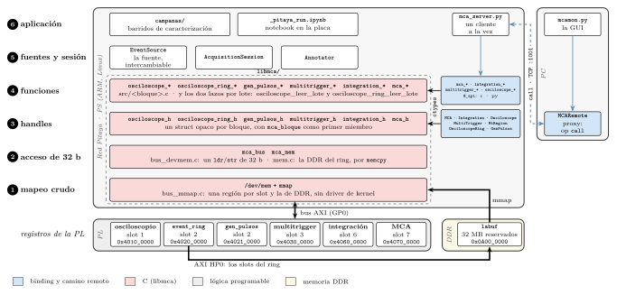
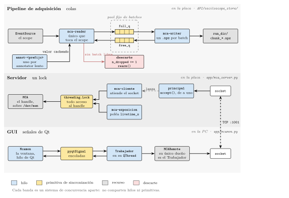
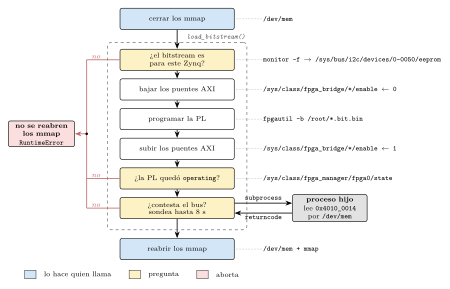
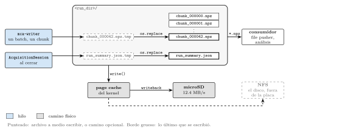
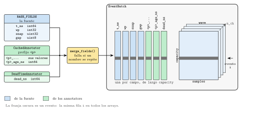
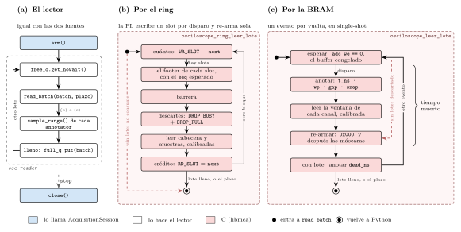

# Arquitectura de software de la API

**Código:** [`prj/MCA/software/API/`](../../software/API/) · [`prj/MCA/software/app/`](../../software/app/)
**Figuras:** [`figuras/`](figuras/) — seis, en TikZ
**Tests:** `make verificar` desde [`software/`](../../software/) — 249 tests, todos en la PC

Este documento describe el software **como pieza de software**: cómo está
estratificado, cómo usa los hilos, qué le pide al filesystem, con qué tipos
trabaja, cómo se verifica y quién responde de qué mientras una corrida está
andando. No explica qué hace cada función —para eso está
[`referencia_api.md`](referencia_api.md)— ni cómo medir con ella —para eso está
[`guia_de_uso.md`](guia_de_uso.md)—.

> ⚠️ **«Niveles» acá no es lo mismo que «las tres capas» del README.** En
> [`README.md`](README.md#las-tres-capas-del-nombre), «las tres capas» son los
> tres segmentos del **nombre** de la función —`<módulo>_<capa>_<campo>`—, una
> convención de nomenclatura. Acá se habla de **niveles de abstracción**: quién
> apoya sobre quién. Son dos cosas distintas y conviven en este mismo
> directorio.

---

## Qué cubre y qué no

Casi todo lo que sigue ya estaba escrito, pero repartido en siete documentos y
sin una vista única. Este reúne la vista y **delega el detalle por enlace**:

| Tema                           | Acá                                          | El detalle está en                                                                          |
| ------------------------------ | -------------------------------------------- | ------------------------------------------------------------------------------------------- |
| Niveles y dónde corre cada uno | la vista completa (§1)                       | [`platform.md`](../platform.md) §4.8                                                        |
| Hilos y rendimiento            | los tres modelos lado a lado (§2)            | [`arquitectura_adquisicion_software.md`](arquitectura_adquisicion_software.md) Partes 2 y 3 |
| Hilos de la aplicación         | el carril del servidor y el de la GUI (§2)   | [`APP/flujo_de_datos.md`](../APP/flujo_de_datos.md)                                         |
| Protocolo de red               | que existe y dónde se inserta (§1)           | [`APP/protocolo.md`](../APP/protocolo.md)                                                   |
| Filesystem y caminos del dato  | qué rutas y qué formatos (§3)                | [`movimiento_de_datos.md`](../movimiento_de_datos.md)                                       |
| Tipos del evento               | el esquema y por qué se arma en runtime (§4) | [`arquitectura_adquisicion_software.md`](arquitectura_adquisicion_software.md) Parte 2      |
| Orden arm → máscara            | que es un invariante (§4, §6)                | [`orden_arm_trigger_captura.md`](../osc/orden_arm_trigger_captura.md)                       |
| Cobertura de tests             | el mapa nivel × suite (§5)                   | [`compatibilidad_y_migracion.md`](compatibilidad_y_migracion.md#5-cobertura-de-los-tests)   |
| Por qué el refactor quedó así  | —                                            | [`decisiones_del_refactor.md`](decisiones_del_refactor.md)                                  |

---

## 1. Los niveles



Seis niveles de software, apoyados sobre los registros de la PL. **Los niveles
no son más que una jerarquía de dependencias**: cada uno puede usar cualquiera
de los de abajo y ninguno de los de arriba. No dicen que cada nivel hable sólo
con el inmediato inferior —`RingSource`, en el 5, lee la DDR por su propio
mapeo, y `mcamon` llama métodos del handle—, sino que **nada de abajo importa
nada de arriba**. Esa es la propiedad que permite sustituir un nivel sin tocar
los que lo usan.

Los registros van debajo y sin número porque **no son software**: son el
contrato que expone el hardware, y la pila empieza donde el software los
alcanza, en el mapeo. Lo que ordena los niveles tampoco es la elegancia sino
**dónde está la frontera física**: entre los registros y el nivel 2 hay un bus
AXI con reglas propias, y entre el 6 y el resto puede haber una red. En la
figura cada fila es un nivel y cada contenedor una máquina (PL, PS, PC); lo
único que cruza entre máquinas son esas dos fronteras. El camino remoto, en
azul, es el de la sección siguiente. La columna en rojo es el MCA en C
(`libmca/`), y a su lado está el binding de Python, que la llama por `ctypes`.
Los otros bloques tienen todavía sus niveles 1 a 4 en Python.

| #   | Nivel            | Qué es                                                                                                                        | Corre en | Sustituible por                                       |
| --- | ---------------- | ----------------------------------------------------------------------------------------------------------------------------- | -------- | ----------------------------------------------------- |
| 6   | aplicación       | [`campanas/`](../../software/campanas/), `_pitaya_run.ipynb`, [`app/mcamon.py`](../../software/app/mcamon.py)                 | PS · PC  | —                                                     |
| 5   | fuentes y sesión | [`osciloscope_store/`](../../software/API/osciloscope_store/): `EventSource` (`BramSource`, `RingSource`), `AcquisitionSession`, `Annotator` | PS       | `FakeSource`                                          |
| 4   | funciones        | `mca_*`, `osciloscope_*`, `multitrigger_*`, `integration_*`. Las `mca_*` son, desde la fase 1 de libmca, una llamada por ctypes a la función de C del mismo nombre ([`libmca/`](../../software/libmca/)) | PS       | la referencia Python `API/ref_py/` (`impl='py'`)       |
| 3   | handles          | `MCA` (sobre un `mca_h*` de libmca), `Osciloscope`, `MultiTrigger`, `MtRegion`, `Integration`                                  | PS       | `MCARemote`, `FakeMCA`, `FakeOsc`, `FakeMultiTrigger` |
| 2   | acceso de 32 b   | MCA: `mca_bus` de libmca ([`bus_devmem.c`](../../software/libmca/src/bus_devmem.c)). Los demás bloques: `w32` / `r32` en Python | PS       | el backend por callbacks de libmca (`FakeMCA`, tests) |
| 1   | mapeo crudo      | `/dev/mem` + `mmap`, una región por slot (el del MCA lo abre libmca)                                                          | PS       | —                                                     |
| —   | registros        | los bloques del bus de sistema: la base, no un nivel de software                                                              | PL       | —                                                     |

El `event_ring` no tiene handle: `RingSource` mapea sus registros y la región
de DDR por su cuenta. Por qué cada clase quedó como quedó está en
[`diseno_de_clases.md`](diseno_de_clases.md).

Y, fuera de la pila, tres módulos a los que no les importa en qué máquina
corren: [`analisis.py`](../../software/API/analisis.py) (picos, FWHM, DNL, FOM,
tau), [`modelo_rtl/`](../../software/API/modelo_rtl/) (layout del slot y
estimadores de referencia) y [`fpga.py`](../../software/API/fpga.py), que es
bring-up por sysfs y los cruza a todos.

### No hay driver de kernel

Entre los registros y el Python no hay nada más que `/dev/mem` y un `mmap` por
slot. De esa ausencia salen dos consecuencias que atraviesan todo el resto del
documento: **un solo proceso puede tocar la PL a la vez**, y **los errores del
bus llegan como señales, no como excepciones**.

### El nivel 2 es una frontera, no una capa de conveniencia

Las dos reglas de [`mca.py`](../../software/API/mca.py#L238-L276) no son
preferencias de estilo:

> **Escritura por slice, nunca `struct.pack_into`.** `pack_into` hace un memset
> previo que sobre memoria de dispositivo sale como stores de a byte; el esclavo
> AXI de la PL no los reconoce y el puente GP0 tira un *external abort* →
> SIGBUS.
>
> **Lectura en bloque palabra por palabra.** `np.frombuffer(...).copy()`, los
> slices grandes del mmap y `struct.unpack_from` con formato largo terminan
> todos en un memcpy, que emite accesos anchos o en ráfaga.
> [`axi4_slave.sv:101`](../../../../rtl/axi4_slave.sv#L101) los rechaza, y en esta
> placa el *external abort* de lectura no da SIGBUS: **reinicia el sistema**.

Desde Python el precio era ~6.7 µs por palabra, o sea ~110 ms por un espectro
de 16384 canales. El 96 % de eso era el intérprete, y por eso el MCA pasó a
**libmca**. Ahí las dos reglas dejaron de ser una disciplina de Python y son una
propiedad del binario: todo acceso a la PL está en
[`libmca/src/bus_devmem.c`](../../software/libmca/src/bus_devmem.c), un
`ldr`/`str` de 32 b por transacción (0.235 µs medidos desde C, ~4 ms un espectro
estimado), y `make -C libmca check-bus` desensambla el `.so` de ARM y falla si
encuentra una ráfaga, un acceso de 64 b o uno de 1-2 bytes. Ver
[`diseno_de_clases.md`](diseno_de_clases.md) §3.2.

Para el camino de formas de onda el costo **sí** importa, porque es por evento.
Ahí se usa `rp_AcqGetDataPosV` y no un acceso directo, hasta la fase de libmca
que porte el lazo del lector.

### El camino remoto se inserta, no se apila

Es la parte que más se malinterpreta.
[`MCARemote`](../../software/API/mca_remote.py) **es un handle del MCA cuyas
funciones corren del otro lado del socket**: desde la fase 2 de libmca es un
proxy, y cada `mca_*` viaja entera por la op `call` y corre en la placa, bajo
el lock del servidor, como un comando SCPI en Red Pitaya. Todo lo que está
arriba del nivel 4 no se entera de que hay red abajo, y el servidor vuelve a
entrar en la pila local por el binding. El protocolo
([`mca_net.py`](../../software/API/mca_net.py), una línea JSON de control más un
bloque binario opcional) tiene 29 operaciones, pero **la que sostiene la API es
`call`**: las otras existen para el acceso crudo (`r32`/`w32`), para lo que no
es una función de la API (el estado de la exposición, el disparo del MCA2) y
para los otros bloques. El cliente no necesita libmca.

La interfaz la fija el consumidor, no el transporte.

---

## 2. Los hilos



**No hay un modelo de hilos: hay tres**, independientes entre sí, y cada uno
elige una primitiva distinta porque resuelve un problema distinto. No hay
`multiprocessing` ni `asyncio` en ninguno. En la figura, cada banda es uno de
los tres: a la izquierda el recurso que se protege, a la derecha lo que sale de
la máquina (el disco o la red). El servidor y la GUI sólo se tocan por el
socket.

| Hilo | Fichero | Nombre | De qué es dueño |
|---|---|---|---|
| lector | [`reader.py`](../../software/API/osciloscope_store/reader.py) | `osc-reader` | el scope: es el único que lo toca |
| escritor | [`storage.py`](../../software/API/osciloscope_store/storage.py) | `osc-writer` | el directorio de la corrida |
| annotator | [`annotators.py`](../../software/API/osciloscope_store/annotators.py#L107) | `annot-<prefijo>` | su sensor lento (GPS, temperatura) |
| principal | [`session.py`](../../software/API/osciloscope_store/session.py#L142) | — | la condición de corte |
| exposición | [`mca_server.py`](../../software/app/mca_server.py#L85) | `mca-exposicion` | el tiempo de exposición, que el HW no tiene |
| cliente | [`mca_server.py`](../../software/app/mca_server.py#L716) | `mca-cliente` | una conexión — y sólo hay uno vivo |
| worker | [`mcamon.py`](../../software/app/mcamon.py#L54) | el `QThread` de la GUI | el `MCARemote` |

### Pipeline: colas

Productor y consumidor con dos colas y un **pool de batches preasignados**. El
pool es lo que hace que la RAM sea una constante conocida de antemano y que
descartar cueste O(1).

La decisión de diseño central es la política ante contrapresión: **descartar y
contar, nunca bloquear**. Si el lector bloqueara esperando lugar en la cola, el
tiempo muerto pasaría a depender del disco y dejaría de ser una constante del
hardware, que es justo lo que rompe la estadística de conteo.

> La rama de descarte **igual llama a `rearm()`**. Cuando eso no estaba, el
> buffer quedaba congelado, `wait_event` volvía a disparar con el mismo evento y
> el contador se llenaba de fantasmas: **14 996 «eventos» vistos contra 10 251
> realmente generados**.

Tres números medidos en la placa explican tres decisiones. Todos salen de
[`arquitectura_adquisicion_software.md`](arquitectura_adquisicion_software.md)
Parte 3:

- El stall máximo del lector con el escritor de fondo era **5288 µs**, que es
  exactamente el `sys.getswitchinterval()` por defecto: la firma de libro de la
  contención de GIL. Por eso la sesión lo baja a 1 ms al arrancar.
- `savez` tarda **86 ms** para un chunk de 1.07 MB contra **628 ms** de
  `savez_compressed` para 0.95 MB: 7.3 veces el tiempo por 12 % de espacio. Y
  además comprimir es CPU con el GIL disputado, mientras que escribir es I/O con
  el GIL suelto.
- La conversión `float32 → int16` vive en el **hilo escritor**, que tiene tiempo
  de sobra, y no en el lector.

Los annotators son un concepto aparte y no un `EventSource`: un GPS no define
cuándo ocurre un evento, lo *anota*, y va tres o cuatro órdenes de magnitud más
lento. La regla que hace que no rompan el tiempo muerto es que `sample_into()`
**no puede hacer I/O**: sólo copia un valor ya cacheado por el hilo del
annotator. Y como ese valor puede estar viejo, todo annotator asincrónico
declara además un campo `<prefijo>_age_ns` — sin eso, un GPS que perdió el fix
hace diez minutos escribe coordenadas plausibles y silenciosamente falsas en
cada evento.

**Los cuatro invariantes del carril.** Son los que hay que no romper al tocar
el pipeline:

- **Descartar y contar, nunca bloquear.** Si el lector bloqueara, el tiempo
  muerto pasaría a depender del disco.
- **`sys.setswitchinterval(0.001)`.** El stall máximo del lector medido era de
  5288 µs, que es exactamente el default del GIL.
- **Sin comprimir.** `savez` 86 ms contra `savez_compressed` 628 ms para el
  mismo chunk: 7.3× de costo por un 12 % de tamaño.
- **Cierre por centinela.** El lector pone `None` en `full_q` y el escritor
  drena antes de salir; sin eso, el último chunk se pierde.

### Servidor: locks

Un `threading.Lock` protege **todo** acceso al handle, y se acepta un cliente a
la vez: el segundo se rechaza con el hint explícito de que *un solo proceso
puede tocar `/dev/mem`*. El hilo `mca-exposicion` existe por una ausencia del
hardware: el MCA es free-running y no hay registro de tiempo de exposición, así
que la exposición la implementa un vigilante que poléa `livetime_s` y para al
llegar al objetivo.

La adquisición **no** se detiene cuando el cliente se va, que es lo que permite
que una medida de media hora sobreviva a cerrar la GUI; al reconectar,
`identify` informa `running`.

El socket va con **`TCP_NODELAY`**: las cabeceras son de ~100 B y Nagle las
retendría esperando a juntar un segmento.

### GUI: señales

`Trabajador(QObject)` es el dueño único del `MCARemote` y vive en su propio
`QThread`; la comunicación con la ventana va enteramente por las 33
`pyqtSignal` de [`mcamon.py`](../../software/app/mcamon.py), en los dos sentidos, y **no hay un solo lock**. Es el patrón
opuesto al del servidor y es correcto por la misma razón por la que el del
servidor lo es: **hay un único dueño por recurso**.

Tres detalles de Qt que no son opcionales: las **conexiones encoladas** cruzan
el límite de hilo por sí solas, así que no hace falta sincronizar a mano; el
worker corre en **el hilo que creó sus `QTimer`**, que es un requisito de Qt y
no una preferencia; y la GUI **nunca bloquea en el socket** — todo lo lento
pasa del otro lado. El worker se destruye en su propio hilo con
`hilo.finished → deleteLater`, porque Qt no deja parar los timers de un hilo
desde otro.

---

## 3. El filesystem

Dos mitades que no se parecen. Lo que lee es configuración del sistema, que se
consulta al arrancar para poder llegar al hardware. Lo que escribe es el
producto de la medición.

### Lo que lee

Casi todo lo que la API lee del sistema lo lee al recargar la PL, y en un orden
que no se puede cambiar. La figura sigue ese orden: a la izquierda cada paso, a
la derecha la ruta que toca. El recuadro punteado es
[`load_bitstream()`](../../software/API/fpga.py); el primer y el último paso los
hace quien llama ([`Osciloscope.reload_bitstream()`](../../software/API/osciloscope.py),
o el servidor antes de recargar). Si alguna de las tres preguntas da que no,
`load_bitstream()` corta con `RuntimeError` y los mapeos no se reabren.



| Ruta                                                  | Para qué                                                                 |
| ----------------------------------------------------- | ------------------------------------------------------------------------ |
| `/dev/mem`                                            | `O_RDWR \| O_SYNC`, un `mmap` por slot — el único camino a los registros |
| `/sys/class/fpga_manager/fpga0/state`                 | ¿está programada la PL? tiene que decir `operating`                      |
| `/sys/class/fpga_bridge/*/enable`                     | bajar los puentes AXI PS–PL antes de reconfigurar                        |
| `/opt/redpitaya/bin/fpgautil` (o `/usr/local/bin/`)   | programar la PL; un shell no interactivo no lo tiene en el `PATH`        |
| `/root/red_pitaya_top.bit.bin`                        | `BITSTREAM_DEFAULT`; el servidor usa `/root/mca_red_pitaya.bit.bin`      |
| `/sys/bus/i2c/devices/0-0050/eeprom` vía `monitor -f` | el modelo de placa → qué Zynq → la guarda que impide un bitstream ajeno  |
| `/opt/redpitaya/lib/python`                           | `sys.path` para el binding `rp`                                          |

**No se usa `/dev/uio*` ni `devmem`.** Las dos reglas que importan de esta mitad
no son rutas, son procedimientos:

> **Cerrar los mmap ANTES de reprogramar la PL.** Reconfigurar con mapeos
> abiertos produce el `external abort ... *pte=40100743` de `dmesg` y puede
> dejar el puerto GP0 trabado hasta reiniciar la placa.
>
> **`pl_probe()` lee en un proceso hijo.** Si el bus no está listo, el que muere
> con SIGBUS es el hijo y nos enteramos por el `returncode`, en vez de perder el
> kernel de Jupyter. Es la única forma segura de preguntar «¿ya puedo tocar el
> scope?» después de reconfigurar.

### Lo que escribe



| Formato            | Qué lleva                                                                                           | Quién lo escribe           |
| ------------------ | --------------------------------------------------------------------------------------------------- | -------------------------- |
| `chunk_%06d.npz`   | `wave` int16 `(eventos, canal, muestra)` + una columna por campo escalar + `meta` como array 0-d    | `ChunkWriter`              |
| `run_summary.json` | los totales de la corrida                                                                           | `AcquisitionSession`       |
| `.csv`             | el espectro con la metadata en cabecera `#` — **el formato por defecto**, se abre en Excel u Origin | `mca_write_file_histogram` |
| `.npz` / `.json`   | el espectro estructurado                                                                            | `mca_save_file_*`          |
| `.n42`             | el espectro en ANSI N42.42-2011, para otros programas de espectroscopía                             | `mca_save_file_n42`        |

La propiedad central es la **atomicidad**. Los dos escritores van a un `.tmp` y
hacen `os.replace`, así que todo archivo visible en el directorio está completo:
es la condición para que un *file pusher* pueda consumir el directorio sin
carreras. A `np.savez` se le pasa un **handle** y no un path, porque `savez`
agrega la extensión por su cuenta y terminaríamos con `chunk.npz.tmp.npz`.

`run_summary.json` no es decorativo. La columna `gap` cuenta los descartes que
ocurrieron **entre** dos eventos guardados, así que los del **final** de la
corrida no tienen ningún evento posterior donde anotarse. El invariante completo
es

```
sum(gap sobre todos los chunks) + trailing_dropped == n_dropped
```

y `trailing_dropped` sale de ese archivo. Sin él, una corrida que termina en
medio de una ráfaga de descartes no cierra las cuentas.

La guarda de disco se chequea cada 8 chunks con `os.statvfs` y corta limpio por
debajo de `MIN_FREE_MB = 200`. Lo que no se ve a primera vista: después de
cortar, el escritor **sigue drenando `full_q`** — si no, el lector se trabaría
esperando lugar.

**Dos convenciones de nombre de directorio, según el origen.** Conviven porque
una es heredada:

| Origen | Patrón | Dónde |
|---|---|---|
| `campanas/run_acquire.py` (heredado) | `Data_<AAAAMMDD_HHMMSS>_TCH1_TL<±mV>mV[_label]` | `/home/jupyter/RedPitaya/DATOS` |
| campañas y Monte-Carlo | `<tipo>_<AAAAMMDD_HHMMSS>/` | `software/datos/` |

Ni `datos/` ni `dist/` se versionan.

Y el camino físico explica por qué el formato está elegido así: `write()` vuelve
antes de tocar la tarjeta, porque escribe al page cache del kernel; el sustrato
real es una microSD a **12.4 MB/s** medidos, y no hay SSD en esta placa. NFS es
la bifurcación que saca el disco de la placa del lazo.

No se usa `/dev/uio*`, ni `devmem`, ni HDF5, ni ningún binario crudo propio.

---

## 4. Tipos de datos y ejecución

### El esquema se arma en runtime

Lo que ordena esta parte es una ausencia: **no hay un solo `dataclass`, `Enum`,
`NamedTuple` ni `TypedDict` en todo el árbol**, y es deliberado. Lo que hay son
constantes de módulo, diccionarios y arrays de numpy.



La fuente declara sus columnas —hoy, en todas las fuentes, `BASE_FIELDS`—, cada
annotator suma las suyas y `merge_fields()` las junta. El resultado es un
`EventBatch`: un array por columna, todos del mismo largo, y la onda aparte. Un
evento es una fila que atraviesa todos los arrays. `BASE_FIELDS` trae las cuatro
columnas que existen siempre:

| Columna | dtype  | Origen                                                      |
| ------- | ------ | ----------------------------------------------------------- |
| `t_ns`  | int64  | `perf_counter_ns()` — monótono, con jitter de µs            |
| `wp`    | int32  | `wp_trig` @`0x1C` — 8 ns de resolución, envuelve cada 16384 |
| `snap`  | uint32 | `trig_snapshot` — qué fuente disparó                        |
| `gap`   | uint8  | eventos descartados justo antes de éste                     |

Se guardan **los dos relojes crudos a propósito**: los Δt salen de un `np.diff`
offline, no se calculan en el lazo. `merge_fields()` falla fuerte ante nombres
repetidos, porque una colisión silenciosa haría que dos productores se pisen la
misma columna.

La consecuencia práctica es la que justifica todo el diseño: **agregar columnas
no toca al lector, ni al escritor, ni al formato de archivo.**

En `EventBatch`, `wave` tiene forma `(capacity, n_ch, samples)`: el canal es un
**eje** y no un nombre de variable, así que el mismo código sirve para 2 o 4
canales, porque la RTL ya es paramétrica en `N_CH`. `gap` satura en 255 porque
lo único que importa por evento es **si** hay un hueco —un `gap > 0` significa
que el Δt contra el evento anterior no es real y hay que excluirlo del
análisis—; el total exacto vive aparte, en `batch.dropped`, que no satura.

Del lado de los registros se repite el mismo criterio sin clases. Son cinco
familias de constantes de módulo:

| Constante | Qué es |
|---|---|
| `R_THR = 0x014`, `R_CTRL = 0x00C`, … | un offset por registro, con el bit-layout en el comentario |
| `_CAMPOS = {nombre: (offset, shift, mask)}` | la tabla sobre la que se generan los `get`/`set` por read-modify-write |
| `FEATURES = {'pico': 0, 'integral': 1, …}` | el bus de features, compartido por los tres ejes del histograma |
| `BIT_SW`, `BIT_ADC_P0`, … `BIT_TRIG_CH3` | los bits de la máscara OR del multitrigger |
| `TAP_NATIVE`, `TAP_ADC`, … + `TAP_NAMES` | los taps de ruteo del datapath del TOP |

> El bus de `FEATURES` merece una nota: `_feat_idx()` valida el índice contra el
> diccionario porque apuntar a una ranura reservada daría **el espectro entero
> acumulado en el canal 0, sin lanzar ningún error**.

### Las dos máquinas de estados



El lazo de `EventSource` vuelve a `wait_event()`, no a `arm()`: `arm()` se llama
una sola vez, al abrir la corrida, y `close()` una vez al cerrarla; las dos las
llama `AcquisitionSession` desde el hilo principal. Entre que `wait_event()`
devuelve y `rearm()` termina, el scope no puede disparar: ese tramo es el tiempo
muerto del método, y por eso `rearm()` va apenas se copia la ventana y los
annotators recién después. `read_into` escribe **en el destino provisto**
en vez de devolver arrays —evita la basura de GC de hacer un `np.zeros` por
llamada y por canal, y hace que la versión DDR sea un memcpy sin capa
intermedia—. Y `rearm()` es parte de la **interfaz** y no un detalle de
`read_into`, precisamente para que el lector pueda re-armar también cuando
descarta.

El flujo del MCA es más corto porque el hardware acumula solo: se configura, se
limpia, se arranca, y la lectura es de un espectro ya formado. **Eso es lo que
saca la tasa de eventos del cuello de botella del bus.**

Las dos trampas de orden cuestan una sesión de laboratorio cada una:

> **Armar (`0x00`) y recién después habilitar la máscara (`R_OR_MASK_CH*`).** Al
> revés, un flanco que llegue en el hueco gasta la máscara con la FSM todavía
> sin armar, y queda esperando un trigger imposible.
>
> **En los relojes de 64 b, leer LO antes que HI.** La palabra baja congela la
> alta en un registro sombra del RTL; al revés, la lectura se parte.

---

## 5. Los tests

Cuatro clases de verificación, y lo que la matriz muestra es que **cada una
puede responder por unos niveles y por otros no**.

| Clase | Qué es | Qué alcanza |
|---|---|---|
| offline, en la PC | 249 tests de `pytest`, con un mmap falso y el servidor en `--fake` | del nivel 3 para arriba, denso |
| en la placa | **scripts, no `pytest`**: necesitan el módulo `rp` y el bitstream cargado | los niveles 1 y 2, y los registros |
| bench | [`API/bench/`](../../software/API/bench/) — **miden, no aprueban**: no tienen asserts | el costo de cruzar el nivel 2 |
| RTL | QuestaSim + asserciones SVA ligadas por `bind`, en `modulos/*/sim/` | los registros, del otro lado |

### La matriz: qué suite toca qué nivel

Las filas son los seis niveles de §1 y los registros, en el mismo orden. Los conteos salen de
`pytest --collect-only`.

| Nivel | offline, en la PC | en la placa | bench | RTL |
|---|---|---|---|---|
| **6** aplicación | `test_mcamon_gui.py` 27 · `test_mca_remote.py` 24 | `app/tests/placa/` · `e2e_rigol_app.py` | — | — |
| **5** fuentes y sesión | `test_mca_pipeline.py` 4 · `test_ring_source.py` 10 | `test_mca_e2e.py` | `bench_reader_budget.py` | — |
| **4** funciones | `test_api_mca.py` 23 · `test_api_osc.py` 15 · `test_compat_api.py` 5 | — | — | — |
| **3** handles | `test_guarda_bitstream.py` 19 · `test_geometria_scope.py` 23 | `test_mca_hw.py` · `diag_mca_hw.py` | — | — |
| **2** acceso de 32 b | *no se puede verificar acá: el mmap es falso* | `test_rw_dev_mem.py` | `bench_buffer_read.py` · `bench_read_vs_length.py` | — |
| **1** mapeo crudo | — | `hw_ring_plumbing.py` · `hw_ring_swtrig.py` | — | — |
| — registros | `test_ring_format.py` 7, contra el volcado del TB | `test_mca_datapath.py` | — | `tb_mca_*` · `tb_event_*` · `tb_multitrigger_*` + SVA por `bind` |

Dos huecos que la matriz hace visibles: el **nivel 2 no tiene test offline** —y
no es un olvido, es que el mmap de la PC es falso y aceptaría cualquier
offset—, y el **nivel 1 sólo se toca desde la placa**.

> `norecursedirs = ["placa", "bench", …]`: los ficheros de esos dos
> directorios hacen `import rp` al importarse, así que sin eso un `pytest`
> pelado en la PC no falla un test, **falla la colección**.
>
> `make verificar` da lo mismo en la PC y en la Pitaya, y eso es lo que hace
> útil `verificar-remoto` como sanity check del deploy. `make verificar-placa`
> necesita la placa; `verificar-placa-datapath` y `-e2e` necesitan además el
> Rigol.
>
> Código: `software/pyproject.toml` · `software/conftest.py` ·
> `software/Makefile` · `modulos/mk/module.mk`.

El cuadro de qué cubre cada test está en
[`compatibilidad_y_migracion.md`](compatibilidad_y_migracion.md#5-cobertura-de-los-tests).

### Los dos tests que atan un nivel con otro

Son los que ganan el sueldo, porque son los únicos que cruzan la frontera:

**[`test_compat_api.py`](../../software/API/tests/test_compat_api.py)** compara
la superficie pública **y las trazas ordenadas de escritura de registros**
contra un baseline congelado en
[`datos_ref/compat_baseline.json`](../../software/API/tests/datos_ref/compat_baseline.json).
Lo que compra es la clase de error que ningún otro test offline puede ver: un
`0x240` que se convierte en `0x244` **no rompe nada en la PC**, donde el mmap es
falso y acepta cualquier offset; rompe en la placa, escribiendo silenciosamente
al registro equivocado.

**[`test_ring_format.py`](../../software/API/tests/test_ring_format.py)** valida
el layout del slot contra el volcado de `sim/tb_event_ring_top.sv`. El mismo
formato queda verificado de los dos lados, en el RTL y en el software, sin que
ninguno de los dos sea la autoridad del otro.

### Dos detalles de infraestructura que no son menores

> **`norecursedirs = ["placa", "bench", …]`** en
> [`pyproject.toml`](../../software/pyproject.toml). Los ficheros de esos dos
> directorios hacen `import rp` **al importarse**, así que sin esa exclusión un
> `pytest` pelado en la PC no falla un test: falla la **colección**, y no corre
> ninguno. Excluir por directorio es más robusto que enumerar ficheros, porque
> un test de placa nuevo queda cubierto por estar donde va.

**`make verificar` da lo mismo en la PC y en la Pitaya.** Eso es lo que hace
útil `verificar-remoto` después de un `rsync`: es un sanity check **del deploy**,
no sólo de la API.

---

## 6. Quién responde de qué durante una corrida

Ningún nivel garantiza la corrida entero. Cada uno sostiene una propiedad, y la
corrida es correcta sólo si todos cumplen la suya. Es la misma idea que «los
cinco tipos de iniciador» de
[`movimiento_de_datos.md`](../movimiento_de_datos.md), mirada desde las
garantías en vez de desde quién arranca:

| Responsable | De qué responde | Qué pasa si no cumple |
|---|---|---|
| la PL | detectar el flanco y **congelar** el buffer hasta el próximo arm | con `we_keep=1` el buffer da la vuelta cada 131 µs y la ventana ya fue sobrescrita cuando el lector llega: 0.001 V en vez de 0.600 V |
| `osc-reader` | ser el único que toca el scope, y re-armar **siempre**, también al descartar | `wait_event` vuelve a disparar con el mismo buffer y el contador se llena de fantasmas |
| `osc-writer` | que todo archivo visible esté completo, y convertir fuera del camino crítico | un consumidor del directorio lee un `.npz` a medias |
| el pool | acotar la RAM de antemano y hacer que descartar cueste O(1) | con una lista que crece, un corte se lleva toda la corrida — el problema de `guardado_mariana.py` |
| `AcquisitionSession` | cortar limpio por duración, eventos, disco o error, y dejar el resumen | una corrida que termina en una ráfaga de descartes no cierra las cuentas |
| el servidor | ser el único proceso sobre `/dev/mem`, y seguir adquiriendo aunque el cliente se vaya | dos procesos sobre `/dev/mem` pelean y sale SIGBUS |
| el kernel | absorber el `write()` en el page cache | el hilo escritor pasaría a correr al ritmo de la microSD |
| la persona | cerrar los mmap antes de reprogramar la PL | el puerto GP0 queda trabado hasta reiniciar la placa |

El patrón que se repite: **un único dueño por recurso**. El scope lo toca un solo
hilo; `/dev/mem`, un solo proceso; el `MCARemote`, un solo `QObject`. Las tres
elecciones de concurrencia de §2 son tres formas distintas de sostener esa misma
regla.

---

## 7. Qué experimento sostiene cada afirmación

Ninguno de los números de este documento es una estimación. Cada uno viene de un
experimento que está en el árbol y se puede volver a correr:

| Afirmación                            | Experimento                                                                                 | Resultado                                  | Dónde                                                                         |
| ------------------------------------- | ------------------------------------------------------------------------------------------- | ------------------------------------------ | ----------------------------------------------------------------------------- |
| Leer en bloque reinicia la placa      | el mismo rango leído de a ráfagas (`bulk`) y de a palabras (`word`), un paso por invocación | `bulk` reinicia la Pitaya; `word` funciona | [`diag_mca_hw.py`](../../software/API/tests/placa/diag_mca_hw.py)             |
| `pack_into` da SIGBUS                 | escribir el mismo registro de las dos formas                                                | slice ok, `pack_into` SIGBUS               | [`test_rw_dev_mem.py`](../../software/API/tests/placa/test_rw_dev_mem.py)     |
| Leer cuesta ~6.7 µs por palabra       | cronometrar la lectura contra la longitud                                                   | ~110 ms un espectro de 16384               | [`bench_read_vs_length.py`](../../software/API/bench/bench_read_vs_length.py) |
| El GIL es lo que para al lector       | el stall máximo del lector con el escritor de fondo                                         | 5288 µs = `sys.getswitchinterval()`        | [`bench_reader_budget.py`](../../software/API/bench/bench_reader_budget.py)   |
| Comprimir no paga                     | `savez` contra `savez_compressed` sobre el mismo chunk                                      | 86 ms / 1.07 MB contra 628 ms / 0.95 MB    | [`bench_reader_budget.py`](../../software/API/bench/bench_reader_budget.py)   |
| El lazo caliente en C se pagaría      | el mismo lazo de lectura escrito en C                                                       | 13×                                        | [`bench_reader_c.c`](../../software/API/bench/bench_reader_c.c)               |
| Hay que re-armar también al descartar | contar eventos vistos contra generados, con y sin ese `rearm()`                             | 14 996 contra 10 251 reales                | [`reader.py`](../../software/API/osciloscope_store/reader.py#L86-L98)         |
| El modo continuo pierde el dato       | leer la ventana con demora deliberada, `we_keep=1` contra single-shot                       | 0.001 V contra 0.600 V a 100 µs            | [`sources.py`](../../software/API/osciloscope_store/sources.py#L35-L60)       |
| El disco es el techo del guardado     | throughput del filesystem de la placa                                                       | 12.4 MB/s en microSD                       | [`movimiento_de_datos.md`](../movimiento_de_datos.md)                         |
| El formato no se desincroniza del RTL | comparar el layout contra el volcado del testbench                                          | 7 tests, sin placa                         | [`test_ring_format.py`](../../software/API/tests/test_ring_format.py)         |
| El orden de las escrituras no cambió  | comparar las trazas ordenadas contra el baseline                                            | 5 tests, sin placa                         | [`test_compat_api.py`](../../software/API/tests/test_compat_api.py)           |
| El pipeline cierra las cuentas        | correr con `FakeSource` y verificar colas, descartes y que no queden `.tmp`                 | 4 tests, sin placa                         | [`test_mca_pipeline.py`](../../software/API/tests/test_mca_pipeline.py)       |

Los que dicen «sin placa» se corren con `make verificar`. Los de la columna de
placa necesitan la Red Pitaya, y los dos de señal real necesitan además el
Rigol: `make verificar-placa`, `verificar-placa-datapath`, `verificar-placa-e2e`.

---

## Regenerar las figuras

```bash
cd prj/MCA/docs/API/figuras
for f in niveles hilos secuencia_bitstream escritura_corrida esquema_evento maquinas_estados; do
  pdflatex $f.tex && pdftocairo -svg $f.pdf $f.svg
done
rm -f *.aux *.log
```

Las coordenadas son a mano: si cambia el código hay que volver a pasar las
figuras por ellas. Ver [`figuras/README.md`](figuras/README.md).

---

## Ver también

- [`README.md`](README.md) — el contrato de nombres y el mapa módulo → bloque del bus
- [`referencia_api.md`](referencia_api.md) — todas las funciones, con el registro al que pega cada una
- [`guia_de_uso.md`](guia_de_uso.md) — recetas completas, con la marca de si van en la Pitaya o en la PC
- [`decisiones_del_refactor.md`](decisiones_del_refactor.md) — por qué el árbol quedó así
- [`diseno_de_clases.md`](diseno_de_clases.md) — el rol de cada módulo y por qué cada clase tiene la forma que tiene
- [`arquitectura_adquisicion_software.md`](arquitectura_adquisicion_software.md) — el pipeline con todos sus números
- [`movimiento_de_datos.md`](../movimiento_de_datos.md) — los caminos del dato de ADC a PC
- [`APP/README.md`](../APP/README.md) — la aplicación cliente/servidor
- [`platform.md`](../platform.md) — qué trae la placa, §4.8 el lado del software
- [`recorrido_del_usuario.md`](../recorrido_del_usuario.md) — las tres fases de una sesión de laboratorio
