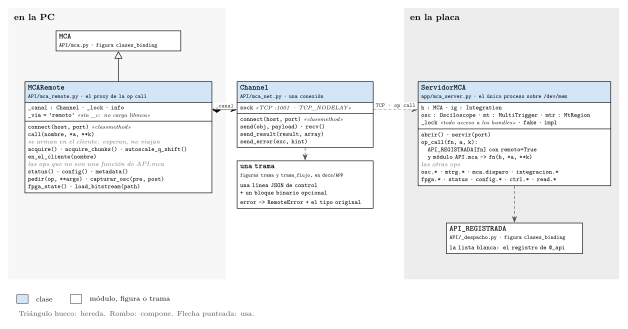

# Diseño de las clases

**Código:** [`software/libmca/`](../../software/libmca/) · [`software/API/`](../../software/API/) · [`software/app/`](../../software/app/)
**Figuras:** las siete `clases_*` y tres de la adquisición, en el índice de §3

La API está descrita en tres documentos, **de abajo hacia arriba**:

1. [`libmca.md`](libmca.md): la biblioteca en C y su binding de Python. Los bloques,
   el bus, los dos lazos por lote, los handles de Python y el despacho a C, a la
   referencia o a la red;
2. [`adquisicion_de_eventos.md`](adquisicion_de_eventos.md): la adquisición de eventos
   del osciloscopio y la sesión. Las fuentes, la máquina de estados de una corrida,
   los hilos, el pool de batches y los annotators;
3. este: lo que cruza a los dos. Las tres preguntas que deciden la forma de una clase
   (§1), el rol de cada módulo (§2), el índice de los diagramas (§3), la red (§4), los
   sustitutos y las pruebas (§5), las simulaciones Monte Carlo (§6), la herencia, el
   duck typing y los shims (§7), y los pendientes (§8).

Los sustitutos que permiten probar todo sin placa no son parte de la API que usa un
programa. Por eso no aparecen en los diagramas: están en §5, con las pruebas.

Lo que ya está escrito en otros documentos no se repite acá:

| Pregunta | Dónde |
|---|---|
| por qué los nombres llevan prefijo, por qué un fichero por módulo, por qué se partió el osciloscopio del multitrigger | [`decisiones_del_refactor.md`](decisiones_del_refactor.md) |
| qué niveles hay, qué hilos, qué toca del filesystem | [`arquitectura_software.md`](arquitectura_software.md) |
| qué hace cada función | [`referencia_api.md`](referencia_api.md) |
| cómo viaja un comando y un espectro por la red | [`../APP/flujo_de_datos.md`](../APP/flujo_de_datos.md) |

---

## 1. Tres preguntas que deciden la forma de una clase

Casi todas las decisiones de este documento responden una de estas tres
preguntas:

1. **¿De qué recurso es dueña?** Una clase existe cuando hay estado que abrir y
   cerrar: un mapeo de `/dev/mem`, un hilo, un socket. Lo que no tiene estado
   queda como función.
2. **¿Por dónde se corta para sustituirla?** El corte va lo más abajo posible,
   donde la interfaz es más chica. Cuanto menos haya que reimplementar, más
   barato es el sustituto y menos se desincroniza del original.
3. **¿Herencia o duck typing?** Se usa herencia cuando el sustituto quiere
   **reusar la lógica** que el original construye encima del corte. Se usa duck
   typing (§7.1) cuando las implementaciones no comparten código y lo único
   común es el contrato.

---

## 2. Los niveles y el rol de cada módulo

Los niveles son los de [`arquitectura_software.md`](arquitectura_software.md#1-los-niveles):

| Nivel | Qué es |
|---|---|
| 1 | mapeo crudo |
| 2 | acceso de 32 b |
| 3 | handles |
| 4 | funciones |
| 5 | fuentes y sesión |
| 6 | aplicación |

Todos los bloques de la PL tienen sus niveles 1 a 4 en C, en libmca, y también los
dos lazos por lote: el de la BRAM del osciloscopio y el del ring
([`libmca.md`](libmca.md) §4).

| Módulo | Nivel | Rol | Clases o tipos |
|---|---|---|---|
| [`libmca/`](../../software/libmca/) | 1 a 4 del MCA, de TOP, del multitrigger, del osciloscopio, del ring y de los generadores, en C | el **analizador multicanal** del slot 7, la **región de TOP** del slot 6, el **multitrigger** del slot 3, el **osciloscopio** del slot 1, el **event_ring** del slot 2, con su región de DDR y su generador de eventos, y el **generador de pulsos** del slot 2 (`0x4021_0000`): un handle opaco por bloque y una función por operación | `mca_h`, `integration_h`, `multitrigger_h`, `osciloscope_h`, `osciloscope_ring_h`, `gen_pulsos_h`, `mca_bus`, `devmem_bus`, `mca_mem` |
| [`API/mca.py`](../../software/API/mca.py) | 3 y 4, binding | el **handle de Python sobre libmca** y las 95 funciones `mca_*` de hardware, más las de guardado | `MCA` |
| [`API/ref_py/`](../../software/API/ref_py/) | 3 y 4, en Python | la **referencia**: la misma superficie sin C. Contra ella se mide y se compara; `ref_py/mca.py` es la única que abre el bitstream MCA1 | `MCA` |
| [`API/osciloscope.py`](../../software/API/osciloscope.py) | 3 y 4, binding | el **osciloscopio heredado** de Red Pitaya, slot 1, sobre libmca: umbral, decimación, delay, BRAM. Y lo que se compone sobre `r32`: `verify_bitstream`, `debug_*`, `acq_capture_sw` | `Osciloscope` |
| [`API/multitrigger.py`](../../software/API/multitrigger.py) | 3 y 4, binding | lo que **este proyecto agregó al trigger**, sobre libmca: máscaras OR, `trigger_shield` y snapshot, disparo por pendiente y polo-cero, todo en el slot 3. Y el armado del disparo del MCA, que cruza con el osciloscopio | `MultiTrigger`, `MtRegion` |
| [`API/integration.py`](../../software/API/integration.py) | 3 y 4, binding | la **región de TOP**, slot 6, sobre libmca: identifica el bitstream, dice qué módulo vive en qué slot y rutea el datapath | `Integration` |
| [`API/osciloscope_ring.py`](../../software/API/osciloscope_ring.py) | 3 y 4, binding; 5 | el **event_ring**, slot 2, sobre libmca: el handle (registros y región de DDR), el lazo por lote, su generador de eventos y la **fuente de eventos** que lo usa | `OsciloscopeRing`, `LectorRing`, `RingSource` |
| [`API/generadores.py`](../../software/API/generadores.py) | 3 y 4, binding | el **generador de pulsos**, slot 2 (`0x4021_0000`), sobre libmca: configurar, la tabla, arrancar, el lazo digital de HK; y las **cuentas del motor de disparos** que comparte con el del ring (umbral por tasa, la predicción de cada disparo) | `GenPulsos` |
| [`API/osciloscope_store/`](../../software/API/osciloscope_store/) | 5 | el **pipeline de formas de onda del osciloscopio**: fuentes, batch, lector, escritor, sesión, annotators ([`adquisicion_de_eventos.md`](adquisicion_de_eventos.md)) | `BramSource`, `EventBatch`, `ReaderThread`, `ChunkWriter`, `AcquisitionSession`, `Annotator` y sus subclases |
| [`API/mca_net.py`](../../software/API/mca_net.py) | transporte | el **formato de trama** del socket: una línea JSON y un bloque binario opcional | `Channel` |
| [`API/mca_remote.py`](../../software/API/mca_remote.py) | 6, en la PC | **el MCA por red**: el proxy de la op `call` | `MCARemote` |
| [`app/mca_server.py`](../../software/app/mca_server.py) | 6, en la placa | **el único proceso sobre `/dev/mem`**: expone el MCA, el osciloscopio y el multitrigger por TCP | `ServidorMCA` |
| [`app/mcamon.py`](../../software/app/mcamon.py) | 6, en la PC | **la GUI** | `Trabajador`, `Mcamon` |
| [`API/fpga.py`](../../software/API/fpga.py) | fuera de la pila | **poner la PL en marcha**: cargar el bitstream, bajar y subir los puentes AXI, sondear el bus. Ocurre antes de que exista cualquier handle | — |
| [`API/analisis.py`](../../software/API/analisis.py) | fuera de la pila | **análisis puro**, sin hardware: picos, FWHM, DNL, FOM | — |
| [`API/n42.py`](../../software/API/n42.py) | fuera de la pila | el **formato** ANSI N42.42-2011, sin hardware: lo usan `mca_save_file_n42` y `mca_load_file` | — |
| [`monte-carlo/`](../../software/monte-carlo/) | fuera de la pila | **simulaciones**: réplicas del RTL en numpy, sin la API (§6) | — |
| `mca_utils.py`, `multitrigger_utils.py`, `rigol_dg4162.py`, `mca/` | — | **shims de compatibilidad** (§7.2) | `MultiTriggerScope` |

Los sustitutos sin placa (`FakeMCA`, `FakeOsc`, `FakeMultiTrigger`,
`FakeMtRegion`, `FakeSource`) viven en `API/mca_remote.py` y en
`osciloscope_store/sources.py`. Se describen en §5.1.

El patrón que se repite en los bloques de hardware es **un handle y funciones
encima**: la clase (o el struct de C) es dueña del mapeo, y las funciones con
prefijo son la superficie pública. El nombre dice a qué bloque se pega la
función aunque no se vea el import
([`decisiones_del_refactor.md`](decisiones_del_refactor.md) §1).

---

## 3. Los diagramas de clases

Diez figuras, una por pieza, y ninguna repite lo que dibuja otra: los métodos que son
una función de C se listan una sola vez, en `clases_libmca`, y lo común a todos los
bloques, una sola vez, en `clases_bloque`. Las cinco de la adquisición de eventos no
son todas de clases: dos son de la ejecución (los hilos en el tiempo y el pool), y una
de los estados.

| Figura | Qué muestra | Dónde |
|---|---|---|
| [`clases_bloque`](figuras/clases_bloque.svg) | la forma de un bloque de libmca: el handle, `mca_bloque`, los códigos, el bus, la PL y la DDR | [`libmca.md`](libmca.md) §1 |
| [`clases_libmca`](figuras/clases_libmca.svg) | los seis handles de C con sus operaciones, y el motor de los generadores | [`libmca.md`](libmca.md) §3 |
| [`clases_lotes`](figuras/clases_lotes.svg) | los dos lazos por lote: sus structs, los handles que reciben, `Lector` y `LectorRing`, y el batch donde escriben | [`libmca.md`](libmca.md) §4 |
| [`clases_binding`](figuras/clases_binding.svg) | el binding de Python: los handles de cada bloque, el despacho de `@_api`, la referencia y el shim | [`libmca.md`](libmca.md) §5 |
| [`clases_red`](figuras/clases_red.svg) | `MCARemote`, `Channel` y `ServidorMCA` | §4 |
| [`clases_fuentes`](figuras/clases_fuentes.svg) | la interfaz `EventSource`, por lote, y sus dos implementaciones | [`adquisicion_de_eventos.md`](adquisicion_de_eventos.md) §1 |
| [`maquinas_estados`](figuras/maquinas_estados.svg) | una corrida del osciloscopio: el lazo del lector, y lo que hace `read_batch` con el ring y con la BRAM | [`adquisicion_de_eventos.md`](adquisicion_de_eventos.md) §2 |
| [`corrida_mca`](figuras/corrida_mca.svg) | una corrida del MCA, lineal | [`adquisicion_de_eventos.md`](adquisicion_de_eventos.md) §2 |
| [`hilos_captura`](figuras/hilos_captura.svg) | los hilos de la captura en el tiempo, con y sin el GIL | [`adquisicion_de_eventos.md`](adquisicion_de_eventos.md) §3 |
| [`pool_batches`](figuras/pool_batches.svg) | los `EventBatch` que circulan entre el lector, las colas y el escritor | [`adquisicion_de_eventos.md`](adquisicion_de_eventos.md) §4 |
| [`clases_sesion`](figuras/clases_sesion.svg) | `AcquisitionSession` y lo que compone | [`adquisicion_de_eventos.md`](adquisicion_de_eventos.md) §5 |

Las convenciones de notación están en
[`figuras/README.md`](figuras/README.md#lo-que-los-diagramas-de-clases-no-dibujan).

---

## 4. La red: `MCARemote` y la op `call`



*`MCARemote` es un handle del MCA (hereda de `MCA`) cuyas funciones corren del otro
lado del socket: con `_via = 'remoto'`, el despacho de `@_api` manda cada función
entera por la op `call`. Del otro lado, `ServidorMCA`, el único proceso sobre
`/dev/mem`, la corre sobre su handle, bajo su lock. `MCA` y `API_REGISTRADA` están
dibujados en la figura del binding.*

### 4.1 El problema y dónde se corta

Dos restricciones tiran en sentidos opuestos:

- **El hardware se toca sólo desde la placa, y desde un solo proceso.**
  `/dev/mem` es el único camino a los registros (no hay driver de kernel). Si
  dos procesos lo usan a la vez —por ejemplo, el servidor y un kernel de
  Jupyter que hizo `rp_Init()`— se pelean y sale SIGBUS.
- **La interfaz gráfica corre en la PC.** La placa no tiene pantalla, y el
  análisis y el guardado se quieren en la máquina donde se trabaja.

La consecuencia es un servidor en la placa, dueño del handle, y un cliente en
la PC que lo maneja a distancia. La pregunta de diseño es **dónde se corta**:

| Corte | Cómo se vería | Problema |
|---|---|---|
| una API propia del cliente | `cliente.set_ranuras(4)`, `cliente.leer_espectro()` | duplica las funciones `mca_*` en otra API que se desincroniza; un script que anda en la placa no anda en la PC |
| una operación de red escrita a mano por función | el servidor expone `set_n_acc`, `get_n_acc`, … | el protocolo crece con cada campo; agregar uno toca el servidor, el protocolo y el cliente |
| en `r32` / `w32` | el cliente corre la lógica y cada acceso viaja | una ida y vuelta por registro; un read-modify-write son dos y no es atómico en la placa; el cliente necesita la biblioteca |
| **la función entera, por nombre** ✔ | `call {fn, a, k}`, y el servidor corre `fn(h, *a, **k)` | — |

**La función entera, por nombre.** `MCARemote` es un **proxy**, como un
cliente SCPI de Red Pitaya. Con `_via = 'remoto'`, el despacho de `@_api`
manda cada función ENTERA al servidor. El servidor la corre sobre su handle,
bajo su lock, y devuelve el resultado
([`protocolo.md`](../APP/protocolo.md), op `call`). El mismo script anda en la
placa y en la PC:

```python
from API.mca import mca_set_n_acc, mca_read_histogram
from API.mca_remote import MCARemote

h = MCARemote.connect('10.73.28.30')
mca_set_n_acc(h, 4)            # una ida y vuelta, atómica en la placa
hist = mca_read_histogram(h)   # una, con el espectro como bloque binario
```

Como el cliente usa las mismas funciones de guardado, **un archivo escrito
desde la GUI es indistinguible de uno escrito en la placa**.

### 4.2 Cómo funciona

- **La lista blanca es el registro de `@_api`.** El servidor sólo corre
  funciones de `API.mca` registradas con `remoto=True`. Una función nueva está
  en la red apenas la registra el decorador: el protocolo no crece con la API.
- **Hereda de `MCA` sin abrir libmca.** No llama a `super().__init__`: recibe la
  geometría en el `identify` del servidor. Por eso el cliente no necesita la
  biblioteca.
- **Lo que espera no viaja.** `acquire`, `acquire_chunks` y
  `autoscale_q_shift` se arman en el cliente con start, sleep y stop remotos:
  tendrían tomado el lock del servidor durante segundos. El despacho se las pide
  al proxy (`en_el_cliente`), así que también `mca_read_acquire(h, ...)` anda.
- **Los valores viajan en JSON** (`{"valor": …}`, con las tuplas marcadas para
  volver como tuplas) y los arreglos por el bloque binario.
- **Los errores vuelven con su tipo y su mensaje**, como una subclase de
  `RemoteError` y del tipo original. La excepción es la familia de `OSError`:
  en el cliente, `OSError` quiere decir "se cayó el transporte".
- **Lo que no es una función de `API.mca` tiene su op propia**: el
  osciloscopio (`osc.*`), el multitrigger (`mtrg.*` y `mca.disparo`), la región
  de TOP (`integracion.*`), el FPGA (`fpga.*`) y el `status` que poléa la GUI.
  Las ops del MCA de antes de `call` (`config.*`, `ctrl.*`, `read.*`) siguen,
  porque las usa la GUI.

### 4.3 Lo que cuesta

`make bench-api-red` mide ~0.6 ms por ida y vuelta desde la PC:

| Operación | Tiempo |
|---|---|
| un campo (read-modify-write) | 0.77 ms (antes, con el corte en `r32`/`w32`, ~1.2 ms en dos idas y vueltas) |
| un espectro de 8192 canales | 3.5 ms |

---

## 5. Comprobación: los sustitutos y las pruebas

### 5.1 Los sustitutos sin placa

Sirven para **desarrollar y probar el servidor, la GUI y el pipeline sin
placa** (`make app-demo`, la suite offline). No son parte de la API que usa un
programa.

| Sustituto | Sustituye a | Cómo | Dónde |
|---|---|---|---|
| `FakeMCA` | `MCA` | hereda de `MCA` y entrega un **modelo del mapa de registros** del MCA2 como callbacks de C (el backend `bus_callback` de [`libmca.md`](libmca.md) §2): la lógica que corre contra el simulador es la misma de C que corre en la placa | [`mca_remote.py`](../../software/API/mca_remote.py) |
| `FakeOsc` | `Osciloscope` | hereda y entrega un dict de registros como callbacks de C, con la geometría en el mapa canónico. La captura es simulada | ídem |
| `FakeMultiTrigger` | `MultiTrigger` | hereda y entrega un dict de registros como callbacks de C: la lógica es la de libmca. Con `region=` (un `FakeMtRegion`) usa los registros de esa región, como en la placa, donde las dos fachadas son la misma región: así lo usa el servidor con `--fake` | ídem |
| `FakeMtRegion` | `MtRegion` | ídem, con el `we_keep` que sale del `FakeOsc` | ídem |
| `FakeSource` | una fuente ([`adquisicion_de_eventos.md`](adquisicion_de_eventos.md) §1) | un reloj nominal y un pulso con ruido; cumple la interfaz sin heredar | [`sources.py`](../../software/API/osciloscope_store/sources.py) |

**Por qué el corte va en el acceso.** `FakeMCA` simula el mapa de registros y
no una API paralela:

- **Lo que se modela** son los campos de `_CAMPOS`, la geometría, el barrido de
  `clear`, el registro sombra de los relojes de 64 b, las ranuras y `t_ocup`.
  `spectrum()` devuelve un fotopico que crece con el tiempo vivo.
- **Por qué así:** si algo anda contra `FakeMCA` y no contra la placa, **la
  diferencia está en el hardware**, no en el simulador.
- **El servidor no cambia:** las operaciones del MCA son las mismas en modo
  real y en `--fake`. Lo único que cambia es qué objeto es `self.h`.

**El precio de un sustituto parcial.** La captura de formas de onda del
servidor real lee la BRAM por libmca, con la calibración de la EEPROM
(`osciloscope_read_window`), y `FakeOsc` simula la captura en vez de modelar la BRAM.
Por eso el servidor tiene una rama `if self.fake:` en la captura
([`mca_server.py:601`](../../software/app/mca_server.py#L601)): **el código que
lo usa tiene que saber que existe**. Las demás ramas `if self.fake:` están
donde no hay nada que simular: abrir los handles, el slot 6, cargar un
bitstream y leer el estado del FPGA.

### 5.2 Las pruebas que atan C con Python

- **Equivalencia**
  ([`test_libmca_equivalencia.py`](../../software/API/tests/test_libmca_equivalencia.py)).
  Cada función corre en C y en `ref_py/mca2.py`, sobre dos modelos de registros
  idénticos con contenido aleatorio, y se exigen tres cosas:
  - las mismas escrituras en el mismo orden, también en los casos de error;
  - el mismo resultado: arreglos bit a bit, dicts con el mismo orden de claves
    y floats exactos;
  - la misma excepción.

  En su primera corrida encontró un bug: la suma de los tres relojes del tiempo
  muerto se desbordaba en `uint64`, mientras que Python la hacía con precisión
  arbitraria. Tres mutaciones puestas a propósito en `mca.c` también las
  atrapó.
- **Compatibilidad**
  ([`test_compat_api.py`](../../software/API/tests/test_compat_api.py)).
  Compara la superficie pública y las trazas de escritura contra un baseline
  congelado antes del refactor. Desde libmca, `MCA(FakeMmap, …)` corre C sobre
  el buffer, así que **las trazas doradas verifican la versión en C**. Lo que
  cambió a propósito (el mapa MCA2, por ejemplo) figura con su motivo en
  `DESVIACIONES`.
- **La red** ([`test_call.py`](../../software/app/tests/test_call.py)). Corre
  la misma secuencia sobre un `FakeMCA` local y sobre un `MCARemote` contra
  `mca_server.py --fake`. Exige el mismo resultado, con los mismos tipos, y la
  misma excepción en **todas** las funciones registradas como remotas. Si se
  agrega una y no se la ejercita, el test falla. También prueba que el proxy
  anda con la carga de libmca saboteada.
- **El disparo** (`test_disparo_mca.py`). La traza de
  `multitrigger_armar_mca` es la de `test_mca2_placa.py`, en el mismo orden.
- **La región de TOP**
  ([`test_libmca_integration.py`](../../software/API/tests/test_libmca_integration.py)).
  La misma equivalencia, contra `ref_py/integration.py`. Además compara el mapa de
  C con los offsets que decodifica `integration_cfg.sv`, así que no alcanza con que
  C y Python coincidan entre sí. Las 69 mutaciones puestas a propósito en C y en el
  binding hacen fallar algún test; tres no lo hacían en la primera pasada, y por
  ellas se agregaron tres casos.
- **El multitrigger**
  ([`test_libmca_multitrigger.py`](../../software/API/tests/test_libmca_multitrigger.py)).
  La misma equivalencia, contra `ref_py/multitrigger2.py`, con las dos fachadas y las
  secuencias que cruzan con el osciloscopio lado a lado. El modelo retiene lo que
  retiene `mt_cfg.sv`, y el mapa se compara con lo que ese RTL decodifica.
  `test_disparo_mca.py` sigue fijando el armado contra la secuencia validada en la
  placa, ahora corriendo sobre C.
- **El osciloscopio**
  ([`test_libmca_osciloscope.py`](../../software/API/tests/test_libmca_osciloscope.py)).
  La misma equivalencia, contra `ref_py/osciloscope2.py`, con todas las cuentas de volts
  (empates, y valores desde 2⁶³) y las composiciones lado a lado. El modelo retiene lo
  que retiene `osc_cfg.sv`. La BRAM no tiene referencia: se compara contra un modelo de
  la apertura con el alias del RTL, y contra la cuenta de `bench_reader_budget.py`. Las
  164 mutaciones puestas a propósito hacen fallar algún test; diez no lo hacían en la
  primera pasada: siete eran huecos de los tests, dos eran cosas que el binding le
  tapaba a C, y una era equivalente y se cambió por otra.
- **La captura y el lazo por evento** (Parte 6). No tienen referencia en la PC: la de
  Python era `rp`. La calibración de C se compara contra una tabla de la cuenta de
  librp, sacada de compilar una vez `cmn_CalibCntsSigned` de rp-api 2.00-35 sobre las
  16384 cuentas con diez calibraciones
  ([`datos_ref/generar_calib_rp.py`](../../software/API/tests/datos_ref/generar_calib_rp.py);
  el repo guarda la tabla, no rp-api). Las ventanas, `read_buffers` y las esperas se
  comparan contra esa cuenta y los bits que leía librp. El lazo corre en
  [`test_bram_source.py`](../../software/API/tests/test_bram_source.py) contra un modelo
  de `rp_bram_sm` y `mt_trig_src` por el backend de callbacks: los re-armados, el
  snapshot del slot 3, las ventanas que dan la vuelta, los descartes y el `gap`, el
  plazo, el modo continuo y la sesión de punta a punta. El lector por lote se prueba
  aparte con una fuente guionada. Las 37 mutaciones puestas a propósito (en la
  calibración, el lazo, el lector, los annotators y el binding) hacen fallar algún
  test, entre ellas la del plan: un desplazamiento que redondee hacia abajo. Dos no lo
  hacían en la primera pasada, y eran huecos de los tests.
- **El event_ring** (Parte 7). Tampoco tiene referencia viva, y el bitstream del ring
  (2026-11-08) no se probó en la placa. [`test_ring_source.py`](../../software/API/tests/test_ring_source.py) corre el C
  contra un modelo de `event_ring_top` (la geometría que sólo se toma parada, los
  créditos, `DROP_FULL`, el slot con su footer) por los dos backends de callbacks: el
  bus y `Mem.sobre`, que C lee en el lugar. Y contra dos referencias de afuera: el
  volcado de DDR del RTL (`ring_dump.hex`, de `tb_event_ring_top`) leído por C contra
  `decode_slot`, y el camino de mmap con ficheros comunes. Las 15 mutaciones puestas a
  propósito en `osciloscope_ring.c` (el footer sin el `seq`, no borrar los footers, el
  crédito sólo al final, el bloque que da la vuelta, configurar sin esperar el
  drenaje, el `snap` del slot anterior, entre otras) hacen fallar algún test.
  [`test_bus.c`](../../software/libmca/tests/test_bus.c) prueba `mca_mem` con sus
  cuatro backends.

### 5.3 Lo que dio la placa

Sobre el MCA2, el 2026-11-02, con el disparo armado por la API sobre el ruido
del ADC (umbral de pendiente 60):

- **Con 1 ranura se perdió el 9 % de los disparos**: `cross` 32768 = `open`
  29782 + `lost_active` 2863 + `lost_busy` 123. **Con 4, ninguno.**
- **El teselado de los relojes y la ocupación (`t_ocup`) cerraron exactos** en
  las dos configuraciones.
- **Las suites de placa pasaron:**
  - `test_mca_hw.py`: 35/35 con C y con Python;
  - `test_mca2_placa.py --etapas regs`, la tabla independiente de la otra línea
    de trabajo: 39/39;
  - `preparar_placa.py`: «PLACA LISTA»;
  - por red, [`call_red.py`](../../software/app/tests/placa/call_red.py)
    configura, arma el disparo y adquiere con 1 y 4 ranuras desde la PC, con
    todas las identidades cerradas.

Sobre el MCA1, el 2026-10-30, los espectros, el mapa, los contadores y la
configuración leídos por las dos implementaciones dieron **bit a bit iguales**,
con 3.45 M eventos en el histograma.

**Algo que encontró la placa.** El MCA2 cargado es el de la fase A, **sin el
trapecio**, y en ese bitstream los registros del trapecio leen cero. La
relectura de `configure` incluía `trap_k`, así que fallaba siempre. Por eso
ahora relee el trapecio sólo con el CAPS bit 2 ([`libmca.md`](libmca.md) §3.1).

**TOP, multitrigger y osciloscopio en C, el 2026-11-07** (bitstream `c1be6d6d`, con el
anillo del osciloscopio de 8192 muestras, y libmca 0.6.0 compilada en la PC):

- **Las baterías de placa pasaron:** `test_integration_hw.py` 27/27,
  `test_multitrigger_hw.py` 28/28 (con el disparo del MCA armado y desarmado por la
  API), `test_osciloscope_hw.py` 53/53 (con la BRAM de un buffer congelado igual en C
  que palabra por palabra en Python, también dando la vuelta al anillo) y
  `test_mca_hw.py` 37/37 con la entrada al aire.
- **Las equivalencias corren en el ARM:** las de los cuatro bloques, `test_bram_source.py`
  y `test_compat_api.py` dan 2950 pasados y 21 salteados (el RTL no está en la placa).
- **`BramSource` arreglado:** con el código viejo `run_acquire.py` leía un evento y
  quedaba ciego, con 1 y con 2 canales; con el nuevo lee ~2950 de 3000 ev/s, con `snap`
  = `BIT_ADC_P0`. Con Poisson, el lector sigue el modelo de τ = 252.7 µs.
- **El banco con Poisson** (`test_banco_poisson.py`, armado por la API) repite la
  corrida del 2026-11-05: la mayor diferencia en una fracción de formas es 0.0008.
- **El servidor** con `--impl c` y `--impl py` contesta igual las operaciones de las
  pestañas de Integración, OSC y Multitrigger.
- **Lo que cuesta:** C puro hace un get en ~1.4 µs, pero los bindings de TOP, multitrigger
  y osciloscopio cuestan 3 a 5 veces lo que la referencia en un get de un registro
  (`osc.get_decim` 64.5 contra 11.8 µs). En bloque gana C: `osc.read_bram` de 32
  muestras, 196 contra 402 µs. El lazo por evento no lo paga: polea sobre la región
  mapeada. `bench_reader_c.c` da 19.29 µs por evento con el mapa nuevo.
  Casi todo el costo de un get es cruzar a C, no la lectura. En la PC, de los 0.83 µs de
  `osciloscope_get_decim`, la llamada de ctypes es 0.33; el resto es Python del binding:
  `_i64(ch)`, el puntero de salida, `_cargar()` y el despacho. La receta del MCA ([`libmca.md`](libmca.md) §6.1)
  lo baja a 0.56 µs, ×1.5, igual que bajó el MCA de ~50 a 30 µs en la placa. Ni así
  alcanza a la referencia, que lee el mmap sin cruzar.
- **LH5 en la placa** (`h5py` 3.6.0 de apt, HDF5 1.10.7): ver §8 y
  [`arquitectura_adquisicion_software.md`](arquitectura_adquisicion_software.md). Escribe
  sin quedarse atrás, pero frena al lector más que `.npz`, y a ρ = 2 pierde unos 2 pp más.
  `.npz` sigue de default.

**El lazo por evento en C (Parte 6), el 2026-11-08** (el mismo bitstream, libmca 0.8.0
compilada en la PC; datos en `software/datos/placa_parte6_20261108/`, ignorado por git):

- **El mismo buffer congelado, por `rp` y por C** (`make verificar-placa-buffer`): 11/11.
  Las 8192 muestras de los dos canales dan la misma cuenta, y también la ventana del
  disparo, una que da la vuelta al anillo y `read_buffers` contra
  `rp_AcqGetOldestDataV`, en float y exacto. La calibración de la EEPROM: canal 0
  `gain` 34216 y `offset` −64, canal 1 34327 y −100, con `base` 2¹⁵.
- **El tiempo muerto del lazo**, con disparos por software: mediana 18.2 µs, p99 19.2,
  máximo 45.9, contra 252.7 µs del lazo de Python.
- **`run_poisson_loss.py`, a las tasas del 2026-11-07** (ρ = 0.1/0.5/1/2 con τ =
  252.7 µs, de 0.4 a 7.9 kHz): se pierde 1.7/7.4/9.2/15.6 % con `.npz` y
  1.6/7.2/9.4/15.6 % con LH5, contra 30/48/67 % del lazo de Python. Casi todo es el
  apilamiento del estímulo (6 a 8 % de los pulsos). LH5 y `.npz` ya no se distinguen,
  y no hubo descartes por falta de batch.
- **El techo**, con τ = 20 µs (5 a 100 kHz, pulsos de 2 µs): la pérdida sigue a Poisson
  con τ = 20 µs a menos de 2.3 pp, y se guardan hasta 34 kev/s. Desde 25 kev/s el
  límite es el escritor: a 100 kHz descartó por falta de batch 41.7 k eventos en 20 s
  con `.npz` y 57.5 k con LH5, con la pérdida total a 1 pp.
- **`e2e_espectro.py`**: el MCA y el pipeline comparten el disparo con la BRAM en
  single-shot, que era lo que faltaba confirmar: 20068 eventos en el pipeline y 20069
  en el MCA, y la amplitud de software difiere +0.22 % de la del MCA. El espectro de
  software sale ancho (23 % de FWHM, contra 0.29 % del MCA) por cómo estima la base:
  `pre` = 32 no cubre la subida de 47 muestras, y el disparo, que compara la cuenta
  cruda, cruza unas muestras después que la traza calibrada. Los picos de las trazas
  varían ±0.3 %.
- **El servidor** de `make app-servidor-remoto` captura sin `rp`: 24 ventanas en 24
  posiciones del anillo, 16 de ellas dando la vuelta, sin errores.
- **Lo que deja `rp_Init()`:** los registros del ecualizador tienen los coeficientes de
  LV (`aa` 0x7D93, `bb` 0x437C7, `kk` 0xD9999A, `pp` 0x2666), y el reset del RTL es otro
  (0, 0, 0xFFFFFF, 0). No cambia las muestras: el bitstream del MCA se arma con
  `EN_FILT = 0` y el ecualizador no está en el camino. Queda por compatibilidad ([`libmca.md`](libmca.md) §3.4).
- **En el ARM**, `test_ring_source.py`, `test_bram_source.py` y
  `test_libmca_osciloscope.py`: 1872 pasados, 16 salteados (el RTL no está en la placa).

El rendimiento de C contra la referencia (los bench) está en [`libmca.md`](libmca.md)
§6.2.

---

## 6. Las simulaciones Monte Carlo

**Código:** [`software/monte-carlo/`](../../software/monte-carlo/) · `make montecarlo` (todas, ~15 min) · `make verificar-montecarlo` (los tests del motor)

Las simulaciones contestan lo que la placa no puede contestar, porque en ellas
**la verdad se conoce**: las amplitudes se sortean, así que existe el espectro
"sin apilamiento" o "sin ruido" contra el cual comparar. Un número que sale de
`monte-carlo/` es una predicción; uno que sale de `campanas/` es una medición.

**No hablan con el hardware.** Los motores son **réplicas vectorizadas del RTL** en
numpy, y corren en la PC, sin placa. Son dos, uno por mapa:

- [`replica_mca2.py`](../../software/monte-carlo/replica_mca2.py), la del MCA2: los
  dos disparos, las ranuras, el publicador y el banco de trapecios.
- [`pileup.py`](../../software/monte-carlo/pileup.py), la del MCA1, que además tiene lo
  común: generación de pulsos, arribos de Poisson y métricas.

Lo único que toman de la API es `mca_banco_config`, para usar el mismo banco que la
placa.

**Cómo se sabe que replican al hardware.**
[`test_replica_mca2.py`](../../software/monte-carlo/test_replica_mca2.py) exige que la
réplica del MCA2 dé, **bit a bit** contra el RTL entero (`mt_top` + `mca_top`, en
QuestaSim, con [`sim/tb_mca2_volcado.sv`](../../sim/tb_mca2_volcado.sv)), los mismos
disparos, los mismos eventos con sus once features, los mismos contadores y la misma
ocupación: 2170 eventos en 10 configuraciones. Doce mutaciones a propósito lo hacen
fallar.
[`test_pileup.py`](../../software/monte-carlo/test_pileup.py) hace lo suyo con la del
MCA1, contra `estimadores.segmentar_rtl` e `integral_gates`, validadas contra el
testbench y contra la placa.
[`test_conformado.py`](../../software/monte-carlo/test_conformado.py)
comprueba que el Monte Carlo de conformado reproduce los números de Nicholson y
cierra con su fórmula. Corren en `make verificar`.

Lo que se hizo, y lo que dio:

| Simulación | Script · `make` | La pregunta | El resultado | Detalle |
|---|---|---|---|---|
| **Apilamiento** | [`montecarlo.py`](../../software/monte-carlo/montecarlo.py) · `montecarlo-apilamiento` | cuánto deforma el apilamiento el espectro, y qué lo corrige | más ranuras dan más eventos, no más eventos buenos: con la integral, a 100 kcps, 34.6 kcps buenos con 1 o con 4 ranuras. `F_SOLAPE` marca lo que `cnt_pileup` no veía (37.6 % de un 42 %). El trapecio corrige: 63.5 kcps. Con el pulso del preamplificador, el banco y el disparo con polo-cero dan 747 kcps buenos a 1 Mcps, contra 224 de un trapecio solo con la pendiente | [`../mca/apilamiento.md`](../mca/apilamiento.md) |
| **Pico contra carga** | [`pico_vs_carga.py`](../../software/monte-carlo/pico_vs_carga.py) · `montecarlo-pico-carga` | la firma de los eventos dobles y triples en el plano pico-carga, con la CR-RC⁴, con 1 y 4 ranuras | con la compuerta de 384 los limpios caen sobre una recta de pendiente 1.51 µs (70 % del techo de 2.153 µs), la misma con 1 y 4 ranuras. Un doble a 150 muestras cae **debajo** de la recta (0.81×): el pico suma más que la carga que entra en la compuerta. La firma cambió de signo respecto de la ventana por histéresis, y el corte por forma hay que recalibrarlo si cambia la forma del pulso | [`../mca/formas_de_pulso.md`](../mca/formas_de_pulso.md) |
| **Seguidor de línea de base** (MCA1) | [`linea_base.py`](../../software/monte-carlo/linea_base.py) · `montecarlo-linea-base` | si el seguidor IIR explica la deriva del centroide con la tasa | la mejora en vez de empeorarla: a 72 kHz baja de +0.21 % a +0.10 %. Con la cadena digital entera modelada, queda sin explicar el 92 % del +1.28 % medido | [`../mca/limites_resolucion_y_deriva.md`](../mca/limites_resolucion_y_deriva.md) |
| **Conformado y ruido** | [`conformado.py`](../../software/monte-carlo/conformado.py) · `montecarlo-conformado` | si el orden de S/N de Nicholson vale para esta cadena | no: con el ruido en el ADC y el estimador de pico del RTL, el trapecio es la mejor forma y el cusp y el triángulo, las peores. Con un filtro adaptado todas quedan en σ ≈ 0.20 | [`../mca/conformado_y_ruido.md`](../mca/conformado_y_ruido.md) |
| **Varianza de los estimadores** | [`varianza_estimadores.py`](../../software/monte-carlo/varianza_estimadores.py) | cuánto vale la varianza de cada estimador de amplitud sobre cada forma, y de qué término viene | a igual FWHM y pico, Σf²/FWHM = 0.75 ± 0.08 en las seis familias: ninguna forma es intrínsecamente más medible que otra. Con el pulso de la campaña, el trapecio es el mejor estimador del MCA2 |  [`../mca/fuentes_de_jitter.md`](../mca/fuentes_de_jitter.md) §5 |
| **Presupuesto de ruido** (MCA1) | [`ruido.py`](../../software/monte-carlo/ruido.py) | de qué es cada parte del ruido, y qué se puede hacer con ella | el ruido no es blanco: 4.47 cuentas blancas más 0.87 correlacionadas con τ ≈ 12 µs. Predice 0.159 % de FWHM contra 0.161 % medido, y que bajar `bl_k` de 12 a 9 lo llevaría a ≈ 0.13 % | [`../ruido_del_sistema.md`](../ruido_del_sistema.md) |
| **Polo-cero** (MCA1) | [`polo_cero.py`](../../software/monte-carlo/polo_cero.py) | cuánto del corrimiento con la tasa cancelaría una corrección polo-cero | el undershoot existe y es chico (η = 0.040, τ = 5.1 µs). Explica el 29 % del corrimiento (0.34 de 1.17 %); el resto no es lineal con la tasa y una PZ no lo toca | [`../mca/polo_cero.md`](../mca/polo_cero.md) |

Las tres últimas parten de trazas medidas (las 7054 ventanas de
`datos/e2e_20260528_013404/` y capturas crudas del scope), así que no
necesitan placa pero sí esos datos. Las corridas quedan en `software/datos/`:
`pileup_*`, `base_*`, `conformado_*` y `ruido_20261009`; las de polo-cero, en
[`../mca/figuras/polo_cero/`](../mca/figuras/polo_cero/). `graficar.py` y
`graficar_base.py` rehacen las figuras desde lo guardado, sin volver a simular.

Las marcadas **(MCA1)** usan la réplica vieja a propósito: explican mediciones hechas
con ese bitstream, y repetirlas sobre el MCA2 no las explicaría. `montecarlo.py
--mapa MCA1` reproduce el barrido viejo, que sigue documentado como histórico en
[`../mca/apilamiento.md`](../mca/apilamiento.md).

---

## 7. Herencia, duck typing y shims

### 7.1 Duck typing

> *«Si camina como un pato y hace cuac como un pato, es un pato.»*

En Python una función **no pregunta de qué clase es un objeto: llama a sus
métodos**. Si el objeto los tiene, funciona; si no, falla recién en ese momento
con `AttributeError`.

```python
# API/multitrigger.py: sirve cualquier osc que tenga w32(), y cualquier mtr con
# estos métodos: el real, `FakeOsc`, o el de la referencia
def multitrigger_desarmar_mca(osc, mtr, ch=0):
    mtr.set_or_mask(ch, 0)
    mtr.disable_slope(ch)
    …
    osc.w32(0x000, 0)
```

En Java o C++ habría que declarar una interfaz y que cada clase dijera que la
implementa. En Python no hace falta, y este árbol lo usa en tres lugares:

| Dónde | Qué objetos son intercambiables |
|---|---|
| el `h` de las funciones `mca_*` | `MCA`, `MCARemote` y `FakeMCA`, que además heredan de `MCA` |
| el `osc` de las secuencias `multitrigger_*` | cualquiera con `w32` y `r32`: el real, `FakeOsc` o el de la referencia |
| la fuente de `AcquisitionSession` y `ReaderThread` | `BramSource`, `RingSource` y `FakeSource` |

En C, el pato es la tabla `vt` del bus ([`libmca.md`](libmca.md) §2): cualquier backend que la llene
sirve.

- **La ventaja:** no hace falta una jerarquía para sustituir, y un sustituto es
  trivial de escribir.
- **El costo:** nada verifica el contrato hasta que se llama el método que
  falta. Es lo que le pasaba a `RingSource.meta()` hasta la Parte 7
  ([`adquisicion_de_eventos.md`](adquisicion_de_eventos.md) §1).
  `typing.Protocol` permite declarar el contrato y chequearlo sin obligar a
  heredar.

### 7.2 Shims

Un shim es una **capa delgada que sólo existe para que los nombres viejos sigan
funcionando** después de mover el código. No tiene comportamiento propio:
reexporta. Python los hace fáciles porque un módulo es un objeto como cualquier
otro, y lo que se importa de él se puede reexportar desde otro:

```python
# software/mca_utils.py: el archivo viejo, ahora vacío de lógica
from API.mca import *
from API.analisis import *
```

El árbol usa tres formas, de la más simple a la más elaborada:

| Forma | Ejemplo | Para qué |
|---|---|---|
| módulo que reexporta | [`mca_utils.py`](../../software/mca_utils.py), [`rigol_dg4162.py`](../../software/rigol_dg4162.py) | que `import mca_utils as mu` siga funcionando |
| paquete y submódulos que reexportan | [`mca/`](../../software/mca/), con siete submódulos | que también funcione `from mca.storage import …`, que no pasa por el `__init__` |
| clase que compone las nuevas | `MultiTriggerScope` en [`multitrigger_utils.py`](../../software/multitrigger_utils.py) | que el objeto con la superficie vieja siga existiendo, delegando en `Osciloscope` y `MultiTrigger` |

El paquete `mca/` es un nombre viejo. Que `from mca import AcquisitionSession`
funcione no quiere decir que la sesión sea del MCA: es la del osciloscopio
([`adquisicion_de_eventos.md`](adquisicion_de_eventos.md)).

Python tiene además dos mecanismos que el árbol **no** usa:

- un `__getattr__` a nivel de módulo (PEP 562), que permite avisar con un
  `DeprecationWarning` sólo cuando alguien usa un nombre viejo;
- registrar un módulo bajo otro nombre en `sys.modules`.

El aviso se descartó a propósito: saltaría en cada corrida en la placa
([`compatibilidad_y_migracion.md`](compatibilidad_y_migracion.md) §1).

**Lo que no es un shim.** De todas las clases de este documento, **la única que
es un shim es `MultiTriggerScope`**. Las demás que «se parecen a otra» son
cosas distintas, porque tienen comportamiento propio:

| Clase | Qué es | Misma interfaz que | Qué cambia |
|---|---|---|---|
| `MultiTriggerScope` | **shim** | la vieja clase única del scope | nada: delega |
| `MCARemote` | **proxy remoto** | `MCA` | dónde corre: cada función, en la placa |
| `ref_py.mca2.MCA` | **implementación de referencia** | `MCA` | el lenguaje: la misma lógica, sin C |
| `FakeMCA`, `FakeOsc`, `FakeMultiTrigger`, `FakeMtRegion`, `FakeSource` | **dobles de prueba** (*fakes*, §5.1) | `MCA`, `Osciloscope`, `MultiTrigger`, `MtRegion`, `EventSource` | el comportamiento: simulan el hardware |

---

## 8. Pendientes que el diseño deja a la vista

| Pendiente | Dónde | Arreglo |
|---|---|---|
| los bindings de TOP, multitrigger y osciloscopio cuestan 3 a 5 veces la referencia por llamada en la placa (§5.3) | [`integration.py`](../../software/API/integration.py), [`multitrigger.py`](../../software/API/multitrigger.py), [`osciloscope.py`](../../software/API/osciloscope.py) | lo que ya tiene el binding del MCA ([`libmca.md`](libmca.md) §6.1): copias sin `argtypes`, structs reusados, y el puntero de un arreglo sin `data_as`. Da ×1.5 (prototipo en la PC), no la paridad. No es urgente: el lazo por evento no usa estos gets, y desde la Parte 6 cruza a C una vez por lote |
| `ref_py/mca2.py` todavía no está congelada | [`ref_py/mca2.py`](../../software/API/ref_py/mca2.py) | congelarla al cerrar el port, como `ref_py/mca.py` |
| el event_ring en C (Parte 7) pasa `make verificar-placa-ring` con los bitstreams del 2026-11-09 (disparos por software), pero no se midió con tasa real | [`osciloscope_ring.c`](../../software/libmca/src/osciloscope_ring.c), `RingSource` | la tasa real con `run_poisson_loss.py --fuente ring` o con el generador del ring, y medir cómo copiar desde la DDR (hoy `memcpy`) |
| las fuentes dependen del shim | `BramSource`, `RingSource` | recibir `osc` y `mt` y armar con `multitrigger_arm()` |
| el contrato de `EventSource` no se verifica | `sources.py` | un `typing.Protocol` y un test con el lector y la sesión reales |
| las campañas de caracterización están portadas al MCA2, pero sólo probadas contra el simulado. `e2e_espectro.py` ya corrió en la placa (§5.3): el disparo compartido llega al MCA; su espectro de software sale ancho porque `pre` = 32 no cubre la subida | `campanas/testbench_mca.py`, `e2e_espectro.py` | correr en la placa `single_peak`, `sweep_rate`, `test_pulse_pair` y `sweep_threshold`; en `e2e_espectro`, `--pre` de 64 o la base del `min` |
| la GUI guarda N42.42 sin calibrar y sin detector | `panel_espectro.py` | pedir la calibración y el detector al guardar; desde Python ya se pueden pasar |
| `StartDateTime` del N42.42 sale del reloj de la placa cuando el `t_wall` lo arma el servidor | `app/mca_server.py`, `read.metadata` | poner la hora en la placa, o que el cliente pase la suya |
| el banco y el disparo con polo-cero no se pueden usar desde la GUI | `mca.disparo`, `panel_espectro.py`, `panel_config_mca.py` | después de la placa: `k`, `m`, `sh` y el umbral por red, armar `pz` desde el Espectro, y las formas y sus umbrales en «MCA settings» |
| el canal 0 de un espectro de `F_TRAP` junta marcados e incompletos, y entra al autoescalado y a la búsqueda de picos | `panel_espectro.py`, `API/analisis.py` | sacarlo de esas cuentas y mostrarlo aparte |
| el servidor y `preparar_placa.py` cargan `/root/mca_red_pitaya.bit.bin`, y el build se llama `mca_red_pitaya_Z10_2CH.bit.bin` | [`mca_server.py`](../../software/app/mca_server.py), [`preparar_placa.py`](../../software/campanas/preparar_placa.py) | ver qué hay en la placa antes de decidir el nombre: ahí está la única copia del MCA2 validado |

---

## Ver también

- [`libmca.md`](libmca.md): la biblioteca en C y su binding
- [`adquisicion_de_eventos.md`](adquisicion_de_eventos.md): las fuentes, los hilos, el pool y la sesión
- [`arquitectura_software.md`](arquitectura_software.md): los niveles, los hilos, el filesystem
- [`decisiones_del_refactor.md`](decisiones_del_refactor.md): por qué los nombres y los ficheros quedaron así
- [`compatibilidad_y_migracion.md`](compatibilidad_y_migracion.md): los shims y cómo retirarlos
- [`../APP/flujo_de_datos.md`](../APP/flujo_de_datos.md): el servidor, el cliente y la red
- [`figuras/README.md`](figuras/README.md): cómo regenerar los diagramas
