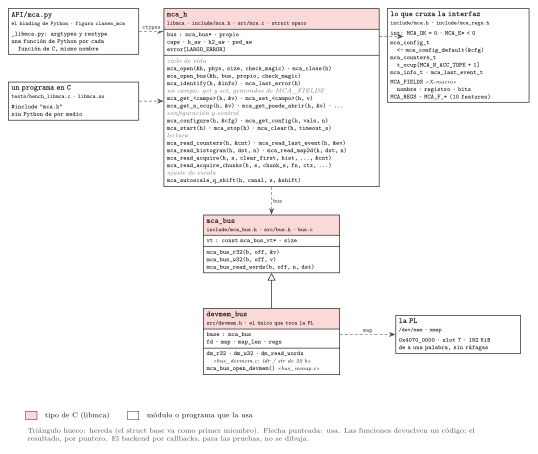
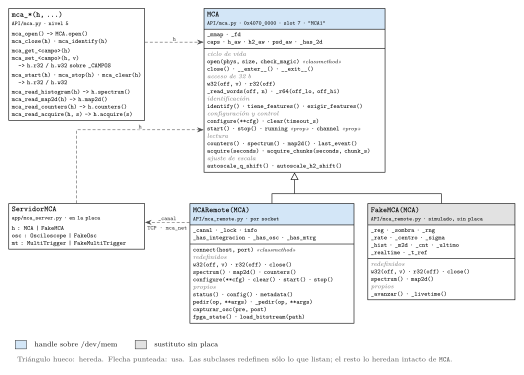
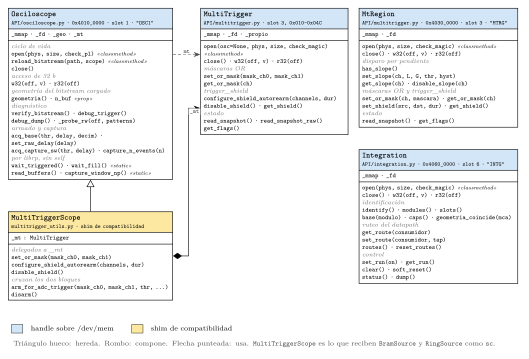
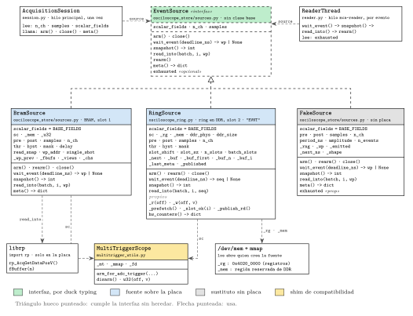
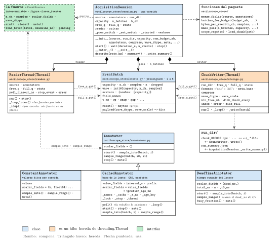

# Diseño de las clases

**Código:** [`software/libmca/`](../../software/libmca/) · [`software/API/`](../../software/API/) · [`software/app/`](../../software/app/)
**Figuras:** [`clases_libmca`](figuras/clases_libmca.svg) · [`clases_mca`](figuras/clases_mca.svg) · [`clases_scope`](figuras/clases_scope.svg) · [`clases_fuentes`](figuras/clases_fuentes.svg) · [`clases_sesion`](figuras/clases_sesion.svg)

Este documento describe **la API como está hoy, nivel por nivel y de abajo
hacia arriba**: qué rol cumple cada módulo y por qué cada clase tiene la forma
que tiene. El orden es el de la pila:

1. el MCA en C (§3);
2. el binding de Python encima (§4);
3. los handles del resto del bus, que siguen en Python (§5);
4. el pipeline de formas de onda del osciloscopio (§6 y §7);
5. la red (§8).

Los sustitutos que permiten probar todo sin placa no son parte de la API que
usa un programa. Por eso no aparecen en los diagramas: están en §9, con las
pruebas. Las simulaciones Monte Carlo tienen su sección aparte, la §10.

Lo que ya está escrito en otros documentos no se repite acá:

| Pregunta | Dónde |
|---|---|
| por qué los nombres llevan prefijo, por qué un fichero por módulo, por qué se partió el osciloscopio del multitrigger | [`decisiones_del_refactor.md`](decisiones_del_refactor.md) |
| qué niveles hay, qué hilos, qué toca del filesystem | [`arquitectura_software.md`](arquitectura_software.md) |
| qué hace cada función | [`referencia_api.md`](referencia_api.md) |
| cómo viaja un comando y un espectro por la red | [`../APP/flujo_de_datos.md`](../APP/flujo_de_datos.md) |

---

## 1. Tres preguntas que deciden la forma de una clase

Casi todas las decisiones de este documento responden una de estas tres
preguntas:

1. **¿De qué recurso es dueña?** Una clase existe cuando hay estado que abrir y
   cerrar: un mapeo de `/dev/mem`, un hilo, un socket. Lo que no tiene estado
   queda como función.
2. **¿Por dónde se corta para sustituirla?** El corte va lo más abajo posible,
   donde la interfaz es más chica. Cuanto menos haya que reimplementar, más
   barato es el sustituto y menos se desincroniza del original.
3. **¿Herencia o duck typing?** Se usa herencia cuando el sustituto quiere
   **reusar la lógica** que el original construye encima del corte. Se usa duck
   typing (§11.1) cuando las implementaciones no comparten código y lo único
   común es el contrato.

---

## 2. Los niveles y el rol de cada módulo

Los niveles son los de [`arquitectura_software.md`](arquitectura_software.md#1-los-niveles):

| Nivel | Qué es |
|---|---|
| 1 | mapeo crudo |
| 2 | acceso de 32 b |
| 3 | handles |
| 4 | funciones |
| 5 | fuentes y sesión |
| 6 | aplicación |

Para el MCA, los niveles 1 a 4 están en C. Para los otros bloques del bus
siguen en Python.

| Módulo | Nivel | Rol | Clases o tipos |
|---|---|---|---|
| [`libmca/`](../../software/libmca/) | 1 a 4 del MCA, en C | el **analizador multicanal** del slot 7: un handle opaco y una función por operación | `mca_h`, `mca_bus`, `devmem_bus` |
| [`API/mca.py`](../../software/API/mca.py) | 3 y 4, binding | el **handle de Python sobre libmca** y las 95 funciones `mca_*` de hardware, más las de guardado | `MCA` |
| [`API/ref_py/`](../../software/API/ref_py/) | 3 y 4, en Python | la **referencia**: la misma superficie sin C. Contra ella se mide y se compara; `ref_py/mca.py` es la única que abre el bitstream MCA1 | `MCA` |
| [`API/osciloscope.py`](../../software/API/osciloscope.py) | 1 a 4 | el **osciloscopio heredado** de Red Pitaya, slot 1: umbral, decimación, delay, BRAM | `Osciloscope` |
| [`API/multitrigger.py`](../../software/API/multitrigger.py) | 1 a 4 | lo que **este proyecto agregó al trigger**: máscaras OR, `trigger_shield` y snapshot, disparo por pendiente y polo-cero, todo en el slot 3, y el armado del disparo del MCA | `MultiTrigger`, `MtRegion` |
| [`API/integration.py`](../../software/API/integration.py) | 1 a 4 | la **región de TOP**, slot 6: identifica el bitstream, dice qué módulo vive en qué slot y rutea el datapath | `Integration` |
| [`API/osciloscope_ring.py`](../../software/API/osciloscope_ring.py) | 5 | **fuente de eventos sobre el ring en DDR**. El `event_ring` no tiene handle: esta clase mapea sus registros y la DDR por su cuenta | `RingSource` |
| [`API/osciloscope_store/`](../../software/API/osciloscope_store/) | 5 | el **pipeline de formas de onda del osciloscopio**: fuentes, batch, lector, escritor, sesión, annotators | `BramSource`, `EventBatch`, `ReaderThread`, `ChunkWriter`, `AcquisitionSession`, `Annotator` y sus subclases |
| [`API/mca_net.py`](../../software/API/mca_net.py) | transporte | el **formato de trama** del socket: una línea JSON y un bloque binario opcional | `Channel` |
| [`API/mca_remote.py`](../../software/API/mca_remote.py) | 6, en la PC | **el MCA por red**: el proxy de la op `call` | `MCARemote` |
| [`app/mca_server.py`](../../software/app/mca_server.py) | 6, en la placa | **el único proceso sobre `/dev/mem`**: expone el MCA, el osciloscopio y el multitrigger por TCP | `ServidorMCA` |
| [`app/mcamon.py`](../../software/app/mcamon.py) | 6, en la PC | **la GUI** | `Trabajador`, `Mcamon` |
| [`API/fpga.py`](../../software/API/fpga.py) | fuera de la pila | **poner la PL en marcha**: cargar el bitstream, bajar y subir los puentes AXI, sondear el bus. Ocurre antes de que exista cualquier handle | — |
| [`API/analisis.py`](../../software/API/analisis.py) | fuera de la pila | **análisis puro**, sin hardware: picos, FWHM, DNL, FOM | — |
| [`API/n42.py`](../../software/API/n42.py) | fuera de la pila | el **formato** ANSI N42.42-2011, sin hardware: lo usan `mca_save_file_n42` y `mca_load_file` | — |
| [`monte-carlo/`](../../software/monte-carlo/) | fuera de la pila | **simulaciones**: réplicas del RTL en numpy, sin la API (§10) | — |
| `mca_utils.py`, `multitrigger_utils.py`, `rigol_dg4162.py`, `mca/` | — | **shims de compatibilidad** (§11.2) | `MultiTriggerScope` |

Los sustitutos sin placa (`FakeMCA`, `FakeOsc`, `FakeMultiTrigger`,
`FakeMtRegion`, `FakeSource`) viven en `API/mca_remote.py` y en
`osciloscope_store/sources.py`. Se describen en §9.1.

El patrón que se repite en los bloques de hardware es **un handle y funciones
encima**: la clase (o el struct de C) es dueña del mapeo, y las funciones con
prefijo son la superficie pública. El nombre dice a qué bloque se pega la
función aunque no se vea el import
([`decisiones_del_refactor.md`](decisiones_del_refactor.md) §1).

---

## 3. El MCA en C: `libmca`



Los niveles 1 a 4 del MCA son una biblioteca en C con la forma de
[`rp-api`](https://github.com/RedPitaya/RedPitaya/tree/master/rp-api). La
razón es el costo: leer un espectro desde Python tardaba ~34 ms para 8192
canales, y el 96 % era el intérprete. Desde C, una palabra cuesta 0.235 µs
([`../TOP/bus_sistema_redpitaya.md`](../TOP/bus_sistema_redpitaya.md) §10.1),
y el mismo espectro baja a 1.9 ms (§9.4).

### 3.1 El handle y las funciones

- **`mca_h` es un struct opaco.** Guarda el bus, la geometría que se lee al
  abrir (`caps`, `h_aw`, `h2_aw`, `psd_aw`) y el texto del último error.
  `mca_open()` mapea `/dev/mem`, valida el *magic* y lee la geometría;
  `mca_close()` libera.
- **Todas las operaciones son funciones**, también las que en Python eran
  métodos con lógica: `mca_configure`, `mca_read_counters`, `mca_read_acquire`,
  `mca_autoscale_q_shift`.
- **Cada función devuelve `MCA_OK` o un `MCA_E*` negativo**, y entrega el
  resultado por puntero. El detalle del error queda en `mca_last_error(h)`.
- **Los campos de configuración salen de una tabla**: la X-macro `MCA_FIELDS`
  de [`mca_regs.h`](../../software/libmca/include/mca_regs.h). Cada entrada
  (nombre, registro, bits, tipo) genera su `mca_get_<campo>`, su
  `mca_set_<campo>` y su fila en `mca_field_info()`. Los campos que se validan
  (`n_acc`, `pre_dly`, `dec`, `trap_k`, …) tienen setter propio, que recibe
  `int64_t` para rechazar un negativo en vez de verlo como un `uint32_t`
  enorme.
- **La memoria es de quien llama.** `mca_read_histogram(h, dst, n)` escribe en
  el buffer que le pasan. Los contadores llegan en un `mca_counters_t` de tipos
  fijos. La configuración entera viaja en un `mca_config_t`, que
  `mca_config_default()` llena con los valores por defecto.
- **Lo que espera también corre en C.** `mca_read_acquire` arranca, duerme,
  para, espera a que se vacíen las ranuras y lee.

### 3.2 El bus: la única puerta a la PL

`mca_h` no toca la PL. Llama a `mca_bus_r32`, `mca_bus_w32` y
`mca_bus_read_words`, que despachan por la tabla `vt` del bus.

**La herencia es a la manera de C**
([`src/bus.h`](../../software/libmca/src/bus.h)). Cada backend lleva
`struct mca_bus` como primer miembro, así que un puntero al backend también es
un puntero a la base, y `vt` dice qué función corre. Es redefinir métodos sin
la palabra clave.

- **El backend de la placa es `devmem_bus`.** Es el único código de todo el
  árbol que accede a la PL desde C:
  [`src/bus_devmem.c`](../../software/libmca/src/bus_devmem.c), tres funciones
  y un `ldr`/`str` de 32 b por acceso.
- **`make -C libmca check-bus`** desensambla el binario de ARM. Falla si
  aparece una ráfaga, un acceso de 64 b o uno de 1–2 bytes (los de §7.2–7.4 del
  doc del bus), y también si el `.so` pide una glibc más nueva que la de la
  placa. En una prueba ya atrapó a `log2()`, que pide `GLIBC_2.29`.

El otro backend, `bus_callback`, recibe las funciones de acceso como punteros.
Lo usan los sustitutos de prueba (§9.1).

### 3.3 El mapa que habla: MCA2

libmca habla sólo el mapa **MCA2**
([`register_map_mca.md`](../mca/register_map_mca.md)):

- **La ventana la abre sólo el disparo del multitrigger.** No hay Schmitt
  interno, ni histéresis, ni `maxlen`, ni re-armado.
- **Varias ranuras miden pulsos a la vez**: `n_acc`, `pre_dly`, `t_ocup`, la
  cola de publicación.
- **El trapecio** existe si CAPS trae el bit 2. `configure` relee sus
  registros sólo en ese caso: en un bitstream sin trapecio leen cero.
- **El banco de trapecios** existe si `0x134` dice `N_FORMAS` > 0. Es parte de
  `mca_config_t`: `configure` es todo el estado, y su validez depende de la
  compuerta. Sin pasarlo queda el reset, una sola forma.
- **Once features.** Las cinco nuevas son `dt_anterior`, `dt_siguiente`, `solape`,
  `trapecio` y `forma`.

`mca_open` sobre un bitstream MCA1 falla, y el mensaje dice que se use
`mca_open(impl='py')` desde Python (§4.3).

---

## 4. El binding de Python: `MCA` y las `mca_*`



El binding es delgado, por `ctypes`, como el módulo `rp` es SWIG encima de
`librp`. **No agrega operaciones**: hay una función de Python por cada función
de C, con el mismo nombre y los mismos argumentos. Por eso la figura no repite
la lista; está en la de §3.

### 4.1 `MCA` guarda el handle de C

`MCA` es dueña del `mca_h*` (`_c`) y de una copia de la geometría (`caps`,
`h_aw`, `h2_aw`, `psd_aw`), con la que el binding dimensiona los arreglos de
salida. Sus métodos (`configure()`, `counters()`, `spectrum()`, `acquire()`, …)
llaman a la función de C del mismo nombre.

| En C | En Python |
|---|---|
| `mca_h*`, struct opaco | `MCA`, que lo guarda en `_c` y es *context manager* |
| `int mca_set_n_acc(mca_h*, int64_t)` | `mca_set_n_acc(h, v)`, sin valor de retorno |
| `int mca_get_n_acc(mca_h*, uint32_t *out)` | `mca_get_n_acc(h)`, que devuelve el valor |
| `mca_counters_t` | el dict de siempre, con las mismas claves en el mismo orden |
| `mca_config_t` + `mca_config_default()` | los kwargs de `mca_configure(h, **cfg)` |
| `MCA_FIELDS` y `MCA_REGS` (los `MCA_R_*`) | `_CAMPOS` y las `R_*`, como constantes públicas. Un test exige que coincidan una por una |

### 4.2 Lo que cambia para quien la usa

1. **Errores.** El binding convierte el código de C en la excepción de
   siempre, con el texto de `mca_last_error`: `ValueError`, `TimeoutError`,
   `MCANotPresent` o `RuntimeError`.
2. **El GIL.** ctypes lo suelta mientras corre C, así que un espectro o una
   adquisición entera dejan correr a los otros hilos del proceso.
3. **Nada más.** Los nombres, las firmas y los resultados son los mismos que en
   la referencia en Python, y eso está verificado escritura por escritura
   (§9.2).

### 4.3 El despacho: c, py o remoto

Todas las funciones públicas de hardware llevan el decorador `@_api`
([`_despacho.py`](../../software/API/_despacho.py)), que mira `h._via`:

| `h._via` | Qué corre | Quién lo devuelve |
|---|---|---|
| `'c'` | libmca, por ctypes | `mca_open()`, `MCA(...)` |
| `'py'` | la homónima de la referencia en Python ([`ref_py/mca2.py`](../../software/API/ref_py/mca2.py)) | `mca_open(impl='py')` |
| `'remoto'` | `h.call(nombre, …)`: la función entera viaja por la red (§8) | `MCARemote.connect()` |

- **`mca_open()` usa `$MCA_IMPL`** si está definido, y si no, C. Si libmca no
  carga, cae a Python **y lo avisa**.
- **El MCA1 se abre sólo por la referencia.** `mca_open(impl='py')` lee el
  *magic* y, si es MCA1, usa [`ref_py/mca.py`](../../software/API/ref_py/mca.py),
  que está congelada.
- **La metadata de cada medición guarda `api_impl` y `libmca_version`**, así
  que un espectro guardado dice con qué implementación se midió.
- **El registro del decorador (`API_REGISTRADA`) es también la lista blanca de
  la red** (§8).

### 4.4 El disparo: `multitrigger_armar_mca`

Sin el disparo del multitrigger el MCA2 no mide. Por eso armarlo es una función
de la API ([`multitrigger.py`](../../software/API/multitrigger.py)), que
recibe los dos handles: `multitrigger_armar_mca(osc, mtr, ch, L, G, thr,
hyst)`. Hace la secuencia validada en placa por `test_mca2_placa.py`, escritura
por escritura:

1. la pendiente, en `MtRegion`;
2. el shield;
3. el arm con `we_keep`, **antes** de la máscara;
4. la máscara;
5. la comprobación de `we_keep` en `FLAGS`.

Por red es la op `mca.disparo`.

### 4.5 Lo que cuesta cruzar ctypes

Lo que lee en bloque gana ×18 contra Python (§9.4). Lo que es un registro o
unos pocos perdía, porque cada cruce por ctypes costaba unos 50 µs en el ARM de
la placa. Medido aparte, ese tiempo se repartía así:

- 4.8 µs una llamada vacía;
- 18 µs con el puntero de salida y la conversión de argumentos;
- el resto, Python del binding.

Se achicó sin tocar la biblioteca:

- **Sin `argtypes` donde es seguro.** Convertir `(void*, uint32_t*)` cuesta
  10.7 µs con `argtypes` y 4.4 µs sin ellos. El binding llama a una copia de
  cada función sin `argtypes` si todos sus parámetros son punteros o enteros de
  32 b (`_libmca.version_rapida`, que lo comprueba contra lo declarado). Las
  que reciben `int64` o `double` siguen con `argtypes`.
- **Un `struct.Struct` por struct de C.** `counters`, `get_config` y
  `configure` se convierten con un solo `unpack` o `pack`. El layout se
  comprueba contra ctypes al importar.
- **Menos capas de Python.** Un despacho genérico con `*args, **kw` cuesta
  ~5 µs por llamada, contra ~2 µs con la firma exacta. Por eso `@_api` genera
  una envoltura con la firma de cada función. Además, el contexto del error se
  arma sólo si hay error, y `MCA.configure` pasa los argumentos posicionales en
  vez de 32 kwargs por tres capas.

Con eso, un get de un registro sigue siendo más lento que en Python (30 contra
16 µs), porque Python lo lee con un `unpack_from` sobre el mmap sin cruzar a C.
Desde un read-modify-write en adelante, C gana.

---

## 5. Los otros handles: osciloscopio, multitrigger y TOP



Estos tres bloques siguen en Python. Pasarlos a C son las fases siguientes de
libmca (§12).

**Por qué una clase.** El mapeo es estado: un `mmap`, un descriptor de archivo
y la geometría que se lee al abrir (`n_buf`, `caps`). La clase es su dueña.
Las cuatro tienen el mismo esqueleto: `open()` como `classmethod`, `close()`,
`w32()` por slice y `r32()` por `unpack_from`. Las cuatro son *context
managers*.

**Por qué handle y funciones, y no sólo métodos.** Las funciones
`osciloscope_*` y `multitrigger_*` son la superficie pública. Los métodos
quedan para el acceso y lo que tiene lógica propia. Como las funciones entran
al hardware sólo por `r32` y `w32`, se puede cambiar el handle sin tocarlas
(§9.1).

**Por qué una clase por región y no una `Placa` con todo.** Cada región es un
slot distinto, con su propio *magic*, y **puede no estar** en el bitstream
cargado. El servidor las abre por separado y sigue andando si falta alguna: sin
el slot 6 desaparece la pestaña de Integración, pero el MCA funciona igual. Una
clase única fallaría entera por la ausencia de una parte. Con libmca el MCA
sigue la misma regla: su handle es aparte.

Dos casos particulares:

- **`Osciloscope` y `MultiTrigger` son regiones distintas**, el slot 1 y el 3, cada
  una con su mapeo; `Osciloscope.mt` abre el segundo si hace falta. El porqué de
  partirlos está en [`decisiones_del_refactor.md`](decisiones_del_refactor.md) §2.
- **`MtRegion` es la región propia del multitrigger**, en el slot 3, con magic
  `"MTRG"`. Maneja el disparo por pendiente, las máscaras OR, el shield y los
  flags. `multitrigger_armar_mca` (§4.4) la usa entera. `MultiTrigger` es la otra
  fachada de los mismos registros, y es la que usan las fuentes de eventos: difieren
  en la firma (`set_or_mask(m0, m1)` contra `set_or_mask(ch, m)`).

---

## 6. Las fuentes de eventos del osciloscopio: una interfaz sin clase base



**Por qué una interfaz.** Para poder cambiar **de dónde salen los eventos**
—la BRAM del scope, el ring en DDR— tocando sólo esta capa. El lector y la
sesión no saben qué fuente tienen: `RingSource` reemplazó a `BramSource` sin
cambiar una línea del lector.

**Por qué sin clase base.** Las implementaciones no comparten código:

| Fuente | Cómo detecta un evento | Cómo lee la ventana |
|---|---|---|
| `BramSource` | polea `adc_we` hasta que la FSM congela el buffer | `rp_AcqGetDataPosV` de `librp`, un canal por llamada, y re-arma por software |
| `RingSource` | prefetchea un lote de slots y valida el footer de cada uno | un reshape sobre memoria ya copiada; el hardware re-arma solo |

No hay nada que heredar. El contrato está escrito en el docstring de
[`sources.py`](../../software/API/osciloscope_store/sources.py), y cada clase
lo cumple por su cuenta.

**Dos consumidores, dos mitades del contrato.**

- `AcquisitionSession` llama una vez a `arm()`, `close()` y `meta()`, y lee
  `n_ch`, `samples` y `scalar_fields` para armar el pool.
- `ReaderThread` llama en cada evento a `wait_event()`, `snapshot()`,
  `read_into()` y `rearm()`, y mira `exhausted` si existe.

Las decisiones que están dentro del contrato:

- **`read_into()` escribe en el destino** que le pasan, en vez de devolver un
  arreglo. Así no reserva memoria por evento, y la versión DDR es una copia
  directa.
- **`rearm()` es un método aparte** y no el final de `read_into()`, para que el
  lector pueda re-armar también cuando descarta. Cuando estaba adentro, el camino
  de descarte no re-armaba y se contaban eventos fantasma: 14 996 vistos contra
  10 251 generados.
- **`snapshot()` es aparte** porque en la BRAM cuesta una lectura más (2.3 µs)
  y se puede apagar con `read_snap=False`.
- **`exhausted` es opcional.** Sólo lo definen las fuentes finitas, para que el
  lector distinga «todavía no llegó nada» de «no va a llegar nunca más».

**Por qué reciben un `MultiTriggerScope`.** Las dos arman el trigger con el scope
(`arm_for_adc_trigger()`, `disarm()`), y reciben la clase del shim porque son
anteriores a la partición en `Osciloscope` y `MultiTrigger`. Migrarlas a
`multitrigger_arm(osc, mt)` está pendiente. `BramSource` además polea y re-arma por
las dos regiones: la FSM y `wp_trig` en el slot 1 (`sc`), las máscaras y el snapshot
en el slot 3 (`sc.mt`).

> ⚠️ **El precio del duck typing, con dos casos reales.** Nada verifica que una
> fuente cumpla el contrato, y `RingSource` no lo cumple entero:
>
> 1. **No tiene `meta()`**, así que `AcquisitionSession(RingSource(...))` falla
>    con `AttributeError` al construirse.
> 2. **El orden `snapshot()` antes de `read_into()` es parte implícita del
>    contrato**, y `RingSource` toma el snapshot recién en `read_into()`. Con el
>    lector real, la columna `snap` queda corrida un evento.
>
> Los tests de `RingSource` llaman a los métodos en otro orden y sin sesión, por
> eso no lo ven. El remedio es declarar la interfaz como `typing.Protocol` y
> agregar un test que pase cada fuente por el `ReaderThread` y la
> `AcquisitionSession` reales.

---

## 7. La sesión de adquisición del osciloscopio: una clase que compone



**La sesión es sólo del osciloscopio.** Guarda una forma de onda por evento.
El MCA no pasa por acá: histogramea en la FPGA y guarda **un espectro por
medición**, con su metadata (configuración, contadores, geometría, sello de
tiempo e implementación, `mca_get_metadata`), sin nada por evento ni
annotators.

La figura muestra la fuente como lo que la sesión ve de ella: la interfaz de
§6. Cuál es la fuente no le importa a ninguna clase de este dibujo.

**`AcquisitionSession` es dueña del ciclo de vida de una corrida.** Recibe la
fuente y los annotators, arma el esquema (`merge_fields()`), dimensiona el pool
a partir de un presupuesto de RAM (`batches_for_budget()`) y crea las colas y
los dos hilos. Lo importante es el **orden**, y por eso vive en un solo lugar:

```
start():  annotators → source.arm() → escritor → lector
stop():   lector → centinela → escritor → annotators → source.close() → run_summary.json
```

Compone y no hereda porque **no es un hilo**: orquesta dos. Es *context
manager* para que el `stop()` ocurra aunque la corrida termine con una
excepción.

**Qué es un hilo y qué no.** En la figura, el color naranja quiere decir que la
clase **es** un hilo: hereda de `threading.Thread`, y por eso lleva `(Thread)`
en el nombre. Son sólo dos:

- **`ReaderThread`** (`osc-reader`) espera el evento, lo lee y re-arma.
- **`ChunkWriter`** (`osc-writer`) escribe los batches llenos.

Las demás clases corren en el hilo que las llama. La sesión, en el del
programa. Los annotators, en `sample_into()`, dentro del lazo del lector.
`CachedAnnotator` no es un hilo, pero lanza uno propio para `poll()`: es el
atributo `_thread`.

**Por qué dos hilos y no uno.** El lector no puede esperar al disco: si lo
hiciera, el tiempo muerto pasaría a depender de la microSD y dejaría de ser una
constante del hardware.

**`EventBatch` es un bloque preasignado**, no un evento. Los arreglos se crean
una vez y se reciclan entre las dos colas; el porqué del pool está en
[`arquitectura_software.md`](arquitectura_software.md) §2. No tiene
`__slots__` porque **las columnas se deciden en runtime**: las que declare la
fuente más las de cada annotator.

**Qué guarda cada evento.** Un evento es **un disparo**. La máscara OR del
multitrigger decide qué fuentes pueden darlo: por defecto, el flanco positivo
de IN1 (`BIT_ADC_P0`). Cualquiera de las fuentes de la máscara arranca la
captura; no hace falta que disparen todos los canales.

Con ese disparo se guarda la ventana de los `n_ch` canales en las mismas
muestras: `wave[i]` es `[n_ch, samples]`, y la columna `snap` dice qué fuente
disparó. El arreglo es denso, sin huecos. Si IN2 no tiene señal, su fila es la
línea de base con su ruido. En la práctica:

- **Con un solo detector se usa `--channels 1`** (`n_ch=1`), en `run_acquire.py`
  y `run_poisson_loss.py`: lee y guarda sólo IN1.
- **`n_ch = 2` sigue siendo el default** de `BramSource`, `RingSource` y de los
  dos scripts. Con un default de 1, un segundo canal conectado se perdería sin
  aviso.
- **Cuánto ahorra con la BRAM.** `BramSource` arma los dos canales con la misma
  máscara y lee los dos en el puntero de disparo del canal 0. El segundo canal
  cuesta unos 86 µs de los 252.7 µs del ciclo medido: una llamada a
  `rp_AcqGetDataPosV` y la copia al batch
  ([`arquitectura_adquisicion_software.md`](arquitectura_adquisicion_software.md)
  Parte 3). El techo pasaría de 3.7 a unos 6 kev/s; es una cuenta sobre ese
  desglose, no una medición. En disco, sin comprimir y con 32 muestras, un evento
  ocupa 90 B en vez de 154 B.
- **El ring escribe siempre los `N_CH` canales** intercalados en cada slot, por
  decisión del RTL ([`../event_ring/diseno_y_register_map.md`](../event_ring/diseno_y_register_map.md)).
  Por eso `RingSource` sigue con `n_ch = 2` y `--channels` sólo llega a la BRAM.
- **Hay un solo stream de eventos.** El multitrigger junta los disparos de los
  canales en un OR, y ese evento va a la captura de todos
  ([`mt_event_logic.v`](../../modulos/mt/rtl/mt_event_logic.v)). Un pulso en IN1
  congela también IN2. Dos detectores independientes compartirían el tiempo
  muerto, y `n_ch` no cambia eso: separarlos pide tocar el RTL.
- **El canal sin señal sí sirvió una vez.** En la campaña del 2026-05-28, IN2
  en vacío dio 3.6 millones de muestras de línea de base pura. Con ellas,
  `ruido.py` midió el espectro del ruido y el crosstalk entre canales, en
  −56.5 dB ([`../ruido_del_sistema.md`](../ruido_del_sistema.md)).

**Los annotators son un concepto aparte de las fuentes.** Un GPS no define
cuándo ocurre un evento: lo *anota*. Acá **sí hay clase base**, porque hay
código que compartir:

- `Annotator` trae `start()`, `stop()` y `meta()` por defecto.
- `CachedAnnotator` trae el hilo, la caché y el campo `<prefijo>_age_ns` que
  todo annotator lento necesita.

La regla que no se negocia es que `sample_into()` corre en el lazo del lector y
**no puede hacer I/O**: sólo copia un valor ya cacheado.

---

## 8. La red: `MCARemote` y la op `call`

Las clases están en la figura de §4: `MCARemote` a la izquierda, arriba, y
`ServidorMCA` debajo.

### 8.1 El problema y dónde se corta

Dos restricciones tiran en sentidos opuestos:

- **El hardware se toca sólo desde la placa, y desde un solo proceso.**
  `/dev/mem` es el único camino a los registros (no hay driver de kernel). Si
  dos procesos lo usan a la vez —por ejemplo, el servidor y un kernel de
  Jupyter que hizo `rp_Init()`— se pelean y sale SIGBUS.
- **La interfaz gráfica corre en la PC.** La placa no tiene pantalla, y el
  análisis y el guardado se quieren en la máquina donde se trabaja.

La consecuencia es un servidor en la placa, dueño del handle, y un cliente en
la PC que lo maneja a distancia. La pregunta de diseño es **dónde se corta**:

| Corte | Cómo se vería | Problema |
|---|---|---|
| una API propia del cliente | `cliente.set_ranuras(4)`, `cliente.leer_espectro()` | duplica las funciones `mca_*` en otra API que se desincroniza; un script que anda en la placa no anda en la PC |
| una operación de red escrita a mano por función | el servidor expone `set_n_acc`, `get_n_acc`, … | el protocolo crece con cada campo; agregar uno toca el servidor, el protocolo y el cliente |
| en `r32` / `w32` | el cliente corre la lógica y cada acceso viaja | una ida y vuelta por registro; un read-modify-write son dos y no es atómico en la placa; el cliente necesita la biblioteca |
| **la función entera, por nombre** ✔ | `call {fn, a, k}`, y el servidor corre `fn(h, *a, **k)` | — |

**La función entera, por nombre.** `MCARemote` es un **proxy**, como un
cliente SCPI de Red Pitaya. Con `_via = 'remoto'`, el despacho de `@_api`
manda cada función ENTERA al servidor. El servidor la corre sobre su handle,
bajo su lock, y devuelve el resultado
([`protocolo.md`](../APP/protocolo.md), op `call`). El mismo script anda en la
placa y en la PC:

```python
from API.mca import mca_set_n_acc, mca_read_histogram
from API.mca_remote import MCARemote

h = MCARemote.connect('10.73.28.30')
mca_set_n_acc(h, 4)            # una ida y vuelta, atómica en la placa
hist = mca_read_histogram(h)   # una, con el espectro como bloque binario
```

Como el cliente usa las mismas funciones de guardado, **un archivo escrito
desde la GUI es indistinguible de uno escrito en la placa**.

### 8.2 Cómo funciona

- **La lista blanca es el registro de `@_api`.** El servidor sólo corre
  funciones de `API.mca` registradas con `remoto=True`. Una función nueva está
  en la red apenas la registra el decorador: el protocolo no crece con la API.
- **Hereda de `MCA` sin abrir libmca.** No llama a `super().__init__`: recibe la
  geometría en el `identify` del servidor. Por eso el cliente no necesita la
  biblioteca.
- **Lo que espera no viaja.** `acquire`, `acquire_chunks` y
  `autoscale_q_shift` se arman en el cliente con start, sleep y stop remotos:
  tendrían tomado el lock del servidor durante segundos. El despacho se las pide
  al proxy (`en_el_cliente`), así que también `mca_read_acquire(h, ...)` anda.
- **Los valores viajan en JSON** (`{"valor": …}`, con las tuplas marcadas para
  volver como tuplas) y los arreglos por el bloque binario.
- **Los errores vuelven con su tipo y su mensaje**, como una subclase de
  `RemoteError` y del tipo original. La excepción es la familia de `OSError`:
  en el cliente, `OSError` quiere decir "se cayó el transporte".
- **Lo que no es una función de `API.mca` tiene su op propia**: el
  osciloscopio (`osc.*`), el multitrigger (`mtrg.*` y `mca.disparo`), la región
  de TOP (`integracion.*`), el FPGA (`fpga.*`) y el `status` que poléa la GUI.
  Las ops del MCA de antes de `call` (`config.*`, `ctrl.*`, `read.*`) siguen,
  porque las usa la GUI.

### 8.3 Lo que cuesta

`make bench-api-red` mide ~0.6 ms por ida y vuelta desde la PC:

| Operación | Tiempo |
|---|---|
| un campo (read-modify-write) | 0.77 ms (antes, con el corte en `r32`/`w32`, ~1.2 ms en dos idas y vueltas) |
| un espectro de 8192 canales | 3.5 ms |

---

## 9. Comprobación: los sustitutos y las pruebas

### 9.1 Los sustitutos sin placa

Sirven para **desarrollar y probar el servidor, la GUI y el pipeline sin
placa** (`make app-demo`, la suite offline). No son parte de la API que usa un
programa.

| Sustituto | Sustituye a | Cómo | Dónde |
|---|---|---|---|
| `FakeMCA` | `MCA` | hereda de `MCA` y entrega un **modelo del mapa de registros** del MCA2 como callbacks de C (el backend `bus_callback` de §3.2): la lógica que corre contra el simulador es la misma de C que corre en la placa | [`mca_remote.py`](../../software/API/mca_remote.py) |
| `FakeOsc` | `Osciloscope` | un dict de registros más una captura simulada; no hereda | ídem |
| `FakeMultiTrigger` | `MultiTrigger` | un dict de registros; no hereda | ídem |
| `FakeMtRegion` | `MtRegion` | hereda y redefine el acceso sobre un dict | ídem |
| `FakeSource` | una fuente de §6 | un reloj nominal y un pulso con ruido; cumple la interfaz sin heredar | [`sources.py`](../../software/API/osciloscope_store/sources.py) |

**Por qué el corte va en el acceso.** `FakeMCA` simula el mapa de registros y
no una API paralela:

- **Lo que se modela** son los campos de `_CAMPOS`, la geometría, el barrido de
  `clear`, el registro sombra de los relojes de 64 b, las ranuras y `t_ocup`.
  `spectrum()` devuelve un fotopico que crece con el tiempo vivo.
- **Por qué así:** si algo anda contra `FakeMCA` y no contra la placa, **la
  diferencia está en el hardware**, no en el simulador.
- **El servidor no cambia:** las operaciones del MCA son las mismas en modo
  real y en `--fake`. Lo único que cambia es qué objeto es `self.h`.

**El precio de un sustituto parcial.** La captura de formas de onda del
servidor real no pasa por `r32`: usa `librp` (`osciloscope_read_window`), que un
objeto simulado no puede imitar. Por eso el servidor tiene una rama
`if self.fake:` en la captura
([`mca_server.py:599`](../../software/app/mca_server.py#L599)): **el código que
lo usa tiene que saber que existe**. Las demás ramas `if self.fake:` están
donde no hay nada que simular: abrir los handles, el slot 6, cargar un
bitstream y leer el estado del FPGA.

### 9.2 Las pruebas que atan C con Python

- **Equivalencia**
  ([`test_libmca_equivalencia.py`](../../software/API/tests/test_libmca_equivalencia.py)).
  Cada función corre en C y en `ref_py/mca2.py`, sobre dos modelos de registros
  idénticos con contenido aleatorio, y se exigen tres cosas:
  - las mismas escrituras en el mismo orden, también en los casos de error;
  - el mismo resultado: arreglos bit a bit, dicts con el mismo orden de claves
    y floats exactos;
  - la misma excepción.

  En su primera corrida encontró un bug: la suma de los tres relojes del tiempo
  muerto se desbordaba en `uint64`, mientras que Python la hacía con precisión
  arbitraria. Tres mutaciones puestas a propósito en `mca.c` también las
  atrapó.
- **Compatibilidad**
  ([`test_compat_api.py`](../../software/API/tests/test_compat_api.py)).
  Compara la superficie pública y las trazas de escritura contra un baseline
  congelado antes del refactor. Desde libmca, `MCA(FakeMmap, …)` corre C sobre
  el buffer, así que **las trazas doradas verifican la versión en C**. Lo que
  cambió a propósito (el mapa MCA2, por ejemplo) figura con su motivo en
  `DESVIACIONES`.
- **La red** ([`test_call.py`](../../software/app/tests/test_call.py)). Corre
  la misma secuencia sobre un `FakeMCA` local y sobre un `MCARemote` contra
  `mca_server.py --fake`. Exige el mismo resultado, con los mismos tipos, y la
  misma excepción en **todas** las funciones registradas como remotas. Si se
  agrega una y no se la ejercita, el test falla. También prueba que el proxy
  anda con la carga de libmca saboteada.
- **El disparo** (`test_disparo_mca.py`). La traza de
  `multitrigger_armar_mca` es la de `test_mca2_placa.py`, en el mismo orden.

### 9.3 Lo que dio la placa

Sobre el MCA2, el 2026-11-02, con el disparo armado por la API sobre el ruido
del ADC (umbral de pendiente 60):

- **Con 1 ranura se perdió el 9 % de los disparos**: `cross` 32768 = `open`
  29782 + `lost_active` 2863 + `lost_busy` 123. **Con 4, ninguno.**
- **El teselado de los relojes y la ocupación (`t_ocup`) cerraron exactos** en
  las dos configuraciones.
- **Las suites de placa pasaron:**
  - `test_mca_hw.py`: 35/35 con C y con Python;
  - `test_mca2_placa.py --etapas regs`, la tabla independiente de la otra línea
    de trabajo: 39/39;
  - `preparar_placa.py`: «PLACA LISTA»;
  - por red, [`call_red.py`](../../software/app/tests/placa/call_red.py)
    configura, arma el disparo y adquiere con 1 y 4 ranuras desde la PC, con
    todas las identidades cerradas.

Sobre el MCA1, el 2026-10-30, los espectros, el mapa, los contadores y la
configuración leídos por las dos implementaciones dieron **bit a bit iguales**,
con 3.45 M eventos en el histograma.

**Algo que encontró la placa.** El MCA2 cargado es el de la fase A, **sin el
trapecio**, y en ese bitstream los registros del trapecio leen cero. La
relectura de `configure` incluía `trap_k`, así que fallaba siempre. Por eso
ahora relee el trapecio sólo con el CAPS bit 2 (§3.3).

### 9.4 Rendimiento

Los bench **miden, no aprueban**: no tienen asserts. Son tres:

- [`bench/bench_impl.py`](../../software/API/bench/bench_impl.py) mide cada
  operación en tres columnas: `py` (la referencia), `c` (por ctypes) y
  `c_puro` (sin intérprete,
  [`tests/bench_libmca.c`](../../software/libmca/tests/bench_libmca.c)).
- [`bench/comparar_bench.py`](../../software/API/bench/comparar_bench.py)
  compara corridas de distintas fechas.
- `testbench_mca.py --impl {c,py}` guarda en cada `.npz` la implementación y
  los tiempos de lectura.

**Sobre el MCA1, después de los cambios de §4.5**
(`datos/bench_impl_20261030_112657/`). Mediana en µs; la columna «`c` antes»
es la primera corrida, del mismo día:

| Operación | `py` | `c` antes | `c` ahora | `c_puro` | py / c |
|---|---:|---:|---:|---:|---:|
| `r32` | 10.6 | 56.8 | 28.7 | 1.5 | 0.37 |
| `get_thr` | 15.8 | 63.7 | 29.9 | 1.4 | 0.53 |
| `set_thr` | 27.6 | 52.1 | 24.1 | 1.7 | 1.14 |
| `identify` | 75.6 | 77.4 | 52.2 | 3.2 | 1.45 |
| `counters` | 271 | 215 | 113 | 10.6 | 2.4 |
| `get_config` | 343 | 193 | 101 | 10.6 | 3.4 |
| `configure` | 253 | 280 | 84 | 9.4 | 3.0 |
| `spectrum` (8192 canales) | 34 429 | 1 880 | 1 848 | 1 700 | 18.6 |

En la primera corrida, `map2d` (128 × 64) dio ×18.1 (34 278 contra 1 897 µs)
y `acquire(0)` ×16.7 (68 936 contra 4 122 µs).

**Sobre el MCA2** (`datos/bench_impl_20261102_165500/`): se repiten los
factores. El espectro da ×18, `configure` ×3.3 y `counters` ×2.9. `clear`
tardaba 176 µs en C por el mínimo de `nanosleep`; ahora espera sin dormir
durante el primer milisegundo y quedó en 95.5 µs.

**Sin el bus: `make bench-api-shm-remoto`.** Corre el mismo bench con el MCA en
un fichero de `/dev/shm` (`bench_impl.py --shm`). `py` lo lee por mmap y `c`
por el backend devmem, como en la PL. No toca la PL, así que sirve con
cualquier bitstream cargado, y es el que hay que correr al tocar `API/mca.py` o
`API/_libmca.py`. La primera corrida (`datos/bench_shm_20261030_112615/`)
separa de dónde sale cada tiempo:

- **En Python, el espectro tarda lo mismo sin bus que con bus** (34.2 ms
  contra 34.4 ms): todo ese tiempo es intérprete.
- **En C, baja de 1.85 ms a 0.21 ms.** Los 1.64 ms de diferencia son el bus:
  0.20 µs por palabra, el costo de cruzar al reloj de la PL
  ([`../TOP/bus_sistema_redpitaya.md`](../TOP/bus_sistema_redpitaya.md) §10).
  A partir de acá, acelerar el espectro es cosa del hardware, no del software.

Por red, los tiempos están en §8.3.

---

## 10. Las simulaciones Monte Carlo

**Código:** [`software/monte-carlo/`](../../software/monte-carlo/) · `make montecarlo` (todas, ~15 min) · `make verificar-montecarlo` (los tests del motor)

Las simulaciones contestan lo que la placa no puede contestar, porque en ellas
**la verdad se conoce**: las amplitudes se sortean, así que existe el espectro
"sin apilamiento" o "sin ruido" contra el cual comparar. Un número que sale de
`monte-carlo/` es una predicción; uno que sale de `campanas/` es una medición.

**No hablan con el hardware.** Los motores son **réplicas vectorizadas del RTL** en
numpy, y corren en la PC, sin placa. Son dos, uno por mapa:

- [`replica_mca2.py`](../../software/monte-carlo/replica_mca2.py), la del MCA2: los
  dos disparos, las ranuras, el publicador y el banco de trapecios.
- [`pileup.py`](../../software/monte-carlo/pileup.py), la del MCA1, que además tiene lo
  común: generación de pulsos, arribos de Poisson y métricas.

Lo único que toman de la API es `mca_banco_config`, para usar el mismo banco que la
placa.

**Cómo se sabe que replican al hardware.**
[`test_replica_mca2.py`](../../software/monte-carlo/test_replica_mca2.py) exige que la
réplica del MCA2 dé, **bit a bit** contra el RTL entero (`mt_top` + `mca_top`, en
QuestaSim, con [`sim/tb_mca2_volcado.sv`](../../sim/tb_mca2_volcado.sv)), los mismos
disparos, los mismos eventos con sus once features, los mismos contadores y la misma
ocupación: 2170 eventos en 10 configuraciones. Doce mutaciones a propósito lo hacen
fallar.
[`test_pileup.py`](../../software/monte-carlo/test_pileup.py) hace lo suyo con la del
MCA1, contra `estimadores.segmentar_rtl` e `integral_gates`, validadas contra el
testbench y contra la placa.
[`test_conformado.py`](../../software/monte-carlo/test_conformado.py)
comprueba que el Monte Carlo de conformado reproduce los números de Nicholson y
cierra con su fórmula. Corren en `make verificar`.

Lo que se hizo, y lo que dio:

| Simulación | Script · `make` | La pregunta | El resultado | Detalle |
|---|---|---|---|---|
| **Apilamiento** | [`montecarlo.py`](../../software/monte-carlo/montecarlo.py) · `montecarlo-apilamiento` | cuánto deforma el apilamiento el espectro, y qué lo corrige | más ranuras dan más eventos, no más eventos buenos: con la integral, a 100 kcps, 34.6 kcps buenos con 1 o con 4 ranuras. `F_SOLAPE` marca lo que `cnt_pileup` no veía (37.6 % de un 42 %). El trapecio corrige: 63.5 kcps. Con el pulso del preamplificador, el banco y el disparo con polo-cero dan 747 kcps buenos a 1 Mcps, contra 224 de un trapecio solo con la pendiente | [`../mca/apilamiento.md`](../mca/apilamiento.md) |
| **Pico contra carga** | [`pico_vs_carga.py`](../../software/monte-carlo/pico_vs_carga.py) · `montecarlo-pico-carga` | la firma de los eventos dobles y triples en el plano pico-carga, con la CR-RC⁴, con 1 y 4 ranuras | con la compuerta de 384 los limpios caen sobre una recta de pendiente 1.51 µs (70 % del techo de 2.153 µs), la misma con 1 y 4 ranuras. Un doble a 150 muestras cae **debajo** de la recta (0.81×): el pico suma más que la carga que entra en la compuerta. La firma cambió de signo respecto de la ventana por histéresis, y el corte por forma hay que recalibrarlo si cambia la forma del pulso | [`../mca/formas_de_pulso.md`](../mca/formas_de_pulso.md) |
| **Seguidor de línea de base** (MCA1) | [`linea_base.py`](../../software/monte-carlo/linea_base.py) · `montecarlo-linea-base` | si el seguidor IIR explica la deriva del centroide con la tasa | la mejora en vez de empeorarla: a 72 kHz baja de +0.21 % a +0.10 %. Con la cadena digital entera modelada, queda sin explicar el 92 % del +1.28 % medido | [`../mca/limites_resolucion_y_deriva.md`](../mca/limites_resolucion_y_deriva.md) |
| **Conformado y ruido** | [`conformado.py`](../../software/monte-carlo/conformado.py) · `montecarlo-conformado` | si el orden de S/N de Nicholson vale para esta cadena | no: con el ruido en el ADC y el estimador de pico del RTL, el trapecio es la mejor forma y el cusp y el triángulo, las peores. Con un filtro adaptado todas quedan en σ ≈ 0.20 | [`../mca/conformado_y_ruido.md`](../mca/conformado_y_ruido.md) |
| **Varianza de los estimadores** | [`varianza_estimadores.py`](../../software/monte-carlo/varianza_estimadores.py) | cuánto vale la varianza de cada estimador de amplitud sobre cada forma, y de qué término viene | a igual FWHM y pico, Σf²/FWHM = 0.75 ± 0.08 en las seis familias: ninguna forma es intrínsecamente más medible que otra. Con el pulso de la campaña, el trapecio es el mejor estimador del MCA2 |  [`../mca/fuentes_de_jitter.md`](../mca/fuentes_de_jitter.md) §5 |
| **Presupuesto de ruido** (MCA1) | [`ruido.py`](../../software/monte-carlo/ruido.py) | de qué es cada parte del ruido, y qué se puede hacer con ella | el ruido no es blanco: 4.47 cuentas blancas más 0.87 correlacionadas con τ ≈ 12 µs. Predice 0.159 % de FWHM contra 0.161 % medido, y que bajar `bl_k` de 12 a 9 lo llevaría a ≈ 0.13 % | [`../ruido_del_sistema.md`](../ruido_del_sistema.md) |
| **Polo-cero** (MCA1) | [`polo_cero.py`](../../software/monte-carlo/polo_cero.py) | cuánto del corrimiento con la tasa cancelaría una corrección polo-cero | el undershoot existe y es chico (η = 0.040, τ = 5.1 µs). Explica el 29 % del corrimiento (0.34 de 1.17 %); el resto no es lineal con la tasa y una PZ no lo toca | [`../mca/polo_cero.md`](../mca/polo_cero.md) |

Las tres últimas parten de trazas medidas (las 7054 ventanas de
`datos/e2e_20260528_013404/` y capturas crudas del scope), así que no
necesitan placa pero sí esos datos. Las corridas quedan en `software/datos/`:
`pileup_*`, `base_*`, `conformado_*` y `ruido_20261009`; las de polo-cero, en
[`../mca/figuras/polo_cero/`](../mca/figuras/polo_cero/). `graficar.py` y
`graficar_base.py` rehacen las figuras desde lo guardado, sin volver a simular.

Las marcadas **(MCA1)** usan la réplica vieja a propósito: explican mediciones hechas
con ese bitstream, y repetirlas sobre el MCA2 no las explicaría. `montecarlo.py
--mapa MCA1` reproduce el barrido viejo, que sigue documentado como histórico en
[`../mca/apilamiento.md`](../mca/apilamiento.md).

---

## 11. Herencia, duck typing y shims

### 11.1 Duck typing

> *«Si camina como un pato y hace cuac como un pato, es un pato.»*

En Python una función **no pregunta de qué clase es un objeto: llama a sus
métodos**. Si el objeto los tiene, funciona; si no, falla recién en ese momento
con `AttributeError`.

```python
# API/multitrigger.py: sirve cualquier mt que tenga r32()
def multitrigger_get_status(mt):
    crudo = mt.r32(R_TRIG_SNAP)
    runtime = mt.r32(R_SHIELD_RUN)
    return {'snapshot': crudo, 'flags': mt.r32(R_FLAGS), …}
```

En Java o C++ habría que declarar una interfaz y que cada clase dijera que la
implementa. En Python no hace falta, y este árbol lo usa en tres lugares:

| Dónde | Qué objetos son intercambiables |
|---|---|
| el `h` de las funciones `mca_*` | `MCA`, `MCARemote` y `FakeMCA`, que además heredan de `MCA` |
| el `osc` y el `mt` de las funciones `osciloscope_*` y `multitrigger_*` | los reales y sus sustitutos, que no heredan de nada |
| la fuente de `AcquisitionSession` y `ReaderThread` | `BramSource`, `RingSource` y `FakeSource` |

En C, el pato es la tabla `vt` del bus (§3.2): cualquier backend que la llene
sirve.

- **La ventaja:** no hace falta una jerarquía para sustituir, y un sustituto es
  trivial de escribir.
- **El costo:** nada verifica el contrato hasta que se llama el método que
  falta. Es exactamente lo que le pasa a `RingSource.meta()` (§6).
  `typing.Protocol` permite declarar el contrato y chequearlo sin obligar a
  heredar.

### 11.2 Shims

Un shim es una **capa delgada que sólo existe para que los nombres viejos sigan
funcionando** después de mover el código. No tiene comportamiento propio:
reexporta. Python los hace fáciles porque un módulo es un objeto como cualquier
otro, y lo que se importa de él se puede reexportar desde otro:

```python
# software/mca_utils.py: el archivo viejo, ahora vacío de lógica
from API.mca import *
from API.analisis import *
```

El árbol usa tres formas, de la más simple a la más elaborada:

| Forma | Ejemplo | Para qué |
|---|---|---|
| módulo que reexporta | [`mca_utils.py`](../../software/mca_utils.py), [`rigol_dg4162.py`](../../software/rigol_dg4162.py) | que `import mca_utils as mu` siga funcionando |
| paquete y submódulos que reexportan | [`mca/`](../../software/mca/), con siete submódulos | que también funcione `from mca.storage import …`, que no pasa por el `__init__` |
| clase que compone las nuevas | `MultiTriggerScope` en [`multitrigger_utils.py`](../../software/multitrigger_utils.py) | que el objeto con la superficie vieja siga existiendo, delegando en `Osciloscope` y `MultiTrigger` |

El paquete `mca/` es un nombre viejo. Que `from mca import AcquisitionSession`
funcione no quiere decir que la sesión sea del MCA: es la del osciloscopio
(§7).

Python tiene además dos mecanismos que el árbol **no** usa:

- un `__getattr__` a nivel de módulo (PEP 562), que permite avisar con un
  `DeprecationWarning` sólo cuando alguien usa un nombre viejo;
- registrar un módulo bajo otro nombre en `sys.modules`.

El aviso se descartó a propósito: saltaría en cada corrida en la placa
([`compatibilidad_y_migracion.md`](compatibilidad_y_migracion.md) §1).

**Lo que no es un shim.** De todas las clases de este documento, **la única que
es un shim es `MultiTriggerScope`**. Las demás que «se parecen a otra» son
cosas distintas, porque tienen comportamiento propio:

| Clase | Qué es | Misma interfaz que | Qué cambia |
|---|---|---|---|
| `MultiTriggerScope` | **shim** | la vieja clase única del scope | nada: delega |
| `MCARemote` | **proxy remoto** | `MCA` | dónde corre: cada función, en la placa |
| `ref_py.mca2.MCA` | **implementación de referencia** | `MCA` | el lenguaje: la misma lógica, sin C |
| `FakeMCA`, `FakeOsc`, `FakeMultiTrigger`, `FakeMtRegion`, `FakeSource` | **dobles de prueba** (*fakes*, §9.1) | `MCA`, `Osciloscope`, `MultiTrigger`, `MtRegion`, `EventSource` | el comportamiento: simulan el hardware |

---

## 12. Pendientes que el diseño deja a la vista

| Pendiente | Dónde | Arreglo |
|---|---|---|
| el osciloscopio, el multitrigger y la región de TOP siguen en Python | [`osciloscope.py`](../../software/API/osciloscope.py), [`multitrigger.py`](../../software/API/multitrigger.py), [`integration.py`](../../software/API/integration.py) | las fases 3 y 4 de libmca; después, el lazo por evento |
| `ref_py/mca2.py` todavía no está congelada | [`ref_py/mca2.py`](../../software/API/ref_py/mca2.py) | congelarla al cerrar el port, como `ref_py/mca.py` |
| `RingSource` no tiene `meta()` | [`osciloscope_ring.py`](../../software/API/osciloscope_ring.py) | agregarlo, con la misma forma que el de `BramSource` |
| `snap` corrido un evento con `RingSource` | ídem, `snapshot()` | leer el snapshot de la cabecera del slot actual, no del último leído |
| las fuentes dependen del shim | `BramSource`, `RingSource` | recibir `osc` y `mt` y armar con `multitrigger_arm()` |
| `BramSource` pasó al slot 3 por el RTL y un modelo, sin correr en la placa | [`sources.py`](../../software/API/osciloscope_store/sources.py), [`test_bram_source.py`](../../software/API/tests/test_bram_source.py) | `run_acquire.py` en la placa, con `--channels 1` y `2`: más de un evento y `snap` distinto de 0 |
| el contrato de `EventSource` no se verifica | `sources.py` | un `typing.Protocol` y un test con el lector y la sesión reales |
| las campañas de caracterización están portadas al MCA2, pero sólo probadas contra el simulado | `campanas/testbench_mca.py`, `e2e_espectro.py` | correrlas en la placa: `single_peak`, `sweep_rate`, `test_pulse_pair`, `sweep_threshold` y `e2e_espectro` (que el disparo llegue al MCA con la BRAM en single-shot, `--pre-dly`) |
| la GUI guarda N42.42 sin calibrar y sin detector | `panel_espectro.py` | pedir la calibración y el detector al guardar; desde Python ya se pueden pasar |
| `StartDateTime` del N42.42 sale del reloj de la placa cuando el `t_wall` lo arma el servidor | `app/mca_server.py`, `read.metadata` | poner la hora en la placa, o que el cliente pase la suya |
| el banco y el disparo con polo-cero no se pueden usar desde la GUI | `mca.disparo`, `panel_espectro.py`, `panel_config_mca.py` | después de la placa: `k`, `m`, `sh` y el umbral por red, armar `pz` desde el Espectro, y las formas y sus umbrales en la pestaña MCA |
| el canal 0 de un espectro de `F_TRAP` junta marcados e incompletos, y entra al autoescalado y a la búsqueda de picos | `panel_espectro.py`, `API/analisis.py` | sacarlo de esas cuentas y mostrarlo aparte |
| el servidor y `preparar_placa.py` cargan `/root/mca_red_pitaya.bit.bin`, y el build se llama `mca_red_pitaya_Z10_2CH.bit.bin` | [`mca_server.py`](../../software/app/mca_server.py), [`preparar_placa.py`](../../software/campanas/preparar_placa.py) | ver qué hay en la placa antes de decidir el nombre: ahí está la única copia del MCA2 validado |

---

## Ver también

- [`arquitectura_software.md`](arquitectura_software.md): los niveles, los hilos, el filesystem
- [`decisiones_del_refactor.md`](decisiones_del_refactor.md): por qué los nombres y los ficheros quedaron así
- [`compatibilidad_y_migracion.md`](compatibilidad_y_migracion.md): los shims y cómo retirarlos
- [`../APP/flujo_de_datos.md`](../APP/flujo_de_datos.md): el servidor, el cliente y la red
- [`../../software/libmca/README.md`](../../software/libmca/README.md): compilar e instalar libmca
- [`figuras/README.md`](figuras/README.md): cómo regenerar los diagramas
