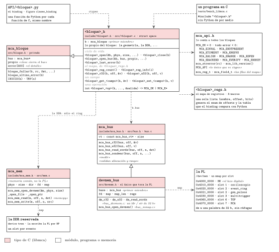
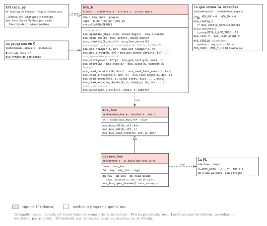
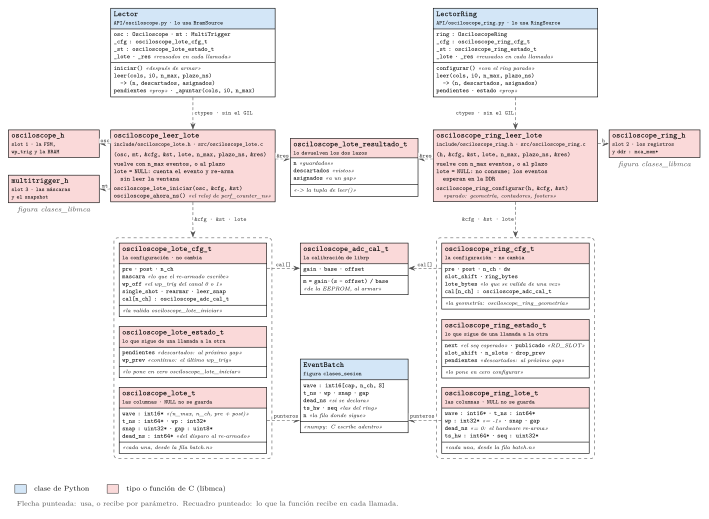
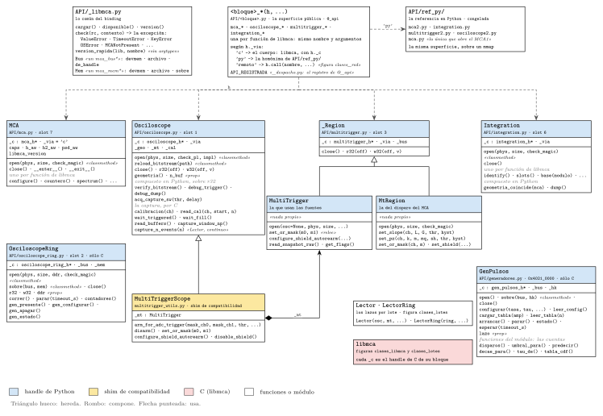

# libmca: la API de hardware en C y su binding de Python

**Código:** [`software/libmca/`](../../software/libmca/) · [`software/API/`](../../software/API/) (el binding)
**Figuras:** [`clases_bloque`](figuras/clases_bloque.svg) · [`clases_libmca`](figuras/clases_libmca.svg) · [`clases_lotes`](figuras/clases_lotes.svg) · [`clases_binding`](figuras/clases_binding.svg)
**Compilar e instalar:** [`software/libmca/README.md`](../../software/libmca/README.md)

Todo acceso del software a la PL pasa por **libmca**, una biblioteca en C con la
forma de [`rp-api`](https://github.com/RedPitaya/RedPitaya/tree/master/rp-api): un
handle opaco por bloque y una función por operación. Python la usa por `ctypes`,
como el módulo `rp` usa `librp` por SWIG, y no le agrega lógica. Este documento
la describe entera, de abajo hacia arriba:

1. lo que comparten todos los bloques: el handle, los códigos y las tablas (§1);
2. la única puerta a la PL, el bus, y la región de DDR del ring (§2);
3. los bloques, uno por uno (§3);
4. los dos lazos por lote, que son donde libmca se encuentra con la adquisición de
   eventos (§4);
5. el binding de Python, con el despacho a C, a la referencia o a la red (§5);
6. lo que cuesta (§6).

Cómo se usan los lazos desde la sesión de adquisición (las fuentes, los hilos, el
pool de batches) está en [`adquisicion_de_eventos.md`](adquisicion_de_eventos.md).
La red, los sustitutos de prueba y las pruebas, en
[`diseno_de_clases.md`](diseno_de_clases.md).

**Por qué en C.** Por dos motivos, y el segundo vale aunque el primero no:

- **El costo.** Leer un espectro desde Python tardaba ~34 ms para 8192 canales, y el
  96 % era el intérprete. Desde C, una palabra cuesta 0.235 µs
  ([`../TOP/bus_sistema_redpitaya.md`](../TOP/bus_sistema_redpitaya.md) §10.1) y el
  mismo espectro baja a 1.9 ms (§6.2). El lazo por evento del osciloscopio pasó de
  252.7 µs de tiempo muerto a 18.2 µs.
- **Una sola puerta.** El esclavo AXI de la PL sólo atiende accesos de 32 b de a uno.
  Si todo acceso pasa por un mismo fichero, esa regla se comprueba en el binario
  (§2). Por eso también están en C bloques sin camino caliente, como la región de
  TOP, donde C es más lento que Python (§3.2).

---

## 1. La forma de un bloque



*Lo que comparten todos los handles de libmca, dibujado una sola vez. `<bloque>_h` es
un struct opaco que lleva `mca_bloque` como primer miembro: el bus, si el handle es su
dueño y el detalle del último error. Todo acceso pasa por `mca_bus`, y el único backend
que toca la PL es `devmem_bus`. `mca_mem` es la región de DDR que escribe la PL; sólo
la usa el event_ring. Las figuras de los bloques y de los lazos no repiten nada de
esto.*

Cada bloque de la PL tiene su handle (`mca_h`, `osciloscope_h`, …) y sus ficheros:
`include/<bloque>_regs.h` con el mapa, `include/<bloque>.h` con la API y
`src/<bloque>.c` con la lógica. La receta para agregar uno está en
[`libmca/README.md`](../../software/libmca/README.md#agregar-un-bloque).

- **El handle es un struct opaco.** Quien lo usa sólo tiene un puntero. `<bloque>_open()`
  mapea `/dev/mem`, valida el *magic* si se lo piden y lee lo que el bloque tenga que
  saber del bitstream (la geometría del MCA y del osciloscopio, por ejemplo).
  `<bloque>_open_bus()` hace lo mismo sobre un bus ya abierto: es la entrada de los
  backends de prueba. `<bloque>_close()` libera.
- **La herencia es a la manera de C.** `mca_bloque`
  ([`src/bloque.h`](../../software/libmca/src/bloque.h)) va como **primer miembro** de
  cada handle, así que un puntero al handle también es un puntero a la base, y las
  funciones de `bloque.c` sirven para todos: dejar el detalle del error
  (`bloque_fallar`), leerlo, rechazar el `NULL` al entrar (`INICIO`). Es el mismo truco
  que `mca_bus` en sus backends (§2).
- **Todas las operaciones son funciones**, también las que en Python eran métodos con
  lógica: `mca_configure`, `mca_read_acquire`, `osciloscope_leer_lote`.
- **Cada función devuelve `MCA_OK` o un `MCA_E*` negativo**, como `rp-api`, y entrega
  el resultado por puntero. El detalle queda en `<bloque>_last_error(h)`. Los códigos
  son comunes a todos los bloques
  ([`mca_api.h`](../../software/libmca/include/mca_api.h)): `MCA_ENOKEY`, por ejemplo,
  es un índice que no está en la tabla del bloque, el `KeyError` de Python.
- **El mapa sale de una tabla.** `<bloque>_regs.h` es una X-macro: una sola lista
  genera el enum de offsets y la tabla que exporta `<bloque>_reg_info()`. El binding
  compara esa tabla con sus constantes de Python, una por una, y los tests la comparan
  con lo que decodifica el RTL. En los bloques con campos (el MCA, el multitrigger, el
  osciloscopio), la misma tabla genera un `get` y un `set` por campo.
- **La memoria es de quien llama.** `mca_read_histogram(h, dst, n)` escribe en el
  buffer que le pasan; los lazos escriben adentro de los arreglos del batch (§4).
- **Lo que espera también corre en C.** `mca_read_acquire` arranca, duerme, para,
  espera a que se vacíen las ranuras y lee; los lazos esperan al disparo.
- **Sólo se exporta lo marcado con `MCA_API`.** La biblioteca se compila con
  `-fvisibility=hidden`, así que la tabla de símbolos del `.so` es exactamente lo que
  `ctypes` puede llamar.

---

## 2. El bus y la DDR: la única puerta a la PL

Ningún handle toca la PL. Llaman a `mca_bus_r32`, `mca_bus_w32` y
`mca_bus_read_words`, que validan alineación y rango y despachan por la tabla `vt` del
backend. `mca_bus_sondear` lee el mismo registro n veces seguidas: no lo usa ningún
bloque, es para medir el bus (`make verificar-placa-bus`).

**La herencia, otra vez a la manera de C**
([`src/bus.h`](../../software/libmca/src/bus.h)). Cada backend lleva `struct mca_bus`
como primer miembro, y `vt` dice qué función corre. Es redefinir métodos sin la
palabra clave.

- **El backend de la placa es `devmem_bus`.** Es el único código de todo el árbol que
  accede a la PL: [`src/bus_devmem.c`](../../software/libmca/src/bus_devmem.c), tres
  funciones y un `ldr`/`str` de 32 b por acceso.
- **`make -C libmca check-bus`** desensambla el binario de ARM. Falla si aparece una
  ráfaga, un acceso de 64 b o uno de 1–2 bytes (los de §7.2–7.4 del doc del bus), si
  la palabra `volatile` aparece en otro fichero, y si el `.so` pide una glibc más nueva
  que la de la placa. En una prueba ya atrapó a `log2()`, que pide `GLIBC_2.29`.
- **Los otros dos backends** son para probar sin placa: `bus_callback` recibe las
  funciones de acceso como punteros, y el de fichero mapea un archivo común en vez de
  `/dev/mem`. No se dibujan; están en
  [`diseno_de_clases.md`](diseno_de_clases.md) §5.1.

**La DDR del ring no es el bus.** El event_ring escribe un slot por evento en una
región reservada de DDR, por el puerto HP: es memoria común, no cacheable, y del lado
del PS no hay ningún esclavo AXI. Por eso tiene su propio tipo,
[`mca_mem`](../../software/libmca/include/mca_mem.h), que se copia de a bloques con
`memcpy`, con los backends `devmem`, `file`, `ptr` (memoria del proceso) y `callback`.
`check-bus` no lo mira, y es a propósito. Cómo copiar (hoy `memcpy`, como el slice de
Python que se midió) se decide midiendo en la placa.

---

## 3. Los bloques



*Un handle por bloque de la PL, con lo que lo distingue: el ciclo de vida, el acceso
crudo y la tabla de registros son los de la figura anterior, y los dos lazos van en la
siguiente. Arriba, los bloques que son sólo registros; abajo, el osciloscopio, el
event_ring (con su segunda región, la DDR) y el generador de pulsos (con un segundo
bus, el de HK, para el lazo digital). `gen_disparos` no tiene handle: son las cuentas
del motor que comparten los dos generadores.*

| Handle | Slot | Base | Fichero | Lo propio |
|---|---|---|---|---|
| `mca_h` | 7 | `0x4070_0000` | [`mca.h`](../../software/libmca/include/mca.h) | la geometría (`caps`, `h_aw`, `h2_aw`, `psd_aw`) |
| `integration_h` | 6 | `0x4060_0000` | [`integration.h`](../../software/libmca/include/integration.h) | nada: sólo `mca_bloque` |
| `multitrigger_h` | 3 | `0x4030_0000` | [`multitrigger.h`](../../software/libmca/include/multitrigger.h) | nada: sólo `mca_bloque` |
| `osciloscope_h` | 1 | `0x4010_0000` | [`osciloscope.h`](../../software/libmca/include/osciloscope.h) | la geometría que lee la sonda (`RSZ`, `DW`, `N_CH`) |
| `osciloscope_ring_h` | 2 | `0x4020_0000` | [`osciloscope_ring.h`](../../software/libmca/include/osciloscope_ring.h) | la región de DDR (`mca_mem`) |
| `gen_pulsos_h` | 2 | `0x4021_0000` | [`gen_pulsos.h`](../../software/libmca/include/gen_pulsos.h) | el bus de HK (`0x4000_0000`), para el lazo digital |

### 3.1 El MCA: el mapa MCA2

libmca habla sólo el mapa **MCA2**
([`register_map_mca.md`](../mca/register_map_mca.md)):

- **La ventana la abre sólo el disparo del multitrigger.** No hay Schmitt interno, ni
  histéresis, ni `maxlen`, ni re-armado.
- **Varias ranuras miden pulsos a la vez**: `n_acc`, `pre_dly`, `t_ocup`, la cola de
  publicación.
- **El trapecio** existe si CAPS trae el bit 2. `configure` relee sus registros sólo
  en ese caso: en un bitstream sin trapecio leen cero.
- **El banco de trapecios** existe si `0x134` dice `N_FORMAS` > 0. Es parte de
  `mca_config_t`: `configure` es todo el estado, y su validez depende de la compuerta.
  Sin pasarlo queda el reset, una sola forma.
- **Once features.** Las cinco nuevas son `dt_anterior`, `dt_siguiente`, `solape`,
  `trapecio` y `forma`.

Los campos que se validan (`n_acc`, `pre_dly`, `dec`, `trap_k`, …) tienen setter
propio, que recibe `int64_t` para rechazar un negativo en vez de verlo como un
`uint32_t` enorme. Los contadores llegan en un `mca_counters_t` de tipos fijos, y la
configuración entera viaja en un `mca_config_t`, que `mca_config_default()` llena con
los valores por defecto.

`mca_open` sobre un bitstream MCA1 falla, y el mensaje dice que se use
`mca_open(impl='py')` desde Python (§5.3).

### 3.2 La región de TOP

[`integration.h`](../../software/libmca/include/integration.h) es la región del slot 6:
identifica el bitstream, dice qué módulo vive en qué slot y rutea el datapath.

- **`integration_h` no guarda nada más que `mca_bloque`**: esta región no tiene
  geometría que leer al abrir.
- **Un índice fuera de tabla es `MCA_ENOKEY`.** Los consumidores y los módulos son enums
  en C. El binding pasa un nombre desconocido como -1, y ese código es el `KeyError`
  que daba el dict en Python.
- **No se pasó a C por velocidad.** No tiene camino caliente, y con ctypes es más
  lenta que Python: en la PC y sin bus, `integration_get_slots` tarda 1.0 µs contra
  0.26 µs. Se pasó para que todo acceso a la PL pase por una sola puerta.

### 3.3 El multitrigger: un handle, dos fachadas

[`multitrigger.h`](../../software/libmca/include/multitrigger.h) es la región del slot 3:
las máscaras OR, el `trigger_shield` y el snapshot, el disparo por pendiente y el
polo-cero. En Python hay dos clases sobre ella, `MultiTrigger` y `MtRegion`, porque sus
firmas difieren (§5.1); en C hay un solo tipo de handle y funciones para las dos:
`multitrigger_set_or_masks(h, ch0, ch1)` relee, y `multitrigger_set_or_mask(h, ch, v)`
no.

- **Las validaciones están en C**, con los mismos mensajes que en Python: `set_slope` y
  `set_pz` rechazan todo antes de escribir.
- **Lo que cruza con el osciloscopio se compone en Python** (`multitrigger_arm`,
  `multitrigger_armar_mca`, §5.4): `arm` y `we_keep` son del slot 1, y el orden de esas
  escrituras es parte del contrato.
- **Un canal fuera de 0..3 es un error**, y es la diferencia deliberada con la
  referencia. Python calculaba `base + 4 * ch` sin mirarlo, y en esas familias eso es
  otro registro: `disable_slope(4)` ponía en cero el umbral del canal 0.
- **El lazo por evento recibe este handle** (§4): re-arma las máscaras y lee el
  snapshot desde C, y llega a su bus por su `mca_bloque`. Desde Python ya no hay acceso
  directo a la región mapeada.

### 3.4 El osciloscopio: la geometría, la BRAM y la calibración

[`osciloscope.h`](../../software/libmca/include/osciloscope.h) es la región del slot 1.
Tiene tres cosas que los otros bloques no:

- **La sonda de geometría.** `osciloscope_open(&h, phys, 0)` mapea 8 KiB, lee `RSZ`,
  `DW` y `N_CH` del mapa canónico y re-mapea lo que hace falta: con 4 canales, los
  `0x30000` históricos dejan dos aperturas afuera. No lee ningún magic para decidir si
  abre: un bitstream sin ese mapa abre igual, con la geometría por defecto y
  `descubierta = 0`.
- **La lectura de la BRAM.** `osciloscope_read_bram(h, ch, start, n, dst)` lee de a una
  palabra, porque una ráfaga sobre esa memoria reinicia la placa. Reduce `start` al
  anillo, de modo que `wp - pre` se puede pasar tal cual, parte la ventana en dos si
  pasa el final, y extiende el signo con el `DW` del bitstream. Devuelve cuentas **sin
  calibrar**. Las aperturas decodifican 64 KiB por canal sea cual sea `RSZ`, así que
  con un anillo más chico la mitad alta es un espejo de la baja: pedir más que el
  anillo es un error de la función, porque el hardware devolvería el buffer repetido
  sin avisar.
- **La calibración de librp.**
  [`osciloscope_lote.h`](../../software/libmca/include/osciloscope_lote.h) la hace en C,
  con la cuenta de `cmn_CalibCntsSigned` (rp-api 2.00-35):
  `m = gain·(s − offset) / base`, truncando hacia cero y recortando a ±2^(DW−1). Con
  `base` potencia de 2 desplaza el módulo y le devuelve el signo, porque el A9 no tiene
  división por hardware y un desplazamiento aritmético redondearía hacia abajo. Los
  números salen de la EEPROM y el binding los lee (`calibracion_adc`): una calibración
  en cero es un error, no ceros guardados. En LV la escala de librp es 1 V, así que `m`
  es exactamente el `rint(V·8192)` que se guardaba con `rp`. `osciloscope_read_cal` es
  la lectura de la BRAM, calibrada.

Y las reglas que lo separan de la referencia en Python:

- **Los volts son double, y la cuenta es la de Python.** El umbral es
  `int(round(v * 8192)) & 0x3FFF`: `rint` redondea al par igual que `round`, y
  `bajos32` da los bits bajos también desde 2⁶³, donde convertir el double directo sería
  indefinido en C.
- **Un canal distinto de 0 y 1 es un error.** La referencia usaba `off1 if ch else off0`,
  así que el canal 2 caía en el 1 sin avisar. `None` sigue siendo «los dos» en los
  `set`; en C es `OSCILOSCOPE_AMBOS`.
- **`acq_base` valida todo antes de escribir.** La referencia ya había reseteado la FSM
  y cambiado la decimación cuando un `thr` inválido la hacía caer.
- **Lo que no es de este bloque se compone en Python:** comprobar que la PL esté
  programada (sysfs), `verify_bitstream`, `debug_*` y `acq_capture_sw`, que cruzan con
  el multitrigger.
- **La captura ya no usa `librp`.** `read_buffers` y `capture_window_np` leen por
  `osciloscope_read_cal`, `wait_*` miran los bits 2 y 4 de `0x000` que leía librp, y
  `capture_n_events` es el lazo de §4 en modo continuo, sin re-armado. `rp_Init()` sigue
  en los scripts y en el servidor, y no para leer: la API quiere seguir siendo en parte
  compatible con la de Red Pitaya (decisión del 2026-11-08). No cambia ninguna muestra:
  escribe los umbrales, el delay, la histéresis y `dis_we`, que el armado vuelve a
  escribir, y los coeficientes del ecualizador, que en este bitstream no está
  (`EN_FILT = 0`).

### 3.5 El event_ring: dos regiones

[`osciloscope_ring.h`](../../software/libmca/include/osciloscope_ring.h) es el único
bloque con **dos regiones**: los registros del slot 2, por el bus, y la DDR donde el
ring escribe un slot por evento, por `mca_mem` (§2).

- **`osciloscope_ring_geometria`** calcula, sin tocar el hardware, el slot y el anillo
  que salen de una configuración: lo que el RTL no acepta falla antes de abrir nada.
- **Configurar** (`osciloscope_ring_configurar`) para el ring y espera que termine de
  drenar, porque la geometría escrita drenando se pierde: el RTL sólo la toma en
  STOPPED. Después limpia, **borra los footers** de todos los slots, escribe la
  geometría y la relee.
- **Correr, parar y los contadores** (`EV_CNT`, `DROP_BUSY`, `DROP_FULL`, `WR_SLOT`,
  `RD_SLOT`): la pérdida que con la BRAM era invisible acá está contada por el
  hardware.
- **`osciloscope_ring_medir`** consume como el lazo pero no entrega nada, en tres modos
  (sólo créditos, con copia, con verificación del patrón del generador): sirve para
  saber qué etapa limita la tasa
  ([`../event_ring/generador.md`](../event_ring/generador.md) §6).

El lazo que lee los slots es el de §4.

### 3.6 Los generadores de prueba

Dos generadores en la PL, con el mismo motor de disparos
([`gen_disparos.sv`](../gen_eventos/generador_pulsos.md)): los mismos seis registros
(`CTRL`, `PERIODO`, `UMBRAL`, `DT_MIN`, `N`, `SEMILLA`) en el mismo orden.

- **`gen_pulsos_h`**, en el lugar del ASG (`0x4021_0000`), genera pulsos para el
  multitrigger y el MCA ([`../gen_eventos/generador_pulsos.md`](../gen_eventos/generador_pulsos.md)).
  Mapea también la página de HK, porque el lazo digital (`0x4000_000C`, bit 0) es lo
  que mete su salida en la entrada del ADC. `gen_estado_leer` lee `ESTADO` antes que
  `GEN_CNT`: al revés, un generador recién terminado puede venir con la cuenta vieja.
- **El generador de eventos del ring** (`0x4020_0100`) es parte del handle del ring
  (`osciloscope_ring_gen_*`): disparos y un dato conocido, para medir el ring
  ([`../event_ring/generador.md`](../event_ring/generador.md)).
- **`gen_disparos` no tiene handle ni hardware.** Son los tipos y las cuentas del
  motor: el umbral para una tasa, la tasa de una configuración y
  `gen_disparos_predecir`, que da el ciclo de cada disparo igual que el modelo de
  Python del RTL. `gen_pulsos` suma las suyas: la caída por τ, la `Mq` y la tabla de
  amplitudes desde una CDF. `exp` y `log` no se usan porque piden `GLIBC_2.29`: van
  `expm1` y `log1p`.

---

## 4. Los lazos por lote: donde libmca se encuentra con la adquisición



*Una columna por lazo. Arriba, el envoltorio de Python que lo llama y es dueño de los
structs; al medio, la función de C y los handles que recibe; abajo, lo que recibe en
cada llamada: la configuración, el estado que sigue de una llamada a la otra y las
columnas del lote, que son punteros a los arreglos del `EventBatch` desde `batch.n`.
Al centro, lo que los dos comparten. Lo que hace cada lazo por evento o por bloque está
en [`maquinas_estados`](figuras/maquinas_estados.svg).*

Los dos lazos tienen la misma forma, y es la que explica cómo libmca sirve a la
adquisición de eventos:

- **Una llamada es un lote, no un evento.** `osciloscope_leer_lote` y
  `osciloscope_ring_leer_lote` vuelven con `n_max` eventos o al vencer el plazo, el que
  llegue antes. El lector de la sesión les da 50 ms, para que `stop` responda
  ([`adquisicion_de_eventos.md`](adquisicion_de_eventos.md) §3).
- **Sin el GIL.** ctypes lo suelta mientras corre C, así que durante el lazo el hilo
  escritor de Python usa el otro núcleo sin frenar al lector.
- **C escribe adentro del batch.** `osciloscope_lote_t` y `osciloscope_ring_lote_t` son
  punteros, uno por columna, a los arreglos de numpy del `EventBatch`, desde la fila
  donde se sigue (`Lector._apuntar`). Una columna en `NULL` no se guarda. No hay copia
  intermedia ni memoria nueva por evento.
- **Cuatro structs.** La configuración (`*_cfg_t`) no cambia en la corrida; el estado
  (`*_estado_t`) sigue de una llamada a la otra y lleva, entre otras cosas, los
  descartados que todavía no fueron a ningún `gap`; las columnas (`*_lote_t`) cambian en
  cada llamada; el resultado (`osciloscope_lote_resultado_t`, el mismo para los dos)
  dice cuántos se guardaron, cuántos se descartaron y cuántos de esos fueron a un `gap`.
  `Lector` y `LectorRing` son dueños de los cuatro y los reusan.
- **El reloj es el de Python.** `t_ns` es `CLOCK_MONOTONIC`, el mismo de
  `time.perf_counter_ns`, y `osciloscope_ahora_ns()` lo expone para armar el plazo.

**El lazo de la BRAM** (`osciloscope_leer_lote`) recibe dos handles, el del
osciloscopio y el del multitrigger. Hace lo que hacía el lector de Python, en el mismo
orden:

```
  esperar   single-shot: adc_we == 0 (bit 0 de 0x000); continuo: cambia wp_trig
  anotar    wp, t_ns, gap, snap (el snapshot, en el slot 3)
  leer      [wp - pre, wp + post) de cada canal, de a una palabra, calibrada
  re-armar  0x000 ← 0x101 y RECIÉN DESPUÉS OR_MASK_CH0/CH1 ← máscara (slot 3)
  dead_ns   del disparo visto al re-armado: el tiempo ciego, por evento
```

El re-armado es parte del lazo, no de la API: quien usa la fuente no lo llama nunca
([`adquisicion_de_eventos.md`](adquisicion_de_eventos.md) §2). Sin lote (`lote =
NULL`), cuenta el evento como descartado y re-arma sin leer la ventana. Con `rearmar =
0` es el lazo de `capture_n_events`, en modo continuo.

**El lazo del ring** (`osciloscope_ring_leer_lote`) recibe sólo el handle del ring, y
va por bloque de slots, no por evento: lee `WR_SLOT` una vez por bloque, valida el
footer de cada slot con el `seq` esperado, pone una barrera, y recién ahí lee cabecera
y muestras; calibra con la cuenta de §3.4, devuelve el crédito (`RD_SLOT`) una vez por
bloque, y lleva los descartes del hardware (`DROP_BUSY + DROP_FULL`) al `gap` del
primer evento que guarda después. Nadie re-arma desde el PS: la PL escribe un slot por
disparo mientras tenga créditos, y `dead_ns` es 0. Sin lote no consume nada: los
eventos esperan en la DDR, y si el ring se llena el hardware los descarta y los cuenta.

Tres reglas del lazo del ring cierran carreras que el `RingSource` de Python no veía y
que un lazo en C sí alcanza:

- **El footer va antes que los datos.** Python copiaba el bloque y miraba el footer en
  la copia, y un footer que llega en el medio validaba datos viejos.
- **Configurar borra los footers**, porque el slot `k` de la corrida anterior tiene el
  mismo `seq` y un footer válido, y `WR_SLOT` avanza cuando el footer se acepta, no
  cuando llega.
- **La geometría se escribe con el ring parado**, porque el RTL sólo la toma en
  STOPPED.

---

## 5. El binding de Python



*Un handle de Python por bloque, cada uno dueño de su handle de C (`_c`). Arriba, las
funciones públicas con `@_api`, que miran `h._via` y van a libmca, a la referencia en
Python o a la red; a la izquierda, lo común del binding. Abajo, los dos que existen
sólo en C, sin referencia ni red: `OsciloscopeRing` y `GenPulsos`. Los métodos que son
una función de C no se repiten: están en la figura de §3.*

El binding es delgado, por `ctypes`. **No agrega operaciones**: hay una función de
Python por cada función de C, con el mismo nombre y los mismos argumentos. Lo que
queda en Python es traducir tipos y errores, y lo que se compone sobre varias
funciones o varios bloques.

### 5.1 Un handle de Python por bloque

| En C | En Python |
|---|---|
| `mca_h*`, struct opaco | `MCA`, que lo guarda en `_c` y es *context manager* |
| `int mca_set_n_acc(mca_h*, int64_t)` | `mca_set_n_acc(h, v)`, sin valor de retorno |
| `int mca_get_n_acc(mca_h*, uint32_t *out)` | `mca_get_n_acc(h)`, que devuelve el valor |
| `mca_counters_t` | el dict de siempre, con las mismas claves en el mismo orden |
| `mca_config_t` + `mca_config_default()` | los kwargs de `mca_configure(h, **cfg)` |
| `MCA_FIELDS` y `MCA_REGS` (los `MCA_R_*`) | `_CAMPOS` y las `R_*`, como constantes públicas. Un test exige que coincidan una por una |

- **Por qué una clase.** El mapeo es estado, y ese estado es el handle de C, que
  también guarda lo que se lee al abrir. La clase es su dueña: tiene `open()` como
  `classmethod`, `close()`, y es *context manager*. Guarda una copia de lo que necesita
  para dimensionar los arreglos de salida (`caps`, `h_aw` en `MCA`; la geometría en
  `Osciloscope`).
- **Por qué handle y funciones, y no sólo métodos.** Las funciones con prefijo
  (`mca_*`, `osciloscope_*`, …) son la superficie pública, y el nombre dice a qué
  bloque pegan aunque no se vea el import
  ([`decisiones_del_refactor.md`](decisiones_del_refactor.md) §1). Los métodos quedan
  para el acceso y para lo que se compone en Python.
- **Por qué una clase por región y no una `Placa` con todo.** Cada región es un slot
  distinto, con su propio *magic*, y **puede no estar** en el bitstream cargado. El
  servidor las abre por separado y sigue andando si falta alguna: sin el slot 6
  desaparece la pestaña de Integración, pero el MCA funciona igual.
- **`Osciloscope` y `MultiTrigger` son regiones distintas**, el slot 1 y el 3;
  `Osciloscope.mt` abre la segunda si hace falta. El porqué de partirlos está en
  [`decisiones_del_refactor.md`](decisiones_del_refactor.md) §2.
- **`MultiTrigger` y `MtRegion` son dos fachadas de la misma región** (`_Region`, un
  solo `multitrigger_h`). Difieren en la firma (`set_or_mask(m0, m1)` contra
  `set_or_mask(ch, m)`): `MultiTrigger` es la que usan las fuentes de eventos, y
  `MtRegion` la del disparo del MCA (§5.4).
- **`OsciloscopeRing` y `GenPulsos` existen sólo en C.** Nacieron con libmca: no
  tienen funciones con `@_api`, ni referencia en Python, ni camino por red. Sus métodos
  son las funciones de C.
- **`Lector` y `LectorRing`** envuelven los lazos de §4. Los usan las fuentes; no son
  handles de un bloque, sino de un lazo sobre uno o dos handles.
- **`MultiTriggerScope` es un shim**: hereda de `Osciloscope` y compone un
  `MultiTrigger`, con la superficie de la vieja clase única del scope. Es lo que
  reciben las fuentes para armar el disparo
  ([`diseno_de_clases.md`](diseno_de_clases.md) §7.2).

### 5.2 Lo que cambia para quien la usa

1. **Errores.** `_libmca.check()` convierte el código de C en la excepción de siempre,
   con el texto de `<bloque>_last_error`: `ValueError`, `TimeoutError`, `KeyError`,
   `MCANotPresent`, … `MCA_EOPEN` da un `OSError` con el `errno` de `open()` o `mmap()`.
2. **El GIL.** ctypes lo suelta mientras corre C, así que un espectro, una adquisición
   o un lote dejan correr a los otros hilos del proceso.
3. **Nada más.** Los nombres, las firmas y los resultados son los mismos que en la
   referencia en Python, y eso está verificado escritura por escritura
   ([`diseno_de_clases.md`](diseno_de_clases.md) §5.2).

### 5.3 El despacho: c, py o remoto

Todas las funciones públicas de hardware llevan el decorador `@_api`
([`_despacho.py`](../../software/API/_despacho.py)), que mira `h._via`:

| `h._via` | Qué corre | Quién lo devuelve |
|---|---|---|
| `'c'` | libmca, por ctypes | `mca_open()`, `MCA(...)`, y los `open()` de los otros handles |
| `'py'` | la homónima de la referencia en Python ([`ref_py/`](../../software/API/ref_py/)) | `mca_open(impl='py')`, `Osciloscope.open(impl='py')`, … |
| `'remoto'` | `h.call(nombre, …)`: la función entera viaja por la red | `MCARemote.connect()` ([`diseno_de_clases.md`](diseno_de_clases.md) §4) |

- **`mca_open()` usa `$MCA_IMPL`** si está definido, y si no, C. Si libmca no carga,
  cae a Python **y lo avisa**.
- **La referencia está congelada.** `ref_py/` tiene la misma superficie, sobre un
  mmap, y es contra lo que se compara C (`mca2.py`, `integration.py`,
  `multitrigger2.py`, `osciloscope2.py`). No se le agregan funciones: una que existe
  sólo en libmca da `NotImplementedError` con `impl='py'`.
- **El MCA1 se abre sólo por la referencia.** `mca_open(impl='py')` lee el *magic* y,
  si es MCA1, usa [`ref_py/mca.py`](../../software/API/ref_py/mca.py).
- **La metadata de cada medición guarda `api_impl` y `libmca_version`**, así que un
  espectro guardado dice con qué implementación se midió.
- **El registro del decorador (`API_REGISTRADA`) es también la lista blanca de la
  red.**

### 5.4 El disparo del MCA: `multitrigger_armar_mca`

Sin el disparo del multitrigger el MCA2 no mide. Por eso armarlo es una función de la
API ([`multitrigger.py`](../../software/API/multitrigger.py)), que recibe los dos
handles: `multitrigger_armar_mca(osc, mtr, ch, L, G, thr, hyst)`. Hace la secuencia
validada en placa por `test_mca2_placa.py`, escritura por escritura:

1. la pendiente, en `MtRegion`;
2. el shield;
3. el arm con `we_keep`, **antes** de la máscara;
4. la máscara;
5. la comprobación de `we_keep` en `FLAGS`.

`multitrigger_armar_banco` es la misma secuencia con el banco de trapecios, y
`multitrigger_desarmar_mca` apaga las dos fuentes. Por red es la op `mca.disparo`.

---

## 6. Lo que cuesta

### 6.1 Cruzar ctypes

Lo que lee en bloque gana ×18 contra Python (§6.2). Lo que es un registro o unos pocos
perdía, porque cada cruce por ctypes costaba unos 50 µs en el ARM de la placa. Medido
aparte, ese tiempo se repartía así:

- 4.8 µs una llamada vacía;
- 18 µs con el puntero de salida y la conversión de argumentos;
- el resto, Python del binding.

Se achicó sin tocar la biblioteca:

- **Sin `argtypes` donde es seguro.** Convertir `(void*, uint32_t*)` cuesta 10.7 µs
  con `argtypes` y 4.4 µs sin ellos. El binding llama a una copia de cada función sin
  `argtypes` si todos sus parámetros son punteros o enteros de 32 b
  (`_libmca.version_rapida`, que lo comprueba contra lo declarado). Las que reciben
  `int64` o `double` siguen con `argtypes`.
- **Un `struct.Struct` por struct de C.** `counters`, `get_config` y `configure` se
  convierten con un solo `unpack` o `pack`. El layout se comprueba contra ctypes al
  importar.
- **Menos capas de Python.** Un despacho genérico con `*args, **kw` cuesta ~5 µs por
  llamada, contra ~2 µs con la firma exacta. Por eso `@_api` genera una envoltura con
  la firma de cada función. Además, el contexto del error se arma sólo si hay error, y
  `MCA.configure` pasa los argumentos posicionales en vez de 32 kwargs por tres capas.

Con eso, un get de un registro sigue siendo más lento que en Python (30 contra 16 µs),
porque Python lo lee con un `unpack_from` sobre el mmap sin cruzar a C. Desde un
read-modify-write en adelante, C gana. Los bindings de TOP, multitrigger y
osciloscopio no tienen todavía esta receta, y cuestan 3 a 5 veces la referencia en un
get (`osc.get_decim` 64.5 contra 11.8 µs en la placa); la receta los bajaría ×1.5 (un
prototipo en la PC), no a la paridad. No es urgente: los lazos cruzan a C una vez por
lote.

### 6.2 Rendimiento

Los bench **miden, no aprueban**: no tienen asserts. Son tres:

- [`bench/bench_impl.py`](../../software/API/bench/bench_impl.py) mide cada operación
  en tres columnas: `py` (la referencia), `c` (por ctypes) y `c_puro` (sin intérprete,
  [`tests/bench_libmca.c`](../../software/libmca/tests/bench_libmca.c)).
- [`bench/comparar_bench.py`](../../software/API/bench/comparar_bench.py) compara
  corridas de distintas fechas.
- `testbench_mca.py --impl {c,py}` guarda en cada `.npz` la implementación y los
  tiempos de lectura.

**Sobre el MCA1, después de los cambios de §6.1**
(`datos/bench_impl_20261030_112657/`). Mediana en µs; la columna «`c` antes» es la
primera corrida, del mismo día:

| Operación | `py` | `c` antes | `c` ahora | `c_puro` | py / c |
|---|---:|---:|---:|---:|---:|
| `r32` | 10.6 | 56.8 | 28.7 | 1.5 | 0.37 |
| `get_thr` | 15.8 | 63.7 | 29.9 | 1.4 | 0.53 |
| `set_thr` | 27.6 | 52.1 | 24.1 | 1.7 | 1.14 |
| `identify` | 75.6 | 77.4 | 52.2 | 3.2 | 1.45 |
| `counters` | 271 | 215 | 113 | 10.6 | 2.4 |
| `get_config` | 343 | 193 | 101 | 10.6 | 3.4 |
| `configure` | 253 | 280 | 84 | 9.4 | 3.0 |
| `spectrum` (8192 canales) | 34 429 | 1 880 | 1 848 | 1 700 | 18.6 |

En la primera corrida, `map2d` (128 × 64) dio ×18.1 (34 278 contra 1 897 µs) y
`acquire(0)` ×16.7 (68 936 contra 4 122 µs).

**Sobre el MCA2** (`datos/bench_impl_20261102_165500/`): se repiten los factores. El
espectro da ×18, `configure` ×3.3 y `counters` ×2.9. `clear` tardaba 176 µs en C por
el mínimo de `nanosleep`; ahora espera sin dormir durante el primer milisegundo y
quedó en 95.5 µs.

**Sin el bus: `make bench-api-shm-remoto`.** Corre el mismo bench con el MCA en un
fichero de `/dev/shm` (`bench_impl.py --shm`). `py` lo lee por mmap y `c` por el
backend devmem, como en la PL. No toca la PL, así que sirve con cualquier bitstream
cargado, y es el que hay que correr al tocar `API/mca.py` o `API/_libmca.py`. La
primera corrida (`datos/bench_shm_20261030_112615/`) separa de dónde sale cada tiempo:

- **En Python, el espectro tarda lo mismo sin bus que con bus** (34.2 ms contra
  34.4 ms): todo ese tiempo es intérprete.
- **En C, baja de 1.85 ms a 0.21 ms.** Los 1.64 ms de diferencia son el bus: 0.20 µs
  por palabra, el costo de cruzar al reloj de la PL
  ([`../TOP/bus_sistema_redpitaya.md`](../TOP/bus_sistema_redpitaya.md) §10). A partir
  de acá, acelerar el espectro es cosa del hardware, no del software.

**El lazo por evento**, en la placa el 2026-11-08: mediana de `dead_ns` 18.2 µs, p99
19.2, máximo 45.9, contra 252.7 µs del lazo de Python. Lo que eso da de punta a punta
está en [`adquisicion_de_eventos.md`](adquisicion_de_eventos.md) §3 y en
[`arquitectura_adquisicion_software.md`](arquitectura_adquisicion_software.md).

Por red, los tiempos están en [`diseno_de_clases.md`](diseno_de_clases.md) §4.3.

---

## Ver también

- [`adquisicion_de_eventos.md`](adquisicion_de_eventos.md): las fuentes, los hilos, el pool y la sesión que usan los lazos de §4
- [`diseno_de_clases.md`](diseno_de_clases.md): las tres preguntas que deciden la forma de una clase, la red, los sustitutos y las pruebas
- [`arquitectura_software.md`](arquitectura_software.md): los niveles, los hilos, el filesystem
- [`referencia_api.md`](referencia_api.md): qué hace cada función
- [`../../software/libmca/README.md`](../../software/libmca/README.md): compilar, la estructura de ficheros, agregar un bloque, la regla del bus
- [`figuras/README.md`](figuras/README.md): cómo regenerar los diagramas
