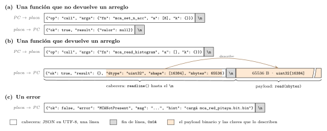
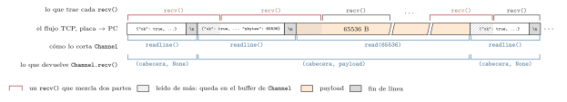

# Referencia del protocolo

**Código:** [`API/mca_net.py`](../../software/API/mca_net.py) (framing) · [`app/mca_server.py`](../../software/app/mca_server.py) (despacho) · [`API/mca_remote.py`](../../software/API/mca_remote.py) (cliente)
**Puerto por defecto:** 1001 · **Versión:** 2 (`PROTOCOL_VERSION`; la 2 agregó la op `call`)
**Por qué es así:** [`flujo_de_datos.md`](flujo_de_datos.md)

Todas las operaciones, sus argumentos y lo que devuelven. El *porqué* del diseño
está en [`flujo_de_datos.md`](flujo_de_datos.md); acá está el contrato.

---

## La trama

Un mensaje es **una línea JSON UTF-8 terminada en `\n`**, seguida opcionalmente
de `nbytes` crudos. Nada más. No hay handshake, no hay longitud previa, no hay
números mágicos.



*Un mensaje es una cabecera JSON en UTF-8, en una sola línea que termina en `\n`, y a
veces un payload binario; el cliente nunca manda payload. (a) Una función que no
devuelve un arreglo: el resultado viaja dentro del JSON, en `valor`. (b) Una que
devuelve un arreglo: la cabecera declara su largo, su tipo y su forma (`nbytes`,
`dtype`, `shape`), y los bytes del arreglo van detrás, crudos. El payload no está a
escala: son 65536 B contra unos 80 de cabecera. (c) Un error trae el tipo de la
excepción, para que el cliente levante el mismo.*

**Petición** — el cliente nunca manda payload:

```json
{"op": "read.spectrum", "args": {}}
```

**Respuesta sin datos:**

```json
{"ok": true, "result": {"val": 317}}
```

**Respuesta con datos** — la cabecera describe el bloque que viene detrás:

```json
{"ok": true, "result": {}, "dtype": "uint32", "shape": [16384], "nbytes": 65536}
```
seguida de exactamente 65536 bytes.

**Error:**

```json
{"ok": false, "error": "MCANotPresent", "msg": "no hay MCA en 0x40700000...", "hint": "cargá mca_red_pitaya.bit.bin"}
```

`error` es el nombre del tipo de la excepción original, y es lo que permite al
cliente distinguir un `MCANotPresent` (hay que cargar el bitstream) de un
`TimeoutError` (el barrido de borrado no terminó). `hint` siempre está presente;
vale `null` si no se pasó.



*El socket entrega un flujo de bytes sin límites entre mensajes. Cada `recv()` trae lo
que haya llegado, y a veces mezcla dos partes: el final de una cabecera y el principio
del payload, o el final del payload y la cabecera siguiente. `Channel` corta el flujo
por el `\n` en las cabeceras y por `nbytes` en el payload. Lo que lee de más queda en
su buffer de lectura y es el principio de lo que sigue: por eso el buffer tiene que
durar lo que dura la conexión, y `Channel` es un objeto y no dos funciones.*

> **El framing exige un lector con buffer.** Se mezclan líneas y bloques, así
> que un `recv()` suelto se queda corto con 64 KB y se come el principio de la
> cabecera siguiente. `Channel` envuelve el socket en dos ficheros separados
> (`'rb'` y `'wb'`) y no en un `makefile('rwb')`, porque el par de
> lectura/escritura hereda el `readline()` genérico, que va byte a byte.

Guarda de integridad: si el JSON serializado llegara a contener un `\n` se
aborta antes de escribir, en vez de desincronizar el stream sin diagnóstico.

---

## Las operaciones

La lista viva es el dict `_OPS` de
[`mca_server.py:277`](../../software/app/mca_server.py#L277), que además
**valida los nombres de los argumentos**: un argumento no reconocido es un
`ValueError`, no un valor ignorado en silencio.

| op | args | devuelve |
|---|---|---|
| `identify` | — | geometría y estado del bitstream (dos formas, abajo) |
| `r32` | `off` | `{"val": int}` |
| `w32` | `off`, `val` | `{}` |
| `config.get` | — | **todos** los campos de `_CAMPOS` (35 en el MCA2) |
| `config.set` | `fields` | la configuración **releída del hardware** |
| `ctrl.start` | `seconds`, `clear_first` | `{"running": true, "exposure_target_s": float\|null}` |
| `ctrl.stop` | — | `{"running": false}` |
| `ctrl.clear` | `timeout_s` | `{}` |
| `status` | — | contadores, tasas y estado de la exposición |
| `read.spectrum` | — | **binario** `uint32[2^h_aw]` |
| `read.map2d` | — | **binario** `uint32[2^h2_aw, 2^psd_aw]` |
| `read.metadata` | — | las ~39 claves que acompañan a un espectro guardado |
| `read.last_event` | — | `{amp, psd, q_tot, q_tail, baseline}` |
| `fpga.state` | — | `{"state": str}` |
| `fpga.load_bitstream` | `path` | el `identify` del bitstream nuevo |
| `integracion.get` | — | `modules`, `slots`, `caps`, `routes`, `status`, `run` |
| `integracion.set_route` | `consumidor`, `tap`, `enable` | el `get` de vuelta |
| `integracion.reset_routes` | — | el `get` de vuelta |
| `integracion.ctrl` | `que` | el `get` de vuelta |
| `osc.get` | — | `config` (16 campos), `status`, `base`, `n_buf`, `fs_hz` |
| `osc.set` | `fields` | el `get` de vuelta |
| `osc.ctrl` | `que` | `reset` o `sw_trig`, y el `get` de vuelta |
| `osc.capture` | `pre`, `post` | **binario** `float32[2, pre+post]` en volts |
| `mtrg.get` | — | `config`, `status`, los nombres de los bits, `base` |
| `mtrg.set` | `fields` | el `get` de vuelta |
| `mtrg.arm` | `mask_ch0`, `mask_ch1`, `thr`, `hyst`, `delay`, `auto_rearm` | el `get` de vuelta |
| `mtrg.disarm` | — | el `get` de vuelta |
| `mca.disparo` | `ch`, `armar`, `L`, `G`, `thr`, `hyst`, `fuente`, `mq` | el estado del disparo del MCA2: `pendiente`, `polo_cero`, `fuente`, `or_mask`, `armado`, `we_keep`, `shield` |
| `call` | `fn`, `a`, `k` | `{"valor": ...}` con el resultado de la función, o un arreglo **binario** (ver abajo) |
| `ring.iniciar` | `run_dir`, `pre`, `post`, `n_ch`, `slot_shift`, `generador` o `disparo`, `calib`, `formato`, `capacity`, `ram_mb`, `margen_mb`, `meta` | `run_dir`, `fs`, `n_slots`, `pool` |
| `ring.estado` | — | `corriendo`, `motivo`, `stats`, `hw`, `error` |
| `ring.parar` | — | `stats`, `hw_final`, `n_slots`, `motivo`, `error` |
| `gen.get` | — | `config` releída, `estado`, `lazo`, `lineas`, y lo derivado con libmca: `tasa_hz`, `tau_us`, `mq`, `sigma_ruido`; `base` |
| `gen.configurar` | `cfg` | la configuración **entera** (lo que falta queda en el reset del RTL); apaga el generador. El `get` de vuelta |
| `gen.ctrl` | `que` | `arrancar` o `parar`, y el `get` de vuelta |
| `gen.lazo` | `on` | `digital_loop[0]`: la entrada pasa a ser el generador. El `get` de vuelta |

`read.spectrum`, `read.map2d` y `osc.capture` traen payload binario, y `call`
cuando la función devuelve un arreglo (`mca_read_histogram`, `mca_read_map2d`).

**`mca.disparo` es la que hace medir al MCA2**: la ventana la abre sólo el
disparo del multitrigger. Con `armar: true` corre `multitrigger_armar_mca`
(en modo continuo, shield y `we_keep`), con `false` lo apaga (las dos fuentes) y
sin `armar` sólo informa. `fuente` es `pendiente` (el de siempre, con `L`, `G`,
`thr`, `hyst`) o `pz` (con polo-cero, con `mq`; `identify` dice si está en
`has_pz`). Necesita la región propia del multitrigger (base de `SLOTS`,
`bases.mtrg_region`) y el osciloscopio: `identify` dice si están en `has_disparo`.
`identify` trae también `n_formas_max`: las formas del banco de trapecios, 0 sin
banco.

**Las `integracion.*`, `osc.*` y `mtrg.*` fallan si el bitstream no trae su
bloque**, con un `RuntimeError` que lo dice. No es una condición de error del
cliente: cualquier bitstream anterior al refactor de registros no trae el
slot 6 y el MCA anda igual. Por eso `identify` publica `has_integracion`,
`has_osc` y `has_mtrg`, y el cliente ni siquiera crea la pestaña — mismo
criterio que con `has_2d`.

### `osc.capture`

La cabecera describe el bloque y trae con qué leerlo:

```json
{"ok": true, "result": {"pre": 256, "post": 1024, "wp": 14487, "dec": 1,
 "fs_hz": 125000000.0, "t_captura": 1789066542.81},
 "dtype": "float32", "shape": [2, 1280], "nbytes": 10240}
```

Tres cosas que el cliente necesita y no puede deducir:

- **`pre`** dice dónde está el trigger dentro del array — en el índice `pre`,
  que es el `t = 0` del gráfico. Sin esto la traza no se puede alinear.
- **`fs_hz`** ya viene dividida por la decimación, así que el eje de tiempo sale
  de ahí y no de una constante del cliente.
- **`t_captura`** es el reloj del **servidor** en el momento de leer. Es lo que
  permite marcar la misma captura sobre la curva de tasa: los dos números salen
  del mismo lado y no hay que confiar en que los relojes coincidan.

Los datos van en **volts**, no en cuentas: la conversión necesita la calibración
que la librería `rp` ya aplicó del lado de la placa.

La ventana se valida **en el servidor**, no sólo en la GUI: `pre + post` mayor
que `n_buf` es un `ValueError`, así que pedirla con `nc` falla igual.

Y **`n_buf` sale del bitstream, no de una constante.** El scope lo lee de su
propio `CAPS` (`Osciloscope.geometria()`) y el servidor publica ése. Importa
porque el hardware no se queja: las aperturas de BRAM miden 64 KB por canal
independientemente de `RSZ`, así que con `RSZ = 13` la mitad alta de cada una es
un alias de la baja y pedir 16384 muestras devuelve **el anillo dos veces**, sin
error. Si el límite se quedara en el `N_BUF` del módulo, la GUI ofrecería
ventanas que no existen y dibujaría el buffer repetido. Ver
[`docs/osc/register_map_osc.md`](../osc/register_map_osc.md#aperturas-bram).

### Las bases, y por qué viajan

`osc.get` y `mtrg.get` devuelven `base`, la dirección física del bloque, y
`identify` devuelve el mapa entero:

```json
{"has_osc": true, "has_mtrg": true, "has_integracion": false,
 "bases": {"osc": 1075838976, "mtrg": 1075838976},
 "bases_notas": ["osc: 0x40100000 (SLOTS coincide con la constante)"],
 "n_buf": 16384, "fs_hz": 125000000.0, "adc_cnt_per_v": 8192}
```

No es decorativo: **el multitrigger está en el slot 3 del top del MCA y en el 7
del `red_pitaya_top` clásico**. El servidor resuelve la base con el registro
`SLOTS` del slot 6 (`Integration.base()`) y, si no coincide con la constante,
**obedece lo descubierto y lo dice en `bases_notas`** — esa discrepancia es el
síntoma de estar corriendo contra otro bitstream, y verla es cómo se diagnostica.

Sin slot 6, o con un `SLOTS` ilegible, cae a las constantes de siempre: que el
descubrimiento falle no puede dejar al servidor sin osciloscopio.

> **El slot 6 se queda hardcodeado, y no es una inconsistencia.** Es la única
> base que no se puede descubrir — hay que leerla para poder leer las demás. Es
> dónde termina la recursión.

Y esto **no** repite el error de la geometría: lo que no hay que importar de esa
región es lo que otro bloque publica sobre sí mismo (`h_aw` ya divergió). `SLOTS`
es topología, no está duplicado en ningún lado, y es para lo que la región existe.

Las tres que escriben devuelven el `get` completo en vez de `{}`: el ruteo es
estado compartido y releerlo entero después de tocarlo evita que el cliente
mantenga una copia que puede quedar vieja.

> **`OPS` de `mca_net.py` es documentación**, no se importa en ningún lado, y
> por eso podía desincronizarse del despacho real sin que nada lo notara. Ahora
> hay un test que compara las dos listas
> ([`test_mca_remote.py`](../../software/app/tests/test_mca_remote.py)).

### `call`: la API entera, en la placa

Es la que sostiene todo lo demás (protocolo 2). `MCARemote` es un proxy: el
despacho de `@_api` manda cada función de `API/mca.py` ENTERA, y el servidor la
corre sobre su handle, bajo su lock, como un comando SCPI en Red Pitaya. **La
superficie `mca_*` entera funciona por red sin cambiar una línea**, y el
cliente no necesita libmca:

```python
from API.mca import mca_set_n_acc, mca_get_config, mca_read_histogram
from API.mca_remote import MCARemote

h = MCARemote.connect('10.73.28.27')
mca_set_n_acc(h, 4)              # read-modify-write: 1 ida y vuelta, atómica
cfg  = mca_get_config(h)         # 1
hist = mca_read_histogram(h)     # 1, con payload binario
```

```
->  {"op": "call", "args": {"fn": "mca_set_n_acc", "a": [4], "k": {}}}
<-  {"ok": true, "result": {"valor": null}}
```

- **Lista blanca**: sólo las funciones de hardware de `API/mca.py` que `@_api`
  registró con `remoto=True`. Las que esperan (`mca_read_acquire*`) no viajan:
  tendrían tomado el lock y congelarían la exposición. `MCARemote` las arma
  del lado del cliente con `start`, `sleep` y `stop` remotos, así que
  `mca_read_acquire(h, 1.0)` funciona igual.
- **Valores**: un arreglo vuelve como payload binario; lo demás, en
  `{"valor": ...}`, con las tuplas marcadas (`{"__tupla__": [...]}`) para que
  vuelvan tuplas, y los escalares de numpy como los de Python.
- **Errores**: vuelven con su tipo, y el cliente lanza una subclase de
  `RemoteError` **y** del tipo original (`ValueError`, `MCANotPresent`,
  `NoRemota`, ...), con el mismo mensaje que en la placa. Los de la familia de
  `OSError` (un `TimeoutError` del clear) quedan como `RemoteError` solo: un
  `OSError` en el cliente quiere decir que se cayó el transporte.
- `mca_stop` y `mca_clear` por `call` tienen sobre la exposición los mismos
  efectos que `ctrl.stop` y `ctrl.clear`.

Medido en la placa (`make bench-api-red`): ~0.6 ms por ida y vuelta; escribir
un campo cuesta 0.77 ms (antes, `r32` + `w32`: ~1.2 ms y no atómico) y un
espectro de 8192 canales, 3.5 ms. `app/tests/test_call.py` exige que cada
función dé lo mismo por red que localmente.

### `ring.*`: una adquisición del event_ring

Las tres ops corren una adquisición del ring **en la placa**: la sesión entera
(`AdquisicionRing`: `RingSource` y `AcquisitionSession`), que escribe sus chunks en
`run_dir`. `run_dir` es un camino de la placa: la SD, `/dev/shm`, o un directorio de la
PC montado por NFS, que es como los datos llegan a la PC. Por el socket va sólo el
control ([`generador.md`](../event_ring/generador.md) §6, «La etapa C por la red»).

- **`ring.iniciar`** arma y arranca.
  - **El estímulo es uno de dos:** `generador` (el dict de
    `API.generadores.disparos`), o `disparo` (`{thr, hyst, mask}`, el disparo real con
    el multitrigger).
  - **`calib`** es una calibración por canal; si no viene, se lee la EEPROM.
  - **Las reglas:**
    - `run_dir` tiene que ser absoluto, y su padre tiene que existir: el servidor crea
      la corrida, no el punto de montaje.
    - Hay una adquisición por vez.
  - **Devuelve `fs`**, el tipo del sistema de archivos donde escribe.
- **`ring.estado`** no la frena. Trae:
  - `stats`, las de la sesión;
  - `hw`, los contadores del ring, y con el generador `hw_gen_cnt` y
    `hw_gen_terminado`;
  - `motivo`: `null` mientras corre, `error`, `disk` o `source`.

  Ya parada, devuelve lo final.
- **`ring.parar`** para la sesión y el ring. Si el ring quedó lleno sin créditos, lo
  destraba y lo dice en `error`. Devuelve los contadores con el ring parado
  (`hw_final`). Repetida, devuelve lo mismo.

Igual que la exposición del MCA, **la adquisición sigue si el cliente se va**:
`identify` trae `ring_corriendo`, y `has_ring` y `has_gen` dicen si el bitstream trae
el ring y su generador. `fpga.load_bitstream` se rechaza mientras corre una. Las tres
ops tienen un lock propio, no el del MCA: parar una adquisición puede tardar segundos.

### `r32` / `w32`

El acceso crudo a un registro, para depurar: `h.r32(off)`, `h.w32(off, v)`.

Las demás operaciones existen sólo para ahorrar idas y vueltas (`config.get`
son 35 campos) o para que una secuencia sea **atómica del lado de la placa**
(`ctrl.clear` poléa `clear_busy` cada milisegundo: por red serían decenas de
vueltas, y además podría cruzarse con el hilo de exposición).

### `identify`

Con MCA presente:

```json
{"presente": true, "magic": 1296253234, "caps": 3, "h_aw": 13, "h2_aw": 7,
 "psd_aw": 6, "n_channels": 8192, "map2d_shape": [128, 64], "has_2d": true,
 "hist_h": true, "hist_h_psd": true, "trap": false, "n_acc_max": 4,
 "features": true, "running": false, "has_disparo": true,
 "protocol": 2, "fake": false, "fpga_state": "operating", "impl": "c",
 "bitstream": "/root/mca_red_pitaya.bit.bin"}
```

Sin MCA —bitstream equivocado o PL sin programar— **la operación no falla**:

```json
{"presente": false, "error": "MCANotPresent: ...", "caps": 0, "h_aw": 0,
 "h2_aw": 0, "psd_aw": 0, "n_channels": 0, "map2d_shape": [0, 0],
 "protocol": 2, "fake": false, "fpga_state": "operating"}
```

> **`identify` contesta siempre, y eso es deliberado.** Es lo que permite
> conectarse a un servidor sin MCA para pedirle `fpga.load_bitstream` y
> arreglarlo desde la GUI. Todas las demás operaciones contestan
> `MCANotPresent` mientras tanto.

La geometría (`h_aw`, `h2_aw`, `psd_aw`) sale del registro `WIDTHS` del propio
`mca_top`, no de constantes: el cliente **nunca hardcodea 16384**. Lo mismo vale
para `n_buf`, que es geometría del *scope* y sale de su `CAPS`: son dos números
distintos —canales del histograma y muestras del anillo— que valían 16384 por
casualidad.

### `status`

Es lo que poléa la GUI cada 200 ms: todo lo que va en pantalla salvo el
espectro, en una sola vuelta.

```json
{"presente": true, "running": true, "baseline_now": 2129,
 "rate_inst_hz": 3048.2, "rate_avg_hz": 3051.7,
 "tasa_entrada_inst_hz": 3112.9, "tasa_entrada_hz": 3108.4,
 "counters": {"total": 41502, "accepted": 41502, "rej_amp": 0, "rej_psd": 0,
              "pileup": 0, "dropped": 4, "realtime_s": 13.83,
              "livetime_s": 13.59, "deadtime_real_s": 0.245, "n_acc": 4,
              "t_ocup_s": [13.59, 0.23, 0.01, 0.0, 0.0], ...,
              "clear_busy": false, "busy": false, "puede_abrir": true},
 "exposure": {"target_s": 50.0, "left_s": 36.4, "done": false},
 "gen": {"gen_cnt": 41630, "generando": true, "terminado": false,
         "desborde": false, "lazo": true, ...}}
```

`rate_inst_hz` es Δ`accepted`/Δ`livetime` entre dos `status` consecutivos —el
servidor guarda la muestra anterior—, y `rate_avg_hz` es `accepted`/`livetime`.
Son los dos números de la aplicación de referencia, y los que dibuja la curva
"MCA (aceptados)" de la pestaña OSC.

`tasa_entrada_hz` es la tasa de los pulsos que **llegan**, corregida por tiempo
muerto: λ̂ = (`cross` − `lost_veto`) / (`realtime` − `vetotime` − `t_rearm`), y
`tasa_entrada_inst_hz` lo mismo entre dos `status`. Los perdidos sin ranura o
esperando al publicador cuentan, porque llegaron; el re-armado del disparo sale
del denominador porque un pulso que llega en ese tiempo no genera flanco y no se
puede contar. Es lo que muestra la pestaña del espectro.

`gen` es el estado corto del generador de pulsos, o `null` si el bitstream no lo
trae. Viaja en el `status` por el `lazo`: con el lazo prendido el MCA mide el
generador y no la entrada, y la GUI lo avisa en la barra superior desde cualquier
pestaña sin pedir nada más.

`exposure.target_s` es **livetime absoluto acumulado**, no un delta: una segunda
exposición sin borrar antes continúa donde iba.

### `ctrl.start`

`seconds` a `null` arranca sin límite. Con un valor, arma el hilo vigilante que
parará solo al llegar a ese tiempo **vivo**. `clear_first` borra histogramas,
contadores y relojes antes de arrancar.

### `fpga.load_bitstream`

`path` a `null` usa el bitstream con el que arrancó el servidor. Rechaza si hay
una adquisición corriendo, y en modo `--fake` rechaza siempre. La secuencia
completa está en [`flujo_de_datos.md`](flujo_de_datos.md#la-carga-de-bitstream-paso-a-paso).

---

## Errores

Dos familias, con dos tratamientos distintos.

**`ProtocolError`** — la trama no se entiende o la conexión se cortó a la mitad:
cabecera ilegible, cabecera de más de 64 KB sin terminar, payload truncado,
falta el `dtype`/`shape` de un bloque. Es local a `mca_net.py`; **no viaja por
la red**. Del lado del servidor rompe el lazo de atención sin contestar.

**`RemoteError`** — el otro lado contestó `ok: false`. Conserva `.error`,
`.msg` y `.hint`. Se levanta en un único punto, al desempaquetar la respuesta.

Política del cliente, que son dos y conviene no confundirlas:

| qué pasó                                                  | qué hace el cliente                                              |
| --------------------------------------------------------- | ---------------------------------------------------------------- |
| `OSError` (el transporte se murió)                        | **tira la conexión**: para los temporizadores y cierra el socket |
| cualquier otra, incluidas `RemoteError` y `ProtocolError` | la reporta en la pestaña de mensajes y **sigue poleando**        |

La distinción importa: un `RemoteError` por un `n_acc` inválido no debe
cortar una medición de media hora.

### El caso `Ocupado`

El servidor acepta **un cliente a la vez** —regla de hardware: un solo proceso
puede tener `/dev/mem` abierto— y al segundo le contesta y le cierra el socket:

```json
{"ok": false, "error": "Ocupado", "msg": "ya hay un cliente (10.73.28.47)",
 "hint": "un solo proceso puede tocar /dev/mem"}
```

> **Ese error llega antes de que el cliente pida nada.** `MCARemote.connect`
> manda `identify` y espera; lo que recibe es directamente el rechazo, que se
> convierte en `RemoteError('Ocupado', ...)` y cierra el canal.

---

## Una sesión con `nc`

Que esto se pueda hacer es el argumento entero a favor de que el control sea
JSON:

```console
$ printf '{"op":"identify","args":{}}\n' | nc 10.73.28.27 1001
{"ok": true, "result": {"magic": 1296253233, "n_channels": 16384, ...}}

$ printf '{"op":"r32","args":{"off":20}}\n' | nc 10.73.28.27 1001
{"ok": true, "result": {"val": 100}}
```

`off` va en decimal porque JSON no tiene literales hexadecimales: `20` es
`0x014`, o sea `R_THR`.

Para `read.spectrum` la cabecera se lee igual, pero los 64 KB que siguen son
binarios y `nc` los escupe crudos — para eso está el cliente.

---

## Ver también

[`flujo_de_datos.md`](flujo_de_datos.md), por qué el protocolo es así ·
[`referencia_api.md`](../API/referencia_api.md), las funciones que el servidor
expone y a qué registro pega cada una ·
[`register_map_mca.md`](../mca/register_map_mca.md), los offsets que aceptan
`r32`/`w32`
