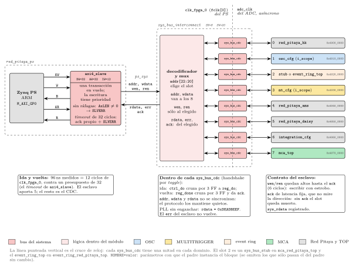
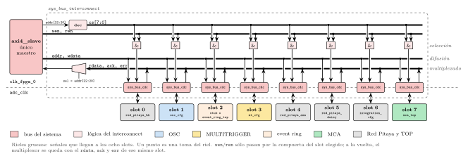
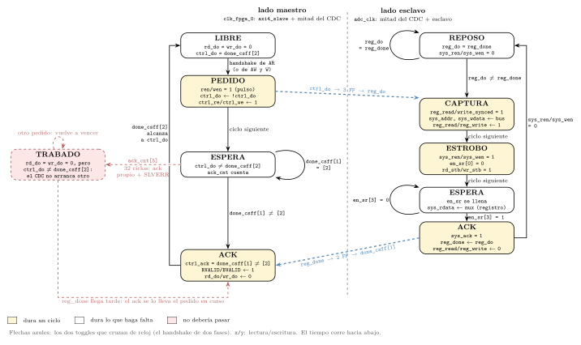
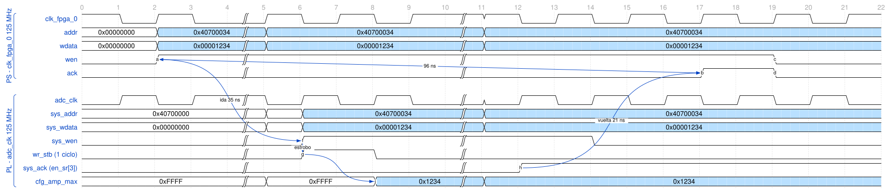
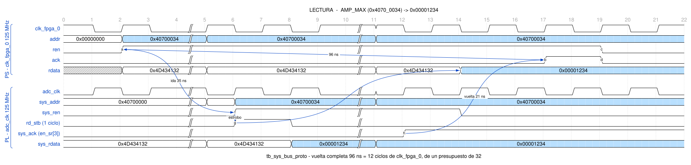
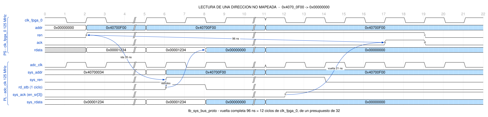
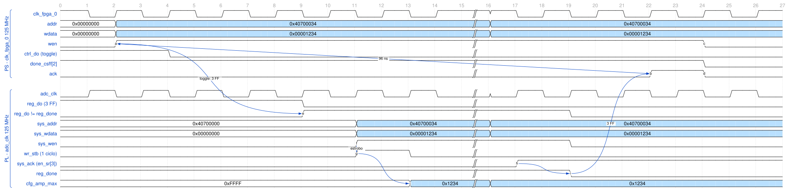
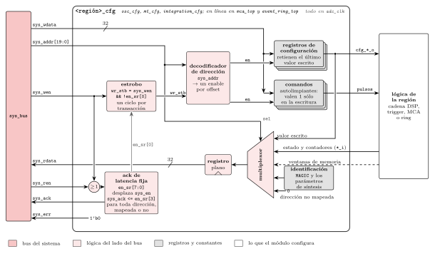
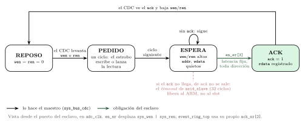
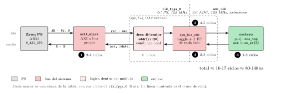

# El bus de sistema de la Red Pitaya

Cómo llega una escritura de `/dev/mem` desde el ARM hasta un registro en la PL,
qué contrato tiene que cumplir un esclavo, y cuáles son los modos de falla —
incluido uno que estuvo latente en este diseño hasta el refactor de registros
(§7.1) y otro que **reinicia la placa** (§7.3 a §7.6).

**Si llegaste acá porque algo se rompió:** §7.3 es el reinicio por lectura
masiva, §7.4 el SIGBUS por `pack_into`, §7.5 explica por qué el mismo error
tiene esos dos finales, y §7.6 es el método para aislarlo. Si venís a hacerlo
más rápido, la tabla de opciones está en §10.1.

Referencia para escribir bloques nuevos. El ejemplo trabajado es
[`mca_top.sv`](../../modulos/mca/rtl/mca_top.sv); las decisiones de ese bloque están
en [`decisiones_diseno_mca.md`](../mca/decisiones_diseno_mca.md).

---

## 1. Qué es

No es AXI. Es un bus **propio de Red Pitaya**, muy simple, que cuelga de un
único puerto AXI del PS y se reparte entre 8 esclavos. Existe porque los
bloques de la PL sólo necesitan registros de 32 bits sueltos: montar un
crossbar AXI completo para eso sería desproporcionado en un Zynq-7010.

Características, y sus consecuencias:

| Propiedad | Consecuencia práctica |
|---|---|
| Una sola transacción en vuelo | No hay pipelining: cada acceso paga la latencia completa |
| Sólo transferencias simples (sin ráfagas) | Leer un buffer de 16k palabras son 16k transacciones |
| Lectura y escritura mutuamente excluyentes | — |
| Handshake por `ack`, sin límite de tiempo del lado del esclavo | Un esclavo puede tomarse los ciclos que quiera… **pero si nunca contesta, rompe cosas** (§7) |

---

## 2. Mapa de direcciones

```
0x4000_0000  ┌──────────────────────┐  slot 0   red_pitaya_hk      (LEDs, GPIO, DNA)
0x4010_0000  ├──────────────────────┤  slot 1   OSC                (osc_cfg)
0x4020_0000  ├──────────────────────┤  slot 2   event_ring         (libre en el build MCA)
0x4030_0000  ├──────────────────────┤  slot 3   MULTITRIGGER       (mt_cfg)
0x4040_0000  ├──────────────────────┤  slot 4   red_pitaya_ams     (XADC/PDM)
0x4050_0000  ├──────────────────────┤  slot 5   red_pitaya_daisy
0x4060_0000  ├──────────────────────┤  slot 6   TOP / integración  (integration_cfg)*
0x4070_0000  ├──────────────────────┤  slot 7   MCA                (mca_top)
0x4080_0000  └──────────────────────┘
```

\* El slot 6 no está libre en todas las variantes: en `` `ifdef Z20_G2 `` lo
ocupa `i_serlines_add`. El build del MCA es `xc7z010` con `` `define Z10 ``, así
que esa rama nunca se toma.

Cada módulo propio del proyecto tiene **su slot, su decodificador y su `ack`**.
El detalle de cada región —incluida la ventana de compatibilidad legacy del
OSC, que mantiene vivos los offsets que usa `librp`— está en
[`register_map_top.md`](register_map_top.md).

En el build del MCA los slots 2 (ASG) y 3 (PID) quedaron libres al eliminar
esos módulos; el 3 lo ocupa ahora el multitrigger.

**Parámetros** (`red_pitaya_top.sv:361`):

```systemverilog
sys_bus_interconnect #(.SN (8), .SW (20)) sys_bus_interconnect (...)
```

- `SN = 8` esclavos → `SL = $clog2(8) = 3` bits de selección
- `SW = 20` → cada slot tiene `2^20 = 1 MB`

**Decodificación** (`rtl/sys_bus_interconnect.sv:63-64`):

```systemverilog
assign bus_s_a  = bus_m.addr[SW +: SL];   // addr[22:20] -> índice de slot
assign bus_s_cs = SN'(1) << bus_s_a;      // chip select one-hot
```

El esclavo recibe la dirección **absoluta y sin enmascarar** (p. ej.
`0x40100218`), no un offset. Por eso todos decodifican sobre `sys_addr[19:0]` y
simplemente ignoran los bits altos.

### Aliasing

La ventana asignada a GP0 es de **1 GB** (`ip/systemZ10.tcl:883`:
`-offset 0x40000000 -range 0x40000000`), pero el interconnect sólo mira
`addr[22:20]`. Los bits `[31:23]` **no se decodifican**, así que el bloque de
8 MB se repite cada 8 MB hasta `0x7FFF_FFFF`.

Consecuencia: `0x4000_0000` y `0x4080_0000` son **la misma dirección física**.
No es un problema en la práctica, pero explica por qué agregar un slot 9 exige
cambiar `SN` y no basta con elegir una dirección más alta.

---

## 3. La cadena completa



De izquierda a derecha:
- El ARM habla AXI4 por `M_AXI_GP0`, con los cinco canales AW, W, B, AR y R.
- [`axi4_slave`](../../../../rtl/axi4_slave.sv) lo traduce al bus custom
  `ps_sys`. Impone tres cosas: sin ráfagas, una transacción en vuelo y un
  *timeout* de 32 ciclos (§7).
- [`sys_bus_interconnect`](../../../../rtl/sys_bus_interconnect.sv) decodifica
  `addr[22:20]`, difunde `addr`/`wdata` a los ocho, habilita `wen`/`ren` sólo
  del slot elegido y multiplexa `rdata`/`err`/`ack` de vuelta.
- Cada slot cruza de `clk_fpga_0` a `adc_clk` por su propio `sys_bus_cdc`
  (§6), y del otro lado está el esclavo.

La fuente es [`figuras/panorama_sys_bus.tex`](figuras/panorama_sys_bus.tex)
(TikZ).

Detalle importante del interconnect (`sys_bus_interconnect.sv:96-97, 123-125`):

```systemverilog
assign bus_int_i[i].wen = bus_s_cs[i] & bus_m.wen;   // sólo el slot elegido
assign bus_int_i[i].ren = bus_s_cs[i] & bus_m.ren;
...
assign bus_m.rdata = bus_s_rdata[bus_s_a];           // mux de retorno
assign bus_m.ack   = bus_s_ack  [bus_s_a];
```

`addr` y `wdata` van a **todos** los esclavos; lo que discrimina es `wen`/`ren`.

Dibujado como bus, no es un medio compartido de tres estados: es una estrella
con tres mecanismos. `addr` y `wdata` se **difunden** por un mismo riel a los
ocho slots; `wen` y `ren` se **seleccionan** con una compuerta por slot, así que
sólo los recibe el que eligió el decodificador; y `rdata`, `ack` y `err`
vuelven por un riel que un **multiplexor** reduce a uno:



La fuente es [`figuras/estructura_sys_bus.tex`](figuras/estructura_sys_bus.tex).

---

## 4. La interfaz `sys_bus_if`

`rtl/interface/sys_bus_if.sv`:

```systemverilog
interface sys_bus_if #(
  int unsigned DW = 32, int unsigned AW = 32, int unsigned SW = DW/8
)(input logic clk, input logic rstn);
  logic          wen  ;   // write enable
  logic          ren  ;   // read enable
  logic [AW-1:0] addr ;   // dirección ABSOLUTA de 32 bits
  logic [DW-1:0] wdata;
  logic [DW-1:0] rdata;
  logic          ack  ;
  logic          err  ;
  modport m (input clk, rstn, output wen, ren, addr, wdata, input rdata, ack, err);
  modport s (input clk, rstn, wen, ren, addr, wdata, output rdata, ack, err);
endinterface
```

Siete señales. No hay `strobe` de bytes: **todos los accesos son de 32 bits**.

---

## 5. Los dos dominios de reloj

Éste es el punto que más confusión genera:

| Dominio     | Reloj                    | Origen                                       |
| ----------- | ------------------------ | -------------------------------------------- |
| Controlador | `clk_fpga_0` (`fclk[0]`) | PS7, 125 MHz (`ip/systemZ10.tcl:384`)        |
| Registros   | `adc_clk`                | PLL alimentado por el reloj del ADC, 125 MHz |

**Son 125 MHz los dos, pero son ASÍNCRONOS**: vienen de fuentes distintas y no
tienen relación de fase. Por eso hace falta un CDC por slot, y por eso los
`set_max_delay -datapath_only` del XDC.

En el top, los 8 esclavos se declaran directamente en `adc_clk`
(`red_pitaya_top.sv:226-227`):

```systemverilog
sys_bus_if ps_sys      (.clk (fclk[0]), .rstn (frstn[0]));
sys_bus_if sys [8-1:0] (.clk (adc_clk), .rstn (adc_rstn));
```

**Un esclavo nuevo no necesita CDC propio**: ya trabaja en `adc_clk` y el cruce
lo hace el interconnect.

---

## 6. El handshake del CDC

`rtl/sys_bus_cdc.sv`. Es un **handshake por toggle**, no un FIFO.

En la jerga de handshakes es uno de **dos fases** (por transición): cada
transacción es un solo cambio de `ctrl_do` a la ida y uno de `reg_done` a la
vuelta, sin volver a cero. Lo que cruza es un evento que queda fijo hasta la
transacción siguiente, así que no importa la fase entre los dos relojes. **No es
de cuatro fases**: del lado del esclavo, el CDC baja `wen`/`ren` apenas ve el
`ack` y nunca espera a que el `ack` baje. Funciona porque el pedido siguiente
no puede llegar antes de que se apague: tiene que dar la vuelta entera por el
CDC.

Cada mitad del handshake es una máquina de estados en su reloj. La del lado
maestro la forman `axi4_slave` y la mitad controladora del CDC; la del lado
esclavo, la mitad de registros del CDC y el esclavo. Las dos sólo se hablan por
los dos toggles, las flechas azules:



La fuente es [`figuras/fsm_sys_bus.tex`](figuras/fsm_sys_bus.tex). A diferencia
de la [vista del contrato](figuras/contrato_sys_bus.svg) (§8), acá el lado
maestro **sí** tiene un estado de falla, TRABADO. El *timeout* de
`axi4_slave` lo saca de ESPERA, pero el CDC queda con `ctrl_do ≠
done_csff[2]`, que no es LIBRE.

**Lado controlador** (`fclk[0]`):

```systemverilog
if ((ctrl_do == ctrl_done_csff[2]) && (ctrl_we_iw || ctrl_re_iw))
   ctrl_do <= !ctrl_do ;                      // arranca una transacción
ctrl_done_csff <= {ctrl_done_csff[1:0], reg_done} ;   // sincroniza la vuelta

assign ctrl_ack = ctrl_done_csff[1] != ctrl_done_csff[2] ;  // pulso de 1 ciclo
```

**Lado registros** (`adc_clk`):

```systemverilog
reg_do <= reg_do_csff[1];                     // ctrl_do sincronizado
if (reg_ack_sync) reg_done <= reg_do ;        // reg_ack_sync = (rd||wr) && bus_m.ack

assign reg_write_synced = (reg_do != reg_done) && reg_we_csff[1] ;
assign reg_read_synced  = (reg_do != reg_done) && reg_re_csff[1] ;

reg_write <= reg_write ? !bus_m.ack : reg_write_synced ;
reg_read  <= reg_read  ? !bus_m.ack : reg_read_synced ;
```

Lo que hay que retener:

1. **`wen`/`ren` quedan altos hasta el ack**: 6 ciclos con `mca_top` (48 ns
   medidos en §6.1). Un esclavo
   que ejecute su `case` incondicionalmente lo va a ejecutar **varias veces por
   transacción**. Si algún registro es autolimpiante o dispara un pulso, hace
   falta un estrobo de un ciclo (§8).
2. **`addr` y `wdata` quedan estables** toda la transacción
   (`sys_bus_cdc.sv:132-139`), así que se pueden usar directo como dirección de
   BRAM.
3. **La transacción avanza SÓLO cuando el esclavo hace `ack`**: `reg_done` se
   actualiza únicamente con `reg_ack_sync`. De ahí sale el modo de falla de §7.
4. `bus_s.rdata = pll_locked_i ? bus_m.rdata : 32'hDEADBEEF`
   (`sys_bus_cdc.sv:74`): **leer `0xDEADBEEF` significa que el PLL del ADC no
   está enganchado**, no que el registro valga eso.
5. **El `err` del esclavo no vuelve.** `sys_bus_cdc.sv:73` es
   `assign bus_s.err = pll_locked_i ? 1'b0 : 1'b1;` — el CDC **nunca mira
   `bus_m.err`**. El único `err` que el software puede ver es el de "PLL sin
   enganchar"; el que levante un esclavo se pierde ahí. Verificado en
   `tb_sys_bus_proto`: una lectura a un slot con `sys_bus_stub` (que contesta
   `err=1`) llega al master con `err=0`.

Costo: unos **8-12 ciclos de ida y vuelta** por acceso.

### 6.1 Las ondas

Los diagramas que siguen **no son esquemas**: salen de simular el camino
real —`sys_bus_interconnect` con su `sys_bus_cdc` por slot, y `mca_top` colgado
del slot 7— en
[`tb_sys_bus_proto.sv`](../../sim/tb_sys_bus_proto.sv). Los tiempos escritos en
las etiquetas los mide el script sobre el VCD. Los genera
[`figuras/bus_sistema/figuras_bus_sistema.py`](figuras/bus_sistema/figuras_bus_sistema.py);
el detalle de cómo, en [su README](figuras/bus_sistema/README.md).

Las tres primeras muestran el **protocolo**, con el CDC como caja negra: sólo
los dos puertos del bus, el del master en `clk_fpga_0` y el del esclavo en
`adc_clk`, y cada cruce como una flecha con lo que tarda. La última es la misma
escritura con el **toggle por dentro**, y acompaña al paso a paso.

**Cómo leerlas.** Cinco convenios, los mismos en todas las figuras:

| En el dibujo | Qué significa |
|---|---|
| Una columna | Un **semiciclo de `clk_fpga_0`** (4 ns). `adc_clk` es asíncrono y queda cuantizado a esa grilla: se dibuja corrido una columna, no con su desfasaje real |
| El par de **eses encontradas** | Un **salto temporal**: ahí no cambia ninguna de las señales dibujadas —un sincronizador corriendo, o el shift register del esclavo contando— y se sacó para acortar la figura. Lo ubica el script midiendo el VCD, no está puesto a mano |
| Flechas **ida** y **vuelta** | Lo que tarda cada cruce del CDC, de puerto a puerto: del `wen`/`ren` del master al del esclavo, y del `ack` del esclavo al del master |
| Bus **azul** | La **carga útil de esta transacción**: la dirección que se va a decodificar, el dato que se escribe, el que vuelve. Se puede seguir con la vista mientras baja por el sistema |
| Bus **blanco** | El bus parado, o todavía con la sobra de la transacción anterior. Eso último es lo que se ve en `sys_addr` antes del cruce: `sys_bus_cdc` sólo recarga `bus_m.addr` cuando arranca una transacción nueva, así que entre acceso y acceso queda la dirección vieja |

#### Escritura — `AMP_MAX (0x4070_0034) ← 0x00001234`



El master pone `addr` y `wdata`, levanta `wen` y sostiene los tres hasta ver el
`ack`. La flecha de **ida** es lo que tarda ese pedido en aparecer del lado del
esclavo, y la de **vuelta** lo que tarda el `ack` del esclavo en llegarle al
master. Entre las dos está el esclavo: `sys_wen` queda alto hasta el `ack`, así
que `mca_top` escribe con `wr_stb`, un estrobo de un ciclo, y ahí aterriza
`cfg_amp_max`. El `ack` sale de `en_sr[3]`, con latencia fija.

#### Lectura — el mismo registro de vuelta



La ida es **idéntica** a la de la escritura —mismo toggle, mismos tres flops,
mismo estrobo, sólo cambia `ctrl_re` por `ctrl_we`—, así que lo propio de la
lectura está en la vuelta.

El dato aparece en `sys_rdata` en el dominio `adc_clk`, registrado y congelado,
unos 53 ns —casi siete ciclos— **antes** de que el `ack` termine de cruzar a
`clk_fpga_0`.
Y en el camino **no hay ningún sincronizador**: `rdata` atraviesa el CDC como un
`assign` crudo (`bus_s.rdata = pll_locked_i ? bus_m.rdata : 32'hDEADBEEF`,
`sys_bus_cdc.sv:74`). No hace falta sincronizarlo: el **`ack` es** la garantía de
que el dato ya se asentó, así que cuando el master lo muestrea —en el ciclo de
`clk_fpga_0` en que ve el ack— está leyendo un valor que no se movió en varios
ciclos de `adc_clk`.

Lo que sí se timea de verdad es ese cruce de 32 bits, con ~0.94 ns de margen.
De ahí sale la regla 4 del §8: `sys_rdata` tiene que ser un **registro plano**,
nada de lógica combinacional ancha.

#### Dirección no mapeada — la figura del modo de falla de §7.1



`0x0F00` no está en el mapa de `mca_top`: cae en el `default` del `casez` y
devuelve 0 — y ese 0 va en azul, porque es la respuesta de esta transacción, no
el bus parado.

Lo que importa es que **el handshake es el mismo ciclo a ciclo**: el `ack` sale
de `en_sr[3]`, un shift register de `adc_clk` alimentado por `sys_wen|sys_ren`
que no mira la dirección, así que la latencia de la vuelta es idéntica a la de
las otras dos figuras.

Si el `ack` dependiera de la dirección, esta transacción no lo levantaría nunca,
y la cadena de consecuencias cruza los dos dominios: `reg_done` no alcanza a
`reg_do` → el strobe de lectura queda pegado en alto del lado `adc_clk` →
`ctrl_do` no puede volver a togglear del lado `clk_fpga_0` → el CDC del slot
queda desincronizado para siempre. No es una lectura mala, es un slot muerto
(§7.1).

**Medido en las tres: 96 ns de vuelta completa = 12 ciclos de `clk_fpga_0`**,
sobre un presupuesto de 32. El esclavo aporta 5 de esos 12 (40 ns, de `sys_wen`
a `sys_ack`); el resto es el CDC, 35 ns de ida y 21 de vuelta.

#### El CDC por dentro — la misma escritura



Seis pasos; al lado de cada uno, el reloj en el que pasa. **En la ida el origen
es `clk_fpga_0` y el destino `adc_clk`; en la vuelta se invierten.**

1. **`clk_fpga_0` (origen).** El master pone `addr` y `wdata` y levanta `wen`.
   En ese mismo flanco el CDC evalúa
   `(ctrl_do == ctrl_done_csff[2]) && (wen || ren)` —cierto, porque la
   transacción anterior terminó— e **invierte `ctrl_do`**
   (`sys_bus_cdc.sv:64`), y en paralelo latchea `ctrl_we`
   (`sys_bus_cdc.sv:84-90`). Es un **toggle, no un pulso**: por eso no importa
   cuánto dure el ciclo del destino ni que los relojes no tengan relación de
   fase. Notar que `wen` llega ya filtrado por el interconnect
   (`bus_int_i[i].wen = bus_s_cs[i] & bus_m.wen`), así que de los ocho CDC
   arranca sólo el del slot 7, aunque los ocho vean `addr` y `wdata`.
2. **`adc_clk` (destino).** `ctrl_do` entra por **tres** flops —`reg_do_csff[0]`,
   `[1]` y `reg_do` (`sys_bus_cdc.sv:107-108`)— y recién en el tercero
   `reg_do != reg_done` se hace cierto: ese es el precio del cruce, y es lo que
   mide la flecha `toggle: 3 FF`. Son 3 ciclos de `adc_clk` más hasta uno de
   incertidumbre del primer muestreo, porque la fase entre los dos relojes es
   arbitraria. `ctrl_we` cruza por su propio par (`reg_we_csff`), así que cuando
   `reg_write_synced = (reg_do != reg_done) && reg_we_csff[1]` sube, ya está
   decidido que es escritura y no lectura.
3. **`adc_clk`.** El mismo flanco que levanta `reg_write_synced` carga
   `bus_m.addr` y `bus_m.wdata` desde `bus_s` (`sys_bus_cdc.sv:132-139`): ahí es
   donde el bus se pone azul del lado de la PL. Esos 64 bits **no pasan por
   ningún sincronizador**, y está bien — de hecho un sincronizador por bit sería
   peor, porque resuelve metaestabilidad pero no garantiza que los 32 bits
   lleguen del mismo ciclo. Lo que los hace seguros es el protocolo: el master
   los dejó quietos antes de levantar `wen` y los sostiene hasta el `ack`, así
   que el registro de destino los captura con la fuente estática. Lo que sí hay
   que hacer es **timearlos**, y de eso no se ocupan los `set_max_delay` del §9
   —ésos cubren sólo las cuatro señales del handshake—: el camino de datos se
   timea como un camino normal entre dos relojes de 125 MHz.
4. **`adc_clk` (el esclavo).** `sys_wen` queda alto **seis ciclos**, hasta que
   el `ack` lo baja. `mca_top` lo convierte en `wr_stb`, un estrobo de un ciclo,
   y ahí aterriza `cfg_amp_max`: el azul llega al registro. Sin el estrobo el
   `case` del esclavo se ejecutaría **seis veces por transacción** — con
   registros de configuración es inocuo, con un bit autolimpiante no (§8).
5. **`adc_clk` → arranca la vuelta.** `sys_ack` sale de `en_sr[3]`: cinco
   ciclos fijos desde `sys_en` —cuatro etapas del shift register y el registro
   de `sys_ack`—, **sin mirar la dirección**. Con
   `reg_ack_sync = (reg_write || reg_read) && bus_m.ack`, `reg_done <= reg_do`
   iguala el toggle del lado destino; el mismo `ack` limpia `reg_write`
   (`reg_write <= reg_write ? !bus_m.ack : …`), así que `sys_wen` baja.
6. **`clk_fpga_0` (ahora el destino).** `reg_done` vuelve por
   `ctrl_done_csff[2:0]`, y `ctrl_ack = ctrl_done_csff[1] != ctrl_done_csff[2]`
   es un pulso de **un solo ciclo**, porque el valor pasa por la etapa `[1]` un
   ciclo antes que por la `[2]`. Eso es lo que chequea el testbench: si el ack
   durara dos ciclos, el master arrancaría una transacción de más. El master lo
   ve y baja `wen`; `addr` y `wdata` los suelta después.

---

## 7. Modos de falla

### 7.1 El grave: un esclavo que nunca hace `ack`

Es un **deadlock latente** del slot, no un simple error de lectura.

Si `sys_ack` nunca se levanta para una dirección:

1. `reg_done` nunca alcanza a `reg_do` → **`reg_do != reg_done` para siempre**.
2. `reg_read` (o `reg_write`) **queda alto permanentemente**: sólo se limpia con
   `bus_m.ack`.
3. Del lado controlador, `ctrl_done_csff` nunca cambia, así que
   `ctrl_do == ctrl_done_csff[2]` es **falso para siempre** → **`ctrl_do` no
   puede volver a togglear**: el CDC de ese slot no acepta más transacciones.
4. Mientras tanto, arriba, `axi4_slave.sv:180-193` salva al ARM:

   ```systemverilog
   assign ack = bus.ack || ack_cnt[5] || (rd_do && rd_errorw) || (wr_do && wr_errorw);
   ```

   `ack_cnt` es de 6 bits: a los **32 ciclos** de `clk_fpga_0` el AXI slave
   **fabrica un ack por su cuenta**, completa la transacción y devuelve lo que
   haya en `axi.RDATA` (que sigue a `bus.rdata` ciclo a ciclo,
   `axi4_slave.sv:174`).

**Resultado neto:** el ARM no se cuelga —el timeout lo rescata— pero
- el acceso tarda 32 ciclos en vez de ~12,
- devuelve un valor sin sentido **sin ninguna indicación de error**, y
- **el CDC del slot queda desincronizado**, con el strobe de lectura pegado en
  alto y la máquina del lado controlador incapaz de arrancar otra transacción.

El slot se "descongela" recién si una transacción posterior consigue un ack
—porque `reg_read_synced` sigue activo y `bus_m.addr` se sigue actualizando, así
que un acceso a una dirección válida sí puede hacer ack y destrabar el
handshake— pero ese acceso también sale corrupto.

**Conclusión de diseño: un esclavo tiene que hacer `ack` de TODA dirección de su
slot, mapeada o no.** El timeout de `axi4_slave` es una red de seguridad, no
parte del protocolo.

#### El caso concreto que hay en el árbol

`mt_rp_scope_cfg.sv:504-507` decodifica cuatro aperturas de BRAM, una
por canal:

```systemverilog
20'h1???? : begin sys_ack <= bram_ack_i[0]; sys_rdata <= ...bram_rd_dat_i[0]...; end
20'h2???? : begin sys_ack <= bram_ack_i[1]; sys_rdata <= ...bram_rd_dat_i[1]...; end
20'h3???? : begin sys_ack <= bram_ack_i[2]; sys_rdata <= ...bram_rd_dat_i[2]...; end
20'h4???? : begin sys_ack <= bram_ack_i[3]; sys_rdata <= ...bram_rd_dat_i[3]...; end
```

Pero el scope se instancia con `N_CH = 2`, así que los canales 2 y 3 no existen,
y un lazo de relleno los ata a cero (`rp_scope_mt_com.sv:572-573`):

```systemverilog
assign bram_rd_dat[(GM+1)*DW-1:GM*DW] = {DW{1'b0}};
assign bram_ack[GM]                   =  1'b0;      // <-- ack CONSTANTE 0
```

Entonces **cualquier lectura en `0x4013_0000`–`0x4014_FFFF` cae en el escenario
de arriba**: `sys_ack <= 1'b0` para siempre.

El `ack` de las aperturas buenas viene de `rp_acq_bram.v:50-56`, que es un
registro de desplazamiento de 4 etapas alimentado por `sys_en`:

```systemverilog
adc_rval <= {adc_rval[2:0], bram_ack_i};   // bram_ack_i = sys_en
assign bram_ack_o = adc_rval[3];
```

O sea que el ack **se genera a partir de la señal de habilitación**, no de nada
que confirme que la lectura ocurrió. Es un ack "a ciegas" con latencia fija — lo
cual funciona, pero deja el patrón expuesto a que alguien lo ate a cero.

**Estado: ARREGLADO.** `osc_cfg` reemplazó a `mt_rp_scope_cfg` y hace
`ack` de latencia fija para toda dirección, sin ninguna ruta de `ack` por
canal. Para los canales que sí existen el timing no cambió: `rp_acq_bram`
generaba `bram_ack_o` = `sys_en` retrasado 4 ciclos, que es exactamente el
`en_sr[3]` del esquema de §8.

`tb_osc_cfg` instancia los dos módulos y barre las mismas direcciones: **cero**
timeouts en el nuevo, **cuatro** en el viejo (`0x30000`, `0x40000`, `0x3FFFC`,
`0x4FFFC`). Esos cuatro accesos son la evidencia del bug y la regresión que
impide que vuelva.

Antes del arreglo era latente, no activo: el driver mapea
`SCOPE_SIZE = 0x30000` (`multitrigger_utils.py:40`), o sea offsets
`0x00000`–`0x2FFFF`, y nunca tocaba las aperturas rotas. Se habría disparado con
un `N_CH` distinto, un barrido de direcciones, o un off-by-one en un lazo de
lectura.

**Cómo lo evita `mca_top`**: ack de latencia fija desde un shift register
incondicional, sin ninguna ruta de ack por motor (§8). `tb_mca_top.sv` es la
regresión: barre todas las direcciones —incluidas las de motores apagados por
parámetro y las no mapeadas— y **falla si el ack no llega en ≤20 ciclos**.

### 7.2 Ráfagas y anchos raros

`axi4_slave.sv:101-102`:

```systemverilog
assign wr_errorw = (axi.AWLEN != 4'h0) | ~((axi.AWSIZE == 3'b010) | (axi.AWSIZE == 3'b001));
assign rd_errorw = (axi.ARLEN != 4'h0) | ~((axi.ARSIZE == 3'b010) | (axi.ARSIZE == 3'b001));
```

Ráfaga (`LEN != 0`) o transferencia que no sea de 4 o 2 bytes → error inmediato,
sin llegar al esclavo. Por eso **desde Python hay que escribir de a 32 bits
alineados**.

### 7.3 Lecturas MASIVAS: reinician la placa

**Verificado en hardware.** Un `np.frombuffer(mem, ...).copy()` de 16384
palabras sobre una apertura de la PL **reinicia la Red Pitaya**. Las mismas
16384 direcciones leídas de a una funcionan perfecto.

| Patrón | Resultado |
|---|---|
| 16384 lecturas de 32 b, de a una | OK, 6.7 us cada una (110 ms en total) |
| `np.frombuffer(...).copy()` del mismo rango | **REINICIA la placa** |
| 646 lecturas sueltas, incluidas direcciones no mapeadas | OK |

La causa es §7.2: el `memcpy` que hay detrás de la copia emite accesos anchos
(LDRD/NEON) o en ráfaga, y `axi4_slave` los rechaza. El error de AXI se propaga
como *external abort* y en esta placa **no da SIGBUS: reinicia el sistema**, sin
dejar nada en dmesg (sólo se nota porque `/proc/uptime` se resetea).

Reproducible con `prj/MCA/software/API/tests/placa/diag_mca_hw.py`, pasos `bulk` y `word`.

> **Ojo con el código existente.** `API/bench/bench_reader_budget.py` usa el mismo
> patrón (`np.frombuffer` + slicing) sobre las aperturas del scope. Que no haya
> dado problemas puede deberse a que las rebanadas son chicas y el memcpy no
> llega a usar instrucciones anchas — conviene revisarlo.

### 7.4 `struct.pack_into` sobre `/dev/mem`

No es del bus, pero se manifiesta acá y cuesta caro. `pack_into` hace un
`memset` previo que sobre memoria de dispositivo sale como **stores de a byte**,
y un acceso de 1 byte cae en la misma regla de §7.2 (`AWSIZE` tiene que ser
`3'b001` o `3'b010`, o sea 2 o 4 bytes: **el de 1 byte también se rechaza**). El
esclavo contesta `BRESP = SLVERR` y el puente GP0 lo entrega como *external
abort* → **SIGBUS** (en Jupyter: "el kernel murió"). Hay que escribir por
asignación de slice, que es un `memcpy` alineado de 4 bytes. Ver
`multitrigger_utils.py:393-403` y `API/tests/placa/test_rw_dev_mem.py`.

> La transacción **sí se completa**: `axi4_slave.sv:125` levanta `WREADY`
> también en el caso de error (`wr_errorw && axi.WVALID`) y responde con
> `SLVERR` en la línea 134. No es un cuelgue — es un rechazo explícito. El
> cuelgue por falta de `ack` es otra cosa, y es §7.1.

### 7.5 Los dos desenlaces, y qué los explica

§7.3 y §7.4 describen **el mismo error de bus con finales distintos**, y conviene
leerlas juntas porque la diferencia es informativa:

| Operación | Qué emite | Rechazo | Desenlace |
|---|---|---|---|
| `pack_into` (§7.4) | unos pocos stores de **1 byte** | `wr_errorw` | **SIGBUS**: muere el proceso, la placa sigue |
| `np.frombuffer().copy()` (§7.3) | miles de accesos **en ráfaga** | `rd_errorw` | **REINICIA la placa** |

Los dos pasan por `axi4_slave.sv:101-102`, los dos terminan en `SLVERR`, los dos
llegan al ARM como *external abort*. Entonces **un external abort no es fatal por
sí mismo** — la pregunta es por qué uno mata un proceso y el otro se lleva el
sistema.

Tres explicaciones posibles, no excluyentes:

1. **Preciso contra impreciso.** En ARMv7 un abort de lectura suele ser preciso
   (el kernel sabe qué instrucción fue y le manda `SIGBUS` al proceso), y uno de
   escritura suele ser impreciso, porque las escrituras son *posted*: el error
   vuelve mucho después, quizá en otro contexto. Un abort que no se puede
   atribuir, el kernel lo trata como fatal. **Nuestra evidencia no encaja con
   esto**: acá el que revienta el sistema es el de lectura.
2. **Contexto.** En espacio de usuario mata el proceso; en espacio de kernel es
   un *oops*, que escala a *panic* con un lock tomado o con `panic_on_oops`, y un
   panic con `panic=N` reinicia solo.
3. **El puerto queda trabado.** Hay evidencia independiente de esto en
   [`puesta_en_marcha.md`](../puesta_en_marcha.md): *"si el puerto GP0 llegó a
   abortar una vez queda trabado, y de ese estado no se sale de otra forma"*.

**La tercera explica las dos observaciones con un solo mecanismo**, y es la más
económica. Con `pack_into` hay unos pocos accesos fallidos y el proceso muere
enseguida: nadie vuelve a tocar el puerto. Con la lectura masiva, el `memcpy`
sigue iterando contra un puerto **ya trabado**, y la próxima transacción —que
puede ser del kernel o de un driver, no del proceso culpable— no falla: **no
termina nunca**. Una CPU esperando un `RVALID` que no llega termina disparando el
watchdog.

Si es así, el reinicio no es el kernel declarando el error grave: es la limpieza
de un interbloqueo de bus. Cambia el pronóstico — no hay parámetro del sistema
operativo que ajustar.

> **Esto no se puede atrapar.** Un abort impreciso no tiene a quién entregarse y
> un bus trabado no genera excepción: no hay `try/except` ni manejador de señal
> que sirva. Para cuando el síntoma aparece, el código culpable ya terminó. La
> única defensa es no emitir el acceso — por eso la docstring de
> `API/mca.py:_read_words` es parte de la corrección, no un comentario.

**Qué falta para cerrarlo.** El mecanismo del RTL está verificado y el
comportamiento está medido; **el camino dentro del kernel no**. Se resuelve con
una medición barata: reproducir el fallo con la **consola serie por UART0** —no
por SSH, que la red muere antes— y leer la última línea que imprime el kernel.
`imprecise external abort` es la explicación 1, `Kernel panic - not syncing` la
2, y un reinicio seco sin mensaje la 3. Complementos: `/proc/sys/kernel/panic`,
`/proc/cmdline` y si hay un watchdog activo.

### 7.6 El método de diagnóstico, por si vuelve a pasar

Vale la pena como método, porque el fallo **destruye su propia evidencia**: no
deja traceback (el proceso se va con el sistema), no deja `dmesg` (el reinicio se
lleva la red antes de que se pueda leer) y el test que lo disparaba hacía decenas
de operaciones distintas.

La salida fue **bisección con un testigo externo al proceso**:
[`API/tests/placa/diag_mca_hw.py`](../../software/API/tests/placa/diag_mca_hw.py)
corre **un paso por invocación**, del menos al más sospechoso (`regs`, `sweep`,
`bulk`, `word`, `clear`, `counters`), y cada paso **imprime `/proc/uptime` al
empezar**. Como el reinicio borra todo rastro adentro del proceso, es el uptime
del sistema el que delata que hubo un reinicio entre una invocación y la
siguiente, y atribuye el fallo al paso anterior sin ambigüedad.

El resultado fue limpio: `bulk` reinicia, `word` lee **las mismas direcciones** y
no. Como lo único que cambia es *cómo* se accede y no *a qué*, el problema quedó
acotado a la forma del acceso en un solo paso.

---

## 8. El contrato del esclavo

Todos los esclavos propios del proyecto siguen el mismo patrón: `osc_cfg`,
`mt_cfg` e `integration_cfg` como submódulos, y `mca_top` y `event_ring_top`
con el banco en línea.



Lo mínimo para no romper nada:

```systemverilog
wire sys_en = sys_wen | sys_ren;

// Estrobo de UN ciclo: wen/ren quedan altos hasta el ack (6 ciclos), así que
// sin esto el case se ejecuta varias veces por transacción.
reg [7:0] en_sr;
always @(posedge adc_clk_i) en_sr <= {en_sr[6:0], sys_en};
wire rd_stb = sys_en && !en_sr[0];
wire wr_stb = sys_wen && !en_sr[0];

always @(posedge adc_clk_i)
  if (!adc_rstn_i) begin sys_ack <= 1'b0; sys_err <= 1'b0; end
  else begin
    sys_err   <= 1'b0;
    sys_ack   <= en_sr[3];     // 5 ciclos FIJOS, para CUALQUIER dirección
    sys_rdata <= rdata_mux;    // registro plano
  end
```

El contrato, como máquina de estados vista desde el puerto del esclavo. Las
transiciones negras las hace el maestro (el `sys_bus_cdc`); la verde es la
obligación del esclavo. No hay un estado de falla: si el `ack` no llega, el
esclavo se queda en ESPERA, porque del lado de `adc_clk` no hay *timeout*. El
de `axi4_slave` libera al ARM, no al slot (§7.1):



La fuente es [`figuras/contrato_sys_bus.tex`](figuras/contrato_sys_bus.tex).

Reglas:

1. **Hacer `ack` de toda dirección del slot**, mapeada o no (§7.1). El `default`
   del `casez` también.
2. **Latencia fija en vez de ack por camino.** Si el ack sale de una señal que
   puede quedar constante en cero, es una bomba de tiempo.
3. **Presupuesto: ~20 ciclos.** Son 32 de timeout menos ~8-12 del CDC.
4. **`sys_rdata` tiene que ser un registro plano.** El XDC trae un
   `set_false_path` sobre `inst_sys_bus_cdc/reg_rdata*`, pero `sys_bus_cdc.sv`
   **no tiene ese registro** (hace `assign bus_s.rdata = ...`), así que la
   restricción no engancha nada y el cruce de datos de lectura se timea de
   verdad, con ~0.94 ns de margen. Nada de lógica combinacional ancha ahí.
5. **`sys_err` en `1'b0`, y no contar con él para nada.** `sys_bus_stub`
   devuelve `err=1` (`rtl/sys_bus_stub.sv:11-13`) con la intención de que el
   software distinga "slot vacío" de "slot ocupado", **pero eso no funciona**:
   el CDC pisa el `err` del esclavo y sólo propaga el suyo (§6, punto 5), así
   que desde el ARM los dos casos se ven igual. La forma de identificar un
   bloque es el **valor mágico en el offset 0**, que además dice *cuál*
   bitstream está cargado.
6. En el `casez`, los matches exactos **antes** de los comodines, y nunca un
   comodín que se trague el archivo de registros (`20'h0????`).

---

## 9. Restricciones (XDC)

`prj/MCA/sdc/red_pitaya.xdc:25-63` — cuatro `set_max_delay -datapath_only 8.000`
por slot, sobre las cuatro señales que cruzan el handshake:

```tcl
set_max_delay -datapath_only 8.000 \
  -from [get_pins sys_bus_interconnect/for_bus[7].inst_sys_bus_cdc/ctrl_do_reg/C] \
  -to   [get_pins sys_bus_interconnect/for_bus[7].inst_sys_bus_cdc/reg_do_csff_reg[0]/D]
# ... reg_done, ctrl_we, ctrl_re
```

**Ya están escritas para `for_bus[0]` hasta `for_bus[7]`**, así que un esclavo
nuevo en el slot 6 o 7 queda constrained sin tocar el XDC.

Dos cosas a saber:

- El nombre de instancia `sys_bus_interconnect` **es parte del contrato**: si se
  renombra, las 32 restricciones dejan de enganchar en silencio. (Lo mismo con
  `i_ams`, por el LOC del XADC en la línea 1.)
- **El parser de XDC de Vivado no soporta `if`**
  (`CRITICAL WARNING [Designutils 20-1307]`). Una guarda condicional anula la
  restricción sin avisar de forma visible.

---

## 10. Rendimiento

Presupuesto por acceso de 32 bits. La figura es el panorama del §3 reducido a
un solo slot: la ida va arriba, la vuelta abajo, y cada marca es una fila de la
tabla. El decodificador del interconnect no suma ciclos porque es
combinacional; todo lo que cuesta está en los registros de `axi4_slave`, en los
sincronizadores del CDC y en el `ack` del esclavo.



La fuente es [`figuras/latencia_sys_bus.tex`](figuras/latencia_sys_bus.tex).

| #   | Etapa                        | Ciclos aprox.           |
| --- | ---------------------------- | ----------------------- |
| 1   | AXI + `axi4_slave`           | 2-4                     |
| 2   | CDC ida (toggle + 2-3 flops) | 4-5                     |
| 3   | Esclavo                      | 1-5                     |
| 4   | CDC vuelta                   | 2-3                     |
|     | **Total**                    | **~10-17** ≈ 80-140 ns  |

El rango de la fila 1 no viene de la fase: `axi4_slave` está entero en
`clk_fpga_0` y es determinista. Una lectura cuesta 2 ciclos: `ren` sale
registrado el ciclo siguiente al handshake de `AR`, y `RVALID` el siguiente al
`ack`. Una escritura cuesta 3, porque `WREADY` necesita `wr_do`, que se levanta
recién después del handshake de `AW`. Si el PS presenta `W` uno o más ciclos
después de `AW`, se suman esos ciclos. Esta fila no está medida: el testbench
no emite AXI.

**Medido** en `tb_sys_bus_proto` (§6.1): **12 ciclos, 96 ns**, iguales para
escritura, lectura y dirección no mapeada. Es el tramo `wen`→`ack` del bus de
sistema, o sea las tres últimas filas de la tabla — el TB es master del
`sys_bus`, no emite AXI, así que las 2-4 de `axi4_slave` van aparte. De esos 12
ciclos, 5 son el esclavo (las cuatro etapas de `en_sr` y el registro de
`sys_ack`) y **7 son el CDC**: 35 ns de ida y 21 de vuelta. La vuelta es más
corta porque del lado del PS el `ack` sale de comparar dos flops, sin el
registro extra que tiene la ida.

**Por qué cada cruce es un rango y no un número.** La cantidad de flops es fija;
lo que no es fijo es cuánto espera el cambio hasta el primer flanco del otro
reloj. Los dos relojes son asíncronos, así que esa espera es una fracción φ de
ciclo entre 0 y 8 ns que depende de la fase del momento:

- ida = 4 ciclos de `adc_clk` + φ
- vuelta = 2 ciclos de `clk_fpga_0` + (8 ns − φ)

El testbench fija φ = 2.6 ns (`SKEW` en `tb_sys_bus_proto.sv`), y por eso mide
siempre lo mismo: 32 + 2.6 = 34.6 ns de ida y 16 + 5.4 = 21.4 ns de vuelta. En
la placa los dos relojes salen de fuentes distintas y no valen exactamente
125 MHz, así que la fase deriva despacio y cada acceso ve un φ distinto.

Lo que sí es casi fijo es la **suma**: como los dos relojes tienen el mismo
período, la espera de la ida y la de la vuelta se complementan, y entre las dos
suman siempre un ciclo. El CDC cuesta **7 ciclos ida y vuelta**, y 8 cuando un
flanco cae justo en la ventana de setup/hold del primer flop y el sincronizador
lo toma un ciclo tarde. Por eso las filas 2 y 4 de la tabla no se suman como
rangos independientes: el total va de 10 ciclos (el esclavo más rápido, de 1
ciclo) a 17. Con los esclavos del proyecto, que tardan 5 ciclos, un acceso desde
el ARM queda en **14-17 ciclos, unos 110-140 ns**.

Sumado al costo de la llamada desde Python, un `r32()` está en el orden del
microsegundo.

**Implicancia de diseño:** leer un buffer de 16384 muestras son 16384
transacciones ⇒ decenas de milisegundos. Ése era exactamente el cuello de
botella que motivó poner los histogramas en la PL: leer un espectro ya formado
una vez por segundo es gratis; leer formas de onda por evento no.

> **Cuidado con el atajo de la vista de numpy.** Armar una vista sobre el mmap
> una sola vez (crearla cuesta ~200 µs) y después rebanar **sólo es seguro
> mientras no se materialice nada**: una rebanada de numpy es una vista, pero
> cualquier `.copy()`, cualquier reducción (`.sum()`, `.max()`) y cualquier
> conversión a array real terminan en un `memcpy` sobre la apertura, que es
> exactamente lo de §7.3. `API/bench/bench_reader_budget.py:193-201` usa ese
> patrón sobre las aperturas del scope; que no haya reventado todavía no lo
> vuelve seguro.

### 10.1 Qué se puede hacer para que esto sea más rápido

Tiempos para leer un espectro de 8192 canales (32 KB). Los estimados salen del
costo medido por transferencia (0.235 µs desde C) por la cantidad de
transferencias; **no están medidos sobre la implementación correspondiente**.

| Cambio | Tiempo | Qué resuelve | Costo | Riesgo |
|---|---|---|---|---|
| **Hoy** (Python, palabra a palabra) | ~55 ms | — | — | — |
| **Reescribir el lazo en C** | ~2 ms *(est.)* | el 96 % del tiempo actual es intérprete, no bus | ~30 líneas; **no toca RTL ni resíntesis** | nulo |
| **`axi_protocol_converter` delante del slot** | ~2 ms *(est.)* | el convertidor **parte las ráfagas** en accesos sueltos: `memcpy` vuelve a ser legal y **el reinicio desaparece** | block design + resíntesis | bajo |
| **Esclavo con ráfagas de verdad** | ~65 µs *(est.)* | amortiza fase de dirección y CDC sobre varias palabras | rehacer `axi4_slave.sv` **y** el `sys_bus` (una transacción en vuelo). RTL de upstream, compartido por los 8 slots | alto |
| **Espectro a DDR por HP** | ~150 µs *(est.)* | saca el bus de registros del camino de datos, como el `event_ring` | un master AXI nuevo en el MCA | medio |
| **Cachear la ventana** | — | **inviable**: los registros tienen que ser memoria de dispositivo, y además un fallo de caché genera una ráfaga de relleno de línea — justo el acceso prohibido | — | — |
| **Subir el reloj del bus** | marginal | el costo lo domina el CDC (8 de 12 ciclos), no el período | — | — |

Dos observaciones:

- **La de mejor relación beneficio/costo no toca el hardware.** Reescribir el
  lazo en C recupera ~×28 sin resintetizar, porque el cuello es el intérprete.
- **Sólo la segunda corrige el defecto**; la primera lo evita. Con el convertidor
  de protocolo, ningún programador futuro puede reintroducir el reinicio de §7.3.
  Y no es hipotético: **ya existe en esta placa**. El XADC cuelga de `M_AXI_GP1`
  detrás de `axi_register_slice` → `axi_protocol_converter` → `s_axi_lite`, y
  sobre esa ventana un `memcpy` es inofensivo. La diferencia entre un puerto que
  tolera cualquier acceso y otro que reinicia la placa es ese bloque adaptador.

Si hiciera falta ancho de banda real, la salida es **AXI-HP** (DMA a DDR), que
es un camino totalmente distinto: los cuatro puertos HP están hoy tomados por el
scope (HP0/HP1) y el ASG (HP2/HP3).

---

## 11. Receta para agregar un esclavo

1. **Elegir slot.** Mirar antes el mapa de §2: en `mca_red_pitaya_top` los slots
   1, 3, 6 y 7 ya están tomados (OSC, MULTITRIGGER, TOP y MCA), y el 0, 4 y 5
   son de RedPitaya. **El único libre es el 2**, reservado para el `event_ring`
   y vacío en el build del MCA. Si hace falta uno más hay que empezar por
   liberar alguno: los ocho son todo el espacio que hay.
2. **Reemplazar el stub** en el top (acá con el slot 2 de ejemplo):
   ```systemverilog
   mi_bloque i_mi_bloque (
     .adc_clk_i(adc_clk), .adc_rstn_i(adc_rstn),
     .sys_addr (sys[2].addr ), .sys_wdata(sys[2].wdata),
     .sys_wen  (sys[2].wen  ), .sys_ren  (sys[2].ren  ),
     .sys_rdata(sys[2].rdata), .sys_err  (sys[2].err  ), .sys_ack(sys[2].ack)
   );
   ```
3. **Implementar el contrato de §8.** Sin CDC propio: ya se está en `adc_clk`.
4. **Poner un valor mágico en el offset 0**, para que el software distinga este
   bitstream de otro.
5. **Testbench con BFM** que sostenga `ren` hasta el ack y **falle si no llega en
   ≤20 ciclos**, barriendo todas las direcciones del slot. `tb_mca_top.sv` sirve
   de plantilla.
6. **Software**: `mmap` en la base del slot elegido, escrituras por slice
   (§7.3), y verificar el magic antes de nada.

---

## 12. Referencias de código

| Archivo | Qué es |
|---|---|
| `rtl/interface/sys_bus_if.sv` | Definición de la interfaz |
| `rtl/axi4_slave.sv` | AXI4 → sys_bus; restricciones de ráfaga; **timeout de 32 ciclos** (L193) |
| `rtl/sys_bus_interconnect.sv` | Decodificación `addr[22:20]`, broadcast, mux de retorno |
| `rtl/sys_bus_cdc.sv` | Handshake por toggle entre `fclk[0]` y `adc_clk` |
| `rtl/sys_bus_stub.sv` | Terminador de slot libre (`ack=1`, `err=1`) |
| `prj/MCA/rtl/red_pitaya_ps.sv` | Instancia del PS7 y del `axi4_slave` de GP0 |
| `prj/MCA/modulos/mca/rtl/mca_top.sv` | Esclavo de referencia, con el contrato bien implementado |
| `prj/MCA/modulos/mca/sim/tb_mca_top.sv` | BFM y regresión contra el cuelgue de §7.1 |
| `prj/MCA/sim/tb_sys_bus_proto.sv` | **El protocolo con el RTL de verdad**: interconnect + CDC + esclavo, en dos dominios asíncronos. De acá salen las ondas de §6.1 |
| `docs/TOP/figuras/bus_sistema/` | Los diagramas de tiempo y el script que los arma desde el VCD |
