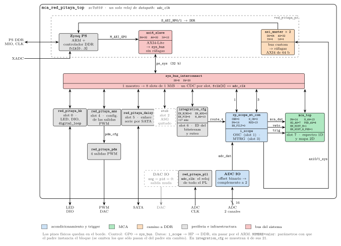
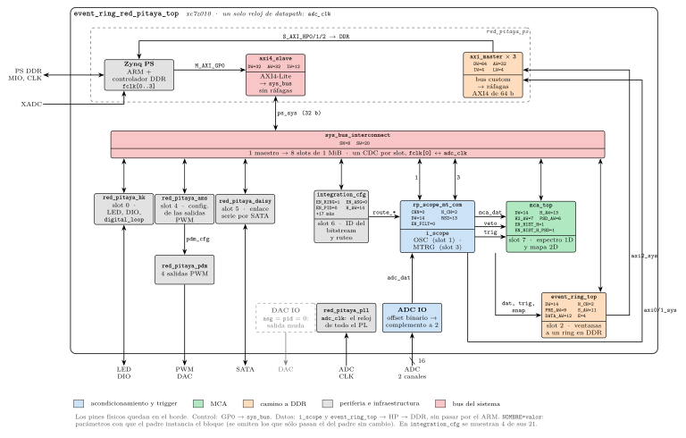
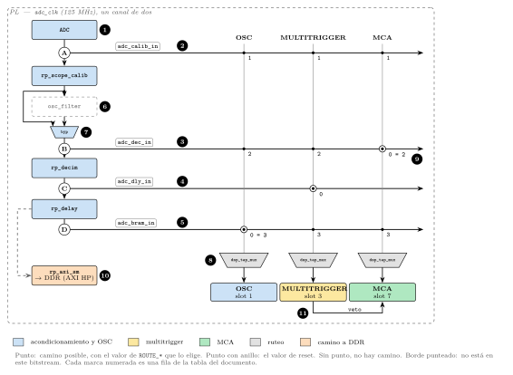

# Mapa de registros — región de TOP (integración)

**Base:** `0x4060_0000` (slot 6 del bus de sistema)
**RTL:** [`integration_cfg.sv`](../../modulos/comun/rtl/integration_cfg.sv) ·
[`dsp_tap_mux.sv`](../../modulos/comun/rtl/dsp_tap_mux.sv)

Esta región identifica el bitstream, describe qué módulos trae y en qué slot
vive cada uno, y rutea el datapath entre ellos.

**No es housekeeping.** `red_pitaya_hk` (slot 0) es un módulo de Red Pitaya
—LEDs, conector de expansión, DNA del chip— y sigue donde estaba. Esta región
describe los bloques **propios del proyecto**, que hasta el refactor vivían
cableados a mano en el top y sin forma de ser descubiertos desde el software.

Para el contrato del bus y sus modos de falla, ver
[`bus_sistema_redpitaya.md`](bus_sistema_redpitaya.md).

---

## El mapa de slots

| Slot | Base | Región | RTL |
|---|---|---|---|
| 0 | `0x4000_0000` | housekeeping | `red_pitaya_hk` (Red Pitaya) |
| 1 | `0x4010_0000` | **OSC** | [`osc/osc_cfg.sv`](../../modulos/osc/rtl/osc_cfg.sv) · [mapa](../osc/register_map_osc.md) |
| 2 | `0x4020_0000` | *event_ring* | libre en el build del MCA |
| 3 | `0x4030_0000` | **MULTITRIGGER** | [`mt_cfg.sv`](../../modulos/mt/rtl/mt_cfg.sv) · [mapa](../mt/register_map_mt.md) |
| 4 | `0x4040_0000` | XADC / PDM | `red_pitaya_ams` (Red Pitaya) |
| 5 | `0x4050_0000` | daisy | `red_pitaya_daisy` (Red Pitaya) |
| 6 | `0x4060_0000` | **TOP** (integración) | `integration_cfg.sv` — este documento |
| 7 | `0x4070_0000` | **MCA** | [`mca/mca_top.sv`](../../rtl/mine/mca/mca_top.sv) · [mapa](../mca/register_map_mca.md) |

Antes del refactor el OSC y el multitrigger compartían el slot 1, el mismo
`casez` y la misma ruta de `ack`. Ahora cada módulo tiene **su slot, su
decodificador y su `ack`**.



El mismo mapa, dentro de `mca_red_pitaya_top`. Arriba, el PS con sus dos
caminos: el de **control** (GP0 → `axi4_slave` → `sys_bus_interconnect` →
slots) y el de **datos** (`i_scope` → `axi_master` → HP → DDR, sin pasar por el
ARM). Los slots 1 y 3 son dos buses de la **misma** instancia, `i_scope`; el
slot 2 es un `sys_bus_stub` porque en este build no hay ASG. Los pines de la
placa quedan en el borde inferior. La fuente es
[`figuras/panorama_mca_red_pitaya_top.tex`](figuras/panorama_mca_red_pitaya_top.tex)
(TikZ).



`event_ring_red_pitaya_top` es el mismo top salvo dos cosas: el slot 2 deja de
ser un stub y pasa a ser el [`event_ring_top`](../event_ring/diseno_y_register_map.md),
y el puerto HP2 —que era del ASG— ahora lo escribe el ring. El ring toma las
mismas muestras que el MCA y el mismo `trigger_event`. Las dos figuras salen de
un único dibujo,
[`figuras/panorama_top_cuerpo.tex`](figuras/panorama_top_cuerpo.tex), para que
no puedan divergir; cada una es un envoltorio de tres líneas que elige la
variante.

El mapa de arriba es el de `mca_red_pitaya_top` y `event_ring_red_pitaya_top`:
por eso el slot 2 queda reservado aunque en el build del MCA esté vacío.

> **`red_pitaya_top` es la excepción.** Ese top conserva el ASG (slot 2) y el
> PID (slot 3), así que el slot 3 canónico no está libre y el **multitrigger va
> al slot 7**. Es la razón de ser del registro `SLOTS`: el software lee el mapa
> real de cada bitstream en vez de asumirlo.

> **El slot 6 no está libre en Z20_G2**: lo ocupa `i_serlines_add`, dentro de un
> `` `ifdef Z20_G2 ``. Los builds de este proyecto son `xc7z010` con
> `` `define Z10 ``, así que esa rama nunca se toma. Compilar para Z20_G2
> exigiría mover la región de TOP a otro slot.

---

## Identificación

| Offset | R/W | Campo | Descripción |
|---|---|---|---|
| `0x000` | R | `MAGIC` | `0x494E5447` (`"INTG"`). Si no coincide, este bitstream no tiene región de TOP. |
| `0x004` | R | `VERSION` | `{mayor[31:24], menor[23:16], parche[15:8], variante[7:0]}` |
| `0x008` | R | `GITH_0` | hash de git, palabra 0 |
| `0x00C` | R | `GITH_1` | |
| `0x010` | R | `GITH_2` | |
| `0x014` | R | `GITH_3` | |
| `0x018` | R | `GITH_4` | 160 b en total; lo inyecta el `.tcl` como *generic* |

El hash de git es el mismo mecanismo que ya usa `rtl/id.sv`: el build script
hace `set_property generic "GITH=160'h$gith"`, así que el bitstream sabe de qué
commit salió sin depender de que alguien lo anote.

---

## Descripción del sistema

| Offset | R/W | Campo | Layout |
|---|---|---|---|
| `0x020` | R | `MODULES` | b0 `OSC` · b1 `MTRG` · b2 `MCA` · b3 `RING` · b4 `ASG` · b5 `PID` |
| `0x024` | R | `SLOTS` | `{MCA[19:16], TOP[15:12], MTRG[11:8], RING[7:4], OSC[3:0]}` |
| `0x028` | R | `CAPS_0` | `{EN_FILT[24], RSZ[21:16], DW[13:8], N_CH[3:0]}` |
| `0x02C` | R | `CAPS_1` | `{PSD_AW[23:16], H2_AW[15:8], H_AW[7:0]}` |

Estos cuatro registros existen para que el software **descubra** el sistema en
vez de hardcodear bases y anchos — que es lo que hacen hoy `mca_utils.py` y
`multitrigger_utils.py`, cada uno con su constante `*_PHYS` a mano.

Salen todos de parámetros de síntesis, así que no cuestan flops: son cableado
constante hacia el mux de lectura.

---

## Ruteo del datapath

| Offset | R/W | Campo |
|---|---|---|
| `0x030` | RW | `ROUTE_OSC` |
| `0x034` | RW | `ROUTE_MTRG` |
| `0x038` | RW | `ROUTE_MCA` |
| `0x03C` | RW | `ROUTE_RING` |

Layout de los cuatro: `[1:0]` = `tap_sel`, `[8]` = `enable`.

La cadena DSP del scope tiene varios nodos utilizables. Antes cada consumidor
estaba cableado a uno fijo; ahora lo elige el software.



La figura lleva sólo nombres de señal, los valores de `ROUTE_*` en cada cruce y
**marcas numeradas**; lo que cada marca significa está acá abajo, una fila por
marca. Es el mismo criterio del overlay de
[`movimiento_de_datos.md`](../movimiento_de_datos.md): el dibujo no repite la
tabla, para que no puedan desincronizarse dos copias de lo mismo.

| # | Qué es | Detalle |
|---|---|---|
| **1** | **Una sola cadena de acondicionado por canal** | No hay una cadena por consumidor: hay una, y cuatro puntos utilizables sobre ella. 125 MSPS, 14 b |
| **2** | Nodo **A** · `adc_calib_in` · `tap_sel = 1` | La muestra **cruda**: ni ganancia ni offset. Continuo, `valid = 1` |
| **3** | Nodo **B** · `adc_dec_in` · `tap_sel = 2` | Post-calibración y, si `EN_FILT = 1`, post-ecualizador. Todavía a ritmo pleno: continuo, `valid = 1` |
| **4** | Nodo **C** · `adc_dly_in` · **sin código de tap** | Post-diezmado, **pre**-retardo. Sólo lo alcanza el multitrigger y sólo como NATIVO — por eso existe el código `0` aparte de los tres taps. Lleva estrobo: `valid = dec_val` |
| **5** | Nodo **D** · `adc_bram_in` · `tap_sel = 3` | Después de toda la cadena. Lleva estrobo: `valid = adc_dv_bram` |
| **6** | `osc_filter` **no está en este bitstream** | `EN_FILT = 0` en el build de integración, así que no se sintetiza y el nodo B es la muestra calibrada y nada más |
| **7** | Bypass del ecualizador | `set_filt_byp`, registro `0x5C` de la región de OSC (slot 1) |
| **8** | Un `dsp_tap_mux` 4:1 **por consumidor** | Cada uno elige en runtime, escribiendo su `ROUTE_*`. Combinacional a propósito (ver más abajo) |
| **9** | El punto con **anillo** es el valor de **reset** | O sea el cableado NATIVO, el que existía antes de que hubiera mux. Donde no hay punto no hay camino posible |
| **10** | La captura a **DDR no se rutea** | `rp_axi_sm` sigue siempre en su nodo nativo: `ROUTE_OSC` mueve la captura en BRAM, **no** las `rp_AcqAxi*` |
| **11** | El **veto** es la única señal que cruza de un consumidor a otro | Nivel, vía `trigger_shield`: del multitrigger al MCA |

En texto, la misma cadena:

```
adc_dat ─→ calib ─→ osc_filter ─→ [byp] ─→ adc_dec_in ────────────── TAP 2
   │                                            │                      └→ MCA (nativo)
 TAP 1                                     rp_decim ─→ adc_dly_in
                                                │           └→ rp_adc_trig (nativo MTRG)
                                           rp_delay ─→ adc_bram_in ─── TAP 3
                                                              └→ rp_acq_bram (nativo OSC)
```

| `tap_sel` | Nodo | Qué es |
|---|---|---|
| `0` | **nativo** | como estaba cableado antes del refactor |
| `1` | `adc_dat` | crudo, **antes** de calibración y ecualizador |
| `2` | `adc_dec_in` | post-calibración/ecualizador, **pre**-decimación, 125 MSPS |
| `3` | `adc_bram_in` | después de todo el DSP (decimación + delay) |

Nativo por consumidor:

| Consumidor | Nodo nativo | ¿Coincide con algún tap? |
|---|---|---|
| OSC | `adc_bram_in` | sí, el 3 |
| MCA | `adc_dec_in` | sí, el 2 |
| MULTITRIGGER | `adc_dly_in` | **no** — post-decimación pero *pre*-delay |

**Por eso existe el valor 0.** Sin él no habría forma de reproducir el
comportamiento actual del multitrigger, y el refactor cambiaría el alineamiento
del pre-trigger sin que nadie lo hubiera pedido.

`tap_sel = 0` y `enable = 1` son los valores de **reset**: un bitstream recién
cargado se comporta exactamente como el anterior. Cualquier diferencia es
porque el software escribió un `ROUTE_*`. `tb_integration_cfg` lo verifica.

### Qué acondicionado acumuló la muestra en cada nodo

Los cuatro nodos no son cuatro cadenas distintas: son cuatro **prefijos de la
misma**. Una ✓ quiere decir que la muestra de ese nodo ya pasó por esa etapa.

| Etapa de la cadena | **A** `adc_calib_in` | **B** `adc_dec_in` | **C** `adc_dly_in` | **D** `adc_bram_in` |
|---|:---:|:---:|:---:|:---:|
| ADC 125 MSPS · 14 b | ✓ | ✓ | ✓ | ✓ |
| `rp_scope_calib` — offset + ganancia | — | ✓ | ✓ | ✓ |
| `osc_filter` — ecualizador IIR \* | — | ✓ | ✓ | ✓ |
| `rp_decim` — diezmado (+ promediado) | — | — | ✓ | ✓ |
| `rp_delay` — retardo de disparo | — | — | — | ✓ |
| **Ritmo** | 125 MSPS | 125 MSPS | 125/N MSPS | 125/N MSPS |
| **En reset lo usa** | nadie | MCA | MULTITRIGGER | OSC |
| **Qué es** | crudo | el acondicionado, a ritmo pleno | ya diezmado, sin retardo | la cadena completa |

\* El ecualizador sólo está en el bitstream si `EN_FILT = 1`. En el de
integración vale 0, así que el nodo B es la muestra calibrada y nada más.

La versión con **el dato encima** —el mismo pulso medido dibujado en los cuatro
nodos, donde se ve el cambio de ritmo— está en
[`docs/comun/figuras/transacciones/`](../comun/figuras/transacciones/).

#### Lo que NO hay

En la FPGA **no hay ningún conformador de espectrometría**: ni CR-RC, ni
trapezoidal, ni cusp. El conformado del *pulso* es analógico, del detector y su
preamplificador; la cadena digital sólo acondiciona (ganancia y offset),
opcionalmente ecualiza, diezma y retarda.

Con promediado, el diezmado es un promedio de bloque de N muestras: es **el
único filtro de la cadena que cambia la forma**, y lo hace a costa del ritmo.

O sea: la diferencia de conformado entre secciones del sistema es **dónde pincha
cada una la misma cadena**, no qué cadena corre.

### Cuatro cosas que hay que saber antes de cambiar un tap

**El dato y su valid viajan juntos.** Los nodos post-decimación llevan estrobo
(`dec_val`, `dly_val`); los pre-decimación son continuos a 125 MSPS. El
`dsp_tap_mux` arrastra el par `(dat, val)`, así que el MCA —que antes recibía
`mca_val = adc_rstn`, o sea "siempre válido"— ahora honra el valid de verdad.

**Cambiar de tap corre la latencia.** `rp_bram_sm` cuenta el delay en muestras
decimadas. Combinaciones cruzadas (OSC en el tap 3, multitrigger en el 1)
desalinean el pre-trigger. Es legítimo, pero no es gratis.

**El camino a DDR por AXI no se rutea.** `rp_axi_sm` sigue siempre en su nodo
nativo, así que `ROUTE_OSC` afecta la captura en BRAM pero **no** las capturas
`rp_AcqAxi*`. Está así para no duplicar el mux en un segundo dominio de datos;
si hiciera falta, es agregar un cuarto `dsp_tap_mux`.

**El mux es combinacional, a propósito.** Registrarlo sería lo natural para
timing, pero correría el dato un ciclo respecto de las señales de control que lo
acompañan (`adc_we` y el write pointer en el OSC, la alineación
trigger-vs-captura en el multitrigger), y en modo nativo el hardware dejaría de
ser idéntico al de antes — que es justamente la propiedad que se quiso
preservar. Un mux 4:1 de 14 bits es un LUT6 por bit, un nivel de lógica, y no
cae sobre el camino crítico (que era el lazo IIR de `osc_filter`, deshabilitado
con `EN_FILT=0`). Si alguna vez hiciera falta registrarlo, hay que registrar
**también** el valid y las señales de control de cada consumidor, en conjunto.

---

## Control global

| Offset | R/W | Bits | Campo |
|---|---|---|---|
| `0x040` | RW | 0 | `run` (nivel) |
| | W | 1 | `clear` (**autolimpiante**, 1 ciclo) |
| | W | 2 | `soft_reset` (**autolimpiante**, 1 ciclo) |
| `0x044` | R | 0 | `pll_locked` |
| | R | 1 | `adc_rstn` |

Abarca los módulos **propios**, no el housekeeping.

Los autolimpiantes usan un estrobo de un ciclo: sin él `sys_bus_cdc` sostiene
`wen` hasta el ack y `clear` quedaría alto ~5 ciclos.
`tb_integration_cfg` mide que dure exactamente uno.

> **`0x040` todavía no tiene consumidores.** Los tres bits salen por puertos del
> `integration_cfg` pero ningún módulo los usa aún: el MCA sigue teniendo su
> propio `run`/`clear` en `0x4070_000C`. Está expuesto para que el cableado sea
> un cambio localizado, no un rediseño del mapa.

---

## Notas de implementación

**Ack de latencia fija.** Igual que `mca_top`: el ack sale de un shift register
incondicional y responde a los 4 ciclos para *cualquier* dirección, mapeada o
no. Un esclavo que no hace ack no produce sólo una lectura mala — deja el CDC
del slot desincronizado para siempre
([§7.1](bus_sistema_redpitaya.md)).

**`sys_rdata` es un registro plano.** El `set_false_path` del XDC sobre
`inst_sys_bus_cdc/reg_rdata*` no engancha nada, así que ese cruce se timea de
verdad y no conviene colgarle lógica combinacional ancha.

---

## Testbenches

| Testbench | Qué verifica |
|---|---|
| [`tb_integration_cfg`](../../sim/tb_integration_cfg.sv) | contrato de bus del slot 6; **el reset deja todo en NATIVO**; autolimpiantes de exactamente 1 ciclo; identificación y descripción del sistema |
| [`tb_slots_integration`](../../sim/tb_slots_integration.sv) | las tres regiones cableadas como en el top: independencia entre slots y **ruteo de punta a punta** — con ganancia de calibración ×0.5, en NATIVO el MCA ve ~1000 y con `TAP_ADC` ve 2000 |
