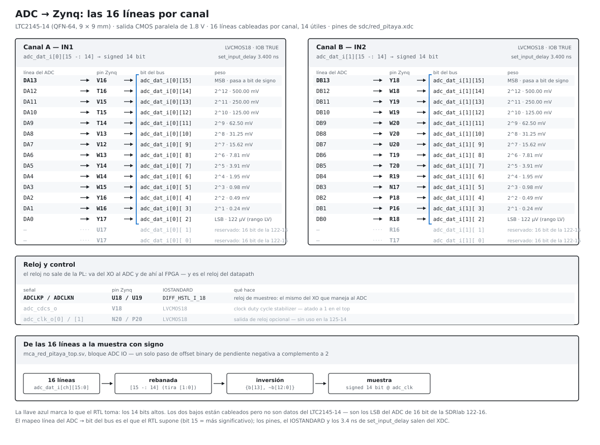
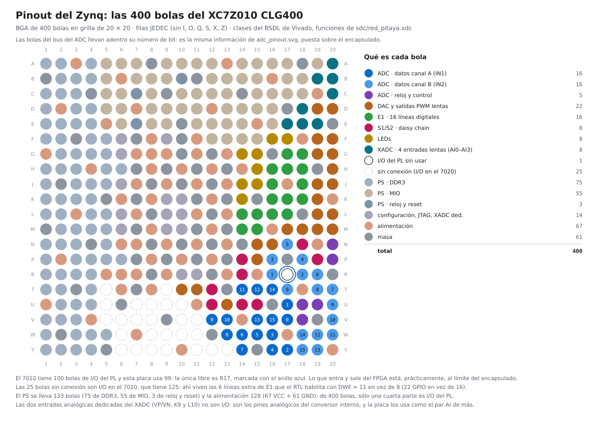

# El ADC: LTC2145-14, sus parámetros, y los límites que le fija al sistema

Todo el instrumento cuelga de un solo componente: el conversor
analógico-digital de la placa. Fija el paso de tiempo, el paso de amplitud, el
caudal de datos y el piso de ruido, y ninguno de los cuatro se puede negociar
por software. Este documento junta sus parámetros y —la parte que importa—
traduce cada uno a **un número en las unidades del MCA** y dice qué decisión de
diseño salió de ahí.

La mitad de las discusiones del proyecto terminan en "¿eso es del ADC?". La
respuesta corta, adelantada: **del ADC son los 8 ns y los 14 bits; el ruido, la
linealidad y la deriva que medimos son casi todos de otra parte.** El detalle
está en §4 a §7.

De dónde sale cada número: los de la hoja de datos del LTC2145-14 llevan la
referencia de §11; los del cableado salen del XDC y del top; los *derivados* son
aritmética sobre los dos anteriores y están marcados como tales. Si un número de
acá no coincide con el archivo al que apunta, manda el archivo.

Documentos hermanos, para no duplicar:

| Documento | Qué contiene |
|---|---|
| [`platform.md`](platform.md) §2.1 | el resumen del front-end y la placa entera; esto es el zoom sobre el conversor |
| [`mca/fuentes_de_jitter.md`](mca/fuentes_de_jitter.md) | el presupuesto de jitter completo, donde el ADC aporta el término más chico |
| [`mca/limites_resolucion_y_deriva.md`](mca/limites_resolucion_y_deriva.md) | qué limita la resolución en la práctica (spoiler: no es el ADC) |
| [`movimiento_de_datos.md`](movimiento_de_datos.md) | qué se hace con los 500 MB/s que el ADC entrega sin preguntar |
| [`mca/conformado_y_ruido.md`](mca/conformado_y_ruido.md) | cómo el conformado digital trabaja el ruido del conversor |
| [`ruido_del_sistema.md`](ruido_del_sistema.md) | el presupuesto de ruido completo del eje de amplitud, medido — **corrige el reparto de §4.1 y contesta los puntos 2 y 5 de §10** |

---

## 1. Qué es y cómo está cableado

**Analog Devices (ex-Linear Technology) LTC2145-14**: dual, 14 bit, 125 MS/s,
muestreo simultáneo de los dos canales, salida paralela CMOS de 1.8 V,
alimentación única de 1.8 V, QFN de 64 pines.

```
  IN1 ─ jumper LV/HV ─ 1 MΩ‖10 pF ─ atenuador ─ driver diferencial ─┐
                                                                    │   LTC2145-14
  IN2 ─ (ídem) ──────────────────────────────────────────────────────┤   2 ch · 14 b
                                                                    │   125 MS/s
  XO 125 MHz ───────────────────────────────────────────────────────►┤   CDCS = 1
                                                                    │
            16 líneas LVCMOS18 por canal (14 útiles, 2 bajas en 0)  │
            + reloj diferencial DIFF_HSTL_I_18 ◄───────────────────┘
                              │
                              ▼
                    PL: adc_dat_i[ch][15:2] → {s, ~b} → signed 14 b @ adc_clk
```

| Qué | Cómo está | Dónde |
|---|---|---|
| Datos | 16 líneas `LVCMOS18` por canal, `IOB TRUE` (el flip-flop de captura va en el bloque de IO) | [`sdc/red_pitaya.xdc`](../../../sdc/red_pitaya.xdc) líneas 18–55 |
| Alineación | el RTL toma `adc_dat_i[ch][15 -: ADW]` con `ADW = 14`; **los dos bits bajos están reservados** para el modelo de 16 bit (122-16) | [`mca_red_pitaya_top.sv:474`](../rtl/mine/tops/mca_red_pitaya_top.sv#L474) |
| Reloj | del oscilador **directo al ADC** y al FPGA por `adc_clk_i` (`DIFF_HSTL_I_18`, U18/U19) → `IBUFDS` → PLL → `adc_clk` | top, líneas ~290; [`platform.md`](platform.md) §2.4 |
| `adc_clk_o` | salida de reloj de la placa hacia el ADC: **sin uso** en la 125-14 | top, líneas 464–465 |
| `adc_cdcs_o` | *clock duty cycle stabilizer*, **atado a 1** permanentemente | [`mca_red_pitaya_top.sv:467`](../rtl/mine/tops/mca_red_pitaya_top.sv#L467) |
| Presupuesto de timing | `set_input_delay -clock adc_clk 3.400` sobre todas las líneas de datos: de los 8 ns del período, 3.4 los consume el camino ADC→pin | XDC línea 201 |
| Codificación | offset binary de **pendiente negativa** (más tensión ⇒ código menor). El top hace `{raw[13], ~raw[12:0]}` y entrega **signed 14 bit** | top, líneas 477–481 |

Y el mapa completo, línea por línea: qué bit de `adc_dat_i` entra por qué pin del
Zynq y cuánto pesa cada uno.



La figura la genera
[`figuras/figuras_adc_pinout.py`](figuras/figuras_adc_pinout.py)
(`python3 figuras_adc_pinout.py`) leyendo los mismos pines del XDC, para que no
puedan desincronizarse dos copias de la misma tabla. El mapeo *línea del ADC →
bit del bus* es el que el RTL supone (bit 15 = más significativo), no una lectura
del esquemático; los pines, el IOSTANDARD y los 3.4 ns sí salen del XDC.

Y dónde caen físicamente esos pines, sobre el encapsulado entero:



Las 32 líneas de datos del ADC caen todas en el **cuadrante inferior derecho**
del encapsulado, pegadas al par diferencial del reloj: es un bloque compacto, que
es lo que uno quiere para 32 líneas que conmutan a la vez a 125 MHz. Tres cosas
más que se leen de la figura y que conviene tener presentes:

- **El 7010 tiene 100 bolas de I/O del PL y la placa usa 99.** La única libre es
  **R17**. No hay margen para sacar una señal nueva del FPGA sin sacrificar
  otra: cualquier agregado al instrumento que necesite un pin —un veto extra, un
  trigger de salida, un reloj externo— compite con algo que ya está.
- **Las 25 bolas sin conexión del 7010 son I/O en el 7020**, que tiene 125. Ahí
  viven las 6 líneas extra de E1 que el RTL habilita con `DWE = 11` en vez de 8,
  y es la razón física de que la misma PCB acepte los dos chips
  ([`platform.md`](platform.md) §1.3).
- **De las 400 bolas, sólo una cuarta parte es I/O del PL**: 133 se las lleva el
  PS (75 de DDR3, 55 de MIO, 3 de reloj y reset) y 128 la alimentación.

El encapsulado entero —qué es cada bola, cómo se lee un nombre de pin, y la
tabla de los 99 pines que usa la placa con su banco, su función y su
IOSTANDARD— está en **[`pinout_zynq.md`](pinout_zynq.md)**. De ahí sale un dato
que importa para el ADC: **todo el bus vive en el banco 34, que está a 1.8 V**,
mientras que el DAC, E1 y los LEDs viven en el 35 a 3.3 V. Y el reloj entra por
`U18`/`U19`, que es un par **MRCC**: el único tipo de pin desde el que se puede
manejar la PLL de todo el datapath.

Dos consecuencias del cableado que vale tener presentes:

- **No hay control del ADC desde la PL.** El único pin de configuración que
  llega al FPGA es `adc_cdcs_o`. El rango de entrada, el formato de salida y el
  modo de salida están *strapeados en el PCB*: no se pueden cambiar por
  registro. Lo que se configura desde la placa se configura con un soldador.
  (Esto es propio de esta placa: las STEMlab TI de 2025 sí llevan el SPI del ADC
  al FPGA, §9.1.)
- **El reloj de muestreo es el reloj del datapath.** No hay cruce de dominio
  entre la conversión y el procesamiento: un ciclo = una muestra = 8 ns. Eso
  simplifica todo el RTL y, del otro lado, hace que la deriva del oscilador se
  traduzca *directo* en deriva de la base de tiempo
  ([`mca/limites_resolucion_y_deriva.md`](mca/limites_resolucion_y_deriva.md)).

### 1.1 Qué quiere decir "QFN de 64 pines"

**QFN** es *Quad Flat No-leads*: un encapsulado sin patitas. Los 64 contactos son
**pads planos en la cara de abajo**, repartidos en los cuatro lados de un cuerpo
de 9 × 9 mm, más un **pad térmico grande en el centro** que se suelda al plano de
masa del PCB. Visto desde arriba es un cuadrado negro liso; toda la conexión
queda escondida debajo.

Comparado con un encapsulado con patas (un QFP, o un DIP), lo que se gana es
inductancia parásita baja y buena disipación —las dos cosas que necesita un
conversor rápido de señal mixta— y lo que se pierde es todo acceso mecánico. Para
este proyecto eso tiene tres consecuencias concretas:

1. **No se puede medir nada del ADC con una punta.** No hay un solo contacto
   accesible: ni las líneas de datos, ni el reloj de muestreo, ni los pines de
   strapping que fijan el rango y el formato. **El único punto observable de la
   conversión es el lado del FPGA**, o sea los códigos ya digitales. Por eso
   todo lo que §10 deja sin verificar se verifica leyendo la hoja de datos o
   midiendo desde la PL, nunca con el osciloscopio sobre el chip.
2. **El pad térmico central es a la vez masa y disipador.** Los 189 mW del
   conversor se van al mismo cobre que sostiene al front-end analógico, así que
   la temperatura del die del ADC sigue a la de la placa —y la del die del Zynq,
   que sí se lee por el XADC, es un proxy razonable de las dos. Ése es el camino
   físico por el que el conversor *podría* estar entrando en la deriva del
   centroide, que es el punto 1 de §10.
3. **No es reemplazable.** Se suelda por reflow con stencil, no hay zócalo y no
   se desuelda a mano. **"Cambiar el ADC" siempre significa cambiar de placa**, y
   es la razón de que §9 esté escrita en términos de placas y no de chips.

Y los 64 contactos, para un conversor que entrega 28 bits: 28 son las dos salidas
de datos, y el resto se reparte entre el reloj de muestreo, el de salida, las dos
entradas analógicas diferenciales, los pines de modo que fijan rango y formato
—los que acá están strapeados en el PCB— y, en mayoría, **alimentación y masa**.
Un conversor rápido necesita muchísimos pares de alimentación cerca de cada
bloque para que el ruido de conmutación de la salida digital no vuelva al
comparador analógico.

---

## 2. Los parámetros de la hoja de datos

Valores típicos del LTC2145-14. La columna de la derecha es para qué sirve el
número acá; el desarrollo está en las secciones que se citan.

| Parámetro | Valor típico | Para qué importa |
|---|---|---|
| Resolución | 14 bit | el paso de amplitud (§3) |
| Tasa de muestreo | 125 MS/s, los dos canales **simultáneos** | el paso de tiempo, y que no haya skew entre canales (§5) |
| SNR | **73.1 dBFS** | el piso de ruido: 1.3 cuentas rms (§4.1) |
| SFDR | 90 dB | espurias 90 dB abajo: irrelevante para pulsos (§7) |
| Ruido de transición | 1.2 LSB rms | el mismo piso, medido en DC (§4.1) |
| INL | ±1 LSB, sin códigos faltantes sobre temperatura | exonera al ADC de la INL medida (§4.5) |
| DNL | ±0.3 LSB | la única estructura fina que el histograma hereda del conversor (§4.5) |
| Jitter de apertura | **0.08 ps rms** | nada: dos órdenes por debajo de todo lo demás (§5, §7) |
| Ancho de banda del S/H | 750 MHz a plena potencia | el límite de banda es el front-end (60 MHz), no el ADC (§5) |
| Latencia de pipeline | 6 ciclos (modo CMOS a tasa completa) | 48 ns de offset **fijo** en los timestamps; no agrega jitter (§5) |
| Rango de entrada | seleccionable 1 a 2 Vp-p diferencial | la placa lo fija; ±1 V en IN = fondo de escala (§3) |
| Consumo | 189 mW total (95 mW por canal) a 1.8 V | autocalentamiento junto al front-end (§10) |
| Salida | CMOS a tasa completa, DDR CMOS o DDR LVDS | la placa usa CMOS a tasa completa: 16 líneas por canal (§1) |

### 2.1 Qué mide cada uno de los cuatro que importan

**SNR — relación señal a ruido.** Se mide metiendo una senoidal de fondo de
escala y comparando su potencia contra **toda** la potencia de ruido que aparece
en la banda de Nyquist (0 a 62.5 MHz), sin contar los armónicos —ésos son el
SFDR—. Es *un solo número que empaqueta todo*: cuantización, ruido térmico de los
comparadores y de la referencia, y el jitter del propio conversor. Por eso es el
que sirve para derivar el piso: una senoidal de fondo de escala tiene valor
eficaz `(FS/2)/√2`, así que `σ = (FS/2)/√2 / 10^(SNR/20)` da las **1.28 cuentas**
de §3.

El detalle que se saltea siempre: ese ruido está repartido en los 62.5 MHz. Si
después filtrás —y conformar *es* filtrar—, te quedás sólo con la parte que cae
en tu banda. Con un conformador de ancho de ruido `B`, el ruido que sobrevive es
`1.28·√(B/62.5 MHz)`. Para `B = 250 kHz` (una integración de 2 µs) eso da
**0.081 cuentas**, que es exactamente el `σ/√N` de §4.1 visto desde el dominio de
la frecuencia. Las dos cuentas son la misma.

**Ruido de transición.** Es el mismo ruido, pero medido en continua y sin señal:
si ponés una tensión perfectamente constante justo en el borde entre dos códigos,
la salida **no se queda en uno** — baila entre códigos vecinos. El desvío estándar
de ese baile, en LSB, es el ruido de transición. 1.2 LSB rms quiere decir que con
la entrada quieta los códigos se desparraman sobre unas ±3 cuentas.

Es el número **directamente comparable con una medición nuestra**: el RMS de la
línea de base con la entrada terminada en 50 Ω y sin pulser, que es la medida
pendiente de [`mca/fuentes_de_jitter.md`](mca/fuentes_de_jitter.md) §6. Si esa
medida da mucho más que 1.2 cuentas, el exceso es del front-end, no del
conversor. Que 1.2 (en DC) y 1.28 (derivado del SNR, en AC) coincidan es la
señal de que las dos especificaciones describen lo mismo.

**Jitter de apertura.** El interruptor del sample-and-hold no abre exactamente en
el mismo instante en cada ciclo: el momento real fluctúa, y su desvío estándar es
el jitter de apertura. Es la contribución **propia del conversor**, aparte del
jitter del oscilador que lo maneja. Se convierte en error de amplitud por la
pendiente de la señal, `σ_v = |dV/dt|·σ_t`: **cero en el pico de un pulso**
(donde la pendiente es cero) y máximo en el flanco más rápido. Con 0.08 ps y
flancos de 100 ns es 0.006 cuentas: nada.

No confundirlo con el *aperture delay*, que es el retardo **fijo** entre el flanco
del reloj y el instante real de muestreo. Ése no fluctúa: es una constante que se
cancela en cualquier diferencia de tiempos.

**Ancho de banda del S/H.** Hasta qué frecuencia de entrada el sample-and-hold
sigue copiando fielmente una señal de fondo de escala. 750 MHz es **doce veces su
propio Nyquist**, y es una virtud deliberada: sirve para submuestrear señales de
radiofrecuencia, que es el uso para el que se diseñó este conversor.

Para nosotros es más bien un riesgo. Significa que el ADC **muestrea
honestamente todo lo que le llegue hasta 750 MHz**, y todo lo que esté arriba de
62.5 MHz se dobla (aliasing) adentro de la banda y se suma al ruido de la línea
de base, sin ninguna forma de distinguirlo después. El único filtro antialias de
la cadena es la caída del front-end a 60 MHz (§5): no hay nada más.

### 2.2 Los tres modos de salida: qué cambia y qué no

Lo primero, porque es lo que menos se dice: **el dato no cambia en nada**. Los
tres modos entregan los mismos 14 bits, con el mismo ruido y la misma
linealidad. Es una decisión de *transporte*, no de conversión.

| | Líneas por canal | Qué cambia |
|---|---|---|
| **CMOS a tasa completa** (el de la placa) | 14, conmutando a 125 MHz | la más simple del lado del FPGA: se captura con un flip-flop en el bloque de IO y un solo `set_input_delay`. A cambio, **la que más pines y más ruido de conmutación genera**: 28 líneas de 1.8 V cambiando a la vez es un `di/dt` que se acopla al lado analógico |
| **DDR CMOS** | 7, con un bit por flanco | la mitad de los pines, mismos niveles. El FPGA necesita `IDDR` para desentrelazar y **el presupuesto de timing por bit se parte al medio** (4 ns en vez de 8) |
| **DDR LVDS** | pares diferenciales, serializados | **mucho menos ruido inyectado**: señal diferencial de ~350 mV en vez de 1.8 V contra masa, con las corrientes cancelándose de a pares. Es el modo que se elige cuando el ruido del conversor importa de verdad. El precio es del lado del FPGA: hace falta `ISERDES` + `IDELAY` + alineación de palabra (*bitslip*) con patrón de entrenamiento, y la deserialización agrega latencia |

O sea que lo que cambia "del todo" entre los tres es: **cuántos pines**, **cuánto
ruido digital vuelve al front-end analógico**, y **cuánta lógica y cuánta
calibración hacen falta en el FPGA**. Nada más — y nada menos, porque el segundo
punto es justamente el que §4.1 señala como dueño del 79 % de la varianza.

Dónde se ve esto en el repo: la 125-14 usa CMOS a tasa completa, y por eso
`adc_dat_i` son 16 líneas por canal capturadas con un flop de IO (§1). Las
STEMlab TI usan SLVDS serializado, y por eso necesitan
[`rtl/adc366x_top.sv`](../../../rtl/adc366x_top.sv) entero —deserializador,
`bitslip`, control de delay— para hacer el mismo trabajo (§9.1).

### 2.3 La codificación de salida, bit por bit

Ésta es la línea del top que traduce el ADC al resto del diseño, y conviene
desarmarla porque en una sola expresión hay **dos conversiones encadenadas**:

```systemverilog
// mca_red_pitaya_top.sv:554  — tomar los 14 bits altos de las 16 líneas
assign adc_dat_raw[0] = adc_dat_i[0][16-1 -: ADW];

// mca_red_pitaya_top.sv:559  — "transform into 2's complement (negative slope)"
adc_dat[0] <= {adc_dat_raw[0][ADW-1], ~adc_dat_raw[0][ADW-2:0]};
```

#### Las dos cosas que arregla

**1. El formato: offset binary → complemento a 2.** El ADC entrega *offset
binary* (también llamado *straight binary*): el código `0` es el extremo
inferior del rango, el código `2^14−1` el superior, y el cero analógico cae en
media escala. El complemento a 2, que es lo que entiende un `logic signed` de
SystemVerilog, es **exactamente lo mismo con el MSB invertido**. Convertir de
uno al otro es `XOR 0x2000`, un solo inversor.

**2. La pendiente: el código baja cuando la tensión sube.** La cadena analógica
invierte, así que lo que llega al FPGA es el código de `−V`, no el de `+V`.
Negar un número ocupa un sumador (`−x = ~x + 1`); negarlo *casi* —el
complemento a uno, `~x = −x − 1`— es `XOR 0x3FFF`, otro inversor y nada más.

Encadenadas, las dos son `XOR 0x2000 ⊕ XOR 0x3FFF = XOR 0x1FFF`: **invertir
todo menos el MSB**. Eso es literalmente `{raw[13], ~raw[12:0]}`. No hay
sumador, no hay lógica: son catorce cables, trece de ellos con una negación que
Vivado absorbe en la LUT siguiente. **Cuesta cero.**

#### La tabla de verdad

Verificada sobre los 16384 códigos: la función es biyectiva, monótona y cubre
el rango completo.

| `raw` (del ADC) | | salida `adc_dat` | Qué es |
|---|---|---|---|
| `0x0000` | 0 | **+8191** | la tensión **más alta** del rango (pendiente negativa) |
| `0x0001` | 1 | +8190 | |
| `0x1FFF` | 8191 | **0** | el código que el RTL toma como cero |
| `0x2000` | 8192 | **−1** | media escala del ADC |
| `0x3FFE` | 16382 | −8191 | |
| `0x3FFF` | 16383 | **−8192** | la tensión **más baja** del rango |

> **El medio LSB que se regala.** Como el paso 2 usa complemento a uno en vez
> de la negación exacta, la salida es **la negación exacta menos 1 LSB** para
> todos los códigos (verificado: la diferencia es constante e igual a −1). O
> sea que la media escala del ADC no cae en `0` sino en `−1`, y el cero
> analógico queda desplazado medio código. Es **122 µV**, y no importa por dos
> razones: el eje de amplitud del MCA se calibra contra el generador de todos
> modos, y los offsets de cero realmente medidos —**−7.4** y **−28 canales**
> según la campaña ([`resultados_validacion_hw.md`](resultados_validacion_hw.md))—
> son entre 7 y 28 veces más grandes. Arreglarlo costaría un sumador de 14 bits
> en el camino de datos a 125 MHz para corregir un error que el ajuste absorbe.

#### ¿Es un número de punto fijo?

**No, y conviene decirlo explícito porque es la confusión habitual.** En el RTL
no hay ningún punto binario: hay un **entero con signo de 14 bits**, declarado
como tal una sola vez y propagado por todo el datapath,

```systemverilog
// mca_red_pitaya_top.sv:316
localparam type SBA_T = logic signed [ADW-1:0];   // ADW = 14
```

y **la escala vive afuera del hardware**. El RTL nunca sabe que un código son
122 µV: suma, compara y acumula enteros. La constante de conversión aparece
recién en el software, como un número en la cabecera del protocolo
(`"adc_cnt_per_v": 8192`, [`APP/protocolo.md`](APP/protocolo.md)), y en la
calibración del eje contra el generador.

Si uno insiste en ponerle notación Q, hay dos lecturas y las dos son correctas
según dónde se elija el punto:

| Interpretación | Notación | 1 LSB | Cuándo conviene pensarlo así |
|---|---|---|---|
| Entero de cuentas | **Q14.0** | 1 cuenta | dentro del RTL: es lo que hacen el discriminador, el conformador y el histograma |
| Fracción del fondo de escala | **Q1.13** | 2⁻¹³ de FS | al comparar con la hoja de datos (SNR, ENOB, DNL se expresan en fracciones de FS) |
| Volts | — | 122.07 µV | sólo en el software, y sólo con el jumper en LV (§3) |

La consecuencia práctica es que **el jumper LV/HV no existe para el RTL**: el
mismo código 8191 son 1 V o 20 V según una posición mecánica que el FPGA no
puede leer. Quien traduce a volts tiene que saber en qué posición está el
jumper; el MCA se ahorra el problema trabajando siempre en cuentas y calibrando
el eje completo contra el generador.

Y como el MCA integra —suma `N` muestras para obtener la carga del pulso—, el
resultado crece a `14 + log₂N` bits y **deja de ser una amplitud**: es carga en
cuentas×muestras. Esa es la razón de fondo por la que el eje del espectro se
calibra empíricamente (3718 canales/Vpp medidos) en vez de derivarse de los
122 µV.

#### El camino de vuelta

El DAC hace exactamente lo inverso, con la misma expresión, porque el AD9767
también espera offset binary de pendiente negativa:

```systemverilog
// mca_red_pitaya_top.sv:582
dac_dat_a <= {dac_a[13], ~dac_a[12:0]};   // signed 14 b -> offset binary negativo
```

Y el `digital_loop` del `red_pitaya_hk` se apoya en esa simetría: conecta
`adc_dat` directo a `dac_dat` para probar el camino sin pasar por el analógico.
En el build del MCA el DAC está apagado ([`platform.md`](platform.md) §4.4),
así que la línea está pero no genera nada.

---

## 3. Traducido a las unidades del MCA

Con el jumper en **LV (±1 V)**, que es la posición del banco:

| Magnitud | Valor | Cómo sale |
|---|---|---|
| `Ts` | **8 ns** | 1/125 MS/s |
| Fondo de escala | 2 V = 16384 códigos, **signed −8192 … +8191** | 14 bit tras la conversión del top |
| 1 LSB | **122.07 µV** | 2 V / 2¹⁴ — derivado |
| 1 LSB con jumper HV (±20 V) | **2.44 mV** (20× peor) | 40 V / 2¹⁴ — derivado |
| Escala útil para un pulso unipolar | **8191 códigos ≈ 1 V** | la base queda cerca de 0 (§4.3) |
| Ruido propio del ADC | **1.28 cuentas rms** | `(8192/√2) / 10^(73.1/20)` — derivado del SNR |
| FWHM mínima alcanzable | **3.0 cuentas = 0.037 % del fondo de escala** | `2.355 × 1.28` — derivado |
| Cuantización sola | 0.289 cuentas rms | `1/√12` — derivado; ya está dentro del número de arriba |
| ENOB | **11.85 bit** | `(73.1 − 1.76)/6.02` — derivado |
| Caudal crudo | **500 MB/s** | 2 ch × 2 B × 125 MS/s — [`movimiento_de_datos.md`](movimiento_de_datos.md) §2 |
| Nyquist | 62.5 MHz | derivado |

El número a retener es **1.28 cuentas**: es el ruido que el conversor agrega por
muestra y por lo tanto el piso absoluto de todo lo demás. El cruce con la hoja de
datos cierra: 73.1 dBFS de SNR y 1.2 LSB de ruido de transición son el mismo
número visto en AC y en DC.

---

## 4. Límites fijos — eje de amplitud

### 4.1 El piso de ruido, y cuánto margen queda

> **Corregido.** El reparto que sigue compara dos cosas que no están en la misma
> unidad: los 2.8 cuentas son el ancho del **fotopico**, o sea la salida de un
> estimador (y el de pico es un máximo sobre el ápice, que *angosta* la
> distribución respecto de una muestra suelta), contra el ruido del ADC **por
> muestra**. Medido por muestra sobre 3.6 M muestras de base pura, el ruido de
> la placa es **4.56 cuentas** y el reparto es **8 % / 92 %**, con el generador
> aportando **cero**: [`ruido_del_sistema.md`](ruido_del_sistema.md) §3 y §4. La
> conclusión cualitativa no cambia —el ADC no es el que manda— pero el margen es
> mayor: arreglar el front-end entero mejora ×3.5, no ×2.2. El resto de esta
> sección se deja como estaba, porque es lo que citan los otros documentos.

El ruido total medido con pulser es **σ ≈ 2.8 cuentas**
([`mca/decisiones_diseno_mca.md`](mca/decisiones_diseno_mca.md) §2.2). De eso, el
ADC pone 1.28:

| | σ (cuentas) | Varianza |
|---|---|---|
| ADC (hoja de datos) | 1.28 | 21 % |
| Front-end + generador (por diferencia) | **2.49** | 79 % |
| **Total medido** | **2.8** | 100 % |

Dos lecturas, las dos útiles:

- **El ADC no es el que manda**, pero tampoco es despreciable: aporta un quinto
  de la varianza. Arreglar todo lo demás —front-end perfecto, generador
  perfecto— mejora la resolución **×2.2 y ahí se termina**.
- En la métrica que usa [`mca/limites_resolucion_y_deriva.md`](mca/limites_resolucion_y_deriva.md)
  (`FS/FWHM`): el ADC solo da **2713, o sea 11.4 bits efectivos**, contra los
  **592–1298 (9.2–10.3 bits)** medidos. Hay entre 1 y 2 bits de margen antes de
  que el conversor sea el límite activo. Hoy no lo es.

**Y el piso se puede bajar promediando.** El ruido del ADC es blanco y
descorrelacionado muestra a muestra, así que el estimador de integral lo
divide por `√N` con `N` muestras en la ventana: con una ventana de 2 µs
(250 muestras) el aporte del ADC baja a 0.08 cuentas. **El piso de ruido del
conversor sólo ata al estimador de pico** (`cfg_amp_src = 0`), que usa una sola
muestra. Para el de integral es irrelevante — y por eso el único término del
presupuesto que el ADC domina es el de una sola muestra.

### 4.2 Cuántos canales de histograma se pueden justificar

Con el estimador de **pico**, la amplitud de un evento es literalmente un código
de ADC: hay **8192 valores posibles** para un pulso unipolar de 1 V, y ni uno
más. Un eje con más bins que eso tiene canales vacíos **por construcción**, no
por falta de estadística.

El RTL ya respeta ese límite por diseño: el bus de features es de 16 bit y el eje
de 13 (`H_AW = 13`), así que [`mca_zoom.sv`](../modulos/mca/rtl/mca_zoom.sv)
satura el zoom en `z = FW − AW = 3`, que es exactamente **1 código de ADC por
bin**. No hay configuración posible que pida más finura que la que el ADC puede
dar.

El otro lado de la misma cuenta, que hay que tener en cuenta al encuadrar:

- La amplitud de **pico** entra al bus de features extendida con ceros
  (`amp_peak = {2'b0, peak}`), así que ocupa sólo los 13 bits bajos de 16. A
  `z = 0` el eje mapea 8 códigos por bin y el espectro de pico vive en **el
  octavo inferior del eje**. Para usar los 8192 canales con 1 código por bin hay
  que poner `z = 3, k = 0`. La ganancia medida en la campaña (3927
  canales/Vpp ≈ 0.48 canales por cuenta) corresponde a un encuadre intermedio.
- La amplitud de **integral** no tiene ese techo: `q_tot` suma cientos de
  muestras, su rango es mucho mayor que 14 bit y `cfg_q_shift` lo baja a 16. Ahí
  el paso del eje puede ser más fino que un código de ADC sin que aparezcan
  huecos, porque la suma tiene más niveles que sus sumandos.

Esto es lo que respalda la decisión de `H_AW = 13` y no 14, anotada en el propio
top ([`mca_red_pitaya_top.sv:878`](../rtl/mine/tops/mca_red_pitaya_top.sv#L878)):
con la resolución que hay, los 4 bits de más no compraban nada y 8 RAMB36 son el
precio de un segundo MCA.

### 4.3 La mitad del rango que se pierde (y cómo recuperarla)

El ADC es bipolar: ±1 V, 16384 códigos. Un pulso de detector es **unipolar** y
la línea de base está cerca de cero, así que ocupa de 0 a +8191: **la mitad del
rango, 13 bits de los 14**.

No hay forma de arreglarlo desde el FPGA — el front-end no tiene control de
offset. La palanca es analógica: **meter un pedestal de −1 V en la entrada** para
que el pulso arranque abajo del rango y lo barra entero. Eso compra un bit
exacto, ×2 en resolución de amplitud. El costo es que el pedestal pasa a ser la
línea de base y su deriva entra directo en el espectro; el seguidor IIR de base
del MCA absorbe la parte lenta, pero el ruido del pedestal se suma en cuadratura
al del front-end. **Es una propuesta derivada, no algo medido**, y es la única
mejora de amplitud de este documento que no requiere cambiar de placa.

### 4.4 Saturación: los eventos clipeados no se marcan, se apilan arriba

Arriba del fondo de escala los códigos se pegan al extremo: el pulso sale con la
punta cortada, el pico queda clavado en ~8191 y la integral queda subestimada.
**No hay bandera de clipeo** en el RTL — ni del ADC, que no la provee, ni
agregada en la PL.

Lo que hay es el *contrato de saturación* del eje: un evento que se va por
arriba va al último canal y nunca al opuesto
([`mca_zoom.sv`](../modulos/mca/rtl/mca_zoom.sv), cabecera). O sea que **el
último canal del espectro es el indicador de clipeo**, y si crece sin que crezca
el resto, la entrada está saturando. El filtro explícito es la ventana de
amplitud (`cfg_amp_max`), que puede rechazar lo que llegue arriba del umbral
antes de histogramarlo.

### 4.5 Linealidad: el ADC queda exonerado

| | ADC (hoja de datos) | Medido en el banco |
|---|---|---|
| INL | ±1 LSB = **1 cuenta** | **40 cuentas** (1.13 % de un rango de 3547) |
| DNL | ±0.3 LSB | no medida por separado |

La INL medida es **40 veces** la del conversor. Como además es sistemática
(correlación +1.00 entre pasadas de ida y vuelta,
[`mca/decisiones_diseno_mca.md`](mca/decisiones_diseno_mca.md) §2.1), **el ADC no
puede ser el que la produce**: viene del front-end o del generador. El ADC pone,
como mucho, 0.012 % del fondo de escala.

De la DNL sale una **predicción falsable** que conviene tener escrita, porque es
el único efecto del conversor que se ve a simple vista en un espectro: con el
estimador de pico a `z = 3` hay un canal por código, así que la DNL del ADC entra
sin filtrar en la estructura fina del histograma. Los pipeline como éste suelen
mostrar un **peine periódico** (período potencia de dos, de los comparadores de
la primera etapa). Si un espectro plano de mucha estadística muestra un peine
regular que *no se mueve al cambiar la ganancia de conformado*, es DNL del ADC;
si se mueve con la ganancia, es del rebinning. El FWHM de 6.6 cuentas promedia
sobre ~7 códigos y aplana buena parte del efecto, que es la razón por la que
todavía no apareció.

---

## 5. Límites fijos — eje de tiempo

Todo acá sale de un solo número, `Ts = 8 ns`, que **no se puede cambiar**: el
reloj viene del oscilador de la placa al ADC y de ahí al FPGA, y la Gen 1 no
tiene entrada de reloj externo.

| Límite | Valor | Consecuencia |
|---|---|---|
| Cuantización del timestamp | uniforme en `Ts` ⇒ **σ = 2.31 ns**, FWHM 8 ns | es el **piso de resolución temporal** sin interpolar, y domina el ruido de amplitud→tiempo en todo el rango dinámico salvo la última década sobre el umbral ([`mca/fuentes_de_jitter.md`](mca/fuentes_de_jitter.md) §4) |
| Granularidad de ventanas y tiempo muerto | múltiplos de 8 ns | compuertas, `gate_short`, `vetotime` y `cnt_total` se cuentan en muestras; [`mca/ventana_de_medicion.md`](mca/ventana_de_medicion.md) |
| Constantes del conformador | en muestras, no en segundos | un τ de 1 µs son 125 muestras; [`mca/formas_de_pulso.md`](mca/formas_de_pulso.md) |
| Resolución de apilamiento | dos pulsos a menos de una muestra son **un solo pulso** | el límite irreducible del rechazo por forma ([`mca/apilamiento.md`](mca/apilamiento.md)) |
| Nyquist | 62.5 MHz, contra 60 MHz de front-end | **no hay margen de antialias**: el S/H del ADC ve hasta 750 MHz, así que todo lo que entre arriba de 62.5 MHz se dobla a la banda y se suma a la base. El único filtro es la caída del front-end |
| Sobremuestreo real | ×18 para `t_r = 100 ns` (`f ≈ 0.35/t_r = 3.5 MHz`) | hay muchísimas muestras por pulso: es lo que habilita conformar y promediar en la PL |
| Latencia de pipeline | 6 ciclos = **48 ns**, fija | offset constante en los timestamps absolutos; **no es jitter** y se cancela en cualquier diferencia de tiempos |
| Skew entre canales | **cero**: los dos canales muestrean simultáneamente | lo que valida la prueba de `ts₁ − ts₂` de [`mca/fuentes_de_jitter.md`](mca/fuentes_de_jitter.md) §6: la fase de muestreo es común a los dos canales y se cancela |
| Jitter de apertura | 0.08 ps rms | **nada**: 0.006 cuentas a fondo de escala con `t_r = 100 ns`. Recién asoma si aparecen pulsos con `t_r < 20 ns` |

La estabilidad en ppm del oscilador —que mueve el eje de tiempo completo— **no es
del ADC** sino del XO de la placa, y está tratada en
[`mca/fuentes_de_jitter.md`](mca/fuentes_de_jitter.md) §2 y
[`mca/limites_resolucion_y_deriva.md`](mca/limites_resolucion_y_deriva.md).

---

## 6. Límite fijo — el caudal

El ADC entrega **500 MB/s y no espera a nadie**: una muestra de 16 bit por canal
cada 8 ns, sin tiempo muerto, sin handshake y sin forma de frenarlo. Es un
*push* permanente, y es el límite que define la arquitectura entera.

| Etapa | Techo | Factor contra el ADC |
|---|---|---|
| ADC → PL | 500 MB/s | 1× |
| PL → PS por `M_AXI_GP0` (sin ráfagas) | 17 MB/s | **29× menos** |
| PL → DDR por `S_AXI_HP0` (DMA) | 1 GB/s | 2× más |
| PS → Ethernet (TCP crudo) | 90–110 MB/s | 5× menos |
| PS → microSD | 12.4 MB/s | 40× menos |

(Números de [`movimiento_de_datos.md`](movimiento_de_datos.md), que es donde está
el análisis completo.)

**Nada de lo que viene después del FPGA puede con el caudal del ADC**, así que la
pregunta de diseño nunca fue "cómo saco 500 MB/s" sino "dónde reduzco". La
respuesta es el MCA: histograma en BRAM dentro de la PL y el PS se lleva 32 kB
por espectro cuando quiere. Ese es el argumento de fondo de
[`mca/decisiones_diseno_mca.md`](mca/decisiones_diseno_mca.md) §1, y es una
consecuencia directa de la tasa del conversor.

Corolario que se confunde seguido: **el ADC no tiene tiempo muerto**. Convierte
cada 8 ns, siempre, haya evento o no. Todo el tiempo muerto del instrumento es
del MCA (ventana, apilamiento, veto) y está en
[`mca/tiempo_muerto.md`](mca/tiempo_muerto.md).

---

## 7. Lo que el ADC *no* limita (y se le echa la culpa)

| Se le echa la culpa de | La verdad | Dónde está el culpable |
|---|---|---|
| El ancho del fotopico | aporta 21 % de la varianza; el resto es front-end + generador | [`mca/decisiones_diseno_mca.md`](mca/decisiones_diseno_mca.md) §2.2 |
| El jitter temporal | 0.08 ps contra 2310 ps de cuantización: ×29 000 abajo | [`mca/fuentes_de_jitter.md`](mca/fuentes_de_jitter.md) §2 |
| La INL de 1.13 % | el ADC pone 0.012 % | §4.5 |
| El ancho de banda | el S/H llega a 750 MHz; el límite de 60 MHz es el front-end | [`platform.md`](platform.md) §2.1 |
| La deriva del centroide | el oscilador deriva con la temperatura, y eso es el XO, no el conversor (pero ver §10) | [`mca/limites_resolucion_y_deriva.md`](mca/limites_resolucion_y_deriva.md) |
| "Necesito 16384 canales porque el ADC es de 14 bit" | los bits del ADC acotan el eje por arriba, no lo justifican: lo que justifica canales es la FWHM | [`mca/limites_resolucion_y_deriva.md`](mca/limites_resolucion_y_deriva.md) §2 |
| El tiempo muerto | el ADC no tiene | [`mca/tiempo_muerto.md`](mca/tiempo_muerto.md) |

---

## 8. Resumen: límite fijo → decisión de diseño

| Límite del ADC | Número | Qué decidió |
|---|---|---|
| `Ts = 8 ns` | σ_ts = 2.31 ns | timestamps cuantizados; compuertas y tiempo muerto en muestras; el datapath corre a `adc_clk` |
| 14 bit bipolar | 8192 códigos útiles para un pulso unipolar | techo de canales con estimador de pico; `z` satura en 3 = 1 código por bin |
| Ruido de 1.28 cuentas | FWHM ≥ 0.037 % FS | piso de la resolución; sólo ata al estimador de pico, la integral lo divide por `√N` |
| 500 MB/s sin frenos | 29× el techo de GP0 | **histogramar en la PL**: es el argumento central del MCA |
| Sin acceso de configuración desde la PL | — | rango, formato y modo de salida son del PCB: no hay nada que calibrar por registro |
| Codificación de pendiente negativa | — | la conversión a complemento a 2 en el top es el contrato de todo lo que está aguas abajo |
| Dos canales simultáneos | skew 0 | habilita la medición de jitter por diferencia entre canales |
| Sin reloj externo (Gen 1) | — | la deriva del XO es irreducible en esta placa |
| INL ±1 LSB, DNL ±0.3 LSB | 0.012 % FS | exonera al conversor de la no linealidad medida |

---

## 9. Qué ADC monta cada placa, y qué cambiaría con cada uno

Sí, varias usan otro conversor. En toda la familia hay **cinco ADC distintos**, y
desde 2025 hay además dos placas que cambiaron de proveedor (Analog Devices → TI)
y de tipo de interfaz.

### 9.1 El censo

| Placa | ADC | Bits · tasa | Interfaz a la PL | DAC | Estado |
|---|---|---|---|---|---|
| **STEMlab 125-14** (la del banco) | **LTC2145-14** | 14 b · 125 MS/s | CMOS paralelo, 16 líneas/canal | AD9767 | vigente |
| STEMlab 125-14 Gen 2 / Pro / Pro Z7020 | **el mismo LTC2145-14** | ídem | ídem | AD9767 | vigente |
| STEMlab 125-14 LN y Z7020 LN | **el mismo**; lo que cambia son los **reguladores lineales** en vez de conmutados | ídem | ídem | AD9767 | discontinuadas |
| STEMlab 125-14 4-Input | **dos LTC2145-14** | 4 × 14 b · 125 MS/s | ídem, 2 × 16 líneas | — | vigente |
| STEMlab 125-14 External Clock | el mismo, con el XO reemplazado por entrada externa | ídem | ídem | AD9767 | discontinuada |
| SDRlab 122-16 | **LTC2185** (misma familia, 16 b) | 16 b · 122.88 MS/s | CMOS paralelo, 16 líneas (de ahí los 2 bits bajos reservados del RTL) | AD9767 | vigente |
| SIGNALlab 250-12 | **AD9613** | 12 b · 250 MS/s | otro árbol de RTL (`rtl_250/`) | AD9746 | vigente |
| **STEMlab 125-14 TI** (2025) | **TI ADC3664** | 14 b · 125 MS/s | **SLVDS serializado** + configuración por **SPI** | DAC2904Y | vigente |
| **STEMlab 65-16 TI** (2025) | **TI ADC3663** | 16 b · 65 MS/s (62.5 en la placa) | ídem SLVDS + SPI | DAC2904 | vigente |
| STEMlab 125-10 | **LTC2145-10** según la página de la placa | 10 b · 125 MS/s | CMOS paralelo | AD9767 (en modo 10 b) | discontinuada |

Dos notas sobre el censo:

- **Las placas TI ya están en este repo.** [`rtl/adc366x_top.sv`](../../../rtl/adc366x_top.sv)
  es el receptor serie (deserializado, `bitslip`, control de delay), y
  [`sdc_ll/red_pitaya.xdc`](../../../sdc_ll/red_pitaya.xdc) tiene los carriles
  LVDS (`ADA0/1`, `ADB0/1`), el reloj de bit y de frame, el SPI del ADC y los
  pines de `ADC_RESET` / `ADC_PDN`. Es la variante que el repo llama **`Z20_LL`**
  (*low latency*, [`platform.md`](platform.md) §3): "low latency" es exactamente
  la familia TI, que tiene 1–2 ciclos de latencia contra los 6 del LTC2145.
- **En esas placas el ADC sí se configura desde la PL**, por SPI vía
  `red_pitaya_hk` — al contrario de la nuestra, donde el único pin de control es
  `adc_cdcs_o` (§1). Eso habilita rango, formato, filtros digitales y DDC por
  registro.
- El part del 125-10 (`LTC2145-10`) es lo que dice la documentación oficial, pero
  el catálogo actual de ADI lista la familia LTC214x sólo en 12/14/16 bit:
  conviene confirmarlo en el esquemático si alguna vez importa. La placa está
  discontinuada.

### 9.2 Los mismos conversores, en las unidades de §3

Piso de ruido derivado del SNR de cada hoja de datos, referido a una entrada de
±1 V para que sean comparables:

| ADC | SNR | ENOB | σ propio | Referido a ±1 V | FWHM mínima | `Ts` |
|---|---|---|---|---|---|---|
| **LTC2145-14** (nuestro) | 73.1 dBFS | 11.9 b | 1.28 LSB | **156 µV** | 369 µV | 8 ns |
| LTC2145-10 | sin dato | — | cuantización sola: 0.56 LSB | **564 µV** (×3.6 peor) | 1.3 mV | 8 ns |
| LTC2185 (122-16) | 76.8 dBFS | 12.5 b | 3.35 LSB | **102 µV** | 241 µV | 8.14 ns |
| AD9613 (250-12) | 69.6 dBFS @185 MHz | 11.3 b | 0.48 LSB | **234 µV** (×1.5 peor) | 551 µV | **4 ns** |
| TI ADC3664 (125-14 TI) | **77.5 dBFS** | 12.6 b | 0.77 LSB | **94 µV** (×1.7 mejor) | 222 µV | 8 ns |
| TI ADC3663 (65-16 TI) | **81.9 dBFS** | 13.3 b | 1.86 LSB | **57 µV** (×2.8 mejor) | 134 µV | **16 ns** |

### 9.3 Qué cambiaría para el MCA

| Placa | Lo que gana | Lo que cuesta |
|---|---|---|
| **125-14 Gen 2 / Pro** | nada del conversor: mismo ADC, mismo `Ts`, mismo piso | sólo el XDC de la Gen 2 |
| **125-14 Pro Z7020 Gen 2** | **entrada de reloj de ADC externo** (1–125 MHz por E2, con un crosspoint NB6L72): `Ts` pasa a ser tan estable como la referencia que le pongas. Ataca el límite activo del instrumento | mover `integration_cfg` del slot 6 |
| **125-14 LN / Z7020 LN** | reguladores **lineales** en los rieles analógicos: ataca justo el 79 % de la varianza que §4.1 le imputa al front-end, sin tocar ni una línea de RTL | discontinuadas: hay que conseguirlas usadas |
| **125-14 4-Input** | 4 detectores con un solo `adc_clk` (coincidencias con skew cero entre los 4) | otro top (`red_pitaya_top_4ADC.sv`), `SCOPE_N_CH = 4`, y el PS7 propio que todavía no existe en `prj/MCA/ip/` |
| **SDRlab 122-16** | 16 bit y, sobre su fondo de escala de 0.5 Vpp, un LSB de 7.6 µV y σ ≈ 26 µV — seis veces mejor que lo nuestro en tensión | **no sirve igual**: entrada acoplada en AC con corte a 300 kHz, el pulso sale diferenciado y la integral de carga pierde sentido. `ADW = 16` es lo fácil; rehacer el acondicionamiento es lo difícil |
| **SIGNALlab 250-12** | `Ts = 4 ns`: σ del timestamp baja a 1.15 ns y el apilamiento irresoluble se parte al medio | **2 bits menos** de amplitud (σ ×1.5 peor), árbol `rtl_250/` completo, y re-pipelinear el MCA para cerrar timing al doble de frecuencia |
| **STEMlab 125-14 TI** | ADC ×1.7 mejor en ruido, **filtrado digital y DDC en el chip**, latencia de 2 ciclos, y reloj **LMK03318** de ultra bajo jitter con entrada externa de 1–300 MHz. Z7020 y 512 MB | el camino de datos es **serie LVDS**: hay que instanciar `adc366x_top`, el SPI del ADC y los `set_input_delay` de `sdc_ll` — todo está en el repo pero nunca se construyó para el MCA |
| **STEMlab 65-16 TI** | **16 bit y σ = 57 µV (×2.8)**: se van de una los dos techos de §4.2 y §4.3 —el límite de 8192 valores del estimador de pico y la media escala perdida por el pulso unipolar— más el LMK03318. Y el caudal baja a 250 MB/s | `Ts = 16 ns`: σ del timestamp sube a 4.6 ns, el apilamiento irresoluble se duplica, el ancho de banda baja a 30 MHz, y **toda constante expresada en muestras cambia de valor** (conformador, compuertas, tiempo muerto). Más `DW = 16` en todo el datapath |

### 9.4 La conclusión incómoda, y cuál conviene

**Cambiar sólo el ADC casi no mueve la aguja.** Con el front-end y el generador
actuales poniendo 304 µV de los 342 µV medidos (§4.1), el mejor conversor de la
familia mejora el total así:

| ADC | σ total esperado | Mejora |
|---|---|---|
| LTC2145-14 (hoy) | 342 µV | — |
| ADC3664 | 318 µV | **×1.07** |
| ADC3663 | 309 µV | **×1.11** |

Siete a once por ciento. Es la medición más importante de este documento y es la
misma conclusión que §4.1 vista desde el otro lado: **el conversor no es el
límite, así que comprar un conversor mejor no compra resolución**. Lo que sí
compra es:

1. **Reloj externo** (Pro Z7020 Gen 2, las dos TI, 122-16 EXT) → ataca la deriva,
   que *sí* es el límite activo
   ([`mca/limites_resolucion_y_deriva.md`](mca/limites_resolucion_y_deriva.md)).
2. **Front-end de bajo ruido** (variantes LN) → ataca el 79 % de la varianza.
3. **16 bit** (65-16 TI) → no por ruido, sino porque elimina los dos techos
   estructurales del eje de amplitud: el estimador de pico deja de estar limitado
   a 8192 valores y el pulso unipolar deja de desperdiciar media escala, sin
   necesidad del pedestal analógico de §4.3.

El patrón de fondo de la familia es que **la amplitud y el tiempo se compran uno
con el otro** —250-12 compra tiempo y paga amplitud, 65-16 TI al revés— y que las
dos únicas mejoras que no cuestan nada del otro lado son el reloj externo y los
reguladores lineales.

---

## 10. Qué falta verificar en la hoja de datos

Cosas que no pude confirmar y que importan para preguntas abiertas del proyecto.
Van explícitas para que nadie las dé por sabidas:

1. **Deriva térmica de ganancia y offset del ADC.** Es relevante de verdad:
   [`mca/limites_resolucion_y_deriva.md`](mca/limites_resolucion_y_deriva.md)
   deja el 92 % de la deriva medida sin explicar y apunta al front-end
   analógico. El conversor disipa 189 mW pegado a ese front-end y es,
   literalmente, el último elemento de la cadena antes de los códigos. Si su
   tempco de ganancia es del orden de las decenas de ppm/°C, **entra en el
   presupuesto de la deriva** y hay que medirlo correlacionando el centroide con
   la temperatura del die (que ya se lee por el XADC,
   [`mca/sesion_placa_deriva.md`](mca/sesion_placa_deriva.md)).
2. ~~**Crosstalk entre canales** (dB).~~ **Medido: −56.5 dB**, del perfil medio
   del canal en vacío de la campaña contra el pulso del canal con señal
   ([`ruido_del_sistema.md`](ruido_del_sistema.md) §3). Partir la misma señal a
   `IN1` e `IN2` sesga la amplitud en 1/670; para la diferencia de timestamps es
   despreciable.
3. **Tasa mínima de muestreo.** Un pipeline no se puede frenar arbitrariamente.
   Si alguien quiere "decimar bajando el reloj" en vez de decimar en la PL, el
   número es el que decide; mi recuerdo es del orden de unos pocos MS/s, pero no
   lo verifiqué.
4. **Qué rango de entrada está strapeado** (el ADC admite 1 a 2 Vp-p) y **qué
   formato de salida**. La pendiente negativa que se observa podría venir del
   strapeo del ADC o de una inversión en el driver diferencial del front-end: el
   RTL la corrige igual, pero saber cuál de las dos es cierra la cadena.
5. **Error de offset y de ganancia típicos**, para separar cuánto del offset
   medido (−28 canales) es del conversor y cuánto del front-end. (Lo que **sí**
   quedó separado es el **generador**, que no aporta ruido:
   [`ruido_del_sistema.md`](ruido_del_sistema.md) §3.)

---

## 11. Fuentes

- **Hoja de datos LTC2145-14/LTC2144-14/LTC2143-14** (Analog Devices,
  `21454314fa`): SNR 73.1 dB, SFDR 90 dB, INL ±1 LSB, DNL ±0.3 LSB, ruido de
  transición 1.2 LSB rms, jitter 0.08 ps rms, S/H de 750 MHz, 189 mW totales /
  95 mW por canal a 1.8 V, rango de entrada seleccionable 1–2 Vp-p, latencia de
  6 ciclos en modo CMOS a tasa completa, salidas CMOS / DDR CMOS / DDR LVDS,
  QFN de 64 pines.
  <https://www.analog.com/media/en/technical-documentation/data-sheets/21454314fa.pdf>
- Página de producto: <https://www.analog.com/en/products/ltc2145-14.html>
- **Hojas de datos de los conversores de las otras placas** (§9.2), todas
  consultadas en octubre de 2026:
  - **LTC2185** (122-16): 16 b, 125 Msps, SNR 76.8 dB, SFDR 90 dB, INL ±2 LSB,
    DNL ±0.5 LSB, ruido de transición 3.4 LSB rms, jitter 0.07 ps, S/H 550 MHz,
    185 mW/canal. <https://www.analog.com/en/products/ltc2185.html>
  - **AD9613** (250-12): 12 b, 250 MSPS, SNR 69.6 dBFS y ENOB 11.1 b a 185 MHz,
    SFDR 86 dBc, 770 mW. <https://www.analog.com/en/products/ad9613.html>
  - **TI ADC3664** (125-14 TI): 14 b, 125 MSPS, SNR 77.5 dB, latencia 2 ciclos,
    100 mW/canal, SLVDS, filtrado digital y DDC en el chip.
    <https://www.ti.com/product/ADC3664>
  - **TI ADC3663** (65-16 TI): 16 b, 65 MSPS, SNR 81.9 dB, latencia 1 ciclo,
    94 mW/canal. <https://www.ti.com/product/ADC3663>
- **Páginas de hardware de Red Pitaya** (de donde sale el censo de §9.1,
  consultadas en octubre de 2026): el índice en
  <https://redpitaya.readthedocs.io/en/latest/developerGuide/hardware/hardware.html>,
  y las páginas por placa — 125-14 (rango de entrada, impedancia, ancho de banda,
  máximos absolutos)
  <https://redpitaya.readthedocs.io/en/latest/developerGuide/hardware/ORIG_GEN/125-14/top.html>,
  4-Input (`.../ORIG_GEN/125-14_4IN/`), Z7020 LN (`.../ORIG_GEN/125-14_Z7020/`),
  122-16 (`.../ORIG_GEN/122-16/`), 250-12 (`.../ORIG_GEN/250-12/`), 125-10
  (`.../ORIG_GEN/125-10/`), Pro Z7020 Gen 2 (`.../GEN2/125-14_Gen2_Z7020_Pro/`),
  125-14 TI (`.../GEN2/125-14_TI/`) y 65-16 TI (`.../GEN2/65-16_TI/`).
- Del repo: [`sdc/red_pitaya.xdc`](../../../sdc/red_pitaya.xdc) (pines, IO
  standards, `set_input_delay`, `create_clock`),
  [`rtl/adc366x_top.sv`](../../../rtl/adc366x_top.sv) y
  [`sdc_ll/red_pitaya.xdc`](../../../sdc_ll/red_pitaya.xdc) (el camino serie
  LVDS y el SPI de las placas TI, §9.1),
  [`rtl/mine/tops/mca_red_pitaya_top.sv`](../rtl/mine/tops/mca_red_pitaya_top.sv)
  (bloque *ADC IO*, conversión a complemento a 2, parámetros de `mca_top`),
  [`modulos/mca/rtl/mca_zoom.sv`](../modulos/mca/rtl/mca_zoom.sv) (saturación de
  `z`, contrato de saturación del eje),
  [`modulos/mca/rtl/mca_pulse_feature.sv`](../modulos/mca/rtl/mca_pulse_feature.sv)
  (amplitud de pico contra integral).
- Números medidos: [`resultados_validacion_hw.md`](resultados_validacion_hw.md)
  y [`mca/decisiones_diseno_mca.md`](mca/decisiones_diseno_mca.md) §2.
