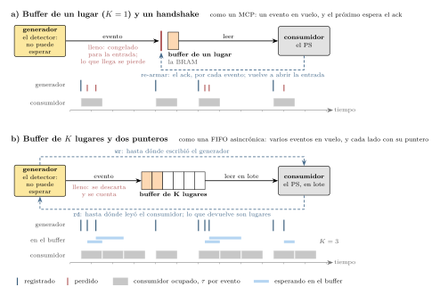
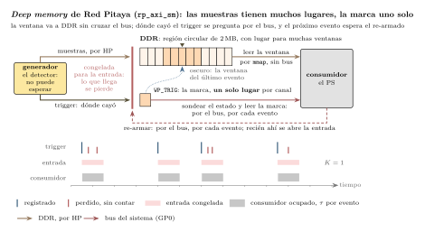

# Por qué agregar buffering baja el tiempo muerto

La idea central del proyecto es poner un **buffer entre el que produce los
eventos y el que los consume**. Este documento explica por qué eso baja el
tiempo muerto, cuánto, y qué no arregla. La teoría completa de colas está en
[`mca/tiempo_muerto.md`](mca/tiempo_muerto.md); el ring que lo implementa, en
[`event_ring/`](event_ring/).

([fuente](figuras/buffering_generador_consumidor.tex))

Las dos mitades de la figura tienen el mismo tren de eventos y el mismo tiempo
de servicio τ. La única diferencia es cuántos eventos caben entre el generador y
el consumidor.

---

## 1. Un buffer de un lugar y un handshake

El esquema original del osciloscopio es
`armar → capturar → congelar → el PS lee → re-armar`. Es un buffer de **un
lugar**, la BRAM: lleno, queda congelado para la entrada, y el permiso para el
próximo evento es el re-armado, un *ack* que el consumidor devuelve después de
leer. Mientras tanto hay un solo evento en vuelo.

El generador es un detector y **no puede esperar**: lo que llega mientras el
lugar está ocupado se pierde. Por eso el tiempo de servicio τ es tiempo muerto
entero, y τ es la ida y vuelta completa del handshake. Medido en placa, con el
lector de Python
([`API/arquitectura_adquisicion_software.md`](API/arquitectura_adquisicion_software.md)):

| fase | por evento |
|---|---|
| leer los dos canales | 172.7 µs |
| re-armar (3 escrituras) | 38.0 µs |
| contabilidad | 30.8 µs |
| leer el snapshot | 11.2 µs |
| **τ** | **252.7 µs** |

El techo es `1/τ` ≈ 4.0 kev/s, y se midieron 3.7. Con arribos Poisson,
como los de una fuente radiactiva, la pérdida es `ρ/(1+ρ)` con `ρ = n·τ`. A
396 ev/s ya es 9.1 %; a 2 kev/s, 33 %. Con un solo lugar, **todo el tiempo que el
consumidor está ocupado es tiempo en que un evento se perdería**.

Hacer más rápido al consumidor achica τ pero no cambia el esquema. Reescribir el
lector en C lo baja a 19.2 µs (13×), y sigue siendo `K=1`: a 10 kcps Poisson
pierde 16 %.

### 1.1 ¿Y el *deep memory*?

El osciloscopio de Red Pitaya tiene un segundo camino, `rp_axi_sm`, que escribe
las muestras en DDR por el puerto HP. Parece un buffer grande, y no lo es:

([fuente](osc/figuras/deep_memory_una_marca.tex))

- **No es un volcado continuo.** Escribe entre el armado y el fin del
  post-trigger; ahí `axi_we` baja y no vuelve a subir hasta el próximo armado
  ([`rp_axi_sm.v:114-117`](../../../rtl/classic/rp_axi_sm.v#L114)). Es la máquina
  de `rp_bram_sm` con la memoria en otro lado
  ([`osc/sistema_adquisicion_original.md` §5](osc/sistema_adquisicion_original.md#5-rp_axi_sm--el-camino-a-ddr-deep-memory)).
- **La marca tiene un solo lugar.** En la región de DDR entran muchas ventanas,
  pero dónde cayó el trigger se anota en un registro, `WP_TRIG`, uno por canal.
  Un trigger nuevo no tiene dónde anotarse hasta que el PS lo lee por el bus y
  re-arma. Aunque la escritura siguiera, una ventana sin marca no se podría
  ubicar.

Lo que cambia es qué cruza el bus:

| | BRAM | *deep memory* | ring |
|---|---|---|---|
| las muestras | por el bus, una por transacción | por DDR | por DDR |
| dónde está el evento | `WP_TRIG`, por el bus, por evento | `WP_TRIG`, por el bus, por evento | `WR_SLOT`, por el bus, por lote |
| permiso para el próximo | re-armar, por evento | re-armar, por evento | `RD_SLOT`, por lote |
| eventos en vuelo | 1 | 1 | hasta `K` |

Así que τ se achica —lo que en el lector de Python eran 172.7 µs de leer
muestras por el bus pasa a ser una lectura de DDR—, pero el esquema sigue siendo
`K=1` y la pérdida sigue siendo `ρ/(1+ρ)`. El tiempo muerto ya no lo ponen las
muestras: lo pone la marca, que hay que ir a buscar por el bus y liberar
re-armando, una vez por evento. Este camino no se midió en placa: el proyecto
nunca lo usó.

## 2. Un buffer de K lugares: dos ganancias distintas

Con un buffer de `K` lugares el generador escribe **mientras haya lugar**, sin
esperar ningún *ack*. El consumidor lee **cuando puede**. Eso compra dos cosas
que conviene no mezclar.

### 2.1 La cola convierte pérdida en demora

El que llega con el consumidor ocupado **espera** en vez de perderse. Se pierde
sólo si encuentra los `K` lugares llenos, y para eso hace falta una ráfaga de
`K` eventos dentro de un mismo servicio. La pérdida pasa de `≈ ρ` a
`≈ ρ^K/K!`: cada lugar de cola sube un orden. Con Poisson y servicio fijo
(M/D/1/K, de [`mca/tiempo_muerto.md`](mca/tiempo_muerto.md)):

| ρ | K=1 | K=2 | K=3 |
|---|---|---|---|
| 0.1 | 9.1 % | 0.48 % | 0.02 % |
| 0.5 | 33.3 % | 9.6 % | 2.7 % |
| 1 | 50 % | 26.9 % | 17.6 % |

En el tiempo se ve en
[`03a_tren_cola_K.png`](mca/figuras/tiempo_muerto/03a_tren_cola_K.png): el mismo
tren de Poisson con `K = 1, 2, 3`. El consumidor no trabaja menos, trabaja
**más**: lo que con `K=1` era pérdida pasa a ser tiempo ocupado.

### 2.2 El lote baja el τ

El segundo efecto es menos obvio y, en este equipo, el más grande. Con un solo
lugar el consumidor tiene que contestar **por cada evento**: leer, re-armar,
volver a preguntar. Con un buffer, el *ack* sale del camino de cada evento. El
consumidor puede leer muchos de una vez y devolver los lugares todos juntos, así
que el costo fijo se paga **una vez por lote**. Medido en placa sobre el ring
([`event_ring/diseno_y_register_map.md`](event_ring/diseno_y_register_map.md)):

| lectura | µs por evento (slot de 512 B) |
|---|---|
| 1 slot por vez | 27.3 |
| 8 slots | 5.8 |
| **128 slots (64 KB)** | **2.31** |

De 252.7 µs por evento a 2.3 µs. Esto **no** es la cola: es que el buffer deja
leer en lote. Las dos ganancias se suman, y el ring tiene las dos.

## 3. Lo que el buffer no arregla

**El promedio.** Si los eventos llegan, en promedio, más rápido de lo que el
consumidor los atiende (`ρ > 1` sostenido), cualquier cola se llena, y a partir
de ahí la pérdida es `1 − 1/ρ` con cualquier `K`. El buffer absorbe
**ráfagas**, como el agrupamiento de Poisson, y la **latencia variable** del
consumidor, porque el PS no es tiempo real. No absorbe un exceso de tasa.

**La captura misma.** El generador también tarda: el ring copia la ventana del
evento a un stream, y mientras la copia, un trigger nuevo se descarta
(`DROP_BUSY`). Esa etapa sigue siendo `K=1`, pero su τ es lo que tarda en
copiar la ventana, `(pre+post)·N_CH` ciclos —66 ciclos, 0.53 µs, para 32
muestras en dos canales—, y no la ida y vuelta del PS.

**Los buffers internos.** Entre la captura y el writer hay otro buffer, el
stage, con `E = 4` eventos. Es la misma idea a escala chica, y tiene el mismo
límite. En la traza de
[`event_ring/logica_de_captura_y_axi.md` §4.5](event_ring/logica_de_captura_y_axi.md#45-cuánto-tarda-cada-etapa),
el writer tarda 120 ciclos por slot y los triggers llegan cada 72: el stage se
llena y tres triggers se pierden aunque el ring tenga lugar de sobra.

Lo que sí cambia es que **lo perdido queda contado**:
`EV_CNT + DROP_BUSY + DROP_FULL` es igual al número de triggers. Con el esquema
viejo, un trigger que llegaba con la BRAM congelada no quedaba en ningún lado.

Cuánto rinde todo junto, en simulación del RTL con AXI ideal (todavía **no
medido en placa**): con una ventana de 32 muestras y Poisson a 100 kcps se
guardan 95 k eventos por segundo. El esquema de un lugar tenía un techo de
3.7 kev/s.

## 4. La analogía: de un MCP a una FIFO asincrónica

En términos de cruce de dominios, el cambio es pasar de un **handshake con
realimentación (MCP)** a una **FIFO asincrónica**, y la analogía vale casi
punto por punto:

| | un lugar — handshake (MCP) | `K` lugares — FIFO asincrónica |
|---|---|---|
| eventos en vuelo | uno | hasta `K` |
| el dato queda quieto hasta que lo toman | la BRAM congelada | el slot escrito en el ring |
| cómo sabe el generador que puede seguir | vuelve el *ack*: el re-armado | el puntero del consumidor dice que hay lugar |
| cómo sabe el consumidor que hay algo | consulta en bucle si terminó | el puntero del generador avanzó |
| qué limita el throughput | la ida y vuelta, `1/τ` | la tasa **media** del más lento |
| si llega un dato antes de tiempo | se pierde (el detector no espera) | espera; se pierde sólo con el buffer lleno |
| en el proyecto | `CMD_ARM` → `ADC_STATE` → `WP_TRIG` | `WR_SLOT` / `RD_SLOT` sobre el ring |

Tres precisiones, para que la analogía no diga más de lo que es:

1. **No hay dos relojes.** El ring corre entero en `adc_clk`. Lo
   "asincrónico" no es la frecuencia, es el *tiempo*: un detector Poisson de
   un lado y un programa sin garantía de latencia del otro. Desacoplar esos dos
   tiempos es lo mismo que hace una FIFO entre dos relojes.
2. **Por eso no hace falta Gray.** En una FIFO de CDC los punteros se codifican
   en Gray para cruzar bit a bit. Acá cruzan como palabras enteras por el bus
   del sistema, y ese bus resuelve su propio cruce con un handshake por toggle
   ([`TOP/bus_sistema_redpitaya.md` §6](TOP/bus_sistema_redpitaya.md)), o sea
   **un MCP por transacción**. El esquema viejo pagaba esa ida y vuelta
   decenas de veces por evento —la BRAM da una muestra por transacción, así
   que leer dos canales de 32 muestras ya son 64—; el ring, dos veces por lote:
   leer `WR_SLOT` y escribir `RD_SLOT`. Las muestras van por DDR, fuera del
   bus.
3. **El atraso de los punteros es del lado seguro.** Como en la FIFO de CDC,
   cada lado ve el puntero del otro tarde. El PL ve `RD_SLOT` recién cuando el
   PS lo publica, y cree que hay **menos** lugar del que hay. El PS ve
   `WR_SLOT` cuando lo lee, y cree que hay **menos** eventos de los que hay.
   Ninguno de los dos errores pierde datos; sólo demoran.

La diferencia que sí importa con una FIFO de CDC de libro es el lleno: allá el
escritor normalmente **se frena**, y acá el generador no puede. Por eso el ring
frena todo lo que puede frenarse —el writer y el camino a DDR— y descarta, entero
y contado, sólo en la entrada
([`event_ring/logica_de_captura_y_axi.md` §5.6](event_ring/logica_de_captura_y_axi.md#56-resumen-del-control-de-flujo)).
