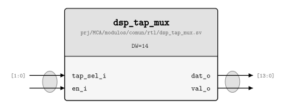

# Datasheet — `dsp_tap_mux`

<!-- Generado por `modulos/mk/datasheet.py`. Lo que está entre las marcas
     AUTO:x y /AUTO:x se REESCRIBE en cada corrida: editar ahí no sirve.
     Todo el resto es prosa a mano y no se toca.
     Regenerar:  make -C modulos/comun/work datasheet              -->

## 1. Función y funcionamiento

### 1.1 Descripción breve

<!-- AUTO:resumen -->
|  |  |
|---|---|
| Módulo RTL | `dsp_tap_mux` |
| Archivo | [`dsp_tap_mux.sv`](../../modulos/comun/rtl/dsp_tap_mux.sv) |
| Parámetros | 1 |
| Puertos | 4 (2 in / 2 out) |




**Cabecera del RTL** (se copia tal cual de [`dsp_tap_mux.sv`](../../modulos/comun/rtl/dsp_tap_mux.sv)):

> dsp_tap_mux — elige de qué punto de la cadena DSP toma un consumidor
>
> La cadena DSP del scope tiene varios nodos utilizables, y hasta el refactor
> cada consumidor estaba cableado a uno fijo:
>
>   adc_dat ─→ calib ─→ osc_filter ─→ [byp] ─→ adc_dec_in ──────── TAP_DEC_IN
>      │                                            │                  └→ MCA
>   TAP_ADC                                     rp_decim ─→ adc_dly_in
>                                                    │           └→ rp_adc_trig (MTRG)
>                                               rp_delay ─→ adc_bram_in ── TAP_BRAM_IN
>                                                                  └→ rp_acq_bram (OSC)
>
> Este mux deja que el software lo decida en runtime, desde los registros
> ROUTE_* de la región de TOP (integration_cfg, slot 6).
>
> EL DATO Y SU VALID VIAJAN JUNTOS. Los nodos post-decimación llevan estrobo
> (dec_val, dly_val) porque la decimación no es 1; los pre-decimación son
> continuos a 125 MSPS y su valid es constante. Mezclarlos sin arrastrar el
> valid daría un consumidor que lee muestras repetidas o se saltea muestras,
> según el sentido del cambio.
>
> POR QUÉ EL MUX ES COMBINACIONAL Y NO REGISTRADO. Registrar la salida sería
> lo natural para timing, pero correría el dato UN ciclo respecto de las
> señales de control que lo acompañan (adc_we y el write pointer en el caso
> del OSC, la alineación trigger-vs-captura en el del multitrigger), y en modo
> NATIVO el hardware dejaría de ser idéntico al de antes del refactor — que es
> justamente la propiedad que se quiso preservar. Un mux 4:1 de 14 bits es un
> LUT6 por bit, un solo nivel de lógica, y no cae sobre el camino crítico del
> diseño (que era el lazo IIR de osc_filter, deshabilitado con EN_FILT=0).
> Si alguna vez hiciera falta registrarlo, hay que registrar TAMBIÉN el valid
> y las señales de control de cada consumidor, en conjunto.
<!-- /AUTO:resumen -->

<!-- A mano: qué problema resuelve el bloque, cómo encaja en la cadena y las
     dos o tres decisiones de diseño que explican por qué está hecho así. -->

**Qué hace.** TODO

### 1.2 Interfaces

<!-- AUTO:interfaces -->
#### Parámetros

| Parámetro | Tipo | Default |
|---|---|---|
| `DW` | `integer` | `14` |


#### Puertos

##### Señales

Selección (desde integration_cfg). Ver la lista canónica de taps en integration_cfg.sv; si cambia allá, cambia acá.

| Puerto | Dir | Bits | Dominio |
|---|---|---|---|
| `tap_sel_i` | in | 2 | sin reloj |
| `en_i` | in | 1 | sin reloj |
| `dat_o` | out | 14 `[DW-1:0]` | sin reloj |
| `val_o` | out | 1 | sin reloj |
<!-- /AUTO:interfaces -->

### 1.3 Mapa de registros

<!-- AUTO:regmap -->
No hay un mapa de registros para este módulo en `docs/comun/`. Si es un esclavo del bus de sistema, falta escribirlo; si no lo es, esta sección no aplica.
<!-- /AUTO:regmap -->

### 1.4 Clock domains

<!-- AUTO:clocks -->
_(nada)_


**Combinacional:** el módulo no tiene puerto de reloj.
<!-- /AUTO:clocks -->

<!-- A mano: si hay más de un reloj, cuál es el cruce, con qué se sincroniza y
     qué se asume de la relación de frecuencias. Si hay uno solo, borrar. -->

### 1.5 Frecuencia máxima de trabajo

<!-- AUTO:timing -->
Sin datos de síntesis todavía. Correr:

```bash
make -C modulos/comun/work syn
make -C modulos/comun/work sweep-all
```

y volver a generar esta página.
<!-- /AUTO:timing -->

<!-- A mano: qué hay en el camino crítico y qué se haría para romperlo si
     hubiera que subir la frecuencia. -->

### 1.6 Waveforms

<!-- AUTO:ondas -->
_Sin figuras de ondas._ Se generan con un script en `docs/comun/figuras/ondas/`, que saca las ondas de un VCD de los testbenches del módulo; el patrón está en [`docs/figuras/ondas.py`](../figuras/ondas.py).
<!-- /AUTO:ondas -->

<!-- A mano: lo que las figuras no pueden mostrar solas. Para agregar una,
     editar docs/comun/figuras/ondas/ondas_comun.py: la onda
     sale de un VCD de los testbenches y los tiempos los mide el script.
       make -C modulos/comun/work wave TB=<tb>   # mirar en Questa
       make -C modulos/comun/work vcd  TB=<tb>   # VCD exportable -->

### 1.7 Verificación realizada

<!-- AUTO:verificacion -->
Todo corre en batch y se chequea el `RESULT: PASS` del testbench; las ondas quedan en `work/waves/<tb>.wlf`.

```bash
make -C modulos/comun/work            # el 1 testbench
make -C modulos/comun/work cov        # + cobertura
make -C modulos/comun/work lint
```

| Testbench | DUT | Escenas | Casos | Contra qué compara | Es el de este módulo |
|---|---|---|---|---|---|
| [`tb_integration_cfg`](../../modulos/comun/sim/tb_integration_cfg.sv) | `integration_cfg` | 7 | 36 | vectores a mano |  |


**36 casos con nombre** en 1 testbench (7 escenas). La lista completa, caso por caso, está en el plan de verificación.

> **`dsp_tap_mux` no tiene testbench propio.** Ningún `TBS` del `work/Makefile` lo instancia como DUT: lo que se verifica de este módulo es lo que arrastre el TB de otro. Es deuda de verificación, no una omisión de esta página.

**Assertions** — en `sim/sva/`, enganchadas por `bind` (no tocan el RTL sintetizable).

- [`bind_comun.sv`](../../modulos/comun/sim/sva/bind_comun.sv)
- [`integration_cfg_sva.sv`](../../modulos/comun/sim/sva/integration_cfg_sva.sv)

> **Los archivos de assertions están vacíos.** Son el scaffold de `create_module.py`: tienen el `bind`, el `default clocking` y un `// TODO:`, pero **ninguna propiedad**. O sea que hoy no aportan nada a la verificación; el enganche ya está hecho y lo que falta es escribirlas. Ver [`verificacion_formal.md`](../verificacion_formal.md), que discute cuáles convienen primero.

Plan de verificación, casos cubiertos y deuda: [`comun/sim/VERIFICACION.md`](../../modulos/comun/sim/VERIFICACION.md).
<!-- /AUTO:verificacion -->

#### Esquema de laboratorio

TODO — qué instrumento, cómo se conecta, qué se mide y contra qué se compara.
