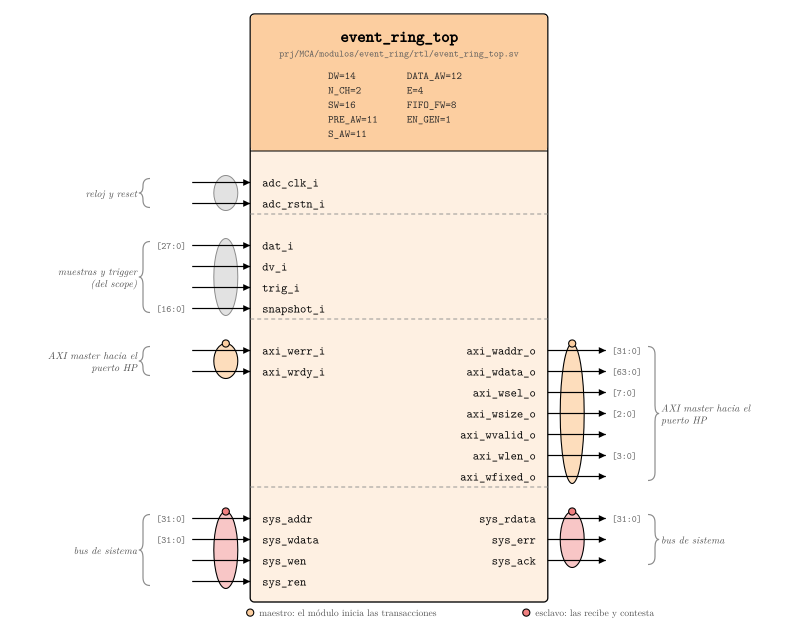

# Datasheet — `event_ring_top`

<!-- Generado por `modulos/mk/datasheet.py`. Lo que está entre las marcas
     AUTO:x y /AUTO:x se REESCRIBE en cada corrida: editar ahí no sirve.
     Todo el resto es prosa a mano y no se toca.
     Regenerar:  make -C modulos/event_ring/work datasheet              -->

## 1. Función y funcionamiento

### 1.1 Descripción breve

<!-- AUTO:resumen -->
|  |  |
|---|---|
| Módulo RTL | `event_ring_top` |
| Archivo | [`event_ring_top.sv`](../../modulos/event_ring/rtl/event_ring_top.sv) |
| Parámetros | 8 |
| Puertos | 22 (12 in / 10 out) |
| MAGIC | `32'h45564E54` — `"EVNT"` |




**Cabecera del RTL** (se copia tal cual de [`event_ring_top.sv`](../../modulos/event_ring/rtl/event_ring_top.sv)):

> event_ring_top — ring de slots de evento en DDR. Esclavo del bus de sistema.
>
> Reemplaza el ciclo "capturar -> congelar -> que el PS lea por GP0 -> re-armar"
> (K=1, tau = 252.7 us) por una COLA productor/consumidor de N_SLOTS eventos en
> DDR. El PS deja de estar en el camino critico: el HW sigue capturando
> mientras el PS drena.
>
> ACK DE LATENCIA FIJA, igual que mca_top: el ack sale de un shift register
> incondicional, sin ninguna ruta de ack por sub-bloque. Un esclavo que no hace
> ack no produce solo una lectura mala — deja el CDC del slot desincronizado y
> ese slot no acepta mas transacciones (ver docs/TOP/bus_sistema_redpitaya.md 7.1,
> y el bug latente de bram_ack[2]/[3] en el scope).
>
> UN SOLO DOMINIO DE RELOJ. En rp_scope_multitrigger_com.sv:686 hay
> `assign axi_clk = adc_clk_i`, y el bus llega ya sincronizado a adc_clk por
> sys_bus_cdc. O sea captura, writer y registros comparten adc_clk: no hace
> falta ningun CDC ni codificacion Gray entre WR_SLOT y RD_SLOT.
>
> COMO LEE EL PS (importante, porque define el techo de tasa):
>   1. No necesita leer NINGUN registro por GP0 en el lazo caliente. Polea el
>      FOOTER del proximo slot directamente en DDR: la ultima palabra del slot
>      vale {~seq, seq}. Cuando las dos mitades son complementarias y seq es el
>      esperado, el slot esta completo (ver event_slot_writer.sv).
>   2. Consume el batch.
>   3. Publica RD_SLOT una vez POR BATCH, no por evento. Publicarlo por evento
>      devolveria el GP0 al camino critico, que es exactamente lo que se
>      esta sacando.
>
> GEOMETRIA CONGELADA EN STOPPED. SLOT_BASE / RING_SZ / SLOT_SHIFT / PRE / POST
> solo latchean con la adquisicion parada, para que nunca convivan dos
> geometrias en el mismo ring. Escribirlos corriendo se ignora y levanta
> err_cfg (sticky).
<!-- /AUTO:resumen -->

<!-- A mano: qué problema resuelve el bloque, cómo encaja en la cadena y las
     dos o tres decisiones de diseño que explican por qué está hecho así. -->

**Qué hace.** Convierte cada evento en un **slot de DDR** y los encadena en una
cola productor/consumidor de `N_SLOTS`. Reemplaza el ciclo «capturar → congelar
→ que el PS lea por GP0 → re-armar» por uno donde **el hardware sigue
capturando mientras el PS drena**.

El problema que resuelve es el techo de tasa. En el esquema K=1 el PS está en el
camino crítico de cada evento: τ = 252.7 µs por evento, o sea ~3.7 kev/s, y lo
que se pierde no es una fracción de los pulsos sino **períodos enteros** (está
medido en [`multitrigger`](datasheet_multitrigger_cfg.md#16-transacciones):
a 8 kHz entra uno de cada cinco). Acá la PL escribe por AXI HP0 por DMA y
mientras queden créditos no espera a nadie.

Tres decisiones que lo hacen funcionar:

- **El footer es la marca de commit, y por eso no hace falta el `BRESP`.** La
  última palabra de cada slot vale `{~seq, seq}`. Como todas las escrituras
  salen por un único master con un único ID, AXI garantiza que se observan en
  orden: si el footer está bien formado y trae el `seq` esperado, **todo lo
  anterior ya llegó a DDR**. El plan original decía «incrementar `wr_slot` con
  el `BRESP` del último burst», que es correcto pero inaplicable — ni
  `axi_wr_fifo` ni `axi_master` exponen el canal B.
- **El PS no lee ningún registro por GP0 en el lazo caliente.** Polea el footer
  del próximo slot directamente en DDR, y publica `RD_SLOT` una vez **por
  batch**, no por evento. Publicarlo por evento devolvería el GP0 al camino
  crítico, que es exactamente lo que se está sacando.
- **La geometría se congela en `STOPPED`.** `SLOT_BASE`, `RING_SZ`,
  `SLOT_SHIFT`, `PRE` y `POST` sólo latchean con la adquisición parada, para que
  nunca convivan dos geometrías en el mismo ring. Escribirlos corriendo se
  ignora y levanta `err_cfg` (sticky).

Un detalle que conviene tener presente al dimensionar: el slot tiene que ser
**potencia de dos** para que su dirección salga de un shift, así que una ventana
de 512 muestras × 2 canales ocupa 4096 B de los cuales sólo la mitad son
muestras. El layout palabra por palabra, con los valores de un evento real,
está en [§1.6](#16-transacciones).

### 1.2 Interfaces

<!-- AUTO:interfaces -->
#### Parámetros

| Parámetro | Tipo | Default | Para qué |
|---|---|---|---|
| `DW` | `integer` | `14` |  |
| `N_CH` | `integer` | `2` |  |
| `SW` | `integer` | `16` |  |
| `PRE_AW` | `integer` | `9` | pre-buffer: 512 muestras |
| `S_AW` | `integer` | `11` |  |
| `DATA_AW` | `integer` | `12` | stage: 4096 muestras (~2 RAMB36) |
| `E` | `integer` | `4` | eventos en vuelo en el stage |
| `FIFO_FW` | `integer` | `8` | profundidad del axi_wr_fifo (2^FW) |


#### Puertos

##### Reloj y reset

| Puerto | Dir | Bits | Dominio |
|---|---|---|---|
| `adc_clk_i` | in | 1 | — |
| `adc_rstn_i` | in | 1 | — |


##### Muestras y trigger (del scope)

| Puerto | Dir | Bits | Dominio |
|---|---|---|---|
| `dat_i` | in | 28 `[N_CH*DW-1:0]` | adc_clk_i |
| `dv_i` | in | 1 | adc_clk_i |
| `trig_i` | in | 1 | adc_clk_i |
| `snapshot_i` | in | 17 | adc_clk_i |


##### AXI master hacia el puerto HP

| Puerto | Dir | Bits | Dominio |
|---|---|---|---|
| `axi_waddr_o` | out | 32 | adc_clk_i |
| `axi_wdata_o` | out | 64 | adc_clk_i |
| `axi_wsel_o` | out | 8 | adc_clk_i |
| `axi_wsize_o` | out | 3 | adc_clk_i |
| `axi_wvalid_o` | out | 1 | adc_clk_i |
| `axi_wlen_o` | out | 4 | adc_clk_i |
| `axi_wfixed_o` | out | 1 | adc_clk_i |
| `axi_werr_i` | in | 1 | adc_clk_i |
| `axi_wrdy_i` | in | 1 | adc_clk_i |


##### Bus de sistema

| Puerto | Dir | Bits | Dominio |
|---|---|---|---|
| `sys_addr` | in | 32 | adc_clk_i |
| `sys_wdata` | in | 32 | adc_clk_i |
| `sys_wen` | in | 1 | adc_clk_i |
| `sys_ren` | in | 1 | adc_clk_i |
| `sys_rdata` | out | 32 | adc_clk_i |
| `sys_err` | out | 1 | adc_clk_i |
| `sys_ack` | out | 1 | adc_clk_i |
<!-- /AUTO:interfaces -->

### 1.3 Mapa de registros

<!-- AUTO:regmap -->
No hay un mapa de registros para este módulo en `docs/event_ring/`. Si es un esclavo del bus de sistema, falta escribirlo; si no lo es, esta sección no aplica.
<!-- /AUTO:regmap -->

### 1.4 Clock domains

<!-- AUTO:clocks -->
| Puerto | Qué es | Polaridad |
|---|---|---|
| `adc_clk_i` | reloj |  |
| `adc_rstn_i` | reset | activo-bajo |


**Un solo dominio.** Todos los puertos de datos y de control son síncronos a `adc_clk_i`: no hay cruce de dominio dentro de este módulo.
<!-- /AUTO:clocks -->

<!-- A mano: si hay más de un reloj, cuál es el cruce, con qué se sincroniza y
     qué se asume de la relación de frecuencias. Si hay uno solo, borrar. -->

### 1.5 Frecuencia máxima de trabajo

<!-- AUTO:timing -->
Sin datos de síntesis todavía. Correr:

```bash
make -C modulos/event_ring/work syn
make -C modulos/event_ring/work sweep-all
```

y volver a generar esta página.
<!-- /AUTO:timing -->

<!-- A mano: qué hay en el camino crítico y qué se haría para romperlo si
     hubiera que subir la frecuencia. -->

### 1.6 Transacciones

<!-- AUTO:transacciones -->
**LA VENTANA QUE CONGELA EL TRIGGER**


Que entra al modulo. Un evento es una ventana de 512 muestras por canal --32 antes del disparo y 480 despues, 4.10 us en total a 125 MSPS-- congelada en el instante en que el canal 0 cruza el umbral de 1229 cuentas (0.15 V a 8192 cuentas/V). El cruce de subida cae en la muestra 31 y el pre-buffer mide 32: la figura no dibuja esa coincidencia, la MIDE sobre el dato, y es lo que confirma que la ventana esta alineada con el disparo. El pico llega 69 muestras despues del cruce, con 2420 cuentas. La banda gris de la izquierda es la historia que el pre-buffer ya tenia guardada cuando el trigger llego: sin ella el flanco de subida no estaria en el archivo.

_Origen: campaña e2e, `software/datos/e2e_20260528_013404/principal/chunk_000000.npz`, evento 1._

**UNA VENTANA, UN SLOT**


Que viaja. La ventana cruza tres bloques --captura, cola elastica de 4 eventos en vuelo y serializador-- y sale por AXI HP0 como exactamente 512 palabras de 64 b, en orden de direccion creciente para que el generador lineal del axi_wr_fifo las coloque sin saltos. La tabla son las palabras de este evento concreto, no un ejemplo: cabecera de 32 B, 2048 B de muestras, 2008 B de relleno y 8 B de footer. El relleno existe porque el slot tiene que ser potencia de dos para que la direccion salga de un shift, asi que de los 4096 B del slot solo 50 % son muestras. El FOOTER vale {~seq, seq} y es la MARCA DE COMMIT: como todas las escrituras salen por un unico master con un unico ID, AXI garantiza que se observan en orden, asi que si el footer esta bien formado todo lo anterior ya llego a DDR. Por eso el PS no necesita leer ningun registro por GP0 para saber que hay un evento nuevo. Los rangos de bits exactos de cada campo estan en la cabecera de `event_slot_writer.sv`; aca va el valor, que es lo que la figura puede mostrar y el RTL no.

_Origen: layout de `event_slot_writer.sv`, verificado con `software/API/modelo_rtl/ring_format.py`._

**EL RING EN DDR**


Que sale. Los slots forman una cola productor/consumidor en DDR: la PL avanza WR_SLOT al terminar de escribir y el PS avanza RD_SLOT al terminar de leer, y los dos son contadores LIBRES de 32 b --la resta cierra en modulo 2^32 aunque hayan dado la vuelta, que es exactamente lo que hace el comparador de creditos del RTL--. En el dibujo hay 4 slots ocupados. El rectangulo verde de cada slot lleno es el footer. La diferencia con el esquema anterior (K=1, tau = 252.7 us) es que aca la PL no espera a nadie: mientras queden creditos sigue capturando, y el tiempo muerto deja de depender de la latencia del lector. Es un esquema: la cantidad de slots del dibujo es ilustrativa, la real sale de RING_SZ / SLOT_SZ.

_Origen: esquema; los créditos salen de `ring_format.credits_used()`._

**LA TRANSACCION COMPLETA**


Las tres preguntas en una imagen: que entra, que viaja y que sale. Es la que va al informe si entra una sola.

_Origen: las tres anteriores, en una figura._

---

Las figuras **recalculan cada número al dibujar** en vez de tomarlo escrito. Las genera [`transacciones_event_ring.py`](../event_ring/figuras/transacciones/transacciones_event_ring.py); de dónde sale el dato de cada una está en la columna «Datos» de [`README.md`](../event_ring/figuras/transacciones/README.md); los epígrafes completos, en [`epigrafes.txt`](../event_ring/figuras/transacciones/epigrafes.txt).
<!-- /AUTO:transacciones -->

### 1.7 Waveforms

<!-- AUTO:ondas -->
_Sin figuras de ondas._ Se generan con un script en `docs/event_ring/figuras/ondas/`, que saca las ondas de un VCD de los testbenches del módulo; el patrón está en [`docs/figuras/ondas.py`](../figuras/ondas.py).
<!-- /AUTO:ondas -->

<!-- A mano: lo que las figuras no pueden mostrar solas. Para
     agregar una, editar docs/event_ring/figuras/ondas/ondas_event_ring.py:
     la onda sale de un VCD de los testbenches y los tiempos los
     mide el script, no se escriben acá.
       make -C modulos/event_ring/work wave TB=<tb>   # mirar en Questa
       make -C modulos/event_ring/work vcd  TB=<tb>   # VCD exportable -->
orden en que la hace el software.

### 1.8 Verificación realizada

<!-- AUTO:verificacion -->
Todo corre en batch y se chequea el `RESULT: PASS` del testbench; las ondas quedan en `work/waves/<tb>.wlf`.

```bash
make -C modulos/event_ring/work            # los 4 testbenches
make -C modulos/event_ring/work cov        # + cobertura
make -C modulos/event_ring/work lint
```

| Testbench | DUT | Escenas | Casos | Contra qué compara | Es el de este módulo |
|---|---|---|---|---|---|
| [`tb_event_window_capture`](../../modulos/event_ring/sim/tb_event_window_capture.sv) | `event_window_capture` | 7 | 25 | vectores a mano |  |
| [`tb_event_stage_fifo`](../../modulos/event_ring/sim/tb_event_stage_fifo.sv) | `event_stage_fifo` | — | 26 | vectores a mano |  |
| [`tb_event_slot_writer`](../../modulos/event_ring/sim/tb_event_slot_writer.sv) | `event_slot_writer` | 9 | 32 | vectores a mano |  |
| [`tb_event_ring_top`](../../modulos/event_ring/sim/tb_event_ring_top.sv) | `event_ring_top` | — | 39 | vectores a mano | **sí** |


**122 casos con nombre** en 4 testbenches (16 escenas). La lista completa, caso por caso, está en el plan de verificación.

**Assertions** — en `sim/sva/`, enganchadas por `bind` (no tocan el RTL sintetizable).

- [`bind_event_ring.sv`](../../modulos/event_ring/sim/sva/bind_event_ring.sv)
- [`event_ring_top_sva.sv`](../../modulos/event_ring/sim/sva/event_ring_top_sva.sv)

> **Los archivos de assertions están vacíos.** Son el scaffold de `create_module.py`: tienen el `bind`, el `default clocking` y un `// TODO:`, pero **ninguna propiedad**. O sea que hoy no aportan nada a la verificación; el enganche ya está hecho y lo que falta es escribirlas. Ver [`verificacion_formal.md`](../verificacion_formal.md), que discute cuáles convienen primero.

Plan de verificación, casos cubiertos y deuda: [`event_ring/sim/VERIFICACION.md`](../../modulos/event_ring/sim/VERIFICACION.md).
<!-- /AUTO:verificacion -->

#### Esquema de laboratorio

TODO — qué instrumento, cómo se conecta, qué se mide y contra qué se compara.
