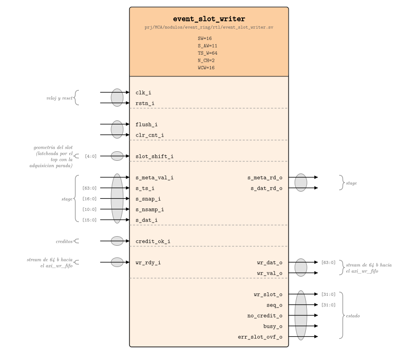

# Datasheet — `event_slot_writer`

<!-- Generado por `modulos/mk/datasheet.py`. Lo que está entre las marcas
     AUTO:x y /AUTO:x se REESCRIBE en cada corrida: editar ahí no sirve.
     Todo el resto es prosa a mano y no se toca.
     La §1.1 «Qué hace» se escribe en prosa/event_slot_writer.md.
     Regenerar:  make -C modulos/event_ring/work datasheet              -->

## 1. Función y funcionamiento

### 1.1 Descripción breve

<!-- AUTO:resumen -->
|  |  |
|---|---|
| Módulo RTL | `event_slot_writer` |
| Archivo | [`event_slot_writer.sv`](../../modulos/event_ring/rtl/event_slot_writer.sv) |
| Parámetros | 5 |
| Puertos | 21 (12 in / 9 out) |
| Parte | `xc7z010clg400-1` |




**Cabecera del RTL** (se copia tal cual de [`event_slot_writer.sv`](../../modulos/event_ring/rtl/event_slot_writer.sv)):

> event_slot_writer — serializa un evento a un slot del ring en DDR.
>
> Emite EXACTAMENTE 2^(slot_shift-3) palabras de 64 b por evento, en orden de
> direccion creciente, para que el generador lineal del axi_wr_fifo las coloque
> sin saltos:
>
>   w0            timestamp[63:0]
>   w1            {flags[7:0], n_ch[7:0], n_samp[15:0], seq[31:0]}
>   w2            {event_id[31:0], 15'b0, snapshot[16:0]}
>   w3            0 (reservado)
>   w4 ..         muestras int16, 4 por palabra, canales intercalados:
>                 [15:0]=ch0[k] [31:16]=ch1[k] [47:32]=ch0[k+1] [63:48]=ch1[k+1]
>   .. relleno    ceros hasta la anteultima palabra
>   ultima        FOOTER {~seq[31:0], seq[31:0]}
>
> COMO SE SABE QUE EL SLOT ESTA COMPLETO — y por que NO hace falta el BRESP.
>
> El plan original decia "incrementar wr_slot recien con el BRESP del ultimo
> burst". Es correcto pero inaplicable: ni axi_wr_fifo ni axi_master exponen el
> canal B (axi_wr_fifo.v solo saca werr/wrdy), asi que no hay forma de
> observarlo sin tocar RTL compartido.
>
> La solucion estandar de descriptor-ring es mejor y ademas mas barata: se
> escribe una MARCA AL FINAL. Todas las escrituras salen por un unico master
> con un unico ID hacia el mismo esclavo, y AXI garantiza que las escrituras
> con el mismo ID se observan en orden. Entonces, si el PS ve el footer del
> slot i con el `seq` esperado, todo lo que esta antes del footer YA esta en
> DDR. El footer es el commit.
>
> Ventaja adicional: el PS no necesita leer NINGUN registro por GP0 para saber
> que hay un evento nuevo. Polea el footer del proximo slot directamente en
> DDR, que es mas rapido que una lectura de registro (2.3 us) y saca el bus GP0
> del lazo caliente por completo. `wr_slot_o` queda como diagnostico.
>
> El footer lleva {~seq, seq}: una lectura rota o vieja se detecta comparando
> las dos mitades, sin depender de que el valor "0" sea especial.
>
> CONTROL DE FLUJO. Sin creditos el writer NO descarta: se frena. La
> contrapresion sube al stage y el descarte ocurre arriba de todo, en la
> captura, donde se puede descartar el evento ENTERO y contarlo. Descartar a
> mitad del slot dejaria basura indistinguible de un evento bueno.
<!-- /AUTO:resumen -->

<!-- AUTO:prosa -->
<!-- Prosa a mano: se edita en prosa/event_slot_writer.md, no aca. -->

**Qué hace.** Serializa un evento a **un slot del anillo en DDR**: emite
exactamente `2^(slot_shift−3)` palabras de 64 bits en orden de dirección
creciente —cabecera, muestras intercaladas de los dos canales, relleno y
footer— para que el generador lineal del `axi_wr_fifo` las coloque sin saltos.
Es la última etapa del [`event_ring_top`](datasheet_event_ring_top.md).

El formato completo, decodificado con el **mismo decodificador que usa el
software en producción** (`ring_format.decode_slot`) sobre datos de una corrida
real, está en
[`event_ring_b_slot.png`](../event_ring/figuras/transacciones/event_ring_b_slot.png).

**El footer es el commit, y eso reemplaza al `BRESP`.** El plan original decía
«incrementar `wr_slot` recién con el `BRESP` del último burst». Es correcto e
**inaplicable**: ni `axi_wr_fifo` ni `axi_master` exponen el canal B, así que
no hay forma de observarlo sin tocar RTL compartido. La solución estándar de
*descriptor ring* es mejor y además más barata: se escribe una **marca al
final**. Todas las escrituras salen por un único master con un único ID hacia
el mismo esclavo, y AXI garantiza que las escrituras con el mismo ID se
observan en orden — así que si el PS ve el footer del slot *i* con el `seq`
esperado, **todo lo que está antes del footer ya está en DDR**.

Eso tiene una consecuencia que cambia el lazo caliente: **el PS no necesita
leer ningún registro por GP0** para enterarse de que hay un evento nuevo.
Poléa el footer del próximo slot directamente en DDR, que es más rápido que una
lectura de registro (**2.3 µs**) y saca el bus GP0 del camino. `wr_slot_o`
queda como diagnóstico, no como mecanismo.

El footer lleva `{~seq, seq}`: una lectura rota o vieja se detecta comparando
las dos mitades, sin depender de que el valor `0` sea especial.

**Sin créditos el writer NO descarta: se frena.** La contrapresión sube a la
stage y el descarte ocurre arriba de todo, en la captura, donde se puede tirar
el evento **entero** y contarlo. Descartar a mitad del slot dejaría basura
indistinguible de un evento bueno.

> **Un detalle de reset que parece de más y no lo es.** `flush_i` vacía la FSM
> y el dato en vuelo; `clr_cnt_i` resetea `wr_slot`/`seq`. Están **separados a
> propósito**: `wr_slot` vive en pareja con el `rd_slot` que publica el PS, y
> resetear uno solo deja la resta de créditos en underflow —ocupados ≈ 2³²— y
> el ring descartando todo. Un stop/start no tiene por qué invalidar el anillo,
> así que los contadores se reinician sólo cuando el PS lo pide explícitamente,
> y ahí el top resetea los dos a la vez.
<!-- /AUTO:prosa -->

### 1.2 Interfaces

<!-- AUTO:interfaces -->
#### Parámetros

| Parámetro | Tipo | Default | Para qué |
|---|---|---|---|
| `SW` | `integer` | `16` |  |
| `S_AW` | `integer` | `11` |  |
| `TS_W` | `integer` | `64` |  |
| `N_CH` | `integer` | `2` |  |
| `WCW` | `integer` | `16` | ancho del contador de palabras por slot |


#### Puertos

##### Señales

| Puerto | Dir | Bits | Dominio | Descripción |
|---|---|---|---|---|
| `clk_i` | in | 1 | — |  |
| `rstn_i` | in | 1 | — |  |
| `flush_i` | in | 1 | clk_i | flush_i: vacia la FSM y el dato en vuelo (parada de adquisicion). clr_cnt_i: resetea wr_slot_o/seq_o. SEPARADO de flush_i a proposito — wr_slot vive en pareja con el rd_slot que publica el PS, y resetear uno solo deja la resta de creditos en underflow (ocupados ~ 2^32) y el ring descartando todo. Un stop/start NO tiene por que invalidar el ring: los contadores solo se reinician cuando el PS pide clr explicitamente, y ahi el top resetea los DOS al mismo tiempo. |
| `clr_cnt_i` | in | 1 | clk_i |  |


##### Geometria del slot (latcheada por el top con la adquisicion parada)

| Puerto | Dir | Bits | Dominio | Descripción |
|---|---|---|---|---|
| `slot_shift_i` | in | 5 | clk_i | log2(bytes por slot), >= 6 |


##### Stage

| Puerto | Dir | Bits | Dominio | Descripción |
|---|---|---|---|---|
| `s_meta_val_i` | in | 1 | clk_i |  |
| `s_ts_i` | in | 64 `[TS_W-1:0]` | clk_i |  |
| `s_snap_i` | in | 17 | clk_i |  |
| `s_nsamp_i` | in | 11 `[S_AW-1:0]` | clk_i | muestras POR CANAL |
| `s_meta_rd_o` | out | 1 | clk_i |  |
| `s_dat_i` | in | 16 `[SW-1:0]` | clk_i |  |
| `s_dat_rd_o` | out | 1 | clk_i |  |


##### Creditos

| Puerto | Dir | Bits | Dominio | Descripción |
|---|---|---|---|---|
| `credit_ok_i` | in | 1 | clk_i | hay al menos un slot libre en DDR |


##### Stream de 64 b hacia el axi_wr_fifo

| Puerto | Dir | Bits | Dominio |
|---|---|---|---|
| `wr_dat_o` | out | 64 | clk_i |
| `wr_val_o` | out | 1 | clk_i |
| `wr_rdy_i` | in | 1 | clk_i |


##### Estado

| Puerto | Dir | Bits | Dominio | Descripción |
|---|---|---|---|---|
| `wr_slot_o` | out | 32 | clk_i | contador LIBRE de slots escritos |
| `seq_o` | out | 32 | clk_i | secuencia del proximo evento |
| `no_credit_o` | out | 1 | clk_i | 1 = frenado por falta de creditos |
| `busy_o` | out | 1 | clk_i |  |
| `err_slot_ovf_o` | out | 1 | clk_i | Sticky: la ventana no entra en el slot configurado. Sin este guard, un slot_shift demasiado chico pisa el slot siguiente y el PS lee eventos corruptos sin ninguna indicacion. |
<!-- /AUTO:interfaces -->

### 1.3 Mapa de registros

<!-- AUTO:regmap -->
No hay un mapa de registros para este módulo en `docs/event_ring/`. Si es un esclavo del bus de sistema, falta escribirlo; si no lo es, esta sección no aplica.
<!-- /AUTO:regmap -->

### 1.4 Clock domains

<!-- AUTO:clocks -->
| Puerto | Qué es | Polaridad |
|---|---|---|
| `clk_i` | reloj |  |
| `rstn_i` | reset | activo-bajo |


**Un solo dominio.** Todos los puertos de datos y de control son síncronos a `clk_i`: no hay cruce de dominio dentro de este módulo.
<!-- /AUTO:clocks -->

<!-- A mano: si hay más de un reloj, cuál es el cruce, con qué se sincroniza y
     qué se asume de la relación de frecuencias. Si hay uno solo, borrar. -->

### 1.5 Frecuencia máxima de trabajo

<!-- AUTO:timing -->
El `metrics.txt` del módulo es de `event_ring_top`, no de `event_slot_writer`: la síntesis OOC del módulo apunta a otro top, así que acá no hay números propios de este bloque.
<!-- /AUTO:timing -->

<!-- A mano: qué hay en el camino crítico y qué se haría para romperlo si
     hubiera que subir la frecuencia. -->

### 1.6 Transacciones

<!-- AUTO:transacciones -->
**LA VENTANA QUE CONGELA EL TRIGGER**


Que entra al modulo. Un evento es una ventana de 512 muestras por canal --32 antes del disparo y 480 despues, 4.10 us en total a 125 MSPS-- congelada en el instante en que el canal 0 cruza el umbral de 1229 cuentas (0.15 V a 8192 cuentas/V). El cruce de subida cae en la muestra 31 y el pre-buffer mide 32: la figura no dibuja esa coincidencia, la MIDE sobre el dato, y es lo que confirma que la ventana esta alineada con el disparo. El pico llega 69 muestras despues del cruce, con 2420 cuentas. La banda gris de la izquierda es la historia que el pre-buffer ya tenia guardada cuando el trigger llego: sin ella el flanco de subida no estaria en el archivo.

_Origen: campaña e2e, `software/datos/e2e_20260528_013404/principal/chunk_000000.npz`, evento 1._

**UNA VENTANA, UN SLOT**


Que viaja. La ventana cruza tres bloques --captura, cola elastica de 4 eventos en vuelo y serializador-- y sale por AXI HP0 como exactamente 512 palabras de 64 b, en orden de direccion creciente para que el generador lineal del axi_wr_fifo las coloque sin saltos. La tabla son las palabras de este evento concreto, no un ejemplo: cabecera de 32 B, 2048 B de muestras, 2008 B de relleno y 8 B de footer. El relleno existe porque el slot tiene que ser potencia de dos para que la direccion salga de un shift, asi que de los 4096 B del slot solo 50 % son muestras. El FOOTER vale {~seq, seq} y es la MARCA DE COMMIT: como todas las escrituras salen por un unico master con un unico ID, AXI garantiza que se observan en orden, asi que si el footer esta bien formado todo lo anterior ya llego a DDR. Por eso el PS no necesita leer ningun registro por GP0 para saber que hay un evento nuevo. Los rangos de bits exactos de cada campo estan en la cabecera de `event_slot_writer.sv`; aca va el valor, que es lo que la figura puede mostrar y el RTL no.

_Origen: layout de `event_slot_writer.sv`, verificado con `software/API/modelo_rtl/ring_format.py`._

**EL RING EN DDR**


Que sale. Los slots forman una cola productor/consumidor en DDR: la PL avanza WR_SLOT al terminar de escribir y el PS avanza RD_SLOT al terminar de leer, y los dos son contadores LIBRES de 32 b --la resta cierra en modulo 2^32 aunque hayan dado la vuelta, que es exactamente lo que hace el comparador de creditos del RTL--. En el dibujo hay 4 slots ocupados. El rectangulo verde de cada slot lleno es el footer. La diferencia con el esquema anterior (K=1, tau = 252.7 us) es que aca la PL no espera a nadie: mientras queden creditos sigue capturando, y el tiempo muerto deja de depender de la latencia del lector. Es un esquema: la cantidad de slots del dibujo es ilustrativa, la real sale de RING_SZ / SLOT_SZ.

_Origen: esquema; los créditos salen de `ring_format.credits_used()`._

**LA TRANSACCION COMPLETA**


Las tres preguntas en una imagen: que entra, que viaja y que sale. Es la que va al informe si entra una sola.

_Origen: las tres anteriores, en una figura._

---

Las figuras **recalculan cada número al dibujar** en vez de tomarlo escrito. Las genera [`transacciones_event_ring.py`](../event_ring/figuras/transacciones/transacciones_event_ring.py); de dónde sale el dato de cada una está en la columna «Datos» de [`README.md`](../event_ring/figuras/transacciones/README.md); los epígrafes completos, en [`epigrafes.txt`](../event_ring/figuras/transacciones/epigrafes.txt).
<!-- /AUTO:transacciones -->

### 1.7 Waveforms

<!-- AUTO:ondas -->
_Sin figuras de ondas._ Se generan con un script en `docs/event_ring/figuras/ondas/`, que saca las ondas de un VCD de los testbenches del módulo; el patrón está en [`docs/figuras/ondas.py`](../figuras/ondas.py).
<!-- /AUTO:ondas -->

<!-- A mano: lo que las figuras no pueden mostrar solas. Para agregar una,
     editar docs/event_ring/figuras/ondas/ondas_event_ring.py: la onda
     sale de un VCD de los testbenches y los tiempos los mide el script.
       make -C modulos/event_ring/work wave TB=<tb>   # mirar en Questa
       make -C modulos/event_ring/work vcd  TB=<tb>   # VCD exportable -->

### 1.8 Verificación realizada

<!-- AUTO:verificacion -->
Todo corre en batch y se chequea el `RESULT: PASS` del testbench; las ondas quedan en `work/waves/<tb>.wlf`.

```bash
make -C modulos/event_ring/work            # los 5 testbenches
make -C modulos/event_ring/work cov        # + cobertura
make -C modulos/event_ring/work lint
```

| Testbench | DUT | Escenas | Casos | Contra qué compara | Es el de este módulo |
|---|---|---|---|---|---|
| [`tb_event_window_capture`](../../modulos/event_ring/sim/tb_event_window_capture.sv) | `event_window_capture` | 7 | 25 | vectores a mano |  |
| [`tb_event_stage_fifo`](../../modulos/event_ring/sim/tb_event_stage_fifo.sv) | `event_stage_fifo` | — | 26 | vectores a mano |  |
| [`tb_event_slot_writer`](../../modulos/event_ring/sim/tb_event_slot_writer.sv) | `event_slot_writer` | 12 | 39 | vectores a mano | **sí** |
| [`tb_event_ring_top`](../../modulos/event_ring/sim/tb_event_ring_top.sv) | `event_ring_top` | — | 39 | vectores a mano |  |
| [`tb_event_ring_ventana`](../../modulos/event_ring/sim/tb_event_ring_ventana.sv) | `event_ring_ventana` | 8 | 23 | vectores a mano |  |


**152 casos con nombre** en 5 testbenches (27 escenas). La lista completa, caso por caso, está en el plan de verificación.

Las escenas de [`tb_event_slot_writer`](../../modulos/event_ring/sim/tb_event_slot_writer.sv): 1) cantidad exacta de palabras por slot = 2^(slot_s, 2) cabecera, 3) empaquetado 4 muestras/palabra, primera muestra , 4) relleno de ceros entre datos y footer, 5) FOOTER = ultima palabra, y vale {~seq, seq}, 6) IDEMPOTENCIA ANTE CONTRAPRESION, 7) sin creditos el writer SE FRENA (no descarta) y , 8) seq y wr_slot avanzan de a uno por evento, 9) err_slot_ovf con ventana que no entra en el slot, 10) RITMO, 11) una ventana que entra JUSTA en el slot no es un , 12) una ventana no multiplo de 4 con contrapresion.

**Assertions** — en `sim/sva/`, enganchadas por `bind` (no tocan el RTL sintetizable).

- [`bind_event_ring.sv`](../../modulos/event_ring/sim/sva/bind_event_ring.sv)
- [`event_ring_top_sva.sv`](../../modulos/event_ring/sim/sva/event_ring_top_sva.sv)

> **Los archivos de assertions están vacíos.** Son el scaffold de `create_module.py`: tienen el `bind`, el `default clocking` y un `// TODO:`, pero **ninguna propiedad**. O sea que hoy no aportan nada a la verificación; el enganche ya está hecho y lo que falta es escribirlas. Ver [`verificacion_formal.md`](../verificacion_formal.md), que discute cuáles convienen primero.

Plan de verificación, casos cubiertos y deuda: [`event_ring/sim/VERIFICACION.md`](../../modulos/event_ring/sim/VERIFICACION.md).
<!-- /AUTO:verificacion -->

#### Esquema de laboratorio

TODO — qué instrumento, cómo se conecta, qué se mide y contra qué se compara.
