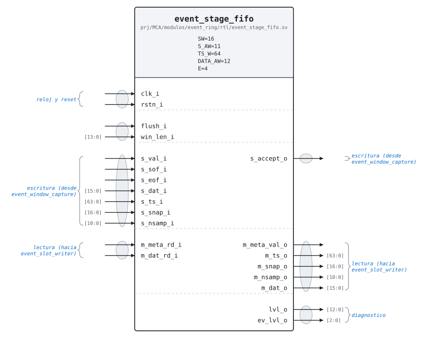
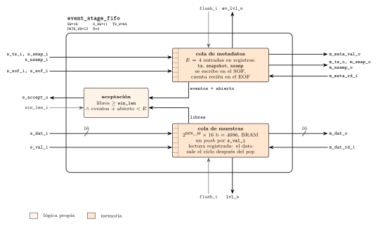

# Datasheet — `event_stage_fifo`

<!-- Generado por `modulos/mk/datasheet.py`. Lo que está entre las marcas
     AUTO:x y /AUTO:x se REESCRIBE en cada corrida: editar ahí no sirve.
     Todo el resto es prosa a mano y no se toca.
     La §1.1 «Qué hace» se escribe en prosa/event_stage_fifo.md.
     Regenerar:  make -C modulos/event_ring/work datasheet              -->

## 1. Función y funcionamiento

### 1.1 Descripción breve

<!-- AUTO:resumen -->
|  |  |
|---|---|
| Módulo RTL | `event_stage_fifo` |
| Archivo | [`event_stage_fifo.sv`](../../modulos/event_ring/rtl/event_stage_fifo.sv) |
| Parámetros | 5 |
| Puertos | 21 (13 in / 8 out) |
| Parte | `xc7z010clg400-1` |




**Cabecera del RTL** (se copia tal cual de [`event_stage_fifo.sv`](../../modulos/event_ring/rtl/event_stage_fifo.sv)):

> event_stage_fifo — buffer elastico entre la captura de ventana y el writer AXI.
>
> POR QUE EXISTE. La captura produce muestras al ritmo del ADC y no se puede
> frenar (las muestras del post-trigger llegan cuando llegan). El writer, en
> cambio, se frena: espera creditos de DDR y espera al axi_wr_fifo. Sin un
> buffer en el medio, cualquier hipo del writer corrompe la ventana en vuelo.
> Con E eventos de capacidad, la captura puede empezar el evento N+1 mientras
> el writer todavia drena el N.
>
> GARANTIA DE EVENTO ENTERO. `s_accept_o` es la respuesta a "¿entra una ventana
> COMPLETA?" y se consulta en el ciclo del trigger, antes de aceptar nada. Si
> da 0 el evento se descarta entero aguas arriba. Nunca se guarda media
> ventana: un evento parcial en el ring seria indistinguible de uno bueno del
> lado del PS.
>
> Dos colas en paralelo: una de muestras (BRAM) y una de metadatos (E entradas,
> registros). El writer las consume desacopladas — primero lee el metadato para
> armar la cabecera, despues drena las muestras.
<!-- /AUTO:resumen -->

<!-- AUTO:prosa -->
<!-- Prosa a mano: se edita en prosa/event_stage_fifo.md, no aca. -->

**Qué hace.** Es el **buffer elástico** entre la captura de ventana y el
escritor AXI: absorbe la diferencia de ritmo entre un productor que no se puede
frenar y un consumidor que sí.



*`eventos + abierto` cuenta también el evento que está entrando, así que un
trigger nunca se acepta sobre un lugar de metadato ya prometido. `win_len_i` es
`(pre + post)·N_CH`, en muestras. `flush_i` es un solo puerto y pone en cero los
punteros de las dos colas; `lvl_o` y `ev_lvl_o` son diagnóstico. Con ventanas de
1024 muestras entran dos eventos, no cuatro. `NOMBRE=valor`: parámetros con que
lo instancia `event_ring_top`.*

*Por dentro:* la cola de muestras, la cola de metadatos y la aceptación. Fuente TikZ en [`panorama_event_stage_fifo.tex`](../event_ring/figuras/panorama_event_stage_fifo.tex).

Esa asimetría es toda la razón de existir del bloque.
[`event_window_capture`](datasheet_event_window_capture.md) produce al ritmo
del ADC y las muestras del post-trigger **llegan cuando llegan**;
[`event_slot_writer`](datasheet_event_slot_writer.md), en cambio, se frena:
espera créditos de DDR y espera al `axi_wr_fifo`. Sin un buffer en el medio,
cualquier hipo del escritor corrompe la ventana en vuelo. Con capacidad para
`E` eventos, la captura puede empezar el evento *N+1* mientras el escritor
todavía drena el *N*.

**La garantía que da es «evento entero o nada».** `s_accept_o` responde a la
pregunta «¿entra una ventana **completa**?» y se consulta en el ciclo del
trigger, **antes** de aceptar nada. Si da 0, el evento se descarta entero aguas
arriba y se cuenta. Nunca se guarda media ventana: un evento parcial en el ring
sería indistinguible de uno bueno del lado del PS, y ese es el modo de falla
que el diseño entero trata de hacer imposible.

**Son dos colas en paralelo, no una.** Una de muestras, en BRAM, y una de
metadatos de `E` entradas en registros. El escritor las consume
**desacopladas**: primero lee el metadato para armar la cabecera del slot
—timestamp, snapshot, número de muestras— y recién después drena las muestras.
Si fueran una sola cola, el escritor tendría que esperar a tener la ventana
entera antes de poder escribir la primera palabra.

Los dos niveles de ocupación (`lvl_o`, `ev_lvl_o`) salen como diagnóstico: son
lo que dice si la stage es el cuello de botella o sólo el que lo absorbe.
<!-- /AUTO:prosa -->

### 1.2 Interfaces

<!-- AUTO:interfaces -->
#### Parámetros

| Parámetro | Tipo | Default | Para qué |
|---|---|---|---|
| `SW` | `integer` | `16` | ancho de muestra |
| `S_AW` | `integer` | `11` | ancho del contador de muestras/canal |
| `TS_W` | `integer` | `64` |  |
| `DATA_AW` | `integer` | `12` | cola de muestras: 2^DATA_AW palabras |
| `E` | `integer` | `4` | eventos simultaneos en vuelo |


#### Puertos

##### Señales

| Puerto | Dir | Bits | Dominio | Descripción |
|---|---|---|---|---|
| `clk_i` | in | 1 | — |  |
| `rstn_i` | in | 1 | — |  |
| `flush_i` | in | 1 | clk_i | vacia todo (parada de adquisicion) |
| `win_len_i` | in | 14 `[S_AW+2:0]` | clk_i | longitud de ventana en MUESTRAS TOTALES (pre+post)*N_CH, para el chequeo de espacio en el SOF |


##### Escritura (desde event_window_capture)

| Puerto | Dir | Bits | Dominio | Descripción |
|---|---|---|---|---|
| `s_accept_o` | out | 1 | clk_i | ¿entra una ventana completa? |
| `s_val_i` | in | 1 | clk_i |  |
| `s_sof_i` | in | 1 | clk_i |  |
| `s_eof_i` | in | 1 | clk_i |  |
| `s_dat_i` | in | 16 `[SW-1:0]` | clk_i |  |
| `s_ts_i` | in | 64 `[TS_W-1:0]` | clk_i | valido con s_sof_i |
| `s_snap_i` | in | 17 | clk_i | valido con s_sof_i |
| `s_nsamp_i` | in | 11 `[S_AW-1:0]` | clk_i | valido con s_sof_i |


##### Lectura (hacia event_slot_writer)

| Puerto | Dir | Bits | Dominio | Descripción |
|---|---|---|---|---|
| `m_meta_val_o` | out | 1 | clk_i | hay al menos un evento COMPLETO |
| `m_ts_o` | out | 64 `[TS_W-1:0]` | clk_i |  |
| `m_snap_o` | out | 17 | clk_i |  |
| `m_nsamp_o` | out | 11 `[S_AW-1:0]` | clk_i |  |
| `m_meta_rd_i` | in | 1 | clk_i | pop del metadato (fin del evento) |
| `m_dat_o` | out | 16 `[SW-1:0]` | clk_i |  |
| `m_dat_rd_i` | in | 1 | clk_i | pop de una muestra |


##### Diagnostico

| Puerto | Dir | Bits | Dominio | Descripción |
|---|---|---|---|---|
| `lvl_o` | out | 13 `[DATA_AW:0]` | clk_i | ocupacion de la cola de muestras |
| `ev_lvl_o` | out | 3 `[$clog2(E+1)-1:0]` | clk_i | eventos en vuelo |
<!-- /AUTO:interfaces -->

### 1.3 Mapa de registros

<!-- AUTO:regmap -->
No hay un mapa de registros para este módulo en `docs/event_ring/`. Si es un esclavo del bus de sistema, falta escribirlo; si no lo es, esta sección no aplica.
<!-- /AUTO:regmap -->

### 1.4 Clock domains

<!-- AUTO:clocks -->
| Puerto | Qué es | Polaridad |
|---|---|---|
| `clk_i` | reloj |  |
| `rstn_i` | reset | activo-bajo |


**Un solo dominio.** Todos los puertos de datos y de control son síncronos a `clk_i`: no hay cruce de dominio dentro de este módulo.
<!-- /AUTO:clocks -->

<!-- A mano: si hay más de un reloj, cuál es el cruce, con qué se sincroniza y
     qué se asume de la relación de frecuencias. Si hay uno solo, borrar. -->

### 1.5 Frecuencia máxima de trabajo

<!-- AUTO:timing -->
El `metrics.txt` del módulo es de `event_ring_top`, no de `event_stage_fifo`: la síntesis OOC del módulo apunta a otro top, así que acá no hay números propios de este bloque.
<!-- /AUTO:timing -->

<!-- A mano: qué hay en el camino crítico y qué se haría para romperlo si
     hubiera que subir la frecuencia. -->

### 1.6 Transacciones

<!-- AUTO:transacciones -->
**LA VENTANA QUE CONGELA EL TRIGGER**


Que entra al modulo. Un evento es una ventana de 512 muestras por canal --32 antes del disparo y 480 despues, 4.10 us en total a 125 MSPS-- congelada en el instante en que el canal 0 cruza el umbral de 1229 cuentas (0.15 V a 8192 cuentas/V). El cruce de subida cae en la muestra 31 y el pre-buffer mide 32: la figura no dibuja esa coincidencia, la MIDE sobre el dato, y es lo que confirma que la ventana esta alineada con el disparo. El pico llega 69 muestras despues del cruce, con 2420 cuentas. La banda gris de la izquierda es la historia que el pre-buffer ya tenia guardada cuando el trigger llego: sin ella el flanco de subida no estaria en el archivo.

_Origen: campaña e2e, `software/datos/e2e_20260528_013404/principal/chunk_000000.npz`, evento 1._

**UNA VENTANA, UN SLOT**


Que viaja. La ventana cruza tres bloques --captura, cola elastica de 4 eventos en vuelo y serializador-- y sale por AXI HP0 como exactamente 512 palabras de 64 b, en orden de direccion creciente para que el generador lineal del axi_wr_fifo las coloque sin saltos. La tabla son las palabras de este evento concreto, no un ejemplo: cabecera de 32 B, 2048 B de muestras, 2008 B de relleno y 8 B de footer. El relleno existe porque el slot tiene que ser potencia de dos para que la direccion salga de un shift, asi que de los 4096 B del slot solo 50 % son muestras. El FOOTER vale {~seq, seq} y es la MARCA DE COMMIT: como todas las escrituras salen por un unico master con un unico ID, AXI garantiza que se observan en orden, asi que si el footer esta bien formado todo lo anterior ya llego a DDR. Por eso el PS no necesita leer ningun registro por GP0 para saber que hay un evento nuevo. Los rangos de bits exactos de cada campo estan en la cabecera de `event_slot_writer.sv`; aca va el valor, que es lo que la figura puede mostrar y el RTL no.

_Origen: layout de `event_slot_writer.sv`, verificado con `software/API/modelo_rtl/ring_format.py`._

**EL RING EN DDR**


Que sale. Los slots forman una cola productor/consumidor en DDR: la PL avanza WR_SLOT al terminar de escribir y el PS avanza RD_SLOT al terminar de leer, y los dos son contadores LIBRES de 32 b --la resta cierra en modulo 2^32 aunque hayan dado la vuelta, que es exactamente lo que hace el comparador de creditos del RTL--. En el dibujo hay 4 slots ocupados. El rectangulo verde de cada slot lleno es el footer. La diferencia con el esquema anterior (K=1, tau = 252.7 us) es que aca la PL no espera a nadie: mientras queden creditos sigue capturando, y el tiempo muerto deja de depender de la latencia del lector. Es un esquema: la cantidad de slots del dibujo es ilustrativa, la real sale de RING_SZ / SLOT_SZ.

_Origen: esquema; los créditos salen de `ring_format.credits_used()`._

**LA TRANSACCION COMPLETA**


Las tres preguntas en una imagen: que entra, que viaja y que sale. Es la que va al informe si entra una sola.

_Origen: las tres anteriores, en una figura._

---

Las figuras **recalculan cada número al dibujar** en vez de tomarlo escrito. Las genera [`transacciones_event_ring.py`](../event_ring/figuras/transacciones/transacciones_event_ring.py); de dónde sale el dato de cada una está en la columna «Datos» de [`README.md`](../event_ring/figuras/transacciones/README.md); los epígrafes completos, en [`epigrafes.txt`](../event_ring/figuras/transacciones/epigrafes.txt).
<!-- /AUTO:transacciones -->

### 1.7 Waveforms

<!-- AUTO:ondas -->
_Sin figuras de ondas._ Se generan con un script en `docs/event_ring/figuras/ondas/`, que saca las ondas de un VCD de los testbenches del módulo; el patrón está en [`docs/figuras/ondas.py`](../figuras/ondas.py).
<!-- /AUTO:ondas -->

<!-- A mano: lo que las figuras no pueden mostrar solas. Para agregar una,
     editar docs/event_ring/figuras/ondas/ondas_event_ring.py: la onda
     sale de un VCD de los testbenches y los tiempos los mide el script.
       make -C modulos/event_ring/work wave TB=<tb>   # mirar en Questa
       make -C modulos/event_ring/work vcd  TB=<tb>   # VCD exportable -->

### 1.8 Verificación realizada

<!-- AUTO:verificacion -->
Todo corre en batch y se chequea el `RESULT: PASS` del testbench; las ondas quedan en `work/waves/<tb>.wlf`.

```bash
make -C modulos/event_ring/work            # los 6 testbenches
make -C modulos/event_ring/work cov        # + cobertura
make -C modulos/event_ring/work lint
```

| Testbench | DUT | Escenas | Casos | Contra qué compara | Es el de este módulo |
|---|---|---|---|---|---|
| [`tb_event_window_capture`](../../modulos/event_ring/sim/tb_event_window_capture.sv) | `event_window_capture` | 7 | 25 | vectores a mano |  |
| [`tb_event_stage_fifo`](../../modulos/event_ring/sim/tb_event_stage_fifo.sv) | `event_stage_fifo` | — | 26 | vectores a mano | **sí** |
| [`tb_event_slot_writer`](../../modulos/event_ring/sim/tb_event_slot_writer.sv) | `event_slot_writer` | 12 | 39 | vectores a mano |  |
| [`tb_event_ring_top`](../../modulos/event_ring/sim/tb_event_ring_top.sv) | `event_ring_top` | — | 39 | vectores a mano |  |
| [`tb_event_ring_ventana`](../../modulos/event_ring/sim/tb_event_ring_ventana.sv) | `event_ring_ventana` | 8 | 23 | vectores a mano |  |
| [`tb_event_ring_gen`](../../modulos/event_ring/sim/tb_event_ring_gen.sv) | `event_ring_gen` | — | 10 | vectores a mano |  |


**162 casos con nombre** en 6 testbenches (27 escenas). La lista completa, caso por caso, está en el plan de verificación.

**Assertions** — en `sim/sva/`, enganchadas por `bind` (no tocan el RTL sintetizable).

- [`bind_event_ring.sv`](../../modulos/event_ring/sim/sva/bind_event_ring.sv)
- [`event_ring_top_sva.sv`](../../modulos/event_ring/sim/sva/event_ring_top_sva.sv)

> **Los archivos de assertions están vacíos.** Son el scaffold de `create_module.py`: tienen el `bind`, el `default clocking` y un `// TODO:`, pero **ninguna propiedad**. O sea que hoy no aportan nada a la verificación; el enganche ya está hecho y lo que falta es escribirlas. Ver [`verificacion_formal.md`](../verificacion_formal.md), que discute cuáles convienen primero.

Plan de verificación, casos cubiertos y deuda: [`event_ring/sim/VERIFICACION.md`](../../modulos/event_ring/sim/VERIFICACION.md).
<!-- /AUTO:verificacion -->

#### Esquema de laboratorio

TODO — qué instrumento, cómo se conecta, qué se mide y contra qué se compara.
