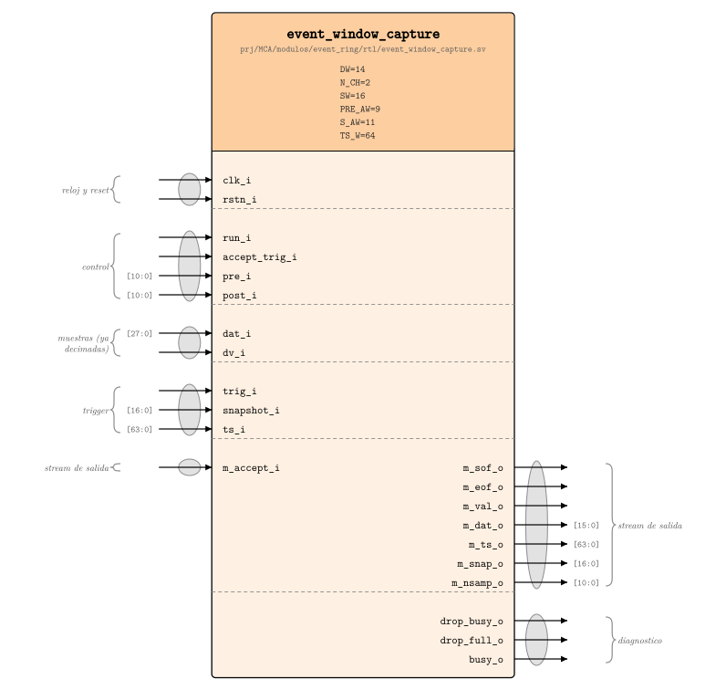

# Datasheet — `event_window_capture`

<!-- Generado por `modulos/mk/datasheet.py`. Lo que está entre las marcas
     AUTO:x y /AUTO:x se REESCRIBE en cada corrida: editar ahí no sirve.
     Todo el resto es prosa a mano y no se toca.
     Regenerar:  make -C modulos/event_ring/work datasheet              -->

## 1. Función y funcionamiento

### 1.1 Descripción breve

<!-- AUTO:resumen -->
|  |  |
|---|---|
| Módulo RTL | `event_window_capture` |
| Archivo | [`event_window_capture.sv`](../../modulos/event_ring/rtl/event_window_capture.sv) |
| Parámetros | 6 |
| Puertos | 22 (12 in / 10 out) |




**Cabecera del RTL** (se copia tal cual de [`event_window_capture.sv`](../../modulos/event_ring/rtl/event_window_capture.sv)):

> event_window_capture — extrae una ventana (pre + post) por trigger y la emite
> como stream de muestras de 16 b.
>
> Reemplaza el rol de rp_bram_sm en el camino de eventos. La diferencia
> estructural: rp_bram_sm CONGELA un buffer de 16384 muestras y no puede
> capturar de nuevo hasta que el PS re-arma (K=1, ~252 us de tiempo muerto).
> Acá la ventana se copia a un stream aguas abajo y el bloque vuelve a estar
> listo en pre+post ciclos (~256 ns con S=32), sin intervencion del PS.
>
> UNA SOLA MEMORIA. El pre-trigger vive en un buffer circular que se escribe
> siempre; la lectura de la ventana sale del MISMO buffer, arrancando `pre`
> muestras atras del trigger. El puntero de lectura queda rezagado y, como se
> consume 1 muestra/ciclo y se produce <=1 muestra/ciclo, el rezago nunca
> crece: alcanza al productor y despues va en lock-step durante el post.
> Por eso la profundidad sólo tiene que cubrir `pre`, no `pre+post`.
>
> DOS CAUSAS DE PERDIDA, contadas por separado porque son diagnosticos
> distintos (ver docs/multitrigger/):
>   drop_busy_o  el trigger cayo mientras se drenaba la ventana anterior.
>                Es el tiempo muerto INTRINSECO del PL: pre+post ciclos.
>   drop_full_o  aguas abajo no acepto el evento (stage llena, o sin creditos
>                de DDR porque el PS no drena). Es tiempo muerto del CONSUMIDOR.
>
> El handshake de aceptacion es en el SOF: si el consumidor no puede recibir la
> ventana entera en el momento del trigger, el evento se descarta ENTERO. Nunca
> se emite media ventana — un evento parcial en el ring seria indistinguible de
> uno bueno del lado del PS.
<!-- /AUTO:resumen -->

<!-- A mano: qué problema resuelve el bloque, cómo encaja en la cadena y las
     dos o tres decisiones de diseño que explican por qué está hecho así. -->

**Qué hace.** TODO

### 1.2 Interfaces

<!-- AUTO:interfaces -->
#### Parámetros

| Parámetro | Tipo | Default | Para qué |
|---|---|---|---|
| `DW` | `integer` | `14` | ancho de la muestra del ADC |
| `N_CH` | `integer` | `2` | canales capturados por evento |
| `SW` | `integer` | `16` | ancho de la muestra en el stream (sign-ext) |
| `PRE_AW` | `integer` | `9` | buffer circular de pre-trigger: 2^PRE_AW |
| `S_AW` | `integer` | `11` | ancho de los contadores de muestras |
| `TS_W` | `integer` | `64` | ancho del timestamp |


#### Puertos

##### Reloj y reset

| Puerto | Dir | Bits | Dominio |
|---|---|---|---|
| `clk_i` | in | 1 | — |
| `rstn_i` | in | 1 | — |


##### Control

run_i mantiene vivo el pre-buffer y el drenaje de la ventana en vuelo. accept_trig_i habilita ACEPTAR triggers nuevos. Estan separados a proposito: en la parada ordenada (DRAINING) se baja accept_trig_i pero se deja run_i, asi el evento en vuelo termina en vez de quedar truncado a mitad de ventana.

| Puerto | Dir | Bits | Dominio | Descripción |
|---|---|---|---|---|
| `run_i` | in | 1 | clk_i |  |
| `accept_trig_i` | in | 1 | clk_i |  |
| `pre_i` | in | 11 `[S_AW-1:0]` | clk_i | muestras antes del trigger |
| `post_i` | in | 11 `[S_AW-1:0]` | clk_i | muestras desde el trigger (incl.) |


##### Muestras (ya decimadas)

| Puerto | Dir | Bits | Dominio | Descripción |
|---|---|---|---|---|
| `dat_i` | in | 28 `[N_CH*DW-1:0]` | clk_i |  |
| `dv_i` | in | 1 | clk_i | muestra valida este ciclo |


##### Trigger

trig_i se toma por FLANCO, no por nivel. multitrigger_trig_src registra `adc_trig <= trig_comb` (un NIVEL), y el strobe de escritura que llega por el sys_bus_cdc puede durar mas de un ciclo de adc_clk: en la placa, cada trigger por software producia DOS eventos (uno capturado y uno contado como drop_busy). Depender del ancho del pulso de un modulo que no controlamos es fragil; el flanco no.

| Puerto | Dir | Bits | Dominio | Descripción |
|---|---|---|---|---|
| `trig_i` | in | 1 | clk_i |  |
| `snapshot_i` | in | 17 | clk_i | que fuente disparo |
| `ts_i` | in | 64 `[TS_W-1:0]` | clk_i | reloj libre de adquisicion |


##### Stream de salida

m_val_o/m_dat_o: una muestra de 16 b por ciclo, canales INTERCALADOS: ch0[k], ch1[k], ch0[k+1], ch1[k+1], ... El consumidor recibe (pre+post)*N_CH muestras entre sof y eof inclusive.

| Puerto | Dir | Bits | Dominio | Descripción |
|---|---|---|---|---|
| `m_sof_o` | out | 1 | clk_i | coincide con la primera m_val_o |
| `m_eof_o` | out | 1 | clk_i | coincide con la ultima m_val_o |
| `m_val_o` | out | 1 | clk_i |  |
| `m_dat_o` | out | 16 `[SW-1:0]` | clk_i |  |
| `m_accept_i` | in | 1 | clk_i | Aceptacion: se muestrea SOLO en el ciclo del trigger. 1 = hay lugar para la ventana completa. |
| `m_ts_o` | out | 64 `[TS_W-1:0]` | clk_i | Metadatos del evento, validos junto con m_sof_o. |
| `m_snap_o` | out | 17 | clk_i |  |
| `m_nsamp_o` | out | 11 `[S_AW-1:0]` | clk_i | pre+post, muestras POR CANAL |


##### Diagnostico

| Puerto | Dir | Bits | Dominio | Descripción |
|---|---|---|---|---|
| `drop_busy_o` | out | 1 | clk_i | pulso |
| `drop_full_o` | out | 1 | clk_i | pulso |
| `busy_o` | out | 1 | clk_i |  |
<!-- /AUTO:interfaces -->

### 1.3 Mapa de registros

<!-- AUTO:regmap -->
No hay un mapa de registros para este módulo en `docs/event_ring/`. Si es un esclavo del bus de sistema, falta escribirlo; si no lo es, esta sección no aplica.
<!-- /AUTO:regmap -->

### 1.4 Clock domains

<!-- AUTO:clocks -->
| Puerto | Qué es | Polaridad |
|---|---|---|
| `clk_i` | reloj |  |
| `rstn_i` | reset | activo-bajo |


**Un solo dominio.** Todos los puertos de datos y de control son síncronos a `clk_i`: no hay cruce de dominio dentro de este módulo.
<!-- /AUTO:clocks -->

<!-- A mano: si hay más de un reloj, cuál es el cruce, con qué se sincroniza y
     qué se asume de la relación de frecuencias. Si hay uno solo, borrar. -->

### 1.5 Frecuencia máxima de trabajo

<!-- AUTO:timing -->
Sin datos de síntesis todavía. Correr:

```bash
make -C modulos/event_ring/work syn
make -C modulos/event_ring/work sweep-all
```

y volver a generar esta página.
<!-- /AUTO:timing -->

<!-- A mano: qué hay en el camino crítico y qué se haría para romperlo si
     hubiera que subir la frecuencia. -->

### 1.6 Waveforms

<!-- AUTO:ondas -->
_Sin figuras de ondas._ Se generan con un script en `docs/event_ring/figuras/ondas/`, que saca las ondas de un VCD de los testbenches del módulo; el patrón está en [`docs/figuras/ondas.py`](../figuras/ondas.py).
<!-- /AUTO:ondas -->

<!-- A mano: lo que las figuras no pueden mostrar solas. Para agregar una,
     editar docs/event_ring/figuras/ondas/ondas_event_ring.py: la onda
     sale de un VCD de los testbenches y los tiempos los mide el script.
       make -C modulos/event_ring/work wave TB=<tb>   # mirar en Questa
       make -C modulos/event_ring/work vcd  TB=<tb>   # VCD exportable -->

### 1.7 Verificación realizada

<!-- AUTO:verificacion -->
Todo corre en batch y se chequea el `RESULT: PASS` del testbench; las ondas quedan en `work/waves/<tb>.wlf`.

```bash
make -C modulos/event_ring/work            # los 4 testbenches
make -C modulos/event_ring/work cov        # + cobertura
make -C modulos/event_ring/work lint
```

| Testbench | DUT | Escenas | Casos | Contra qué compara | Es el de este módulo |
|---|---|---|---|---|---|
| [`tb_event_window_capture`](../../modulos/event_ring/sim/tb_event_window_capture.sv) | `event_window_capture` | 7 | 25 | vectores a mano | **sí** |
| [`tb_event_stage_fifo`](../../modulos/event_ring/sim/tb_event_stage_fifo.sv) | `event_stage_fifo` | — | 26 | vectores a mano |  |
| [`tb_event_slot_writer`](../../modulos/event_ring/sim/tb_event_slot_writer.sv) | `event_slot_writer` | 9 | 32 | vectores a mano |  |
| [`tb_event_ring_top`](../../modulos/event_ring/sim/tb_event_ring_top.sv) | `event_ring_top` | — | 39 | vectores a mano |  |


**122 casos con nombre** en 4 testbenches (16 escenas). La lista completa, caso por caso, está en el plan de verificación.

Las escenas de [`tb_event_window_capture`](../../modulos/event_ring/sim/tb_event_window_capture.sv): 1) cantidad exacta de muestras emitidas = (pre+post, 2) sof/eof en la primera y ultima muestra, una sola, 3) ALINEACION, 4) intercalado de canales ch0,ch1,ch0,ch1, 5) drop_busy, 6) drop_full, 7) pre=0 (captura solo post) y ventana impar (no mu.

**Assertions** — en `sim/sva/`, enganchadas por `bind` (no tocan el RTL sintetizable).

- [`bind_event_ring.sv`](../../modulos/event_ring/sim/sva/bind_event_ring.sv)
- [`event_ring_top_sva.sv`](../../modulos/event_ring/sim/sva/event_ring_top_sva.sv)

> **Los archivos de assertions están vacíos.** Son el scaffold de `create_module.py`: tienen el `bind`, el `default clocking` y un `// TODO:`, pero **ninguna propiedad**. O sea que hoy no aportan nada a la verificación; el enganche ya está hecho y lo que falta es escribirlas. Ver [`verificacion_formal.md`](../verificacion_formal.md), que discute cuáles convienen primero.

Plan de verificación, casos cubiertos y deuda: [`event_ring/sim/VERIFICACION.md`](../../modulos/event_ring/sim/VERIFICACION.md).
<!-- /AUTO:verificacion -->

#### Esquema de laboratorio

TODO — qué instrumento, cómo se conecta, qué se mide y contra qué se compara.
