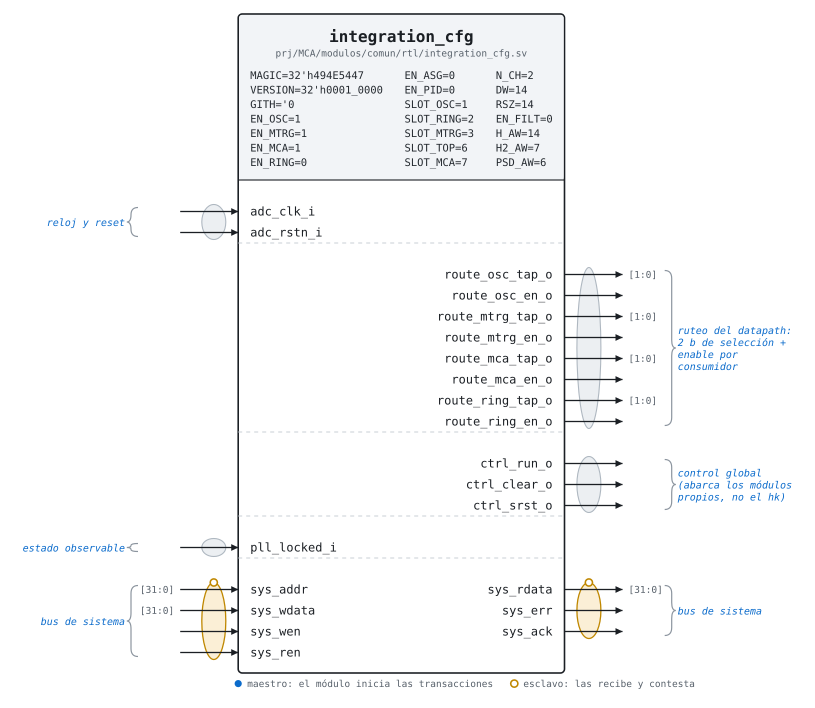

# Datasheet — `integration_cfg`

<!-- Generado por `modulos/mk/datasheet.py`. Lo que está entre las marcas
     AUTO:x y /AUTO:x se REESCRIBE en cada corrida: editar ahí no sirve.
     Todo el resto es prosa a mano y no se toca.
     La §1.1 «Qué hace» se escribe en prosa/integration_cfg.md.
     Regenerar:  make -C modulos/comun/work datasheet              -->

## 1. Función y funcionamiento

### 1.1 Descripción breve

<!-- AUTO:resumen -->
|  |  |
|---|---|
| Módulo RTL | `integration_cfg` |
| Archivo | [`integration_cfg.sv`](../../modulos/comun/rtl/integration_cfg.sv) |
| Parámetros | 21 |
| Puertos | 21 (7 in / 14 out) |




**Cabecera del RTL** (se copia tal cual de [`integration_cfg.sv`](../../modulos/comun/rtl/integration_cfg.sv)):

> integration_cfg — región de TOP (integración): esclavo del bus de sistema
>
> Base 0x4060_0000 (slot 6). Dominio adc_clk; el cruce a fclk[0] lo hace
> sys_bus_cdc por slot, así que acá no hace falta CDC.
>
> QUÉ ES ESTA REGIÓN. No es housekeeping. red_pitaya_hk (slot 0) es un módulo
> de Red Pitaya —LEDs, conector de expansión, DNA del chip— y sigue donde
> estaba. Esta región describe y conecta entre sí los bloques propios del
> proyecto (OSC, MULTITRIGGER, MCA, EVENT_RING), que hasta ahora vivían
> cableados a mano en el top y sin forma de ser descubiertos desde el software.
>
> Hace tres cosas:
>
>   1. IDENTIFICA el bitstream (MAGIC, VERSION, hash de git).
>   2. DESCRIBE qué módulos trae, en qué slot vive cada uno y con qué
>      parámetros se sintetizaron. El software descubre el sistema en vez de
>      hardcodear bases y anchos.
>   3. RUTEA el datapath: elige de qué punto de la cadena DSP toma sus
>      muestras cada consumidor (ver ROUTE_* más abajo).
>
> ACK DE LATENCIA FIJA. Mismo contrato que mca_top: el ack sale de un shift
> register incondicional y responde a los 4 ciclos para CUALQUIER dirección,
> mapeada o no. Un esclavo que no hace ack no produce sólo una lectura mala:
> deja el CDC del slot desincronizado para siempre (ver
> docs/TOP/bus_sistema_redpitaya.md §7.1).
<!-- /AUTO:resumen -->

<!-- AUTO:prosa -->
<!-- Prosa a mano: se edita en prosa/integration_cfg.md, no aca. -->

**Qué hace.** Es el registro de identidad y el panel de ruteo del bitstream.
No mueve muestras: contesta dos preguntas que antes no tenían a quién
preguntárselas —**qué trae este bitstream** y **de dónde toma sus muestras cada
consumidor**— y deja que el software cambie la segunda en runtime.

Antes de que existiera, los bloques propios del proyecto vivían cableados a
mano en el top y el software no tenía forma de descubrirlos: `mca_utils.py` y
`multitrigger_utils.py` todavía arrastran una constante `*_PHYS` hardcodeada
por ese motivo. Ahora hay tres grupos de registros: **identificación** (`MAGIC`,
`VERSION`, hash de git), **descripción** (qué módulos hay, en qué slot vive cada
uno y con qué parámetros se sintetizaron) y **ruteo** (`ROUTE_*`). Los dos
primeros salen de parámetros de síntesis, así que no cuestan flops: son cableado
constante hacia el mux de lectura.

Esto **no es housekeeping.** `red_pitaya_hk` (slot 0) es un módulo de Red Pitaya
—LEDs, conector de expansión, DNA del chip— y sigue donde estaba.

Dos decisiones que explican la forma:

- **El ack es de latencia fija**, igual que en `mca_top`: sale de un shift
  register incondicional y responde a los 4 ciclos para *cualquier* dirección,
  mapeada o no. Un esclavo que no hace ack no produce sólo una lectura mala —
  deja el CDC del slot desincronizado para siempre, y ese slot no acepta más
  transacciones ([§7.1](../TOP/bus_sistema_redpitaya.md)).
- **`tap_sel = 0` y `enable = 1` son los valores de reset**, y el código `0`
  significa «como estaba cableado antes de que hubiera mux». Un bitstream
  recién cargado se comporta exactamente como el anterior al refactor:
  cualquier diferencia es porque el software escribió un `ROUTE_*`.

El `dsp_tap_mux` que estos registros manejan, y qué muestra entrega cada nodo,
están en [`register_map_top.md`](../TOP/register_map_top.md) §Ruteo del
datapath; el mismo pulso dibujado en los cuatro nodos, en [§1.6](#16-transacciones).
<!-- /AUTO:prosa -->

### 1.2 Interfaces

<!-- AUTO:interfaces -->
#### Parámetros

| Parámetro | Tipo | Default | Para qué |
|---|---|---|---|
| `MAGIC` | `[31:0]` | `32'h494E5447` = `1229870151` | "INTG" |
| `VERSION` | `[31:0]` | `32'h0001_0000` = `65536` | {mayor, menor, parche, variante} |
| `GITH` | `bit` | `'0` | hash de git (lo inyecta el .tcl) |
| `EN_OSC` | `integer` | `1` |  |
| `EN_MTRG` | `integer` | `1` |  |
| `EN_MCA` | `integer` | `1` |  |
| `EN_RING` | `integer` | `0` |  |
| `EN_ASG` | `integer` | `0` |  |
| `EN_PID` | `integer` | `0` |  |
| `SLOT_OSC` | `integer` | `1` |  |
| `SLOT_RING` | `integer` | `2` |  |
| `SLOT_MTRG` | `integer` | `3` |  |
| `SLOT_TOP` | `integer` | `6` |  |
| `SLOT_MCA` | `integer` | `7` |  |
| `N_CH` | `integer` | `2` |  |
| `DW` | `integer` | `14` |  |
| `RSZ` | `integer` | `14` |  |
| `EN_FILT` | `integer` | `0` |  |
| `H_AW` | `integer` | `14` |  |
| `H2_AW` | `integer` | `7` |  |
| `PSD_AW` | `integer` | `6` |  |


#### Puertos

##### Reloj y reset

| Puerto | Dir | Bits | Dominio |
|---|---|---|---|
| `adc_clk_i` | in | 1 | — |
| `adc_rstn_i` | in | 1 | — |


##### Ruteo del datapath: 2 b de selección + enable por consumidor

| Puerto | Dir | Bits | Dominio |
|---|---|---|---|
| `route_osc_tap_o` | out | 2 | adc_clk_i |
| `route_osc_en_o` | out | 1 | adc_clk_i |
| `route_mtrg_tap_o` | out | 2 | adc_clk_i |
| `route_mtrg_en_o` | out | 1 | adc_clk_i |
| `route_mca_tap_o` | out | 2 | adc_clk_i |
| `route_mca_en_o` | out | 1 | adc_clk_i |
| `route_ring_tap_o` | out | 2 | adc_clk_i |
| `route_ring_en_o` | out | 1 | adc_clk_i |


##### Control global (abarca los módulos propios, no el hk)

| Puerto | Dir | Bits | Dominio | Descripción |
|---|---|---|---|---|
| `ctrl_run_o` | out | 1 | adc_clk_i | nivel |
| `ctrl_clear_o` | out | 1 | adc_clk_i | pulso de 1 ciclo (autolimpiante) |
| `ctrl_srst_o` | out | 1 | adc_clk_i | pulso de 1 ciclo (autolimpiante) |


##### Estado observable

| Puerto | Dir | Bits | Dominio |
|---|---|---|---|
| `pll_locked_i` | in | 1 | adc_clk_i |


##### Bus de sistema

| Puerto | Dir | Bits | Dominio |
|---|---|---|---|
| `sys_addr` | in | 32 | adc_clk_i |
| `sys_wdata` | in | 32 | adc_clk_i |
| `sys_wen` | in | 1 | adc_clk_i |
| `sys_ren` | in | 1 | adc_clk_i |
| `sys_rdata` | out | 32 | adc_clk_i |
| `sys_err` | out | 1 | adc_clk_i |
| `sys_ack` | out | 1 | adc_clk_i |
<!-- /AUTO:interfaces -->

### 1.3 Mapa de registros

<!-- AUTO:regmap -->
No hay un mapa de registros para este módulo en `docs/comun/`. Si es un esclavo del bus de sistema, falta escribirlo; si no lo es, esta sección no aplica.
<!-- /AUTO:regmap -->

### 1.4 Clock domains

<!-- AUTO:clocks -->
| Puerto | Qué es | Polaridad |
|---|---|---|
| `adc_clk_i` | reloj |  |
| `adc_rstn_i` | reset | activo-bajo |


**Un solo dominio.** Todos los puertos de datos y de control son síncronos a `adc_clk_i`: no hay cruce de dominio dentro de este módulo.
<!-- /AUTO:clocks -->

<!-- A mano: si hay más de un reloj, cuál es el cruce, con qué se sincroniza y
     qué se asume de la relación de frecuencias. Si hay uno solo, borrar. -->

### 1.5 Frecuencia máxima de trabajo

<!-- AUTO:timing -->
Sin datos de síntesis todavía. Correr:

```bash
make -C modulos/comun/work syn
make -C modulos/comun/work sweep-all
```

y volver a generar esta página.
<!-- /AUTO:timing -->

<!-- A mano: qué hay en el camino crítico y qué se haría para romperlo si
     hubiera que subir la frecuencia. -->

### 1.6 Transacciones

<!-- AUTO:transacciones -->
**LO QUE ENTRA: EL PULSO AL RITMO DEL ADC**


Que entra a la cadena. Una muestra por ciclo de adc_clk, 125 MSPS, continua: en este nodo el valid vale siempre 1, asi que no hay nada que un consumidor pueda esperar. Son las 160 muestras del flanco de un pulso real de la campana e2e, el mismo que usa la figura de event_ring --hay una sola copia del dato en el repo--.

_Origen: campaña e2e, `software/datos/e2e_20260528_013404/principal/chunk_000000.npz`, evento 1._

**UNA SOLA CADENA, CUATRO NODOS**


Que viaja. No hay una cadena por consumidor: hay UNA, y cuatro puntos utilizables sobre ella. Cada consumidor tiene su propio mux 4:1 y elige el suyo en runtime con los registros ROUTE_* de la region de TOP. El mux es COMBINACIONAL a proposito: registrarlo corrorria el dato un ciclo respecto de las senales de control que lo acompanan --adc_we y el write pointer del osciloscopio, la alineacion trigger-vs-captura del multitrigger-- y en modo nativo el hardware dejaria de ser identico al de antes del refactor, que es justo la propiedad que se quiso preservar.

_Origen: estructura de `dsp_tap_mux.sv` y del top._

**EL MISMO PULSO EN LOS CUATRO NODOS**


Que sale, y lo que importa no es solo el valor: es el RITMO. En A y B hay una muestra por ciclo y el valid es constante; en C y D sale una cada 8 ciclos y el dato viaja con estrobo --512 muestras contra 64, 8x menos--. Por eso la cabecera del RTL insiste en que el dato y su valid viajan JUNTOS: un consumidor que cambie de nodo sin arrastrar el valid leeria muestras repetidas o se saltearia muestras, segun el sentido del cambio. El diezmado es con promediado, o sea un promedio de bloque de 8 muestras: es el unico bloque de la cadena que cambia la FORMA del pulso, y lo paga en ritmo. D es C corrido 4 muestras diezmadas (32 ciclos). A y B salen IGUALES en el dibujo y eso no es que la calibracion no haga nada: es que esta captura ya paso por ella y el archivo no guarda los coeficientes, asi que re-aplicarlos seria inventarlos.

_Origen: el pulso medido, con el diezmado y el retardo aplicados._

**LA TRANSACCION COMPLETA**


Las tres preguntas en una imagen: que entra, que viaja y que sale.

_Origen: las tres anteriores, en una figura._

---

Las figuras **recalculan cada número al dibujar** en vez de tomarlo escrito. Las genera [`transacciones_comun.py`](../comun/figuras/transacciones/transacciones_comun.py); de dónde sale el dato de cada una está en la columna «Datos» de [`README.md`](../comun/figuras/transacciones/README.md); los epígrafes completos, en [`epigrafes.txt`](../comun/figuras/transacciones/epigrafes.txt).
<!-- /AUTO:transacciones -->

### 1.7 Waveforms

<!-- AUTO:ondas -->
_Sin figuras de ondas._ Se generan con un script en `docs/comun/figuras/ondas/`, que saca las ondas de un VCD de los testbenches del módulo; el patrón está en [`docs/figuras/ondas.py`](../figuras/ondas.py).
<!-- /AUTO:ondas -->

<!-- A mano: lo que las figuras no pueden mostrar solas. Para
     agregar una, editar docs/comun/figuras/ondas/ondas_comun.py:
     la onda sale de un VCD de los testbenches y los tiempos los
     mide el script, no se escriben acá.
       make -C modulos/comun/work wave TB=<tb>   # mirar en Questa
       make -C modulos/comun/work vcd  TB=<tb>   # VCD exportable -->

### 1.8 Verificación realizada

<!-- AUTO:verificacion -->
Todo corre en batch y se chequea el `RESULT: PASS` del testbench; las ondas quedan en `work/waves/<tb>.wlf`.

```bash
make -C modulos/comun/work            # el 1 testbench
make -C modulos/comun/work cov        # + cobertura
make -C modulos/comun/work lint
```

| Testbench | DUT | Escenas | Casos | Contra qué compara | Es el de este módulo |
|---|---|---|---|---|---|
| [`tb_integration_cfg`](../../modulos/comun/sim/tb_integration_cfg.sv) | `integration_cfg` | 7 | 36 | vectores a mano | **sí** |


**36 casos con nombre** en 1 testbench (7 escenas). La lista completa, caso por caso, está en el plan de verificación.

Las escenas de [`tb_integration_cfg`](../../modulos/comun/sim/tb_integration_cfg.sv): 1) CONTRATO DE BUS. El BFM imita a sys_bus_cdc (sos, 2) EL RESET ES EL COMPORTAMIENTO PRE-REFACTOR. Todo, 1) EL RESET ES EL COMPORTAMIENTO PRE-REFACTOR, 2) IDENTIFICACIÓN Y DESCRIPCIÓN, 3) RUTEO, 4) CONTROL GLOBAL, 5) BARRIDO DE ACK.

**Assertions** — en `sim/sva/`, enganchadas por `bind` (no tocan el RTL sintetizable).

- [`bind_comun.sv`](../../modulos/comun/sim/sva/bind_comun.sv)
- [`integration_cfg_sva.sv`](../../modulos/comun/sim/sva/integration_cfg_sva.sv)

> **Los archivos de assertions están vacíos.** Son el scaffold de `create_module.py`: tienen el `bind`, el `default clocking` y un `// TODO:`, pero **ninguna propiedad**. O sea que hoy no aportan nada a la verificación; el enganche ya está hecho y lo que falta es escribirlas. Ver [`verificacion_formal.md`](../verificacion_formal.md), que discute cuáles convienen primero.

Plan de verificación, casos cubiertos y deuda: [`comun/sim/VERIFICACION.md`](../../modulos/comun/sim/VERIFICACION.md).
<!-- /AUTO:verificacion -->

#### Esquema de laboratorio

TODO — qué instrumento, cómo se conecta, qué se mide y contra qué se compara.
