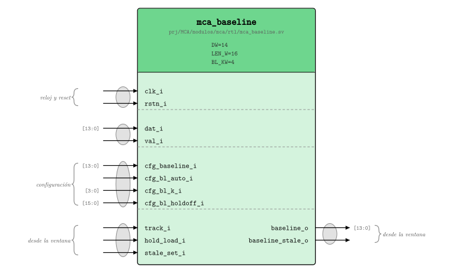

# Datasheet — `mca_baseline`

<!-- Generado por `modulos/mk/datasheet.py`. Lo que está entre las marcas
     AUTO:x y /AUTO:x se REESCRIBE en cada corrida: editar ahí no sirve.
     Todo el resto es prosa a mano y no se toca.
     La §1.1 «Qué hace» se escribe en prosa/mca_baseline.md.
     Regenerar:  make -C modulos/mca/work datasheet              -->

## 1. Función y funcionamiento

### 1.1 Descripción breve

<!-- AUTO:resumen -->
|  |  |
|---|---|
| Módulo RTL | `mca_baseline` |
| Archivo | [`mca_baseline.sv`](../../modulos/mca/rtl/mca_baseline.sv) |
| Parámetros | 3 |
| Puertos | 13 (11 in / 2 out) |
| Parte | `xc7z010clg400-1` |




**Cabecera del RTL** (se copia tal cual de [`mca_baseline.sv`](../../modulos/mca/rtl/mca_baseline.sv)):

> mca_baseline — línea de base del extractor: seguidor IIR o base fija
>
> Es la decision D3 (cfg_bl_auto) de la vista general
> (docs/mca/vista_general_mca.md). Las dos opciones conviven y la salida es un
> REGISTRO: mca_window la resta de la muestra (x = dat - base) y compara contra
> los umbrales, asi que los umbrales del MCA son siempre relativos a la base.
>
> LÍNEA DE BASE. Seguidor IIR  bl_acc += x - (bl_acc >> k),  bl = bl_acc >> k.
> El acumulador es ancho a propósito: con la forma ingenua `bl += (x-bl)>>k`
> el incremento se cuantiza a cero cuando |x-bl| < 2^k y el seguidor se
> congela. Se congela durante el pulso Y durante cfg_bl_holdoff muestras
> después: si se descongelara al cruzar la histéresis hacia abajo, agarraría
> el undershoot de la cola y arrastraría la base hacia el lado equivocado.
>
> QUIEN DECIDE CUANDO SEGUIR es la ventana: track_i, hold_load_i y stale_set_i
> salen de mca_window porque dependen de su estado. La resta x = dat - base NO
> esta aca sino alla, en el mismo modulo que los umbrales: es el comienzo del
> camino critico del bitstream, y el sintetizador no aplana jerarquia.
<!-- /AUTO:resumen -->

<!-- AUTO:prosa -->
<!-- Prosa a mano: se edita en prosa/mca_baseline.md, no aca. -->

**Qué hace.** Da la línea de base que [`mca_window`](datasheet_mca_window.md)
le resta a cada muestra antes de compararla con los umbrales: es la decisión
**D3** de la [vista general](../mca/vista_general_mca.md#21-línea-de-base--d3).
Hay dos opciones en el mismo bitstream, elegidas por `cfg_bl_auto`: una base
**fija** (`cfg_baseline`, el reset) o un **seguidor IIR**
`bl_acc += x − (bl_acc ≫ k)`.

**La salida es un registro, y la resta no está acá.** La resta `x = dat − base`
es el primer eslabón del camino crítico del bitstream, así que vive en
`mca_window`, junto a los umbrales. Como la base llega registrada, esta frontera
no le cuesta nada al timing aunque el sintetizador no aplane jerarquía.

**Dos detalles que no son menores.** El acumulador es ancho porque con la forma
ingenua `bl += (x − bl) ≫ k` el incremento se cuantiza a cero y el seguidor se
congela. Y el seguidor se descongela `cfg_bl_holdoff` muestras **después** del
pulso, no al cruzar la histéresis, para no agarrar el undershoot de la cola
([`polo_cero.md`](../mca/polo_cero.md)). Cuándo seguir lo dice la ventana
(`track_i`, `hold_load_i`), porque depende de su estado.
<!-- /AUTO:prosa -->

### 1.2 Interfaces

<!-- AUTO:interfaces -->
#### Parámetros

| Parámetro | Tipo | Default | Para qué |
|---|---|---|---|
| `DW` | `integer` | `14` | ancho de muestra (con signo) |
| `LEN_W` | `integer` | `16` | ancho de los contadores de longitud |
| `BL_KW` | `integer` | `4` | bits del exponente k del seguidor IIR |


#### Puertos

##### Señales

| Puerto | Dir | Bits | Signo | Dominio |
|---|---|---|---|---|
| `clk_i` | in | 1 |  | — |
| `rstn_i` | in | 1 |  | — |
| `dat_i` | in | 14 `[DW-1:0]` | signed | clk_i |
| `val_i` | in | 1 |  | clk_i |


##### Configuración

| Puerto | Dir | Bits | Signo | Dominio | Descripción |
|---|---|---|---|---|---|
| `cfg_baseline_i` | in | 14 `[DW-1:0]` | signed | clk_i | base fija si cfg_bl_auto=0 |
| `cfg_bl_auto_i` | in | 1 |  | clk_i |  |
| `cfg_bl_k_i` | in | 4 `[BL_KW-1:0]` |  | clk_i | alfa = 2^-k |
| `cfg_bl_holdoff_i` | in | 16 `[LEN_W-1:0]` |  | clk_i |  |


##### Desde la ventana

| Puerto | Dir | Bits | Signo | Dominio | Descripción |
|---|---|---|---|---|---|
| `track_i` | in | 1 |  | clk_i | reposo y sin abrir en este flanco |
| `hold_load_i` | in | 1 |  | clk_i | cierre: arranca el holdoff |
| `stale_set_i` | in | 1 |  | clk_i | pulso abierto sin muestras desde hace maxlen |
| `baseline_o` | out | 14 `[DW-1:0]` | signed | clk_i |  |
| `baseline_stale_o` | out | 1 |  | clk_i |  |
<!-- /AUTO:interfaces -->

### 1.3 Mapa de registros

<!-- AUTO:regmap -->
Mapas de registros de la región:

- [`register_map_mca.md`](../mca/register_map_mca.md)

Contrato del bus: [`bus_sistema_redpitaya.md`](../TOP/bus_sistema_redpitaya.md) · Mapa de slots: [`register_map_top.md`](../TOP/register_map_top.md)
<!-- /AUTO:regmap -->

### 1.4 Clock domains

<!-- AUTO:clocks -->
| Puerto | Qué es | Polaridad |
|---|---|---|
| `clk_i` | reloj |  |
| `rstn_i` | reset | activo-bajo |


**Un solo dominio.** Todos los puertos de datos y de control son síncronos a `clk_i`: no hay cruce de dominio dentro de este módulo.
<!-- /AUTO:clocks -->

<!-- A mano: si hay más de un reloj, cuál es el cruce, con qué se sincroniza y
     qué se asume de la relación de frecuencias. Si hay uno solo, borrar. -->

### 1.5 Frecuencia máxima de trabajo

<!-- AUTO:timing -->
El `metrics.txt` del módulo es de `mca_top`, no de `mca_baseline`: la síntesis OOC del módulo apunta a otro top, así que acá no hay números propios de este bloque.
<!-- /AUTO:timing -->

<!-- A mano: qué hay en el camino crítico y qué se haría para romperlo si
     hubiera que subir la frecuencia. -->

### 1.6 Transacciones

<!-- AUTO:transacciones -->
**LA CADENA DE UN EVENTO  -  senal, registro y espectro**


La transaccion del MCA es UN EVENTO, y la figura la sigue entera: (a) la senal de entrada con el umbral y la ventana que `pulse_feature` abre y cierra, (b) el camino de datos, donde entre los dos bloques no va una flecha pelada sino el tren de amplitudes concretas que viaja --un registro de evento por pulso--, y (c) el espectro que se acumula del otro lado, una cuenta por numero. Los numeros de los tres paneles son los mismos: la amplitud que se mide en (a) es la que viaja en (b) y la que cae en un canal en (c), con el mismo `amp >> h_shift` que hace el RTL. Es la unica figura del proyecto que muestra la cuenta completa de punta a punta.

_Origen: simulacion con semilla fija (`animacion_cadena_mca.py`), los mismos cuadros que los videos._

**(a) LA SENAL: UN PULSO POR EVENTO**


Las bandas parten el eje de TIEMPO en estados --ventana abierta, reposo-- y no la senal en eventos. La ventana abre al cruzar `thr` y cierra recien al bajar de `thr - hyst`, que es lo que hace que termine bastante despues del pico.

_Origen: la misma simulacion, panel (a) suelto._

**(b) EL CAMINO DE DATOS: UN NUMERO POR PULSO**


`pulse_feature` emite un registro de evento por pulso y el histograma lo convierte en una cuenta. La tabla de abajo son los mismos pulsos como los ve el histograma, incluido el que no cruza el umbral y no produce nada.

_Origen: la misma simulacion, panel (b) suelto._

**(c) EL ESPECTRO: UNA CUENTA POR NUMERO**


El mismo espectro en tres momentos de la acumulacion (12, 64 y 227 cuentas): la forma aparece recien cuando hay estadistica.

_Origen: la misma simulacion, panel (c) suelto._

---

Las figuras **recalculan cada número al dibujar** en vez de tomarlo escrito.
<!-- /AUTO:transacciones -->

### 1.7 Waveforms

<!-- AUTO:ondas -->
**LA VIDA DE UN PULSO  -  cruce de umbral, ventana, carga acumulada y evento**


Es la figura central del modulo: todo lo que el MCA hace por evento pasa aca. La muestra cruza el umbral, `busy` sube y marca la ventana abierta, las dos cargas se acumulan mientras la ventana dura --q_tot sobre toda la ventana y q_tail desde la segunda muestra, que es lo que hace separable la forma del pulso-- y al cerrar sale `ev_valid` con la amplitud y el bus de features. El pulso es RECTANGULAR a proposito, igual que en el testbench: su ventana es inequivoca, asi que los numeros del epigrafe salen de una multiplicacion y no de reimplementar el DUT.

_Origen: `tb_mca_pulse_feature`, escena 1 (pulso rectangular)._

**APILAMIENTO  -  la ventana llega a maxlen: el pulso se cuenta pero NO se acepta**


El mismo bloque con `maxlen` chico y un pulso mas largo que eso. La ventana se cierra por limite y el evento cae en `cnt_pileup` sin pasar por `cnt_accepted`: no sale `ev_valid`. Lo que importa es que SI se cuenta en `cnt_total`. Un evento descartado que no se cuenta en ningun lado es tiempo muerto invisible, y sin ese numero no se puede corregir el espectro por eventos perdidos.

_Origen: `tb_mca_pulse_feature`, escena 5 (apilamiento)._

**READ-MODIFY-WRITE AL MISMO BIN  -  la cuenta no se pierde aunque los eventos lleguen pegados**


El histograma es una BRAM: incrementar un bin es leerlo, sumarle uno y escribirlo, y eso tarda varios ciclos. Si dos eventos consecutivos caen en el MISMO bin, el segundo leeria el valor viejo --el que todavia no se escribio-- y una de las dos cuentas se perderia. La figura muestra cuatro incrementos seguidos al mismo bin y la lectura posterior dando el total correcto: el bloque puentea la escritura en vuelo. Es el peor caso realista, porque un pico del espectro es justamente muchos eventos al mismo bin.

_Origen: `tb_mca_hist`, escena 3 (forwarding)._

**ACK DE LATENCIA FIJA  -  el barrido de borrado dura miles de ciclos y el bus no se entera**


Lo que la cabecera del RTL marca como lo mas importante del modulo. El barrido de borrado recorre 2^H_AW bins y dura miles de ciclos, muchisimo mas que los 32 ciclos de timeout del axi4_slave. Si el ack dependiera de que el motor este libre, una lectura durante el barrido no haria ack nunca, y eso no produce una lectura mala: deja el CDC del slot desincronizado para siempre --reg_do != reg_done-- y ese slot no acepta mas transacciones. El ack sale de un shift register incondicional, asi que llega con la misma latencia este barriendo o no, que es lo que la figura mide.

_Origen: `tb_mca_top`, escena 5 (lectura durante el borrado)._

**FLUJO DE UNA MEDICION  -  mca_top**


Es un esquema de la SECUENCIA, no una medicion. La configuracion es una escalera: el bus del PS escribe un registro por vez, y la figura los pone en el orden en que los escribe Mca.configure(). Ese orden importa en un solo punto: cfg_hist_sel va DESPUES de cfg_amp_src, porque escribir cfg_amp_src tambien lo mueve. Un registro que no se escribe conserva lo que tenia (el valor de reset solo despues de cargar el bitstream; ver register_map_mca.md). Despues, las dos cosas que fija: el borrado hay que ESPERARLO --`clear_busy` avisa, y los eventos que llegan mientras barre se descartan y se cuentan en `dropped`--, y los contadores se pueden leer con la medicion corriendo, que es lo que permite supervisar sin frenar. La misma secuencia en software esta en docs/API/guia_de_uso.md; si las dos se contradicen, una de las dos esta mal.

_Origen: esquema (sin VCD)._

---

Las figuras y sus epígrafes los escribe [`ondas_mca.py`](../mca/figuras/ondas/ondas_mca.py): los tiempos y las latencias se **miden sobre el VCD**, no se escriben a mano, así que no pueden desincronizarse del RTL. Los epígrafes completos, con los números, están en [`epigrafes.txt`](../mca/figuras/ondas/epigrafes.txt).

```bash
python3 docs/mca/figuras/ondas/ondas_mca.py    # regenerar
```
<!-- /AUTO:ondas -->

<!-- A mano: lo que las figuras no pueden mostrar solas. Para agregar una,
     editar docs/mca/figuras/ondas/ondas_mca.py: la onda
     sale de un VCD de los testbenches y los tiempos los mide el script.
       make -C modulos/mca/work wave TB=<tb>   # mirar en Questa
       make -C modulos/mca/work vcd  TB=<tb>   # VCD exportable -->

### 1.8 Verificación realizada

<!-- AUTO:verificacion -->
Todo corre en batch y se chequea el `RESULT: PASS` del testbench; las ondas quedan en `work/waves/<tb>.wlf`.

```bash
make -C modulos/mca/work            # los 7 testbenches
make -C modulos/mca/work cov        # + cobertura
make -C modulos/mca/work lint
```

| Testbench | DUT | Escenas | Casos | Contra qué compara | Es el de este módulo |
|---|---|---|---|---|---|
| [`tb_mca_div_restore`](../../modulos/mca/sim/tb_mca_div_restore.sv) | `mca_div_restore` | 6 | 22 | vectores a mano |  |
| [`tb_mca_hist`](../../modulos/mca/sim/tb_mca_hist.sv) | `mca_hist` | 8 | 31 | vectores a mano |  |
| [`tb_mca_zoom`](../../modulos/mca/sim/tb_mca_zoom.sv) | `mca_zoom` | 5 | 11 | vectores a mano |  |
| [`tb_mca_discriminator`](../../modulos/mca/sim/tb_mca_discriminator.sv) | `mca_discriminator` | 7 | 21 | vectores a mano |  |
| [`tb_mca_pulse_feature`](../../modulos/mca/sim/tb_mca_pulse_feature.sv) | `mca_pulse_feature` | 17 | 161 | vectores a mano |  |
| [`tb_mca_pulse_feature_eq`](../../modulos/mca/sim/tb_mca_pulse_feature_eq.sv) | `mca_pulse_feature_eq` | — | — | RTL de referencia `mca_pulse_feature_ref.v` instanciado al lado del DUT |  |
| [`tb_mca_top`](../../modulos/mca/sim/tb_mca_top.sv) | `mca_top` | 9 | 82 | vectores a mano |  |


**328 casos con nombre** en 7 testbenches (52 escenas). La lista completa, caso por caso, está en el plan de verificación.

> **`mca_baseline` no tiene testbench propio.** Ningún `TBS` del `work/Makefile` lo instancia como DUT: lo que se verifica de este módulo es lo que arrastre el TB de otro. Es deuda de verificación, no una omisión de esta página.

**Assertions** — en `sim/sva/`, enganchadas por `bind` (no tocan el RTL sintetizable).

- [`mca_top_sva.sv`](../../modulos/mca/sim/sva/mca_top_sva.sv) — 64 propiedades

Plan de verificación, casos cubiertos y deuda: [`mca/sim/VERIFICACION.md`](../../modulos/mca/sim/VERIFICACION.md).
<!-- /AUTO:verificacion -->

#### Esquema de laboratorio

TODO — qué instrumento, cómo se conecta, qué se mide y contra qué se compara.
