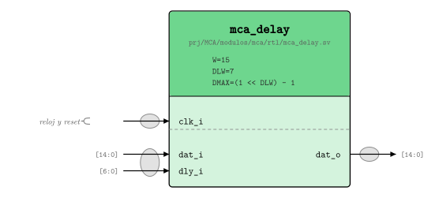
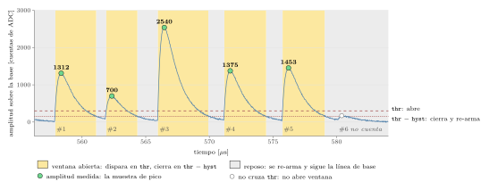
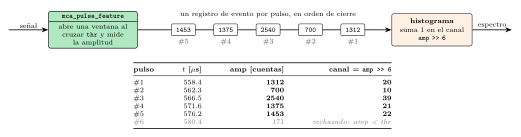
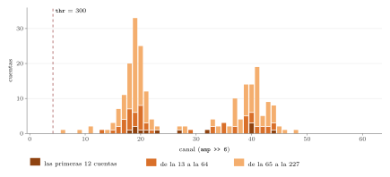

# Datasheet — `mca_delay`

<!-- Generado por `modulos/mk/datasheet.py`. Lo que está entre las marcas
     AUTO:x y /AUTO:x se REESCRIBE en cada corrida: editar ahí no sirve.
     Todo el resto es prosa a mano y no se toca.
     La §1.1 «Qué hace» se escribe en prosa/mca_delay.md.
     Regenerar:  make -C modulos/mca/work datasheet              -->

## 1. Función y funcionamiento

### 1.1 Descripción breve

<!-- AUTO:resumen -->
|  |  |
|---|---|
| Módulo RTL | `mca_delay` |
| Archivo | [`mca_delay.sv`](../../modulos/mca/rtl/mca_delay.sv) |
| Parámetros | 3 |
| Puertos | 4 (3 in / 1 out) |
| Parte | `xc7z010clg400-1` |




**Cabecera del RTL** (se copia tal cual de [`mca_delay.sv`](../../modulos/mca/rtl/mca_delay.sv)):

> mca_delay — linea de retardo de muestras, para alinear la ventana con trig_i
>
> La ventana la abre el trigger externo (el trigger_event del multitrigger), y
> ese trigger llega TARDE respecto de la muestra que lo causo: el disparo por
> pendiente necesita del orden de L muestras para cruzar su umbral, mas los
> registros de mt_trig_src y mt_event_logic. Si la ventana mirara la muestra
> en vivo arrancaria despues del pie del pulso y perderia el flanco de subida:
> el pico y la integral saldrian truncados. Retrasando la MUESTRA
> cfg_dly_i ciclos, el trigger llega cuando la muestra retrasada todavia esta
> en el pie, y la ventana ve el pulso entero.
>
> El retardo es en CICLOS de adc_clk, no en muestras validas: la latencia del
> trigger es de hardware y no depende de la decimacion propia del MCA. `val`
> viaja con el dato, asi que la decimacion sigue funcionando igual del otro
> lado.
>
> Se infiere en SRL (SRLC32E en cascada, con direccion dinamica): la linea no
> tiene reset, y por eso tiene valor inicial en cero, que Vivado lleva al INIT
> de los SRL. La salida se registra: el clock-to-out de un SRL es lento y esto
> es el comienzo del camino de la muestra. Latencia total: cfg_dly_i + 1.
>
> UNA LINEA POR BIT, como la plantilla de SRL dinamico de UG901 (un vector que
> se corre y una toma `sr[d-1]`). La version anterior, un arreglo de palabras
> corrido con un for, NO se inferia en SRL: daba 510 LUT y 1920 FF, tambien en
> el bitstream. Por bit son 4 SRLC32E en cascada: 60 SRL, ~83 LUT, 15 FF.
<!-- /AUTO:resumen -->

<!-- AUTO:prosa -->
<!-- Prosa a mano: se edita en prosa/mca_delay.md, no aca. -->

**Qué hace.** Retrasa la muestra (`{val, dat}`) de 0 a 127 ciclos, según
`cfg_pre_dly`. Hace falta porque la ventana la abre el disparo del multitrigger,
y ese disparo llega **tarde** respecto del pie del pulso: el disparo por
pendiente tarda unas L muestras en cruzar su umbral, más sus registros. Con la
muestra retrasada lo justo, el disparo llega cuando el pie está entrando a la
ventana. Cuánto hace falta lo mide `sim/tb_mca_mt_latencia.sv`; la tabla está en
[`register_map_mca.md`](../mca/register_map_mca.md) §La línea de retardo.

**Dos decisiones.** El retardo es en **ciclos**, no en muestras válidas: la
latencia del trigger es de hardware y no depende de la decimación del MCA, y
`val` viaja con el dato. Y se infiere en SRL con la salida **registrada**: el
clock-to-out de un SRL es lento, y esto es el comienzo del camino de la muestra.
<!-- /AUTO:prosa -->

### 1.2 Interfaces

<!-- AUTO:interfaces -->
#### Parámetros

| Parámetro | Tipo | Default | Para qué |
|---|---|---|---|
| `W` | `integer` | `15` | ancho de lo que se retrasa ({val, dat}) |
| `DLW` | `integer` | `7` | bits de cfg_dly_i |
| `DMAX` | `integer` | `(1 << DLW) - 1` = `127` |  |


#### Puertos

##### Señales

| Puerto | Dir | Bits | Dominio | Descripción |
|---|---|---|---|---|
| `clk_i` | in | 1 | — |  |
| `dat_i` | in | 15 `[W-1:0]` | clk_i |  |
| `dly_i` | in | 7 `[DLW-1:0]` | clk_i | 0 = sin retardo extra |
| `dat_o` | out | 15 `[W-1:0]` | clk_i |  |
<!-- /AUTO:interfaces -->

### 1.3 Mapa de registros

<!-- AUTO:regmap -->
Mapas de registros de la región:

- [`register_map_mca.md`](../mca/register_map_mca.md)

Contrato del bus: [`bus_sistema_redpitaya.md`](../TOP/bus_sistema_redpitaya.md) · Mapa de slots: [`register_map_top.md`](../TOP/register_map_top.md)
<!-- /AUTO:regmap -->

### 1.4 Clock domains

<!-- AUTO:clocks -->
| Puerto | Qué es |
|---|---|
| `clk_i` | reloj |


**Un solo dominio.** Todos los puertos de datos y de control son síncronos a `clk_i`: no hay cruce de dominio dentro de este módulo.
<!-- /AUTO:clocks -->

<!-- A mano: si hay más de un reloj, cuál es el cruce, con qué se sincroniza y
     qué se asume de la relación de frecuencias. Si hay uno solo, borrar. -->

### 1.5 Frecuencia máxima de trabajo

<!-- AUTO:timing -->
El `metrics.txt` del módulo es de `mca_top`, no de `mca_delay`: la síntesis OOC del módulo apunta a otro top, así que acá no hay números propios de este bloque.
<!-- /AUTO:timing -->

<!-- A mano: qué hay en el camino crítico y qué se haría para romperlo si
     hubiera que subir la frecuencia. -->

### 1.6 Transacciones

<!-- AUTO:transacciones -->
**LA CADENA DE UN EVENTO  -  senal, registro y espectro**


La transaccion del MCA es UN EVENTO, y la figura la sigue entera: (a) la senal de entrada con el umbral y la ventana que `pulse_feature` abre y cierra, (b) el camino de datos, donde entre los dos bloques no va una flecha pelada sino el tren de amplitudes concretas que viaja --un registro de evento por pulso--, y (c) el espectro que se acumula del otro lado, una cuenta por numero. Los numeros de los tres paneles son los mismos: la amplitud que se mide en (a) es la que viaja en (b) y la que cae en un canal en (c), con el mismo `amp >> h_shift` que hace el RTL. Es la unica figura del proyecto que muestra la cuenta completa de punta a punta.

_Origen: simulacion con semilla fija (`animacion_cadena_mca.py`), los mismos cuadros que los videos._

**(a) LA SENAL: UN PULSO POR EVENTO**



Las bandas parten el eje de TIEMPO en estados --ventana abierta, reposo-- y no la senal en eventos. La ventana abre al cruzar `thr` y cierra recien al bajar de `thr - hyst`, que es lo que hace que termine bastante despues del pico.

_Origen: la misma simulacion, panel (a) suelto, en TikZ (`figuras_cadena_tikz.py`)._

**(b) EL CAMINO DE DATOS: UN NUMERO POR PULSO**



`pulse_feature` emite un registro de evento por pulso y el histograma lo convierte en una cuenta. La tabla de abajo son los mismos pulsos como los ve el histograma, incluido el que no cruza el umbral y no produce nada.

_Origen: la misma simulacion, panel (b) suelto, en TikZ (`figuras_cadena_tikz.py`)._

**(c) EL ESPECTRO: UNA CUENTA POR NUMERO**



El espectro final en barras apiladas: cada capa es un tramo de la acumulacion (las primeras 12 cuentas, de la 13 a la 64 y de la 65 a la 227), asi que el borde de arriba de cada capa es el espectro en ese momento. La capa de abajo son cuentas sueltas; la forma de las dos lineas aparece recien cuando hay estadistica.

_Origen: la misma simulacion, panel (c) suelto, en TikZ (`figuras_cadena_tikz.py`)._

---

Las figuras **recalculan cada número al dibujar** en vez de tomarlo escrito.
<!-- /AUTO:transacciones -->

### 1.7 Waveforms

<!-- AUTO:ondas -->
**LA VIDA DE UN PULSO  -  cruce de umbral, ventana, carga acumulada y evento**


Es la figura central del modulo: todo lo que el MCA hace por evento pasa aca. La muestra cruza el umbral, `busy` sube y marca la ventana abierta, las dos cargas se acumulan mientras la ventana dura --q_tot sobre toda la ventana y q_tail desde la segunda muestra, que es lo que hace separable la forma del pulso-- y al cerrar sale `ev_valid` con la amplitud y el bus de features. El pulso es RECTANGULAR a proposito, igual que en el testbench: su ventana es inequivoca, asi que los numeros del epigrafe salen de una multiplicacion y no de reimplementar el DUT.

_Origen: `tb_mca_pulse_feature`, escena 1 (pulso rectangular)._

**APILAMIENTO  -  la ventana llega a maxlen: el pulso se cuenta pero NO se acepta**


El mismo bloque con `maxlen` chico y un pulso mas largo que eso. La ventana se cierra por limite y el evento cae en `cnt_pileup` sin pasar por `cnt_accepted`: no sale `ev_valid`. Lo que importa es que SI se cuenta en `cnt_total`. Un evento descartado que no se cuenta en ningun lado es tiempo muerto invisible, y sin ese numero no se puede corregir el espectro por eventos perdidos.

_Origen: `tb_mca_pulse_feature`, escena 5 (apilamiento)._

**READ-MODIFY-WRITE AL MISMO BIN  -  la cuenta no se pierde aunque los eventos lleguen pegados**


El histograma es una BRAM: incrementar un bin es leerlo, sumarle uno y escribirlo, y eso tarda varios ciclos. Si dos eventos consecutivos caen en el MISMO bin, el segundo leeria el valor viejo --el que todavia no se escribio-- y una de las dos cuentas se perderia. La figura muestra cuatro incrementos seguidos al mismo bin y la lectura posterior dando el total correcto: el bloque puentea la escritura en vuelo. Es el peor caso realista, porque un pico del espectro es justamente muchos eventos al mismo bin.

_Origen: `tb_mca_hist`, escena 3 (forwarding)._

**ACK DE LATENCIA FIJA  -  el barrido de borrado dura miles de ciclos y el bus no se entera**


Lo que la cabecera del RTL marca como lo mas importante del modulo. El barrido de borrado recorre 2^H_AW bins y dura miles de ciclos, muchisimo mas que los 32 ciclos de timeout del axi4_slave. Si el ack dependiera de que el motor este libre, una lectura durante el barrido no haria ack nunca, y eso no produce una lectura mala: deja el CDC del slot desincronizado para siempre --reg_do != reg_done-- y ese slot no acepta mas transacciones. El ack sale de un shift register incondicional, asi que llega con la misma latencia este barriendo o no, que es lo que la figura mide.

_Origen: `tb_mca_top`, escena 5 (lectura durante el borrado)._

---

Las figuras y sus epígrafes los escribe [`ondas_mca.py`](../mca/figuras/ondas/ondas_mca.py): los tiempos y las latencias se **miden sobre el VCD**, no se escriben a mano, así que no pueden desincronizarse del RTL. Los epígrafes completos, con los números, están en [`epigrafes.txt`](../mca/figuras/ondas/epigrafes.txt).

```bash
python3 docs/mca/figuras/ondas/ondas_mca.py    # regenerar
```
<!-- /AUTO:ondas -->

<!-- A mano: lo que las figuras no pueden mostrar solas. Para agregar una,
     editar docs/mca/figuras/ondas/ondas_mca.py: la onda
     sale de un VCD de los testbenches y los tiempos los mide el script.
       make -C modulos/mca/work wave TB=<tb>   # mirar en Questa
       make -C modulos/mca/work vcd  TB=<tb>   # VCD exportable -->

### 1.8 Verificación realizada

<!-- AUTO:verificacion -->
Todo corre en batch y se chequea el `RESULT: PASS` del testbench; las ondas quedan en `work/waves/<tb>.wlf`.

```bash
make -C modulos/mca/work            # los 8 testbenches
make -C modulos/mca/work cov        # + cobertura
make -C modulos/mca/work lint
```

| Testbench | DUT | Escenas | Casos | Contra qué compara | Es el de este módulo |
|---|---|---|---|---|---|
| [`tb_mca_div_restore`](../../modulos/mca/sim/tb_mca_div_restore.sv) | `mca_div_restore` | 6 | 22 | vectores a mano |  |
| [`tb_mca_hist`](../../modulos/mca/sim/tb_mca_hist.sv) | `mca_hist` | 8 | 31 | vectores a mano |  |
| [`tb_mca_zoom`](../../modulos/mca/sim/tb_mca_zoom.sv) | `mca_zoom` | 5 | 11 | vectores a mano |  |
| [`tb_mca_discriminator`](../../modulos/mca/sim/tb_mca_discriminator.sv) | `mca_discriminator` | 7 | 21 | vectores a mano |  |
| [`tb_mca_trap`](../../modulos/mca/sim/tb_mca_trap.sv) | `mca_trap` | — | — | vectores a mano |  |
| [`tb_mca_multi`](../../modulos/mca/sim/tb_mca_multi.sv) | `mca_multi` | — | — | vectores a mano |  |
| [`tb_mca_pulse_feature_evt`](../../modulos/mca/sim/tb_mca_pulse_feature_evt.sv) | `mca_pulse_feature_evt` | — | — | RTL de referencia `mca_pulse_feature_ref.v` instanciado al lado del DUT |  |
| [`tb_mca_top`](../../modulos/mca/sim/tb_mca_top.sv) | `mca_top` | 11 | 131 | vectores a mano |  |


**216 casos con nombre** en 8 testbenches (37 escenas). La lista completa, caso por caso, está en el plan de verificación.

> **`mca_delay` no tiene testbench propio.** Ningún `TBS` del `work/Makefile` lo instancia como DUT: lo que se verifica de este módulo es lo que arrastre el TB de otro. Es deuda de verificación, no una omisión de esta página.

**Assertions** — en `sim/sva/`, enganchadas por `bind` (no tocan el RTL sintetizable).

- [`mca_top_sva.sv`](../../modulos/mca/sim/sva/mca_top_sva.sv) — 74 propiedades

Plan de verificación, casos cubiertos y deuda: [`mca/sim/VERIFICACION.md`](../../modulos/mca/sim/VERIFICACION.md).
<!-- /AUTO:verificacion -->

#### Esquema de laboratorio

TODO — qué instrumento, cómo se conecta, qué se mide y contra qué se compara.
