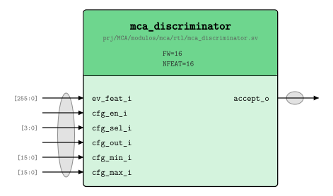

# Datasheet — `mca_discriminator`

<!-- Generado por `modulos/mk/datasheet.py`. Lo que está entre las marcas
     AUTO:x y /AUTO:x se REESCRIBE en cada corrida: editar ahí no sirve.
     Todo el resto es prosa a mano y no se toca.
     Regenerar:  make -C modulos/mca/work datasheet              -->

## 1. Función y funcionamiento

### 1.1 Descripción breve

<!-- AUTO:resumen -->
|  |  |
|---|---|
| Módulo RTL | `mca_discriminator` |
| Archivo | [`mca_discriminator.sv`](../../modulos/mca/rtl/mca_discriminator.sv) |
| Parámetros | 2 |
| Puertos | 7 (6 in / 1 out) |
| Parte | `xc7z010clg400-1` |




**Cabecera del RTL** (se copia tal cual de [`mca_discriminator.sv`](../../modulos/mca/rtl/mca_discriminator.sv)):

> mca_discriminator — acepta o rechaza un evento por el valor de UNA feature.
>
> Antes esto eran dos lineas sueltas adentro de la FSM del extractor
> (`amp_ok`): una condicion, feature FIJA (la amplitud seleccionada), y solo
> intervalo interno. Aca pasa a ser un bloque con selector, y el intervalo
> puede ser interno [min,max] o su complemento.
>
> VA DESPUES DE LOS DIVISORES, no antes. Es lo que permite que el selector
> alcance tambien a las features de FORMA, que no existen hasta que el divisor
> termina. Y esa es justamente la que importa: medido por Monte-Carlo sobre el
> espectro de una linea a 100 kcps, un corte por ANCHO (Pico/Q_total) rechaza
> el 99.1 % de los apilados y baja el continuo sobre el fotopico de 32.4 % a
> 0.8 %, sin perder un solo evento limpio. El eje de forma que ya estaba en el
> hardware (Q_cola/Q_total) rechaza el 29.6 % en modo histeresis y EXACTAMENTE
> NADA en modo compuerta. Ver software/monte-carlo/.
>
> El costo de estar despues del divisor es que todo evento paga su latencia
> antes de poder ser rechazado. Son DIV_W ciclos = 128 ns contra una ventana de
> 3.07 us: el 4 %.
>
> EL CORTE HAY QUE CALIBRARLO CONTRA LA AMPLITUD. `Pico/Q_total` NO es
> constante: en modo histeresis la ventana cierra cuando la cola cruza el
> umbral, o sea que su largo crece con el logaritmo de la amplitud, y el
> cociente deriva ~21 % de punta a punta del rango. Un umbral fijo cortaria los
> pulsos limpios chicos y dejaria pasar los apilados grandes. La calibracion se
> hace con un pulser DESLIZANTE y no con el espectro fuente: con una linea
> monoenergetica el lugar geometrico queda definido en un punado de canales y el
> corte terminaria rechazando por caer fuera del rango calibrado y no por tener
> la forma mal — un corte en amplitud disfrazado de corte en forma, que da un
> resultado espectacular y falso.
>
> INTERVALO VACIO: con min > max el conjunto interno es vacio por definicion,
> asi que `interno` rechaza TODO y `externo` acepta todo. No es un caso de
> error, es la respuesta correcta a lo que se pidio, y esta fijado por un test
> para que nadie lo "arregle" despues.
<!-- /AUTO:resumen -->

<!-- A mano: qué problema resuelve el bloque, cómo encaja en la cadena y las
     dos o tres decisiones de diseño que explican por qué está hecho así. -->

**Qué hace.** TODO

### 1.2 Interfaces

<!-- AUTO:interfaces -->
#### Parámetros

| Parámetro | Tipo | Default | Para qué |
|---|---|---|---|
| `FW` | `integer` | `16` | ancho de una feature |
| `NFEAT` | `integer` | `16` | ranuras del bus |


#### Puertos

##### Señales

| Puerto | Dir | Bits | Dominio | Descripción |
|---|---|---|---|---|
| `ev_feat_i` | in | 256 `[NFEAT*FW-1:0]` | sin reloj |  |
| `cfg_en_i` | in | 1 | sin reloj | 0 = pasa todo (default) |
| `cfg_sel_i` | in | 4 | sin reloj | que feature mira (indices F_* ) |
| `cfg_out_i` | in | 1 | sin reloj | 0 = interno [min,max], 1 = externo |
| `cfg_min_i` | in | 16 `[FW-1:0]` | sin reloj |  |
| `cfg_max_i` | in | 16 `[FW-1:0]` | sin reloj |  |
| `accept_o` | out | 1 | sin reloj |  |
<!-- /AUTO:interfaces -->

### 1.3 Mapa de registros

<!-- AUTO:regmap -->
Mapas de registros de la región:

- [`register_map_mca.md`](../mca/register_map_mca.md)

Contrato del bus: [`bus_sistema_redpitaya.md`](../TOP/bus_sistema_redpitaya.md) · Mapa de slots: [`register_map_top.md`](../TOP/register_map_top.md)
<!-- /AUTO:regmap -->

### 1.4 Clock domains

<!-- AUTO:clocks -->
_(nada)_


**Combinacional:** el módulo no tiene puerto de reloj.
<!-- /AUTO:clocks -->

<!-- A mano: si hay más de un reloj, cuál es el cruce, con qué se sincroniza y
     qué se asume de la relación de frecuencias. Si hay uno solo, borrar. -->

### 1.5 Frecuencia máxima de trabajo

<!-- AUTO:timing -->
El `metrics.txt` del módulo es de `mca_top`, no de `mca_discriminator`: la síntesis OOC del módulo apunta a otro top, así que acá no hay números propios de este bloque.
<!-- /AUTO:timing -->

<!-- A mano: qué hay en el camino crítico y qué se haría para romperlo si
     hubiera que subir la frecuencia. -->

### 1.6 Waveforms

<!-- AUTO:ondas -->
**LA VIDA DE UN PULSO  -  cruce de umbral, ventana, carga acumulada y evento**


Es la figura central del modulo: todo lo que el MCA hace por evento pasa aca. La muestra cruza el umbral, `busy` sube y marca la ventana abierta, las dos cargas se acumulan mientras la ventana dura --q_tot sobre toda la ventana y q_tail desde la segunda muestra, que es lo que hace separable la forma del pulso-- y al cerrar sale `ev_valid` con la amplitud y el bus de features. El pulso es RECTANGULAR a proposito, igual que en el testbench: su ventana es inequivoca, asi que los numeros del epigrafe salen de una multiplicacion y no de reimplementar el DUT.

_Origen: `tb_mca_pulse_feature`, escena 1 (pulso rectangular)._

**APILAMIENTO  -  la ventana llega a maxlen: el pulso se cuenta pero NO se acepta**


El mismo bloque con `maxlen` chico y un pulso mas largo que eso. La ventana se cierra por limite y el evento cae en `cnt_pileup` sin pasar por `cnt_accepted`: no sale `ev_valid`. Lo que importa es que SI se cuenta en `cnt_total`. Un evento descartado que no se cuenta en ningun lado es tiempo muerto invisible, y sin ese numero no se puede corregir el espectro por eventos perdidos.

_Origen: `tb_mca_pulse_feature`, escena 5 (apilamiento)._

**READ-MODIFY-WRITE AL MISMO BIN  -  la cuenta no se pierde aunque los eventos lleguen pegados**


El histograma es una BRAM: incrementar un bin es leerlo, sumarle uno y escribirlo, y eso tarda varios ciclos. Si dos eventos consecutivos caen en el MISMO bin, el segundo leeria el valor viejo --el que todavia no se escribio-- y una de las dos cuentas se perderia. La figura muestra cuatro incrementos seguidos al mismo bin y la lectura posterior dando el total correcto: el bloque puentea la escritura en vuelo. Es el peor caso realista, porque un pico del espectro es justamente muchos eventos al mismo bin.

_Origen: `tb_mca_hist`, escena 3 (forwarding)._

**ACK DE LATENCIA FIJA  -  el barrido de borrado dura miles de ciclos y el bus no se entera**


Lo que la cabecera del RTL marca como lo mas importante del modulo. El barrido de borrado recorre 2^H_AW bins y dura miles de ciclos, muchisimo mas que los 32 ciclos de timeout del axi4_slave. Si el ack dependiera de que el motor este libre, una lectura durante el barrido no haria ack nunca, y eso no produce una lectura mala: deja el CDC del slot desincronizado para siempre --reg_do != reg_done-- y ese slot no acepta mas transacciones. El ack sale de un shift register incondicional, asi que llega con la misma latencia este barriendo o no, que es lo que la figura mide.

_Origen: `tb_mca_top`, escena 5 (lectura durante el borrado)._

**FLUJO DE UNA MEDICION  -  mca_top**


Es un esquema de la SECUENCIA, no una medicion. Las dos cosas que fija: el borrado hay que ESPERARLO --`clear_busy` avisa, y los eventos que llegan mientras barre se descartan y se cuentan en `dropped`--, y los contadores se pueden leer con la medicion corriendo, que es lo que permite supervisar sin frenar. La misma secuencia en software esta en docs/API/guia_de_uso.md; si las dos se contradicen, una de las dos esta mal.

_Origen: esquema (sin VCD)._

---

Las figuras y sus epígrafes los escribe [`ondas_mca.py`](../mca/figuras/ondas/ondas_mca.py): los tiempos y las latencias se **miden sobre el VCD**, no se escriben a mano, así que no pueden desincronizarse del RTL. Los epígrafes completos, con los números, están en [`epigrafes.txt`](../mca/figuras/ondas/epigrafes.txt).

```bash
python3 docs/mca/figuras/ondas/ondas_mca.py    # regenerar
```
<!-- /AUTO:ondas -->

<!-- A mano: lo que las figuras no pueden mostrar solas. Para agregar una,
     editar docs/mca/figuras/ondas/ondas_mca.py: la onda
     sale de un VCD de los testbenches y los tiempos los mide el script.
       make -C modulos/mca/work wave TB=<tb>   # mirar en Questa
       make -C modulos/mca/work vcd  TB=<tb>   # VCD exportable -->

### 1.7 Verificación realizada

<!-- AUTO:verificacion -->
Todo corre en batch y se chequea el `RESULT: PASS` del testbench; las ondas quedan en `work/waves/<tb>.wlf`.

```bash
make -C modulos/mca/work            # los 6 testbenches
make -C modulos/mca/work cov        # + cobertura
make -C modulos/mca/work lint
```

| Testbench | DUT | Escenas | Casos | Contra qué compara | Es el de este módulo |
|---|---|---|---|---|---|
| [`tb_mca_div_restore`](../../modulos/mca/sim/tb_mca_div_restore.sv) | `mca_div_restore` | 6 | 22 | vectores a mano |  |
| [`tb_mca_hist`](../../modulos/mca/sim/tb_mca_hist.sv) | `mca_hist` | 8 | 31 | vectores a mano |  |
| [`tb_mca_zoom`](../../modulos/mca/sim/tb_mca_zoom.sv) | `mca_zoom` | 5 | 11 | vectores a mano |  |
| [`tb_mca_discriminator`](../../modulos/mca/sim/tb_mca_discriminator.sv) | `mca_discriminator` | 7 | 21 | vectores a mano | **sí** |
| [`tb_mca_pulse_feature`](../../modulos/mca/sim/tb_mca_pulse_feature.sv) | `mca_pulse_feature` | 13 | 99 | vectores a mano |  |
| [`tb_mca_top`](../../modulos/mca/sim/tb_mca_top.sv) | `mca_top` | 7 | 48 | vectores a mano |  |


**232 casos con nombre** en 6 testbenches (46 escenas). La lista completa, caso por caso, está en el plan de verificación.

Las escenas de [`tb_mca_discriminator`](../../modulos/mca/sim/tb_mca_discriminator.sv): 1) Deshabilitado pasa TODO, sin importar min/max ni, 2) Intervalo INTERNO [min,max], bordes INCLUIDOS, 3) Intervalo EXTERNO, 4) El SELECTOR elige de verdad. Con la misma ventan, 5) INTERVALO VACIO (min > max). No es un error, 6) Ventana degenerada de UN valor (min == max), 7) Los extremos del rango sin signo, que es el cont.

**Assertions** — en `sim/sva/`, enganchadas por `bind` (no tocan el RTL sintetizable).

- [`bind_mca.sv`](../../modulos/mca/sim/sva/bind_mca.sv)
- [`mca_top_sva.sv`](../../modulos/mca/sim/sva/mca_top_sva.sv)

> **Los archivos de assertions están vacíos.** Son el scaffold de `create_module.py`: tienen el `bind`, el `default clocking` y un `// TODO:`, pero **ninguna propiedad**. O sea que hoy no aportan nada a la verificación; el enganche ya está hecho y lo que falta es escribirlas. Ver [`verificacion_formal.md`](../verificacion_formal.md), que discute cuáles convienen primero.

Plan de verificación, casos cubiertos y deuda: [`mca/sim/VERIFICACION.md`](../../modulos/mca/sim/VERIFICACION.md).
<!-- /AUTO:verificacion -->

#### Esquema de laboratorio

TODO — qué instrumento, cómo se conecta, qué se mide y contra qué se compara.
