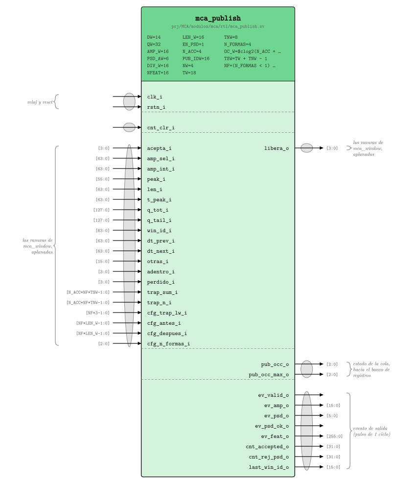
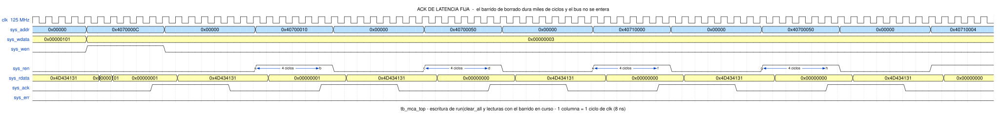

# Datasheet — `mca_publish`

<!-- Generado por `modulos/mk/datasheet.py`. Lo que está entre las marcas
     AUTO:x y /AUTO:x se REESCRIBE en cada corrida: editar ahí no sirve.
     Todo el resto es prosa a mano y no se toca.
     La §1.1 «Qué hace» se escribe en prosa/mca_publish.md.
     Regenerar:  make -C modulos/mca/work datasheet              -->

## 1. Función y funcionamiento

### 1.1 Descripción breve

<!-- AUTO:resumen -->
|  |  |
|---|---|
| Módulo RTL | `mca_publish` |
| Archivo | [`mca_publish.sv`](../../modulos/mca/rtl/mca_publish.sv) |
| Parámetros | 17 |
| Puertos | 34 (23 in / 11 out) |
| Parte | `xc7z010clg400-1` |




**Cabecera del RTL** (se copia tal cual de [`mca_publish.sv`](../../modulos/mca/rtl/mca_publish.sv)):

> mca_publish — publicacion del evento: cola de ranuras, divisores de forma y
> armado del bus de features
>
> Las ranuras de mca_window SON la cola de publicacion: una ranura que cierra
> aceptada se queda con su resultado (estado CERRADA) hasta que este modulo lo
> toma. Aca solo se guarda el ORDEN en que cerraron, como una cola de indices
> de N_ACC lugares, y el publicador las atiende de a una: carga los operandos
> de la mas vieja en los dos divisores, arma el bus de features cuando terminan
> y libera la ranura. Con N_ACC = 1 la ranura no puede reabrir hasta publicar:
> es el modo bloqueante de antes. Con mas, la ventana sigue midiendo mientras
> el publicador trabaja.
>
> ARRANQUE DIRECTO. Si la cola esta vacia y el publicador libre, los divisores
> arrancan en el MISMO flanco del cierre, desde los registros de la ranura que
> cierra (que en ese ciclo ya tienen su valor final: la muestra de cierre no se
> acumula). Asi una ranura espera exactamente 18 ciclos por evento: el del
> arranque, el de carga, las 16 iteraciones y el de valid.
>
> FRONTERA. Todo lo que entra de mca_window sale de los registros de las
> ranuras, y el mux N:1 de operandos va a un registro: con
> -flatten_hierarchy none la frontera no le agrega logica a ningun camino.
>
> EL BANCO DE TRAPECIOS: QUE FORMA SE PUBLICA. Cada ranura trae la meseta de
> las NF formas del banco, ordenadas de la mas larga a la mas corta, y la
> distancia al disparo anterior (dt_prev) y al siguiente dentro de la ventana
> (dt_next). Gana la PRIMERA forma f < n_formas con
>     antes[f] <= dt_prev   y   despues[f] <= dt_next
> o sea la mas larga (la de menos ruido) cuya ventana no alcanza al vecino. Si
> ninguna cumple, el pulso queda MARCADO: F_TRAP vale cero (cae en el canal 0,
> donde se ve, como una ventana incompleta) y F_FORMA vale 0xFFFF. Los umbrales
> en cero, que es lo del reset, hacen ganar siempre a la forma 0: es el MCA de
> un solo trapecio. La eleccion se registra en el ciclo en que los divisores
> enganchan los operandos, desde `cur`, asi que no agrega latencia: los 18
> ciclos por evento siguen iguales (y sin divisores, 2).
<!-- /AUTO:resumen -->

<!-- AUTO:prosa -->
<!-- Prosa a mano: se edita en prosa/mca_publish.md, no aca. -->

**Qué hace.** Publica los eventos de las ranuras cerradas, **en orden de
cierre**: guarda una cola de índices de ranura, toma la más vieja, la pasa por los
dos `mca_div_restore` (forma $Q_\mathrm{cola}/Q_\mathrm{tot}$ y ancho inverso
pico$/Q_\mathrm{tot}$), arma el bus de features con todas las ranuras del mismo
evento y libera la ranura. Si la cola está vacía, los divisores arrancan en el
mismo flanco del cierre: una ranura espera exactamente 18 ciclos por evento.

**Por qué los operandos salen del índice registrado.** La primera versión cargaba
los operandos en el mismo flanco en que decidía qué ranura atender, y el camino
cierre → aceptación → prioridad → mux de 32 bits → comparador de 32 bits dio
−0.734 ns. El divisor engancha los operandos un ciclo después de `div_start`, así
que salen del índice `cur`, ya registrado: +0.065 ns en la OOC.
<!-- /AUTO:prosa -->

### 1.2 Interfaces

<!-- AUTO:interfaces -->
#### Parámetros

| Parámetro | Tipo | Default | Para qué |
|---|---|---|---|
| `DW` | `integer` | `14` | ancho de muestra |
| `QW` | `integer` | `32` | ancho de los acumuladores de carga |
| `AMP_W` | `integer` | `16` | ancho de una ranura del bus de features |
| `PSD_AW` | `integer` | `6` | bits del EJE de factor de forma (mapa 2D) |
| `DIV_W` | `integer` | `16` | bits de COCIENTE de los divisores |
| `NFEAT` | `integer` | `16` | ranuras del bus de features |
| `LEN_W` | `integer` | `16` | ancho de los contadores de longitud |
| `EN_PSD` | `integer` | `1` | 0: no instancia los divisores |
| `N_ACC` | `integer` | `4` | ranuras de medicion |
| `PUB_IDW` | `integer` | `16` | bits del id de ventana |
| `NW` | `integer` | `4` | bits de la marca `otras` |
| `TW` | `integer` | `18` | salida del trapecio |
| `TNW` | `integer` | `8` | bits de la cuenta de la meseta |
| `N_FORMAS` | `integer` | `4` | formas del banco; 0: sin trapecio |
| `OC_W` | `integer` | `$clog2(N_ACC + 1)` = `3` |  |
| `TSW` | `integer` | `TW + TNW - 1` = `25` |  |
| `NF` | `integer` | `(N_FORMAS < 1) ? 1 : N_FORMAS` |  |


#### Puertos

##### Señales

| Puerto | Dir | Bits | Dominio | Descripción |
|---|---|---|---|---|
| `clk_i` | in | 1 | — |  |
| `rstn_i` | in | 1 | — |  |
| `cnt_clr_i` | in | 1 | clk_i | pulso: pone a cero los contadores |


##### Las ranuras de mca_window, aplanadas

| Puerto | Dir | Bits | Dominio | Descripción |
|---|---|---|---|---|
| `acepta_i` | in | 4 `[N_ACC-1:0]` | clk_i | cierra aceptada en este ciclo |
| `amp_sel_i` | in | 64 `[N_ACC*AMP_W-1:0]` | clk_i | el estimador SELECCIONADO |
| `amp_int_i` | in | 64 `[N_ACC*AMP_W-1:0]` | clk_i | la integral, siempre |
| `peak_i` | in | 56 `[N_ACC*DW-1:0]` | clk_i |  |
| `len_i` | in | 64 `[N_ACC*LEN_W-1:0]` | clk_i |  |
| `t_peak_i` | in | 64 `[N_ACC*LEN_W-1:0]` | clk_i |  |
| `q_tot_i` | in | 128 `[N_ACC*QW-1:0]` | clk_i |  |
| `q_tail_i` | in | 128 `[N_ACC*QW-1:0]` | clk_i |  |
| `win_id_i` | in | 64 `[N_ACC*PUB_IDW-1:0]` | clk_i |  |
| `dt_prev_i` | in | 64 `[N_ACC*LEN_W-1:0]` | clk_i |  |
| `dt_next_i` | in | 64 `[N_ACC*LEN_W-1:0]` | clk_i |  |
| `otras_i` | in | 16 `[N_ACC*NW-1:0]` | clk_i |  |
| `adentro_i` | in | 4 `[N_ACC-1:0]` | clk_i |  |
| `perdido_i` | in | 4 `[N_ACC-1:0]` | clk_i |  |
| `trap_sum_i` | in | `[N_ACC*NF*TSW-1:0]` | clk_i | suma sobre cada meseta: (k*NF + f) |
| `trap_n_i` | in | `[N_ACC*NF*TNW-1:0]` | clk_i | ...y cuantas muestras sumo |
| `cfg_trap_lw_i` | in | `[NF*3-1:0]` | clk_i | la ventana de la forma f: 2^lw muestras |
| `cfg_antes_i` | in | `[NF*LEN_W-1:0]` | clk_i | umbral de dt_prev de cada forma |
| `cfg_despues_i` | in | `[NF*LEN_W-1:0]` | clk_i | umbral de dt_next de cada forma |
| `cfg_n_formas_i` | in | 3 | clk_i | formas habilitadas (0 = 1) |
| `libera_o` | out | 4 `[N_ACC-1:0]` | clk_i | publicada: la ranura queda libre |


##### Estado de la cola, hacia el banco de registros

| Puerto | Dir | Bits | Dominio | Descripción |
|---|---|---|---|---|
| `pub_occ_o` | out | 3 `[OC_W-1:0]` | clk_i | ranuras esperando publicar |
| `pub_occ_max_o` | out | 3 `[OC_W-1:0]` | clk_i | maximo historico |


##### Evento de salida (pulso de 1 ciclo)

| Puerto | Dir | Bits | Dominio | Descripción |
|---|---|---|---|---|
| `ev_valid_o` | out | 1 | clk_i |  |
| `ev_amp_o` | out | 16 `[AMP_W-1:0]` | clk_i |  |
| `ev_psd_o` | out | 6 `[PSD_AW-1:0]` | clk_i |  |
| `ev_psd_ok_o` | out | 1 | clk_i | 0 => no histogramear el 2D |
| `ev_feat_o` | out | 256 `[NFEAT*AMP_W-1:0]` | clk_i |  |
| `cnt_accepted_o` | out | 32 | clk_i |  |
| `cnt_rej_psd_o` | out | 32 | clk_i | q_tot=0 o q_tail>=q_tot |
| `last_win_id_o` | out | 16 `[PUB_IDW-1:0]` | clk_i | id de la ultima ventana publicada |
<!-- /AUTO:interfaces -->

### 1.3 Mapa de registros

<!-- AUTO:regmap -->
Mapas de registros de la región:

- [`register_map_mca.md`](../mca/register_map_mca.md)

Contrato del bus: [`bus_sistema_redpitaya.md`](../TOP/bus_sistema_redpitaya.md) · Mapa de slots: [`register_map_top.md`](../TOP/register_map_top.md)
<!-- /AUTO:regmap -->

### 1.4 Clock domains

<!-- AUTO:clocks -->
| Puerto | Qué es | Polaridad |
|---|---|---|
| `clk_i` | reloj |  |
| `rstn_i` | reset | activo-bajo |


**Un solo dominio.** Todos los puertos de datos y de control son síncronos a `clk_i`: no hay cruce de dominio dentro de este módulo.
<!-- /AUTO:clocks -->

<!-- A mano: si hay más de un reloj, cuál es el cruce, con qué se sincroniza y
     qué se asume de la relación de frecuencias. Si hay uno solo, borrar. -->

### 1.5 Frecuencia máxima de trabajo

<!-- AUTO:timing -->
El `metrics.txt` del módulo es de `mca_top`, no de `mca_publish`: la síntesis OOC del módulo apunta a otro top, así que acá no hay números propios de este bloque.
<!-- /AUTO:timing -->

<!-- A mano: qué hay en el camino crítico y qué se haría para romperlo si
     hubiera que subir la frecuencia. -->

### 1.6 Transacciones

<!-- AUTO:transacciones -->
**LA CADENA DE UN EVENTO  -  senal, registro y espectro**


La transaccion del MCA es UN EVENTO, y la figura la sigue entera: (a) la senal de entrada con el umbral y la ventana que `pulse_feature` abre y cierra, (b) el camino de datos, donde entre los dos bloques no va una flecha pelada sino el tren de amplitudes concretas que viaja --un registro de evento por pulso--, y (c) el espectro que se acumula del otro lado, una cuenta por numero. Los numeros de los tres paneles son los mismos: la amplitud que se mide en (a) es la que viaja en (b) y la que cae en un canal en (c), con el mismo `amp >> h_shift` que hace el RTL. Es la unica figura del proyecto que muestra la cuenta completa de punta a punta.

_Origen: simulacion con semilla fija (`animacion_cadena_mca.py`), los mismos cuadros que los videos._

**(a) LA SENAL: UN PULSO POR EVENTO**


Las bandas parten el eje de TIEMPO en estados --ventana abierta, reposo-- y no la senal en eventos. La ventana abre al cruzar `thr` y cierra recien al bajar de `thr - hyst`, que es lo que hace que termine bastante despues del pico.

_Origen: la misma simulacion, panel (a) suelto._

**(b) EL CAMINO DE DATOS: UN NUMERO POR PULSO**


`pulse_feature` emite un registro de evento por pulso y el histograma lo convierte en una cuenta. La tabla de abajo son los mismos pulsos como los ve el histograma, incluido el que no cruza el umbral y no produce nada.

_Origen: la misma simulacion, panel (b) suelto._

**(c) EL ESPECTRO: UNA CUENTA POR NUMERO**


El mismo espectro en tres momentos de la acumulacion (12, 64 y 227 cuentas): la forma aparece recien cuando hay estadistica.

_Origen: la misma simulacion, panel (c) suelto._

---

Las figuras **recalculan cada número al dibujar** en vez de tomarlo escrito.
<!-- /AUTO:transacciones -->

### 1.7 Waveforms

<!-- AUTO:ondas -->
**LA VIDA DE UN PULSO  -  cruce de umbral, ventana, carga acumulada y evento**


Es la figura central del modulo: todo lo que el MCA hace por evento pasa aca. La muestra cruza el umbral, `busy` sube y marca la ventana abierta, las dos cargas se acumulan mientras la ventana dura --q_tot sobre toda la ventana y q_tail desde la segunda muestra, que es lo que hace separable la forma del pulso-- y al cerrar sale `ev_valid` con la amplitud y el bus de features. El pulso es RECTANGULAR a proposito, igual que en el testbench: su ventana es inequivoca, asi que los numeros del epigrafe salen de una multiplicacion y no de reimplementar el DUT.

_Origen: `tb_mca_pulse_feature`, escena 1 (pulso rectangular)._

**APILAMIENTO  -  la ventana llega a maxlen: el pulso se cuenta pero NO se acepta**


El mismo bloque con `maxlen` chico y un pulso mas largo que eso. La ventana se cierra por limite y el evento cae en `cnt_pileup` sin pasar por `cnt_accepted`: no sale `ev_valid`. Lo que importa es que SI se cuenta en `cnt_total`. Un evento descartado que no se cuenta en ningun lado es tiempo muerto invisible, y sin ese numero no se puede corregir el espectro por eventos perdidos.

_Origen: `tb_mca_pulse_feature`, escena 5 (apilamiento)._

**READ-MODIFY-WRITE AL MISMO BIN  -  la cuenta no se pierde aunque los eventos lleguen pegados**


El histograma es una BRAM: incrementar un bin es leerlo, sumarle uno y escribirlo, y eso tarda varios ciclos. Si dos eventos consecutivos caen en el MISMO bin, el segundo leeria el valor viejo --el que todavia no se escribio-- y una de las dos cuentas se perderia. La figura muestra cuatro incrementos seguidos al mismo bin y la lectura posterior dando el total correcto: el bloque puentea la escritura en vuelo. Es el peor caso realista, porque un pico del espectro es justamente muchos eventos al mismo bin.

_Origen: `tb_mca_hist`, escena 3 (forwarding)._

**ACK DE LATENCIA FIJA  -  el barrido de borrado dura miles de ciclos y el bus no se entera**



Lo que la cabecera del RTL marca como lo mas importante del modulo. El barrido de borrado recorre 2^H_AW bins y dura miles de ciclos, muchisimo mas que los 32 ciclos de timeout del axi4_slave. Si el ack dependiera de que el motor este libre, una lectura durante el barrido no haria ack nunca, y eso no produce una lectura mala: deja el CDC del slot desincronizado para siempre --reg_do != reg_done-- y ese slot no acepta mas transacciones. El ack sale de un shift register incondicional, asi que llega con la misma latencia este barriendo o no, que es lo que la figura mide.

_Origen: `tb_mca_top`, escena 5 (lectura durante el borrado)._

**FLUJO DE UNA MEDICION  -  mca_top**


Es un esquema de la SECUENCIA, no una medicion. La configuracion es una escalera: el bus del PS escribe un registro por vez, y la figura los pone en el orden en que los escribe Mca.configure(). Ese orden importa en un solo punto: cfg_hist_sel va DESPUES de cfg_amp_src, porque escribir cfg_amp_src tambien lo mueve. Un registro que no se escribe conserva lo que tenia (el valor de reset solo despues de cargar el bitstream; ver register_map_mca.md). Despues, las dos cosas que fija: el borrado hay que ESPERARLO --`clear_busy` avisa, y los eventos que llegan mientras barre se descartan y se cuentan en `dropped`--, y los contadores se pueden leer con la medicion corriendo, que es lo que permite supervisar sin frenar. La misma secuencia en software esta en docs/API/guia_de_uso.md; si las dos se contradicen, una de las dos esta mal.

_Origen: esquema (sin VCD)._

---

Las figuras y sus epígrafes los escribe [`ondas_mca.py`](../mca/figuras/ondas/ondas_mca.py): los tiempos y las latencias se **miden sobre el VCD**, no se escriben a mano, así que no pueden desincronizarse del RTL. Los epígrafes completos, con los números, están en [`epigrafes.txt`](../mca/figuras/ondas/epigrafes.txt).

```bash
python3 docs/mca/figuras/ondas/ondas_mca.py    # regenerar
```
<!-- /AUTO:ondas -->

<!-- A mano: lo que las figuras no pueden mostrar solas. Para agregar una,
     editar docs/mca/figuras/ondas/ondas_mca.py: la onda
     sale de un VCD de los testbenches y los tiempos los mide el script.
       make -C modulos/mca/work wave TB=<tb>   # mirar en Questa
       make -C modulos/mca/work vcd  TB=<tb>   # VCD exportable -->

### 1.8 Verificación realizada

<!-- AUTO:verificacion -->
Todo corre en batch y se chequea el `RESULT: PASS` del testbench; las ondas quedan en `work/waves/<tb>.wlf`.

```bash
make -C modulos/mca/work            # los 8 testbenches
make -C modulos/mca/work cov        # + cobertura
make -C modulos/mca/work lint
```

| Testbench | DUT | Escenas | Casos | Contra qué compara | Es el de este módulo |
|---|---|---|---|---|---|
| [`tb_mca_div_restore`](../../modulos/mca/sim/tb_mca_div_restore.sv) | `mca_div_restore` | 6 | 22 | vectores a mano |  |
| [`tb_mca_hist`](../../modulos/mca/sim/tb_mca_hist.sv) | `mca_hist` | 8 | 31 | vectores a mano |  |
| [`tb_mca_zoom`](../../modulos/mca/sim/tb_mca_zoom.sv) | `mca_zoom` | 5 | 11 | vectores a mano |  |
| [`tb_mca_discriminator`](../../modulos/mca/sim/tb_mca_discriminator.sv) | `mca_discriminator` | 7 | 21 | vectores a mano |  |
| [`tb_mca_trap`](../../modulos/mca/sim/tb_mca_trap.sv) | `mca_trap` | — | — | vectores a mano |  |
| [`tb_mca_multi`](../../modulos/mca/sim/tb_mca_multi.sv) | `mca_multi` | — | — | vectores a mano |  |
| [`tb_mca_pulse_feature_evt`](../../modulos/mca/sim/tb_mca_pulse_feature_evt.sv) | `mca_pulse_feature_evt` | — | — | RTL de referencia `mca_pulse_feature_ref.v` instanciado al lado del DUT |  |
| [`tb_mca_top`](../../modulos/mca/sim/tb_mca_top.sv) | `mca_top` | 11 | 121 | vectores a mano |  |


**206 casos con nombre** en 8 testbenches (37 escenas). La lista completa, caso por caso, está en el plan de verificación.

> **`mca_publish` no tiene testbench propio.** Ningún `TBS` del `work/Makefile` lo instancia como DUT: lo que se verifica de este módulo es lo que arrastre el TB de otro. Es deuda de verificación, no una omisión de esta página.

**Assertions** — en `sim/sva/`, enganchadas por `bind` (no tocan el RTL sintetizable).

- [`mca_top_sva.sv`](../../modulos/mca/sim/sva/mca_top_sva.sv) — 68 propiedades

Plan de verificación, casos cubiertos y deuda: [`mca/sim/VERIFICACION.md`](../../modulos/mca/sim/VERIFICACION.md).
<!-- /AUTO:verificacion -->

#### Esquema de laboratorio

TODO — qué instrumento, cómo se conecta, qué se mide y contra qué se compara.
