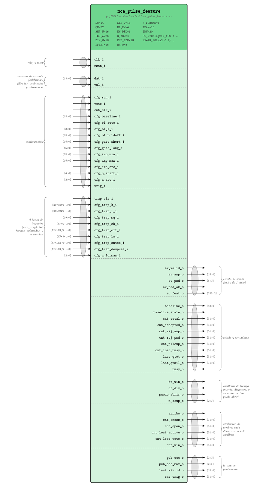
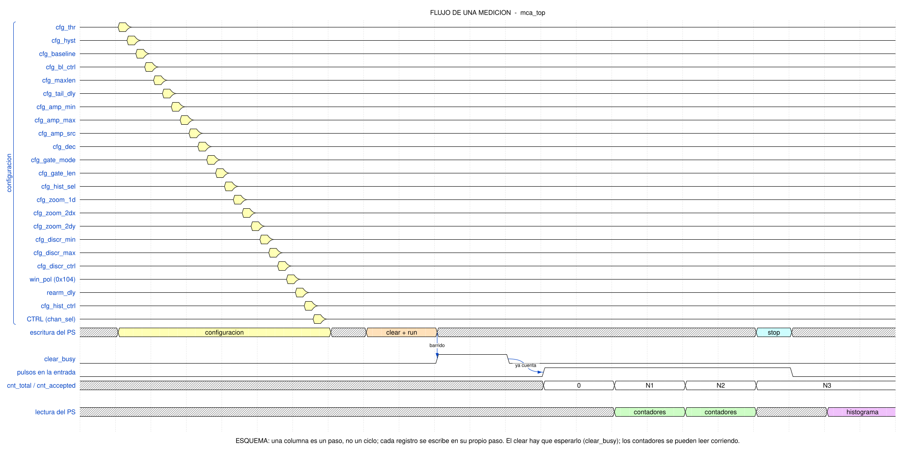

# Datasheet — `mca_pulse_feature`

<!-- Generado por `modulos/mk/datasheet.py`. Lo que está entre las marcas
     AUTO:x y /AUTO:x se REESCRIBE en cada corrida: editar ahí no sirve.
     Todo el resto es prosa a mano y no se toca.
     Regenerar:  make -C modulos/mca/work datasheet              -->

## 1. Función y funcionamiento

### 1.1 Descripción breve

<!-- AUTO:resumen -->
|  |  |
|---|---|
| Módulo RTL | `mca_pulse_feature` |
| Archivo | [`mca_pulse_feature.sv`](../../modulos/mca/rtl/mca_pulse_feature.sv) |
| Parámetros | 9 |
| Puertos | 38 (22 in / 16 out) |
| Parte | `xc7z010clg400-1` |




**Cabecera del RTL** (se copia tal cual de [`mca_pulse_feature.sv`](../../modulos/mca/rtl/mca_pulse_feature.sv)):

> mca_pulse_feature — segmentador de pulsos y extractor de características
>
> Recibe la muestra ya calibrada/filtrada y, por cada pulso detectado, emite
> UN registro de evento coherente {amp, psd} que alimenta a todos los motores
> de histograma. Que salga de un único registro es lo que garantiza que el
> espectro 1D y el mapa 2D cuenten exactamente los mismos pulsos.
>
> LÍNEA DE BASE. Seguidor IIR  bl_acc += x - (bl_acc >> k),  bl = bl_acc >> k.
> El acumulador es ancho a propósito: con la forma ingenua `bl += (x-bl)>>k`
> el incremento se cuantiza a cero cuando |x-bl| < 2^k y el seguidor se
> congela. Se congela durante el pulso Y durante cfg_bl_holdoff muestras
> después: si se descongelara al cruzar la histéresis hacia abajo, agarraría
> el undershoot de la cola y arrastraría la base hacia el lado equivocado.
>
> SEGMENTACIÓN. Schmitt igual que rp_adc_trig.v, para que los umbrales del
> MCA y del scope sean comparables. Abre al cruzar cfg_thr hacia arriba, con
> re-armado previo por debajo de cfg_thr-cfg_hyst. Para CERRAR hay dos modos,
> seleccionables por cfg_gate_mode:
>
>   0 = HISTÉRESIS: cierra al bajar de cfg_thr-cfg_hyst, o al llegar a
>       cfg_maxlen (esto último cuenta como APILAMIENTO).
>   1 = COMPUERTAS FIJAS: cierra a cfg_gate_long muestras del disparo, y la
>       cola arranca en cfg_gate_short. Es el método de comparación de carga.
>
> El motivo del modo 1: con histéresis el largo de la ventana lo decide dónde
> la cola cruza el umbral, que es la parte más chata del pulso, así que lo
> decide el ruido. Medido offline sobre 7054 pulsos reales, la resolución de la
> integral pasa de 0.528 % (histéresis) a 0.149 % (compuerta fija). Ver
> software/API/modelo_rtl/estimadores.py.
>
> Los eventos marcados como apilamiento se cuentan pero NO se histogramean,
> porque su integral y su pico están contaminados por el segundo pulso.
>
> AMPLITUD. Seleccionable por cfg_amp_src:
>   0 = muestra de pico   -> ruido de UNA muestra, y el muestreo casi nunca
>                            cae en el máximo real: ensancha el fotopico.
>   1 = integral de carga -> el ruido blanco promedia como sigma/sqrt(N) y
>                            es inmune al jitter de muestreo. Es lo que hace
>                            cualquier MCA digital serio, y lo que justifica
>                            un eje de 16384 canales.
> Poder alternar entre ambos en el mismo bitstream ES el experimento que mide
> la contribución de jitter de muestreo.
>
> PICO con comparación ESTRICTA (>): en un techo plano con ruido gana la
> PRIMERA ocurrencia del máximo. Con >= el instante de pico se correría hasta
> el final de la meseta y el tiempo de subida saldría arbitrariamente largo.
>
> CARGA. Cada muestra se satura a >= 0 antes de acumular. Sin eso, una cola
> con undershoot resta de q_tot mientras q_tail (en la parte plana) sigue
> sumando, y se llega a q_tail > q_total, que rompe la premisa del divisor.
<!-- /AUTO:resumen -->

<!-- A mano: qué problema resuelve el bloque, cómo encaja en la cadena y las
     dos o tres decisiones de diseño que explican por qué está hecho así. -->

**Qué hace.** TODO

### 1.2 Interfaces

<!-- AUTO:interfaces -->
#### Parámetros

| Parámetro | Tipo | Default | Para qué |
|---|---|---|---|
| `DW` | `integer` | `14` | ancho de muestra (con signo) |
| `QW` | `integer` | `32` | ancho de los acumuladores de carga |
| `AMP_W` | `integer` | `16` | ancho de la amplitud emitida |
| `PSD_AW` | `integer` | `6` | bits del EJE de factor de forma (mapa 2D) |
| `DIV_W` | `integer` | `16` | bits de COCIENTE de los divisores |
| `NFEAT` | `integer` | `16` | ranuras del bus de features |
| `LEN_W` | `integer` | `16` | ancho de los contadores de longitud |
| `BL_KW` | `integer` | `4` | bits del exponente k del seguidor IIR |
| `EN_PSD` | `integer` | `1` | 0: no instancia los divisores |


#### Puertos

##### Reloj y reset

| Puerto | Dir | Bits | Dominio |
|---|---|---|---|
| `clk_i` | in | 1 | — |
| `rstn_i` | in | 1 | — |


##### Muestras de entrada (ya calibradas/filtradas/decimadas)

| Puerto | Dir | Bits | Signo | Dominio |
|---|---|---|---|---|
| `dat_i` | in | 14 `[DW-1:0]` | signed | clk_i |
| `val_i` | in | 1 |  | clk_i |


##### Configuración

| Puerto | Dir | Bits | Signo | Dominio | Descripción |
|---|---|---|---|---|---|
| `cfg_run_i` | in | 1 |  | clk_i |  |
| `veto_i` | in | 1 |  | clk_i | VETO externo (nivel): no se abren pulsos nuevos mientras vale 1. El pulso en curso termina normal, y el seguidor de linea de base SIGUE corriendo -- a diferencia de cfg_run=0 --, porque la base deriva igual durante el veto y si se congelara arrancaria desfasada al liberarse. Viene del trigger_shield del multitrigger (dst = mca). |
| `cnt_clr_i` | in | 1 |  | clk_i | pulso: pone a cero los contadores |
| `cfg_thr_i` | in | 14 `[DW-1:0]` | signed | clk_i | umbral sobre la línea de base |
| `cfg_hyst_i` | in | 14 `[DW-1:0]` |  | clk_i | histéresis (positiva) |
| `cfg_baseline_i` | in | 14 `[DW-1:0]` | signed | clk_i | base fija si cfg_bl_auto=0 |
| `cfg_bl_auto_i` | in | 1 |  | clk_i |  |
| `cfg_bl_k_i` | in | 4 `[BL_KW-1:0]` |  | clk_i | alfa = 2^-k |
| `cfg_bl_holdoff_i` | in | 16 `[LEN_W-1:0]` |  | clk_i |  |
| `cfg_maxlen_i` | in | 16 `[LEN_W-1:0]` |  | clk_i |  |
| `cfg_tail_dly_i` | in | 16 `[LEN_W-1:0]` |  | clk_i | >= 1 |


##### Modo de ventana (ver cabecera, SEGMENTACION)

| Puerto | Dir | Bits | Dominio | Descripción |
|---|---|---|---|---|
| `cfg_gate_mode_i` | in | 1 | clk_i | 0=histeresis, 1=compuertas fijas |
| `cfg_gate_short_i` | in | 16 `[LEN_W-1:0]` | clk_i | compuerta corta, en muestras |
| `cfg_gate_long_i` | in | 16 `[LEN_W-1:0]` | clk_i | compuerta larga, en muestras |
| `cfg_amp_min_i` | in | 16 `[AMP_W-1:0]` | clk_i |  |
| `cfg_amp_max_i` | in | 16 `[AMP_W-1:0]` | clk_i |  |
| `cfg_amp_src_i` | in | 1 | clk_i | 0=pico, 1=integral |
| `cfg_q_shift_i` | in | 5 | clk_i |  |


##### Evento de salida (pulso de 1 ciclo)

| Puerto | Dir | Bits | Dominio | Descripción |
|---|---|---|---|---|
| `ev_valid_o` | out | 1 | clk_i |  |
| `ev_amp_o` | out | 16 `[AMP_W-1:0]` | clk_i |  |
| `ev_psd_o` | out | 6 `[PSD_AW-1:0]` | clk_i |  |
| `ev_psd_ok_o` | out | 1 | clk_i | 0 => no histogramear el 2D |
| `ev_feat_o` | out | 256 `[NFEAT*AMP_W-1:0]` | clk_i | Bus de features: NFEAT ranuras de AMP_W bits, todas del MISMO evento. Se arma a la salida de S_DIV, no al cerrar, porque los cocientes valen DIV_W ciclos mas tarde que el resto (ver F_ del cuerpo). |


##### Estado y contadores

| Puerto | Dir | Bits | Signo | Dominio | Descripción |
|---|---|---|---|---|---|
| `baseline_o` | out | 14 `[DW-1:0]` | signed | clk_i |  |
| `baseline_stale_o` | out | 1 |  | clk_i |  |
| `cnt_total_o` | out | 32 |  | clk_i | pulsos cerrados |
| `cnt_accepted_o` | out | 32 |  | clk_i |  |
| `cnt_rej_amp_o` | out | 32 |  | clk_i | fuera de [min,max] |
| `cnt_rej_psd_o` | out | 32 |  | clk_i | q_tot=0 o q_tail>=q_tot |
| `cnt_pileup_o` | out | 32 |  | clk_i | cerrado por maxlen |
| `cnt_lost_busy_o` | out | 32 |  | clk_i | pulso perdido con el divisor ocupado |
| `last_qtot_o` | out | 32 `[QW-1:0]` |  | clk_i |  |
| `last_qtail_o` | out | 32 `[QW-1:0]` |  | clk_i |  |
| `busy_o` | out | 1 |  | clk_i | pulso activo o divisor ocupado |
<!-- /AUTO:interfaces -->

### 1.3 Mapa de registros

<!-- AUTO:regmap -->
Mapas de registros de la región:

- [`register_map_mca.md`](../mca/register_map_mca.md)

Contrato del bus: [`bus_sistema_redpitaya.md`](../TOP/bus_sistema_redpitaya.md) · Mapa de slots: [`register_map_top.md`](../TOP/register_map_top.md)
<!-- /AUTO:regmap -->

### 1.4 Clock domains

<!-- AUTO:clocks -->
| Puerto | Qué es | Polaridad |
|---|---|---|
| `clk_i` | reloj |  |
| `rstn_i` | reset | activo-bajo |


**Un solo dominio.** Todos los puertos de datos y de control son síncronos a `clk_i`: no hay cruce de dominio dentro de este módulo.
<!-- /AUTO:clocks -->

<!-- A mano: si hay más de un reloj, cuál es el cruce, con qué se sincroniza y
     qué se asume de la relación de frecuencias. Si hay uno solo, borrar. -->

### 1.5 Frecuencia máxima de trabajo

<!-- AUTO:timing -->
El `metrics.txt` del módulo es de `mca_top`, no de `mca_pulse_feature`: la síntesis OOC del módulo apunta a otro top, así que acá no hay números propios de este bloque.
<!-- /AUTO:timing -->

<!-- A mano: qué hay en el camino crítico y qué se haría para romperlo si
     hubiera que subir la frecuencia. -->

### 1.6 Waveforms

<!-- AUTO:ondas -->
**LA VIDA DE UN PULSO  -  cruce de umbral, ventana, carga acumulada y evento**


Es la figura central del modulo: todo lo que el MCA hace por evento pasa aca. La muestra cruza el umbral, `busy` sube y marca la ventana abierta, las dos cargas se acumulan mientras la ventana dura --q_tot sobre toda la ventana y q_tail desde la segunda muestra, que es lo que hace separable la forma del pulso-- y al cerrar sale `ev_valid` con la amplitud y el bus de features. El pulso es RECTANGULAR a proposito, igual que en el testbench: su ventana es inequivoca, asi que los numeros del epigrafe salen de una multiplicacion y no de reimplementar el DUT.

_Origen: `tb_mca_pulse_feature`, escena 1 (pulso rectangular)._

**APILAMIENTO  -  la ventana llega a maxlen: el pulso se cuenta pero NO se acepta**


El mismo bloque con `maxlen` chico y un pulso mas largo que eso. La ventana se cierra por limite y el evento cae en `cnt_pileup` sin pasar por `cnt_accepted`: no sale `ev_valid`. Lo que importa es que SI se cuenta en `cnt_total`. Un evento descartado que no se cuenta en ningun lado es tiempo muerto invisible, y sin ese numero no se puede corregir el espectro por eventos perdidos.

_Origen: `tb_mca_pulse_feature`, escena 5 (apilamiento)._

**READ-MODIFY-WRITE AL MISMO BIN  -  la cuenta no se pierde aunque los eventos lleguen pegados**


El histograma es una BRAM: incrementar un bin es leerlo, sumarle uno y escribirlo, y eso tarda varios ciclos. Si dos eventos consecutivos caen en el MISMO bin, el segundo leeria el valor viejo --el que todavia no se escribio-- y una de las dos cuentas se perderia. La figura muestra cuatro incrementos seguidos al mismo bin y la lectura posterior dando el total correcto: el bloque puentea la escritura en vuelo. Es el peor caso realista, porque un pico del espectro es justamente muchos eventos al mismo bin.

_Origen: `tb_mca_hist`, escena 3 (forwarding)._

**ACK DE LATENCIA FIJA  -  el barrido de borrado dura miles de ciclos y el bus no se entera**


Lo que la cabecera del RTL marca como lo mas importante del modulo. El barrido de borrado recorre 2^H_AW bins y dura miles de ciclos, muchisimo mas que los 32 ciclos de timeout del axi4_slave. Si el ack dependiera de que el motor este libre, una lectura durante el barrido no haria ack nunca, y eso no produce una lectura mala: deja el CDC del slot desincronizado para siempre --reg_do != reg_done-- y ese slot no acepta mas transacciones. El ack sale de un shift register incondicional, asi que llega con la misma latencia este barriendo o no, que es lo que la figura mide.

_Origen: `tb_mca_top`, escena 5 (lectura durante el borrado)._

**FLUJO DE UNA MEDICION  -  mca_top**



Es un esquema de la SECUENCIA, no una medicion. Las dos cosas que fija: el borrado hay que ESPERARLO --`clear_busy` avisa, y los eventos que llegan mientras barre se descartan y se cuentan en `dropped`--, y los contadores se pueden leer con la medicion corriendo, que es lo que permite supervisar sin frenar. La misma secuencia en software esta en docs/API/guia_de_uso.md; si las dos se contradicen, una de las dos esta mal.

_Origen: esquema (sin VCD)._

---

Las figuras y sus epígrafes los escribe [`ondas_mca.py`](../mca/figuras/ondas/ondas_mca.py): los tiempos y las latencias se **miden sobre el VCD**, no se escriben a mano, así que no pueden desincronizarse del RTL. Los epígrafes completos, con los números, están en [`epigrafes.txt`](../mca/figuras/ondas/epigrafes.txt).

```bash
python3 docs/mca/figuras/ondas/ondas_mca.py    # regenerar
```
<!-- /AUTO:ondas -->

<!-- A mano: lo que las figuras no pueden mostrar solas. Para agregar una,
     editar docs/mca/figuras/ondas/ondas_mca.py: la onda
     sale de un VCD de los testbenches y los tiempos los mide el script.
       make -C modulos/mca/work wave TB=<tb>   # mirar en Questa
       make -C modulos/mca/work vcd  TB=<tb>   # VCD exportable -->

### 1.7 Verificación realizada

<!-- AUTO:verificacion -->
Todo corre en batch y se chequea el `RESULT: PASS` del testbench; las ondas quedan en `work/waves/<tb>.wlf`.

```bash
make -C modulos/mca/work            # los 6 testbenches
make -C modulos/mca/work cov        # + cobertura
make -C modulos/mca/work lint
```

| Testbench | DUT | Escenas | Casos | Contra qué compara | Es el de este módulo |
|---|---|---|---|---|---|
| [`tb_mca_div_restore`](../../modulos/mca/sim/tb_mca_div_restore.sv) | `mca_div_restore` | 6 | 22 | vectores a mano |  |
| [`tb_mca_hist`](../../modulos/mca/sim/tb_mca_hist.sv) | `mca_hist` | 8 | 31 | vectores a mano |  |
| [`tb_mca_zoom`](../../modulos/mca/sim/tb_mca_zoom.sv) | `mca_zoom` | 5 | 11 | vectores a mano |  |
| [`tb_mca_discriminator`](../../modulos/mca/sim/tb_mca_discriminator.sv) | `mca_discriminator` | 7 | 21 | vectores a mano |  |
| [`tb_mca_pulse_feature`](../../modulos/mca/sim/tb_mca_pulse_feature.sv) | `mca_pulse_feature` | 13 | 99 | vectores a mano | **sí** |
| [`tb_mca_top`](../../modulos/mca/sim/tb_mca_top.sv) | `mca_top` | 7 | 48 | vectores a mano |  |


**232 casos con nombre** en 6 testbenches (46 escenas). La lista completa, caso por caso, está en el plan de verificación.

Las escenas de [`tb_mca_pulse_feature`](../../modulos/mca/sim/tb_mca_pulse_feature.sv): 1) Pulso rectangular, 2) Estimador de INTEGRAL, 3) Pulso por debajo del umbral, 4) Ventana de aceptación de amplitud, 5) APILAMIENTO, 6) Pulso que NUNCA vuelve a bajar de la histéresis, 7) Línea de base FIJA distinta de cero, 8) Línea de base AUTOMÁTICA, 9) Caso borde PSD, 10) Caso borde PSD, 11) Dos pulsos SEPARADOS (hueco > latencia del divis, 12) cfg_run=0 inhibe la detección, 13) COMPUERTAS DE LARGO FIJO (cfg_gate_mode = 1).

**Assertions** — en `sim/sva/`, enganchadas por `bind` (no tocan el RTL sintetizable).

- [`bind_mca.sv`](../../modulos/mca/sim/sva/bind_mca.sv)
- [`mca_top_sva.sv`](../../modulos/mca/sim/sva/mca_top_sva.sv)

> **Los archivos de assertions están vacíos.** Son el scaffold de `create_module.py`: tienen el `bind`, el `default clocking` y un `// TODO:`, pero **ninguna propiedad**. O sea que hoy no aportan nada a la verificación; el enganche ya está hecho y lo que falta es escribirlas. Ver [`verificacion_formal.md`](../verificacion_formal.md), que discute cuáles convienen primero.

Plan de verificación, casos cubiertos y deuda: [`mca/sim/VERIFICACION.md`](../../modulos/mca/sim/VERIFICACION.md).
<!-- /AUTO:verificacion -->

#### Esquema de laboratorio

TODO — qué instrumento, cómo se conecta, qué se mide y contra qué se compara.
