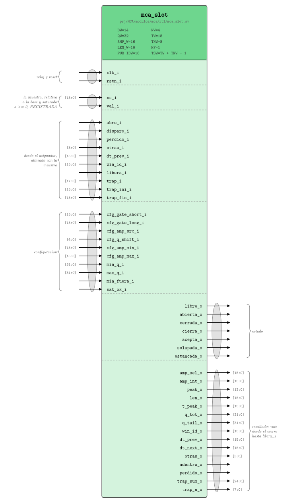
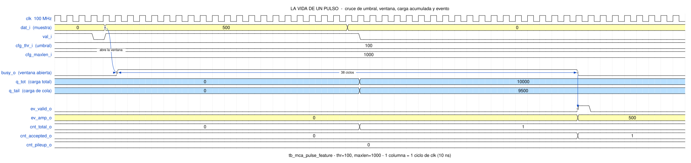
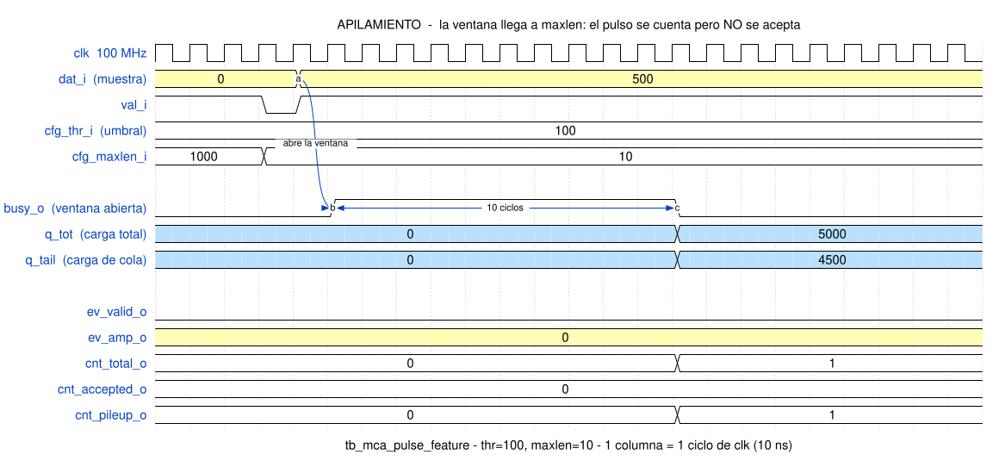

# Datasheet — `mca_slot`

<!-- Generado por `modulos/mk/datasheet.py`. Lo que está entre las marcas
     AUTO:x y /AUTO:x se REESCRIBE en cada corrida: editar ahí no sirve.
     Todo el resto es prosa a mano y no se toca.
     La §1.1 «Qué hace» se escribe en prosa/mca_slot.md.
     Regenerar:  make -C modulos/mca/work datasheet              -->

## 1. Función y funcionamiento

### 1.1 Descripción breve

<!-- AUTO:resumen -->
|  |  |
|---|---|
| Módulo RTL | `mca_slot` |
| Archivo | [`mca_slot.sv`](../../modulos/mca/rtl/mca_slot.sv) |
| Parámetros | 10 |
| Puertos | 46 (24 in / 22 out) |
| Parte | `xc7z010clg400-1` |




**Cabecera del RTL** (se copia tal cual de [`mca_slot.sv`](../../modulos/mca/rtl/mca_slot.sv)):

> mca_slot — una ranura de medicion: un juego entero de acumuladores
>
> mca_window instancia N_ACC de estas. Cada una mide UNA ventana: la abre el
> asignador con un disparo, acumula la muestra mientras dura la compuerta y,
> al cerrar, se queda con el resultado hasta que el publicador lo toma. O sea
> que la ranura es a la vez el juego de acumuladores y el lugar de la cola de
> publicacion: con N_ACC = 1 se tiene el modo bloqueante de antes, y con mas
> ranuras se miden pulsos solapados.
>
>   LIBRE ──abre──► ABIERTA ──cierra (len = gate_long)──► CERRADA ──libera──► LIBRE
>                      └──── fuera de [amp_min, amp_max] ───────────────────► LIBRE
>
> LA MUESTRA LLEGA REGISTRADA (xc_i sale de un flop de mca_window). Es lo que
> hace gratis esta frontera con -flatten_hierarchy none: la suma de cada
> acumulador arranca de un registro, y las N copias no le cuelgan logica al
> camino de la resta de la base.
>
> LA COMPUERTA SE RETIENE AL ABRIR. La ventana que ya estaba abierta mide lo que
> se configuro cuando abrio, no una mezcla, aunque se toque gate_long a mitad de
> una corrida. Cada ranura cierra sola, con su len contra su g_long: no mira a
> las otras. Con la compuerta quieta dos ranuras cierran en muestras distintas,
> porque abren en muestras distintas (el asignador abre a lo sumo una por
> muestra); si gate_long cambia entre dos aperturas pueden cerrar en la MISMA,
> y mca_publish encola las dos (lo ejercita tb_mca_multi).
>
> Las reglas de acumulacion son las de la ventana unica de antes, una por una
> (ver la historia de cada una en git: mca_window.sv antes de las ranuras):
>
>   PICO con comparacion ESTRICTA (>): en un techo plano gana la PRIMERA
>   ocurrencia del maximo. Con >= el instante de pico se correria al final de la
>   meseta y el tiempo de subida saldria arbitrariamente largo.
>
>   CARGA. La muestra ya viene saturada a >= 0. Sin eso una cola con undershoot
>   resta de q_tot mientras q_tail sigue sumando, y se llega a q_tail > q_tot,
>   que rompe la premisa del divisor.
>
>   COLA. Arranca en la compuerta corta, medida desde el DISPARO: es lo que la
>   hace inmune al jitter del instante de pico.
>
>   VENTANA DE AMPLITUD evaluada un ciclo ANTES del cierre, con las restas
>   contra [min, max] llevadas en sombras (d_min, d_max). Era el camino critico
>   del bitstream; el razonamiento entero esta en el comentario del cuerpo.
>
> MARCAS DE SOLAPE. Una ventana que abre con otras abiertas, o dentro de la
> cual llega otro disparo, mide un pulso montado sobre otro: su carga esta
> contaminada. La ranura no lo corrige; lo deja escrito en el resultado para
> que el discriminador o el software decidan:
>   otras        ranuras abiertas cuando se decidio abrir esta
>   dt_prev      muestras desde el disparo anterior (haya abierto o no)
>   dt_next      muestras hasta el siguiente disparo DENTRO de la ventana, o
>                todo unos si no hubo
>   adentro      llego otro disparo dentro de la ventana
>   perdido      ...y al menos uno no encontro ranura libre
>
> LA MESETA DEL TRAPECIO, UNA POR FORMA DEL BANCO. mca_window corre NF
> trapecios (comunes a todas las ranuras), y la ranura suma la salida de cada
> uno sobre su propia ventana: las muestras con indice en [trap_ini, trap_fin)
> de esa forma, que mca_window ya corrio por la latencia del trapecio. Por forma
> tambien cuenta cuantas sumo: si la compuerta cerro antes de completar la
> ventana, el publicador lo ve y no publica un promedio parcial. Las NF sumas
> corren siempre en paralelo: la forma se elige al publicar, cuando ya se sabe
> si llego otro disparo adentro (dt_next).
<!-- /AUTO:resumen -->

<!-- AUTO:prosa -->
<!-- Prosa a mano: se edita en prosa/mca_slot.md, no aca. -->

**Qué hace.** Es una ranura de medición: un juego entero de acumuladores con su
estado (**libre → midiendo → cerrada → libre**). La abre el asignador de
`mca_window` con un disparo; mientras mide, cada muestra válida actualiza el
pico, $Q_\mathrm{tot}$, $Q_\mathrm{cola}$ (desde la compuerta corta), el largo y
el tiempo de subida; cierra a la compuerta larga y, si la amplitud cae en
`[amp_min, amp_max]`, se queda con el resultado hasta que `mca_publish` lo toma.
O sea que la ranura es a la vez el juego de acumuladores y el lugar de la cola de
publicación. Ver la [vista general](../mca/vista_general_mca.md) §2.3.

**Las marcas de solape.** Una ventana que abre con otras abiertas, o dentro de la
cual llega otro disparo, mide un pulso montado sobre otro. La ranura no lo
corrige: deja `dt_prev`, `dt_next` y `{perdido, adentro, otras}` con el
resultado, y salen al bus como `F_DTPREV`, `F_DTNEXT` y `F_SOLAPE`.

**Dos decisiones que explican su forma.** Las compuertas se **retienen al
abrir**: cada ranura cierra sola, con su `len` contra su `g_long`, y mide lo que
se configuró cuando abrió aunque se toque `gate_long` a mitad de una corrida. Si
se lo toca entre dos aperturas, dos ranuras pueden cerrar en la misma muestra, y
el publicador encola las dos. Y la ventana de
amplitud se evalúa **un ciclo antes del cierre**, con sombras de la resta
contra `[min, max]` (`d_min`, `d_max`), igual que en la ventana única: era el
camino crítico del bitstream.
<!-- /AUTO:prosa -->

### 1.2 Interfaces

<!-- AUTO:interfaces -->
#### Parámetros

| Parámetro | Tipo | Default | Para qué |
|---|---|---|---|
| `DW` | `integer` | `14` | ancho de muestra |
| `QW` | `integer` | `32` | ancho de los acumuladores de carga |
| `AMP_W` | `integer` | `16` | ancho de la amplitud emitida |
| `LEN_W` | `integer` | `16` | ancho de los contadores de longitud |
| `PUB_IDW` | `integer` | `16` | bits del id de ventana |
| `NW` | `integer` | `4` | bits de `otras` |
| `TW` | `integer` | `18` | salida del trapecio, con signo |
| `TNW` | `integer` | `8` | bits de la cuenta de la meseta (hasta 2^(TNW-1)) |
| `NF` | `integer` | `1` | formas del banco (>= 1 en los puertos) |
| `TSW` | `integer` | `TW + TNW - 1` = `25` |  |


#### Puertos

##### Reloj y reset

| Puerto | Dir | Bits | Dominio |
|---|---|---|---|
| `clk_i` | in | 1 | — |
| `rstn_i` | in | 1 | — |


##### La muestra, relativa a la base y saturada a >= 0, REGISTRADA

| Puerto | Dir | Bits | Dominio |
|---|---|---|---|
| `xc_i` | in | 14 `[DW-1:0]` | clk_i |
| `val_i` | in | 1 | clk_i |


##### Desde el asignador, alineado con la muestra

| Puerto | Dir | Bits | Dominio | Descripción |
|---|---|---|---|---|
| `abre_i` | in | 1 | clk_i | esta ranura abre con ESTA muestra |
| `disparo_i` | in | 1 | clk_i | hubo un disparo en esta muestra |
| `perdido_i` | in | 1 | clk_i | ...y no encontro ranura libre |
| `otras_i` | in | 4 `[NW-1:0]` | clk_i | ranuras abiertas al decidir abrir |
| `dt_prev_i` | in | 16 `[LEN_W-1:0]` | clk_i | muestras desde el disparo anterior |
| `win_id_i` | in | 16 `[PUB_IDW-1:0]` | clk_i |  |
| `libera_i` | in | 1 | clk_i | el publicador termino con esta |
| `trap_i` | in | 18 `[NF*TW-1:0]` | clk_i | --- los trapecios, alineados con la muestra, y sus ventanas en la de la ranura: NF de cada uno, aplanados --- |
| `trap_ini_i` | in | 16 `[NF*LEN_W-1:0]` | clk_i |  |
| `trap_fin_i` | in | 16 `[NF*LEN_W-1:0]` | clk_i |  |


##### Configuracion

| Puerto | Dir | Bits | Dominio | Descripción |
|---|---|---|---|---|
| `cfg_gate_short_i` | in | 16 `[LEN_W-1:0]` | clk_i |  |
| `cfg_gate_long_i` | in | 16 `[LEN_W-1:0]` | clk_i |  |
| `cfg_amp_src_i` | in | 1 | clk_i | 0=pico, 1=integral |
| `cfg_q_shift_i` | in | 5 | clk_i |  |
| `cfg_amp_min_i` | in | 16 `[AMP_W-1:0]` | clk_i |  |
| `cfg_amp_max_i` | in | 16 `[AMP_W-1:0]` | clk_i |  |
| `min_q_i` | in | 32 `[QW-1:0]` | clk_i | la ventana de amplitud ya pre-desplazada: la calcula mca_window una vez para todas las ranuras, a partir de registros de configuracion |
| `max_q_i` | in | 32 `[QW-1:0]` | clk_i |  |
| `min_fuera_i` | in | 1 | clk_i |  |
| `sat_ok_i` | in | 1 | clk_i |  |


##### Estado

| Puerto | Dir | Bits | Dominio | Descripción |
|---|---|---|---|---|
| `libre_o` | out | 1 | clk_i |  |
| `abierta_o` | out | 1 | clk_i |  |
| `cerrada_o` | out | 1 | clk_i |  |
| `cierra_o` | out | 1 | clk_i | cierra con esta muestra (pulso) |
| `acepta_o` | out | 1 | clk_i | ...y pasa la ventana de amplitud |
| `solapada_o` | out | 1 | clk_i | la que cierra tiene marca de solape |
| `estancada_o` | out | 1 | clk_i | abierta, vencida y sin muestras |


##### Resultado: vale desde el cierre hasta libera_i

| Puerto | Dir | Bits | Dominio | Descripción |
|---|---|---|---|---|
| `amp_sel_o` | out | 16 `[AMP_W-1:0]` | clk_i |  |
| `amp_int_o` | out | 16 `[AMP_W-1:0]` | clk_i |  |
| `peak_o` | out | 14 `[DW-1:0]` | clk_i |  |
| `len_o` | out | 16 `[LEN_W-1:0]` | clk_i |  |
| `t_peak_o` | out | 16 `[LEN_W-1:0]` | clk_i |  |
| `q_tot_o` | out | 32 `[QW-1:0]` | clk_i |  |
| `q_tail_o` | out | 32 `[QW-1:0]` | clk_i |  |
| `win_id_o` | out | 16 `[PUB_IDW-1:0]` | clk_i |  |
| `dt_prev_o` | out | 16 `[LEN_W-1:0]` | clk_i |  |
| `dt_next_o` | out | 16 `[LEN_W-1:0]` | clk_i |  |
| `otras_o` | out | 4 `[NW-1:0]` | clk_i |  |
| `adentro_o` | out | 1 | clk_i |  |
| `perdido_o` | out | 1 | clk_i |  |
| `trap_sum_o` | out | 25 `[NF*TSW-1:0]` | clk_i | suma sobre cada meseta (con signo) |
| `trap_n_o` | out | 8 `[NF*TNW-1:0]` | clk_i | ...y cuantas muestras sumo cada una |
<!-- /AUTO:interfaces -->

### 1.3 Mapa de registros

<!-- AUTO:regmap -->
Mapas de registros de la región:

- [`register_map_mca.md`](../mca/register_map_mca.md)

Contrato del bus: [`bus_sistema_redpitaya.md`](../TOP/bus_sistema_redpitaya.md) · Mapa de slots: [`register_map_top.md`](../TOP/register_map_top.md)
<!-- /AUTO:regmap -->

### 1.4 Clock domains

<!-- AUTO:clocks -->
| Puerto | Qué es | Polaridad |
|---|---|---|
| `clk_i` | reloj |  |
| `rstn_i` | reset | activo-bajo |


**Un solo dominio.** Todos los puertos de datos y de control son síncronos a `clk_i`: no hay cruce de dominio dentro de este módulo.
<!-- /AUTO:clocks -->

<!-- A mano: si hay más de un reloj, cuál es el cruce, con qué se sincroniza y
     qué se asume de la relación de frecuencias. Si hay uno solo, borrar. -->

### 1.5 Frecuencia máxima de trabajo

<!-- AUTO:timing -->
El `metrics.txt` del módulo es de `mca_top`, no de `mca_slot`: la síntesis OOC del módulo apunta a otro top, así que acá no hay números propios de este bloque.
<!-- /AUTO:timing -->

<!-- A mano: qué hay en el camino crítico y qué se haría para romperlo si
     hubiera que subir la frecuencia. -->

### 1.6 Transacciones

<!-- AUTO:transacciones -->
**LA CADENA DE UN EVENTO  -  senal, registro y espectro**


La transaccion del MCA es UN EVENTO, y la figura la sigue entera: (a) la senal de entrada con el umbral y la ventana que `pulse_feature` abre y cierra, (b) el camino de datos, donde entre los dos bloques no va una flecha pelada sino el tren de amplitudes concretas que viaja --un registro de evento por pulso--, y (c) el espectro que se acumula del otro lado, una cuenta por numero. Los numeros de los tres paneles son los mismos: la amplitud que se mide en (a) es la que viaja en (b) y la que cae en un canal en (c), con el mismo `amp >> h_shift` que hace el RTL. Es la unica figura del proyecto que muestra la cuenta completa de punta a punta.

_Origen: simulacion con semilla fija (`animacion_cadena_mca.py`), los mismos cuadros que los videos._

**(a) LA SENAL: UN PULSO POR EVENTO**


Las bandas parten el eje de TIEMPO en estados --ventana abierta, reposo-- y no la senal en eventos. La ventana abre al cruzar `thr` y cierra recien al bajar de `thr - hyst`, que es lo que hace que termine bastante despues del pico.

_Origen: la misma simulacion, panel (a) suelto._

**(b) EL CAMINO DE DATOS: UN NUMERO POR PULSO**


`pulse_feature` emite un registro de evento por pulso y el histograma lo convierte en una cuenta. La tabla de abajo son los mismos pulsos como los ve el histograma, incluido el que no cruza el umbral y no produce nada.

_Origen: la misma simulacion, panel (b) suelto._

**(c) EL ESPECTRO: UNA CUENTA POR NUMERO**


El mismo espectro en tres momentos de la acumulacion (12, 64 y 227 cuentas): la forma aparece recien cuando hay estadistica.

_Origen: la misma simulacion, panel (c) suelto._

---

Las figuras **recalculan cada número al dibujar** en vez de tomarlo escrito.
<!-- /AUTO:transacciones -->

### 1.7 Waveforms

<!-- AUTO:ondas -->
**LA VIDA DE UN PULSO  -  cruce de umbral, ventana, carga acumulada y evento**



Es la figura central del modulo: todo lo que el MCA hace por evento pasa aca. La muestra cruza el umbral, `busy` sube y marca la ventana abierta, las dos cargas se acumulan mientras la ventana dura --q_tot sobre toda la ventana y q_tail desde la segunda muestra, que es lo que hace separable la forma del pulso-- y al cerrar sale `ev_valid` con la amplitud y el bus de features. El pulso es RECTANGULAR a proposito, igual que en el testbench: su ventana es inequivoca, asi que los numeros del epigrafe salen de una multiplicacion y no de reimplementar el DUT.

_Origen: `tb_mca_pulse_feature`, escena 1 (pulso rectangular)._

**APILAMIENTO  -  la ventana llega a maxlen: el pulso se cuenta pero NO se acepta**



El mismo bloque con `maxlen` chico y un pulso mas largo que eso. La ventana se cierra por limite y el evento cae en `cnt_pileup` sin pasar por `cnt_accepted`: no sale `ev_valid`. Lo que importa es que SI se cuenta en `cnt_total`. Un evento descartado que no se cuenta en ningun lado es tiempo muerto invisible, y sin ese numero no se puede corregir el espectro por eventos perdidos.

_Origen: `tb_mca_pulse_feature`, escena 5 (apilamiento)._

**READ-MODIFY-WRITE AL MISMO BIN  -  la cuenta no se pierde aunque los eventos lleguen pegados**


El histograma es una BRAM: incrementar un bin es leerlo, sumarle uno y escribirlo, y eso tarda varios ciclos. Si dos eventos consecutivos caen en el MISMO bin, el segundo leeria el valor viejo --el que todavia no se escribio-- y una de las dos cuentas se perderia. La figura muestra cuatro incrementos seguidos al mismo bin y la lectura posterior dando el total correcto: el bloque puentea la escritura en vuelo. Es el peor caso realista, porque un pico del espectro es justamente muchos eventos al mismo bin.

_Origen: `tb_mca_hist`, escena 3 (forwarding)._

**ACK DE LATENCIA FIJA  -  el barrido de borrado dura miles de ciclos y el bus no se entera**


Lo que la cabecera del RTL marca como lo mas importante del modulo. El barrido de borrado recorre 2^H_AW bins y dura miles de ciclos, muchisimo mas que los 32 ciclos de timeout del axi4_slave. Si el ack dependiera de que el motor este libre, una lectura durante el barrido no haria ack nunca, y eso no produce una lectura mala: deja el CDC del slot desincronizado para siempre --reg_do != reg_done-- y ese slot no acepta mas transacciones. El ack sale de un shift register incondicional, asi que llega con la misma latencia este barriendo o no, que es lo que la figura mide.

_Origen: `tb_mca_top`, escena 5 (lectura durante el borrado)._

**FLUJO DE UNA MEDICION  -  mca_top**


Es un esquema de la SECUENCIA, no una medicion. La configuracion es una escalera: el bus del PS escribe un registro por vez, y la figura los pone en el orden en que los escribe Mca.configure(). Ese orden importa en un solo punto: cfg_hist_sel va DESPUES de cfg_amp_src, porque escribir cfg_amp_src tambien lo mueve. Un registro que no se escribe conserva lo que tenia (el valor de reset solo despues de cargar el bitstream; ver register_map_mca.md). Despues, las dos cosas que fija: el borrado hay que ESPERARLO --`clear_busy` avisa, y los eventos que llegan mientras barre se descartan y se cuentan en `dropped`--, y los contadores se pueden leer con la medicion corriendo, que es lo que permite supervisar sin frenar. La misma secuencia en software esta en docs/API/guia_de_uso.md; si las dos se contradicen, una de las dos esta mal.

_Origen: esquema (sin VCD)._

---

Las figuras y sus epígrafes los escribe [`ondas_mca.py`](../mca/figuras/ondas/ondas_mca.py): los tiempos y las latencias se **miden sobre el VCD**, no se escriben a mano, así que no pueden desincronizarse del RTL. Los epígrafes completos, con los números, están en [`epigrafes.txt`](../mca/figuras/ondas/epigrafes.txt).

```bash
python3 docs/mca/figuras/ondas/ondas_mca.py    # regenerar
```
<!-- /AUTO:ondas -->

<!-- A mano: lo que las figuras no pueden mostrar solas. Para agregar una,
     editar docs/mca/figuras/ondas/ondas_mca.py: la onda
     sale de un VCD de los testbenches y los tiempos los mide el script.
       make -C modulos/mca/work wave TB=<tb>   # mirar en Questa
       make -C modulos/mca/work vcd  TB=<tb>   # VCD exportable -->

### 1.8 Verificación realizada

<!-- AUTO:verificacion -->
Todo corre en batch y se chequea el `RESULT: PASS` del testbench; las ondas quedan en `work/waves/<tb>.wlf`.

```bash
make -C modulos/mca/work            # los 8 testbenches
make -C modulos/mca/work cov        # + cobertura
make -C modulos/mca/work lint
```

| Testbench | DUT | Escenas | Casos | Contra qué compara | Es el de este módulo |
|---|---|---|---|---|---|
| [`tb_mca_div_restore`](../../modulos/mca/sim/tb_mca_div_restore.sv) | `mca_div_restore` | 6 | 22 | vectores a mano |  |
| [`tb_mca_hist`](../../modulos/mca/sim/tb_mca_hist.sv) | `mca_hist` | 8 | 31 | vectores a mano |  |
| [`tb_mca_zoom`](../../modulos/mca/sim/tb_mca_zoom.sv) | `mca_zoom` | 5 | 11 | vectores a mano |  |
| [`tb_mca_discriminator`](../../modulos/mca/sim/tb_mca_discriminator.sv) | `mca_discriminator` | 7 | 21 | vectores a mano |  |
| [`tb_mca_trap`](../../modulos/mca/sim/tb_mca_trap.sv) | `mca_trap` | — | — | vectores a mano |  |
| [`tb_mca_multi`](../../modulos/mca/sim/tb_mca_multi.sv) | `mca_multi` | — | — | vectores a mano |  |
| [`tb_mca_pulse_feature_evt`](../../modulos/mca/sim/tb_mca_pulse_feature_evt.sv) | `mca_pulse_feature_evt` | — | — | RTL de referencia `mca_pulse_feature_ref.v` instanciado al lado del DUT |  |
| [`tb_mca_top`](../../modulos/mca/sim/tb_mca_top.sv) | `mca_top` | 11 | 121 | vectores a mano |  |


**206 casos con nombre** en 8 testbenches (37 escenas). La lista completa, caso por caso, está en el plan de verificación.

> **`mca_slot` no tiene testbench propio.** Ningún `TBS` del `work/Makefile` lo instancia como DUT: lo que se verifica de este módulo es lo que arrastre el TB de otro. Es deuda de verificación, no una omisión de esta página.

**Assertions** — en `sim/sva/`, enganchadas por `bind` (no tocan el RTL sintetizable).

- [`mca_top_sva.sv`](../../modulos/mca/sim/sva/mca_top_sva.sv) — 68 propiedades

Plan de verificación, casos cubiertos y deuda: [`mca/sim/VERIFICACION.md`](../../modulos/mca/sim/VERIFICACION.md).
<!-- /AUTO:verificacion -->

#### Esquema de laboratorio

TODO — qué instrumento, cómo se conecta, qué se mide y contra qué se compara.
