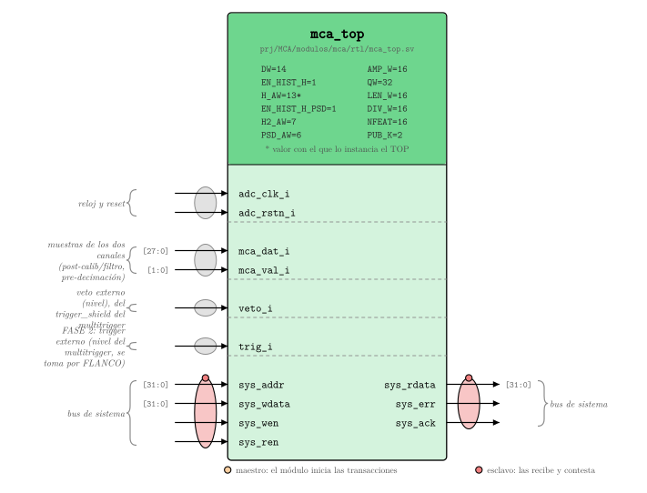
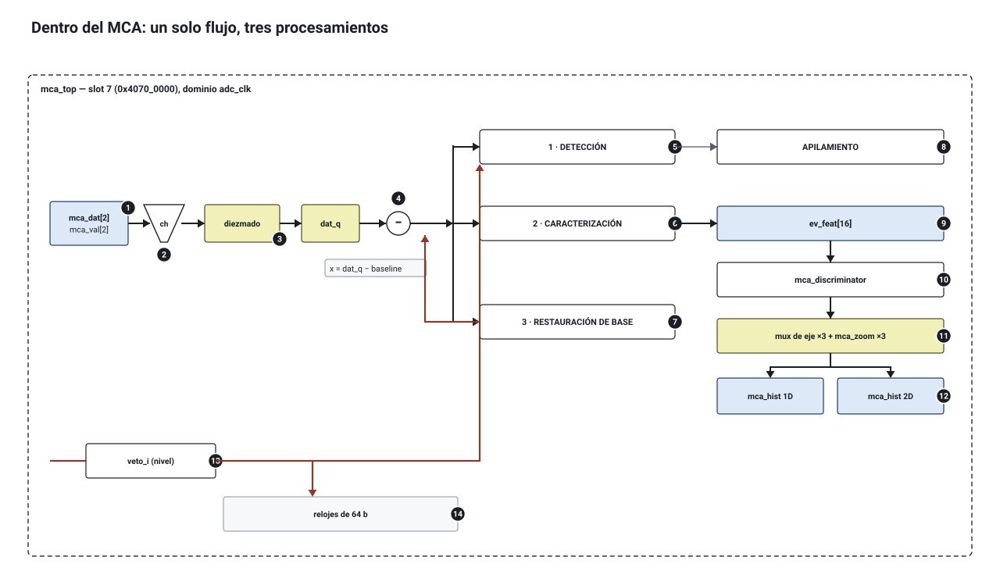
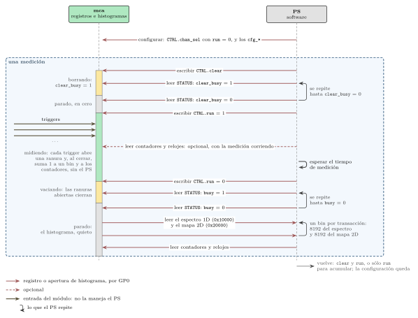
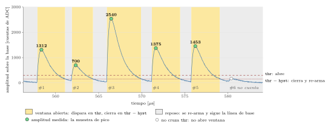
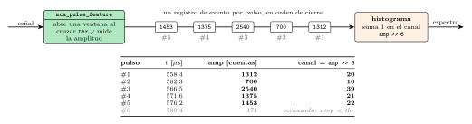
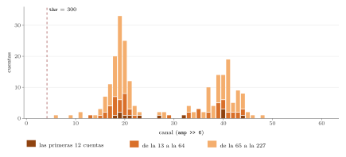

# Datasheet — `mca_top`

<!-- Generado por `modulos/mk/datasheet.py`. Lo que está entre las marcas
     AUTO:x y /AUTO:x se REESCRIBE en cada corrida: editar ahí no sirve.
     Todo el resto es prosa a mano y no se toca.
     La §1.1 «Qué hace» se escribe en prosa/mca_top.md.
     Regenerar:  make -C modulos/mca/work datasheet              -->

## 1. Función y funcionamiento

### 1.1 Descripción breve

<!-- AUTO:resumen -->
|  |  |
|---|---|
| Módulo RTL | `mca_top` |
| Archivo | [`mca_top.sv`](../../modulos/mca/rtl/mca_top.sv) |
| Parámetros | 13 |
| Puertos | 14 (11 in / 3 out) |
| MAGIC | `32'h4D434132` — `"MCA2"` |
| Parte | `xc7z010clg400-1` |




**Cabecera del RTL** (se copia tal cual de [`mca_top.sv`](../../modulos/mca/rtl/mca_top.sv)):

> mca_top — analizador multicanal: esclavo del bus de sistema (slot 7)
>
> Base 0x4070_0000. Todo en el dominio adc_clk; el cruce a fclk[0] lo hace
> sys_bus_cdc por slot, así que acá no hace falta CDC.
>
> ACK DE LATENCIA FIJA — es lo más importante de este módulo.
>
> Un esclavo que no hace ack NO produce sólo una lectura mala: deja el CDC del
> slot DESINCRONIZADO. En sys_bus_cdc.sv, reg_done sólo avanza con bus_m.ack,
> así que sin ack queda reg_do != reg_done para siempre, el strobe de lectura
> pegado en alto, y del lado controlador ctrl_do ya no puede togglear: ese slot
> no acepta más transacciones. Al ARM lo rescata el timeout de 32 ciclos de
> rtl/axi4_slave.sv:193, que fabrica un ack por su cuenta, pero la transacción
> devuelve un valor sin sentido y SIN indicación de error.
>
> El scope tiene ese bug latente: ata bram_ack[2]/[3] = 0 para los canales no
> construidos (rp_scope_mt_com.sv:572-573) y
> mt_rp_scope_cfg.sv:506-507 lo usa como ack de las aperturas 3 y 4.
>
> Acá el ack sale de un shift register incondicional: NO existe ninguna ruta de
> ack por motor, así que un motor apagado por parámetro no puede colgar el bus.
> Su apertura simplemente devuelve 0. Ver docs/TOP/bus_sistema_redpitaya.md §7.1.
>
> CONTADORES DE 64 BITS. Leer lo y después hi puede partirse: a 125 MHz el
> contador avanza entre las dos lecturas. Leer la palabra BAJA congela la
> ALTA en un registro sombra, que es lo que devuelve la dirección alta.
<!-- /AUTO:resumen -->

<!-- AUTO:prosa -->
<!-- Prosa a mano: se edita en prosa/mca_top.md, no aca. -->

**Qué hace.** Recibe el flujo de muestras de los dos canales y devuelve, por el
bus de sistema, el **espectro de alturas de pulso**: un histograma de 8192
canales donde cada cuenta es un evento detectado y clasificado. Todo el trabajo
—detectar el pulso, medirlo, decidir si se acepta e incrementar el canal— pasa
en la PL, a 125 MHz, sin que el PS intervenga por evento. Eso es lo que lo
distingue del camino del osciloscopio: lo que cruza a software no son muestras,
es el resultado.

#### Arquitectura interna



La idea que ordena el bloque: **hay un solo flujo de muestras y tres
procesamientos que lo consumen**, no tres cadenas con su conformado propio. Lo
que cambia entre las tres funciones es el procesamiento, no el filtro.

Como en las demás figuras del repo, el dibujo lleva sólo las marcas y los
nombres; el detalle de cada una está acá:

| # | Bloque | Qué hace |
|---|---|---|
| **1** | `mca_dat[2]` / `mca_val[2]` | Las muestras de los dos canales, desde el `dsp_tap_mux` del slot 6. El valid se honra de verdad: ver [`register_map_top.md`](../TOP/register_map_top.md) |
| **2** | Selector de canal | `cfg_chan`. Un solo canal alimenta la cadena de análisis |
| **3** | Diezmado propio | `cfg_dec`. Es **del MCA**, independiente del `rp_decim` de la cadena compartida |
| **4** | `x = dat_q − baseline` | **El flujo único.** Las tres ramas consumen este mismo `x`; el restador es el punto donde la línea de base se quita |
| **5** | 1 · Detección | Schmitt (`cfg_thr`, `cfg_hyst`) con rearmado, más la FSM de segmentación que abre y cierra la ventana. Modo 0 histéresis / modo 1 compuerta fija |
| **6** | 2 · Caracterización | Sobre `xc = máx(x, 0)`: `q_tot`, `q_tail`, pico (comparación estricta), `len`, `t_peak`, y los divisores `Q_cola/Q_tot` y `pico/Q_tot` |
| **7** | 3 · Restauración de base | Seguidor IIR `bl_acc += x − (bl_acc >> k)`, **congelado** durante el pulso y durante `cfg_bl_holdoff`. Es el único bloque que modifica el flujo que ven los otros dos — de ahí el lazo rojo |
| **8** | Apilamiento | **No es un bloque**: es una condición de cierre de la FSM (modo 0, cerró por `cfg_maxlen`; modo 1, segundo cruce dentro de la compuerta). Se cuenta en `cnt_pileup` y **no** se histogramea |
| **9** | `ev_feat[16]` | El registro único de evento: `0` pico · `1` integral · `2` Q_cola/Q_tot · `3` pico/Q_tot · `4` largo · `5` t_subida |
| **10** | `mca_discriminator` | Ventana [mín, máx] sobre **una** feature. Rechaza el evento entero. No mira muestras: mira features, con el pulso ya cerrado |
| **11** | Mux de eje ×3 + `mca_zoom` ×3 | `cfg_sel_*` elige qué feature va a cada eje; el zoom recorta y escala. Es la etapa de pipeline antes de la BRAM |
| **12** | `mca_hist` 1D y 2D | El espectro de 8192 canales y el mapa de 128 × 64 |
| **13** | `veto_i` (nivel) | Desde el `trigger_shield` del multitrigger. **No deja abrir** pulsos nuevos; el que está en curso termina normal |
| **14** | Relojes de 64 b | `realtime = livetime + deadtime + vetotime`. El veto gana sobre `busy`: su cola cuenta como tiempo vetado |

La **vida de un pulso** medida sobre la simulación, con los números de cada
etapa, está en [§1.7](#17-waveforms); el espectro que se acumula del otro lado,
en [`figuras/07_cadena.png`](../mca/figuras/07_cadena.png).
<!-- /AUTO:prosa -->

### 1.2 Interfaces

<!-- AUTO:interfaces -->
#### Parámetros

| Parámetro | Tipo | Default | Para qué |
|---|---|---|---|
| `DW` | `integer` | `14` |  |
| `EN_HIST_H` | `integer` | `1` |  |
| `H_AW` | `integer` | `14` → **`13`** (del TOP) | 16384 canales |
| `EN_HIST_H_PSD` | `integer` | `1` |  |
| `H2_AW` | `integer` | `7` | 128 bins de amplitud |
| `PSD_AW` | `integer` | `6` | 64 bins de forma |
| `AMP_W` | `integer` | `16` |  |
| `QW` | `integer` | `32` |  |
| `LEN_W` | `integer` | `16` |  |
| `DIV_W` | `integer` | `16` | bits de cociente de los divisores de forma |
| `NFEAT` | `integer` | `16` | ranuras del bus de features |
| `N_ACC` | `integer` | `4` → **`3`** (del TOP) |  |
| `N_FORMAS` | `integer` | `4` → **`3`** (del TOP) |  |


Los marcados **(del TOP)** son los valores con los que el diseño se construye de verdad (`GENERICS` del `work/Makefile`); los anchos de esta página están resueltos con ésos, no con los defaults del RTL.


#### Puertos

##### Reloj y reset

| Puerto | Dir | Bits | Dominio |
|---|---|---|---|
| `adc_clk_i` | in | 1 | — |
| `adc_rstn_i` | in | 1 | — |


##### Muestras de los dos canales (post-calib/filtro, pre-decimación)

| Puerto | Dir | Bits | Dominio |
|---|---|---|---|
| `mca_dat_i` | in | 28 `[2*DW-1:0]` | adc_clk_i |
| `mca_val_i` | in | 2 | adc_clk_i |


##### Veto externo (nivel), del trigger_shield del multitrigger

Mientras vale 1 no se abren pulsos, el pulso en curso termina normal y el reloj de tiempo vivo se detiene: el tiempo va a `vetotime`. Atar a 0 si el top no lo usa.

| Puerto | Dir | Bits | Dominio |
|---|---|---|---|
| `veto_i` | in | 1 | adc_clk_i |


##### Trigger externo: el UNICO que abre ventanas (se toma por FLANCO)

Viene del trigger_event del multitrigger, ya en adc_clk, asi que no hace falta CDC. Llega con la latencia del disparo por pendiente: la compensa la linea de retardo de muestras (cfg_pre_dly). Atado a 0, el MCA no abre nunca.

| Puerto | Dir | Bits | Dominio |
|---|---|---|---|
| `trig_i` | in | 1 | adc_clk_i |


##### Estado del disparo (nivel), del multitrigger

1 = algun canal del multitrigger puede disparar ya. Con 0 el disparo esta esperando re-armar (el Schmitt no bajo de thr - hyst), y un pulso que llegue no genera flanco: el MCA no lo ve, asi que lo unico medible es el TIEMPO, que va a t_rearm en vez de a livetime. Atar a 1 si el top no lo tiene (es el comportamiento de antes).

| Puerto | Dir | Bits | Dominio |
|---|---|---|---|
| `trig_arm_i` | in | 1 | adc_clk_i |


##### Bus de sistema

| Puerto | Dir | Bits | Dominio |
|---|---|---|---|
| `sys_addr` | in | 32 | adc_clk_i |
| `sys_wdata` | in | 32 | adc_clk_i |
| `sys_wen` | in | 1 | adc_clk_i |
| `sys_ren` | in | 1 | adc_clk_i |
| `sys_rdata` | out | 32 | adc_clk_i |
| `sys_err` | out | 1 | adc_clk_i |
| `sys_ack` | out | 1 | adc_clk_i |
<!-- /AUTO:interfaces -->

### 1.3 Mapa de registros

<!-- AUTO:regmap -->
`mca_top` es esclavo del bus de sistema (`sys_addr`, `sys_wdata`, `sys_wen`, `sys_ren`, `sys_rdata`, `sys_err`, `sys_ack`). El mapa completo está en:

- [`register_map_mca.md`](../mca/register_map_mca.md)

Contrato del bus: [`bus_sistema_redpitaya.md`](../TOP/bus_sistema_redpitaya.md) · Mapa de slots: [`register_map_top.md`](../TOP/register_map_top.md)
<!-- /AUTO:regmap -->

<!-- AUTO:secuencia -->
#### Secuencia de programación

**UNA MEDICIÓN, VISTA DESDE EL PS** ([fuente](../mca/figuras/secuencia/mca_secuencia.tex))



El contrato entre el PS y el MCA, en el orden en que lo hace `mca_read_acquire` de libmca. La configuración se escribe una vez y queda; cada medición es borrar, esperar el barrido, correr, parar, esperar que las ranuras publiquen y leer. La diferencia con el osciloscopio está en la franja verde: cada evento abre una ranura, se mide y se suma a un bin en la PL, sin el PS. El PS habla con el módulo al principio y al final de la medición, no por evento, y el tiempo muerto queda contado en los relojes (`t_win`, `t_div`). La configuración, en el orden de `mca_configure`, es `CTRL` (el canal, con `run` = 0: configurar para la medición), `cfg_baseline`, `cfg_bl_ctrl`, `cfg_amp_min`, `cfg_amp_max`, `cfg_amp_src`, `cfg_dec`, `cfg_gate_len`, `cfg_n_acc`, `cfg_pre_dly`, `cfg_trap_*` y las formas del banco, `cfg_hist_sel`, `cfg_zoom_*`, `cfg_discr_*` y `cfg_hist_ctrl`. Lo que pide cada paso: en la configuración, `cfg_hist_sel` va después de `cfg_amp_src`, porque escribir `cfg_amp_src` también lo mueve, y escribir `cfg_trap_km` o `cfg_trap_mq` reinicia el estado del trapecio, así que no se cambian con la medición corriendo. Un registro que no se escribe conserva lo que tenía: el valor de reset vale sólo después de cargar el bitstream. `CTRL.clear` es autolimpiante y borra histogramas, contadores y relojes. El barrido recorre los 2^`H_AW` bins (66 µs con 8192): durante ese lapso el bus sigue respondiendo, pero un evento que llegue con `run` = 1 se descarta y se cuenta en `cnt_dropped`; por eso libmca para antes de borrar. Los contadores y los relojes se pueden leer con la medición corriendo, que es lo que permite supervisar sin frenar. Al parar, las ranuras abiertas cierran y publican igual: hay que esperar `busy` = 0 antes de leer, o el espectro y los contadores pueden quedar desparejos. El espectro y el mapa se leen por las aperturas `0x10000` y `0x20000`, un bin `uint32` saturante por transacción; las aperturas son de 64 KB y el histograma ocupa menos, así que los offsets de más devuelven el mismo contenido. Sin `clear`, un `run` nuevo acumula sobre el histograma anterior. El trigger entra desde afuera: cómo configurar el multitrigger para el MCA está en [`register_map_mca.md`](../mca/register_map_mca.md#cómo-configurar-el-multitrigger-para-el-mca).
<!-- /AUTO:secuencia -->

### 1.4 Clock domains

<!-- AUTO:clocks -->
| Puerto | Qué es | Polaridad |
|---|---|---|
| `adc_clk_i` | reloj |  |
| `adc_rstn_i` | reset | activo-bajo |


**Un solo dominio.** Todos los puertos de datos y de control son síncronos a `adc_clk_i`: no hay cruce de dominio dentro de este módulo.
<!-- /AUTO:clocks -->

<!-- A mano: si hay más de un reloj, cuál es el cruce, con qué se sincroniza y
     qué se asume de la relación de frecuencias. Si hay uno solo, borrar. -->

### 1.5 Frecuencia máxima de trabajo

<!-- AUTO:timing -->
**Punto de síntesis** — Vivado out-of-context, `xc7z010clg400-1`.

| Métrica | Valor |
|---|---|
| Período de la restricción | 8.00 ns (125.0 MHz) |
| WNS | 0.037 ns |
| Camino crítico | 7.963 ns |
| **Fmax** | **125.6 MHz** |
| Niveles de lógica | 8 |


**Camino crítico**

|  |  |
|---|---|
| startpoint | `cfg_amp_max_reg[4]/C` |
| endpoint | `i_feat/i_win/max_q_reg[0]/S` |


**Recursos**

| LUT | FF | BRAM | DSP | CARRY | MUXF |
|---|---|---|---|---|---|
| 9418 | 6463 | 28 | 4 | 1226 | 206 |


`lut` cuenta **primitivas** LUT, no los _Slice LUTs_ del `report_utilization` (dos LUT5 que comparten O5/O6 ocupan un solo sitio).

_Barrido no corrido_: `make -C modulos/mca/work sweep-all` y regenerar.
<!-- /AUTO:timing -->

<!-- A mano: qué hay en el camino crítico y qué se haría para romperlo si
     hubiera que subir la frecuencia. -->

#### El número de arriba es out-of-context y NO es el que decide si el diseño cierra

La tabla automática sintetiza `mca_top` solo, con estimación de carga de cable.
El bitstream real mete el módulo en un diseño con el osciloscopio, el
multitrigger y el PS, y ahí el ruteo es otro. Los dos números del build completo
de `red_pitaya_vivado_Z10_mca.tcl`, post-route, medidos el 2026-10-22:

| build | WNS post-route | endpoints | camino crítico |
|---|---|---|---|
| HEAD, antes de las fases 1-2 | 0.050 ns | 26 416 | `i_scope/i_osc_cfg/...` (fuera del MCA) |
| con las fases 1 y 2 | **0.006 ns** | 29 332 | `i_mca/dat_q_reg[7]/C` → `i_mca/i_feat/q_tot_reg[14]/R` |

**Cumple, con 6 picosegundos.** Eso no es margen: es el ancho del redondeo.
Y el camino crítico del diseño entero **se mudó adentro del MCA**, que antes no
era el peor.

**La discrepancia con el OOC no es ruido, es estructural, y conviene entenderla
antes de confiar en el número automático.** El OOC dice que el peor camino es
`cfg_amp_max → max_q` y que las fases 1-2 no costaron nada; el build completo
dice que el peor camino es `dat_q → q_tot/R` y que se fue casi todo el margen.
Los dos tienen razón sobre lo que miden: OOC optimiza el módulo aislado y
estima el cable, y `q_tot/R` es un camino cuyo delay es **62 % ruteo**, que es
justo lo que el OOC no puede saber.

El camino, término por término, es este
([`mca_pulse_feature.sv:276`](../../modulos/mca/rtl/mca_pulse_feature.sv#L276),
[`:340-348`](../../modulos/mca/rtl/mca_pulse_feature.sv#L340-L348),
[`:402`](../../modulos/mca/rtl/mca_pulse_feature.sv#L402)):

```
dat_q  →  x = dat − baseline  →  disparo_int = (x >= thr_hi)
       →  disparo = src_int_en & disparo_int | src_ext_en & disparo_ext
       →  open_pulse = (st==S_IDLE) & cfg_run & !veto & armed & !pub_lleno & disparo
       →  mux de q_tot_d  →  q_tot[14]/R
```

El endpoint es el pin de *reset* porque al abrir `q_tot_d` carga
`{{(QW-DW){1'b0}}, xc}`: los bits altos van a cero, y el sintetizador los mapea
al reset síncrono del flop.

**Es exactamente el camino que la fase 2 tocó.** El plan de la fase 1 se había
puesto como condición no tocarlo —sus señales nuevas son funciones puras de
`st` y `armed` y ninguna realimenta `open_pulse`— y la cumplió. La fase 2 no
tenía esa salida: multiplexar la fuente de disparo es, por definición, meterse
en `open_pulse`. El mux quedó mitigado (`cfg_trig_src` se decodifica registrado
en `src_int_en`/`src_ext_en`, y `pub_lleno` con `K=2` es un bit de un flop),
pero son 9 niveles de lógica con 4.7 ns de ruteo y la mitigación no alcanza.

**Y hay un precedente que decide la cuestión, escrito en el propio RTL.**
[`:423`](../../modulos/mca/rtl/mca_pulse_feature.sv#L423) dice que la ventana de
amplitud *"ERA el camino critico de todo el bitstream (6 ps de slack en el
build, y -0.129 ns con mca_top aislado)"*. O sea: **este diseño ya estuvo en 6
ps una vez**, en un camino vecino del mismo ciclo de cierre, y el proyecto no lo
dejó así — de ahí salieron las sombras `d_min`/`d_max` y los umbrales
pre-desplazados de
[`:424-474`](../../modulos/mca/rtl/mca_pulse_feature.sv#L424-L474).

Eso aporta las dos mitades del juicio. Por un lado, 6 ps no es un valor que haga
fallar la placa: el diseño ya funcionó así. Por el otro, cuando este proyecto se
encontró en 6 ps **decidió que no era aceptable y refactorizó** — y el OOC
aislado de entonces marcaba −0.129 ns, exactamente el mismo patrón de hoy pero
al revés (OOC pesimista entonces, optimista ahora). La recomendación de abajo no
es una precaución inventada: es lo que el repo ya hizo la vez anterior.

**Si hubiera que recuperar slack, en orden de relación costo/beneficio:**

1. **Sacar `t_win` del hardware** y derivarlo en software como
   `deadtime − t_div`. Es exacto en modo bloqueante y está probado por
   assertion (`ap_deadtime_viejo_identidad`); libera un contador de 64 b y su
   sumador del dominio de `adc_clk`. No cambia ninguna semántica observable.
   Es el único de los tres que no toca el camino de decisión.
2. **Comparar contra el umbral desplazado, no contra la señal corregida.** Hoy
   la resta `dat − baseline` está **dentro** del camino, antes del comparador, y
   `thr_hi` es `cfg_thr_i` a secas. Comparando `dat >= thr_mas_bl` con
   `thr_mas_bl = cfg_thr_i + baseline` **registrado**, la resta sale del camino
   y queda sólo el comparador sobre la muestra. El costo es que el umbral llega
   un ciclo tarde cuando el seguidor mueve la base — irrelevante contra su
   constante de 2^`bl_k` muestras (4096 con `bl_k=12`), pero rompe la
   comparación ciclo a ciclo de `tb_mca_pulse_feature` en el ciclo exacto del
   cambio, así que hay que ajustar el TB y decidirlo a propósito.
3. **Registrar el término estático de la apertura.** `cfg_run`, `veto_i`,
   `src_*_en` y `pub_lleno` no dependen de la muestra de este ciclo; `st ==
   S_IDLE`, `armed` y el comparador sí. Un flop con el AND de los primeros deja
   la apertura en `habilitado && armed && disparo`. Es el más barato de
   escribir y el más fácil de arruinar: si se mete `armed` o `st` adentro del
   flop, la decisión corre un ciclo. `tb_mca_pulse_feature` lo detecta.

**Mientras no se haga nada de esto, el bitstream de las fases 1-2 es para
medir, no para dejar instalado.** Un re-place con otra semilla puede dar
negativo, y el reporte no avisa dos veces.

**Mientras no se haga nada de esto, el bitstream de las fases 1-2 es para
medir, no para dejar instalado.** Un re-place con otra semilla puede dar
negativo, y el reporte no avisa dos veces.

<!-- AUTO:transacciones -->
**LA CADENA DE UN EVENTO  -  senal, registro y espectro**


La transaccion del MCA es UN EVENTO, y la figura la sigue entera: (a) la senal de entrada con el umbral y la ventana que `pulse_feature` abre y cierra, (b) el camino de datos, donde entre los dos bloques no va una flecha pelada sino el tren de amplitudes concretas que viaja --un registro de evento por pulso--, y (c) el espectro que se acumula del otro lado, una cuenta por numero. Los numeros de los tres paneles son los mismos: la amplitud que se mide en (a) es la que viaja en (b) y la que cae en un canal en (c), con el mismo `amp >> h_shift` que hace el RTL. Es la unica figura del proyecto que muestra la cuenta completa de punta a punta.

_Origen: simulacion con semilla fija (`animacion_cadena_mca.py`), los mismos cuadros que los videos._

**(a) LA SENAL: UN PULSO POR EVENTO**



Las bandas parten el eje de TIEMPO en estados --ventana abierta, reposo-- y no la senal en eventos. La ventana abre al cruzar `thr` y cierra recien al bajar de `thr - hyst`, que es lo que hace que termine bastante despues del pico.

_Origen: la misma simulacion, panel (a) suelto, en TikZ (`figuras_cadena_tikz.py`)._

**(b) EL CAMINO DE DATOS: UN NUMERO POR PULSO**



`pulse_feature` emite un registro de evento por pulso y el histograma lo convierte en una cuenta. La tabla de abajo son los mismos pulsos como los ve el histograma, incluido el que no cruza el umbral y no produce nada.

_Origen: la misma simulacion, panel (b) suelto, en TikZ (`figuras_cadena_tikz.py`)._

**(c) EL ESPECTRO: UNA CUENTA POR NUMERO**



El espectro final en barras apiladas: cada capa es un tramo de la acumulacion (las primeras 12 cuentas, de la 13 a la 64 y de la 65 a la 227), asi que el borde de arriba de cada capa es el espectro en ese momento. La capa de abajo son cuentas sueltas; la forma de las dos lineas aparece recien cuando hay estadistica.

_Origen: la misma simulacion, panel (c) suelto, en TikZ (`figuras_cadena_tikz.py`)._

---

Las figuras **recalculan cada número al dibujar** en vez de tomarlo escrito.
<!-- /AUTO:transacciones -->

### 1.7 Waveforms

<!-- AUTO:ondas -->
**LA VIDA DE UN PULSO  -  cruce de umbral, ventana, carga acumulada y evento**


Es la figura central del modulo: todo lo que el MCA hace por evento pasa aca. La muestra cruza el umbral, `busy` sube y marca la ventana abierta, las dos cargas se acumulan mientras la ventana dura --q_tot sobre toda la ventana y q_tail desde la segunda muestra, que es lo que hace separable la forma del pulso-- y al cerrar sale `ev_valid` con la amplitud y el bus de features. El pulso es RECTANGULAR a proposito, igual que en el testbench: su ventana es inequivoca, asi que los numeros del epigrafe salen de una multiplicacion y no de reimplementar el DUT.

_Origen: `tb_mca_pulse_feature`, escena 1 (pulso rectangular)._

**APILAMIENTO  -  la ventana llega a maxlen: el pulso se cuenta pero NO se acepta**


El mismo bloque con `maxlen` chico y un pulso mas largo que eso. La ventana se cierra por limite y el evento cae en `cnt_pileup` sin pasar por `cnt_accepted`: no sale `ev_valid`. Lo que importa es que SI se cuenta en `cnt_total`. Un evento descartado que no se cuenta en ningun lado es tiempo muerto invisible, y sin ese numero no se puede corregir el espectro por eventos perdidos.

_Origen: `tb_mca_pulse_feature`, escena 5 (apilamiento)._

**READ-MODIFY-WRITE AL MISMO BIN  -  la cuenta no se pierde aunque los eventos lleguen pegados**


El histograma es una BRAM: incrementar un bin es leerlo, sumarle uno y escribirlo, y eso tarda varios ciclos. Si dos eventos consecutivos caen en el MISMO bin, el segundo leeria el valor viejo --el que todavia no se escribio-- y una de las dos cuentas se perderia. La figura muestra cuatro incrementos seguidos al mismo bin y la lectura posterior dando el total correcto: el bloque puentea la escritura en vuelo. Es el peor caso realista, porque un pico del espectro es justamente muchos eventos al mismo bin.

_Origen: `tb_mca_hist`, escena 3 (forwarding)._

**ACK DE LATENCIA FIJA  -  el barrido de borrado dura miles de ciclos y el bus no se entera**


Lo que la cabecera del RTL marca como lo mas importante del modulo. El barrido de borrado recorre 2^H_AW bins y dura miles de ciclos, muchisimo mas que los 32 ciclos de timeout del axi4_slave. Si el ack dependiera de que el motor este libre, una lectura durante el barrido no haria ack nunca, y eso no produce una lectura mala: deja el CDC del slot desincronizado para siempre --reg_do != reg_done-- y ese slot no acepta mas transacciones. El ack sale de un shift register incondicional, asi que llega con la misma latencia este barriendo o no, que es lo que la figura mide.

_Origen: `tb_mca_top`, escena 5 (lectura durante el borrado)._

---

Las figuras y sus epígrafes los escribe [`ondas_mca.py`](../mca/figuras/ondas/ondas_mca.py): los tiempos y las latencias se **miden sobre el VCD**, no se escriben a mano, así que no pueden desincronizarse del RTL. Los epígrafes completos, con los números, están en [`epigrafes.txt`](../mca/figuras/ondas/epigrafes.txt).

```bash
python3 docs/mca/figuras/ondas/ondas_mca.py    # regenerar
```
<!-- /AUTO:ondas -->

<!-- A mano: lo que las figuras no pueden mostrar solas. Para
     agregar una, editar docs/mca/figuras/ondas/ondas_mca.py:
     la onda sale de un VCD de los testbenches y los tiempos los
     mide el script, no se escriben acá.
       make -C modulos/mca/work wave TB=<tb>   # mirar en Questa
       make -C modulos/mca/work vcd  TB=<tb>   # VCD exportable -->

### 1.8 Verificación realizada

<!-- AUTO:verificacion -->
Todo corre en batch y se chequea el `RESULT: PASS` del testbench; las ondas quedan en `work/waves/<tb>.wlf`.

```bash
make -C modulos/mca/work            # los 8 testbenches
make -C modulos/mca/work cov        # + cobertura
make -C modulos/mca/work lint
```

| Testbench | DUT | Escenas | Casos | Contra qué compara | Es el de este módulo |
|---|---|---|---|---|---|
| [`tb_mca_div_restore`](../../modulos/mca/sim/tb_mca_div_restore.sv) | `mca_div_restore` | 6 | 22 | vectores a mano |  |
| [`tb_mca_hist`](../../modulos/mca/sim/tb_mca_hist.sv) | `mca_hist` | 8 | 31 | vectores a mano |  |
| [`tb_mca_zoom`](../../modulos/mca/sim/tb_mca_zoom.sv) | `mca_zoom` | 5 | 11 | vectores a mano |  |
| [`tb_mca_discriminator`](../../modulos/mca/sim/tb_mca_discriminator.sv) | `mca_discriminator` | 7 | 21 | vectores a mano |  |
| [`tb_mca_trap`](../../modulos/mca/sim/tb_mca_trap.sv) | `mca_trap` | — | — | vectores a mano |  |
| [`tb_mca_multi`](../../modulos/mca/sim/tb_mca_multi.sv) | `mca_multi` | — | — | vectores a mano |  |
| [`tb_mca_pulse_feature_evt`](../../modulos/mca/sim/tb_mca_pulse_feature_evt.sv) | `mca_pulse_feature_evt` | — | — | RTL de referencia `mca_pulse_feature_ref.v` instanciado al lado del DUT |  |
| [`tb_mca_top`](../../modulos/mca/sim/tb_mca_top.sv) | `mca_top` | 11 | 131 | vectores a mano | **sí** |


**216 casos con nombre** en 8 testbenches (37 escenas). La lista completa, caso por caso, está en el plan de verificación.

Las escenas de [`tb_mca_top`](../../modulos/mca/sim/tb_mca_top.sv): 1) Identificación, 2) Escritura y relectura de todos los registros RW, 3) BARRIDO DE ACK — la regresión importante, 4) El mismo barrido en el DUT B, con el motor 2D AU, 5) Lectura DURANTE el barrido de borrado, 6) CAMINO DE DATOS COMPLETO, 7) El borrado deja el espectro y los contadores en , 8) EL TESELADO DEL TIEMPO MUERTO, visto por el BUS,, 9) VARIAS RANURAS, por el bus, 10) EL TRAPECIO, 10) toma los pares que la forma 0 no puede medir lim.

**Assertions** — en `sim/sva/`, enganchadas por `bind` (no tocan el RTL sintetizable).

- [`mca_top_sva.sv`](../../modulos/mca/sim/sva/mca_top_sva.sv) — 74 propiedades

Plan de verificación, casos cubiertos y deuda: [`mca/sim/VERIFICACION.md`](../../modulos/mca/sim/VERIFICACION.md).
<!-- /AUTO:verificacion -->

#### Esquema de laboratorio

TODO — qué instrumento, cómo se conecta, qué se mide y contra qué se compara.
