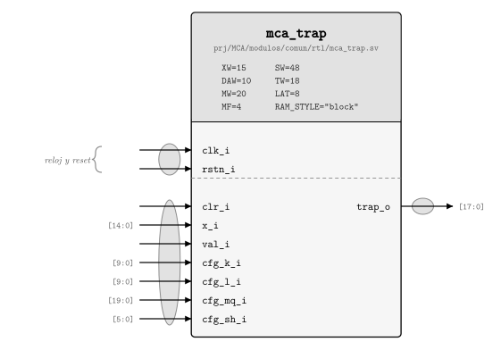

# Datasheet — `mca_trap`

<!-- Generado por `modulos/mk/datasheet.py`. Lo que está entre las marcas
     AUTO:x y /AUTO:x se REESCRIBE en cada corrida: editar ahí no sirve.
     Todo el resto es prosa a mano y no se toca.
     La §1.1 «Qué hace» se escribe en prosa/mca_trap.md.
     Regenerar:  make -C modulos/mca/work datasheet              -->

## 1. Función y funcionamiento

### 1.1 Descripción breve

<!-- AUTO:resumen -->
|  |  |
|---|---|
| Módulo RTL | `mca_trap` |
| Archivo | [`mca_trap.sv`](../../modulos/comun/rtl/mca_trap.sv) |
| Parámetros | 8 |
| Puertos | 10 (9 in / 1 out) |




**Cabecera del RTL** (se copia tal cual de [`mca_trap.sv`](../../modulos/comun/rtl/mca_trap.sv)):

> mca_trap — conformado trapezoidal de Jordanov-Knoll, en enteros EXACTOS
>
>     d[n] = v[n] - v[n-k] - v[n-l] + v[n-k-l]          l = k + m
>     p[n] = p[n-1] + d[n]
>     r[n] = p[n]*2^MF + Mq*d[n]                         Mq = M * 2^MF
>     s[n] = s[n-1] + r[n]
>
> Es estimadores.trapecio (software/API/modelo_rtl) multiplicado por 2^MF: con
> M = Mq/2^MF la cuenta en punto flotante es exacta mientras s < 2^53, asi que
> el modelo de Python es la referencia bit a bit.
>
> QUE HACE. Un pulso exponencial A*e^(-n/tau) sale como un trapecio de subida k,
> meseta m y bajada k, de altura 2^MF*A*k*(1+M), si M = 1/(e^(1/tau) - 1): el
> termino M*d cancela el polo de la cola (polo-cero). La salida VUELVE A CERO
> 2k+m muestras despues del pie, aunque la cola de la entrada dure mucho mas.
> Por eso dos pulsos separados k+m o mas tienen mesetas limpias aunque se pisen
> en la entrada: es la correccion de lo que las ranuras de mca_window solo
> marcan. Con M = 0 el trapecio es el de un impulso: el area del pulso.
>
> POR QUE ENTEROS EXACTOS, Y EL CLR. La forma recursiva es un FIR solo si el
> estado (p, s) es consistente con lo que hay en las lineas de retardo. Si no lo
> es —al salir del reset, al cambiar k, m o M— a p le queda un escalon
> PERMANENTE y s, que lo integra, deriva sin fin hasta desbordar. Por eso:
>   - nada se redondea: la recursion en enteros reproduce el FIR exacto;
>   - clr_i (lo pulsa mca_top al escribir k, m o M y con el clear del MCA)
>     pone a cero el estado, y hasta que cada linea se llena su salida cuenta
>     como CERO. Es la convencion v[<0] = 0 del modelo, aplicada desde el clr:
>     el contenido viejo de la BRAM no entra nunca a la cuenta.
>
> LAS LINEAS DE RETARDO VAN EN BRAM (tres RAMB18 de 1024 x XW): v por k, v por
> l, y v por l retrasada otra vez por k. Con SRL, 1024 muestras de profundidad
> variable serian ~700 LUT de memoria mas los multiplexores.
>
> LO COMPARTEN EL MCA Y EL MULTITRIGGER (por eso vive en comun/). El MCA lo usa
> para F_TRAP y el banco de formas, con lineas de 1024 en BRAM; mt_pz_trig lo
> usa como disparo (k = 2, m = 1), con lineas de 32 en LUT: RAM_STYLE elige.
>
> TODO AVANZA CON val_i. Cada etapa es un registro con habilitacion, y la BRAM
> sostiene su salida entre lecturas, asi que la latencia es de LAT MUESTRAS sea
> cual sea la decimacion: con la muestra n en la entrada, trap_o vale s[n-LAT].
> mca_window usa LAT para alinear la meseta con la ventana de cada ranura.
<!-- /AUTO:resumen -->

<!-- AUTO:prosa -->
<!-- Prosa a mano: se edita en prosa/mca_trap.md, no aca. -->

**Qué hace.** Conforma la muestra relativa a la base con el trapecio recursivo de
Jordanov y Knoll: una doble diferencia con retardos k y l = k + m, dos
integradores, y el término `M·d` que cancela el polo de la cola. Un pulso
exponencial sale como un trapecio de subida k, meseta m y bajada k, que **vuelve a
cero en 2k + m muestras** aunque la cola de la entrada dure mucho más. Es la
corrección de lo que las ranuras de `mca_window` solo marcan: dos pulsos
separados k + m o más tienen mesetas limpias aunque se pisen en la entrada. Hay
uno por forma del banco (`N_FORMAS`), común a todas las ranuras; cada ranura
promedia la salida de cada uno sobre su propia ventana, y la que se publica en
`F_TRAP` se elige al publicar. Vive en `modulos/comun/` porque también es el
trapecio del disparo con polo-cero del multitrigger
([`mt_pz_trig`](datasheet_mt_pz_trig.md)), con las líneas en LUT
(`RAM_STYLE = "distributed"`). Cómo elegir k, m, M y la ventana:
[`register_map_mca.md`](../mca/register_map_mca.md) §El conformado trapezoidal.

**Tres decisiones.**

- **Enteros exactos, y un `clr`.** La forma recursiva es un FIR solo si el estado
  es consistente con las líneas de retardo. Al cambiar la forma, `clr_i` pone el
  estado en cero y las líneas cuentan como vacías hasta llenarse (la convención
  `v[<0] = 0` del modelo de Python), así que la salida es exactamente
  `16 × estimadores.trapecio` desde el `clr`. Sin eso a `p` le quedaría un escalón
  permanente y `s` derivaría hasta desbordar.
- **Todo avanza por muestra válida.** Cada etapa es un registro con
  habilitación y la BRAM sostiene su salida entre lecturas: la latencia es de 8
  **muestras** sea cual sea la decimación, y `mca_window` la descuenta al ubicar
  la ventana de cada ranura.
- **Las líneas en BRAM y el polo-cero en un DSP48.** Tres RAMB18 de 1024 muestras
  en vez de ~700 LUT de SRL más sus multiplexores. Las comparaciones que dicen si
  una línea ya se llenó se hacen en la entrada y viajan como banderas: en la
  etapa de la doble diferencia costaban 0.2 ns de un camino que termina en el DSP.
<!-- /AUTO:prosa -->

### 1.2 Interfaces

<!-- AUTO:interfaces -->
#### Parámetros

| Parámetro | Tipo | Default | Para qué |
|---|---|---|---|
| `XW` | `integer` | `15` | muestra relativa a la base, con signo |
| `DAW` | `integer` | `10` | log2 de la profundidad de las lineas de retardo |
| `MW` | `integer` | `20` | bits de Mq, sin signo |
| `MF` | `integer` | `4` | ...de los cuales fraccionarios |
| `SW` | `integer` | `48` | acumulador s |
| `TW` | `integer` | `18` | salida, con signo y saturada |
| `LAT` | `integer` | `8` | latencia en muestras: NO se elige, se declara |
| `RAM_STYLE` |  | `"block"` | lineas en BRAM, o "distributed" (LUT) |


#### Puertos

##### Señales

| Puerto | Dir | Bits | Signo | Dominio | Descripción |
|---|---|---|---|---|---|
| `clk_i` | in | 1 |  | — |  |
| `rstn_i` | in | 1 |  | — |  |
| `clr_i` | in | 1 |  | clk_i | reinicia el estado (pulso) |
| `x_i` | in | 15 `[XW-1:0]` | signed | clk_i | muestra relativa a la base, registrada |
| `val_i` | in | 1 |  | clk_i |  |
| `cfg_k_i` | in | 10 `[DAW-1:0]` |  | clk_i | subida, 1 .. 2^DAW-1 |
| `cfg_l_i` | in | 10 `[DAW-1:0]` |  | clk_i | k + meseta, k .. 2^DAW-1 |
| `cfg_mq_i` | in | 20 `[MW-1:0]` |  | clk_i | constante polo-cero, M * 2^MF |
| `cfg_sh_i` | in | 6 |  | clk_i | corrimiento aritmetico de la salida |
| `trap_o` | out | 18 `[TW-1:0]` | signed | clk_i | s[n-LAT] >>> sh, saturada a TW bits |
<!-- /AUTO:interfaces -->

### 1.3 Mapa de registros

<!-- AUTO:regmap -->
No hay un mapa de registros para este módulo en `docs/comun/`. Si es un esclavo del bus de sistema, falta escribirlo; si no lo es, esta sección no aplica.
<!-- /AUTO:regmap -->

### 1.4 Clock domains

<!-- AUTO:clocks -->
| Puerto | Qué es | Polaridad |
|---|---|---|
| `clk_i` | reloj |  |
| `rstn_i` | reset | activo-bajo |


**Un solo dominio.** Todos los puertos de datos y de control son síncronos a `clk_i`: no hay cruce de dominio dentro de este módulo.
<!-- /AUTO:clocks -->

<!-- A mano: si hay más de un reloj, cuál es el cruce, con qué se sincroniza y
     qué se asume de la relación de frecuencias. Si hay uno solo, borrar. -->

### 1.5 Frecuencia máxima de trabajo

<!-- AUTO:timing -->
Sin datos de síntesis todavía. Correr:

```bash
make -C modulos/comun/work syn
make -C modulos/comun/work sweep-all
```

y volver a generar esta página.
<!-- /AUTO:timing -->

<!-- A mano: qué hay en el camino crítico y qué se haría para romperlo si
     hubiera que subir la frecuencia. -->

### 1.6 Transacciones

<!-- AUTO:transacciones -->
**LO QUE ENTRA: EL PULSO AL RITMO DEL ADC**


Que entra a la cadena. Una muestra por ciclo de adc_clk, 125 MSPS, continua: en este nodo el valid vale siempre 1, asi que no hay nada que un consumidor pueda esperar. Son las 160 muestras del flanco de un pulso real de la campana e2e, el mismo que usa la figura de event_ring --hay una sola copia del dato en el repo--.

_Origen: campaña e2e, `software/datos/e2e_20260528_013404/principal/chunk_000000.npz`, evento 1._

**UNA SOLA CADENA, CUATRO NODOS**


Que viaja. No hay una cadena por consumidor: hay UNA, y cuatro puntos utilizables sobre ella. Cada consumidor tiene su propio mux 4:1 y elige el suyo en runtime con los registros ROUTE_* de la region de TOP. El mux es COMBINACIONAL a proposito: registrarlo corrorria el dato un ciclo respecto de las senales de control que lo acompanan --adc_we y el write pointer del osciloscopio, la alineacion trigger-vs-captura del multitrigger-- y en modo nativo el hardware dejaria de ser identico al de antes del refactor, que es justo la propiedad que se quiso preservar.

_Origen: estructura de `dsp_tap_mux.sv` y del top._

**EL MISMO PULSO EN LOS CUATRO NODOS**


Que sale, y lo que importa no es solo el valor: es el RITMO. En A y B hay una muestra por ciclo y el valid es constante; en C y D sale una cada 8 ciclos y el dato viaja con estrobo --512 muestras contra 64, 8x menos--. Por eso la cabecera del RTL insiste en que el dato y su valid viajan JUNTOS: un consumidor que cambie de nodo sin arrastrar el valid leeria muestras repetidas o se saltearia muestras, segun el sentido del cambio. El diezmado es con promediado, o sea un promedio de bloque de 8 muestras: es el unico bloque de la cadena que cambia la FORMA del pulso, y lo paga en ritmo. D es C corrido 4 muestras diezmadas (32 ciclos). A y B salen IGUALES en el dibujo y eso no es que la calibracion no haga nada: es que esta captura ya paso por ella y el archivo no guarda los coeficientes, asi que re-aplicarlos seria inventarlos.

_Origen: el pulso medido, con el diezmado y el retardo aplicados._

**LA TRANSACCION COMPLETA**


Las tres preguntas en una imagen: que entra, que viaja y que sale.

_Origen: las tres anteriores, en una figura._

---

Las figuras **recalculan cada número al dibujar** en vez de tomarlo escrito. Las genera [`transacciones_comun.py`](../comun/figuras/transacciones/transacciones_comun.py); de dónde sale el dato de cada una está en la columna «Datos» de [`README.md`](../comun/figuras/transacciones/README.md); los epígrafes completos, en [`epigrafes.txt`](../comun/figuras/transacciones/epigrafes.txt).
<!-- /AUTO:transacciones -->

### 1.7 Waveforms

<!-- AUTO:ondas -->
_Sin figuras de ondas._ Se generan con un script en `docs/comun/figuras/ondas/`, que saca las ondas de un VCD de los testbenches del módulo; el patrón está en [`docs/figuras/ondas.py`](../figuras/ondas.py).
<!-- /AUTO:ondas -->

<!-- A mano: lo que las figuras no pueden mostrar solas. Para agregar una,
     editar docs/mca/figuras/ondas/ondas_mca.py: la onda
     sale de un VCD de los testbenches y los tiempos los mide el script.
       make -C modulos/mca/work wave TB=<tb>   # mirar en Questa
       make -C modulos/mca/work vcd  TB=<tb>   # VCD exportable -->

### 1.8 Verificación realizada

<!-- AUTO:verificacion -->
Todo corre en batch y se chequea el `RESULT: PASS` del testbench; las ondas quedan en `work/waves/<tb>.wlf`.

```bash
make -C modulos/comun/work            # el 1 testbench
make -C modulos/comun/work cov        # + cobertura
make -C modulos/comun/work lint
```

| Testbench | DUT | Escenas | Casos | Contra qué compara | Es el de este módulo |
|---|---|---|---|---|---|
| [`tb_integration_cfg`](../../modulos/comun/sim/tb_integration_cfg.sv) | `integration_cfg` | 7 | 36 | vectores a mano |  |


**36 casos con nombre** en 1 testbench (7 escenas). La lista completa, caso por caso, está en el plan de verificación.

> **`mca_trap` no tiene testbench propio.** Ningún `TBS` del `work/Makefile` lo instancia como DUT: lo que se verifica de este módulo es lo que arrastre el TB de otro. Es deuda de verificación, no una omisión de esta página.

**Assertions** — en `sim/sva/`, enganchadas por `bind` (no tocan el RTL sintetizable).

- [`bind_comun.sv`](../../modulos/comun/sim/sva/bind_comun.sv)
- [`integration_cfg_sva.sv`](../../modulos/comun/sim/sva/integration_cfg_sva.sv)

> **Los archivos de assertions están vacíos.** Son el scaffold de `create_module.py`: tienen el `bind`, el `default clocking` y un `// TODO:`, pero **ninguna propiedad**. O sea que hoy no aportan nada a la verificación; el enganche ya está hecho y lo que falta es escribirlas. Ver [`verificacion_formal.md`](../verificacion_formal.md), que discute cuáles convienen primero.

Plan de verificación, casos cubiertos y deuda: [`comun/sim/VERIFICACION.md`](../../modulos/comun/sim/VERIFICACION.md).
<!-- /AUTO:verificacion -->

#### Esquema de laboratorio

TODO — qué instrumento, cómo se conecta, qué se mide y contra qué se compara.
