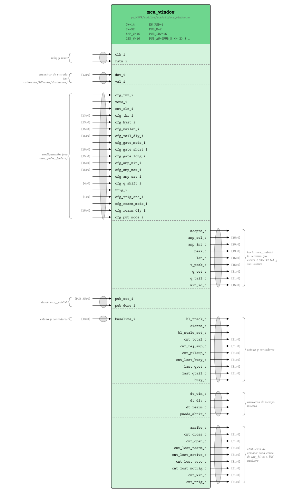
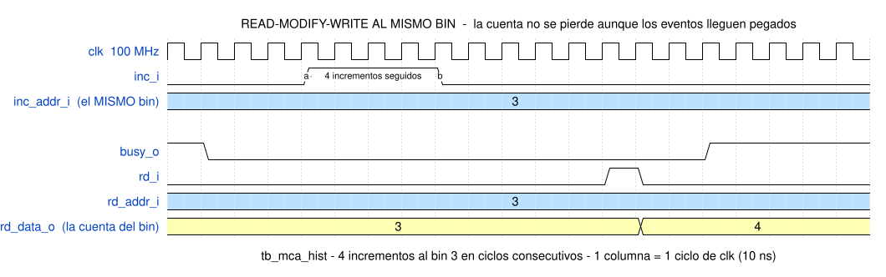

# Datasheet — `mca_window`

<!-- Generado por `modulos/mk/datasheet.py`. Lo que está entre las marcas
     AUTO:x y /AUTO:x se REESCRIBE en cada corrida: editar ahí no sirve.
     Todo el resto es prosa a mano y no se toca.
     La §1.1 «Qué hace» se escribe en prosa/mca_window.md.
     Regenerar:  make -C modulos/mca/work datasheet              -->

## 1. Función y funcionamiento

### 1.1 Descripción breve

<!-- AUTO:resumen -->
|  |  |
|---|---|
| Módulo RTL | `mca_window` |
| Archivo | [`mca_window.sv`](../../modulos/mca/rtl/mca_window.sv) |
| Parámetros | 16 |
| Puertos | 61 (24 in / 37 out) |
| Parte | `xc7z010clg400-1` |




**Cabecera del RTL** (se copia tal cual de [`mca_window.sv`](../../modulos/mca/rtl/mca_window.sv)):

> mca_window — el nucleo: la muestra relativa a la base, el disparo, el
> asignador de ranuras y la contabilidad del tiempo muerto
>
> QUIEN ABRE: solo el TRIGGER EXTERNO (trig_i, el trigger_event del
> multitrigger, con su disparo por pendiente). El Schmitt interno se saco: no
> puede ver un pulso montado sobre la cola de otro, porque la senal nunca baja
> del umbral entre los dos, y ver esos pulsos es para lo que estan las ranuras.
> La latencia del trigger la compensa la linea de retardo de mca_top
> (mca_delay): la muestra que llega aca ya esta retrasada, y la ventana abre en
> el pie del pulso.
>
> N_ACC RANURAS (mca_slot), cada una un juego entero de acumuladores. Un disparo
> abre la ranura libre de menor indice; si no hay, el pulso se pierde y se
> cuenta. Con cfg_n_acc = 1 es la arquitectura de una sola ventana con
> publicacion bloqueante; con mas, el modulo mide pulsos que se solapan, y la
> perdida pasa de ser de primer orden en la tasa (~rho) a ~rho^N/N!, el modelo
> M/D/N/N de Erlang. Lo que una ranura mide sobre otro pulso viene contaminado:
> no se corrige aca, se MARCA (ver mca_slot, "marcas de solape").
>
> QUIEN CIERRA: solo la compuerta fija, cfg_gate_long muestras desde el disparo,
> con la cola desde cfg_gate_short. La histeresis no tiene sentido con ventanas
> solapadas: el cruce de bajada es de la senal sumada y las cerraria juntas.
>
> LA MUESTRA SE REGISTRA ANTES DE REPARTIRSE. x = dat - base es el comienzo del
> camino de datos, y el sintetizador no aplana jerarquia: una frontera es
> gratis solo si lo que cruza sale de un registro. Por eso xc_q es un flop, y
> todo lo que el asignador decide para la muestra n (abrir, que ranura, las
> marcas) se registra junto con ella y llega a las ranuras en el mismo ciclo.
> Ese ciclo de latencia lo absorbe la linea de retardo.
>
> RESERVA. La ranura elegida para la muestra n recien pasa a ABIERTA en el
> flanco de n+1, asi que en el ciclo n+1 todavia figura libre. `reserva_q` la
> marca ocupada ese ciclo; sin eso un disparo en la muestra siguiente elegiria
> la misma ranura.
>
> EL BANCO DE TRAPECIOS: N_FORMAS mca_trap corren sobre la misma muestra
> registrada, CON signo, cada uno con su forma (k, l) y su escala (sh), y el M
> y el clr en comun. Su salida es comun a todas las ranuras: cada una la suma
> sobre su propia ventana, una por forma, y el publicador elige despues cual
> publica (ver mca_publish). Como el trapecio llega TRAP_LAT muestras tarde, la
> ventana que se le pasa a las ranuras ya esta corrida por esa latencia: el off
> de cada forma se cuenta en muestras del trapecio desde la apertura, como si
> no hubiera latencia.
<!-- /AUTO:resumen -->

<!-- AUTO:prosa -->
<!-- Prosa a mano: se edita en prosa/mca_window.md, no aca. -->

**Qué hace.** Es el núcleo del extractor: resta la base de la muestra, la
registra y la reparte a las `N_ACC` ranuras (`mca_slot`); toma el disparo
(`trig_i`, por flanco, sostenido hasta la muestra válida siguiente) y le asigna
la ranura libre de menor índice entre las `cfg_n_acc` habilitadas; y reparte cada
ciclo y cada disparo en los casilleros de tiempo muerto y de atribución. Es la
decisión **D8** de la [vista general](../mca/vista_general_mca.md), cuántas
ranuras miden a la vez.

**Por qué la muestra se registra antes de repartirse.** El sintetizador corre con
`-flatten_hierarchy none`, así que una frontera es gratis solo si lo que cruza
sale de un registro. `xc_q` es ese registro, y lo que el asignador decide para
cada muestra (abrir, qué ranura, las marcas de solape) viaja registrado con ella.
La ranura elegida queda **reservada** el ciclo siguiente, porque recién abre en
ese flanco: sin la reserva, un disparo en la muestra siguiente elegiría la misma.

**Por qué ya no hay Schmitt.** La ventana la abría un Schmitt interno, que no
puede ver un pulso montado sobre la cola de otro (la señal nunca baja del umbral
entre los dos), y esos son los pulsos para los que existen las ranuras. Abre
solo el disparo por pendiente del multitrigger; `mca_delay` compensa que llega
tarde.
<!-- /AUTO:prosa -->

### 1.2 Interfaces

<!-- AUTO:interfaces -->
#### Parámetros

| Parámetro | Tipo | Default | Para qué |
|---|---|---|---|
| `DW` | `integer` | `14` | ancho de muestra (con signo) |
| `QW` | `integer` | `32` | ancho de los acumuladores de carga |
| `AMP_W` | `integer` | `16` | ancho de la amplitud emitida |
| `LEN_W` | `integer` | `16` | ancho de los contadores de longitud |
| `N_ACC` | `integer` | `4` | ranuras de medicion |
| `PUB_IDW` | `integer` | `16` | bits del id de ventana |
| `NW` | `integer` | `4` | bits de la marca `otras` |
| `NA_W` | `integer` | `3` | bits de cfg_n_acc |
| `N_FORMAS` | `integer` | `4` | trapecios del banco; 0: sin trapecio (F_TRAP vale cero) |
| `TDAW` | `integer` | `10` | log2 de la profundidad de sus lineas de retardo |
| `TMW` | `integer` | `20` | bits de su constante polo-cero |
| `TW` | `integer` | `18` | salida del trapecio |
| `TNW` | `integer` | `8` | bits de la cuenta de la meseta |
| `OC_W` | `integer` | `$clog2(N_ACC + 1)` = `3` |  |
| `TSW` | `integer` | `TW + TNW - 1` = `25` |  |
| `NF` | `integer` | `(N_FORMAS < 1) ? 1 : N_FORMAS` | ancho de los puertos |


#### Puertos

##### Reloj y reset

| Puerto | Dir | Bits | Dominio |
|---|---|---|---|
| `clk_i` | in | 1 | — |
| `rstn_i` | in | 1 | — |


##### La muestra, ya retrasada por mca_delay

| Puerto | Dir | Bits | Signo | Dominio |
|---|---|---|---|---|
| `dat_i` | in | 14 `[DW-1:0]` | signed | clk_i |
| `val_i` | in | 1 |  | clk_i |


##### Configuracion

| Puerto | Dir | Bits | Dominio | Descripción |
|---|---|---|---|---|
| `cfg_run_i` | in | 1 | clk_i |  |
| `veto_i` | in | 1 | clk_i |  |
| `cnt_clr_i` | in | 1 | clk_i |  |
| `cfg_gate_short_i` | in | 16 `[LEN_W-1:0]` | clk_i |  |
| `cfg_gate_long_i` | in | 16 `[LEN_W-1:0]` | clk_i |  |
| `cfg_amp_min_i` | in | 16 `[AMP_W-1:0]` | clk_i |  |
| `cfg_amp_max_i` | in | 16 `[AMP_W-1:0]` | clk_i |  |
| `cfg_amp_src_i` | in | 1 | clk_i |  |
| `cfg_q_shift_i` | in | 5 | clk_i |  |
| `cfg_n_acc_i` | in | 3 `[NA_W-1:0]` | clk_i | ranuras habilitadas (0 = 1) |
| `trig_i` | in | 1 | clk_i |  |


##### El banco de trapecios: NF formas, aplanadas

| Puerto | Dir | Bits | Dominio | Descripción |
|---|---|---|---|---|
| `trap_clr_i` | in | 1 | clk_i | reinicia su estado (pulso) |
| `cfg_trap_k_i` | in | `[NF*TDAW-1:0]` | clk_i | subida, >= 1 |
| `cfg_trap_l_i` | in | `[NF*TDAW-1:0]` | clk_i | subida + meseta |
| `cfg_trap_mq_i` | in | 20 `[TMW-1:0]` | clk_i | polo-cero, M * 16 (comun) |
| `cfg_trap_sh_i` | in | `[NF*6-1:0]` | clk_i |  |
| `cfg_trap_off_i` | in | `[NF*LEN_W-1:0]` | clk_i | inicio de la ventana de la meseta |
| `cfg_trap_lw_i` | in | `[NF*3-1:0]` | clk_i | su largo: 2^lw muestras |


##### Linea de base (mca_baseline): entra registrada

| Puerto | Dir | Bits | Signo | Dominio | Descripción |
|---|---|---|---|---|---|
| `baseline_i` | in | 14 `[DW-1:0]` | signed | clk_i |  |
| `bl_track_o` | out | 1 |  | clk_i | ninguna ventana sobre esta muestra |
| `cierra_o` | out | 1 |  | clk_i | alguna ranura cierra: holdoff |
| `bl_stale_set_o` | out | 1 |  | clk_i | ventana vencida sin muestras |


##### Hacia mca_publish: las N ranuras, aplanadas

| Puerto | Dir | Bits | Dominio | Descripción |
|---|---|---|---|---|
| `acepta_o` | out | 4 `[N_ACC-1:0]` | clk_i | cierra aceptada en este ciclo |
| `amp_sel_o` | out | 64 `[N_ACC*AMP_W-1:0]` | clk_i |  |
| `amp_int_o` | out | 64 `[N_ACC*AMP_W-1:0]` | clk_i |  |
| `peak_o` | out | 56 `[N_ACC*DW-1:0]` | clk_i |  |
| `len_o` | out | 64 `[N_ACC*LEN_W-1:0]` | clk_i |  |
| `t_peak_o` | out | 64 `[N_ACC*LEN_W-1:0]` | clk_i |  |
| `q_tot_o` | out | 128 `[N_ACC*QW-1:0]` | clk_i |  |
| `q_tail_o` | out | 128 `[N_ACC*QW-1:0]` | clk_i |  |
| `win_id_o` | out | 64 `[N_ACC*PUB_IDW-1:0]` | clk_i |  |
| `dt_prev_o` | out | 64 `[N_ACC*LEN_W-1:0]` | clk_i |  |
| `dt_next_o` | out | 64 `[N_ACC*LEN_W-1:0]` | clk_i |  |
| `otras_o` | out | 16 `[N_ACC*NW-1:0]` | clk_i |  |
| `adentro_o` | out | 4 `[N_ACC-1:0]` | clk_i |  |
| `perdido_o` | out | 4 `[N_ACC-1:0]` | clk_i |  |
| `libera_i` | in | 4 `[N_ACC-1:0]` | clk_i | el publicador termino con estas |
| `trap_sum_o` | out | `[N_ACC*NF*TSW-1:0]` | clk_i | ranura k, forma f: (k*NF + f) |
| `trap_n_o` | out | `[N_ACC*NF*TNW-1:0]` | clk_i |  |


##### Contadores

| Puerto | Dir | Bits | Dominio | Descripción |
|---|---|---|---|---|
| `cnt_total_o` | out | 32 | clk_i | ventanas cerradas |
| `cnt_rej_amp_o` | out | 32 | clk_i | ...fuera de [min,max] |
| `cnt_pileup_o` | out | 32 | clk_i | ...con marca de solape |
| `last_qtot_o` | out | 32 `[QW-1:0]` | clk_i |  |
| `last_qtail_o` | out | 32 `[QW-1:0]` | clk_i |  |
| `busy_o` | out | 1 | clk_i | alguna ranura ocupada |


##### Casilleros de tiempo muerto

| Puerto | Dir | Bits | Dominio | Descripción |
|---|---|---|---|---|
| `dt_win_o` | out | 1 | clk_i | sin ranura libre, todas abiertas |
| `dt_div_o` | out | 1 | clk_i | sin ranura libre, alguna esperando publicar |
| `puede_abrir_o` | out | 1 | clk_i |  |
| `n_ocup_o` | out | 3 `[OC_W-1:0]` | clk_i | ranuras ocupadas ahora |


##### Atribucion de arribos: cada disparo va a UN casillero

| Puerto | Dir | Bits | Dominio | Descripción |
|---|---|---|---|---|
| `arribo_o` | out | 1 | clk_i | disparo en esta muestra, con run |
| `cnt_cross_o` | out | 32 | clk_i | todos los arribos |
| `cnt_open_o` | out | 32 | clk_i | ...que abrieron ranura |
| `cnt_lost_active_o` | out | 32 | clk_i | ...sin ranura libre, todas abiertas |
| `cnt_lost_busy_o` | out | 32 | clk_i | ...sin ranura libre, alguna esperando publicar |
| `cnt_lost_veto_o` | out | 32 | clk_i | ...bajo veto |
| `cnt_win_o` | out | 32 | clk_i | ventanas abiertas |
| `cnt_trig_o` | out | 32 | clk_i | flancos crudos de trig_i |
<!-- /AUTO:interfaces -->

### 1.3 Mapa de registros

<!-- AUTO:regmap -->
Mapas de registros de la región:

- [`register_map_mca.md`](../mca/register_map_mca.md)

Contrato del bus: [`bus_sistema_redpitaya.md`](../TOP/bus_sistema_redpitaya.md) · Mapa de slots: [`register_map_top.md`](../TOP/register_map_top.md)
<!-- /AUTO:regmap -->

### 1.4 Clock domains

<!-- AUTO:clocks -->
| Puerto | Qué es | Polaridad |
|---|---|---|
| `clk_i` | reloj |  |
| `rstn_i` | reset | activo-bajo |


**Un solo dominio.** Todos los puertos de datos y de control son síncronos a `clk_i`: no hay cruce de dominio dentro de este módulo.
<!-- /AUTO:clocks -->

<!-- A mano: si hay más de un reloj, cuál es el cruce, con qué se sincroniza y
     qué se asume de la relación de frecuencias. Si hay uno solo, borrar. -->

### 1.5 Frecuencia máxima de trabajo

<!-- AUTO:timing -->
El `metrics.txt` del módulo es de `mca_top`, no de `mca_window`: la síntesis OOC del módulo apunta a otro top, así que acá no hay números propios de este bloque.
<!-- /AUTO:timing -->

<!-- A mano: qué hay en el camino crítico y qué se haría para romperlo si
     hubiera que subir la frecuencia. -->

### 1.6 Transacciones

<!-- AUTO:transacciones -->
**LA CADENA DE UN EVENTO  -  senal, registro y espectro**


La transaccion del MCA es UN EVENTO, y la figura la sigue entera: (a) la senal de entrada con el umbral y la ventana que `pulse_feature` abre y cierra, (b) el camino de datos, donde entre los dos bloques no va una flecha pelada sino el tren de amplitudes concretas que viaja --un registro de evento por pulso--, y (c) el espectro que se acumula del otro lado, una cuenta por numero. Los numeros de los tres paneles son los mismos: la amplitud que se mide en (a) es la que viaja en (b) y la que cae en un canal en (c), con el mismo `amp >> h_shift` que hace el RTL. Es la unica figura del proyecto que muestra la cuenta completa de punta a punta.

_Origen: simulacion con semilla fija (`animacion_cadena_mca.py`), los mismos cuadros que los videos._

**(a) LA SENAL: UN PULSO POR EVENTO**


Las bandas parten el eje de TIEMPO en estados --ventana abierta, reposo-- y no la senal en eventos. La ventana abre al cruzar `thr` y cierra recien al bajar de `thr - hyst`, que es lo que hace que termine bastante despues del pico.

_Origen: la misma simulacion, panel (a) suelto._

**(b) EL CAMINO DE DATOS: UN NUMERO POR PULSO**


`pulse_feature` emite un registro de evento por pulso y el histograma lo convierte en una cuenta. La tabla de abajo son los mismos pulsos como los ve el histograma, incluido el que no cruza el umbral y no produce nada.

_Origen: la misma simulacion, panel (b) suelto._

**(c) EL ESPECTRO: UNA CUENTA POR NUMERO**


El mismo espectro en tres momentos de la acumulacion (12, 64 y 227 cuentas): la forma aparece recien cuando hay estadistica.

_Origen: la misma simulacion, panel (c) suelto._

---

Las figuras **recalculan cada número al dibujar** en vez de tomarlo escrito.
<!-- /AUTO:transacciones -->

### 1.7 Waveforms

<!-- AUTO:ondas -->
**LA VIDA DE UN PULSO  -  cruce de umbral, ventana, carga acumulada y evento**


Es la figura central del modulo: todo lo que el MCA hace por evento pasa aca. La muestra cruza el umbral, `busy` sube y marca la ventana abierta, las dos cargas se acumulan mientras la ventana dura --q_tot sobre toda la ventana y q_tail desde la segunda muestra, que es lo que hace separable la forma del pulso-- y al cerrar sale `ev_valid` con la amplitud y el bus de features. El pulso es RECTANGULAR a proposito, igual que en el testbench: su ventana es inequivoca, asi que los numeros del epigrafe salen de una multiplicacion y no de reimplementar el DUT.

_Origen: `tb_mca_pulse_feature`, escena 1 (pulso rectangular)._

**APILAMIENTO  -  la ventana llega a maxlen: el pulso se cuenta pero NO se acepta**


El mismo bloque con `maxlen` chico y un pulso mas largo que eso. La ventana se cierra por limite y el evento cae en `cnt_pileup` sin pasar por `cnt_accepted`: no sale `ev_valid`. Lo que importa es que SI se cuenta en `cnt_total`. Un evento descartado que no se cuenta en ningun lado es tiempo muerto invisible, y sin ese numero no se puede corregir el espectro por eventos perdidos.

_Origen: `tb_mca_pulse_feature`, escena 5 (apilamiento)._

**READ-MODIFY-WRITE AL MISMO BIN  -  la cuenta no se pierde aunque los eventos lleguen pegados**



El histograma es una BRAM: incrementar un bin es leerlo, sumarle uno y escribirlo, y eso tarda varios ciclos. Si dos eventos consecutivos caen en el MISMO bin, el segundo leeria el valor viejo --el que todavia no se escribio-- y una de las dos cuentas se perderia. La figura muestra cuatro incrementos seguidos al mismo bin y la lectura posterior dando el total correcto: el bloque puentea la escritura en vuelo. Es el peor caso realista, porque un pico del espectro es justamente muchos eventos al mismo bin.

_Origen: `tb_mca_hist`, escena 3 (forwarding)._

**ACK DE LATENCIA FIJA  -  el barrido de borrado dura miles de ciclos y el bus no se entera**


Lo que la cabecera del RTL marca como lo mas importante del modulo. El barrido de borrado recorre 2^H_AW bins y dura miles de ciclos, muchisimo mas que los 32 ciclos de timeout del axi4_slave. Si el ack dependiera de que el motor este libre, una lectura durante el barrido no haria ack nunca, y eso no produce una lectura mala: deja el CDC del slot desincronizado para siempre --reg_do != reg_done-- y ese slot no acepta mas transacciones. El ack sale de un shift register incondicional, asi que llega con la misma latencia este barriendo o no, que es lo que la figura mide.

_Origen: `tb_mca_top`, escena 5 (lectura durante el borrado)._

**FLUJO DE UNA MEDICION  -  mca_top**


Es un esquema de la SECUENCIA, no una medicion. La configuracion es una escalera: el bus del PS escribe un registro por vez, y la figura los pone en el orden en que los escribe Mca.configure(). Ese orden importa en un solo punto: cfg_hist_sel va DESPUES de cfg_amp_src, porque escribir cfg_amp_src tambien lo mueve. Un registro que no se escribe conserva lo que tenia (el valor de reset solo despues de cargar el bitstream; ver register_map_mca.md). Despues, las dos cosas que fija: el borrado hay que ESPERARLO --`clear_busy` avisa, y los eventos que llegan mientras barre se descartan y se cuentan en `dropped`--, y los contadores se pueden leer con la medicion corriendo, que es lo que permite supervisar sin frenar. La misma secuencia en software esta en docs/API/guia_de_uso.md; si las dos se contradicen, una de las dos esta mal.

_Origen: esquema (sin VCD)._

---

Las figuras y sus epígrafes los escribe [`ondas_mca.py`](../mca/figuras/ondas/ondas_mca.py): los tiempos y las latencias se **miden sobre el VCD**, no se escriben a mano, así que no pueden desincronizarse del RTL. Los epígrafes completos, con los números, están en [`epigrafes.txt`](../mca/figuras/ondas/epigrafes.txt).

```bash
python3 docs/mca/figuras/ondas/ondas_mca.py    # regenerar
```
<!-- /AUTO:ondas -->

<!-- A mano: lo que las figuras no pueden mostrar solas. Para agregar una,
     editar docs/mca/figuras/ondas/ondas_mca.py: la onda
     sale de un VCD de los testbenches y los tiempos los mide el script.
       make -C modulos/mca/work wave TB=<tb>   # mirar en Questa
       make -C modulos/mca/work vcd  TB=<tb>   # VCD exportable -->

### 1.8 Verificación realizada

<!-- AUTO:verificacion -->
Todo corre en batch y se chequea el `RESULT: PASS` del testbench; las ondas quedan en `work/waves/<tb>.wlf`.

```bash
make -C modulos/mca/work            # los 8 testbenches
make -C modulos/mca/work cov        # + cobertura
make -C modulos/mca/work lint
```

| Testbench | DUT | Escenas | Casos | Contra qué compara | Es el de este módulo |
|---|---|---|---|---|---|
| [`tb_mca_div_restore`](../../modulos/mca/sim/tb_mca_div_restore.sv) | `mca_div_restore` | 6 | 22 | vectores a mano |  |
| [`tb_mca_hist`](../../modulos/mca/sim/tb_mca_hist.sv) | `mca_hist` | 8 | 31 | vectores a mano |  |
| [`tb_mca_zoom`](../../modulos/mca/sim/tb_mca_zoom.sv) | `mca_zoom` | 5 | 11 | vectores a mano |  |
| [`tb_mca_discriminator`](../../modulos/mca/sim/tb_mca_discriminator.sv) | `mca_discriminator` | 7 | 21 | vectores a mano |  |
| [`tb_mca_trap`](../../modulos/mca/sim/tb_mca_trap.sv) | `mca_trap` | — | — | vectores a mano |  |
| [`tb_mca_multi`](../../modulos/mca/sim/tb_mca_multi.sv) | `mca_multi` | — | — | vectores a mano |  |
| [`tb_mca_pulse_feature_evt`](../../modulos/mca/sim/tb_mca_pulse_feature_evt.sv) | `mca_pulse_feature_evt` | — | — | RTL de referencia `mca_pulse_feature_ref.v` instanciado al lado del DUT |  |
| [`tb_mca_top`](../../modulos/mca/sim/tb_mca_top.sv) | `mca_top` | 11 | 121 | vectores a mano |  |


**206 casos con nombre** en 8 testbenches (37 escenas). La lista completa, caso por caso, está en el plan de verificación.

> **`mca_window` no tiene testbench propio.** Ningún `TBS` del `work/Makefile` lo instancia como DUT: lo que se verifica de este módulo es lo que arrastre el TB de otro. Es deuda de verificación, no una omisión de esta página.

**Assertions** — en `sim/sva/`, enganchadas por `bind` (no tocan el RTL sintetizable).

- [`mca_top_sva.sv`](../../modulos/mca/sim/sva/mca_top_sva.sv) — 68 propiedades

Plan de verificación, casos cubiertos y deuda: [`mca/sim/VERIFICACION.md`](../../modulos/mca/sim/VERIFICACION.md).
<!-- /AUTO:verificacion -->

#### Esquema de laboratorio

TODO — qué instrumento, cómo se conecta, qué se mide y contra qué se compara.
