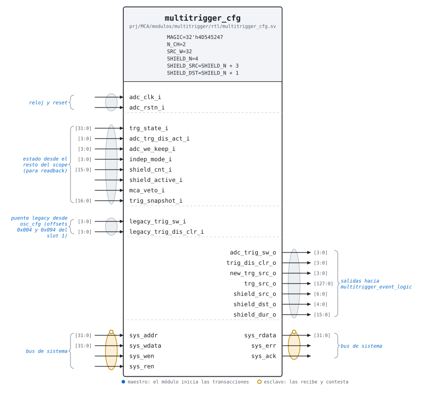

# Datasheet — `multitrigger_cfg`

<!-- Generado por `modulos/mk/datasheet.py`. Lo que está entre las marcas
     AUTO:x y /AUTO:x se REESCRIBE en cada corrida: editar ahí no sirve.
     Todo el resto es prosa a mano y no se toca.
     Regenerar:  make -C modulos/multitrigger/work datasheet              -->

## 1. Función y funcionamiento

### 1.1 Descripción breve

<!-- AUTO:resumen -->
|  |  |
|---|---|
| Módulo RTL | `multitrigger_cfg` |
| Archivo | [`multitrigger_cfg.sv`](../../modulos/multitrigger/rtl/multitrigger_cfg.sv) |
| Parámetros | 6 |
| Puertos | 26 (16 in / 10 out) |




**Cabecera del RTL** (se copia tal cual de [`multitrigger_cfg.sv`](../../modulos/multitrigger/rtl/multitrigger_cfg.sv)):

> multitrigger_cfg — región de MULTITRIGGER: esclavo del bus de sistema
>
> Base 0x4030_0000 (slot 3). Dominio adc_clk; el CDC lo hace el interconnect.
>
> Antes del refactor estos registros vivían dentro del casez de
> multitrigger_rp_scope_cfg (slot 1), mezclados con los del scope y colgados
> del mismo sys_ack que las aperturas BRAM — el mismo ack que tiene el bug
> latente de bram_ack[2]/[3] atado a cero. Al separarlos, el multitrigger deja
> de compartir esa ruta de ack.
>
> EQUIVALENCIA CON EL MAPA VIEJO (todo esto vivía en el slot 1):
>
>   0x210 -> 0x010   SHIELD_CFG
>   0x214 -> 0x014   SHIELD_STAT
>   0x218 -> 0x018   SNAPSHOT
>   0x21C -> 0x01C   DIS_FLAGS
>   0x240 -> 0x040   OR_MASK ch0   (+4 por canal)
>   0x004 -> 0x020   TRIG_SW       (estaba escondido en bits [3:0] del scope)
>   0x094 -> 0x024   TRIG_DIS_CLR  (era un offset "reservado", sin readback)
>
> Los dos últimos los conoce librp, así que además del registro propio se
> aceptan por el puente legacy (legacy_trig_sw_i / legacy_trig_dis_clr_i):
> osc_cfg sigue decodificando 0x004 y 0x094 en el slot 1 y manda acá el pulso
> ya decodificado por canal. Las dos vías se OR-ean.
>
> SEMÁNTICA PRESERVADA TAL CUAL, INCLUIDA UNA VERRUGA. sys_bus_cdc sostiene
> wen hasta el ack, así que los pulsos de abajo (adc_trig_sw, trig_dis_clr,
> new_trg_src) duran ~5 ciclos, no uno. Es el comportamiento que tenía el
> módulo original y del que depende la lógica aguas abajo; convertirlos en
> estrobos de un ciclo es un cambio deliberado y aparte, no algo que deba
> colarse en una mudanza de registros.
<!-- /AUTO:resumen -->

<!-- A mano: qué problema resuelve el bloque, cómo encaja en la cadena y las
     dos o tres decisiones de diseño que explican por qué está hecho así. -->

**Qué hace.** Es el esclavo de registros del multitrigger: la **máscara OR de
fuentes de disparo** por canal, el **escudo** que impide que un canal dispare
mientras otro está en su ventana de veto, y el estado de vuelta —qué fuente
disparó (`SNAPSHOT`) y qué canales quedaron deshabilitados (`DIS_FLAGS`)—.

Lo que resuelve es que el scope de fábrica tiene **una** fuente de trigger por
canal; acá hay 32 OR-eadas, y además canales que se vetan entre sí. Eso es lo
que permite que el MCA y el osciloscopio no se pisen: el veto que sale de
`trigger_shield` es la única señal que cruza de un consumidor a otro en todo el
top.

La decisión estructural: **estos registros vivían dentro del `casez` del slot 1**,
mezclados con los del scope y colgados del mismo `sys_ack` que las aperturas de
BRAM — el mismo ack que arrastra el bug latente de `bram_ack[2]`/`[3]` atados a
cero. Separarlos al slot 3 saca al multitrigger de esa ruta de ack.

Dos cosas que no son evidentes:

- **Hay un puente legacy, y es a propósito.** `librp` conoce dos de los offsets
  viejos (`0x004` SW-trigger y `0x094` `trig_dis_clr`), así que `osc_cfg` los
  sigue decodificando en el slot 1 y manda acá el pulso ya decodificado por
  canal. Las dos vías —el registro propio y el puente— se **OR-ean**. El resto
  de los offsets viejos (`0x210`–`0x21C`, `0x240`–`0x24C`) no los conoce nadie
  más que este proyecto, así que no hay compatibilidad que preservar: sólo hay
  que reapuntar `multitrigger_utils.py`.
- **Los pulsos duran ~5 ciclos, no uno.** `sys_bus_cdc` sostiene `wen` hasta el
  ack, así que `adc_trig_sw`, `trig_dis_clr` y `new_trg_src` salen anchos. Es la
  semántica que tenía el módulo original y de la que depende la lógica aguas
  abajo; convertirlos en estrobos de un ciclo es un cambio deliberado y aparte,
  no algo que deba colarse en una mudanza de registros.

El **disable queda enganchado**: después de un single-shot no entra otro disparo
hasta que el software escriba `TRIG_DIS_CLR`. Los cronogramas del veto y del
holdoff están en [§1.7](#17-waveforms); cuántos disparos se pierden de verdad en
el lazo completo, medido, en [§1.6](#16-transacciones).

### 1.2 Interfaces

<!-- AUTO:interfaces -->
#### Parámetros

| Parámetro | Tipo | Default | Para qué |
|---|---|---|---|
| `MAGIC` | `[31:0]` | `32'h4D545247` = `1297371719` | "MTRG" |
| `N_CH` | `integer` | `2` |  |
| `SRC_W` | `integer` | `32` |  |
| `SHIELD_N` | `integer` | `4` |  |
| `SHIELD_SRC` | `integer` | `SHIELD_N + 3` = `7` |  |
| `SHIELD_DST` | `integer` | `SHIELD_N + 1` = `5` |  |


#### Puertos

##### Reloj y reset

| Puerto | Dir | Bits | Dominio |
|---|---|---|---|
| `adc_clk_i` | in | 1 | — |
| `adc_rstn_i` | in | 1 | — |


##### Estado desde el resto del scope (para readback)

| Puerto | Dir | Bits | Dominio | Descripción |
|---|---|---|---|---|
| `trg_state_i` | in | 32 | adc_clk_i | máscara activa, 8 b por canal |
| `adc_trg_dis_act_i` | in | 4 | adc_clk_i |  |
| `adc_we_keep_i` | in | 4 | adc_clk_i |  |
| `indep_mode_i` | in | 4 | adc_clk_i |  |
| `shield_cnt_i` | in | 16 | adc_clk_i |  |
| `shield_active_i` | in | 1 | adc_clk_i |  |
| `mca_veto_i` | in | 1 | adc_clk_i | nivel de veto hacia el MCA |
| `trig_snapshot_i` | in | 17 | adc_clk_i |  |


##### Puente legacy desde osc_cfg (offsets 0x004 y 0x094 del slot 1)

| Puerto | Dir | Bits | Dominio |
|---|---|---|---|
| `legacy_trig_sw_i` | in | 4 | adc_clk_i |
| `legacy_trig_dis_clr_i` | in | 4 | adc_clk_i |


##### Salidas hacia multitrigger_event_logic

| Puerto | Dir | Bits | Dominio |
|---|---|---|---|
| `adc_trig_sw_o` | out | 4 | adc_clk_i |
| `trig_dis_clr_o` | out | 4 | adc_clk_i |
| `new_trg_src_o` | out | 4 | adc_clk_i |
| `trg_src_o` | out | 128 | adc_clk_i |
| `shield_src_o` | out | 7 `[SHIELD_SRC-1:0]` | adc_clk_i |
| `shield_dst_o` | out | 5 `[SHIELD_DST-1:0]` | adc_clk_i |
| `shield_dur_o` | out | 16 | adc_clk_i |


##### Bus de sistema

| Puerto | Dir | Bits | Dominio |
|---|---|---|---|
| `sys_addr` | in | 32 | adc_clk_i |
| `sys_wdata` | in | 32 | adc_clk_i |
| `sys_wen` | in | 1 | adc_clk_i |
| `sys_ren` | in | 1 | adc_clk_i |
| `sys_rdata` | out | 32 | adc_clk_i |
| `sys_err` | out | 1 | adc_clk_i |
| `sys_ack` | out | 1 | adc_clk_i |
<!-- /AUTO:interfaces -->

### 1.3 Mapa de registros

<!-- AUTO:regmap -->
`multitrigger_cfg` es esclavo del bus de sistema (`sys_addr`, `sys_wdata`, `sys_wen`, `sys_ren`, `sys_rdata`, `sys_err`, `sys_ack`). El mapa completo está en:

- [`register_map_multitrigger.md`](../multitrigger/register_map_multitrigger.md)
- [`register_map_multitrigger_rp_scope_cfg.md`](../multitrigger/register_map_multitrigger_rp_scope_cfg.md)

Contrato del bus: [`bus_sistema_redpitaya.md`](../TOP/bus_sistema_redpitaya.md) · Mapa de slots: [`register_map_top.md`](../TOP/register_map_top.md)
<!-- /AUTO:regmap -->

### 1.4 Clock domains

<!-- AUTO:clocks -->
| Puerto | Qué es | Polaridad |
|---|---|---|
| `adc_clk_i` | reloj |  |
| `adc_rstn_i` | reset | activo-bajo |


**Un solo dominio.** Todos los puertos de datos y de control son síncronos a `adc_clk_i`: no hay cruce de dominio dentro de este módulo.
<!-- /AUTO:clocks -->

<!-- A mano: si hay más de un reloj, cuál es el cruce, con qué se sincroniza y
     qué se asume de la relación de frecuencias. Si hay uno solo, borrar. -->

### 1.5 Frecuencia máxima de trabajo

<!-- AUTO:timing -->
Sin datos de síntesis todavía. Correr:

```bash
make -C modulos/multitrigger/work syn
make -C modulos/multitrigger/work sweep-all
```

y volver a generar esta página.
<!-- /AUTO:timing -->

<!-- A mano: qué hay en el camino crítico y qué se haría para romperlo si
     hubiera que subir la frecuencia. -->

### 1.6 Transacciones

<!-- AUTO:transacciones -->
**EL TREN DEL GENERADOR, Y CUAL SE CAPTURA**


Que entra al modulo. El generador entrega un pulso cada 500 us y todos cruzan el umbral: como candidatos son todos validos. Lo que decide cuales se capturan no es el escudo sino el lazo: una captura congela la ventana y el hardware no acepta otra hasta que el PS la leyo y re-armo. La banda naranja es ese tiempo muerto, y las cruces rojas son los pulsos que cayeron adentro. A esta tasa entra uno de cada 2.

_Origen: campaña e2e, barrido de tasa, 2000 Hz._

**EL CAMINO DE UN DISPARO**


Que viaja. Un candidato pasa por el enmascarado --32 fuentes OR-eadas en `trig_src`--, por el escudo --que lo veta si otro canal esta en su ventana de holdoff-- y recien ahi congela la ventana. Lo que NO se ve en un cronograma y si en esta figura es el lazo del final: la ventana no se libera sola, la libera el PS al leerla. Es un esquema de la estructura; los cronogramas ciclo a ciclo del veto y del holdoff estan en `docs/multitrigger/figuras/ondas/`.

_Origen: estructura de `multitrigger_trig_src.sv`, `trigger_shield.sv` y la captura._

**SE PIERDEN PERIODOS ENTEROS, NO UNA FRACCION**


Que sale, y por que. Para cada par de capturas consecutivas se calcula k = dt / T, cuantos periodos del generador pasaron. El histograma de abajo muestra que k es un ENTERO --la mediana de |dt/T - k| es 0.0310, o sea que las capturas caen sobre el tren del generador y no en cualquier lado--: el lazo no pierde una fraccion de los pulsos, pierde periodos completos, porque cuando termina de leer espera al proximo pulso. A 2000 Hz el 98 % de las capturas tienen k = 2; a 8000 Hz la distribucion se parte entre k = 5 y k = 6, que es lo que da el <k> = 5.46 no entero. De ahi sale la curva de arriba: la eficiencia es 1/<k>, y coincide con la que el barrido habia guardado por su cuenta con un error maximo de 0.0002. No es una curva ajustada, es el reciproco de un contador. Medido: 500 Hz: 99.4 %  1000 Hz: 97.8 %  2000 Hz: 49.1 %  4000 Hz: 32.5 %  8000 Hz: 18.3 %. OJO: este tiempo muerto es del lazo de lectura K=1 por GP0, no del escudo; es exactamente el cuello que el `event_ring` viene a sacar.

_Origen: campaña e2e, barrido de tasa (5 puntos)._

**LA TRANSACCION COMPLETA**


Las tres preguntas en una imagen: que entra, que viaja y que sale.

_Origen: las tres anteriores, en una figura._

---

Las figuras **recalculan cada número al dibujar** en vez de tomarlo escrito. Las genera [`transacciones_multitrigger.py`](../multitrigger/figuras/transacciones/transacciones_multitrigger.py); de dónde sale el dato de cada una está en la columna «Datos» de [`README.md`](../multitrigger/figuras/transacciones/README.md); los epígrafes completos, en [`epigrafes.txt`](../multitrigger/figuras/transacciones/epigrafes.txt).
<!-- /AUTO:transacciones -->

### 1.7 Waveforms

<!-- AUTO:ondas -->
**LAS TRES FORMAS DEL VETO AL MCA  -  nivel / nivel con cola / ventana por flanco**


El mismo bloque da tres vetos distintos segun como se lo configure, y la diferencia no esta en el RTL sino en que fuente se elige y que duracion se escribe. Con una fuente de NIVEL y dur=0 el veto es la linea con un ciclo de latencia: dura lo que dure la linea. Con la misma fuente y dur=8 el veto se extiende ocho ciclos despues de que la linea baje, que es lo que hace falta cuando el estimulo deja cola. Con una fuente de FLANCO y dur=12 el veto es una ventana fija de doce ciclos, sin importar cuanto dure el pulso. Los tres tramos vienen de escenas distintas del testbench y el hueco entre ellos dice que se salteo tiempo: no es una secuencia.

_Origen: `tb_trigger_shield`, escenas 4, 5 y 6._

**HOLDOFF Y RE-ARM  -  el escudo cuenta y al expirar limpia el canal de destino**


Lo que el escudo hace de verdad: cuando el canal fuente dispara, arranca un contador y mantiene `active` mientras cuenta; al expirar emite UN pulso de clear en el canal de destino, que es lo que lo vuelve a armar. Importa que el clear salga al EXPIRAR y no al disparar: si saliera al disparar, el canal de destino se re-armaria en medio del evento que el escudo esta tratando de protegerlo.

_Origen: `tb_trigger_shield`, escena 2._

**DISPARO SINGLE-SHOT  -  el flanco dispara, engancha el disable y la mascara se auto-limpia**


El flanco de la fuente habilitada dispara `adc_trig` y en el mismo movimiento engancha `adc_trg_dis`, que es lo que impide que el siguiente flanco vuelva a disparar. En modo single-shot la mascara se auto-limpia, asi que para volver a disparar hace falta reescribirla; en modo continuo la mascara persiste y basta con limpiar el disable. Esa es la unica diferencia entre los dos modos.

_Origen: `tb_multitrigger_trig_src`, escena 1._

**FLUJO DE UTILIZACION  -  multitrigger_cfg**


Es un esquema de la SECUENCIA, no una medicion. Lo que fija es el orden y una dependencia que no se ve en el mapa de registros: el disable queda ENGANCHADO despues del disparo, asi que sin escribir TRIG_DIS_CLR no hay segundo disparo. Un programa que configure, dispare y se quede esperando el proximo evento sin limpiar el disable espera para siempre.

_Origen: esquema (sin VCD)._

---

Las figuras y sus epígrafes los escribe [`ondas_multitrigger.py`](../multitrigger/figuras/ondas/ondas_multitrigger.py): los tiempos y las latencias se **miden sobre el VCD**, no se escriben a mano, así que no pueden desincronizarse del RTL. Los epígrafes completos, con los números, están en [`epigrafes.txt`](../multitrigger/figuras/ondas/epigrafes.txt).

```bash
python3 docs/multitrigger/figuras/ondas/ondas_multitrigger.py    # regenerar
```
<!-- /AUTO:ondas -->

<!-- A mano: lo que las figuras no pueden mostrar solas. Para
     agregar una, editar docs/multitrigger/figuras/ondas/ondas_multitrigger.py:
     la onda sale de un VCD de los testbenches y los tiempos los
     mide el script, no se escriben acá.
       make -C modulos/multitrigger/work wave TB=<tb>   # mirar en Questa
       make -C modulos/multitrigger/work vcd  TB=<tb>   # VCD exportable -->
orden en que la hace el software.

### 1.8 Verificación realizada

<!-- AUTO:verificacion -->
Todo corre en batch y se chequea el `RESULT: PASS` del testbench; las ondas quedan en `work/waves/<tb>.wlf`.

```bash
make -C modulos/multitrigger/work            # los 4 testbenches
make -C modulos/multitrigger/work cov        # + cobertura
make -C modulos/multitrigger/work lint
```

| Testbench | DUT | Escenas | Casos | Contra qué compara | Es el de este módulo |
|---|---|---|---|---|---|
| [`tb_multitrigger_cfg`](../../modulos/multitrigger/sim/tb_multitrigger_cfg.sv) | `multitrigger_cfg` | 11 | 30 | vectores a mano | **sí** |
| [`tb_multitrigger_trig_src`](../../modulos/multitrigger/sim/tb_multitrigger_trig_src.sv) | `multitrigger_trig_src` | 5 | 8 | vectores a mano |  |
| [`tb_multitrigger_event_logic`](../../modulos/multitrigger/sim/tb_multitrigger_event_logic.sv) | `multitrigger_event_logic` | 3 | 5 | vectores a mano |  |
| [`tb_trigger_shield`](../../modulos/multitrigger/sim/tb_trigger_shield.sv) | `trigger_shield` | 8 | 19 | vectores a mano |  |


**62 casos con nombre** en 4 testbenches (27 escenas). La lista completa, caso por caso, está en el plan de verificación.

Las escenas de [`tb_multitrigger_cfg`](../../modulos/multitrigger/sim/tb_multitrigger_cfg.sv): 1) CONTRATO DE BUS, 2) Los registros mudados conservan valor y layout d, 3) EL PUENTE LEGACY. librp escribe el SW-trigger en, 4) EL FAN-OUT POR indep_mode, 1) IDENTIFICACIÓN, 2) SHIELD, 3) SNAPSHOT y FLAGS (eran 0x218 y 0x21C), 4) MÁSCARAS OR, 5) SW-TRIGGER, 6) FAN-OUT POR indep_mode, 7) BARRIDO DE ACK.

**Assertions** — en `sim/sva/`, enganchadas por `bind` (no tocan el RTL sintetizable).

- [`bind_multitrigger.sv`](../../modulos/multitrigger/sim/sva/bind_multitrigger.sv)
- [`multitrigger_cfg_sva.sv`](../../modulos/multitrigger/sim/sva/multitrigger_cfg_sva.sv)

> **Los archivos de assertions están vacíos.** Son el scaffold de `create_module.py`: tienen el `bind`, el `default clocking` y un `// TODO:`, pero **ninguna propiedad**. O sea que hoy no aportan nada a la verificación; el enganche ya está hecho y lo que falta es escribirlas. Ver [`verificacion_formal.md`](../verificacion_formal.md), que discute cuáles convienen primero.

Plan de verificación, casos cubiertos y deuda: [`multitrigger/sim/VERIFICACION.md`](../../modulos/multitrigger/sim/VERIFICACION.md).
<!-- /AUTO:verificacion -->

#### Esquema de laboratorio

TODO — qué instrumento, cómo se conecta, qué se mide y contra qué se compara.
