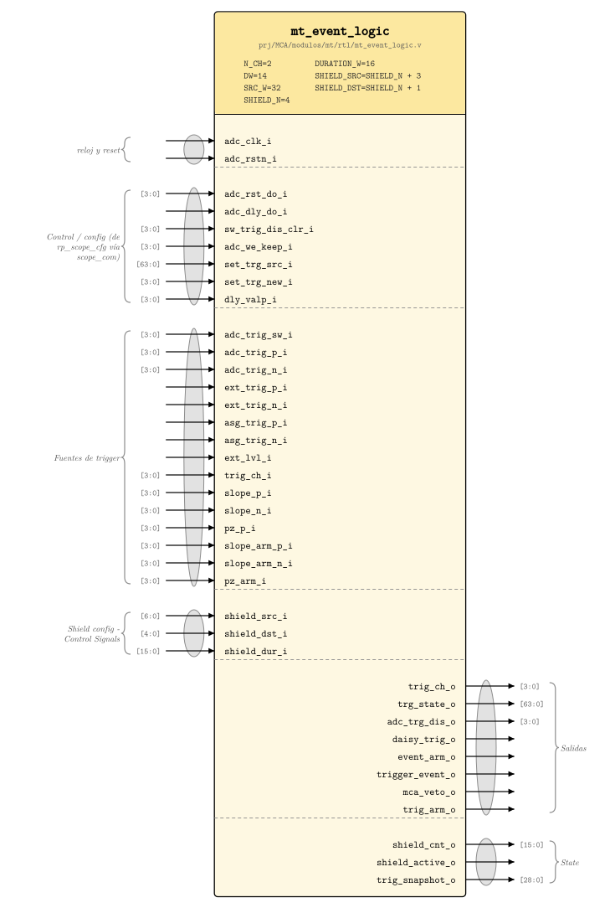
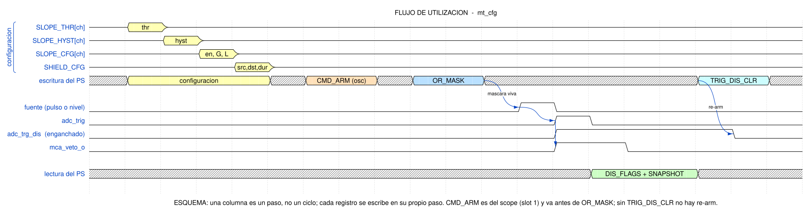

# Datasheet — `mt_event_logic`

<!-- Generado por `modulos/mk/datasheet.py`. Lo que está entre las marcas
     AUTO:x y /AUTO:x se REESCRIBE en cada corrida: editar ahí no sirve.
     Todo el resto es prosa a mano y no se toca.
     La §1.1 «Qué hace» se escribe en prosa/mt_event_logic.md.
     Regenerar:  make -C modulos/mt/work datasheet              -->

## 1. Función y funcionamiento

### 1.1 Descripción breve

<!-- AUTO:resumen -->
|  |  |
|---|---|
| Módulo RTL | `mt_event_logic` |
| Archivo | [`mt_event_logic.v`](../../modulos/mt/rtl/mt_event_logic.v) |
| Parámetros | 7 |
| Puertos | 33 (23 in / 10 out) |
| Parte | `xc7z010clg400-1` |




**Cabecera del RTL** (se copia tal cual de [`mt_event_logic.v`](../../modulos/mt/rtl/mt_event_logic.v)):

> Este módulo tiene la tarea de dar la salida de eventos.
> Une el trigger_shield (que afecta el disable de los mt_trig_src)
> con N_CH instancias de mt_trig_src y sus conexiones de cadena.
>
> Trabaja con N_CH canales: instancia un mt_trig_src por canal y
> produce un evento conjunto = OR de todas las salidas de trigger.
<!-- /AUTO:resumen -->

<!-- AUTO:prosa -->
<!-- Prosa a mano: se edita en prosa/mt_event_logic.md, no aca. -->

**Qué hace.** Es el **cableado del subsistema de disparo**: instancia un
[`mt_trig_src`](datasheet_mt_trig_src.md) por canal y un
[`trigger_shield`](datasheet_trigger_shield.md), los conecta entre sí, y
produce el **evento conjunto** que usan el buffer del scope y el anillo de
eventos. No tiene lógica propia de disparo: lo que aporta es la topología.


*Por dentro:* los `mt_trig_src`, el escudo, el OR que da `trigger_event`, el snapshot y la cadena. Fuente TikZ en [`panorama_mt_event_logic.tex`](../mt/figuras/panorama_mt_event_logic.tex).

Tres salidas que son la misma señal y una que no:

- `trigger_event_o`, `event_arm_o` y `daisy_trig_o` son **el mismo OR** de los
  triggers de todos los canales (los canales no usados se rellenan con cero).
  Están separadas porque cada una va a un consumidor distinto —captura, armado
  y cadena entre scopes—, no porque difieran.
- `trig_snapshot_o` es otra cosa: 17 bits **sticky** con las fuentes que
  estaban activas en el momento del último evento. Es lo que permite
  reconstruir *qué* disparó cada evento después del hecho, y es el campo
  `snapshot` que
  [`event_slot_writer`](datasheet_event_slot_writer.md) pone en la cabecera de
  cada slot del ring. Lo borran el reset, el `adc_rst_do` y el clear de
  software.

El detalle que hace que el snapshot sea correcto y no aproximado: `src_now` se
**retrasa un ciclo** antes de latchearlo, para alinearse con el pipeline de
`mt_trig_src` (`trig_comb` combinacional → `adc_trig` registrado →
`event_signal`). Sin ese retardo el snapshot guardaría las fuentes del ciclo
equivocado y mentiría justo en los eventos que importan, los de coincidencia.

El escudo recibe como fuentes los disparos por canal **más la entrada externa
cruda** (los dos flancos y el nivel): así se puede escudar o vetar desde afuera
sin gastar la máscara OR de un canal del scope en eso.

El camino completo desde el disparo hasta la captura, con los tiempos medidos,
está en [`mt_b_camino.png`](../mt/figuras/transacciones/mt_b_camino.png);
el orden en que hay que armar y disparar, en
[`orden_arm_trigger_captura.md`](../osc/orden_arm_trigger_captura.md).
<!-- /AUTO:prosa -->

### 1.2 Interfaces

<!-- AUTO:interfaces -->
#### Parámetros

| Parámetro | Tipo | Default | Para qué |
|---|---|---|---|
| `N_CH` | `integer` | `2` | Number of Channels |
| `DW` | `integer` | `14` | Data Width |
| `SRC_W` | `integer` | `32` | Ancho de la máscara de fuentes |
| `SHIELD_N` | `integer` | `4` | Canales del trigger_shield |
| `DURATION_W` | `integer` | `16` | Ancho del contador de holdoff |
| `SHIELD_SRC` | `integer` | `SHIELD_N + 3` = `7` |  |
| `SHIELD_DST` | `integer` | `SHIELD_N + 1` = `5` |  |


#### Puertos

##### ADC

| Puerto | Dir | Bits | Dominio | Descripción |
|---|---|---|---|---|
| `adc_clk_i` | in | 1 | — | ADC clock |
| `adc_rstn_i` | in | 1 | — | ADC reset - active low |


##### Control / config (de rp_scope_cfg vía scope_com)

| Puerto | Dir | Bits | Dominio | Descripción |
|---|---|---|---|---|
| `adc_rst_do_i` | in | 4 | adc_clk_i |  |
| `adc_dly_do_i` | in | 1 | adc_clk_i |  |
| `sw_trig_dis_clr_i` | in | 4 | adc_clk_i | clear de SW (reg 0x94) |
| `adc_we_keep_i` | in | 4 | adc_clk_i | modo continuo por canal (0x00 bit3) |
| `set_trg_src_i` | in | 64 `[N_CH*SRC_W-1: 0]` | adc_clk_i | máscara de fuentes por canal |
| `set_trg_new_i` | in | 4 | adc_clk_i |  |
| `dly_valp_i` | in | 4 | adc_clk_i |  |


##### Fuentes de trigger

| Puerto | Dir | Bits | Dominio | Descripción |
|---|---|---|---|---|
| `adc_trig_sw_i` | in | 4 | adc_clk_i |  |
| `adc_trig_p_i` | in | 4 | adc_clk_i |  |
| `adc_trig_n_i` | in | 4 | adc_clk_i |  |
| `ext_trig_p_i` | in | 1 | adc_clk_i |  |
| `ext_trig_n_i` | in | 1 | adc_clk_i |  |
| `asg_trig_p_i` | in | 1 | adc_clk_i |  |
| `asg_trig_n_i` | in | 1 | adc_clk_i |  |
| `ext_lvl_i` | in | 1 | adc_clk_i | NIVEL externo sincronizado (veto) |
| `trig_ch_i` | in | 4 | adc_clk_i | cadena desde el otro scope |
| `slope_p_i` | in | 4 | adc_clk_i | pendiente positiva por canal |
| `slope_n_i` | in | 4 | adc_clk_i | pendiente negativa por canal |


##### Shield config - Control Signals

| Puerto | Dir | Bits | Dominio |
|---|---|---|---|
| `shield_src_i` | in | 7 `[SHIELD_SRC-1: 0]` | adc_clk_i |
| `shield_dst_i` | in | 5 `[SHIELD_DST-1: 0]` | adc_clk_i |
| `shield_dur_i` | in | 16 `[DURATION_W-1: 0]` | adc_clk_i |


##### Salidas

| Puerto | Dir | Bits | Dominio | Descripción |
|---|---|---|---|---|
| `trig_ch_o` | out | 4 | adc_clk_i | cadena hacia el otro scope |
| `trg_state_o` | out | 64 `[N_CH*SRC_W-1: 0]` | adc_clk_i | máscara activa por canal (32 b/ch) |
| `adc_trg_dis_o` | out | 4 | adc_clk_i | bit de disable por canal (padded) |
| `daisy_trig_o` | out | 1 | adc_clk_i |  |
| `event_arm_o` | out | 1 | adc_clk_i |  |
| `trigger_event_o` | out | 1 | adc_clk_i | evento conjunto -> bram_sm/axi_sm |
| `mca_veto_o` | out | 1 | adc_clk_i | nivel: el MCA no abre pulsos |


##### State

| Puerto | Dir | Bits | Dominio | Descripción |
|---|---|---|---|---|
| `shield_cnt_o` | out | 16 `[DURATION_W-1: 0]` | adc_clk_i | contador del shield |
| `shield_active_o` | out | 1 | adc_clk_i | shield en holdoff |
| `trig_snapshot_o` | out | 25 | adc_clk_i | sticky: qué disparó el último evento |
<!-- /AUTO:interfaces -->

### 1.3 Mapa de registros

<!-- AUTO:regmap -->
Mapas de registros de la región:

- [`register_map_mt.md`](../mt/register_map_mt.md)

Contrato del bus: [`bus_sistema_redpitaya.md`](../TOP/bus_sistema_redpitaya.md) · Mapa de slots: [`register_map_top.md`](../TOP/register_map_top.md)
<!-- /AUTO:regmap -->

### 1.4 Clock domains

<!-- AUTO:clocks -->
| Puerto | Qué es | Polaridad | Notas |
|---|---|---|---|
| `adc_clk_i` | reloj |  | ADC clock |
| `adc_rstn_i` | reset | activo-bajo | ADC reset - active low |


**Un solo dominio.** Todos los puertos de datos y de control son síncronos a `adc_clk_i`: no hay cruce de dominio dentro de este módulo.
<!-- /AUTO:clocks -->

<!-- A mano: si hay más de un reloj, cuál es el cruce, con qué se sincroniza y
     qué se asume de la relación de frecuencias. Si hay uno solo, borrar. -->

### 1.5 Frecuencia máxima de trabajo

<!-- AUTO:timing -->
El `metrics.txt` del módulo es de `mt_slope_trig`, no de `mt_event_logic`: la síntesis OOC del módulo apunta a otro top, así que acá no hay números propios de este bloque.
<!-- /AUTO:timing -->

<!-- A mano: qué hay en el camino crítico y qué se haría para romperlo si
     hubiera que subir la frecuencia. -->

### 1.6 Transacciones

<!-- AUTO:transacciones -->
**EL TREN DEL GENERADOR, Y CUAL SE CAPTURA**


Que entra al modulo. El generador entrega un pulso cada 500 us y todos cruzan el umbral: como candidatos son todos validos. Lo que decide cuales se capturan no es el escudo sino el lazo: una captura congela la ventana y el hardware no acepta otra hasta que el PS la leyo y re-armo. La banda naranja es ese tiempo muerto, y las cruces rojas son los pulsos que cayeron adentro. A esta tasa entra uno de cada 2.

_Origen: campaña e2e, barrido de tasa, 2000 Hz._

**EL CAMINO DE UN DISPARO**


Que viaja. Un candidato pasa por el enmascarado --32 fuentes OR-eadas en `trig_src`--, por el escudo --que lo veta si otro canal esta en su ventana de holdoff-- y recien ahi congela la ventana. Lo que NO se ve en un cronograma y si en esta figura es el lazo del final: la ventana no se libera sola, la libera el PS al leerla. Es un esquema de la estructura; los cronogramas ciclo a ciclo del veto y del holdoff estan en `docs/mt/figuras/ondas/`.

_Origen: estructura de `mt_trig_src.sv`, `trigger_shield.sv` y la captura._

**SE PIERDEN PERIODOS ENTEROS, NO UNA FRACCION**


Que sale, y por que. Para cada par de capturas consecutivas se calcula k = dt / T, cuantos periodos del generador pasaron. El histograma de abajo muestra que k es un ENTERO --la mediana de |dt/T - k| es 0.0310, o sea que las capturas caen sobre el tren del generador y no en cualquier lado--: el lazo no pierde una fraccion de los pulsos, pierde periodos completos, porque cuando termina de leer espera al proximo pulso. A 2000 Hz el 98 % de las capturas tienen k = 2; a 8000 Hz la distribucion se parte entre k = 5 y k = 6, que es lo que da el <k> = 5.46 no entero. De ahi sale la curva de arriba: la eficiencia es 1/<k>, y coincide con la que el barrido habia guardado por su cuenta con un error maximo de 0.0002. No es una curva ajustada, es el reciproco de un contador. Medido: 500 Hz: 99.4 %  1000 Hz: 97.8 %  2000 Hz: 49.1 %  4000 Hz: 32.5 %  8000 Hz: 18.3 %. OJO: este tiempo muerto es del lazo de lectura K=1 por GP0, no del escudo; es exactamente el cuello que el `event_ring` viene a sacar.

_Origen: campaña e2e, barrido de tasa (5 puntos)._

**LA TRANSACCION COMPLETA**


Las tres preguntas en una imagen: que entra, que viaja y que sale.

_Origen: las tres anteriores, en una figura._

---

Las figuras **recalculan cada número al dibujar** en vez de tomarlo escrito. Las genera [`transacciones_mt.py`](../mt/figuras/transacciones/transacciones_mt.py); de dónde sale el dato de cada una está en la columna «Datos» de [`README.md`](../mt/figuras/transacciones/README.md); los epígrafes completos, en [`epigrafes.txt`](../mt/figuras/transacciones/epigrafes.txt).
<!-- /AUTO:transacciones -->

### 1.7 Waveforms

<!-- AUTO:ondas -->
**LAS TRES FORMAS DEL VETO AL MCA  -  nivel / nivel con cola / ventana por flanco**


El mismo bloque da tres vetos distintos segun como se lo configure, y la diferencia no esta en el RTL sino en que fuente se elige y que duracion se escribe. Con una fuente de NIVEL y dur=0 el veto es la linea con un ciclo de latencia: dura lo que dure la linea. Con la misma fuente y dur=8 el veto se extiende ocho ciclos despues de que la linea baje, que es lo que hace falta cuando el estimulo deja cola. Con una fuente de FLANCO y dur=12 el veto es una ventana fija de doce ciclos, sin importar cuanto dure el pulso. Los tres tramos vienen de escenas distintas del testbench y el hueco entre ellos dice que se salteo tiempo: no es una secuencia.

_Origen: `tb_trigger_shield`, escenas 4, 5 y 6._

**HOLDOFF Y RE-ARM  -  el escudo cuenta y al expirar limpia el canal de destino**


Lo que el escudo hace de verdad: cuando el canal fuente dispara, arranca un contador y mantiene `active` mientras cuenta; al expirar emite UN pulso de clear en el canal de destino, que es lo que lo vuelve a armar. Importa que el clear salga al EXPIRAR y no al disparar: si saliera al disparar, el canal de destino se re-armaria en medio del evento que el escudo esta tratando de protegerlo.

_Origen: `tb_trigger_shield`, escena 2._

**DISPARO SINGLE-SHOT  -  el flanco dispara, engancha el disable y la mascara se auto-limpia**


El flanco de la fuente habilitada dispara `adc_trig` y en el mismo movimiento engancha `adc_trg_dis`, que es lo que impide que el siguiente flanco vuelva a disparar. En modo single-shot la mascara se auto-limpia, asi que para volver a disparar hace falta reescribirla; en modo continuo la mascara persiste y basta con limpiar el disable. Esa es la unica diferencia entre los dos modos.

_Origen: `tb_mt_trig_src`, escena 1._

**FLUJO DE UTILIZACION  -  mt_cfg**



Es un esquema de la SECUENCIA, no una medicion. La configuracion es una escalera: el bus del PS escribe un registro por vez, en el orden de MtRegion.set_slope() --los umbrales antes que `en`, porque con en=1 y thr=hyst=0 el Schmitt no re-arma-- y despues el escudo. OR_MASK NO es parte de esa etapa: va DESPUES de CMD_ARM, porque la mascara vive apenas se escribe y un flanco previo al arm la gasta (single-shot) y deja la captura esperando un disparo imposible (ver docs/osc/orden_arm_trigger_captura.md). CMD_ARM no es un registro del multitrigger: arma la captura del scope (slot 1); aparece aca porque fija cuando se puede escribir la mascara. La otra dependencia que no se ve en el mapa de registros: el disable queda ENGANCHADO despues del disparo, asi que sin escribir TRIG_DIS_CLR no hay segundo disparo. Un programa que configure, dispare y se quede esperando el proximo evento sin limpiar el disable espera para siempre.

_Origen: esquema (sin VCD)._

---

Las figuras y sus epígrafes los escribe [`ondas_mt.py`](../mt/figuras/ondas/ondas_mt.py): los tiempos y las latencias se **miden sobre el VCD**, no se escriben a mano, así que no pueden desincronizarse del RTL. Los epígrafes completos, con los números, están en [`epigrafes.txt`](../mt/figuras/ondas/epigrafes.txt).

```bash
python3 docs/mt/figuras/ondas/ondas_mt.py    # regenerar
```
<!-- /AUTO:ondas -->

<!-- A mano: lo que las figuras no pueden mostrar solas. Para agregar una,
     editar docs/mt/figuras/ondas/ondas_mt.py: la onda
     sale de un VCD de los testbenches y los tiempos los mide el script.
       make -C modulos/mt/work wave TB=<tb>   # mirar en Questa
       make -C modulos/mt/work vcd  TB=<tb>   # VCD exportable -->

### 1.8 Verificación realizada

<!-- AUTO:verificacion -->
Todo corre en batch y se chequea el `RESULT: PASS` del testbench; las ondas quedan en `work/waves/<tb>.wlf`.

```bash
make -C modulos/mt/work            # los 6 testbenches
make -C modulos/mt/work cov        # + cobertura
make -C modulos/mt/work lint
```

| Testbench | DUT | Escenas | Casos | Contra qué compara | Es el de este módulo |
|---|---|---|---|---|---|
| [`tb_mt_cfg`](../../modulos/mt/sim/tb_mt_cfg.sv) | `mt_cfg` | 13 | 41 | vectores a mano |  |
| [`tb_mt_slope_trig`](../../modulos/mt/sim/tb_mt_slope_trig.sv) | `mt_slope_trig` | 8 | 15 | vectores a mano |  |
| [`tb_mt_trig_src`](../../modulos/mt/sim/tb_mt_trig_src.sv) | `mt_trig_src` | 6 | 12 | vectores a mano |  |
| [`tb_mt_event_logic`](../../modulos/mt/sim/tb_mt_event_logic.sv) | `mt_event_logic` | 5 | 9 | vectores a mano | **sí** |
| [`tb_trigger_shield`](../../modulos/mt/sim/tb_trigger_shield.sv) | `trigger_shield` | 8 | 19 | vectores a mano |  |
| [`tb_mt_top`](../../modulos/mt/sim/tb_mt_top.sv) | `mt_top` | 20 | 46 | vectores a mano |  |


**142 casos con nombre** en 6 testbenches (60 escenas). La lista completa, caso por caso, está en el plan de verificación.

Las escenas de [`tb_mt_event_logic`](../../modulos/mt/sim/tb_mt_event_logic.sv): 1) flanco ch0 -> evento conjunto + snapshot bit1 (a, 2) snapshot se resetea con sw_trig_dis_clr, 3) flanco en ch1 (adc_trig_p bit1) tambien dispara , 4) pendiente, 5) slope_n[1] (bit 22).

**Assertions** — en `sim/sva/`, enganchadas por `bind` (no tocan el RTL sintetizable).

- [`bind_mt.sv`](../../modulos/mt/sim/sva/bind_mt.sv)
- [`mt_cfg_sva.sv`](../../modulos/mt/sim/sva/mt_cfg_sva.sv)

> **Los archivos de assertions están vacíos.** Son el scaffold de `create_module.py`: tienen el `bind`, el `default clocking` y un `// TODO:`, pero **ninguna propiedad**. O sea que hoy no aportan nada a la verificación; el enganche ya está hecho y lo que falta es escribirlas. Ver [`verificacion_formal.md`](../verificacion_formal.md), que discute cuáles convienen primero.

Plan de verificación, casos cubiertos y deuda: [`mt/sim/VERIFICACION.md`](../../modulos/mt/sim/VERIFICACION.md).
<!-- /AUTO:verificacion -->

#### Esquema de laboratorio

TODO — qué instrumento, cómo se conecta, qué se mide y contra qué se compara.
