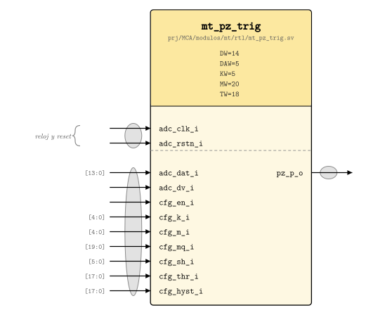
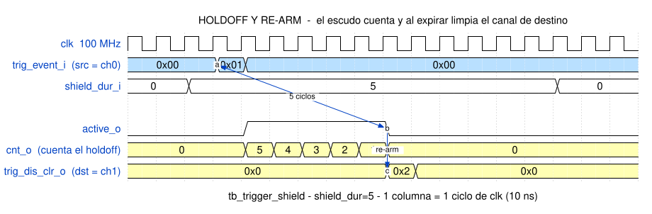
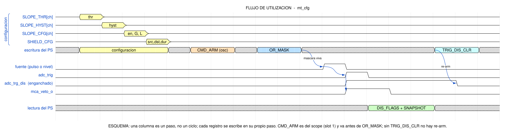

# Datasheet — `mt_pz_trig`

<!-- Generado por `modulos/mk/datasheet.py`. Lo que está entre las marcas
     AUTO:x y /AUTO:x se REESCRIBE en cada corrida: editar ahí no sirve.
     Todo el resto es prosa a mano y no se toca.
     La §1.1 «Qué hace» se escribe en prosa/mt_pz_trig.md.
     Regenerar:  make -C modulos/mt/work datasheet              -->

## 1. Función y funcionamiento

### 1.1 Descripción breve

<!-- AUTO:resumen -->
|  |  |
|---|---|
| Módulo RTL | `mt_pz_trig` |
| Archivo | [`mt_pz_trig.sv`](../../modulos/mt/rtl/mt_pz_trig.sv) |
| Parámetros | 5 |
| Puertos | 13 (11 in / 2 out) |
| Parte | `xc7z010clg400-1` |




**Cabecera del RTL** (se copia tal cual de [`mt_pz_trig.sv`](../../modulos/mt/rtl/mt_pz_trig.sv)):

> mt_pz_trig — disparo con POLO-CERO: un trapecio muy corto y un Schmitt
>
> Hermano de mt_slope_trig: misma entrada (el tap mtrg_dat/mtrg_val), mismo
> Schmitt con re-armado por histeresis, un pulso de 1 ciclo por cruce. Lo que
> cambia es QUE se compara contra el umbral: la salida de un trapecio de
> Jordanov-Knoll CON polo-cero (mca_trap, el mismo del MCA), de subida k y
> meseta m chicas (k = 2, m = 1 para el pulso del Rigol).
>
> POR QUE, Y NO LA PENDIENTE. La pendiente s = sum_L x - sum_L x[n-L-G] no
> cancela el polo de la cola, asi que la cola de un pulso grande le da s < 0
> durante cientos de muestras: un pulso chico encima no llega al umbral (con
> L = 8, G = 4, uno de 300 despues de uno de 8000 queda ciego hasta Dt ~ 150).
> Y como s sube durante L + G muestras, dos pulsos a menos de ~2L + G se funden
> en un solo disparo, y el cruce corre con la amplitud (7 a 13 ciclos entre
> A = 8000 y 100). Con el polo-cero la salida de cada pulso es un trapecio que
> VUELVE A CERO a las 2k + m muestras, sobre cero aunque haya una cola debajo:
> pares desde 7-8 muestras, sin ceguera, y el cruce corre 1 muestra. Ver
> docs/mca/pruebas_banco_trapecios.md, donde se valido con este mismo mca_trap.
>
> LA CONTINUA NO SE CANCELA DEL TODO. Para una entrada constante D la salida se
> asienta en 2^MF*D*k*l >> sh (la doble integral del pulso finito que deja la
> doble diferencia): con k = 2, m = 1 es ~1.2 % de lo que da un pulso de alto
> D. 500 cuentas de offset corren el umbral efectivo unas 6 cuentas. No hace
> falta restar la base, pero el umbral se elige sobre la muestra del tap.
>
> RE-ARRANQUE. El trapecio es exacto solo con su estado consistente con las
> lineas de retardo (ver mca_trap.sv), asi que un cambio de k, m o Mq, cfg_en =
> 0 o el reset le pulsan clr. La configuracion se registra dos veces y el
> re-arranque dura mientras la viva difiera de cualquiera de las dos copias,
> igual que en mt_slope_trig; el trapecio toma la segunda.
>
> ARRANQUE. Desde el clr el trapecio ve la continua del tap como un ESCALON:
> con 500 cuentas sube a ~3900 antes de asentarse. Por eso, hasta que entraron
> k + l + LAT + 2 muestras desde el re-arranque, el Schmitt queda "disparado"
> sin flanco, y despues tiene que re-armar (y < thr - hyst) antes del primer
> pulso, igual que tras un disparo.
>
> SCHMITT, solo positivo (el MCA mide pulsos positivos):
>   dispara con y >= thr, re-arma con y < thr - hyst
> thr y hyst son magnitudes en unidades de la salida del trapecio (la ganancia
> de un pulso es 2^MF*k*(1+M) >> sh por cuenta: el software convierte). Con
> hyst >= thr no re-arma nunca en y = 0: configuracion invalida.
>
> LATENCIA. La de mca_trap (LAT = 8 muestras) mas dos registros (el Schmitt y
> el flanco): 10 ciclos desde la muestra del cruce hasta pz_p_o, 5 mas que la
> pendiente. El MCA lo absorbe en cfg_pre_dly.
>
> Todo avanza con adc_dv_i, asi que funciona igual sobre el tap nativo
> (decimado) que sobre los de 125 MSPS. El Schmitt se evalua todos los ciclos:
> entre muestras la salida del trapecio se sostiene, y evaluar dos veces el
> mismo valor no cambia el estado.
<!-- /AUTO:resumen -->

<!-- AUTO:prosa -->
<!-- Prosa a mano: se edita en prosa/mt_pz_trig.md, no aca. -->

**Qué hace.** Es el **disparo con polo-cero de un canal**, el que usa el banco de
trapecios del MCA. Como [`mt_slope_trig`](datasheet_mt_slope_trig.md), toma
el tap del multitrigger, tiene un Schmitt y saca un pulso de un ciclo por cruce,
que entra a [`mt_trig_src`](datasheet_mt_trig_src.md) en los bits 25..28 de
la máscara. Lo que cambia es qué compara contra el umbral: la salida de un
trapecio corto **con** cancelación del polo de la cola
([`mca_trap`](datasheet_mca_trap.md), k = 2 y m = 1 para el Rigol). Cada pulso
sale como un trapecio que vuelve a cero a las 2k + m muestras, apoyado en cero
aunque haya una cola debajo. Por eso separa pares desde 7–8 muestras y ve un
pulso chico en la cola de uno grande, que es donde la pendiente queda ciega
(~20 y ~150 muestras). Por qué y con qué números:
[`disparo_polo_cero.md`](../mt/disparo_polo_cero.md).

**Tres decisiones.**

- **El mismo `mca_trap` del MCA, con las líneas en LUT.** Es la misma recursión
  entera, bit a bit, con `RAM_STYLE = "distributed"` y líneas de 32 muestras
  (k + m ≤ 31), así que no gasta BRAM. El software le escribe el mismo M que al
  MCA.
- **Re-arranque y arranque como la pendiente.** Un cambio de k, m o M, `en = 0`
  o el reset le pulsan `clr` al trapecio. Como el trapecio ve la continua del tap
  como un escalón, el Schmitt queda "disparado" hasta k + l + 12 muestras
  después, y el primer pulso pide re-armar.
- **No resta la base.** La continua se atenúa por l/(1 + M), unas 80 veces, así
  que con la base de la placa no se nota. Con más de ~+1880 cuentas de offset,
  el Schmitt de 50/25 ya no re-arma: es un límite documentado, no un error.
<!-- /AUTO:prosa -->

### 1.2 Interfaces

<!-- AUTO:interfaces -->
#### Parámetros

| Parámetro | Tipo | Default | Para qué |
|---|---|---|---|
| `DW` | `integer` | `14` | ancho de la muestra |
| `DAW` | `integer` | `5` | lineas de 2^DAW: k y k + m hasta 2^DAW - 1 |
| `KW` | `integer` | `5` | ancho de los campos k y m |
| `MW` | `integer` | `20` | bits de Mq (M * 16), sin signo |
| `TW` | `integer` | `18` | salida del trapecio, con signo; thr y hyst |


#### Puertos

##### Señales

| Puerto | Dir | Bits | Dominio | Descripción |
|---|---|---|---|---|
| `adc_clk_i` | in | 1 | — | ADC clock |
| `adc_rstn_i` | in | 1 | — | ADC reset - active low |
| `adc_dat_i` | in | 14 `[DW-1: 0]` | adc_clk_i | muestra (con signo) |
| `adc_dv_i` | in | 1 | adc_clk_i | muestra valida |
| `cfg_en_i` | in | 1 | adc_clk_i | 0 = trapecio vacio, sin pulsos |
| `cfg_k_i` | in | 5 `[KW-1: 0]` | adc_clk_i | subida (0 se toma como 1) |
| `cfg_m_i` | in | 5 `[KW-1: 0]` | adc_clk_i | meseta (k + m satura en 2^DAW - 1) |
| `cfg_mq_i` | in | 20 `[MW-1: 0]` | adc_clk_i | polo-cero: M * 16 |
| `cfg_sh_i` | in | 6 | adc_clk_i | corrimiento de la salida |
| `cfg_thr_i` | in | 18 `[TW-1: 0]` | adc_clk_i | umbral (magnitud) |
| `cfg_hyst_i` | in | 18 `[TW-1: 0]` | adc_clk_i | histeresis del re-armado |
| `pz_p_o` | out | 1 | adc_clk_i | pulso de 1 ciclo |
| `armado_o` | out | 1 | adc_clk_i | 1 = re-armado: el próximo cruce de thr dispara. Es el estado del Schmitt, sin registro extra; lo usa mt_event_logic para el tiempo de re-armado del MCA. Vale 0 mientras no hay trapecio (cfg_en = 0 o llenando). |
<!-- /AUTO:interfaces -->

### 1.3 Mapa de registros

<!-- AUTO:regmap -->
Mapas de registros de la región:

- [`register_map_mt.md`](../mt/register_map_mt.md)

Contrato del bus: [`bus_sistema_redpitaya.md`](../TOP/bus_sistema_redpitaya.md) · Mapa de slots: [`register_map_top.md`](../TOP/register_map_top.md)
<!-- /AUTO:regmap -->

### 1.4 Clock domains

<!-- AUTO:clocks -->
| Puerto | Qué es | Polaridad | Notas |
|---|---|---|---|
| `adc_clk_i` | reloj |  | ADC clock |
| `adc_rstn_i` | reset | activo-bajo | ADC reset - active low |


**Un solo dominio.** Todos los puertos de datos y de control son síncronos a `adc_clk_i`: no hay cruce de dominio dentro de este módulo.
<!-- /AUTO:clocks -->

<!-- A mano: si hay más de un reloj, cuál es el cruce, con qué se sincroniza y
     qué se asume de la relación de frecuencias. Si hay uno solo, borrar. -->

### 1.5 Frecuencia máxima de trabajo

<!-- AUTO:timing -->
El `metrics.txt` del módulo es de `mt_top`, no de `mt_pz_trig`: la síntesis OOC del módulo apunta a otro top, así que acá no hay números propios de este bloque.
<!-- /AUTO:timing -->

<!-- A mano: qué hay en el camino crítico y qué se haría para romperlo si
     hubiera que subir la frecuencia. -->

### 1.6 Transacciones

<!-- AUTO:transacciones -->
**EL TREN DEL GENERADOR, Y CUAL SE CAPTURA**


Que entra al modulo. El generador entrega un pulso cada 500 us y todos cruzan el umbral: como candidatos son todos validos. Lo que decide cuales se capturan no es el escudo sino el lazo: una captura congela la ventana y el hardware no acepta otra hasta que el PS la leyo y re-armo. La banda naranja es ese tiempo muerto, y las cruces rojas son los pulsos que cayeron adentro. A esta tasa entra uno de cada 2.

_Origen: campaña e2e, barrido de tasa, 2000 Hz._

**EL CAMINO DE UN DISPARO**


Que viaja. Un candidato pasa por el enmascarado --32 fuentes OR-eadas en `trig_src`--, por el escudo --que lo veta si otro canal esta en su ventana de holdoff-- y recien ahi congela la ventana. Lo que NO se ve en un cronograma y si en esta figura es el lazo del final: la ventana no se libera sola, la libera el PS al leerla. Es un esquema de la estructura; los cronogramas ciclo a ciclo del veto y del holdoff estan en `docs/mt/figuras/ondas/`.

_Origen: estructura de `mt_trig_src.sv`, `trigger_shield.sv` y la captura._

**SE PIERDEN PERIODOS ENTEROS, NO UNA FRACCION**


Que sale, y por que. Para cada par de capturas consecutivas se calcula k = dt / T, cuantos periodos del generador pasaron. El histograma de abajo muestra que k es un ENTERO --la mediana de |dt/T - k| es 0.0310, o sea que las capturas caen sobre el tren del generador y no en cualquier lado--: el lazo no pierde una fraccion de los pulsos, pierde periodos completos, porque cuando termina de leer espera al proximo pulso. A 2000 Hz el 98 % de las capturas tienen k = 2; a 8000 Hz la distribucion se parte entre k = 5 y k = 6, que es lo que da el <k> = 5.46 no entero. De ahi sale la curva de arriba: la eficiencia es 1/<k>, y coincide con la que el barrido habia guardado por su cuenta con un error maximo de 0.0002. No es una curva ajustada, es el reciproco de un contador. Medido: 500 Hz: 99.4 %  1000 Hz: 97.8 %  2000 Hz: 49.1 %  4000 Hz: 32.5 %  8000 Hz: 18.3 %. OJO: este tiempo muerto es del lazo de lectura K=1 por GP0, no del escudo; es exactamente el cuello que el `event_ring` viene a sacar.

_Origen: campaña e2e, barrido de tasa (5 puntos)._

**LA TRANSACCION COMPLETA**


Las tres preguntas en una imagen: que entra, que viaja y que sale.

_Origen: las tres anteriores, en una figura._

---

Las figuras **recalculan cada número al dibujar** en vez de tomarlo escrito. Las genera [`transacciones_mt.py`](../mt/figuras/transacciones/transacciones_mt.py); de dónde sale el dato de cada una está en la columna «Datos» de [`README.md`](../mt/figuras/transacciones/README.md); los epígrafes completos, en [`epigrafes.txt`](../mt/figuras/transacciones/epigrafes.txt).
<!-- /AUTO:transacciones -->

### 1.7 Waveforms

<!-- AUTO:ondas -->
**LAS TRES FORMAS DEL VETO AL MCA  -  nivel / nivel con cola / ventana por flanco**


El mismo bloque da tres vetos distintos segun como se lo configure, y la diferencia no esta en el RTL sino en que fuente se elige y que duracion se escribe. Con una fuente de NIVEL y dur=0 el veto es la linea con un ciclo de latencia: dura lo que dure la linea. Con la misma fuente y dur=8 el veto se extiende ocho ciclos despues de que la linea baje, que es lo que hace falta cuando el estimulo deja cola. Con una fuente de FLANCO y dur=12 el veto es una ventana fija de doce ciclos, sin importar cuanto dure el pulso. Los tres tramos vienen de escenas distintas del testbench y el hueco entre ellos dice que se salteo tiempo: no es una secuencia.

_Origen: `tb_trigger_shield`, escenas 4, 5 y 6._

**HOLDOFF Y RE-ARM  -  el escudo cuenta y al expirar limpia el canal de destino**



Lo que el escudo hace de verdad: cuando el canal fuente dispara, arranca un contador y mantiene `active` mientras cuenta; al expirar emite UN pulso de clear en el canal de destino, que es lo que lo vuelve a armar. Importa que el clear salga al EXPIRAR y no al disparar: si saliera al disparar, el canal de destino se re-armaria en medio del evento que el escudo esta tratando de protegerlo.

_Origen: `tb_trigger_shield`, escena 2._

**DISPARO SINGLE-SHOT  -  el flanco dispara, engancha el disable y la mascara se auto-limpia**


El flanco de la fuente habilitada dispara `adc_trig` y en el mismo movimiento engancha `adc_trg_dis`, que es lo que impide que el siguiente flanco vuelva a disparar. En modo single-shot la mascara se auto-limpia, asi que para volver a disparar hace falta reescribirla; en modo continuo la mascara persiste y basta con limpiar el disable. Esa es la unica diferencia entre los dos modos.

_Origen: `tb_mt_trig_src`, escena 1._

**FLUJO DE UTILIZACION  -  mt_cfg**



Es un esquema de la SECUENCIA, no una medicion. La configuracion es una escalera: el bus del PS escribe un registro por vez, en el orden de MtRegion.set_slope() --los umbrales antes que `en`, porque con en=1 y thr=hyst=0 el Schmitt no re-arma-- y despues el escudo. OR_MASK NO es parte de esa etapa: va DESPUES de CMD_ARM, porque la mascara vive apenas se escribe y un flanco previo al arm la gasta (single-shot) y deja la captura esperando un disparo imposible (ver docs/osc/orden_arm_trigger_captura.md). CMD_ARM no es un registro del multitrigger: arma la captura del scope (slot 1); aparece aca porque fija cuando se puede escribir la mascara. La otra dependencia que no se ve en el mapa de registros: el disable queda ENGANCHADO despues del disparo, asi que sin escribir TRIG_DIS_CLR no hay segundo disparo. Un programa que configure, dispare y se quede esperando el proximo evento sin limpiar el disable espera para siempre.

_Origen: esquema (sin VCD)._

---

Las figuras y sus epígrafes los escribe [`ondas_mt.py`](../mt/figuras/ondas/ondas_mt.py): los tiempos y las latencias se **miden sobre el VCD**, no se escriben a mano, así que no pueden desincronizarse del RTL. Los epígrafes completos, con los números, están en [`epigrafes.txt`](../mt/figuras/ondas/epigrafes.txt).

```bash
python3 docs/mt/figuras/ondas/ondas_mt.py    # regenerar
```
<!-- /AUTO:ondas -->

<!-- A mano: lo que las figuras no pueden mostrar solas. Para agregar una,
     editar docs/mt/figuras/ondas/ondas_mt.py: la onda
     sale de un VCD de los testbenches y los tiempos los mide el script.
       make -C modulos/mt/work wave TB=<tb>   # mirar en Questa
       make -C modulos/mt/work vcd  TB=<tb>   # VCD exportable -->

### 1.8 Verificación realizada

<!-- AUTO:verificacion -->
Todo corre en batch y se chequea el `RESULT: PASS` del testbench; las ondas quedan en `work/waves/<tb>.wlf`.

```bash
make -C modulos/mt/work            # los 7 testbenches
make -C modulos/mt/work cov        # + cobertura
make -C modulos/mt/work lint
```

| Testbench | DUT | Escenas | Casos | Contra qué compara | Es el de este módulo |
|---|---|---|---|---|---|
| [`tb_mt_cfg`](../../modulos/mt/sim/tb_mt_cfg.sv) | `mt_cfg` | 14 | 60 | vectores a mano |  |
| [`tb_mt_slope_trig`](../../modulos/mt/sim/tb_mt_slope_trig.sv) | `mt_slope_trig` | 8 | 17 | vectores a mano |  |
| [`tb_mt_pz_trig`](../../modulos/mt/sim/tb_mt_pz_trig.sv) | `mt_pz_trig` | 8 | 2 | vectores a mano | **sí** |
| [`tb_mt_trig_src`](../../modulos/mt/sim/tb_mt_trig_src.sv) | `mt_trig_src` | 8 | 21 | vectores a mano |  |
| [`tb_mt_event_logic`](../../modulos/mt/sim/tb_mt_event_logic.sv) | `mt_event_logic` | 9 | 19 | vectores a mano |  |
| [`tb_trigger_shield`](../../modulos/mt/sim/tb_trigger_shield.sv) | `trigger_shield` | 8 | 19 | vectores a mano |  |
| [`tb_mt_top`](../../modulos/mt/sim/tb_mt_top.sv) | `mt_top` | 20 | 55 | vectores a mano |  |


**193 casos con nombre** en 7 testbenches (75 escenas). La lista completa, caso por caso, está en el plan de verificación.

Las escenas de [`tb_mt_pz_trig`](../../modulos/mt/sim/tb_mt_pz_trig.sv): 1) EL TRAPECIO BIT A BIT. Un modelo entero de Jorda, 2) EL SCHMITT. Un Schmitt de referencia sobre la sa, 3) EL ARRANQUE. Desde el re-arranque tienen que pas, 4) LA DETECCION, con la medida de verdad, 5) PARES, con la subida de la cadena (10-90 % en 1., 3) Arranque con continua, 4) Deteccion sobre un tren de Poisson como el de la, 5) Pares.

**Assertions** — en `sim/sva/`, enganchadas por `bind` (no tocan el RTL sintetizable).

- [`bind_mt.sv`](../../modulos/mt/sim/sva/bind_mt.sv)
- [`mt_cfg_sva.sv`](../../modulos/mt/sim/sva/mt_cfg_sva.sv)

> **Los archivos de assertions están vacíos.** Son el scaffold de `create_module.py`: tienen el `bind`, el `default clocking` y un `// TODO:`, pero **ninguna propiedad**. O sea que hoy no aportan nada a la verificación; el enganche ya está hecho y lo que falta es escribirlas. Ver [`verificacion_formal.md`](../verificacion_formal.md), que discute cuáles convienen primero.

Plan de verificación, casos cubiertos y deuda: [`mt/sim/VERIFICACION.md`](../../modulos/mt/sim/VERIFICACION.md).
<!-- /AUTO:verificacion -->

#### Esquema de laboratorio

TODO — qué instrumento, cómo se conecta, qué se mide y contra qué se compara.
