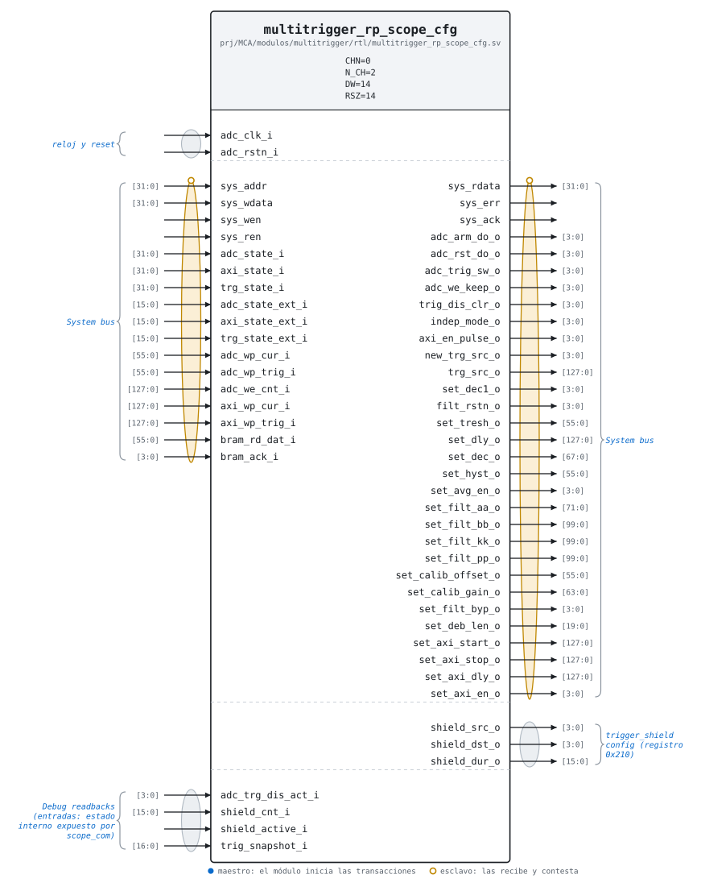

# Datasheet — `multitrigger_rp_scope_cfg`

<!-- Generado por `modulos/mk/datasheet.py`. Lo que está entre las marcas
     AUTO:x y /AUTO:x se REESCRIBE en cada corrida: editar ahí no sirve.
     Todo el resto es prosa a mano y no se toca.
     Regenerar:  make -C modulos/multitrigger/work datasheet              -->

## 1. Función y funcionamiento

### 1.1 Descripción breve

<!-- AUTO:resumen -->
|  |  |
|---|---|
| Módulo RTL | `multitrigger_rp_scope_cfg` |
| Archivo | [`multitrigger_rp_scope_cfg.sv`](../../modulos/multitrigger/rtl/multitrigger_rp_scope_cfg.sv) |
| Parámetros | 4 |
| Puertos | 57 (23 in / 34 out) |



<!-- /AUTO:resumen -->

<!-- A mano: qué problema resuelve el bloque, cómo encaja en la cadena y las
     dos o tres decisiones de diseño que explican por qué está hecho así. -->

**Qué hace.** TODO

### 1.2 Interfaces

<!-- AUTO:interfaces -->
#### Parámetros

| Parámetro | Default | Para qué |
|---|---|---|
| `CHN` | `0` |  |
| `N_CH` | `2` |  |
| `DW` | `14` |  |
| `RSZ` | `14` | RAM size 2^RSZ |


#### Puertos

##### ADC

| Puerto | Dir | Bits | Dominio | Descripción |
|---|---|---|---|---|
| `adc_clk_i` | in | 1 | — | ADC clock |
| `adc_rstn_i` | in | 1 | — | ADC reset - active low |


##### System bus

| Puerto | Dir | Bits | Dominio |
|---|---|---|---|
| `sys_addr` | in | 32 | adc_clk_i |
| `sys_wdata` | in | 32 | adc_clk_i |
| `sys_wen` | in | 1 | adc_clk_i |
| `sys_ren` | in | 1 | adc_clk_i |
| `sys_rdata` | out | 32 | adc_clk_i |
| `sys_err` | out | 1 | adc_clk_i |
| `sys_ack` | out | 1 | adc_clk_i |
| `adc_state_i` | in | 32 | adc_clk_i |
| `axi_state_i` | in | 32 | adc_clk_i |
| `trg_state_i` | in | 32 | adc_clk_i |
| `adc_state_ext_i` | in | 16 | adc_clk_i |
| `axi_state_ext_i` | in | 16 | adc_clk_i |
| `trg_state_ext_i` | in | 16 | adc_clk_i |
| `adc_wp_cur_i` | in | 56 `[4*RSZ-1: 0]` | adc_clk_i |
| `adc_wp_trig_i` | in | 56 `[4*RSZ-1: 0]` | adc_clk_i |
| `adc_we_cnt_i` | in | 128 | adc_clk_i |
| `axi_wp_cur_i` | in | 128 | adc_clk_i |
| `axi_wp_trig_i` | in | 128 | adc_clk_i |
| `bram_rd_dat_i` | in | 56 `[4*DW -1: 0]` | adc_clk_i |
| `bram_ack_i` | in | 4 | adc_clk_i |
| `adc_arm_do_o` | out | 4 | adc_clk_i |
| `adc_rst_do_o` | out | 4 | adc_clk_i |
| `adc_trig_sw_o` | out | 4 | adc_clk_i |
| `adc_we_keep_o` | out | 4 | adc_clk_i |
| `trig_dis_clr_o` | out | 4 | adc_clk_i |
| `indep_mode_o` | out | 4 | adc_clk_i |
| `axi_en_pulse_o` | out | 4 | adc_clk_i |
| `new_trg_src_o` | out | 4 | adc_clk_i |
| `trg_src_o` | out | 128 | adc_clk_i |
| `set_dec1_o` | out | 4 | adc_clk_i |
| `filt_rstn_o` | out | 4 | adc_clk_i |
| `set_tresh_o` | out | 56 `[4*DW -1: 0]` | adc_clk_i |
| `set_dly_o` | out | 128 | adc_clk_i |
| `set_dec_o` | out | 68 | adc_clk_i |
| `set_hyst_o` | out | 56 `[4*DW -1: 0]` | adc_clk_i |
| `set_avg_en_o` | out | 4 | adc_clk_i |
| `set_filt_aa_o` | out | 72 | adc_clk_i |
| `set_filt_bb_o` | out | 100 | adc_clk_i |
| `set_filt_kk_o` | out | 100 | adc_clk_i |
| `set_filt_pp_o` | out | 100 | adc_clk_i |
| `set_calib_offset_o` | out | 56 `[4*DW -1: 0]` | adc_clk_i |
| `set_calib_gain_o` | out | 64 | adc_clk_i |
| `set_filt_byp_o` | out | 4 | adc_clk_i |
| `set_deb_len_o` | out | 20 | adc_clk_i |
| `set_axi_start_o` | out | 128 | adc_clk_i |
| `set_axi_stop_o` | out | 128 | adc_clk_i |
| `set_axi_dly_o` | out | 128 | adc_clk_i |
| `set_axi_en_o` | out | 4 | adc_clk_i |


##### Trigger_shield config (registro 0x210)

| Puerto | Dir | Bits | Dominio |
|---|---|---|---|
| `shield_src_o` | out | 4 | adc_clk_i |
| `shield_dst_o` | out | 4 | adc_clk_i |
| `shield_dur_o` | out | 16 | adc_clk_i |


##### Debug readbacks (entradas: estado interno expuesto por scope_com)

| Puerto | Dir | Bits | Dominio | Descripción |
|---|---|---|---|---|
| `adc_trg_dis_act_i` | in | 4 | adc_clk_i | disable flag por canal |
| `shield_cnt_i` | in | 16 | adc_clk_i | contador del shield |
| `shield_active_i` | in | 1 | adc_clk_i | shield en holdoff |
| `trig_snapshot_i` | in | 17 | adc_clk_i | sticky: qué disparó el último evento |
<!-- /AUTO:interfaces -->

### 1.3 Mapa de registros

<!-- AUTO:regmap -->
`multitrigger_rp_scope_cfg` es esclavo del bus de sistema (`sys_addr`, `sys_wdata`, `sys_wen`, `sys_ren`, `sys_rdata`, `sys_err`, `sys_ack`). El mapa completo está en:

- [`register_map_multitrigger.md`](../multitrigger/register_map_multitrigger.md)
- [`register_map_multitrigger_rp_scope_cfg.md`](../multitrigger/register_map_multitrigger_rp_scope_cfg.md)

Contrato del bus: [`bus_sistema_redpitaya.md`](../TOP/bus_sistema_redpitaya.md) · Mapa de slots: [`register_map_top.md`](../TOP/register_map_top.md)
<!-- /AUTO:regmap -->

### 1.4 Clock domains

<!-- AUTO:clocks -->
| Puerto | Qué es | Polaridad | Notas |
|---|---|---|---|
| `adc_clk_i` | reloj |  | ADC clock |
| `adc_rstn_i` | reset | activo-bajo | ADC reset - active low |


**Un solo dominio.** Todos los puertos de datos y de control son síncronos a `adc_clk_i`: no hay cruce de dominio dentro de este módulo.
<!-- /AUTO:clocks -->

<!-- A mano: si hay más de un reloj, cuál es el cruce, con qué se sincroniza y
     qué se asume de la relación de frecuencias. Si hay uno solo, borrar. -->

### 1.5 Frecuencia máxima de trabajo

<!-- AUTO:timing -->
Sin datos de síntesis todavía. Correr:

```bash
make -C modulos/multitrigger/work syn
make -C modulos/multitrigger/work sweep-all
```

y volver a generar esta página.
<!-- /AUTO:timing -->

<!-- A mano: qué hay en el camino crítico y qué se haría para romperlo si
     hubiera que subir la frecuencia. -->

### 1.6 Waveforms

<!-- AUTO:ondas -->
**LAS TRES FORMAS DEL VETO AL MCA  -  nivel / nivel con cola / ventana por flanco**


El mismo bloque da tres vetos distintos segun como se lo configure, y la diferencia no esta en el RTL sino en que fuente se elige y que duracion se escribe. Con una fuente de NIVEL y dur=0 el veto es la linea con un ciclo de latencia: dura lo que dure la linea. Con la misma fuente y dur=8 el veto se extiende ocho ciclos despues de que la linea baje, que es lo que hace falta cuando el estimulo deja cola. Con una fuente de FLANCO y dur=12 el veto es una ventana fija de doce ciclos, sin importar cuanto dure el pulso. Los tres tramos vienen de escenas distintas del testbench y el hueco entre ellos dice que se salteo tiempo: no es una secuencia.

_Origen: `tb_trigger_shield`, escenas 4, 5 y 6._

**HOLDOFF Y RE-ARM  -  el escudo cuenta y al expirar limpia el canal de destino**


Lo que el escudo hace de verdad: cuando el canal fuente dispara, arranca un contador y mantiene `active` mientras cuenta; al expirar emite UN pulso de clear en el canal de destino, que es lo que lo vuelve a armar. Importa que el clear salga al EXPIRAR y no al disparar: si saliera al disparar, el canal de destino se re-armaria en medio del evento que el escudo esta tratando de protegerlo.

_Origen: `tb_trigger_shield`, escena 2._

**DISPARO SINGLE-SHOT  -  el flanco dispara, engancha el disable y la mascara se auto-limpia**


El flanco de la fuente habilitada dispara `adc_trig` y en el mismo movimiento engancha `adc_trg_dis`, que es lo que impide que el siguiente flanco vuelva a disparar. En modo single-shot la mascara se auto-limpia, asi que para volver a disparar hace falta reescribirla; en modo continuo la mascara persiste y basta con limpiar el disable. Esa es la unica diferencia entre los dos modos.

_Origen: `tb_multitrigger_trig_src`, escena 1._

**FLUJO DE UTILIZACION  -  multitrigger_cfg**


Es un esquema de la SECUENCIA, no una medicion. Lo que fija es el orden y una dependencia que no se ve en el mapa de registros: el disable queda ENGANCHADO despues del disparo, asi que sin escribir TRIG_DIS_CLR no hay segundo disparo. Un programa que configure, dispare y se quede esperando el proximo evento sin limpiar el disable espera para siempre.

_Origen: esquema (sin VCD)._

---

Las figuras y sus epígrafes los escribe [`ondas_multitrigger.py`](../multitrigger/figuras/ondas/ondas_multitrigger.py): los tiempos y las latencias se **miden sobre el VCD**, no se escriben a mano, así que no pueden desincronizarse del RTL. Los epígrafes completos, con los números, están en [`epigrafes.txt`](../multitrigger/figuras/ondas/epigrafes.txt).

```bash
python3 docs/multitrigger/figuras/ondas/ondas_multitrigger.py    # regenerar
```
<!-- /AUTO:ondas -->

<!-- A mano: lo que las figuras no pueden mostrar solas. Para agregar una,
     editar docs/multitrigger/figuras/ondas/ondas_multitrigger.py: la onda
     sale de un VCD de los testbenches y los tiempos los mide el script.
       make -C modulos/multitrigger/work wave TB=<tb>   # mirar en Questa
       make -C modulos/multitrigger/work vcd  TB=<tb>   # VCD exportable -->

### 1.7 Verificación realizada

<!-- AUTO:verificacion -->
Todo corre en batch y se chequea el `RESULT: PASS` del testbench; las ondas quedan en `work/waves/<tb>.wlf`.

```bash
make -C modulos/multitrigger/work            # los 4 testbenches
make -C modulos/multitrigger/work cov        # + cobertura
make -C modulos/multitrigger/work lint
```

| Testbench | DUT | Escenas | Casos | Contra qué compara | Es el de este módulo |
|---|---|---|---|---|---|
| [`tb_multitrigger_cfg`](../../modulos/multitrigger/sim/tb_multitrigger_cfg.sv) | `multitrigger_cfg` | 11 | 30 | vectores a mano |  |
| [`tb_multitrigger_trig_src`](../../modulos/multitrigger/sim/tb_multitrigger_trig_src.sv) | `multitrigger_trig_src` | 5 | 8 | vectores a mano |  |
| [`tb_multitrigger_event_logic`](../../modulos/multitrigger/sim/tb_multitrigger_event_logic.sv) | `multitrigger_event_logic` | 3 | 5 | vectores a mano |  |
| [`tb_trigger_shield`](../../modulos/multitrigger/sim/tb_trigger_shield.sv) | `trigger_shield` | 8 | 19 | vectores a mano |  |


**62 casos con nombre** en 4 testbenches (27 escenas). La lista completa, caso por caso, está en el plan de verificación.

> **`multitrigger_rp_scope_cfg` no tiene testbench propio.** Ningún `TBS` del `work/Makefile` lo instancia como DUT: lo que se verifica de este módulo es lo que arrastre el TB de otro. Es deuda de verificación, no una omisión de esta página.

**Assertions** — en `sim/sva/`, enganchadas por `bind` (no tocan el RTL sintetizable).

- [`bind_multitrigger.sv`](../../modulos/multitrigger/sim/sva/bind_multitrigger.sv)
- [`multitrigger_cfg_sva.sv`](../../modulos/multitrigger/sim/sva/multitrigger_cfg_sva.sv)

> **Los archivos de assertions están vacíos.** Son el scaffold de `create_module.py`: tienen el `bind`, el `default clocking` y un `// TODO:`, pero **ninguna propiedad**. O sea que hoy no aportan nada a la verificación; el enganche ya está hecho y lo que falta es escribirlas. Ver [`verificacion_formal.md`](../verificacion_formal.md), que discute cuáles convienen primero.

Plan de verificación, casos cubiertos y deuda: [`multitrigger/sim/VERIFICACION.md`](../../modulos/multitrigger/sim/VERIFICACION.md).
<!-- /AUTO:verificacion -->

#### Esquema de laboratorio

TODO — qué instrumento, cómo se conecta, qué se mide y contra qué se compara.
