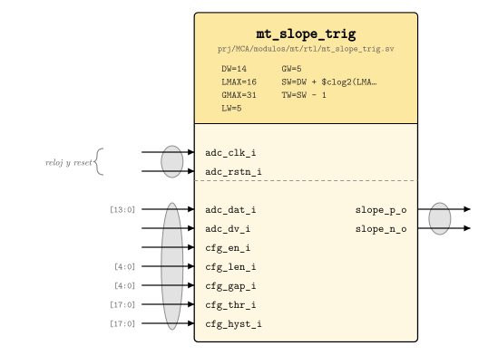
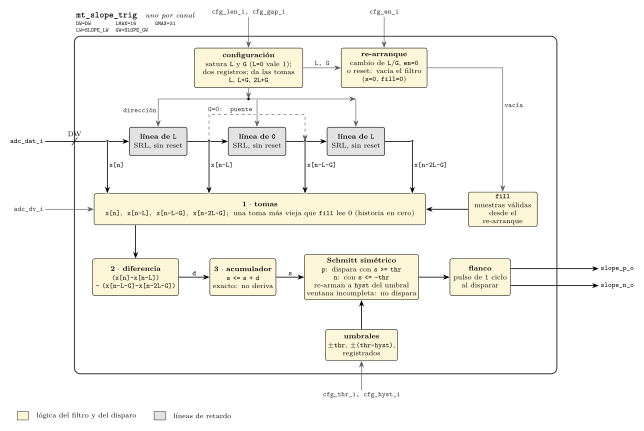

# Datasheet — `mt_slope_trig`

<!-- Generado por `modulos/mk/datasheet.py`. Lo que está entre las marcas
     AUTO:x y /AUTO:x se REESCRIBE en cada corrida: editar ahí no sirve.
     Todo el resto es prosa a mano y no se toca.
     La §1.1 «Qué hace» se escribe en prosa/mt_slope_trig.md.
     Regenerar:  make -C modulos/mt/work datasheet              -->

## 1. Función y funcionamiento

### 1.1 Descripción breve

<!-- AUTO:resumen -->
|  |  |
|---|---|
| Módulo RTL | `mt_slope_trig` |
| Archivo | [`mt_slope_trig.sv`](../../modulos/mt/rtl/mt_slope_trig.sv) |
| Parámetros | 7 |
| Puertos | 13 (9 in / 4 out) |
| Parte | `xc7z010clg400-1` |




**Cabecera del RTL** (se copia tal cual de [`mt_slope_trig.sv`](../../modulos/mt/rtl/mt_slope_trig.sv)):

> mt_slope_trig — disparo por PENDIENTE con un trapezoidal rápido
>
> Hermano de rp_adc_trig: misma entrada (el tap mtrg_dat/mtrg_val), mismo
> Schmitt a la salida, mismos dos pulsos de 1 ciclo (p = flanco de subida,
> n = flanco de bajada). Lo que cambia es QUÉ se compara contra el umbral: no
> la muestra x, sino la salida de un filtro trapezoidal rápido
>
>   s[n] = Σ_{i=0}^{L-1} x[n-i]  -  Σ_{i=0}^{L-1} x[n-L-G-i]
>
> es decir, la suma de las últimas L muestras menos la suma de L muestras
> G muestras más atrás: una DERIVADA SUAVIZADA. Es el "fast filter" con el que
> disparan los procesadores digitales de pulsos (Jordanov & Knoll 1994; es la
> rama rápida de XIA, Amptek y del DPP-PHA de CAEN).
>
> POR QUÉ Y NO UN UMBRAL DE NIVEL. La suma de coeficientes es cero, así que s
> RECHAZA LA CONTINUA: un offset o una deriva lenta de la línea de base no
> mueve el umbral efectivo, que en el disparo de nivel sí se mueve (y la
> deriva es el límite real del MCA, ver docs/mca/limites_resolucion_y_deriva).
>
> QUÉ MIDE s:
>   - un escalón de alto A (más rápido que L+G) da un TRAPECIO de alto L·A,
>     subida L y techo G+1 muestras;
>   - una rampa de pendiente m da s = L·(L+G)·m: la pendiente, escalada;
>   - ruido blanco σ da σ_s = σ·√(2L). Subir L mejora la relación señal/ruido
>     como √L para escalones, a costa de latencia. Con L=1, G=k-1 queda la
>     diferencia de k muestras x[n]-x[n-k].
>
> IMPLEMENTACIÓN. Recursiva y exacta en enteros (no deriva):
>
>   s[n] = s[n-1] + (x[n] - x[n-L]) - (x[n-L-G] - x[n-2L-G])
>
> con TRES líneas de retardo en cascada (L, G, L muestras), cada una con UNA
> toma dinámica: es el patrón que Vivado lleva a SRLC32E. Una sola línea de
> 2·LMAX+GMAX con tres tomas sale en flip-flops y muxes: medido OOC, 3 veces
> más LUT y 5 veces más FF (docs/mt/trigger_pendiente.md §6). Las líneas no tienen reset (si no, no hay SRL); en su lugar, el
> contador `fill` cuenta cuántas muestras válidas entraron desde el último
> re-arranque, y una toma más vieja que eso lee 0. Así s es exactamente el
> filtro aplicado a la señal con historia en cero, sin offset fantasma.
>
> RE-ARRANQUE. Cualquier cambio de L o G, cfg_en=0 o el reset vacían el filtro
> (s=0, fill=0). Mientras la ventana completa (2L+G muestras) no esté llena,
> el Schmitt queda en "disparado" y no sale ningún pulso: el arranque desde
> historia cero es un escalón falso y no debe disparar. Por la misma razón el
> primer pulso pide re-armar antes (s < thr-hyst), igual que tras un disparo.
>
> SCHMITT. Igual que rp_adc_trig, simétrico en los dos signos:
>   p: dispara con s >=  thr, re-arma con s <  thr-hyst
>   n: dispara con s <= -thr, re-arma con s > -thr+hyst
> thr y hyst son magnitudes (sin signo). Con hyst >= thr no re-arma nunca en
> s=0: es configuración inválida, igual que en el disparo de nivel.
>
> LATENCIA. 5 ciclos de pipeline desde la muestra hasta el pulso, más lo que
> tarde s en cruzar thr (del orden de L muestras para un escalón).
>
> Todo avanza solo con adc_dv_i, así que funciona igual sobre el tap nativo
> (decimado) que sobre los taps de 125 MSPS.
<!-- /AUTO:resumen -->

<!-- AUTO:prosa -->
<!-- Prosa a mano: se edita en prosa/mt_slope_trig.md, no aca. -->

**Qué hace.** Es el **disparo por pendiente de un canal**. Funciona como
`rp_adc_trig` (misma entrada, mismo Schmitt, mismos dos pulsos `p`/`n` de un
ciclo), pero el umbral no se compara contra la muestra sino contra un
**trapezoidal rápido**:

```
s[n] = Σ_{i<L} x[n-i]  −  Σ_{i<L} x[n-L-G-i]
```

que es una derivada suavizada. Un escalón de alto `A` da `s = L·A`, una rampa
de pendiente `m` da `L·(L+G)·m` y una continua da 0. Por eso el umbral no se
mueve con la línea de base, que es lo que le pasa al disparo de nivel. Hay una
instancia por canal en [`mt_top`](datasheet_mt_top.md),
y sus pulsos entran a [`mt_trig_src`](datasheet_mt_trig_src.md) como los
bits 17–24 de la máscara OR.



*`s[n] = s[n-1] + (x[n] - x[n-L]) - (x[n-L-G] - x[n-2L-G])`. De arriba hacia
abajo: la configuración, las tres líneas de retardo, las tomas, la diferencia,
el acumulador y el Schmitt de cada signo. Cada línea tiene una sola toma
dinámica, en la dirección `L-1` o `G-1`; con `G = 0` la del medio se puentea.
Una toma más vieja que `fill` lee 0: el filtro arranca con historia en cero.
`restart` (cambio de `L` o `G`, `cfg_en_i = 0` o reset) vacía el filtro: borra
`fill`, `s` y las cadenas `p*_v` y `p*_full`. Las líneas, `fill` y cada etapa
avanzan sólo con la muestra válida (`adc_dv_i` y su cadena): el filtro anda
igual sobre el tap decimado que a 125 MS/s. En el Schmitt, S pone el estado en 1
(disparado) y gana sobre R, que lo re-arma; mientras la ventana no está llena
(`p3_full = 0`) los dos bits quedan en 1 y no sale flanco. Latencia: 5 ciclos de
pipeline más lo que tarde `s` en cruzar `thr`. Nombres sin cable (`fill`, `L+G`,
`p3_v`…): la señal del mismo nombre, que se dibuja una sola vez donde nace.
`NOMBRE=valor`: parámetros con que lo instancia `mt_top`.*

*Por dentro:* la configuración y el re-arranque, las tres líneas de retardo, las tomas, la diferencia, el acumulador, los umbrales y el Schmitt de cada signo con su flanco. Fuente TikZ en [`panorama_mt_slope_trig.tex`](../mt/figuras/panorama_mt_slope_trig.tex).

Tres cosas que hay que saber para usarlo:

- **Cambiar `L` o `G`, o pasar por `cfg_en=0`, vacía el filtro.** Mientras la
  ventana de `2L+G` muestras no esté llena no sale ningún pulso, y el primero
  exige re-armar (`s < thr−hyst`). Habilitarlo sobre una señal con offset no
  dispara.
- **`hyst < thr`** o el Schmitt no re-arma nunca en `s = 0`.
- **Latencia**: 5 ciclos de pipeline, más lo que tarde `s` en cruzar el
  umbral (del orden de `L` muestras para un escalón).

Las líneas de retardo son tres en cascada (`L`, `G`, `L`) con una toma
dinámica cada una, inferidas en SRL. Teoría, elección del umbral, costo
medido y bibliografía en
[`trigger_pendiente.md`](../mt/trigger_pendiente.md).
<!-- /AUTO:prosa -->

### 1.2 Interfaces

<!-- AUTO:interfaces -->
#### Parámetros

| Parámetro | Tipo | Default | Para qué |
|---|---|---|---|
| `DW` | `integer` | `14` | ancho de la muestra |
| `LMAX` | `integer` | `16` | L máximo (ventana de suma) |
| `GMAX` | `integer` | `31` | G máximo (separación) |
| `LW` | `integer` | `5` | ancho del campo L |
| `GW` | `integer` | `5` | ancho del campo G |
| `SW` | `integer` | `DW + $clog2(LMAX) + 1` = `19` | ancho de s (con signo) |
| `TW` | `integer` | `SW - 1` = `18` | ancho de thr/hyst (magnitud) |


#### Puertos

##### Señales

| Puerto | Dir | Bits | Dominio | Descripción |
|---|---|---|---|---|
| `adc_clk_i` | in | 1 | — | ADC clock |
| `adc_rstn_i` | in | 1 | — | ADC reset - active low |
| `adc_dat_i` | in | 14 `[DW-1: 0]` | adc_clk_i | muestra (con signo) |
| `adc_dv_i` | in | 1 | adc_clk_i | muestra válida |
| `cfg_en_i` | in | 1 | adc_clk_i | 0 = filtro vacío, sin pulsos |
| `cfg_len_i` | in | 5 `[LW-1: 0]` | adc_clk_i | L (0 se toma como 1, >LMAX satura) |
| `cfg_gap_i` | in | 5 `[GW-1: 0]` | adc_clk_i | G (>GMAX satura) |
| `cfg_thr_i` | in | 18 `[TW-1: 0]` | adc_clk_i | umbral sobre |s| |
| `cfg_hyst_i` | in | 18 `[TW-1: 0]` | adc_clk_i | histéresis del re-armado |
| `slope_p_o` | out | 1 | adc_clk_i | pendiente positiva, 1 ciclo |
| `slope_n_o` | out | 1 | adc_clk_i | pendiente negativa, 1 ciclo |
| `armado_p_o` | out | 1 | adc_clk_i | 1 = re-armado: el próximo cruce de thr (o de -thr) dispara. Es el estado del Schmitt, sin registro extra; lo usa mt_event_logic para el tiempo de re-armado del MCA. Vale 0 mientras la ventana no está llena. |
| `armado_n_o` | out | 1 | adc_clk_i |  |
<!-- /AUTO:interfaces -->

### 1.3 Mapa de registros

<!-- AUTO:regmap -->
Mapas de registros de la región:

- [`register_map_mt.md`](../mt/register_map_mt.md)

Contrato del bus: [`bus_sistema_redpitaya.md`](../TOP/bus_sistema_redpitaya.md) · Mapa de slots: [`register_map_top.md`](../TOP/register_map_top.md)
<!-- /AUTO:regmap -->

### 1.4 Clock domains

<!-- AUTO:clocks -->
| Puerto | Qué es | Polaridad | Notas |
|---|---|---|---|
| `adc_clk_i` | reloj |  | ADC clock |
| `adc_rstn_i` | reset | activo-bajo | ADC reset - active low |


**Un solo dominio.** Todos los puertos de datos y de control son síncronos a `adc_clk_i`: no hay cruce de dominio dentro de este módulo.
<!-- /AUTO:clocks -->

<!-- A mano: si hay más de un reloj, cuál es el cruce, con qué se sincroniza y
     qué se asume de la relación de frecuencias. Si hay uno solo, borrar. -->

### 1.5 Frecuencia máxima de trabajo

<!-- AUTO:timing -->
El `metrics.txt` del módulo es de `mt_top`, no de `mt_slope_trig`: la síntesis OOC del módulo apunta a otro top, así que acá no hay números propios de este bloque.
<!-- /AUTO:timing -->

<!-- A mano: qué hay en el camino crítico y qué se haría para romperlo si
     hubiera que subir la frecuencia. -->

### 1.6 Transacciones

<!-- AUTO:transacciones -->
**EL TREN DEL GENERADOR, Y CUAL SE CAPTURA**


Que entra al modulo. El generador entrega un pulso cada 500 us y todos cruzan el umbral: como candidatos son todos validos. Lo que decide cuales se capturan no es el escudo sino el lazo: una captura congela la ventana y el hardware no acepta otra hasta que el PS la leyo y re-armo. La banda naranja es ese tiempo muerto, y las cruces rojas son los pulsos que cayeron adentro. A esta tasa entra uno de cada 2.

_Origen: campaña e2e, barrido de tasa, 2000 Hz._

**EL CAMINO DE UN DISPARO**


Que viaja. Un candidato pasa por el enmascarado --32 fuentes OR-eadas en `trig_src`--, por el escudo --que lo veta si otro canal esta en su ventana de holdoff-- y recien ahi congela la ventana. Lo que NO se ve en un cronograma y si en esta figura es el lazo del final: la ventana no se libera sola, la libera el PS al leerla. Es un esquema de la estructura; los cronogramas ciclo a ciclo del veto y del holdoff estan en `docs/mt/figuras/ondas/`.

_Origen: estructura de `mt_trig_src.sv`, `trigger_shield.sv` y la captura._

**SE PIERDEN PERIODOS ENTEROS, NO UNA FRACCION**


Que sale, y por que. Para cada par de capturas consecutivas se calcula k = dt / T, cuantos periodos del generador pasaron. El histograma de abajo muestra que k es un ENTERO --la mediana de |dt/T - k| es 0.0310, o sea que las capturas caen sobre el tren del generador y no en cualquier lado--: el lazo no pierde una fraccion de los pulsos, pierde periodos completos, porque cuando termina de leer espera al proximo pulso. A 2000 Hz el 98 % de las capturas tienen k = 2; a 8000 Hz la distribucion se parte entre k = 5 y k = 6, que es lo que da el <k> = 5.46 no entero. De ahi sale la curva de arriba: la eficiencia es 1/<k>, y coincide con la que el barrido habia guardado por su cuenta con un error maximo de 0.0002. No es una curva ajustada, es el reciproco de un contador. Medido: 500 Hz: 99.4 %  1000 Hz: 97.8 %  2000 Hz: 49.1 %  4000 Hz: 32.5 %  8000 Hz: 18.3 %. OJO: este tiempo muerto es del lazo de lectura K=1 por GP0, no del escudo; es exactamente el cuello que el `event_ring` viene a sacar.

_Origen: campaña e2e, barrido de tasa (5 puntos)._

**LA TRANSACCION COMPLETA**


Las tres preguntas en una imagen: que entra, que viaja y que sale.

_Origen: las tres anteriores, en una figura._

---

Las figuras **recalculan cada número al dibujar** en vez de tomarlo escrito. Las genera [`transacciones_mt.py`](../mt/figuras/transacciones/transacciones_mt.py); de dónde sale el dato de cada una está en la columna «Datos» de [`README.md`](../mt/figuras/transacciones/README.md); los epígrafes completos, en [`epigrafes.txt`](../mt/figuras/transacciones/epigrafes.txt).
<!-- /AUTO:transacciones -->

### 1.7 Waveforms

<!-- AUTO:ondas -->
**LAS TRES FORMAS DEL VETO AL MCA  -  nivel / nivel con cola / ventana por flanco**


El mismo bloque da tres vetos distintos segun como se lo configure, y la diferencia no esta en el RTL sino en que fuente se elige y que duracion se escribe. Con una fuente de NIVEL y dur=0 el veto es la linea con un ciclo de latencia: dura lo que dure la linea. Con la misma fuente y dur=8 el veto se extiende ocho ciclos despues de que la linea baje, que es lo que hace falta cuando el estimulo deja cola. Con una fuente de FLANCO y dur=12 el veto es una ventana fija de doce ciclos, sin importar cuanto dure el pulso. Los tres tramos vienen de escenas distintas del testbench y el hueco entre ellos dice que se salteo tiempo: no es una secuencia.

_Origen: `tb_trigger_shield`, escenas 4, 5 y 6._

**HOLDOFF Y RE-ARM  -  el escudo cuenta y al expirar limpia el canal de destino**


Lo que el escudo hace de verdad: cuando el canal fuente dispara, arranca un contador y mantiene `active` mientras cuenta; al expirar emite UN pulso de clear en el canal de destino, que es lo que lo vuelve a armar. Importa que el clear salga al EXPIRAR y no al disparar: si saliera al disparar, el canal de destino se re-armaria en medio del evento que el escudo esta tratando de protegerlo.

_Origen: `tb_trigger_shield`, escena 2._

**DISPARO SINGLE-SHOT  -  el flanco dispara, engancha el disable y la mascara se auto-limpia**


El flanco de la fuente habilitada dispara `adc_trig` y en el mismo movimiento engancha `adc_trg_dis`, que es lo que impide que el siguiente flanco vuelva a disparar. En modo single-shot la mascara se auto-limpia, asi que para volver a disparar hace falta reescribirla; en modo continuo la mascara persiste y basta con limpiar el disable. Esa es la unica diferencia entre los dos modos.

_Origen: `tb_mt_trig_src`, escena 1._

---

Las figuras y sus epígrafes los escribe [`ondas_mt.py`](../mt/figuras/ondas/ondas_mt.py): los tiempos y las latencias se **miden sobre el VCD**, no se escriben a mano, así que no pueden desincronizarse del RTL. Los epígrafes completos, con los números, están en [`epigrafes.txt`](../mt/figuras/ondas/epigrafes.txt).

```bash
python3 docs/mt/figuras/ondas/ondas_mt.py    # regenerar
```
<!-- /AUTO:ondas -->

<!-- A mano: lo que las figuras no pueden mostrar solas. Para agregar una,
     editar docs/mt/figuras/ondas/ondas_mt.py: la onda
     sale de un VCD de los testbenches y los tiempos los mide el script.
       make -C modulos/mt/work wave TB=<tb>   # mirar en Questa
       make -C modulos/mt/work vcd  TB=<tb>   # VCD exportable -->

### 1.8 Verificación realizada

<!-- AUTO:verificacion -->
Todo corre en batch y se chequea el `RESULT: PASS` del testbench; las ondas quedan en `work/waves/<tb>.wlf`.

```bash
make -C modulos/mt/work            # los 7 testbenches
make -C modulos/mt/work cov        # + cobertura
make -C modulos/mt/work lint
```

| Testbench | DUT | Escenas | Casos | Contra qué compara | Es el de este módulo |
|---|---|---|---|---|---|
| [`tb_mt_cfg`](../../modulos/mt/sim/tb_mt_cfg.sv) | `mt_cfg` | 14 | 60 | vectores a mano |  |
| [`tb_mt_slope_trig`](../../modulos/mt/sim/tb_mt_slope_trig.sv) | `mt_slope_trig` | 8 | 17 | vectores a mano | **sí** |
| [`tb_mt_pz_trig`](../../modulos/mt/sim/tb_mt_pz_trig.sv) | `mt_pz_trig` | 8 | 2 | vectores a mano |  |
| [`tb_mt_trig_src`](../../modulos/mt/sim/tb_mt_trig_src.sv) | `mt_trig_src` | 8 | 21 | vectores a mano |  |
| [`tb_mt_event_logic`](../../modulos/mt/sim/tb_mt_event_logic.sv) | `mt_event_logic` | 9 | 19 | vectores a mano |  |
| [`tb_trigger_shield`](../../modulos/mt/sim/tb_trigger_shield.sv) | `trigger_shield` | 8 | 19 | vectores a mano |  |
| [`tb_mt_top`](../../modulos/mt/sim/tb_mt_top.sv) | `mt_top` | 20 | 55 | vectores a mano |  |


**193 casos con nombre** en 7 testbenches (75 escenas). La lista completa, caso por caso, está en el plan de verificación.

Las escenas de [`tb_mt_slope_trig`](../../modulos/mt/sim/tb_mt_slope_trig.sv): 1) Exactitud, 2) Exactitud con huecos de dv y L, G intermedios, 3) L=1 G=0 es x[n]-x[n-1]; L=0 se satura a 1; L>LMA, 4) Escalón sobre una base, 5) Continua grande y rampa lenta, 6) Escalones ruidosos, 7) Cambio de L en caliente, 8) cfg_en = 0.

**Assertions** — en `sim/sva/`, enganchadas por `bind` (no tocan el RTL sintetizable).

- [`bind_mt.sv`](../../modulos/mt/sim/sva/bind_mt.sv)
- [`mt_cfg_sva.sv`](../../modulos/mt/sim/sva/mt_cfg_sva.sv)

> **Los archivos de assertions están vacíos.** Son el scaffold de `create_module.py`: tienen el `bind`, el `default clocking` y un `// TODO:`, pero **ninguna propiedad**. O sea que hoy no aportan nada a la verificación; el enganche ya está hecho y lo que falta es escribirlas. Ver [`verificacion_formal.md`](../verificacion_formal.md), que discute cuáles convienen primero.

Plan de verificación, casos cubiertos y deuda: [`mt/sim/VERIFICACION.md`](../../modulos/mt/sim/VERIFICACION.md).
<!-- /AUTO:verificacion -->

#### Esquema de laboratorio

TODO — qué instrumento, cómo se conecta, qué se mide y contra qué se compara.
