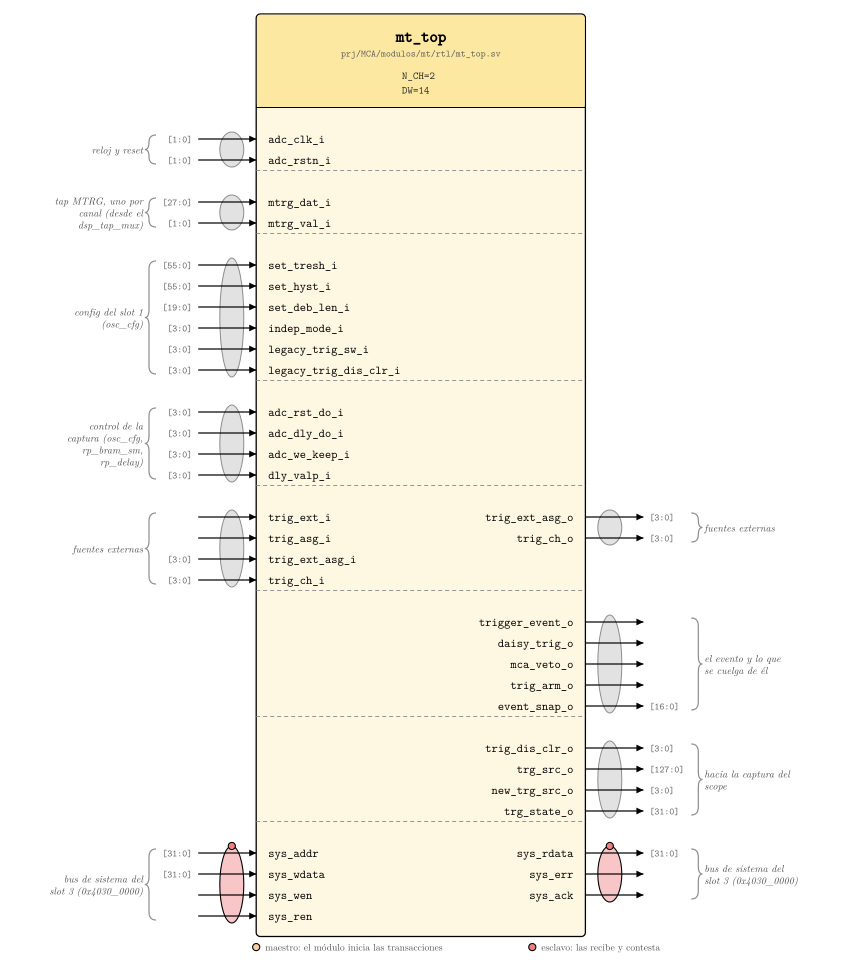
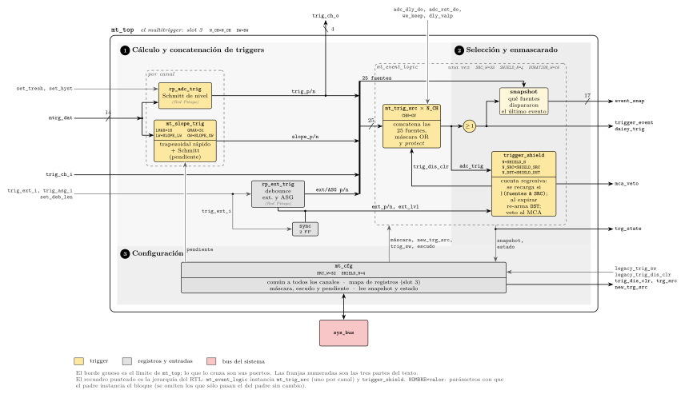
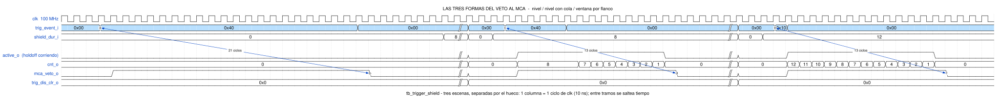
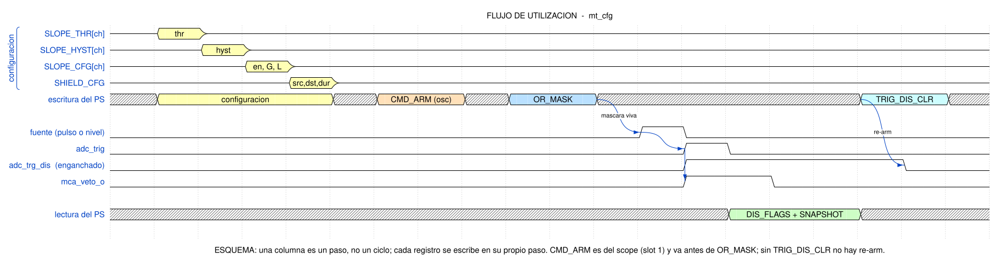

# Datasheet — `mt_top`

<!-- Generado por `modulos/mk/datasheet.py`. Lo que está entre las marcas
     AUTO:x y /AUTO:x se REESCRIBE en cada corrida: editar ahí no sirve.
     Todo el resto es prosa a mano y no se toca.
     La §1.1 «Qué hace» se escribe en prosa/mt_top.md.
     Regenerar:  make -C modulos/mt/work datasheet              -->

## 1. Función y funcionamiento

### 1.1 Descripción breve

<!-- AUTO:resumen -->
|  |  |
|---|---|
| Módulo RTL | `mt_top` |
| Archivo | [`mt_top.sv`](../../modulos/mt/rtl/mt_top.sv) |
| Parámetros | 2 |
| Puertos | 35 (22 in / 13 out) |
| Parte | `xc7z010clg400-1` |




**Cabecera del RTL** (se copia tal cual de [`mt_top.sv`](../../modulos/mt/rtl/mt_top.sv)):

> mt_top — el MULTITRIGGER entero: un solo bloque con un solo borde
>
> Hasta acá el multitrigger no era un módulo sino una "región": sus piezas se
> instanciaban sueltas dentro de rp_scope_mt_com (mt_event_logic y mt_cfg en
> el nivel de arriba, mt_slope_trig y rp_adc_trig dentro del generate por
> canal, más el sync del nivel externo y el empaquetado de trg_state). Lo único
> que lo delimitaba era su mapa de registros (slot 3). Este módulo junta todo
> eso detrás de un borde, con la misma interfaz que ya describía la tabla de
> puertos de docs/mt/register_map_mt.md.
>
>   tap MTRG ──→ rp_adc_trig ×N_CH  (nivel) ─┐
>            ├─→ mt_slope_trig ×N_CH (pend.) ─┤
>            └─→ mt_pz_trig ×N_CH (polo-cero) ┤
>   trig_ext ──→ rp_ext_trig ──→ (afuera y vuelve por trig_ext_asg_i)
>            └─→ sync 2 FF (nivel, veto) ─────┼─→ mt_event_logic ──→ trigger_event
>   trig_ch_i ────────────────────────────────┘          ↑
>   sys_bus slot 3 ──→ mt_cfg ── máscaras, escudo, pendiente, polo-cero, pulsos
>
> mt_pz_trig (el disparo con polo-cero) se agregó después de la mudanza: es una
> fuente nueva en los bits 25..28 de la máscara, no un cambio de las de antes.
>
> ES UNA MUDANZA, NO UN CAMBIO DE LÓGICA. Cada instancia es la que estaba en
> rp_scope_mt_com, con los mismos parámetros y las mismas conexiones; los
> relojes por canal se conservan (rp_adc_trig y mt_slope_trig corren con
> adc_clk_i[GV], el resto con adc_clk_i[0]). El netlist sólo cambia de nombres
> jerárquicos.
>
> Lo que cruza el borde:
>
> - El TAP (mtrg_dat_i/mtrg_val_i) lo elige afuera el dsp_tap_mux MTRG: el
>   ruteo es de la cadena del scope, no del multitrigger.
> - La configuración del disparo de NIVEL y del debounce externo (set_tresh,
>   set_hyst, set_deb_len) entra desde osc_cfg: son registros del slot 1 que
>   librp conoce, así que no se mudan. Mismo criterio que el puente legacy.
> - El LAZO CON LA CAPTURA. trigger_event sale hacia rp_bram_sm/rp_axi_sm, y
>   vuelve el control de la captura (adc_dly_do, adc_rst_do, we_keep,
>   dly_valp). trig_dis_clr, trg_src y new_trg_src salen porque rp_bram_sm y
>   rp_delay también los usan.
> - rp_ext_trig saca sus flancos por trig_ext_asg_o y el multitrigger los
>   toma de trig_ext_asg_i: el top los une, para poder compartirlos entre
>   varios scopes. Se respeta ese lazo tal cual.
<!-- /AUTO:resumen -->

<!-- AUTO:prosa -->
<!-- Prosa a mano: se edita en prosa/mt_top.md, no aca. -->

**Qué hace.** Es el **multitrigger entero** detrás de un solo borde: de las
muestras del tap MTRG y las entradas externas a `trigger_event`, más los
registros del slot 3. Adentro están el disparo de nivel
([`rp_adc_trig`](../../../../rtl/classic/rp_adc_trig.v), de Red Pitaya) y el de
pendiente ([`mt_slope_trig`](datasheet_mt_slope_trig.md)) de cada canal, el
debounce externo ([`rp_ext_trig`](../../../../rtl/classic/rp_ext_trig.v)), la
lógica de evento ([`mt_event_logic`](datasheet_mt_event_logic.md)) y el
esclavo del bus ([`mt_cfg`](datasheet_mt_cfg.md)).
[`rp_scope_mt_com`](datasheet_rp_scope_mt_com.md) lo instancia una vez.



*Por dentro:* las tres partes del texto de
[`register_map_mt.md`](../mt/register_map_mt.md#panorama), con la tabla de
puertos y de dónde viene cada uno. Fuente TikZ en
[`panorama_mt.tex`](../mt/figuras/panorama_mt.tex).

Hasta este módulo, el multitrigger era una **región**: sus piezas estaban
sueltas dentro de `rp_scope_mt_com`, y sólo el mapa de registros lo
delimitaba. `mt_top` es una **mudanza sin cambios de lógica**: cada instancia
tiene los mismos parámetros y conexiones que antes, y se conservan los relojes
por canal. Con estímulos al azar, el `rp_scope_mt_com` nuevo y una copia
congelada del anterior dieron las mismas salidas en cada ciclo.

Lo que cruza el borde muestra dónde termina el multitrigger y empieza el scope:

- **El tap entra ya elegido.** Qué nodo de la cadena mira el disparo lo decide
  el `dsp_tap_mux` MTRG, que es parte del ruteo del scope.
- **Parte de la configuración viene del slot 1.** El umbral y la histéresis
  del disparo de nivel y el largo del debounce son registros de `osc_cfg` que
  `librp` conoce, así que no se mudan: entran como puertos, igual que el
  puente legacy de `TRIG_SW` y `TRIG_DIS_CLR`.
- **El lazo con la captura cruza el borde.** `trigger_event` va a
  `rp_bram_sm` y `rp_axi_sm`, y vuelve el control de la captura (`adc_dly_do`,
  `adc_rst_do`, `we_keep`, `dly_valp`). `trig_dis_clr`, `trg_src` y
  `new_trg_src` también salen, porque `rp_bram_sm` y `rp_delay` los usan.
- **Los flancos externos salen y vuelven.** `rp_ext_trig` los saca por
  `trig_ext_asg_o` y la lógica de evento los toma de `trig_ext_asg_i`. El top
  une las dos puntas para poder compartirlas entre varios scopes.

[`tb_mt_top`](../../modulos/mt/sim/tb_mt_top.sv) prueba el módulo solo, con
el tap y la captura manejados por el TB. Verifica cada camino de punta a punta:
nivel, pendiente, externo, veto, SW (por el puente y por el registro propio),
cadena, modo continuo y el lazo con la captura.
<!-- /AUTO:prosa -->

### 1.2 Interfaces

<!-- AUTO:interfaces -->
#### Parámetros

| Parámetro | Tipo | Default | Para qué |
|---|---|---|---|
| `N_CH` | `integer` | `2` | canales |
| `DW` | `integer` | `14` | ancho de la muestra |


#### Puertos

##### Reloj y reset

| Puerto | Dir | Bits | Dominio |
|---|---|---|---|
| `adc_clk_i` | in | 2 `[N_CH   -1: 0]` | — |
| `adc_rstn_i` | in | 2 `[N_CH   -1: 0]` | — |


##### Tap MTRG, uno por canal (desde el dsp_tap_mux)

| Puerto | Dir | Bits | Dominio |
|---|---|---|---|
| `mtrg_dat_i` | in | 28 `[N_CH*DW-1: 0]` | adc_clk_i |
| `mtrg_val_i` | in | 2 `[N_CH   -1: 0]` | adc_clk_i |


##### Config del slot 1 (osc_cfg)

| Puerto | Dir | Bits | Dominio | Descripción |
|---|---|---|---|---|
| `set_tresh_i` | in | 56 `[4*DW-1: 0]` | adc_clk_i | umbral del disparo de nivel |
| `set_hyst_i` | in | 56 `[4*DW-1: 0]` | adc_clk_i | histéresis del disparo de nivel |
| `set_deb_len_i` | in | 20 | adc_clk_i | debounce de la entrada externa |
| `indep_mode_i` | in | 4 | adc_clk_i |  |
| `legacy_trig_sw_i` | in | 4 | adc_clk_i | puente legacy: 0x004 del slot 1 |
| `legacy_trig_dis_clr_i` | in | 4 | adc_clk_i | puente legacy: 0x094 del slot 1 |


##### Control de la captura (osc_cfg, rp_bram_sm, rp_delay)

| Puerto | Dir | Bits | Dominio |
|---|---|---|---|
| `adc_rst_do_i` | in | 4 | adc_clk_i |
| `adc_dly_do_i` | in | 4 | adc_clk_i |
| `adc_we_keep_i` | in | 4 | adc_clk_i |
| `dly_valp_i` | in | 4 | adc_clk_i |


##### Fuentes externas

| Puerto | Dir | Bits | Dominio | Descripción |
|---|---|---|---|---|
| `trig_ext_i` | in | 1 | adc_clk_i | DIO0_P |
| `trig_asg_i` | in | 1 | adc_clk_i | ASG |
| `trig_ext_asg_o` | out | 4 | adc_clk_i | {asg_n, asg_p, ext_n, ext_p} |
| `trig_ext_asg_i` | in | 4 | adc_clk_i | los mismos, de vuelta del top |
| `trig_ch_i` | in | 4 | adc_clk_i | cadena desde el otro scope |
| `trig_ch_o` | out | 4 | adc_clk_i | cadena hacia el otro scope |


##### El evento y lo que se cuelga de él

| Puerto | Dir | Bits | Dominio | Descripción |
|---|---|---|---|---|
| `trigger_event_o` | out | 1 | adc_clk_i | dispara la captura de todos los canales |
| `daisy_trig_o` | out | 1 | adc_clk_i |  |
| `mca_veto_o` | out | 1 | adc_clk_i |  |
| `event_snap_o` | out | 17 | adc_clk_i | snapshot hacia el event_ring |


##### Hacia la captura del scope

| Puerto | Dir | Bits | Dominio | Descripción |
|---|---|---|---|---|
| `trig_dis_clr_o` | out | 4 | adc_clk_i | rp_bram_sm |
| `trg_src_o` | out | 128 | adc_clk_i | rp_delay (hint de categoría) |
| `new_trg_src_o` | out | 4 | adc_clk_i | rp_delay |
| `trg_state_o` | out | 32 | adc_clk_i | máscara activa, 8 b/canal (readback) |


##### Bus de sistema del slot 3 (0x4030_0000)

| Puerto | Dir | Bits | Dominio |
|---|---|---|---|
| `sys_addr` | in | 32 | adc_clk_i |
| `sys_wdata` | in | 32 | adc_clk_i |
| `sys_wen` | in | 1 | adc_clk_i |
| `sys_ren` | in | 1 | adc_clk_i |
| `sys_rdata` | out | 32 | adc_clk_i |
| `sys_err` | out | 1 | adc_clk_i |
| `sys_ack` | out | 1 | adc_clk_i |
<!-- /AUTO:interfaces -->

### 1.3 Mapa de registros

<!-- AUTO:regmap -->
`mt_top` es esclavo del bus de sistema (`sys_addr`, `sys_wdata`, `sys_wen`, `sys_ren`, `sys_rdata`, `sys_err`, `sys_ack`). El mapa completo está en:

- [`register_map_mt.md`](../mt/register_map_mt.md)

Contrato del bus: [`bus_sistema_redpitaya.md`](../TOP/bus_sistema_redpitaya.md) · Mapa de slots: [`register_map_top.md`](../TOP/register_map_top.md)
<!-- /AUTO:regmap -->

### 1.4 Clock domains

<!-- AUTO:clocks -->
| Puerto | Qué es | Polaridad |
|---|---|---|
| `adc_clk_i` | reloj ×2 |  |
| `adc_rstn_i` | reset | activo-bajo |


**`adc_clk_i` es un vector de 2 relojes** (uno por canal): el bloque se replica, y lo que acá parece un dominio son 2. Qué se cruza entre réplicas —si algo se cruza— va escrito abajo, no se infiere del nombre.
<!-- /AUTO:clocks -->

<!-- A mano: si hay más de un reloj, cuál es el cruce, con qué se sincroniza y
     qué se asume de la relación de frecuencias. Si hay uno solo, borrar. -->

### 1.5 Frecuencia máxima de trabajo

<!-- AUTO:timing -->
**Punto de síntesis** — Vivado out-of-context, `xc7z010clg400-1`.

| Métrica | Valor |
|---|---|
| Período de la restricción | 8.00 ns (125.0 MHz) |
| WNS | 1.461 ns |
| Camino crítico | 6.539 ns |
| **Fmax** | **152.9 MHz** |
| Niveles de lógica | 7 |


**Camino crítico**

|  |  |
|---|---|
| startpoint | `g_ch[0].i_pz_trig/mq_q_reg[4]/C` |
| endpoint | `g_ch[0].i_pz_trig/i_trap/r5_reg/RSTB` |


**Recursos**

| LUT | FF | BRAM | DSP | CARRY | MUXF |
|---|---|---|---|---|---|
| 2509 | 2159 | 0 | 2 | 226 | 0 |


`lut` cuenta **primitivas** LUT, no los _Slice LUTs_ del `report_utilization` (dos LUT5 que comparten O5/O6 ocupan un solo sitio).

_Barrido no corrido_: `make -C modulos/mt/work sweep-all` y regenerar.
<!-- /AUTO:timing -->

<!-- A mano: qué hay en el camino crítico y qué se haría para romperlo si
     hubiera que subir la frecuencia. -->

### 1.6 Transacciones

<!-- AUTO:transacciones -->
**EL TREN DEL GENERADOR, Y CUAL SE CAPTURA**


Que entra al modulo. El generador entrega un pulso cada 500 us y todos cruzan el umbral: como candidatos son todos validos. Lo que decide cuales se capturan no es el escudo sino el lazo: una captura congela la ventana y el hardware no acepta otra hasta que el PS la leyo y re-armo. La banda naranja es ese tiempo muerto, y las cruces rojas son los pulsos que cayeron adentro. A esta tasa entra uno de cada 2.

_Origen: campaña e2e, barrido de tasa, 2000 Hz._

**EL CAMINO DE UN DISPARO**


Que viaja. Un candidato pasa por el enmascarado --32 fuentes OR-eadas en `trig_src`--, por el escudo --que lo veta si otro canal esta en su ventana de holdoff-- y recien ahi congela la ventana. Lo que NO se ve en un cronograma y si en esta figura es el lazo del final: la ventana no se libera sola, la libera el PS al leerla. Es un esquema de la estructura; los cronogramas ciclo a ciclo del veto y del holdoff estan en `docs/mt/figuras/ondas/`.

_Origen: estructura de `mt_trig_src.sv`, `trigger_shield.sv` y la captura._

**SE PIERDEN PERIODOS ENTEROS, NO UNA FRACCION**


Que sale, y por que. Para cada par de capturas consecutivas se calcula k = dt / T, cuantos periodos del generador pasaron. El histograma de abajo muestra que k es un ENTERO --la mediana de |dt/T - k| es 0.0310, o sea que las capturas caen sobre el tren del generador y no en cualquier lado--: el lazo no pierde una fraccion de los pulsos, pierde periodos completos, porque cuando termina de leer espera al proximo pulso. A 2000 Hz el 98 % de las capturas tienen k = 2; a 8000 Hz la distribucion se parte entre k = 5 y k = 6, que es lo que da el <k> = 5.46 no entero. De ahi sale la curva de arriba: la eficiencia es 1/<k>, y coincide con la que el barrido habia guardado por su cuenta con un error maximo de 0.0002. No es una curva ajustada, es el reciproco de un contador. Medido: 500 Hz: 99.4 %  1000 Hz: 97.8 %  2000 Hz: 49.1 %  4000 Hz: 32.5 %  8000 Hz: 18.3 %. OJO: este tiempo muerto es del lazo de lectura K=1 por GP0, no del escudo; es exactamente el cuello que el `event_ring` viene a sacar.

_Origen: campaña e2e, barrido de tasa (5 puntos)._

**LA TRANSACCION COMPLETA**


Las tres preguntas en una imagen: que entra, que viaja y que sale.

_Origen: las tres anteriores, en una figura._

---

Las figuras **recalculan cada número al dibujar** en vez de tomarlo escrito. Las genera [`transacciones_mt.py`](../mt/figuras/transacciones/transacciones_mt.py); de dónde sale el dato de cada una está en la columna «Datos» de [`README.md`](../mt/figuras/transacciones/README.md); los epígrafes completos, en [`epigrafes.txt`](../mt/figuras/transacciones/epigrafes.txt).
<!-- /AUTO:transacciones -->

### 1.7 Waveforms

<!-- AUTO:ondas -->
**LAS TRES FORMAS DEL VETO AL MCA  -  nivel / nivel con cola / ventana por flanco**



El mismo bloque da tres vetos distintos segun como se lo configure, y la diferencia no esta en el RTL sino en que fuente se elige y que duracion se escribe. Con una fuente de NIVEL y dur=0 el veto es la linea con un ciclo de latencia: dura lo que dure la linea. Con la misma fuente y dur=8 el veto se extiende ocho ciclos despues de que la linea baje, que es lo que hace falta cuando el estimulo deja cola. Con una fuente de FLANCO y dur=12 el veto es una ventana fija de doce ciclos, sin importar cuanto dure el pulso. Los tres tramos vienen de escenas distintas del testbench y el hueco entre ellos dice que se salteo tiempo: no es una secuencia.

_Origen: `tb_trigger_shield`, escenas 4, 5 y 6._

**HOLDOFF Y RE-ARM  -  el escudo cuenta y al expirar limpia el canal de destino**


Lo que el escudo hace de verdad: cuando el canal fuente dispara, arranca un contador y mantiene `active` mientras cuenta; al expirar emite UN pulso de clear en el canal de destino, que es lo que lo vuelve a armar. Importa que el clear salga al EXPIRAR y no al disparar: si saliera al disparar, el canal de destino se re-armaria en medio del evento que el escudo esta tratando de protegerlo.

_Origen: `tb_trigger_shield`, escena 2._

**DISPARO SINGLE-SHOT  -  el flanco dispara, engancha el disable y la mascara se auto-limpia**


El flanco de la fuente habilitada dispara `adc_trig` y en el mismo movimiento engancha `adc_trg_dis`, que es lo que impide que el siguiente flanco vuelva a disparar. En modo single-shot la mascara se auto-limpia, asi que para volver a disparar hace falta reescribirla; en modo continuo la mascara persiste y basta con limpiar el disable. Esa es la unica diferencia entre los dos modos.

_Origen: `tb_mt_trig_src`, escena 1._

**FLUJO DE UTILIZACION  -  mt_cfg**



Es un esquema de la SECUENCIA, no una medicion. La configuracion es una escalera: el bus del PS escribe un registro por vez, en el orden de MtRegion.set_slope() --los umbrales antes que `en`, porque con en=1 y thr=hyst=0 el Schmitt no re-arma-- y despues el escudo. OR_MASK NO es parte de esa etapa: va DESPUES de CMD_ARM, porque la mascara vive apenas se escribe y un flanco previo al arm la gasta (single-shot) y deja la captura esperando un disparo imposible (ver docs/osc/orden_arm_trigger_captura.md). CMD_ARM no es un registro del multitrigger: arma la captura del scope (slot 1); aparece aca porque fija cuando se puede escribir la mascara. La otra dependencia que no se ve en el mapa de registros: el disable queda ENGANCHADO despues del disparo, asi que sin escribir TRIG_DIS_CLR no hay segundo disparo. Un programa que configure, dispare y se quede esperando el proximo evento sin limpiar el disable espera para siempre.

_Origen: esquema (sin VCD)._

---

Las figuras y sus epígrafes los escribe [`ondas_mt.py`](../mt/figuras/ondas/ondas_mt.py): los tiempos y las latencias se **miden sobre el VCD**, no se escriben a mano, así que no pueden desincronizarse del RTL. Los epígrafes completos, con los números, están en [`epigrafes.txt`](../mt/figuras/ondas/epigrafes.txt).

```bash
python3 docs/mt/figuras/ondas/ondas_mt.py    # regenerar
```
<!-- /AUTO:ondas -->

<!-- A mano: lo que las figuras no pueden mostrar solas. Para agregar una,
     editar docs/mt/figuras/ondas/ondas_mt.py: la onda
     sale de un VCD de los testbenches y los tiempos los mide el script.
       make -C modulos/mt/work wave TB=<tb>   # mirar en Questa
       make -C modulos/mt/work vcd  TB=<tb>   # VCD exportable -->

### 1.8 Verificación realizada

<!-- AUTO:verificacion -->
Todo corre en batch y se chequea el `RESULT: PASS` del testbench; las ondas quedan en `work/waves/<tb>.wlf`.

```bash
make -C modulos/mt/work            # los 7 testbenches
make -C modulos/mt/work cov        # + cobertura
make -C modulos/mt/work lint
```

| Testbench | DUT | Escenas | Casos | Contra qué compara | Es el de este módulo |
|---|---|---|---|---|---|
| [`tb_mt_cfg`](../../modulos/mt/sim/tb_mt_cfg.sv) | `mt_cfg` | 14 | 59 | vectores a mano |  |
| [`tb_mt_slope_trig`](../../modulos/mt/sim/tb_mt_slope_trig.sv) | `mt_slope_trig` | 8 | 15 | vectores a mano |  |
| [`tb_mt_pz_trig`](../../modulos/mt/sim/tb_mt_pz_trig.sv) | `mt_pz_trig` | 8 | 1 | vectores a mano |  |
| [`tb_mt_trig_src`](../../modulos/mt/sim/tb_mt_trig_src.sv) | `mt_trig_src` | 7 | 14 | vectores a mano |  |
| [`tb_mt_event_logic`](../../modulos/mt/sim/tb_mt_event_logic.sv) | `mt_event_logic` | 8 | 11 | vectores a mano |  |
| [`tb_trigger_shield`](../../modulos/mt/sim/tb_trigger_shield.sv) | `trigger_shield` | 8 | 19 | vectores a mano |  |
| [`tb_mt_top`](../../modulos/mt/sim/tb_mt_top.sv) | `mt_top` | 20 | 51 | vectores a mano | **sí** |


**170 casos con nombre** en 7 testbenches (73 escenas). La lista completa, caso por caso, está en el plan de verificación.

Las escenas de [`tb_mt_top`](../../modulos/mt/sim/tb_mt_top.sv): 1) IDENTIFICACIÓN por el slot 3 (MAGIC, CAPS con N_, 2) NIVEL, 3) PENDIENTE configurada por registros, 4) EXTERNA, 5) VETO por nivel externo, 6) SW por el puente legacy (lo que usa librp) y por, 7) CADENA, 8) MODO CONTINUO, 9) EL LAZO CON LA CAPTURA, 10) RELLENO, 1) IDENTIFICACIÓN, 2) NIVEL, single-shot, 3) PENDIENTE, configurada por registros, 4) EXTERNA, por el lazo trig_ext_asg, 5) VETO por nivel externo, 6) SW, 7) CADENA, 8) MODO CONTINUO, 9) EL LAZO CON LA CAPTURA, 10) RELLENO Y CONTRATO.

**Assertions** — en `sim/sva/`, enganchadas por `bind` (no tocan el RTL sintetizable).

- [`bind_mt.sv`](../../modulos/mt/sim/sva/bind_mt.sv)
- [`mt_cfg_sva.sv`](../../modulos/mt/sim/sva/mt_cfg_sva.sv)

> **Los archivos de assertions están vacíos.** Son el scaffold de `create_module.py`: tienen el `bind`, el `default clocking` y un `// TODO:`, pero **ninguna propiedad**. O sea que hoy no aportan nada a la verificación; el enganche ya está hecho y lo que falta es escribirlas. Ver [`verificacion_formal.md`](../verificacion_formal.md), que discute cuáles convienen primero.

Plan de verificación, casos cubiertos y deuda: [`mt/sim/VERIFICACION.md`](../../modulos/mt/sim/VERIFICACION.md).
<!-- /AUTO:verificacion -->

#### Esquema de laboratorio

TODO — qué instrumento, cómo se conecta, qué se mide y contra qué se compara.
