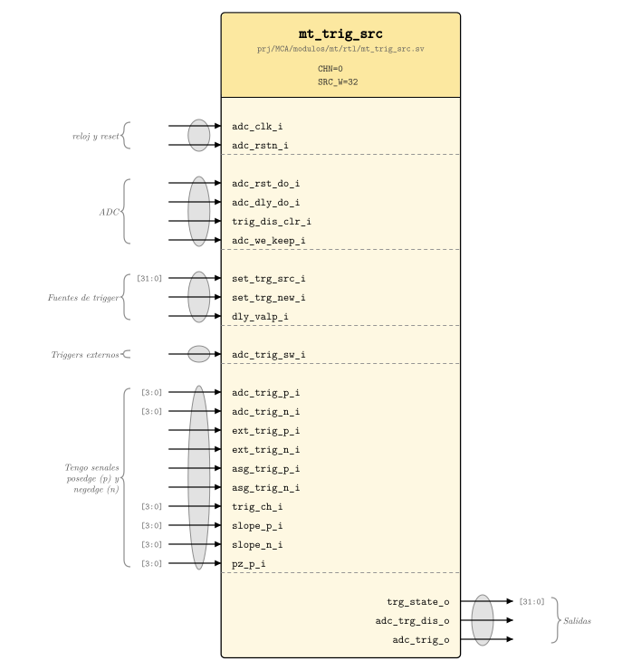
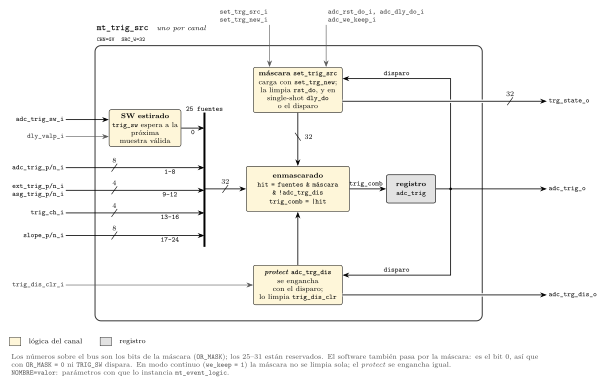
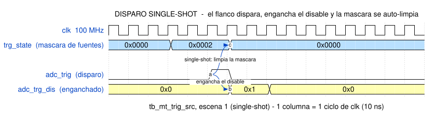

# Datasheet — `mt_trig_src`

<!-- Generado por `modulos/mk/datasheet.py`. Lo que está entre las marcas
     AUTO:x y /AUTO:x se REESCRIBE en cada corrida: editar ahí no sirve.
     Todo el resto es prosa a mano y no se toca.
     La §1.1 «Qué hace» se escribe en prosa/mt_trig_src.md.
     Regenerar:  make -C modulos/mt/work datasheet              -->

## 1. Función y funcionamiento

### 1.1 Descripción breve

<!-- AUTO:resumen -->
|  |  |
|---|---|
| Módulo RTL | `mt_trig_src` |
| Archivo | [`mt_trig_src.sv`](../../modulos/mt/rtl/mt_trig_src.sv) |
| Parámetros | 2 |
| Puertos | 25 (21 in / 4 out) |
| Parte | `xc7z010clg400-1` |




**Cabecera del RTL** (se copia tal cual de [`mt_trig_src.sv`](../../modulos/mt/rtl/mt_trig_src.sv)):

> Selección de fuentes de 8 bits como MÁSCARA OR:
>   cada bit habilita una clase de fuente y la salida es el OR de las
>   habilitadas. Setear varios bits da el OR entre todas / pares / ternas.
<!-- /AUTO:resumen -->

<!-- AUTO:prosa -->
<!-- Prosa a mano: se edita en prosa/mt_trig_src.md, no aca. -->

**Qué hace.** Es el **selector de disparo de un canal**: toma las 29 fuentes
de trigger del sistema (los flancos de nivel de los canales del ADC, los de
pendiente de [`mt_slope_trig`](datasheet_mt_slope_trig.md) y de polo-cero
de [`mt_pz_trig`](datasheet_mt_pz_trig.md), la entrada
externa, el generador, la cadena desde el otro scope y el disparo por
software), las filtra con una máscara, y emite el trigger del canal. Hay una
instancia por canal dentro de
[`mt_event_logic`](datasheet_mt_event_logic.md).



*En el estilo de `panorama_mt`: el color es la función del bloque (la leyenda),
las operaciones van con su símbolo y gris con triángulo es un registro del RTL.
Acá sí hay un vector: las fuentes entran cada una por su línea y este módulo
las concatena (la barra); los números son los bits de la máscara (`OR_MASK`), y
los 29–31 están en cero. El software también pasa por la máscara: es el bit 0,
así que con `OR_MASK = 0` ni `TRIG_SW` dispara. La máscara, salvo con el
disable enganchado, da con las fuentes el disparo, y con el armado de cada
fuente (`armado_i`) da `puede_o`: el canal puede disparar ya. «disparo» es la
salida del registro `adc_trig`, realimentada: engancha el disable y, en
single-shot (`we_keep = 0`), limpia la máscara, igual que `dly_do`; en modo
continuo la máscara no se limpia sola. `rst_do` la limpia siempre.
`NOMBRE=valor`: parámetros con que lo instancia `mt_event_logic`.*

*Por dentro:* las 29 fuentes, la máscara, el disable, `puede` y la realimentación del disparo. Fuente TikZ en [`panorama_mt_trig_src.tex`](../mt/figuras/panorama_mt_trig_src.tex).

Es el reemplazo de `rp_trig_src.v`, y las dos diferencias con el original son
las que dan el nombre al módulo:

- **La máscara es un OR, no un selector.** En el original un registro elegía
  **una** fuente. Acá cada bit habilita una clase de fuente y la salida es el
  OR de las habilitadas, así que poner varios bits da el OR entre todas —
  pares, ternas, lo que se configure. Eso es lo que permite disparar por
  coincidencia de condiciones sin un bitstream por combinación.
- **La salida va registrada** (`adc_trig`), que es lo que el camino de captura
  necesitaba para alinearse.

**El enganche es la parte que hay que entender para usarlo.** Al disparar, el
módulo engancha `adc_trg_dis` en el mismo movimiento, y eso es lo que impide
que el flanco siguiente vuelva a disparar. Medido sobre el VCD de
`tb_mt_trig_src` en
[`mt_trig_src_enganche.svg`](../mt/figuras/ondas/mt_trig_src_enganche.svg):
el disable engancha **1 ciclo** después del disparo y la máscara se limpia a
**1 ciclo**.

| Modo | Qué pasa con la máscara | Para volver a disparar |
|---|---|---|
| single-shot (default) | se **auto-limpia** al disparar | reescribir la máscara |
| continuo (`adc_we_keep`) | **persiste** | basta con limpiar el disable (`trig_dis_clr`) |

Esa es la única diferencia entre los dos modos, y el clear puede venir del
software (registro `0x94`) o del
[`trigger_shield`](datasheet_trigger_shield.md) al expirar su holdoff — por eso
el escudo puede re-armar un canal sin que el PS intervenga.

El disparo por software está **gateado por `dly_valp`**: no vale por sí solo,
tiene que caer con el pulso de validez del retardo. Es lo que evita que una
escritura de registro dispare en un momento en que la cadena no está lista.

> **Candidato a formal.** «Después de un single-shot la máscara queda limpia y
> no se vuelve a disparar sin `trig_dis_clr`» es una propiedad de secuencia
> sobre una FSM chica: barata de probar y exactamente el tipo de cosa que un
> testbench cubre con casos puntuales. Ver
> [`verificacion_formal.md`](../verificacion_formal.md).
<!-- /AUTO:prosa -->

### 1.2 Interfaces

<!-- AUTO:interfaces -->
#### Parámetros

| Parámetro | Tipo | Default | Para qué |
|---|---|---|---|
| `CHN` | `integer` | `0` | Channel number (interfaz; el cableado decide el par) |
| `SRC_W` | `integer` | `32` | Ancho de la máscara de fuentes |


#### Puertos

##### ADC

| Puerto | Dir | Bits | Dominio | Descripción |
|---|---|---|---|---|
| `adc_clk_i` | in | 1 | — | ADC clock |
| `adc_rstn_i` | in | 1 | — | ADC reset - active low |
| `adc_rst_do_i` | in | 1 | adc_clk_i |  |
| `adc_dly_do_i` | in | 1 | adc_clk_i | Delay asociado al arm_do? |
| `trig_dis_clr_i` | in | 1 | adc_clk_i | Trigger disable clear |
| `adc_we_keep_i` | in | 1 | adc_clk_i | modo continuo: 1 = ARM se mantiene tras trigger |


##### Fuentes de trigger

| Puerto | Dir | Bits | Dominio | Descripción |
|---|---|---|---|---|
| `set_trg_src_i` | in | 32 `[SRC_W-1: 0]` | adc_clk_i | Máscara de fuentes a tener en cuenta |
| `set_trg_new_i` | in | 1 | adc_clk_i | Senal de actualización de trigger de entrada |
| `dly_valp_i` | in | 1 | adc_clk_i | delay valid - immediate pulse |


##### Triggers externos

| Puerto | Dir | Bits | Dominio | Descripción |
|---|---|---|---|---|
| `adc_trig_sw_i` | in | 1 | adc_clk_i | Salida manual del trigger |


##### Tengo senales posedge (p) y negedge (n)

| Puerto | Dir | Bits | Dominio | Descripción |
|---|---|---|---|---|
| `adc_trig_p_i` | in | 4 | adc_clk_i | Senales específicas de cada uno de los trigger |
| `adc_trig_n_i` | in | 4 | adc_clk_i |  |
| `ext_trig_p_i` | in | 1 | adc_clk_i |  |
| `ext_trig_n_i` | in | 1 | adc_clk_i |  |
| `asg_trig_p_i` | in | 1 | adc_clk_i | Externos, no de chainig |
| `asg_trig_n_i` | in | 1 | adc_clk_i |  |
| `trig_ch_i` | in | 4 | adc_clk_i | Triggers de la cadena (otro par) |
| `slope_p_i` | in | 4 | adc_clk_i | pendiente positiva por canal (mt_slope_trig) |
| `slope_n_i` | in | 4 | adc_clk_i | pendiente negativa por canal |
| `pz_p_i` | in | 4 | adc_clk_i | polo-cero por canal (mt_pz_trig) |
| `armado_i` | in | 32 `[SRC_W-1: 0]` | adc_clk_i | Por fuente, con los mismos bits que la máscara: 1 = esa fuente puede disparar ya. Los Schmitt (pendiente, polo-cero) dan su estado de re-armado; el resto, 1. Ver mt_event_logic. |


##### Salidas

| Puerto | Dir | Bits | Dominio | Descripción |
|---|---|---|---|---|
| `trg_state_o` | out | 32 `[SRC_W-1: 0]` | adc_clk_i | máscara activa (set_trig_src), 32 b |
| `adc_trg_dis_o` | out | 1 | adc_clk_i | bit de disable (separado) |
| `adc_trig_o` | out | 1 | adc_clk_i | trigger en sí (registrado) |
| `puede_o` | out | 1 | adc_clk_i | 1 = el canal puede disparar en este ciclo: no está deshabilitado y alguna fuente habilitada está armada. Combinacional; lo registra mt_event_logic. |
<!-- /AUTO:interfaces -->

### 1.3 Mapa de registros

<!-- AUTO:regmap -->
Mapas de registros de la región:

- [`register_map_mt.md`](../mt/register_map_mt.md)

Contrato del bus: [`bus_sistema_redpitaya.md`](../TOP/bus_sistema_redpitaya.md) · Mapa de slots: [`register_map_top.md`](../TOP/register_map_top.md)
<!-- /AUTO:regmap -->

### 1.4 Clock domains

<!-- AUTO:clocks -->
| Puerto | Qué es | Polaridad | Notas |
|---|---|---|---|
| `adc_clk_i` | reloj |  | ADC clock |
| `adc_rstn_i` | reset | activo-bajo | ADC reset - active low |


**Un solo dominio.** Todos los puertos de datos y de control son síncronos a `adc_clk_i`: no hay cruce de dominio dentro de este módulo.
<!-- /AUTO:clocks -->

<!-- A mano: si hay más de un reloj, cuál es el cruce, con qué se sincroniza y
     qué se asume de la relación de frecuencias. Si hay uno solo, borrar. -->

### 1.5 Frecuencia máxima de trabajo

<!-- AUTO:timing -->
El `metrics.txt` del módulo es de `mt_top`, no de `mt_trig_src`: la síntesis OOC del módulo apunta a otro top, así que acá no hay números propios de este bloque.
<!-- /AUTO:timing -->

<!-- A mano: qué hay en el camino crítico y qué se haría para romperlo si
     hubiera que subir la frecuencia. -->

### 1.6 Transacciones

<!-- AUTO:transacciones -->
**EL TREN DEL GENERADOR, Y CUAL SE CAPTURA**


Que entra al modulo. El generador entrega un pulso cada 500 us y todos cruzan el umbral: como candidatos son todos validos. Lo que decide cuales se capturan no es el escudo sino el lazo: una captura congela la ventana y el hardware no acepta otra hasta que el PS la leyo y re-armo. La banda naranja es ese tiempo muerto, y las cruces rojas son los pulsos que cayeron adentro. A esta tasa entra uno de cada 2.

_Origen: campaña e2e, barrido de tasa, 2000 Hz._

**EL CAMINO DE UN DISPARO**


Que viaja. Un candidato pasa por el enmascarado --32 fuentes OR-eadas en `trig_src`--, por el escudo --que lo veta si otro canal esta en su ventana de holdoff-- y recien ahi congela la ventana. Lo que NO se ve en un cronograma y si en esta figura es el lazo del final: la ventana no se libera sola, la libera el PS al leerla. Es un esquema de la estructura; los cronogramas ciclo a ciclo del veto y del holdoff estan en `docs/mt/figuras/ondas/`.

_Origen: estructura de `mt_trig_src.sv`, `trigger_shield.sv` y la captura._

**SE PIERDEN PERIODOS ENTEROS, NO UNA FRACCION**


Que sale, y por que. Para cada par de capturas consecutivas se calcula k = dt / T, cuantos periodos del generador pasaron. El histograma de abajo muestra que k es un ENTERO --la mediana de |dt/T - k| es 0.0310, o sea que las capturas caen sobre el tren del generador y no en cualquier lado--: el lazo no pierde una fraccion de los pulsos, pierde periodos completos, porque cuando termina de leer espera al proximo pulso. A 2000 Hz el 98 % de las capturas tienen k = 2; a 8000 Hz la distribucion se parte entre k = 5 y k = 6, que es lo que da el <k> = 5.46 no entero. De ahi sale la curva de arriba: la eficiencia es 1/<k>, y coincide con la que el barrido habia guardado por su cuenta con un error maximo de 0.0002. No es una curva ajustada, es el reciproco de un contador. Medido: 500 Hz: 99.4 %  1000 Hz: 97.8 %  2000 Hz: 49.1 %  4000 Hz: 32.5 %  8000 Hz: 18.3 %. OJO: este tiempo muerto es del lazo de lectura K=1 por GP0, no del escudo; es exactamente el cuello que el `event_ring` viene a sacar.

_Origen: campaña e2e, barrido de tasa (5 puntos)._

**LA TRANSACCION COMPLETA**


Las tres preguntas en una imagen: que entra, que viaja y que sale.

_Origen: las tres anteriores, en una figura._

---

Las figuras **recalculan cada número al dibujar** en vez de tomarlo escrito. Las genera [`transacciones_mt.py`](../mt/figuras/transacciones/transacciones_mt.py); de dónde sale el dato de cada una está en la columna «Datos» de [`README.md`](../mt/figuras/transacciones/README.md); los epígrafes completos, en [`epigrafes.txt`](../mt/figuras/transacciones/epigrafes.txt).
<!-- /AUTO:transacciones -->

### 1.7 Waveforms

<!-- AUTO:ondas -->
**LAS TRES FORMAS DEL VETO AL MCA  -  nivel / nivel con cola / ventana por flanco**


El mismo bloque da tres vetos distintos segun como se lo configure, y la diferencia no esta en el RTL sino en que fuente se elige y que duracion se escribe. Con una fuente de NIVEL y dur=0 el veto es la linea con un ciclo de latencia: dura lo que dure la linea. Con la misma fuente y dur=8 el veto se extiende ocho ciclos despues de que la linea baje, que es lo que hace falta cuando el estimulo deja cola. Con una fuente de FLANCO y dur=12 el veto es una ventana fija de doce ciclos, sin importar cuanto dure el pulso. Los tres tramos vienen de escenas distintas del testbench y el hueco entre ellos dice que se salteo tiempo: no es una secuencia.

_Origen: `tb_trigger_shield`, escenas 4, 5 y 6._

**HOLDOFF Y RE-ARM  -  el escudo cuenta y al expirar limpia el canal de destino**


Lo que el escudo hace de verdad: cuando el canal fuente dispara, arranca un contador y mantiene `active` mientras cuenta; al expirar emite UN pulso de clear en el canal de destino, que es lo que lo vuelve a armar. Importa que el clear salga al EXPIRAR y no al disparar: si saliera al disparar, el canal de destino se re-armaria en medio del evento que el escudo esta tratando de protegerlo.

_Origen: `tb_trigger_shield`, escena 2._

**DISPARO SINGLE-SHOT  -  el flanco dispara, engancha el disable y la mascara se auto-limpia**



El flanco de la fuente habilitada dispara `adc_trig` y en el mismo movimiento engancha `adc_trg_dis`, que es lo que impide que el siguiente flanco vuelva a disparar. En modo single-shot la mascara se auto-limpia, asi que para volver a disparar hace falta reescribirla; en modo continuo la mascara persiste y basta con limpiar el disable. Esa es la unica diferencia entre los dos modos.

_Origen: `tb_mt_trig_src`, escena 1._

---

Las figuras y sus epígrafes los escribe [`ondas_mt.py`](../mt/figuras/ondas/ondas_mt.py): los tiempos y las latencias se **miden sobre el VCD**, no se escriben a mano, así que no pueden desincronizarse del RTL. Los epígrafes completos, con los números, están en [`epigrafes.txt`](../mt/figuras/ondas/epigrafes.txt).

```bash
python3 docs/mt/figuras/ondas/ondas_mt.py    # regenerar
```
<!-- /AUTO:ondas -->

<!-- A mano: lo que las figuras no pueden mostrar solas. Para agregar una,
     editar docs/mt/figuras/ondas/ondas_mt.py: la onda
     sale de un VCD de los testbenches y los tiempos los mide el script.
       make -C modulos/mt/work wave TB=<tb>   # mirar en Questa
       make -C modulos/mt/work vcd  TB=<tb>   # VCD exportable -->

### 1.8 Verificación realizada

<!-- AUTO:verificacion -->
Todo corre en batch y se chequea el `RESULT: PASS` del testbench; las ondas quedan en `work/waves/<tb>.wlf`.

```bash
make -C modulos/mt/work            # los 7 testbenches
make -C modulos/mt/work cov        # + cobertura
make -C modulos/mt/work lint
```

| Testbench | DUT | Escenas | Casos | Contra qué compara | Es el de este módulo |
|---|---|---|---|---|---|
| [`tb_mt_cfg`](../../modulos/mt/sim/tb_mt_cfg.sv) | `mt_cfg` | 14 | 60 | vectores a mano |  |
| [`tb_mt_slope_trig`](../../modulos/mt/sim/tb_mt_slope_trig.sv) | `mt_slope_trig` | 8 | 17 | vectores a mano |  |
| [`tb_mt_pz_trig`](../../modulos/mt/sim/tb_mt_pz_trig.sv) | `mt_pz_trig` | 8 | 2 | vectores a mano |  |
| [`tb_mt_trig_src`](../../modulos/mt/sim/tb_mt_trig_src.sv) | `mt_trig_src` | 8 | 21 | vectores a mano | **sí** |
| [`tb_mt_event_logic`](../../modulos/mt/sim/tb_mt_event_logic.sv) | `mt_event_logic` | 9 | 19 | vectores a mano |  |
| [`tb_trigger_shield`](../../modulos/mt/sim/tb_trigger_shield.sv) | `trigger_shield` | 8 | 19 | vectores a mano |  |
| [`tb_mt_top`](../../modulos/mt/sim/tb_mt_top.sv) | `mt_top` | 20 | 55 | vectores a mano |  |


**193 casos con nombre** en 7 testbenches (75 escenas). La lista completa, caso por caso, está en el plan de verificación.

Las escenas de [`tb_mt_trig_src`](../../modulos/mt/sim/tb_mt_trig_src.sv): 1) flanco habilitado dispara adc_trig, engancha dis, 2) trig_dis_clr limpia el disable, 3) fuente NO habilitada no dispara (mascara solo P1, 4) modo continuo, 5) SW trigger gateado por dly_valp, 6) pendiente, 7) polo-cero, 8) puede_o.

**Assertions** — en `sim/sva/`, enganchadas por `bind` (no tocan el RTL sintetizable).

- [`bind_mt.sv`](../../modulos/mt/sim/sva/bind_mt.sv)
- [`mt_cfg_sva.sv`](../../modulos/mt/sim/sva/mt_cfg_sva.sv)

> **Los archivos de assertions están vacíos.** Son el scaffold de `create_module.py`: tienen el `bind`, el `default clocking` y un `// TODO:`, pero **ninguna propiedad**. O sea que hoy no aportan nada a la verificación; el enganche ya está hecho y lo que falta es escribirlas. Ver [`verificacion_formal.md`](../verificacion_formal.md), que discute cuáles convienen primero.

Plan de verificación, casos cubiertos y deuda: [`mt/sim/VERIFICACION.md`](../../modulos/mt/sim/VERIFICACION.md).
<!-- /AUTO:verificacion -->

#### Esquema de laboratorio

TODO — qué instrumento, cómo se conecta, qué se mide y contra qué se compara.
