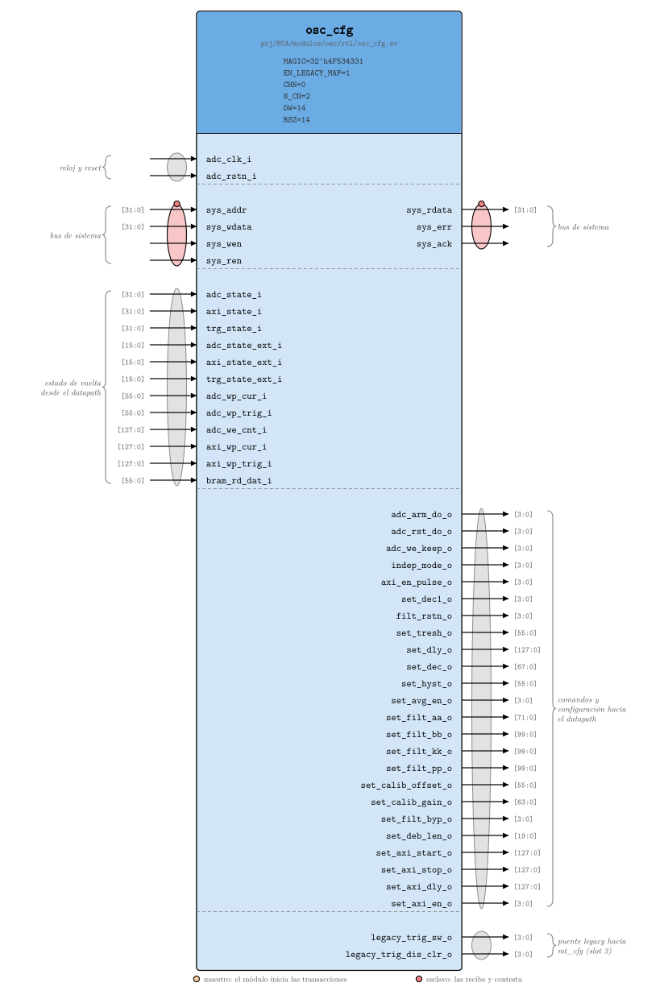
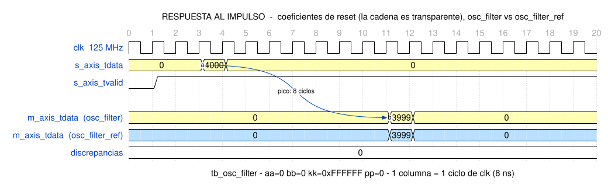
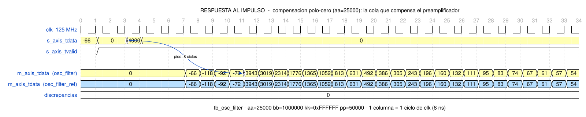
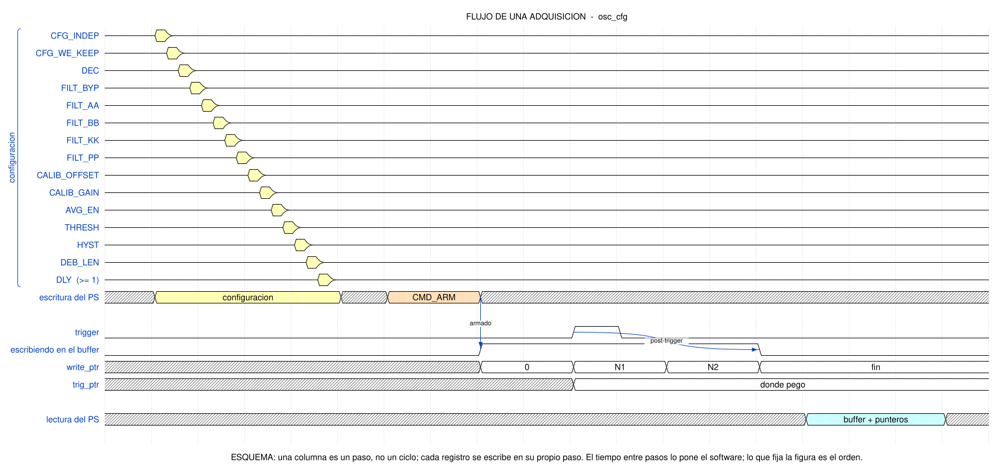

# Datasheet — `osc_cfg`

<!-- Generado por `modulos/mk/datasheet.py`. Lo que está entre las marcas
     AUTO:x y /AUTO:x se REESCRIBE en cada corrida: editar ahí no sirve.
     Todo el resto es prosa a mano y no se toca.
     Regenerar:  make -C modulos/osc/work datasheet              -->

## 1. Función y funcionamiento

### 1.1 Descripción breve

<!-- AUTO:resumen -->
|  |  |
|---|---|
| Módulo RTL | `osc_cfg` |
| Archivo | [`osc_cfg.sv`](../../modulos/osc/rtl/osc_cfg.sv) |
| Parámetros | 6 |
| Puertos | 47 (18 in / 29 out) |
| Parte | `xc7z010clg400-1` |




**Cabecera del RTL** (se copia tal cual de [`osc_cfg.sv`](../../modulos/osc/rtl/osc_cfg.sv)):

> osc_cfg — región de OSC: esclavo del bus de sistema (slot 1, 0x4010_0000)
>
> Sale de multitrigger_rp_scope_cfg, quitándole los registros del multitrigger
> (que se mudaron al slot 3, ver multitrigger_cfg.sv) y reorganizando el mapa.
>
> LOS DOS MAPAS
>
> Este esclavo decodifica DOS rangos de direcciones sobre EL MISMO banco de
> registros físicos. No hay estado duplicado: un solo flop por registro, dos
> decodificadores para alcanzarlo. Escribir por un mapa y leer por el otro
> devuelve el mismo valor, así que no se pueden desincronizar.
>
>   0x00000 - 0x00FFF   mapa LEGACY   offsets históricos de Red Pitaya
>   0x01000 - 0x01FFF   mapa CANÓNICO stride uniforme por canal
>   0x10000 - 0x4FFFF   aperturas BRAM (comunes a los dos mapas)
>
> POR QUÉ EXISTE EL MAPA LEGACY. librp es una librería C cerrada que lee y
> escribe offsets fijos en 0x4010_0000; hay 111 llamadas a la API rp repartidas
> en 14 archivos del software del proyecto (run_acquire, e2e_espectro,
> mca/sources, los benches). Mover los registros sin dejar los offsets viejos
> rompería todo eso de golpe y sin posibilidad de parche del lado Python.
> Con la ventana, la migración del software es incremental.
>
> CÓMO SE SACA. El parámetro EN_LEGACY_MAP la compila fuera. Cuando el software
> esté migrado se pone en 0 y las ramas legacy desaparecen en síntesis; es el
> único lugar donde hay que tocar.
>
> LO QUE EL MAPA LEGACY *NO* CUBRE. Los registros del multitrigger que se
> fueron al slot 3 (0x210, 0x214, 0x218, 0x21C, 0x240-0x24C): librp no los
> conoce, son propios del proyecto, así que no hay compatibilidad que
> preservar — sólo hay que reapuntar multitrigger_utils.py.
>
> Excepción: dos offsets legacy SÍ pertenecen a lógica que se mudó, y librp los
> usa. Se siguen decodificando acá y se mandan al slot 3 ya decodificados por
> canal, por los puertos legacy_trig_sw_o / legacy_trig_dis_clr_o:
>
>   0x004  SW-trigger      (bits [3:0] == 1 del byte del canal)
>   0x094  trig_dis_clr
>
> OJO, DIVERGENCIA PREEXISTENTE. En 0x004 este diseño ya no es el Red Pitaya de
> fábrica: el RTL sólo honra el valor 1 (SW). Un rp_AcqSetTriggerSrc con una
> fuente de flanco escribe 2, 3, ... y se ignora, porque esas fuentes pasaron a
> la OR-mask del multitrigger. La ventana legacy preserva EL COMPORTAMIENTO
> ACTUAL, no el original de Red Pitaya.
>
> ACK DE LATENCIA FIJA — Y EL BUG QUE ESTO ARREGLA
>
> El módulo original sacaba el ack de las aperturas BRAM de bram_ack_i[i], y
> rp_scope_multitrigger_com ata bram_ack[2]/[3] = 0 para los canales no
> construidos: cualquier lectura en 0x4013_0000-0x4014_FFFF no hacía ack NUNCA
> y dejaba el CDC del slot desincronizado (docs/TOP/bus_sistema_redpitaya.md §7.1).
>
> Acá el ack sale de un shift register incondicional, a los 4 ciclos y para
> cualquier dirección. Para los canales que sí existen el timing es IDÉNTICO:
> rp_acq_bram genera bram_ack_o = sys_en retrasado 4 ciclos
> (adc_rval <= {adc_rval[2:0], bram_ack_i}), que es exactamente en_sr[3].
> O sea que se arregla el cuelgue sin cambiar en nada las lecturas buenas.
<!-- /AUTO:resumen -->

<!-- A mano: qué problema resuelve el bloque, cómo encaja en la cadena y las
     dos o tres decisiones de diseño que explican por qué está hecho así. -->

**Qué hace.** Es el esclavo de registros del osciloscopio: configura la cadena
de adquisición —umbral, histéresis, decimación, retardo de disparo, ecualizador—
y expone las **aperturas de BRAM** por donde el PS lee las muestras capturadas.
No procesa datos: todo el flujo de muestras pasa por fuera, y lo que este bloque
controla es *dónde se congela* y *cómo se lee*.

Sale de `multitrigger_rp_scope_cfg` quitándole los registros del multitrigger,
que se mudaron al slot 3 ([`multitrigger_cfg`](datasheet_multitrigger_cfg.md)),
y reorganizando el mapa.

La decisión que explica casi toda su forma: **decodifica dos mapas de
direcciones sobre el mismo banco de registros físicos.**

| Rango | Mapa |
|---|---|
| `0x00000`–`0x00FFF` | **legacy**: los offsets históricos de Red Pitaya |
| `0x01000`–`0x01FFF` | **canónico**: stride uniforme por canal |
| `0x10000`–`0x4FFFF` | aperturas de BRAM, comunes a los dos |

No hay estado duplicado —un solo flop por registro, dos decodificadores para
alcanzarlo—, así que escribir por un mapa y leer por el otro devuelve el mismo
valor y **no se pueden desincronizar**. El mapa legacy existe porque `librp` es
una librería C cerrada que escribe offsets fijos en `0x4010_0000`, y el software
del proyecto la usa en todos lados: hoy son ~80 llamadas a la API `rp`
repartidas en 11 archivos (`run_acquire`, `e2e_espectro`, `mca/sources`, los
benches). Mover los registros sin dejar los viejos rompería todo eso de golpe y
sin posibilidad de parche del lado de Python.

> La cabecera de [`osc_cfg.sv`](../../modulos/osc/rtl/osc_cfg.sv) dice «111
> llamadas en 14 archivos». Ese número ya no se reproduce —`grep` da ~80 en
> 11—, así que o la migración avanzó o se contó de otra forma. El argumento no
> cambia; el número sí conviene no citarlo como vigente. El parámetro `EN_LEGACY_MAP` lo
compila fuera cuando el software esté migrado, y es el único lugar que hay que
tocar.

Dos cosas que conviene saber antes de tocarlo:

- **Dos offsets legacy pertenecen a lógica que ya se mudó** y `librp` los usa,
  así que se siguen decodificando acá y se mandan al slot 3 ya decodificados
  por canal: `0x004` (SW-trigger) y `0x094` (`trig_dis_clr`).
- **En `0x004` este diseño ya no es el Red Pitaya de fábrica.** El RTL sólo
  honra el valor `1` (SW); un `rp_AcqSetTriggerSrc` con una fuente de flanco
  escribe 2, 3, … y se ignora, porque esas fuentes pasaron al multitrigger. Es
  una divergencia **preexistente**, no la introdujo el refactor.

El otro bloque del módulo, `osc_filter`, es el ecualizador IIR: qué le hace a un
flujo de muestras está medido en [§1.6](#16-transacciones).

### 1.2 Interfaces

<!-- AUTO:interfaces -->
#### Parámetros

| Parámetro | Tipo | Default | Para qué |
|---|---|---|---|
| `MAGIC` | `[31:0]` | `32'h4F534331` = `1330856753` | "OSC1" |
| `EN_LEGACY_MAP` | `integer` | `1` | 0 = compila fuera el mapa viejo |
| `CHN` | `integer` | `0` |  |
| `N_CH` | `integer` | `2` |  |
| `DW` | `integer` | `14` |  |
| `RSZ` | `integer` | `14` |  |


#### Puertos

##### Reloj y reset

| Puerto | Dir | Bits | Dominio |
|---|---|---|---|
| `adc_clk_i` | in | 1 | — |
| `adc_rstn_i` | in | 1 | — |


##### Bus de sistema

| Puerto | Dir | Bits | Dominio |
|---|---|---|---|
| `sys_addr` | in | 32 | adc_clk_i |
| `sys_wdata` | in | 32 | adc_clk_i |
| `sys_wen` | in | 1 | adc_clk_i |
| `sys_ren` | in | 1 | adc_clk_i |
| `sys_rdata` | out | 32 | adc_clk_i |
| `sys_err` | out | 1 | adc_clk_i |
| `sys_ack` | out | 1 | adc_clk_i |


##### Estado de vuelta desde el datapath

| Puerto | Dir | Bits | Dominio |
|---|---|---|---|
| `adc_state_i` | in | 32 | adc_clk_i |
| `axi_state_i` | in | 32 | adc_clk_i |
| `trg_state_i` | in | 32 | adc_clk_i |
| `adc_state_ext_i` | in | 16 | adc_clk_i |
| `axi_state_ext_i` | in | 16 | adc_clk_i |
| `trg_state_ext_i` | in | 16 | adc_clk_i |
| `adc_wp_cur_i` | in | 56 `[4*RSZ-1: 0]` | adc_clk_i |
| `adc_wp_trig_i` | in | 56 `[4*RSZ-1: 0]` | adc_clk_i |
| `adc_we_cnt_i` | in | 128 | adc_clk_i |
| `axi_wp_cur_i` | in | 128 | adc_clk_i |
| `axi_wp_trig_i` | in | 128 | adc_clk_i |
| `bram_rd_dat_i` | in | 56 `[4*DW -1: 0]` | adc_clk_i |


##### Comandos y configuración hacia el datapath

| Puerto | Dir | Bits | Dominio |
|---|---|---|---|
| `adc_arm_do_o` | out | 4 | adc_clk_i |
| `adc_rst_do_o` | out | 4 | adc_clk_i |
| `adc_we_keep_o` | out | 4 | adc_clk_i |
| `indep_mode_o` | out | 4 | adc_clk_i |
| `axi_en_pulse_o` | out | 4 | adc_clk_i |
| `set_dec1_o` | out | 4 | adc_clk_i |
| `filt_rstn_o` | out | 4 | adc_clk_i |
| `set_tresh_o` | out | 56 `[4*DW -1: 0]` | adc_clk_i |
| `set_dly_o` | out | 128 | adc_clk_i |
| `set_dec_o` | out | 68 | adc_clk_i |
| `set_hyst_o` | out | 56 `[4*DW -1: 0]` | adc_clk_i |
| `set_avg_en_o` | out | 4 | adc_clk_i |
| `set_filt_aa_o` | out | 72 | adc_clk_i |
| `set_filt_bb_o` | out | 100 | adc_clk_i |
| `set_filt_kk_o` | out | 100 | adc_clk_i |
| `set_filt_pp_o` | out | 100 | adc_clk_i |
| `set_calib_offset_o` | out | 56 `[4*DW -1: 0]` | adc_clk_i |
| `set_calib_gain_o` | out | 64 | adc_clk_i |
| `set_filt_byp_o` | out | 4 | adc_clk_i |
| `set_deb_len_o` | out | 20 | adc_clk_i |
| `set_axi_start_o` | out | 128 | adc_clk_i |
| `set_axi_stop_o` | out | 128 | adc_clk_i |
| `set_axi_dly_o` | out | 128 | adc_clk_i |
| `set_axi_en_o` | out | 4 | adc_clk_i |


##### Puente legacy hacia multitrigger_cfg (slot 3)

Pulsos ya decodificados por canal desde los offsets 0x004 y 0x094.

| Puerto | Dir | Bits | Dominio |
|---|---|---|---|
| `legacy_trig_sw_o` | out | 4 | adc_clk_i |
| `legacy_trig_dis_clr_o` | out | 4 | adc_clk_i |
<!-- /AUTO:interfaces -->

### 1.3 Mapa de registros

<!-- AUTO:regmap -->
`osc_cfg` es esclavo del bus de sistema (`sys_addr`, `sys_wdata`, `sys_wen`, `sys_ren`, `sys_rdata`, `sys_err`, `sys_ack`). El mapa completo está en:

- [`register_map_osc.md`](../osc/register_map_osc.md)

Contrato del bus: [`bus_sistema_redpitaya.md`](../TOP/bus_sistema_redpitaya.md) · Mapa de slots: [`register_map_top.md`](../TOP/register_map_top.md)
<!-- /AUTO:regmap -->

### 1.4 Clock domains

<!-- AUTO:clocks -->
| Puerto | Qué es | Polaridad |
|---|---|---|
| `adc_clk_i` | reloj |  |
| `adc_rstn_i` | reset | activo-bajo |


**Un solo dominio.** Todos los puertos de datos y de control son síncronos a `adc_clk_i`: no hay cruce de dominio dentro de este módulo.
<!-- /AUTO:clocks -->

<!-- A mano: si hay más de un reloj, cuál es el cruce, con qué se sincroniza y
     qué se asume de la relación de frecuencias. Si hay uno solo, borrar. -->

### 1.5 Frecuencia máxima de trabajo

<!-- AUTO:timing -->
**Punto de síntesis** — Vivado out-of-context, `xc7z010clg400-1`.

| Métrica | Valor |
|---|---|
| Período de la restricción | 8.00 ns (125.0 MHz) |
| WNS | 1.844 ns |
| Camino crítico | 6.156 ns |
| **Fmax** | **162.4 MHz** |
| Niveles de lógica | 3 |


**Camino crítico**

|  |  |
|---|---|
| startpoint | `set_dec_reg[1]/C` |
| endpoint | `set_dec1_o[1]` |


**Recursos**

| LUT | FF | BRAM | DSP | CARRY | MUXF |
|---|---|---|---|---|---|
| 1992 | 1279 | 0 | 0 | 0 | 1 |


`lut` cuenta **primitivas** LUT, no los _Slice LUTs_ del `report_utilization` (dos LUT5 que comparten O5/O6 ocupan un solo sitio).

_Barrido no corrido_: `make -C modulos/osc/work sweep-all` y regenerar.
<!-- /AUTO:timing -->

<!-- A mano: qué hay en el camino crítico y qué se haría para romperlo si
     hubiera que subir la frecuencia. -->

### 1.6 Transacciones

<!-- AUTO:transacciones -->
**LO QUE ENTRA: UN IMPULSO**


Que entra. Una muestra de 4000 cuentas y el resto cero. Para un filtro lineal invariante eso no es un caso mas: la respuesta al impulso LO DESCRIBE ENTERO, asi que las dos curvas del panel (c) son la caracterizacion completa del bloque con cada juego de coeficientes. El flujo es de una muestra por ciclo de adc_clk (8 ns) y no hay handshake que lo pueda frenar: el `tready` existe en los puertos pero el dato llega igual, asi que lo que el bloque hace tiene que hacerlo en un ciclo.

_Origen: `tb_osc_filter`, VCD completo._

**EL BLOQUE, Y EL MODELO QUE CORRE AL LADO**


Que viaja. El bloque es una compensacion polo-cero, dos IIR de primer orden y una etapa de escalado, con cuatro coeficientes configurables. Lo que esta figura agrega a un diagrama de bloques es el segundo camino: el testbench instancia AL LADO del DUT una copia congelada del filtro anterior al rediseno (`osc_filter_ref.v`) y le da el mismo flujo. No se comparan resumenes ni metricas: se comparan las dos salidas muestra por muestra.

_Origen: `osc_filter.v` y `sim/osc_filter_ref.v`._

**LO QUE SALE: EL MISMO IMPULSO, DOS FILTROS**


Que sale, y es donde esta todo. Con los coeficientes de RESET la cadena queda transparente: el impulso de 4000 sale como una sola muestra de 3999 --o sea ganancia 0.99975, el error de redondeo de kk = 2^24-1 en vez de 2^24-- 8 ciclos despues. Con la compensacion POLO-CERO el mismo impulso sale como una exponencial que arranca en 3943 y tarda 99 ciclos en caer al 1 %: el filtro no recorta la cola, la FABRICA, porque esta pensado para cancelar la del detector --un cero donde el preamplificador pone su polo--. La latencia es la misma en los dos casos, 8 ciclos, porque el pipeline no depende de los coeficientes: lo MEDIDO es 8 y 8. Lo que si cambia es que con polo-cero el pico viene precedido por un precursor de hasta 118 cuentas que arranca 4 ciclos antes --el camino directo, que llega antes que las dos IIR--; es chico pero existe, y medir la latencia por la primera muestra no nula en vez de por el pico lo contaria como si la respuesta empezara ahi. Los circulos son `ref_out`: la salida del modelo congelado coincide con la del DUT en 460 de los 460 ciclos dibujados, o sea TODOS. Esa coincidencia es el contenido de la figura.

_Origen: `tb_osc_filter`, escenas de coeficientes de reset y polo-cero._

**LA TRANSACCION COMPLETA**


Las tres preguntas en una imagen: que entra, que viaja y que sale.

_Origen: las tres anteriores, en una figura._

---

Las figuras **recalculan cada número al dibujar** en vez de tomarlo escrito. Las genera [`transacciones_osc.py`](../osc/figuras/transacciones/transacciones_osc.py); de dónde sale el dato de cada una está en la columna «Datos» de [`README.md`](../osc/figuras/transacciones/README.md); los epígrafes completos, en [`epigrafes.txt`](../osc/figuras/transacciones/epigrafes.txt).
<!-- /AUTO:transacciones -->

### 1.7 Waveforms

<!-- AUTO:ondas -->
**RESPUESTA AL IMPULSO  -  coeficientes de reset (la cadena es transparente), osc_filter vs osc_filter_ref**



Los coeficientes de reset son los que usa el driver hoy, asi que es la configuracion que mas importa que no haya cambiado. Un impulso entra y sale UN solo impulso, del mismo tamano: con aa=bb=pp=0 y kk en 2^24-1 la cadena es transparente y lo unico que agrega es latencia, que es el numero que da esta figura. Las dos salidas se dibujan superpuestas a proposito: tb_osc_filter es un test de EQUIVALENCIA contra el filtro original del repo, asi que las filas de osc_filter y osc_filter_ref tienen que ser la misma onda columna por columna. Si en alguna se separan, el testbench esta fallando y la figura lo muestra.

_Origen: `tb_osc_filter`, caso de coeficientes de reset._

**RESPUESTA AL IMPULSO  -  compensacion polo-cero (aa=25000): la cola que compensa el preamplificador**



La misma entrada que la figura anterior --un impulso-- con el lazo recursivo activo. Ahora la salida no es un impulso sino un pico seguido de una COLA que decae: eso es la compensacion polo-cero, que cancela la cola del preamplificador para que el pulso vuelva a la linea de base antes del siguiente. Es la parte del filtro que se rediseno, y la figura muestra que la cola entera --mas de veinte muestras-- coincide con la del filtro original muestra por muestra. Se dibuja el impulso y no un escalon porque con aa=25000 la constante de tiempo es de cientos de ciclos: un escalon no se asienta dentro de una ventana que se pueda mirar.

_Origen: `tb_osc_filter`, caso de compensacion polo-cero._

**FLUJO DE UNA ADQUISICION  -  osc_cfg**



Es un esquema de la SECUENCIA, no una medicion: no hay testbench de osc_cfg del que sacar las ondas (ver §1.7 de su datasheet, que lo marca como deuda de verificacion). Lo que la figura fija es el orden y las dependencias: la configuracion del filtro y del diezmado va ANTES del armado, porque cambiarla con el buffer llenandose mezcla muestras de dos configuraciones en la misma traza; y la lectura va despues de que el puntero deje de moverse, porque leer durante la captura devuelve una traza partida entre dos vueltas del buffer.

_Origen: esquema (sin VCD: `osc_cfg` no tiene testbench)._

---

Las figuras y sus epígrafes los escribe [`ondas_osc.py`](../osc/figuras/ondas/ondas_osc.py): los tiempos y las latencias se **miden sobre el VCD**, no se escriben a mano, así que no pueden desincronizarse del RTL. Los epígrafes completos, con los números, están en [`epigrafes.txt`](../osc/figuras/ondas/epigrafes.txt).

```bash
python3 docs/osc/figuras/ondas/ondas_osc.py    # regenerar
```
<!-- /AUTO:ondas -->

<!-- A mano: lo que las figuras no pueden mostrar solas. Para
     agregar una, editar docs/osc/figuras/ondas/ondas_osc.py:
     la onda sale de un VCD de los testbenches y los tiempos los
     mide el script, no se escriben acá.
       make -C modulos/osc/work wave TB=<tb>   # mirar en Questa
       make -C modulos/osc/work vcd  TB=<tb>   # VCD exportable -->
orden en que la hace el software.

### 1.8 Verificación realizada

<!-- AUTO:verificacion -->
Todo corre en batch y se chequea el `RESULT: PASS` del testbench; las ondas quedan en `work/waves/<tb>.wlf`.

```bash
make -C modulos/osc/work            # el 1 testbench
make -C modulos/osc/work cov        # + cobertura
make -C modulos/osc/work lint
```

| Testbench | DUT | Escenas | Casos | Contra qué compara | Es el de este módulo |
|---|---|---|---|---|---|
| [`tb_osc_filter`](../../modulos/osc/sim/tb_osc_filter.sv) | `osc_filter` | 7 | 10 | RTL de referencia `osc_filter_ref.v` instanciado al lado del DUT |  |


**10 casos con nombre** en 1 testbench (7 escenas). La lista completa, caso por caso, está en el plan de verificación.

> **`osc_cfg` no tiene testbench propio.** Ningún `TBS` del `work/Makefile` lo instancia como DUT: lo que se verifica de este módulo es lo que arrastre el TB de otro. Es deuda de verificación, no una omisión de esta página.

**Assertions** — en `sim/sva/`, enganchadas por `bind` (no tocan el RTL sintetizable).

- [`bind_osc.sv`](../../modulos/osc/sim/sva/bind_osc.sv)
- [`osc_cfg_sva.sv`](../../modulos/osc/sim/sva/osc_cfg_sva.sv)

> **Los archivos de assertions están vacíos.** Son el scaffold de `create_module.py`: tienen el `bind`, el `default clocking` y un `// TODO:`, pero **ninguna propiedad**. O sea que hoy no aportan nada a la verificación; el enganche ya está hecho y lo que falta es escribirlas. Ver [`verificacion_formal.md`](../verificacion_formal.md), que discute cuáles convienen primero.

Plan de verificación, casos cubiertos y deuda: [`osc/sim/VERIFICACION.md`](../../modulos/osc/sim/VERIFICACION.md).
<!-- /AUTO:verificacion -->

#### Esquema de laboratorio

TODO — qué instrumento, cómo se conecta, qué se mide y contra qué se compara.
