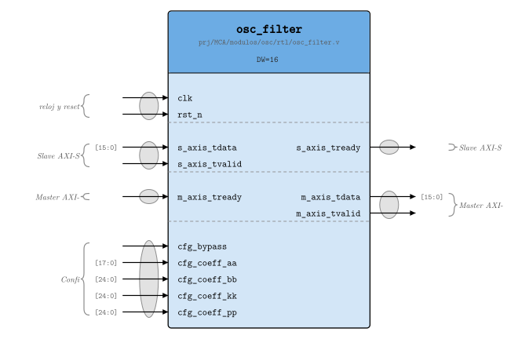
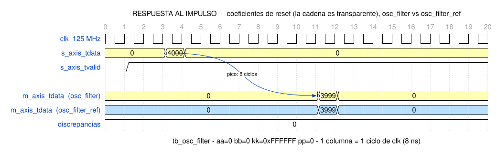
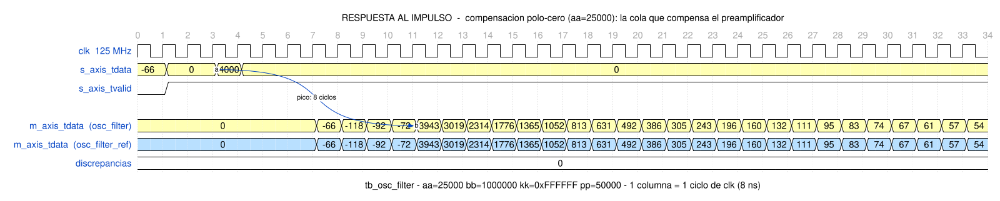
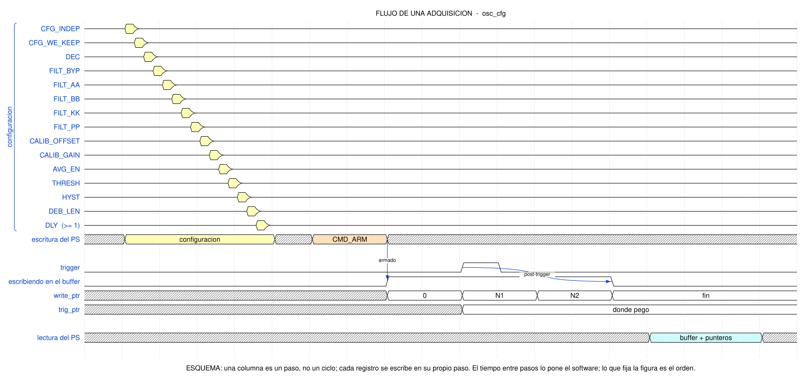

# Datasheet — `osc_filter`

<!-- Generado por `modulos/mk/datasheet.py`. Lo que está entre las marcas
     AUTO:x y /AUTO:x se REESCRIBE en cada corrida: editar ahí no sirve.
     Todo el resto es prosa a mano y no se toca.
     Regenerar:  make -C modulos/osc/work datasheet              -->

## 1. Función y funcionamiento

### 1.1 Descripción breve

<!-- AUTO:resumen -->
|  |  |
|---|---|
| Módulo RTL | `osc_filter` |
| Archivo | [`osc_filter.v`](../../modulos/osc/rtl/osc_filter.v) |
| Parámetros | 1 |
| Puertos | 13 (10 in / 3 out) |
| Parte | `xc7z010clg400-1` |



<!-- /AUTO:resumen -->

<!-- A mano: qué problema resuelve el bloque, cómo encaja en la cadena y las
     dos o tres decisiones de diseño que explican por qué está hecho así. -->

**Qué hace.** TODO

### 1.2 Interfaces

<!-- AUTO:interfaces -->
#### Parámetros

| Parámetro | Default |
|---|---|
| `DW` | `16` |


#### Puertos

##### Reloj y reset

| Puerto | Dir | Bits | Dominio |
|---|---|---|---|
| `clk` | in | 1 | — |
| `rst_n` | in | 1 | — |


##### Slave AXI-S

| Puerto | Dir | Bits | Dominio |
|---|---|---|---|
| `s_axis_tdata` | in | 16 `[DW-1:0]` | clk |
| `s_axis_tvalid` | in | 1 | clk |
| `s_axis_tready` | out | 1 | clk |


##### Master AXI-

| Puerto | Dir | Bits | Dominio |
|---|---|---|---|
| `m_axis_tdata` | out | 16 `[DW-1:0]` | clk |
| `m_axis_tvalid` | out | 1 | clk |
| `m_axis_tready` | in | 1 | clk |


##### Confi

| Puerto | Dir | Bits | Dominio |
|---|---|---|---|
| `cfg_bypass` | in | 1 | clk |
| `cfg_coeff_aa` | in | 18 | clk |
| `cfg_coeff_bb` | in | 25 | clk |
| `cfg_coeff_kk` | in | 25 | clk |
| `cfg_coeff_pp` | in | 25 | clk |
<!-- /AUTO:interfaces -->

### 1.3 Mapa de registros

<!-- AUTO:regmap -->
Mapas de registros de la región:

- [`register_map_osc.md`](../osc/register_map_osc.md)

Contrato del bus: [`bus_sistema_redpitaya.md`](../TOP/bus_sistema_redpitaya.md) · Mapa de slots: [`register_map_top.md`](../TOP/register_map_top.md)
<!-- /AUTO:regmap -->

### 1.4 Clock domains

<!-- AUTO:clocks -->
| Puerto | Qué es | Polaridad |
|---|---|---|
| `clk` | reloj |  |
| `rst_n` | reset | activo-alto |


**Un solo dominio.** Todos los puertos de datos y de control son síncronos a `clk`: no hay cruce de dominio dentro de este módulo.
<!-- /AUTO:clocks -->

<!-- A mano: si hay más de un reloj, cuál es el cruce, con qué se sincroniza y
     qué se asume de la relación de frecuencias. Si hay uno solo, borrar. -->

### 1.5 Frecuencia máxima de trabajo

<!-- AUTO:timing -->
El `metrics.txt` del módulo es de `osc_cfg`, no de `osc_filter`: la síntesis OOC del módulo apunta a otro top, así que acá no hay números propios de este bloque.
<!-- /AUTO:timing -->

<!-- A mano: qué hay en el camino crítico y qué se haría para romperlo si
     hubiera que subir la frecuencia. -->

### 1.6 Waveforms

<!-- AUTO:ondas -->
**RESPUESTA AL IMPULSO  -  coeficientes de reset (la cadena es transparente), osc_filter vs osc_filter_ref**



Los coeficientes de reset son los que usa el driver hoy, asi que es la configuracion que mas importa que no haya cambiado. Un impulso entra y sale UN solo impulso, del mismo tamano: con aa=bb=pp=0 y kk en 2^24-1 la cadena es transparente y lo unico que agrega es latencia, que es el numero que da esta figura. Las dos salidas se dibujan superpuestas a proposito: tb_osc_filter es un test de EQUIVALENCIA contra el filtro original del repo, asi que las filas de osc_filter y osc_filter_ref tienen que ser la misma onda columna por columna. Si en alguna se separan, el testbench esta fallando y la figura lo muestra.

_Origen: `tb_osc_filter`, caso de coeficientes de reset._

**RESPUESTA AL IMPULSO  -  compensacion polo-cero (aa=25000): la cola que compensa el preamplificador**



La misma entrada que la figura anterior --un impulso-- con el lazo recursivo activo. Ahora la salida no es un impulso sino un pico seguido de una COLA que decae: eso es la compensacion polo-cero, que cancela la cola del preamplificador para que el pulso vuelva a la linea de base antes del siguiente. Es la parte del filtro que se rediseno, y la figura muestra que la cola entera --mas de veinte muestras-- coincide con la del filtro original muestra por muestra. Se dibuja el impulso y no un escalon porque con aa=25000 la constante de tiempo es de cientos de ciclos: un escalon no se asienta dentro de una ventana que se pueda mirar.

_Origen: `tb_osc_filter`, caso de compensacion polo-cero._

**FLUJO DE UNA ADQUISICION  -  osc_cfg**



Es un esquema de la SECUENCIA, no una medicion: no hay testbench de osc_cfg del que sacar las ondas (ver §1.7 de su datasheet, que lo marca como deuda de verificacion). Lo que la figura fija es el orden y las dependencias: la configuracion del filtro y del diezmado va ANTES del armado, porque cambiarla con el buffer llenandose mezcla muestras de dos configuraciones en la misma traza; y la lectura va despues de que el puntero deje de moverse, porque leer durante la captura devuelve una traza partida entre dos vueltas del buffer.

_Origen: esquema (sin VCD: `osc_cfg` no tiene testbench)._

---

Las figuras y sus epígrafes los escribe [`ondas_osc.py`](../osc/figuras/ondas/ondas_osc.py): los tiempos y las latencias se **miden sobre el VCD**, no se escriben a mano, así que no pueden desincronizarse del RTL. Los epígrafes completos, con los números, están en [`epigrafes.txt`](../osc/figuras/ondas/epigrafes.txt).

```bash
python3 docs/osc/figuras/ondas/ondas_osc.py    # regenerar
```
<!-- /AUTO:ondas -->

<!-- A mano: lo que las figuras no pueden mostrar solas. Para agregar una,
     editar docs/osc/figuras/ondas/ondas_osc.py: la onda
     sale de un VCD de los testbenches y los tiempos los mide el script.
       make -C modulos/osc/work wave TB=<tb>   # mirar en Questa
       make -C modulos/osc/work vcd  TB=<tb>   # VCD exportable -->

### 1.7 Verificación realizada

<!-- AUTO:verificacion -->
Todo corre en batch y se chequea el `RESULT: PASS` del testbench; las ondas quedan en `work/waves/<tb>.wlf`.

```bash
make -C modulos/osc/work            # el 1 testbench
make -C modulos/osc/work cov        # + cobertura
make -C modulos/osc/work lint
```

| Testbench | DUT | Escenas | Casos | Contra qué compara | Es el de este módulo |
|---|---|---|---|---|---|
| [`tb_osc_filter`](../../modulos/osc/sim/tb_osc_filter.sv) | `osc_filter` | 7 | 10 | RTL de referencia `osc_filter_ref.v` instanciado al lado del DUT | **sí** |


**10 casos con nombre** en 1 testbench (7 escenas). La lista completa, caso por caso, está en el plan de verificación.

Las escenas de [`tb_osc_filter`](../../modulos/osc/sim/tb_osc_filter.sv): 1) Coeficientes de RESET, 2) Compensación polo-cero tipica (aa != 0, 3) aa grande positivo y negativo, 4) pp extremos, 5) kk extremos, 6) Todo al maximo a la vez, 7) Barrido aleatorio de coeficientes.

**Assertions** — en `sim/sva/`, enganchadas por `bind` (no tocan el RTL sintetizable).

- [`bind_osc.sv`](../../modulos/osc/sim/sva/bind_osc.sv)
- [`osc_cfg_sva.sv`](../../modulos/osc/sim/sva/osc_cfg_sva.sv)

> **Los archivos de assertions están vacíos.** Son el scaffold de `create_module.py`: tienen el `bind`, el `default clocking` y un `// TODO:`, pero **ninguna propiedad**. O sea que hoy no aportan nada a la verificación; el enganche ya está hecho y lo que falta es escribirlas. Ver [`verificacion_formal.md`](../verificacion_formal.md), que discute cuáles convienen primero.

Plan de verificación, casos cubiertos y deuda: [`osc/sim/VERIFICACION.md`](../../modulos/osc/sim/VERIFICACION.md).
<!-- /AUTO:verificacion -->

#### Esquema de laboratorio

TODO — qué instrumento, cómo se conecta, qué se mide y contra qué se compara.
