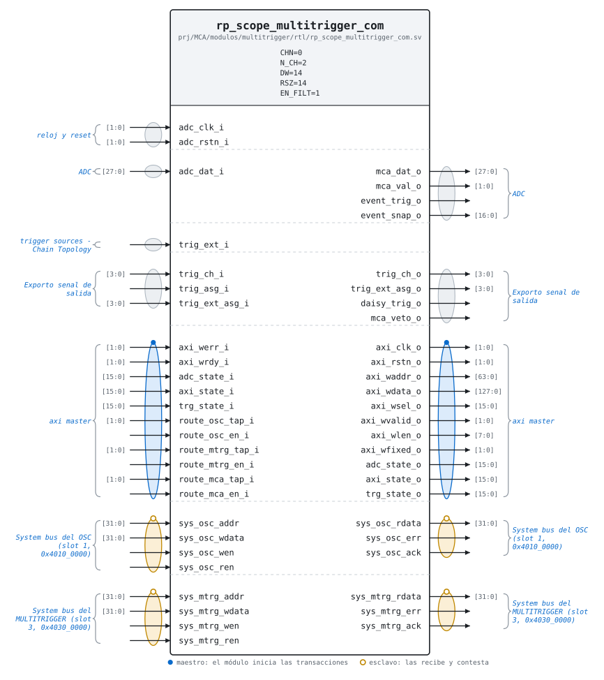

# Datasheet — `rp_scope_multitrigger_com`

<!-- Generado por `modulos/mk/datasheet.py`. Lo que está entre las marcas
     AUTO:x y /AUTO:x se REESCRIBE en cada corrida: editar ahí no sirve.
     Todo el resto es prosa a mano y no se toca.
     Regenerar:  make -C modulos/multitrigger/work datasheet              -->

## 1. Función y funcionamiento

### 1.1 Descripción breve

<!-- AUTO:resumen -->
|  |  |
|---|---|
| Módulo RTL | `rp_scope_multitrigger_com` |
| Archivo | [`rp_scope_multitrigger_com.sv`](../../modulos/multitrigger/rtl/rp_scope_multitrigger_com.sv) |
| Parámetros | 5 |
| Puertos | 51 (26 in / 25 out) |




**Cabecera del RTL** (se copia tal cual de [`rp_scope_multitrigger_com.sv`](../../modulos/multitrigger/rtl/rp_scope_multitrigger_com.sv)):

> Cada uno de estos tiene como entradas dos canales de datos
<!-- /AUTO:resumen -->

<!-- A mano: qué problema resuelve el bloque, cómo encaja en la cadena y las
     dos o tres decisiones de diseño que explican por qué está hecho así. -->

**Qué hace.** TODO

### 1.2 Interfaces

<!-- AUTO:interfaces -->
#### Parámetros

| Parámetro | Default | Para qué |
|---|---|---|
| `CHN` | `0` | Channel Number |
| `N_CH` | `2` | Number of Channels |
| `DW` | `14` | Data Width |
| `RSZ` | `14` | RAM size 2^RSZ |
| `EN_FILT` | `1` |  |


#### Puertos

##### ADC

| Puerto | Dir | Bits | Dominio | Descripción |
|---|---|---|---|---|
| `adc_clk_i` | in | 2 `[N_CH   -1: 0]` | — | ADC clock |
| `adc_rstn_i` | in | 2 `[N_CH   -1: 0]` | — | ADC reset - active low |
| `adc_dat_i` | in | 28 `[N_CH*DW-1: 0]` | adc_clk_i | ADC data CHA - Hace mal uso de las dimensiones packed? |
| `mca_dat_o` | out | 28 `[N_CH*DW-1: 0]` | adc_clk_i | Muestra acondicionada hacia el MCA: post-calibracion, post-ecualizador (si EN_FILT=1) y PRE-decimacion, a 125 MSPS. Es el mismo nodo que alimenta a rp_decim, asi que los umbrales del MCA y del scope son comparables, pero el MCA lleva su propia decimacion y queda desacoplado del set_dec del scope. En red_pitaya_top estos puertos quedan sin conectar (es legal para salidas) y se podan: el netlist del scope no cambia. |
| `mca_val_o` | out | 2 `[N_CH   -1: 0]` | adc_clk_i |  |
| `event_trig_o` | out | 1 | adc_clk_i | Evento conjunto hacia el event_ring (Fase 1). Es el MISMO trigger_event que alimenta a rp_bram_sm y rp_axi_sm, y el mismo snapshot que se lee por 0x218: el ring no introduce una fuente de disparo nueva, se cuelga de la que ya existe. |
| `event_snap_o` | out | 17 | adc_clk_i |  |


##### Trigger sources - Chain Topology

| Puerto | Dir | Bits | Dominio | Descripción |
|---|---|---|---|---|
| `trig_ext_i` | in | 1 | adc_clk_i | external trigger |


##### Exporto senal de salida

| Puerto | Dir | Bits | Dominio | Descripción |
|---|---|---|---|---|
| `trig_ch_o` | out | 4 | adc_clk_i | output trigger to ADC for other 2 channels. Q: por qué 4? Por n y p |
| `trig_ch_i` | in | 4 | adc_clk_i | input ADC trigger from other 2 channels |
| `trig_asg_i` | in | 1 | adc_clk_i | ASG trigger |
| `trig_ext_asg_o` | out | 4 | adc_clk_i | output External and ASG trigger to share between multiple scope modules |
| `trig_ext_asg_i` | in | 4 | adc_clk_i | input External and ASG trigger |
| `daisy_trig_o` | out | 1 | adc_clk_i | trigger for daisy chaining |
| `mca_veto_o` | out | 1 | adc_clk_i | nivel del trigger_shield hacia el MCA |


##### Axi master

| Puerto | Dir | Bits | Dominio | Descripción |
|---|---|---|---|---|
| `axi_clk_o` | out | 2 `[N_CH   -1: 0]` | adc_clk_i | global clock |
| `axi_rstn_o` | out | 2 `[N_CH   -1: 0]` | adc_clk_i | global reset |
| `axi_waddr_o` | out | 64 `[N_CH*32-1: 0]` | adc_clk_i | system write address |
| `axi_wdata_o` | out | 128 `[N_CH*64-1: 0]` | adc_clk_i | system write data |
| `axi_wsel_o` | out | 16 `[N_CH* 8-1: 0]` | adc_clk_i | system write byte select |
| `axi_wvalid_o` | out | 2 `[N_CH   -1: 0]` | adc_clk_i | system write data valid |
| `axi_wlen_o` | out | 8 `[N_CH* 4-1: 0]` | adc_clk_i | system write burst length |
| `axi_wfixed_o` | out | 2 `[N_CH   -1: 0]` | adc_clk_i | system write burst type (fixed / incremental) |
| `axi_werr_i` | in | 2 `[N_CH   -1: 0]` | adc_clk_i | system write error |
| `axi_wrdy_i` | in | 2 `[N_CH   -1: 0]` | adc_clk_i | system write ready |
| `adc_state_o` | out | 16 | adc_clk_i |  |
| `adc_state_i` | in | 16 | adc_clk_i |  |
| `axi_state_o` | out | 16 | adc_clk_i |  |
| `axi_state_i` | in | 16 | adc_clk_i |  |
| `trg_state_o` | out | 16 | adc_clk_i |  |
| `trg_state_i` | in | 16 | adc_clk_i | Trigger state? Se conecta a la configuración. |
| `route_osc_tap_i` | in | 2 | adc_clk_i | Ruteo del datapath, desde integration_cfg (region de TOP, slot 6). En reset valen TAP_NATIVE/enable=1, o sea el cableado de siempre. |
| `route_osc_en_i` | in | 1 | adc_clk_i |  |
| `route_mtrg_tap_i` | in | 2 | adc_clk_i |  |
| `route_mtrg_en_i` | in | 1 | adc_clk_i |  |
| `route_mca_tap_i` | in | 2 | adc_clk_i |  |
| `route_mca_en_i` | in | 1 | adc_clk_i |  |


##### System bus del OSC (slot 1, 0x4010_0000)

| Puerto | Dir | Bits | Dominio |
|---|---|---|---|
| `sys_osc_addr` | in | 32 | adc_clk_i |
| `sys_osc_wdata` | in | 32 | adc_clk_i |
| `sys_osc_wen` | in | 1 | adc_clk_i |
| `sys_osc_ren` | in | 1 | adc_clk_i |
| `sys_osc_rdata` | out | 32 | adc_clk_i |
| `sys_osc_err` | out | 1 | adc_clk_i |
| `sys_osc_ack` | out | 1 | adc_clk_i |


##### System bus del MULTITRIGGER (slot 3, 0x4030_0000)

| Puerto | Dir | Bits | Dominio |
|---|---|---|---|
| `sys_mtrg_addr` | in | 32 | adc_clk_i |
| `sys_mtrg_wdata` | in | 32 | adc_clk_i |
| `sys_mtrg_wen` | in | 1 | adc_clk_i |
| `sys_mtrg_ren` | in | 1 | adc_clk_i |
| `sys_mtrg_rdata` | out | 32 | adc_clk_i |
| `sys_mtrg_err` | out | 1 | adc_clk_i |
| `sys_mtrg_ack` | out | 1 | adc_clk_i |
<!-- /AUTO:interfaces -->

### 1.3 Mapa de registros

<!-- AUTO:regmap -->
`rp_scope_multitrigger_com` es esclavo del bus de sistema (`sys_osc_addr`, `sys_osc_wdata`, `sys_osc_wen`, `sys_osc_ren`, `sys_osc_rdata`, `sys_osc_err`, `sys_osc_ack`, `sys_mtrg_addr`, `sys_mtrg_wdata`, `sys_mtrg_wen`, `sys_mtrg_ren`, `sys_mtrg_rdata`, `sys_mtrg_err`, `sys_mtrg_ack`). El mapa completo está en:

- [`register_map_multitrigger.md`](../multitrigger/register_map_multitrigger.md)
- [`register_map_multitrigger_rp_scope_cfg.md`](../multitrigger/register_map_multitrigger_rp_scope_cfg.md)

Contrato del bus: [`bus_sistema_redpitaya.md`](../TOP/bus_sistema_redpitaya.md) · Mapa de slots: [`register_map_top.md`](../TOP/register_map_top.md)
<!-- /AUTO:regmap -->

### 1.4 Clock domains

<!-- AUTO:clocks -->
| Puerto | Qué es | Polaridad | Notas |
|---|---|---|---|
| `adc_clk_i` | reloj ×2 |  | ADC clock |
| `adc_rstn_i` | reset | activo-bajo | ADC reset - active low |


**`adc_clk_i` es un vector de 2 relojes** (uno por canal): el bloque se replica, y lo que acá parece un dominio son 2. Qué se cruza entre réplicas —si algo se cruza— va escrito abajo, no se infiere del nombre.
<!-- /AUTO:clocks -->

<!-- A mano: si hay más de un reloj, cuál es el cruce, con qué se sincroniza y
     qué se asume de la relación de frecuencias. Si hay uno solo, borrar. -->

### 1.5 Frecuencia máxima de trabajo

<!-- AUTO:timing -->
Sin datos de síntesis todavía. Correr:

```bash
make -C modulos/multitrigger/work syn
make -C modulos/multitrigger/work sweep-all
```

y volver a generar esta página.
<!-- /AUTO:timing -->

<!-- A mano: qué hay en el camino crítico y qué se haría para romperlo si
     hubiera que subir la frecuencia. -->

### 1.6 Waveforms

<!-- AUTO:ondas -->
**LAS TRES FORMAS DEL VETO AL MCA  -  nivel / nivel con cola / ventana por flanco**


El mismo bloque da tres vetos distintos segun como se lo configure, y la diferencia no esta en el RTL sino en que fuente se elige y que duracion se escribe. Con una fuente de NIVEL y dur=0 el veto es la linea con un ciclo de latencia: dura lo que dure la linea. Con la misma fuente y dur=8 el veto se extiende ocho ciclos despues de que la linea baje, que es lo que hace falta cuando el estimulo deja cola. Con una fuente de FLANCO y dur=12 el veto es una ventana fija de doce ciclos, sin importar cuanto dure el pulso. Los tres tramos vienen de escenas distintas del testbench y el hueco entre ellos dice que se salteo tiempo: no es una secuencia.

_Origen: `tb_trigger_shield`, escenas 4, 5 y 6._

**HOLDOFF Y RE-ARM  -  el escudo cuenta y al expirar limpia el canal de destino**


Lo que el escudo hace de verdad: cuando el canal fuente dispara, arranca un contador y mantiene `active` mientras cuenta; al expirar emite UN pulso de clear en el canal de destino, que es lo que lo vuelve a armar. Importa que el clear salga al EXPIRAR y no al disparar: si saliera al disparar, el canal de destino se re-armaria en medio del evento que el escudo esta tratando de protegerlo.

_Origen: `tb_trigger_shield`, escena 2._

**DISPARO SINGLE-SHOT  -  el flanco dispara, engancha el disable y la mascara se auto-limpia**


El flanco de la fuente habilitada dispara `adc_trig` y en el mismo movimiento engancha `adc_trg_dis`, que es lo que impide que el siguiente flanco vuelva a disparar. En modo single-shot la mascara se auto-limpia, asi que para volver a disparar hace falta reescribirla; en modo continuo la mascara persiste y basta con limpiar el disable. Esa es la unica diferencia entre los dos modos.

_Origen: `tb_multitrigger_trig_src`, escena 1._

**FLUJO DE UTILIZACION  -  multitrigger_cfg**


Es un esquema de la SECUENCIA, no una medicion. Lo que fija es el orden y una dependencia que no se ve en el mapa de registros: el disable queda ENGANCHADO despues del disparo, asi que sin escribir TRIG_DIS_CLR no hay segundo disparo. Un programa que configure, dispare y se quede esperando el proximo evento sin limpiar el disable espera para siempre.

_Origen: esquema (sin VCD)._

---

Las figuras y sus epígrafes los escribe [`ondas_multitrigger.py`](../multitrigger/figuras/ondas/ondas_multitrigger.py): los tiempos y las latencias se **miden sobre el VCD**, no se escriben a mano, así que no pueden desincronizarse del RTL. Los epígrafes completos, con los números, están en [`epigrafes.txt`](../multitrigger/figuras/ondas/epigrafes.txt).

```bash
python3 docs/multitrigger/figuras/ondas/ondas_multitrigger.py    # regenerar
```
<!-- /AUTO:ondas -->

<!-- A mano: lo que las figuras no pueden mostrar solas. Para agregar una,
     editar docs/multitrigger/figuras/ondas/ondas_multitrigger.py: la onda
     sale de un VCD de los testbenches y los tiempos los mide el script.
       make -C modulos/multitrigger/work wave TB=<tb>   # mirar en Questa
       make -C modulos/multitrigger/work vcd  TB=<tb>   # VCD exportable -->

### 1.7 Verificación realizada

<!-- AUTO:verificacion -->
Todo corre en batch y se chequea el `RESULT: PASS` del testbench; las ondas quedan en `work/waves/<tb>.wlf`.

```bash
make -C modulos/multitrigger/work            # los 4 testbenches
make -C modulos/multitrigger/work cov        # + cobertura
make -C modulos/multitrigger/work lint
```

| Testbench | DUT | Escenas | Casos | Contra qué compara | Es el de este módulo |
|---|---|---|---|---|---|
| [`tb_multitrigger_cfg`](../../modulos/multitrigger/sim/tb_multitrigger_cfg.sv) | `multitrigger_cfg` | 11 | 30 | vectores a mano |  |
| [`tb_multitrigger_trig_src`](../../modulos/multitrigger/sim/tb_multitrigger_trig_src.sv) | `multitrigger_trig_src` | 5 | 8 | vectores a mano |  |
| [`tb_multitrigger_event_logic`](../../modulos/multitrigger/sim/tb_multitrigger_event_logic.sv) | `multitrigger_event_logic` | 3 | 5 | vectores a mano |  |
| [`tb_trigger_shield`](../../modulos/multitrigger/sim/tb_trigger_shield.sv) | `trigger_shield` | 8 | 19 | vectores a mano |  |


**62 casos con nombre** en 4 testbenches (27 escenas). La lista completa, caso por caso, está en el plan de verificación.

> **`rp_scope_multitrigger_com` no tiene testbench propio.** Ningún `TBS` del `work/Makefile` lo instancia como DUT: lo que se verifica de este módulo es lo que arrastre el TB de otro. Es deuda de verificación, no una omisión de esta página.

**Assertions** — en `sim/sva/`, enganchadas por `bind` (no tocan el RTL sintetizable).

- [`bind_multitrigger.sv`](../../modulos/multitrigger/sim/sva/bind_multitrigger.sv)
- [`multitrigger_cfg_sva.sv`](../../modulos/multitrigger/sim/sva/multitrigger_cfg_sva.sv)

> **Los archivos de assertions están vacíos.** Son el scaffold de `create_module.py`: tienen el `bind`, el `default clocking` y un `// TODO:`, pero **ninguna propiedad**. O sea que hoy no aportan nada a la verificación; el enganche ya está hecho y lo que falta es escribirlas. Ver [`verificacion_formal.md`](../verificacion_formal.md), que discute cuáles convienen primero.

Plan de verificación, casos cubiertos y deuda: [`multitrigger/sim/VERIFICACION.md`](../../modulos/multitrigger/sim/VERIFICACION.md).
<!-- /AUTO:verificacion -->

#### Esquema de laboratorio

TODO — qué instrumento, cómo se conecta, qué se mide y contra qué se compara.
