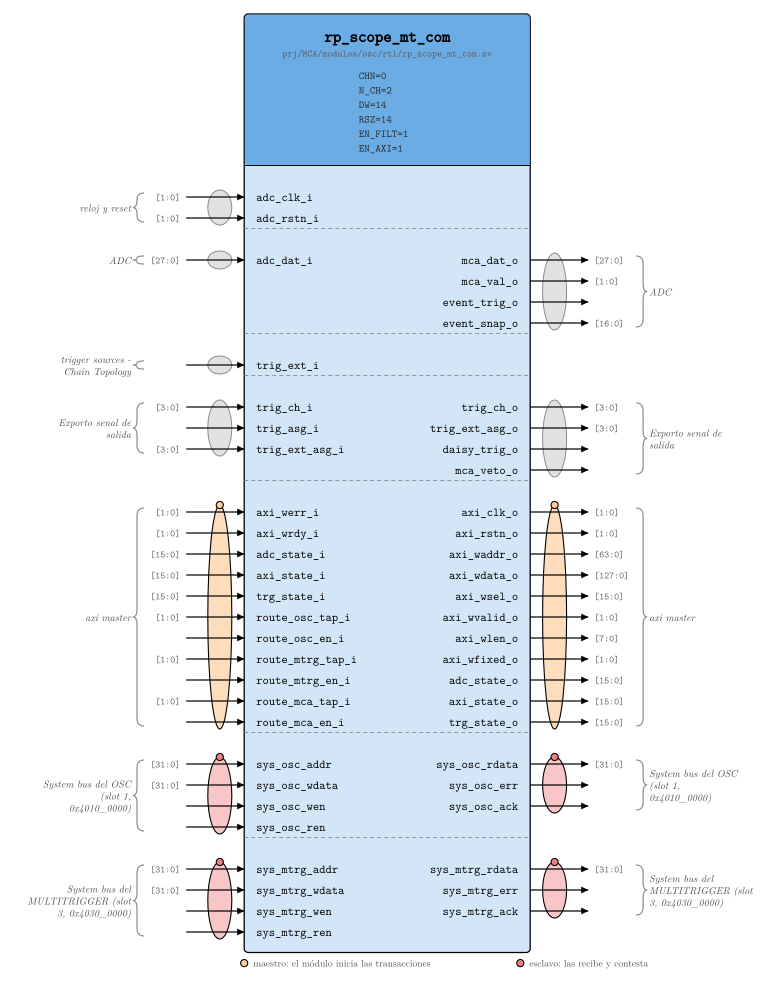
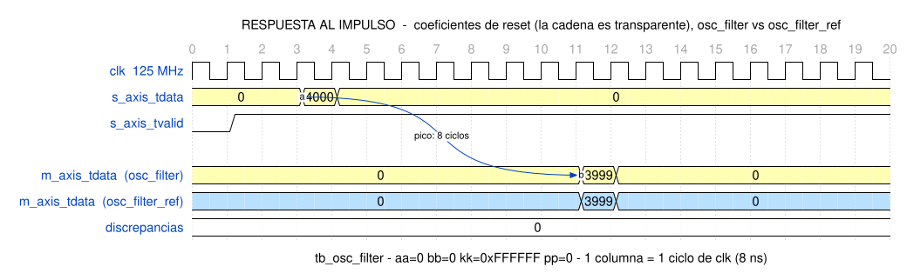
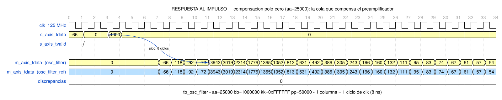
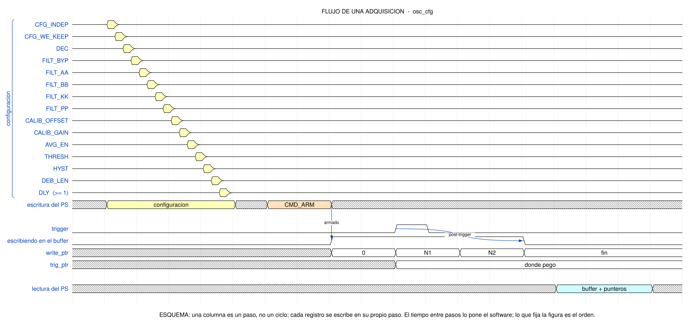

# Datasheet — `rp_scope_mt_com`

<!-- Generado por `modulos/mk/datasheet.py`. Lo que está entre las marcas
     AUTO:x y /AUTO:x se REESCRIBE en cada corrida: editar ahí no sirve.
     Todo el resto es prosa a mano y no se toca.
     La §1.1 «Qué hace» se escribe en prosa/rp_scope_mt_com.md.
     Regenerar:  make -C modulos/mt/work datasheet              -->

## 1. Función y funcionamiento

### 1.1 Descripción breve

<!-- AUTO:resumen -->
|  |  |
|---|---|
| Módulo RTL | `rp_scope_mt_com` |
| Archivo | [`rp_scope_mt_com.sv`](../../modulos/osc/rtl/rp_scope_mt_com.sv) |
| Parámetros | 5 |
| Puertos | 51 (26 in / 25 out) |
| Parte | `xc7z010clg400-1` |




**Cabecera del RTL** (se copia tal cual de [`rp_scope_mt_com.sv`](../../modulos/osc/rtl/rp_scope_mt_com.sv)):

> Cada uno de estos tiene como entradas dos canales de datos
<!-- /AUTO:resumen -->

<!-- AUTO:prosa -->
<!-- Prosa a mano: se edita en prosa/rp_scope_mt_com.md, no aca. -->

**Qué hace.** Es **la región del osciloscopio entera**: el contenedor que los
tres tops instancian y que tiene adentro toda la cadena de adquisición, los
dos esclavos de registros y la lógica de disparo. No es un bloque con una
función, es el lugar donde se cablea el sistema — por eso es el archivo que
hay que leer para saber de dónde sale cada señal.

Viene de `red_pitaya_scope.v` de fábrica, y lo que le agregó este proyecto es
la cadena de taps, el multitrigger y las dos salidas nuevas hacia los
consumidores propios.

**Qué tiene adentro.** Por canal: calibración → ecualizador
([`osc_filter`](datasheet_osc_filter.md), si `EN_FILT = 1`) → decimación
(`rp_decim`) → retardo (`rp_delay`) → buffer de captura (`rp_bram_sm`,
`rp_acq_bram`), y los tres [`dsp_tap_mux`](datasheet_dsp_tap_mux.md) que
eligen desde dónde lee cada consumidor. Comunes: el multitrigger entero,
[`mt_top`](datasheet_mt_top.md) (los disparos de nivel y de pendiente de
cada canal, la lógica de evento y [`mt_cfg`](datasheet_mt_cfg.md), el
esclavo del slot 3), y [`osc_cfg`](datasheet_osc_cfg.md), el esclavo del
slot 1.

**Las dos salidas que lo conectan con el resto del proyecto:**

- `mca_dat_o` / `mca_val_o` — la muestra acondicionada hacia el
  [`mca_top`](datasheet_mca_top.md): post-calibración, post-ecualizador y
  **pre-decimación**, a 125 MSPS. Es el mismo nodo que alimenta a `rp_decim`,
  así que los umbrales del MCA y los del scope son comparables; pero el MCA
  lleva **su propia** decimación y queda desacoplado del `set_dec` del scope.
- `event_trig_o` / `event_snap_o` — hacia el
  [`event_ring_top`](datasheet_event_ring_top.md). Es **el mismo**
  `trigger_event` que alimenta a `rp_bram_sm` y `rp_axi_sm`, y el mismo
  snapshot que se lee en `SNAPSHOT` (`0x018` del slot 3): el anillo **no introduce una fuente de
  disparo nueva**, se cuelga de la que ya existe.

En `red_pitaya_top` esos puertos quedan sin conectar y se podan: el netlist
del scope de fábrica no cambia.

**`EN_FILT` es la decisión de diseño que más se nota.** El lazo IIR del
ecualizador no cierra timing a 125 MHz en el -1: registro → multiplicación →
suma de 48 bits → registro en **un** ciclo, 9.421 ns contra 8 ns de período, y
son **137 de los 221 endpoints en falla** del diseño, con la peor severidad
(−1.820 ns contra ≤0.2 ns del resto). Se probaron dos reescrituras equivalentes
bit a bit y ninguna mejoró —plegar el término al coeficiente lleva a 27 bits y
Vivado parte el multiplicador en dos DSP en cascada **dentro** del lazo
(−3.514 ns); reasociar en dos pasos deja igual un sumador en el lazo
(−1.957 ns)—, así que es una limitación estructural y no de codificación. El
default es `1` para que el top de fábrica no cambie en nada; los tops del MCA y
del anillo usan `0`, que saca el lazo del diseño y con él el camino crítico.

El mapa de slots completo está en
[`register_map_top.md`](../TOP/register_map_top.md), y cómo se recorre el
sistema de punta a punta en
[`cadena_de_medicion.md`](../cadena_de_medicion.md).
<!-- /AUTO:prosa -->

### 1.2 Interfaces

<!-- AUTO:interfaces -->
#### Parámetros

| Parámetro | Default | Para qué |
|---|---|---|
| `CHN` | `0` | Channel Number |
| `N_CH` | `2` | Number of Channels |
| `DW` | `14` | Data Width |
| `RSZ` | `14` | RAM size 2^RSZ |
| `EN_FILT` | `1` |  |


#### Puertos

##### ADC

| Puerto | Dir | Bits | Dominio | Descripción |
|---|---|---|---|---|
| `adc_clk_i` | in | 2 `[N_CH   -1: 0]` | — | ADC clock |
| `adc_rstn_i` | in | 2 `[N_CH   -1: 0]` | — | ADC reset - active low |
| `adc_dat_i` | in | 28 `[N_CH*DW-1: 0]` | adc_clk_i | ADC data CHA - Hace mal uso de las dimensiones packed? |
| `mca_dat_o` | out | 28 `[N_CH*DW-1: 0]` | adc_clk_i | Muestra acondicionada hacia el MCA: post-calibracion, post-ecualizador (si EN_FILT=1) y PRE-decimacion, a 125 MSPS. Es el mismo nodo que alimenta a rp_decim, asi que los umbrales del MCA y del scope son comparables, pero el MCA lleva su propia decimacion y queda desacoplado del set_dec del scope. En red_pitaya_top estos puertos quedan sin conectar (es legal para salidas) y se podan: el netlist del scope no cambia. |
| `mca_val_o` | out | 2 `[N_CH   -1: 0]` | adc_clk_i |  |
| `event_trig_o` | out | 1 | adc_clk_i | Evento conjunto hacia el event_ring (Fase 1). Es el MISMO trigger_event que alimenta a rp_bram_sm y rp_axi_sm, y el mismo snapshot que se lee en SNAPSHOT (0x018 del slot 3): el ring no introduce una fuente de disparo nueva, se cuelga de la que ya existe. |
| `event_snap_o` | out | 17 | adc_clk_i |  |


##### Trigger sources - Chain Topology

| Puerto | Dir | Bits | Dominio | Descripción |
|---|---|---|---|---|
| `trig_ext_i` | in | 1 | adc_clk_i | external trigger |


##### Exporto senal de salida

| Puerto | Dir | Bits | Dominio | Descripción |
|---|---|---|---|---|
| `trig_ch_o` | out | 4 | adc_clk_i | output trigger to ADC for other 2 channels. Q: por qué 4? Por n y p |
| `trig_ch_i` | in | 4 | adc_clk_i | input ADC trigger from other 2 channels |
| `trig_asg_i` | in | 1 | adc_clk_i | ASG trigger |
| `trig_ext_asg_o` | out | 4 | adc_clk_i | output External and ASG trigger to share between multiple scope modules |
| `trig_ext_asg_i` | in | 4 | adc_clk_i | input External and ASG trigger |
| `daisy_trig_o` | out | 1 | adc_clk_i | trigger for daisy chaining |
| `mca_veto_o` | out | 1 | adc_clk_i | nivel del trigger_shield hacia el MCA |


##### Axi master

| Puerto | Dir | Bits | Dominio | Descripción |
|---|---|---|---|---|
| `axi_clk_o` | out | 2 `[N_CH   -1: 0]` | adc_clk_i | global clock |
| `axi_rstn_o` | out | 2 `[N_CH   -1: 0]` | adc_clk_i | global reset |
| `axi_waddr_o` | out | 64 `[N_CH*32-1: 0]` | adc_clk_i | system write address |
| `axi_wdata_o` | out | 128 `[N_CH*64-1: 0]` | adc_clk_i | system write data |
| `axi_wsel_o` | out | 16 `[N_CH* 8-1: 0]` | adc_clk_i | system write byte select |
| `axi_wvalid_o` | out | 2 `[N_CH   -1: 0]` | adc_clk_i | system write data valid |
| `axi_wlen_o` | out | 8 `[N_CH* 4-1: 0]` | adc_clk_i | system write burst length |
| `axi_wfixed_o` | out | 2 `[N_CH   -1: 0]` | adc_clk_i | system write burst type (fixed / incremental) |
| `axi_werr_i` | in | 2 `[N_CH   -1: 0]` | adc_clk_i | system write error |
| `axi_wrdy_i` | in | 2 `[N_CH   -1: 0]` | adc_clk_i | system write ready |
| `adc_state_o` | out | 16 | adc_clk_i |  |
| `adc_state_i` | in | 16 | adc_clk_i |  |
| `axi_state_o` | out | 16 | adc_clk_i |  |
| `axi_state_i` | in | 16 | adc_clk_i |  |
| `trg_state_o` | out | 16 | adc_clk_i |  |
| `trg_state_i` | in | 16 | adc_clk_i | Trigger state? Se conecta a la configuración. |
| `route_osc_tap_i` | in | 2 | adc_clk_i | Ruteo del datapath, desde integration_cfg (region de TOP, slot 6). En reset valen TAP_NATIVE/enable=1, o sea el cableado de siempre. |
| `route_osc_en_i` | in | 1 | adc_clk_i |  |
| `route_mtrg_tap_i` | in | 2 | adc_clk_i |  |
| `route_mtrg_en_i` | in | 1 | adc_clk_i |  |
| `route_mca_tap_i` | in | 2 | adc_clk_i |  |
| `route_mca_en_i` | in | 1 | adc_clk_i |  |


##### System bus del OSC (slot 1, 0x4010_0000)

| Puerto | Dir | Bits | Dominio |
|---|---|---|---|
| `sys_osc_addr` | in | 32 | adc_clk_i |
| `sys_osc_wdata` | in | 32 | adc_clk_i |
| `sys_osc_wen` | in | 1 | adc_clk_i |
| `sys_osc_ren` | in | 1 | adc_clk_i |
| `sys_osc_rdata` | out | 32 | adc_clk_i |
| `sys_osc_err` | out | 1 | adc_clk_i |
| `sys_osc_ack` | out | 1 | adc_clk_i |


##### System bus del MULTITRIGGER (slot 3, 0x4030_0000)

| Puerto | Dir | Bits | Dominio |
|---|---|---|---|
| `sys_mtrg_addr` | in | 32 | adc_clk_i |
| `sys_mtrg_wdata` | in | 32 | adc_clk_i |
| `sys_mtrg_wen` | in | 1 | adc_clk_i |
| `sys_mtrg_ren` | in | 1 | adc_clk_i |
| `sys_mtrg_rdata` | out | 32 | adc_clk_i |
| `sys_mtrg_err` | out | 1 | adc_clk_i |
| `sys_mtrg_ack` | out | 1 | adc_clk_i |
<!-- /AUTO:interfaces -->

### 1.3 Mapa de registros

<!-- AUTO:regmap -->
`rp_scope_mt_com` es esclavo del bus de sistema (`sys_osc_addr`, `sys_osc_wdata`, `sys_osc_wen`, `sys_osc_ren`, `sys_osc_rdata`, `sys_osc_err`, `sys_osc_ack`, `sys_mtrg_addr`, `sys_mtrg_wdata`, `sys_mtrg_wen`, `sys_mtrg_ren`, `sys_mtrg_rdata`, `sys_mtrg_err`, `sys_mtrg_ack`). El mapa completo está en:

- [`register_map_mt_rp_scope_cfg.md`](../osc/register_map_mt_rp_scope_cfg.md)
- [`register_map_osc.md`](../osc/register_map_osc.md)

Contrato del bus: [`bus_sistema_redpitaya.md`](../TOP/bus_sistema_redpitaya.md) · Mapa de slots: [`register_map_top.md`](../TOP/register_map_top.md)
<!-- /AUTO:regmap -->

### 1.4 Clock domains

<!-- AUTO:clocks -->
| Puerto | Qué es | Polaridad | Notas |
|---|---|---|---|
| `adc_clk_i` | reloj ×2 |  | ADC clock |
| `adc_rstn_i` | reset | activo-bajo | ADC reset - active low |


**`adc_clk_i` es un vector de 2 relojes** (uno por canal): el bloque se replica, y lo que acá parece un dominio son 2. Qué se cruza entre réplicas —si algo se cruza— va escrito abajo, no se infiere del nombre.
<!-- /AUTO:clocks -->

<!-- A mano: si hay más de un reloj, cuál es el cruce, con qué se sincroniza y
     qué se asume de la relación de frecuencias. Si hay uno solo, borrar. -->

### 1.5 Frecuencia máxima de trabajo

<!-- AUTO:timing -->
El `metrics.txt` del módulo es de `osc_cfg`, no de `rp_scope_mt_com`: la síntesis OOC del módulo apunta a otro top, así que acá no hay números propios de este bloque.
<!-- /AUTO:timing -->

<!-- A mano: qué hay en el camino crítico y qué se haría para romperlo si
     hubiera que subir la frecuencia. -->

### 1.6 Transacciones

<!-- AUTO:transacciones -->
**LO QUE ENTRA: UN IMPULSO**


Que entra. Una muestra de 4000 cuentas y el resto cero. Para un filtro lineal invariante eso no es un caso mas: la respuesta al impulso LO DESCRIBE ENTERO, asi que las dos curvas del panel (c) son la caracterizacion completa del bloque con cada juego de coeficientes. El flujo es de una muestra por ciclo de adc_clk (8 ns) y no hay handshake que lo pueda frenar: el `tready` existe en los puertos pero el dato llega igual, asi que lo que el bloque hace tiene que hacerlo en un ciclo.

_Origen: `tb_osc_filter`, VCD completo._

**EL BLOQUE, Y EL MODELO QUE CORRE AL LADO**


Que viaja. El bloque es una compensacion polo-cero, dos IIR de primer orden y una etapa de escalado, con cuatro coeficientes configurables. Lo que esta figura agrega a un diagrama de bloques es el segundo camino: el testbench instancia AL LADO del DUT una copia congelada del filtro anterior al rediseno (`osc_filter_ref.v`) y le da el mismo flujo. No se comparan resumenes ni metricas: se comparan las dos salidas muestra por muestra.

_Origen: `osc_filter.v` y `sim/osc_filter_ref.v`._

**LO QUE SALE: EL MISMO IMPULSO, DOS FILTROS**


Que sale, y es donde esta todo. Con los coeficientes de RESET la cadena queda transparente: el impulso de 4000 sale como una sola muestra de 3999 --o sea ganancia 0.99975, el error de redondeo de kk = 2^24-1 en vez de 2^24-- 8 ciclos despues. Con la compensacion POLO-CERO el mismo impulso sale como una exponencial que arranca en 3943 y tarda 99 ciclos en caer al 1 %: el filtro no recorta la cola, la FABRICA, porque esta pensado para cancelar la del detector --un cero donde el preamplificador pone su polo--. La latencia es la misma en los dos casos, 8 ciclos, porque el pipeline no depende de los coeficientes: lo MEDIDO es 8 y 8. Lo que si cambia es que con polo-cero el pico viene precedido por un precursor de hasta 118 cuentas que arranca 4 ciclos antes --el camino directo, que llega antes que las dos IIR--; es chico pero existe, y medir la latencia por la primera muestra no nula en vez de por el pico lo contaria como si la respuesta empezara ahi. Los circulos son `ref_out`: la salida del modelo congelado coincide con la del DUT en 460 de los 460 ciclos dibujados, o sea TODOS. Esa coincidencia es el contenido de la figura.

_Origen: `tb_osc_filter`, escenas de coeficientes de reset y polo-cero._

**LA TRANSACCION COMPLETA**


Las tres preguntas en una imagen: que entra, que viaja y que sale.

_Origen: las tres anteriores, en una figura._

---

Las figuras **recalculan cada número al dibujar** en vez de tomarlo escrito. Las genera [`transacciones_osc.py`](../osc/figuras/transacciones/transacciones_osc.py); de dónde sale el dato de cada una está en la columna «Datos» de [`README.md`](../osc/figuras/transacciones/README.md); los epígrafes completos, en [`epigrafes.txt`](../osc/figuras/transacciones/epigrafes.txt).
<!-- /AUTO:transacciones -->

### 1.7 Waveforms

<!-- AUTO:ondas -->
**RESPUESTA AL IMPULSO  -  coeficientes de reset (la cadena es transparente), osc_filter vs osc_filter_ref**



Los coeficientes de reset son los que usa el driver hoy, asi que es la configuracion que mas importa que no haya cambiado. Un impulso entra y sale UN solo impulso, del mismo tamano: con aa=bb=pp=0 y kk en 2^24-1 la cadena es transparente y lo unico que agrega es latencia, que es el numero que da esta figura. Las dos salidas se dibujan superpuestas a proposito: tb_osc_filter es un test de EQUIVALENCIA contra el filtro original del repo, asi que las filas de osc_filter y osc_filter_ref tienen que ser la misma onda columna por columna. Si en alguna se separan, el testbench esta fallando y la figura lo muestra.

_Origen: `tb_osc_filter`, caso de coeficientes de reset._

**RESPUESTA AL IMPULSO  -  compensacion polo-cero (aa=25000): la cola que compensa el preamplificador**



La misma entrada que la figura anterior --un impulso-- con el lazo recursivo activo. Ahora la salida no es un impulso sino un pico seguido de una COLA que decae: eso es la compensacion polo-cero, que cancela la cola del preamplificador para que el pulso vuelva a la linea de base antes del siguiente. Es la parte del filtro que se rediseno, y la figura muestra que la cola entera --mas de veinte muestras-- coincide con la del filtro original muestra por muestra. Se dibuja el impulso y no un escalon porque con aa=25000 la constante de tiempo es de cientos de ciclos: un escalon no se asienta dentro de una ventana que se pueda mirar.

_Origen: `tb_osc_filter`, caso de compensacion polo-cero._

**FLUJO DE UNA ADQUISICION  -  osc_cfg**



Es un esquema de la SECUENCIA, no una medicion: no hay testbench de osc_cfg del que sacar las ondas (ver §1.7 de su datasheet, que lo marca como deuda de verificacion). La configuracion es una escalera: el bus del PS escribe un registro por vez, primero los modos globales y despues la cadena de cada canal en el orden del datapath; DLY tiene que quedar en 1 o mas, porque el 0 de reset es el caso degenerado de rp_bram_sm. Lo que la figura fija es el orden y las dependencias: la configuracion del filtro y del diezmado va ANTES del armado, porque cambiarla con el buffer llenandose mezcla muestras de dos configuraciones en la misma traza; y la lectura va despues de que el puntero deje de moverse, porque leer durante la captura devuelve una traza partida entre dos vueltas del buffer.

_Origen: esquema (sin VCD: `osc_cfg` no tiene testbench)._

---

Las figuras y sus epígrafes los escribe [`ondas_osc.py`](../osc/figuras/ondas/ondas_osc.py): los tiempos y las latencias se **miden sobre el VCD**, no se escriben a mano, así que no pueden desincronizarse del RTL. Los epígrafes completos, con los números, están en [`epigrafes.txt`](../osc/figuras/ondas/epigrafes.txt).

```bash
python3 docs/osc/figuras/ondas/ondas_osc.py    # regenerar
```
<!-- /AUTO:ondas -->

<!-- A mano: lo que las figuras no pueden mostrar solas. Para agregar una,
     editar docs/mt/figuras/ondas/ondas_mt.py: la onda
     sale de un VCD de los testbenches y los tiempos los mide el script.
       make -C modulos/mt/work wave TB=<tb>   # mirar en Questa
       make -C modulos/mt/work vcd  TB=<tb>   # VCD exportable -->

### 1.8 Verificación realizada

<!-- AUTO:verificacion -->
Todo corre en batch y se chequea el `RESULT: PASS` del testbench; las ondas quedan en `work/waves/<tb>.wlf`.

```bash
make -C modulos/osc/work            # el 1 testbench
make -C modulos/osc/work cov        # + cobertura
make -C modulos/osc/work lint
```

| Testbench | DUT | Escenas | Casos | Contra qué compara | Es el de este módulo |
|---|---|---|---|---|---|
| [`tb_osc_filter`](../../modulos/osc/sim/tb_osc_filter.sv) | `osc_filter` | 7 | 10 | RTL de referencia `osc_filter_ref.v` instanciado al lado del DUT |  |


**10 casos con nombre** en 1 testbench (7 escenas). La lista completa, caso por caso, está en el plan de verificación.

> **`rp_scope_mt_com` no tiene testbench propio.** Ningún `TBS` del `work/Makefile` lo instancia como DUT: lo que se verifica de este módulo es lo que arrastre el TB de otro. Es deuda de verificación, no una omisión de esta página.

**Assertions** — en `sim/sva/`, enganchadas por `bind` (no tocan el RTL sintetizable).

- [`bind_osc.sv`](../../modulos/osc/sim/sva/bind_osc.sv)
- [`osc_cfg_sva.sv`](../../modulos/osc/sim/sva/osc_cfg_sva.sv)

> **Los archivos de assertions están vacíos.** Son el scaffold de `create_module.py`: tienen el `bind`, el `default clocking` y un `// TODO:`, pero **ninguna propiedad**. O sea que hoy no aportan nada a la verificación; el enganche ya está hecho y lo que falta es escribirlas. Ver [`verificacion_formal.md`](../verificacion_formal.md), que discute cuáles convienen primero.

Plan de verificación, casos cubiertos y deuda: [`osc/sim/VERIFICACION.md`](../../modulos/osc/sim/VERIFICACION.md).
<!-- /AUTO:verificacion -->

#### Esquema de laboratorio

TODO — qué instrumento, cómo se conecta, qué se mide y contra qué se compara.
