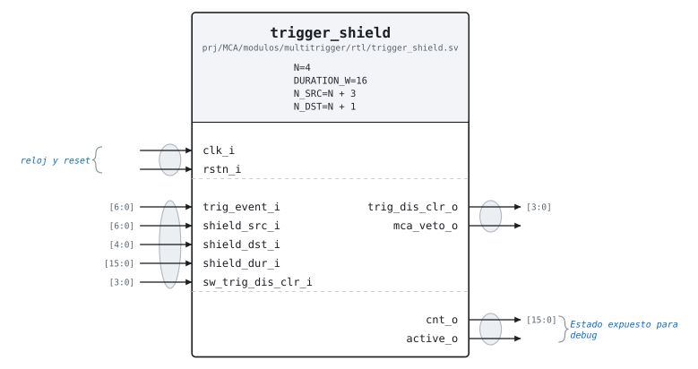
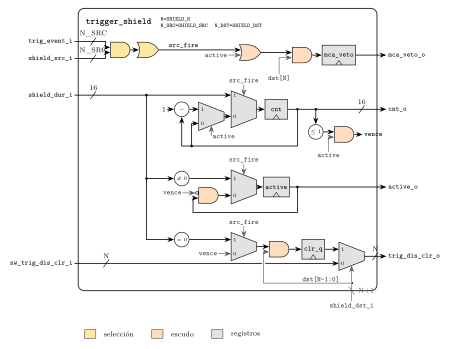

# Datasheet — `trigger_shield`

<!-- Generado por `modulos/mk/datasheet.py`. Lo que está entre las marcas
     AUTO:x y /AUTO:x se REESCRIBE en cada corrida: editar ahí no sirve.
     Todo el resto es prosa a mano y no se toca.
     La §1.1 «Qué hace» se escribe en prosa/trigger_shield.md.
     Regenerar:  make -C modulos/mt/work datasheet              -->

## 1. Función y funcionamiento

### 1.1 Descripción breve

<!-- AUTO:resumen -->
|  |  |
|---|---|
| Módulo RTL | `trigger_shield` |
| Archivo | [`trigger_shield.sv`](../../modulos/mt/rtl/trigger_shield.sv) |
| Parámetros | 4 |
| Puertos | 11 (7 in / 4 out) |
| Parte | `xc7z010clg400-1` |




**Cabecera del RTL** (se copia tal cual de [`trigger_shield.sv`](../../modulos/mt/rtl/trigger_shield.sv)):

> Módulo que toma configuración como parámetros.
> La salida se la conecta al trig_dis_clr_i del mt_trig_src.
>
>   Cantidad de canales:  parameter integer N          = 4
>   Duración del holdoff: parameter integer DURATION_W = 16
>   Shield src  vector de N_SRC (qué fuentes actúan de disparo del escudo)
>   Shield dest vector de N_DST (qué destinos quedan escudados)
>
> Holdoff src->dest: cuando una fuente "src" dispara, los canales "dest" quedan
> deshabilitados durante DURATION ciclos de ADC; al expirar se emite un pulso
> de trig_dis_clr que los re-arma. Los canales no escudados siguen de forma
> transparente al clear de SW.
>
> FUENTES Y DESTINOS NO SON LO MISMO. Los N primeros bits de cada vector son los
> canales del scope, como siempre. Por encima:
>
>   src[N+0]  ext_p    flanco de subida de la entrada externa (DIO0_P)
>   src[N+1]  ext_n    flanco de bajada
>   src[N+2]  ext_lvl  NIVEL de la entrada externa, sincronizado
>   dst[N]    mca      el analizador multicanal, como VETO
>
> Con `ext_lvl` como fuente el escudo "dispara" cada ciclo que la línea está
> alta, y como cada disparo recarga el contador, el veto queda activo mientras
> dura la línea y DURATION ciclos más: un veto de nivel con cola programable.
> Con `ext_p` da una ventana de DURATION ciclos tras el flanco. Las dos cosas
> salen del mismo contador; lo que cambia es qué bit de src se habilita.
>
> El veto al MCA es un NIVEL, no un pulso de re-arm: vale mientras alguna
> fuente dispara o el holdoff está corriendo. Va registrado porque termina en
> la lógica de apertura de pulso del MCA y no hace falta que sea inmediato.
<!-- /AUTO:resumen -->

<!-- AUTO:prosa -->
<!-- Prosa a mano: se edita en prosa/trigger_shield.md, no aca. -->

**Qué hace.** Es el **escudo**: cuando una fuente dispara, deja inhabilitados
durante un holdoff programable a los destinos que uno elija, y al expirar los
vuelve a armar. Sirve para dos cosas distintas con el mismo contador: evitar
que un canal del scope se re-dispare con su propia cola, y darle al MCA un
**veto** mientras pasa algo que no debe entrar al espectro.



*Una fila por registro. `src_fire` es el OR de las fuentes habilitadas que
disparan. Con `src_fire`, `cnt` carga `dur`; si no, mientras `active`, cuenta
hacia abajo, y `vence` (`active` y `cnt ≤ 1`) termina el holdoff. El pulso
`clr_q` re-arma los destinos al vencer, o al disparar si `dur = 0`. Hay un solo
contador para todos los destinos. Con una fuente de nivel (`ext_lvl`) el escudo
dispara cada ciclo que la línea está alta y cada disparo recarga `dur`: el veto
dura la línea más `dur` ciclos. Los canales que no están en `dst` siguen al
clear de software sin cambio. Nombres sin cable (`src_fire`, `active`, `vence`,
`dst[N]`): la señal del mismo nombre, que se dibuja una sola vez donde nace.
`NOMBRE=valor`: parámetros con que lo instancia `mt_event_logic`.*

*Por dentro:* `src_fire`, el contador de holdoff, `active`, el pulso de re-arm, el veto al MCA y el mux por canal. Fuente TikZ en [`panorama_trigger_shield.tex`](../mt/figuras/panorama_trigger_shield.tex).

Lo que lo hace más que un holdoff por canal es que **fuentes y destinos son
vectores independientes**:

| Bits | Fuentes (`shield_src`) | Destinos (`shield_dst`) |
|---|---|---|
| `0 … N−1` | los canales del scope | los canales del scope |
| `N+0`, `N+1` | `ext_p`, `ext_n` — flancos de la entrada externa (DIO0_P) | — |
| `N+2` | `ext_lvl` — el **nivel** externo, sincronizado | — |
| `N` (dst) | — | `mca` — el analizador, como veto |

Cualquiera puede escudar a cualquiera, y la entrada externa puede vetar sin
gastar la máscara OR de un canal del scope en eso.

**Las tres formas del veto salen del mismo contador**; lo único que cambia es
qué bit de `src` se habilita y qué duración se escribe. Los tres tramos, cada
uno de una escena distinta de `tb_trigger_shield`, están medidos sobre el VCD
en [`mt_veto_tres_formas.svg`](../mt/figuras/ondas/mt_veto_tres_formas.svg):

| Configuración | Qué veto da | Medido |
|---|---|---|
| `src = ext_lvl`, `dur = 0` | el veto **es** la línea, con un ciclo de latencia | 21 ciclos (la línea duró eso) |
| `src = ext_lvl`, `dur = 8` | la línea **más cola**: sigue 8 ciclos después de bajar | 13 ciclos |
| `src = ext_p`, `dur = 12` | ventana fija por flanco, dure lo que dure el pulso | 13 ciclos |

Con una fuente de nivel el escudo «dispara» cada ciclo que la línea está alta
y cada disparo recarga el contador: de ahí sale el veto de nivel con cola, sin
lógica dedicada.

Dos detalles de temporizado que son decisiones, no accidentes:

- **El clear sale al EXPIRAR, no al disparar.** Si saliera al disparar, el
  destino se re-armaría en medio del evento del que el escudo lo está
  protegiendo. Se ve en
  [`mt_holdoff_rearm.svg`](../mt/figuras/ondas/mt_holdoff_rearm.svg):
  `active` se mantiene los `shield_dur` ciclos y el pulso de clear aparece al
  final.
- **El veto al MCA es un NIVEL y va registrado.** Vale mientras alguna fuente
  dispare o el holdoff corra. Termina en la lógica de apertura de pulso del MCA
  —que no abre ventanas nuevas pero **sí deja terminar la que está en curso** y
  **sí sigue corriendo el seguidor de línea de base**, ver
  [`mca_pulse_feature`](datasheet_mca_pulse_feature.md)— así que un ciclo de
  retardo no cambia nada.

Los canales **no** escudados siguen siendo transparentes al clear de software
(`0x94`): el escudo se mete en el camino sólo de lo que se le pidió.

> **Un contador para todos.** `cnt` es **global**, no uno por destino: dos
> fuentes que disparen con solapamiento comparten el mismo holdoff y el
> segundo disparo lo recarga entero. Para el uso previsto —un escudo a la vez—
> da lo mismo, pero no es un holdoff por par src→dst y conviene no leerlo así.
>
> **Es el candidato más barato a verificación formal del módulo.** El
> testbench comprueba `n_veto` para **un** valor de `dur`; la propiedad que
> importa —el veto siempre termina, `active` no se queda pegado— es liveness
> acotada sobre una FSM diminuta, y el formal la probaría para **todos** los
> `dur`. Ver [`verificacion_formal.md`](../verificacion_formal.md).
<!-- /AUTO:prosa -->

### 1.2 Interfaces

<!-- AUTO:interfaces -->
#### Parámetros

| Parámetro | Tipo | Default | Para qué |
|---|---|---|---|
| `N` | `integer` | `4` | canales del scope |
| `DURATION_W` | `integer` | `16` | ancho del contador de holdoff |
| `N_SRC` | `integer` | `N + 3` = `7` | canales + {ext_p, ext_n, ext_lvl} |
| `N_DST` | `integer` | `N + 1` = `5` | canales + {mca} |


#### Puertos

##### Señales

| Puerto | Dir | Bits | Dominio | Descripción |
|---|---|---|---|---|
| `clk_i` | in | 1 | — |  |
| `rstn_i` | in | 1 | — | reset síncrono activo-bajo |
| `trig_event_i` | in | 7 `[N_SRC-1:0]` | clk_i | disparo por fuente |
| `shield_src_i` | in | 7 `[N_SRC-1:0]` | clk_i | fuentes del escudo |
| `shield_dst_i` | in | 5 `[N_DST-1:0]` | clk_i | destinos escudados |
| `shield_dur_i` | in | 16 `[DURATION_W-1:0]` | clk_i | duración del holdoff (ciclos ADC) |
| `sw_trig_dis_clr_i` | in | 4 `[N-1:0]` | clk_i | clear de SW (rp_scope_cfg, reg 0x94) |
| `trig_dis_clr_o` | out | 4 `[N-1:0]` | clk_i | a mt_trig_src.trig_dis_clr_i |
| `mca_veto_o` | out | 1 | clk_i | nivel: el MCA no abre pulsos |


##### Estado expuesto para debug

| Puerto | Dir | Bits | Dominio | Descripción |
|---|---|---|---|---|
| `cnt_o` | out | 16 `[DURATION_W-1:0]` | clk_i | contador holdoff actual |
| `active_o` | out | 1 | clk_i | holdoff en progreso |
<!-- /AUTO:interfaces -->

### 1.3 Mapa de registros

<!-- AUTO:regmap -->
Mapas de registros de la región:

- [`register_map_mt.md`](../mt/register_map_mt.md)

Contrato del bus: [`bus_sistema_redpitaya.md`](../TOP/bus_sistema_redpitaya.md) · Mapa de slots: [`register_map_top.md`](../TOP/register_map_top.md)
<!-- /AUTO:regmap -->

### 1.4 Clock domains

<!-- AUTO:clocks -->
| Puerto | Qué es | Polaridad | Notas |
|---|---|---|---|
| `clk_i` | reloj |  |  |
| `rstn_i` | reset | activo-bajo | reset síncrono activo-bajo |


**Un solo dominio.** Todos los puertos de datos y de control son síncronos a `clk_i`: no hay cruce de dominio dentro de este módulo.
<!-- /AUTO:clocks -->

<!-- A mano: si hay más de un reloj, cuál es el cruce, con qué se sincroniza y
     qué se asume de la relación de frecuencias. Si hay uno solo, borrar. -->

### 1.5 Frecuencia máxima de trabajo

<!-- AUTO:timing -->
El `metrics.txt` del módulo es de `mt_top`, no de `trigger_shield`: la síntesis OOC del módulo apunta a otro top, así que acá no hay números propios de este bloque.
<!-- /AUTO:timing -->

<!-- A mano: qué hay en el camino crítico y qué se haría para romperlo si
     hubiera que subir la frecuencia. -->

### 1.6 Transacciones

<!-- AUTO:transacciones -->
**EL TREN DEL GENERADOR, Y CUAL SE CAPTURA**


Que entra al modulo. El generador entrega un pulso cada 500 us y todos cruzan el umbral: como candidatos son todos validos. Lo que decide cuales se capturan no es el escudo sino el lazo: una captura congela la ventana y el hardware no acepta otra hasta que el PS la leyo y re-armo. La banda naranja es ese tiempo muerto, y las cruces rojas son los pulsos que cayeron adentro. A esta tasa entra uno de cada 2.

_Origen: campaña e2e, barrido de tasa, 2000 Hz._

**EL CAMINO DE UN DISPARO**


Que viaja. Un candidato pasa por el enmascarado --32 fuentes OR-eadas en `trig_src`--, por el escudo --que lo veta si otro canal esta en su ventana de holdoff-- y recien ahi congela la ventana. Lo que NO se ve en un cronograma y si en esta figura es el lazo del final: la ventana no se libera sola, la libera el PS al leerla. Es un esquema de la estructura; los cronogramas ciclo a ciclo del veto y del holdoff estan en `docs/mt/figuras/ondas/`.

_Origen: estructura de `mt_trig_src.sv`, `trigger_shield.sv` y la captura._

**SE PIERDEN PERIODOS ENTEROS, NO UNA FRACCION**


Que sale, y por que. Para cada par de capturas consecutivas se calcula k = dt / T, cuantos periodos del generador pasaron. El histograma de abajo muestra que k es un ENTERO --la mediana de |dt/T - k| es 0.0310, o sea que las capturas caen sobre el tren del generador y no en cualquier lado--: el lazo no pierde una fraccion de los pulsos, pierde periodos completos, porque cuando termina de leer espera al proximo pulso. A 2000 Hz el 98 % de las capturas tienen k = 2; a 8000 Hz la distribucion se parte entre k = 5 y k = 6, que es lo que da el <k> = 5.46 no entero. De ahi sale la curva de arriba: la eficiencia es 1/<k>, y coincide con la que el barrido habia guardado por su cuenta con un error maximo de 0.0002. No es una curva ajustada, es el reciproco de un contador. Medido: 500 Hz: 99.4 %  1000 Hz: 97.8 %  2000 Hz: 49.1 %  4000 Hz: 32.5 %  8000 Hz: 18.3 %. OJO: este tiempo muerto es del lazo de lectura K=1 por GP0, no del escudo; es exactamente el cuello que el `event_ring` viene a sacar.

_Origen: campaña e2e, barrido de tasa (5 puntos)._

**LA TRANSACCION COMPLETA**


Las tres preguntas en una imagen: que entra, que viaja y que sale.

_Origen: las tres anteriores, en una figura._

---

Las figuras **recalculan cada número al dibujar** en vez de tomarlo escrito. Las genera [`transacciones_mt.py`](../mt/figuras/transacciones/transacciones_mt.py); de dónde sale el dato de cada una está en la columna «Datos» de [`README.md`](../mt/figuras/transacciones/README.md); los epígrafes completos, en [`epigrafes.txt`](../mt/figuras/transacciones/epigrafes.txt).
<!-- /AUTO:transacciones -->

### 1.7 Waveforms

<!-- AUTO:ondas -->
**LAS TRES FORMAS DEL VETO AL MCA  -  nivel / nivel con cola / ventana por flanco**


El mismo bloque da tres vetos distintos segun como se lo configure, y la diferencia no esta en el RTL sino en que fuente se elige y que duracion se escribe. Con una fuente de NIVEL y dur=0 el veto es la linea con un ciclo de latencia: dura lo que dure la linea. Con la misma fuente y dur=8 el veto se extiende ocho ciclos despues de que la linea baje, que es lo que hace falta cuando el estimulo deja cola. Con una fuente de FLANCO y dur=12 el veto es una ventana fija de doce ciclos, sin importar cuanto dure el pulso. Los tres tramos vienen de escenas distintas del testbench y el hueco entre ellos dice que se salteo tiempo: no es una secuencia.

_Origen: `tb_trigger_shield`, escenas 4, 5 y 6._

**HOLDOFF Y RE-ARM  -  el escudo cuenta y al expirar limpia el canal de destino**


Lo que el escudo hace de verdad: cuando el canal fuente dispara, arranca un contador y mantiene `active` mientras cuenta; al expirar emite UN pulso de clear en el canal de destino, que es lo que lo vuelve a armar. Importa que el clear salga al EXPIRAR y no al disparar: si saliera al disparar, el canal de destino se re-armaria en medio del evento que el escudo esta tratando de protegerlo.

_Origen: `tb_trigger_shield`, escena 2._

**DISPARO SINGLE-SHOT  -  el flanco dispara, engancha el disable y la mascara se auto-limpia**


El flanco de la fuente habilitada dispara `adc_trig` y en el mismo movimiento engancha `adc_trg_dis`, que es lo que impide que el siguiente flanco vuelva a disparar. En modo single-shot la mascara se auto-limpia, asi que para volver a disparar hace falta reescribirla; en modo continuo la mascara persiste y basta con limpiar el disable. Esa es la unica diferencia entre los dos modos.

_Origen: `tb_mt_trig_src`, escena 1._

---

Las figuras y sus epígrafes los escribe [`ondas_mt.py`](../mt/figuras/ondas/ondas_mt.py): los tiempos y las latencias se **miden sobre el VCD**, no se escriben a mano, así que no pueden desincronizarse del RTL. Los epígrafes completos, con los números, están en [`epigrafes.txt`](../mt/figuras/ondas/epigrafes.txt).

```bash
python3 docs/mt/figuras/ondas/ondas_mt.py    # regenerar
```
<!-- /AUTO:ondas -->

<!-- A mano: lo que las figuras no pueden mostrar solas. Para agregar una,
     editar docs/mt/figuras/ondas/ondas_mt.py: la onda
     sale de un VCD de los testbenches y los tiempos los mide el script.
       make -C modulos/mt/work wave TB=<tb>   # mirar en Questa
       make -C modulos/mt/work vcd  TB=<tb>   # VCD exportable -->

### 1.8 Verificación realizada

<!-- AUTO:verificacion -->
Todo corre en batch y se chequea el `RESULT: PASS` del testbench; las ondas quedan en `work/waves/<tb>.wlf`.

```bash
make -C modulos/mt/work            # los 7 testbenches
make -C modulos/mt/work cov        # + cobertura
make -C modulos/mt/work lint
```

| Testbench | DUT | Escenas | Casos | Contra qué compara | Es el de este módulo |
|---|---|---|---|---|---|
| [`tb_mt_cfg`](../../modulos/mt/sim/tb_mt_cfg.sv) | `mt_cfg` | 14 | 60 | vectores a mano |  |
| [`tb_mt_slope_trig`](../../modulos/mt/sim/tb_mt_slope_trig.sv) | `mt_slope_trig` | 8 | 17 | vectores a mano |  |
| [`tb_mt_pz_trig`](../../modulos/mt/sim/tb_mt_pz_trig.sv) | `mt_pz_trig` | 8 | 2 | vectores a mano |  |
| [`tb_mt_trig_src`](../../modulos/mt/sim/tb_mt_trig_src.sv) | `mt_trig_src` | 8 | 21 | vectores a mano |  |
| [`tb_mt_event_logic`](../../modulos/mt/sim/tb_mt_event_logic.sv) | `mt_event_logic` | 9 | 19 | vectores a mano |  |
| [`tb_trigger_shield`](../../modulos/mt/sim/tb_trigger_shield.sv) | `trigger_shield` | 8 | 19 | vectores a mano | **sí** |
| [`tb_mt_top`](../../modulos/mt/sim/tb_mt_top.sv) | `mt_top` | 20 | 55 | vectores a mano |  |


**193 casos con nombre** en 7 testbenches (75 escenas). La lista completa, caso por caso, está en el plan de verificación.

Las escenas de [`tb_trigger_shield`](../../modulos/mt/sim/tb_trigger_shield.sv): 1) dur=0, 2) dur=K, 3) canal no escudado, 4) VETO de nivel, 5) VETO de nivel con cola, 6) VETO de ventana, 7) sin dst=mca no hay veto, aunque el escudo corra, 8) los canales del scope como fuente tambien vetan .

**Assertions** — en `sim/sva/`, enganchadas por `bind` (no tocan el RTL sintetizable).

- [`bind_mt.sv`](../../modulos/mt/sim/sva/bind_mt.sv)
- [`mt_cfg_sva.sv`](../../modulos/mt/sim/sva/mt_cfg_sva.sv)

> **Los archivos de assertions están vacíos.** Son el scaffold de `create_module.py`: tienen el `bind`, el `default clocking` y un `// TODO:`, pero **ninguna propiedad**. O sea que hoy no aportan nada a la verificación; el enganche ya está hecho y lo que falta es escribirlas. Ver [`verificacion_formal.md`](../verificacion_formal.md), que discute cuáles convienen primero.

Plan de verificación, casos cubiertos y deuda: [`mt/sim/VERIFICACION.md`](../../modulos/mt/sim/VERIFICACION.md).
<!-- /AUTO:verificacion -->

#### Esquema de laboratorio

TODO — qué instrumento, cómo se conecta, qué se mide y contra qué se compara.
