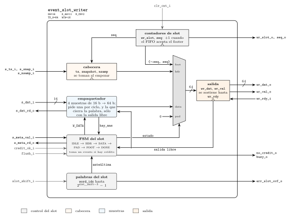

<!-- Prosa a mano del datasheet de `event_slot_writer`: la §1.1 «Qué hace».

     Este archivo es la FUENTE. `modulos/mk/datasheet.py` lo copia dentro del
     bloque AUTO:prosa de `../datasheet_event_slot_writer.md` en cada corrida, y nunca lo
     reescribe: es el unico lugar donde esta prosa se edita, y por eso vive
     afuera de la pagina generada.  Estos comentarios no se copian.

     Los enlaces y las imagenes se escriben relativos a ESTE archivo, asi
     renderiza bien y el chequeo de enlaces del repo lo puede verificar; al
     copiarlos a la pagina se recalculan solos.                         -->

**Qué hace.** Serializa un evento a **un slot del anillo en DDR**: emite
exactamente `2^(slot_shift−3)` palabras de 64 bits en orden de dirección
creciente —cabecera, muestras intercaladas de los dos canales, relleno y
footer— para que el generador lineal del `axi_wr_fifo` las coloque sin saltos.
Es la última etapa del [`event_ring_top`](../datasheet_event_ring_top.md).

*El estado de la FSM elige qué palabra sale: cuatro de cabecera, las muestras
empaquetadas, ceros de relleno hasta la anteúltima y el footer `{~seq, seq}`.
Cada palabra se sostiene en la salida hasta que el `axi_wr_fifo` la acepta
(`wr_rdy_i`), así que la contrapresión frena al writer sin perder muestras.
`wr_slot` y `seq` suben recién cuando se acepta el footer. `clr_cnt_i` los pone
en cero y `flush_i` no, aunque en `event_ring_top` los dos vienen del mismo
`flush`. Si la ventana no entra en el slot, `err_slot_ovf_o` queda prendido y el
evento se trunca. `NOMBRE=valor`: parámetros con que lo instancia
`event_ring_top`.*

*Por dentro:* la FSM del slot, la cabecera, el empaquetador, el mux de la palabra, la salida con su handshake, los contadores de slot y la cuenta de palabras. Fuente TikZ en [`panorama_event_slot_writer.tex`](../../event_ring/figuras/panorama_event_slot_writer.tex).

El formato completo, decodificado con el **mismo decodificador que usa el
software en producción** (`ring_format.decode_slot`) sobre datos de una corrida
real, está en
[`event_ring_b_slot.png`](../../event_ring/figuras/transacciones/event_ring_b_slot.png).

**El footer es el commit, y eso reemplaza al `BRESP`.** El plan original decía
«incrementar `wr_slot` recién con el `BRESP` del último burst». Es correcto e
**inaplicable**: ni `axi_wr_fifo` ni `axi_master` exponen el canal B, así que
no hay forma de observarlo sin tocar RTL compartido. La solución estándar de
*descriptor ring* es mejor y además más barata: se escribe una **marca al
final**. Todas las escrituras salen por un único master con un único ID hacia
el mismo esclavo, y AXI garantiza que las escrituras con el mismo ID se
observan en orden — así que si el PS ve el footer del slot *i* con el `seq`
esperado, **todo lo que está antes del footer ya está en DDR**.

Eso tiene una consecuencia que cambia el lazo caliente: **el PS no necesita
leer ningún registro por GP0** para enterarse de que hay un evento nuevo.
Poléa el footer del próximo slot directamente en DDR, que es más rápido que una
lectura de registro (**2.3 µs**) y saca el bus GP0 del camino. `wr_slot_o`
queda como diagnóstico, no como mecanismo.

El footer lleva `{~seq, seq}`: una lectura rota o vieja se detecta comparando
las dos mitades, sin depender de que el valor `0` sea especial.

**Sin créditos el writer NO descarta: se frena.** La contrapresión sube a la
stage y el descarte ocurre arriba de todo, en la captura, donde se puede tirar
el evento **entero** y contarlo. Descartar a mitad del slot dejaría basura
indistinguible de un evento bueno.

> **Un detalle de reset que parece de más y no lo es.** `flush_i` vacía la FSM
> y el dato en vuelo; `clr_cnt_i` resetea `wr_slot`/`seq`. Están **separados a
> propósito**: `wr_slot` vive en pareja con el `rd_slot` que publica el PS, y
> resetear uno solo deja la resta de créditos en underflow —ocupados ≈ 2³²— y
> el ring descartando todo. Un stop/start no tiene por qué invalidar el anillo,
> así que los contadores se reinician sólo cuando el PS lo pide explícitamente,
> y ahí el top resetea los dos a la vez.
