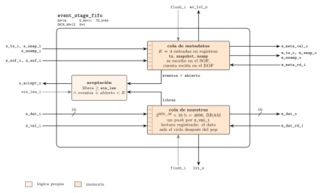

<!-- Prosa a mano del datasheet de `event_stage_fifo`: la §1.1 «Qué hace».

     Este archivo es la FUENTE. `modulos/mk/datasheet.py` lo copia dentro del
     bloque AUTO:prosa de `../datasheet_event_stage_fifo.md` en cada corrida, y nunca lo
     reescribe: es el unico lugar donde esta prosa se edita, y por eso vive
     afuera de la pagina generada.  Estos comentarios no se copian.

     Los enlaces y las imagenes se escriben relativos a ESTE archivo, asi
     renderiza bien y el chequeo de enlaces del repo lo puede verificar; al
     copiarlos a la pagina se recalculan solos.                         -->

**Qué hace.** Es el **buffer elástico** entre la captura de ventana y el
escritor AXI: absorbe la diferencia de ritmo entre un productor que no se puede
frenar y un consumidor que sí.

*`eventos + abierto` cuenta también el evento que está entrando, así que un
trigger nunca se acepta sobre un lugar de metadato ya prometido. `win_len_i` es
`(pre + post)·N_CH`, en muestras. `flush_i` es un solo puerto y pone en cero los
punteros de las dos colas; `lvl_o` y `ev_lvl_o` son diagnóstico. Con ventanas de
1024 muestras entran dos eventos, no cuatro. `NOMBRE=valor`: parámetros con que
lo instancia `event_ring_top`.*

*Por dentro:* la cola de muestras, la cola de metadatos y la aceptación. Fuente TikZ en [`panorama_event_stage_fifo.tex`](../../event_ring/figuras/panorama_event_stage_fifo.tex).

Esa asimetría es toda la razón de existir del bloque.
[`event_window_capture`](../datasheet_event_window_capture.md) produce al ritmo
del ADC y las muestras del post-trigger **llegan cuando llegan**;
[`event_slot_writer`](../datasheet_event_slot_writer.md), en cambio, se frena:
espera créditos de DDR y espera al `axi_wr_fifo`. Sin un buffer en el medio,
cualquier hipo del escritor corrompe la ventana en vuelo. Con capacidad para
`E` eventos, la captura puede empezar el evento *N+1* mientras el escritor
todavía drena el *N*.

**La garantía que da es «evento entero o nada».** `s_accept_o` responde a la
pregunta «¿entra una ventana **completa**?» y se consulta en el ciclo del
trigger, **antes** de aceptar nada. Si da 0, el evento se descarta entero aguas
arriba y se cuenta. Nunca se guarda media ventana: un evento parcial en el ring
sería indistinguible de uno bueno del lado del PS, y ese es el modo de falla
que el diseño entero trata de hacer imposible.

**Son dos colas en paralelo, no una.** Una de muestras, en BRAM, y una de
metadatos de `E` entradas en registros. El escritor las consume
**desacopladas**: primero lee el metadato para armar la cabecera del slot
—timestamp, snapshot, número de muestras— y recién después drena las muestras.
Si fueran una sola cola, el escritor tendría que esperar a tener la ventana
entera antes de poder escribir la primera palabra.

Los dos niveles de ocupación (`lvl_o`, `ev_lvl_o`) salen como diagnóstico: son
lo que dice si la stage es el cuello de botella o sólo el que lo absorbe.
