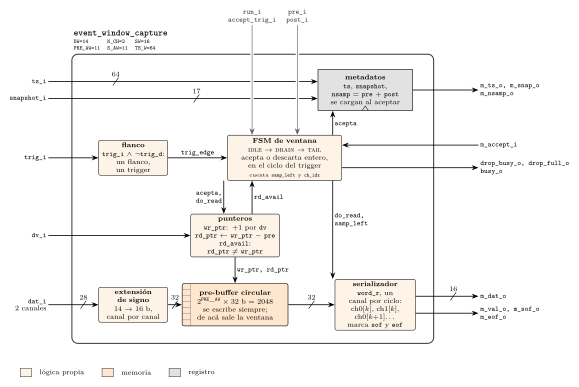

<!-- Prosa a mano del datasheet de `event_window_capture`: la §1.1 «Qué hace».

     Este archivo es la FUENTE. `modulos/mk/datasheet.py` lo copia dentro del
     bloque AUTO:prosa de `../datasheet_event_window_capture.md` en cada corrida, y nunca lo
     reescribe: es el unico lugar donde esta prosa se edita, y por eso vive
     afuera de la pagina generada.  Estos comentarios no se copian.

     Los enlaces y las imagenes se escriben relativos a ESTE archivo, asi
     renderiza bien y el chequeo de enlaces del repo lo puede verificar; al
     copiarlos a la pagina se recalculan solos.                         -->

**Qué hace.** Por cada trigger extrae una **ventana** de muestras —`pre` antes
y `post` desde el disparo— y la emite como un stream de 16 bits hacia
[`event_stage_fifo`](../datasheet_event_stage_fifo.md). Es la primera etapa del
[`event_ring_top`](../datasheet_event_ring_top.md) y lo que reemplaza el rol de
`rp_bram_sm` en el camino de eventos.

*Una sola memoria para el pre y el post: al aceptar, `rd_ptr` arranca `pre`
palabras atrás de `wr_ptr`, y desde ahí el lector consume una palabra cada
`N_CH` ciclos mientras el pre-buffer se sigue escribiendo a una por ciclo. Cada
palabra trae los dos canales y el serializador los saca de a uno. `m_accept_i`
se mira una sola vez, en el ciclo del trigger. Con `run_i = 0` la FSM vuelve a
`IDLE`, y `wr_ptr` y el detector de flanco a cero, pero el contenido del buffer
no se borra. `NOMBRE=valor`: parámetros con que lo instancia `event_ring_top`.*

*Por dentro:* el detector de flanco, la FSM de ventana, los punteros, el pre-buffer circular, el serializador y los metadatos. Fuente TikZ en [`panorama_event_window_capture.tex`](../../event_ring/figuras/panorama_event_window_capture.tex).

**La diferencia con el camino del scope es estructural, no de tamaño.**
`rp_bram_sm` **congela** un buffer de 16384 muestras y no puede volver a
capturar hasta que el PS lo re-arma: son ~**252 µs** de tiempo muerto por
evento. Acá la ventana se copia a un stream aguas abajo y el bloque vuelve a
estar listo en `(pre+post)·N_CH + 2` ciclos —**528 ns** con la ventana de 32
muestras y dos canales— sin que el PS intervenga. Eso es lo que convierte el
osciloscopio en un adquisidor de eventos.

**Una sola memoria para el pre y el post.** El pre-trigger vive en un buffer
circular que se escribe siempre, y la lectura de la ventana sale del **mismo**
buffer, arrancando `pre` palabras atrás del trigger. Cada palabra trae los
`N_CH` canales y el stream saca una muestra por ciclo, así que el lector
consume una palabra cada `N_CH` ciclos mientras el escritor sigue a una por
ciclo: el rezago **crece** durante toda la ventana, hasta
`(pre + post)·N_CH − post` (`2·pre + post` con dos canales). Si llega a
`2^PRE_AW`, el escritor pisa lo que falta leer **sin aviso**: el RTL no lo
verifica, lo verifica libmca. Con `PRE_AW = 11` entra cualquier ventana de
hasta 1024 muestras.

**El evento se acepta o se descarta entero, y se decide en el SOF.** El
handshake con el consumidor ocurre en el ciclo del trigger: si la ventana
completa no entra, el evento se descarta completo. Nunca se emite media
ventana, porque un evento parcial en el ring sería **indistinguible de uno
bueno** del lado del PS.

**Las dos causas de pérdida se cuentan por separado** porque son diagnósticos
distintos: `drop_busy` es el trigger que cayó mientras se drenaba la ventana
anterior —el tiempo muerto **intrínseco** del PL, `(pre+post)·N_CH + 2`
ciclos— y
`drop_full` es que aguas abajo no aceptó —la stage llena, o sin créditos de DDR
porque el PS no drena: tiempo muerto del **consumidor**—. Confundirlos llevaría
a agrandar el buffer cuando el problema es el software, o al revés.

> **El trigger se toma por FLANCO, y eso costó un bug en la placa.**
> `mt_trig_src` registra `adc_trig` como un **nivel**, y el estrobo
> de escritura que llega por el `sys_bus_cdc` puede durar más de un ciclo de
> `adc_clk`: cada trigger por software producía **dos** eventos, uno capturado
> y uno contado como `drop_busy`. Depender del ancho del pulso de un módulo que
> no controlamos es frágil; el flanco no.

La ventana tal como sale, con sus tiempos medidos, está en
[`event_ring_a_ventana.png`](../../event_ring/figuras/transacciones/event_ring_a_ventana.png);
el diseño completo del camino, en
[`logica_de_captura_y_axi.md`](../../event_ring/logica_de_captura_y_axi.md).
