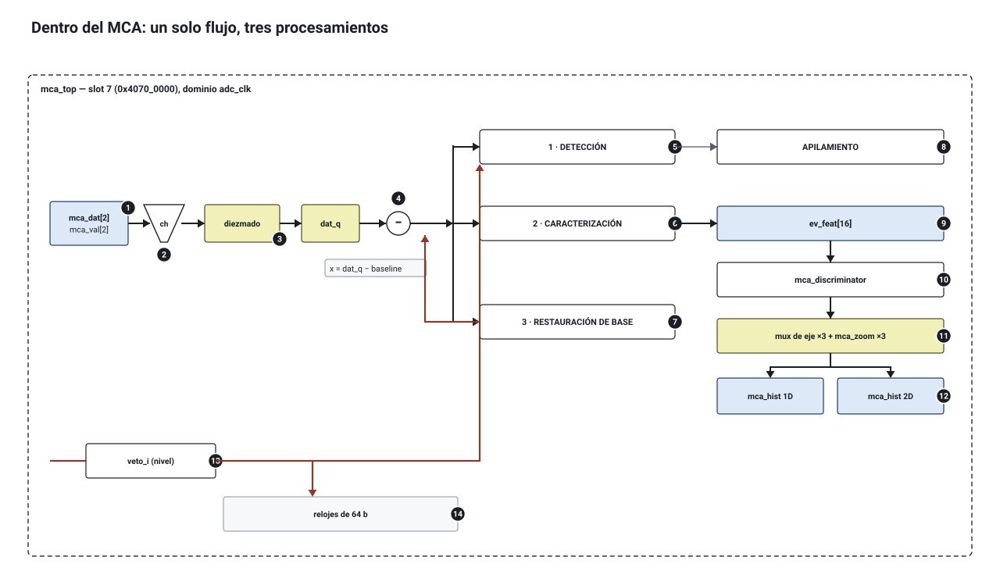

<!-- Prosa a mano del datasheet de `mca_top`: la §1.1 «Qué hace».

     Este archivo es la FUENTE. `modulos/mk/datasheet.py` lo copia dentro del
     bloque AUTO:prosa de `../datasheet_mca_top.md` en cada corrida, y nunca lo
     reescribe: es el unico lugar donde esta prosa se edita, y por eso vive
     afuera de la pagina generada.  Estos comentarios no se copian.

     Los enlaces y las imagenes se escriben relativos a ESTE archivo, asi
     renderiza bien y el chequeo de enlaces del repo lo puede verificar; al
     copiarlos a la pagina se recalculan solos.                         -->

**Qué hace.** Recibe el flujo de muestras de los dos canales y devuelve, por el
bus de sistema, el **espectro de alturas de pulso**: un histograma de 8192
canales donde cada cuenta es un evento detectado y clasificado. Todo el trabajo
—detectar el pulso, medirlo, decidir si se acepta e incrementar el canal— pasa
en la PL, a 125 MHz, sin que el PS intervenga por evento. Eso es lo que lo
distingue del camino del osciloscopio: lo que cruza a software no son muestras,
es el resultado.

#### Arquitectura interna

La idea que ordena el bloque: **hay un solo flujo de muestras y tres
procesamientos que lo consumen**, no tres cadenas con su conformado propio. Lo
que cambia entre las tres funciones es el procesamiento, no el filtro.

Como en las demás figuras del repo, el dibujo lleva sólo las marcas y los
nombres; el detalle de cada una está acá:

| # | Bloque | Qué hace |
|---|---|---|
| **1** | `mca_dat[2]` / `mca_val[2]` | Las muestras de los dos canales, desde el `dsp_tap_mux` del slot 6. El valid se honra de verdad: ver [`register_map_top.md`](../../TOP/register_map_top.md) |
| **2** | Selector de canal | `cfg_chan`. Un solo canal alimenta la cadena de análisis |
| **3** | Diezmado propio | `cfg_dec`. Es **del MCA**, independiente del `rp_decim` de la cadena compartida |
| **4** | `x = dat_q − baseline` | **El flujo único.** Las tres ramas consumen este mismo `x`; el restador es el punto donde la línea de base se quita |
| **5** | 1 · Detección | Schmitt (`cfg_thr`, `cfg_hyst`) con rearmado, más la FSM de segmentación que abre y cierra la ventana. Modo 0 histéresis / modo 1 compuerta fija |
| **6** | 2 · Caracterización | Sobre `xc = máx(x, 0)`: `q_tot`, `q_tail`, pico (comparación estricta), `len`, `t_peak`, y los divisores `Q_cola/Q_tot` y `pico/Q_tot` |
| **7** | 3 · Restauración de base | Seguidor IIR `bl_acc += x − (bl_acc >> k)`, **congelado** durante el pulso y durante `cfg_bl_holdoff`. Es el único bloque que modifica el flujo que ven los otros dos — de ahí el lazo rojo |
| **8** | Apilamiento | **No es un bloque**: es una condición de cierre de la FSM (modo 0, cerró por `cfg_maxlen`; modo 1, segundo cruce dentro de la compuerta). Se cuenta en `cnt_pileup` y **no** se histogramea |
| **9** | `ev_feat[16]` | El registro único de evento: `0` pico · `1` integral · `2` Q_cola/Q_tot · `3` pico/Q_tot · `4` largo · `5` t_subida |
| **10** | `mca_discriminator` | Ventana [mín, máx] sobre **una** feature. Rechaza el evento entero. No mira muestras: mira features, con el pulso ya cerrado |
| **11** | Mux de eje ×3 + `mca_zoom` ×3 | `cfg_sel_*` elige qué feature va a cada eje; el zoom recorta y escala. Es la etapa de pipeline antes de la BRAM |
| **12** | `mca_hist` 1D y 2D | El espectro de 8192 canales y el mapa de 128 × 64 |
| **13** | `veto_i` (nivel) | Desde el `trigger_shield` del multitrigger. **No deja abrir** pulsos nuevos; el que está en curso termina normal |
| **14** | Relojes de 64 b | `realtime = livetime + deadtime + vetotime`. El veto gana sobre `busy`: su cola cuenta como tiempo vetado |

La **vida de un pulso** medida sobre la simulación, con los números de cada
etapa, está en [§1.7](#17-waveforms); el espectro que se acumula del otro lado,
en [`figuras/07_cadena.png`](../../mca/figuras/07_cadena.png).
