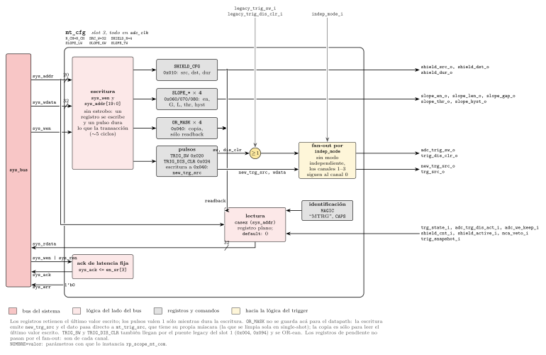

<!-- Prosa a mano del datasheet de `mt_cfg`: la §1.1 «Qué hace».

     Este archivo es la FUENTE. `modulos/mk/datasheet.py` lo copia dentro del
     bloque AUTO:prosa de `../datasheet_mt_cfg.md` en cada corrida, y nunca lo
     reescribe: es el unico lugar donde esta prosa se edita, y por eso vive
     afuera de la pagina generada.  Estos comentarios no se copian.

     Los enlaces y las imagenes se escriben relativos a ESTE archivo, asi
     renderiza bien y el chequeo de enlaces del repo lo puede verificar; al
     copiarlos a la pagina se recalculan solos.                         -->

**Qué hace.** Es el esclavo de registros del multitrigger: la **máscara OR de
fuentes de disparo** por canal, el **escudo** que impide que un canal dispare
mientras otro está en su ventana de veto, y el estado de vuelta —qué fuente
disparó (`SNAPSHOT`) y qué canales quedaron deshabilitados (`DIS_FLAGS`)—.

*Por dentro:* escritura, registros y pulsos, el puente legacy, el fan-out por `indep_mode` y la lectura. Fuente TikZ en [`panorama_mt_cfg.tex`](../../mt/figuras/panorama_mt_cfg.tex).

Lo que resuelve es que el scope de fábrica tiene **una** fuente de trigger por
canal; acá hay 32 OR-eadas, y además canales que se vetan entre sí. Eso es lo
que permite que el MCA y el osciloscopio no se pisen: el veto que sale de
`trigger_shield` es la única señal que cruza de un consumidor a otro en todo el
top.

La decisión estructural: **estos registros vivían dentro del `casez` del slot 1**,
mezclados con los del scope y colgados del mismo `sys_ack` que las aperturas de
BRAM — el mismo ack que arrastra el bug latente de `bram_ack[2]`/`[3]` atados a
cero. Separarlos al slot 3 saca al multitrigger de esa ruta de ack.

Dos cosas que no son evidentes:

- **Hay un puente legacy, y es a propósito.** `librp` conoce dos de los offsets
  viejos (`0x004` SW-trigger y `0x094` `trig_dis_clr`), así que `osc_cfg` los
  sigue decodificando en el slot 1 y manda acá el pulso ya decodificado por
  canal. Las dos vías —el registro propio y el puente— se **OR-ean**. El resto
  de los offsets viejos (`0x210`–`0x21C`, `0x240`–`0x24C`) no los conoce nadie
  más que este proyecto, así que no hay compatibilidad que preservar: sólo hay
  que reapuntar `multitrigger_utils.py`.
- **Los pulsos duran ~5 ciclos, no uno.** `sys_bus_cdc` sostiene `wen` hasta el
  ack, así que `adc_trig_sw`, `trig_dis_clr` y `new_trg_src` salen anchos. Es la
  semántica que tenía el módulo original y de la que depende la lógica aguas
  abajo; convertirlos en estrobos de un ciclo es un cambio deliberado y aparte,
  no algo que deba colarse en una mudanza de registros.

El **disable queda enganchado**: después de un single-shot no entra otro disparo
hasta que el software escriba `TRIG_DIS_CLR`. Los cronogramas del veto y del
holdoff están en [§1.7](#17-waveforms); cuántos disparos se pierden de verdad en
el lazo completo, medido, en [§1.6](#16-transacciones).
