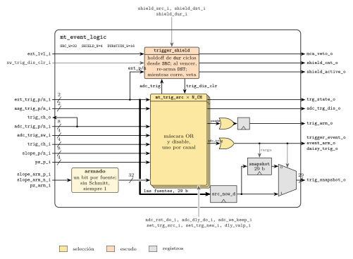

<!-- Prosa a mano del datasheet de `mt_event_logic`: la §1.1 «Qué hace».

     Este archivo es la FUENTE. `modulos/mk/datasheet.py` lo copia dentro del
     bloque AUTO:prosa de `../datasheet_mt_event_logic.md` en cada corrida, y nunca lo
     reescribe: es el unico lugar donde esta prosa se edita, y por eso vive
     afuera de la pagina generada.  Estos comentarios no se copian.

     Los enlaces y las imagenes se escriben relativos a ESTE archivo, asi
     renderiza bien y el chequeo de enlaces del repo lo puede verificar; al
     copiarlos a la pagina se recalculan solos.                         -->

**Qué hace.** Es el **cableado del subsistema de disparo**: instancia un
[`mt_trig_src`](../datasheet_mt_trig_src.md) por canal y un
[`trigger_shield`](../datasheet_trigger_shield.md), los conecta entre sí, y
produce el **evento conjunto** que usan el buffer del scope y el anillo de
eventos. No tiene lógica propia de disparo: lo que aporta es la topología.

*`trigger_event_o`, `event_arm_o` y `daisy_trig_o` son la misma señal: el OR de
los disparos de los canales. Las fuentes del escudo son los disparos por canal
más la entrada externa cruda (flancos y nivel), así que se puede vetar desde
afuera sin gastar la máscara de un canal. El snapshot guarda las fuentes crudas
del ciclo del evento, retrasadas uno para alinearlas con el registro de
`mt_trig_src`. `NOMBRE=valor`: parámetros con que lo instancia
`rp_scope_mt_com`.*

*Por dentro:* los `mt_trig_src`, el escudo, el OR que da `trigger_event`, el snapshot y la cadena. Fuente TikZ en [`panorama_mt_event_logic.tex`](../../mt/figuras/panorama_mt_event_logic.tex).

Tres salidas que son la misma señal y una que no:

- `trigger_event_o`, `event_arm_o` y `daisy_trig_o` son **el mismo OR** de los
  triggers de todos los canales (los canales no usados se rellenan con cero).
  Están separadas porque cada una va a un consumidor distinto —captura, armado
  y cadena entre scopes—, no porque difieran.
- `trig_snapshot_o` es otra cosa: 17 bits **sticky** con las fuentes que
  estaban activas en el momento del último evento. Es lo que permite
  reconstruir *qué* disparó cada evento después del hecho, y es el campo
  `snapshot` que
  [`event_slot_writer`](../datasheet_event_slot_writer.md) pone en la cabecera de
  cada slot del ring. Lo borran el reset, el `adc_rst_do` y el clear de
  software.

El detalle que hace que el snapshot sea correcto y no aproximado: `src_now` se
**retrasa un ciclo** antes de latchearlo, para alinearse con el pipeline de
`mt_trig_src` (`trig_comb` combinacional → `adc_trig` registrado →
`event_signal`). Sin ese retardo el snapshot guardaría las fuentes del ciclo
equivocado y mentiría justo en los eventos que importan, los de coincidencia.

El escudo recibe como fuentes los disparos por canal **más la entrada externa
cruda** (los dos flancos y el nivel): así se puede escudar o vetar desde afuera
sin gastar la máscara OR de un canal del scope en eso.

El camino completo desde el disparo hasta la captura, con los tiempos medidos,
está en [`mt_b_camino.png`](../../mt/figuras/transacciones/mt_b_camino.png);
el orden en que hay que armar y disparar, en
[`orden_arm_trigger_captura.md`](../../osc/orden_arm_trigger_captura.md).
