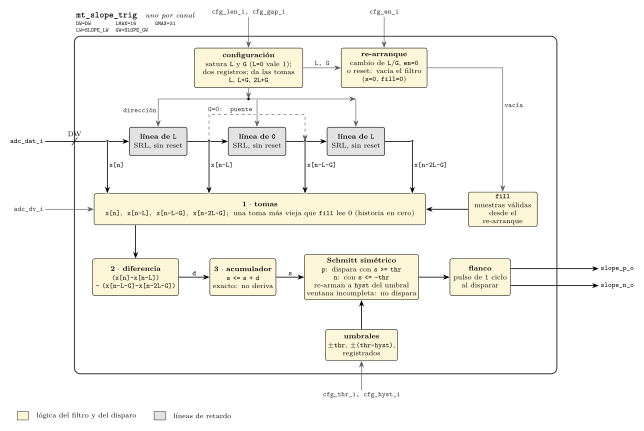

<!-- Prosa a mano del datasheet de `mt_slope_trig`: la §1.1 «Qué hace».

     Este archivo es la FUENTE. `modulos/mk/datasheet.py` lo copia dentro del
     bloque AUTO:prosa de `../datasheet_mt_slope_trig.md` en cada corrida, y nunca lo
     reescribe: es el unico lugar donde esta prosa se edita, y por eso vive
     afuera de la pagina generada.  Estos comentarios no se copian.

     Los enlaces y las imagenes se escriben relativos a ESTE archivo, asi
     renderiza bien y el chequeo de enlaces del repo lo puede verificar; al
     copiarlos a la pagina se recalculan solos.                         -->

**Qué hace.** Es el **disparo por pendiente de un canal**. Funciona como
`rp_adc_trig` (misma entrada, mismo Schmitt, mismos dos pulsos `p`/`n` de un
ciclo), pero el umbral no se compara contra la muestra sino contra un
**trapezoidal rápido**:

```
s[n] = Σ_{i<L} x[n-i]  −  Σ_{i<L} x[n-L-G-i]
```

que es una derivada suavizada. Un escalón de alto `A` da `s = L·A`, una rampa
de pendiente `m` da `L·(L+G)·m` y una continua da 0. Por eso el umbral no se
mueve con la línea de base, que es lo que le pasa al disparo de nivel. Hay una
instancia por canal en [`mt_top`](../datasheet_mt_top.md),
y sus pulsos entran a [`mt_trig_src`](../datasheet_mt_trig_src.md) como los
bits 17–24 de la máscara OR.



*`s[n] = s[n-1] + (x[n] - x[n-L]) - (x[n-L-G] - x[n-2L-G])`. Cada línea tiene
una sola toma dinámica, que es el patrón que Vivado lleva a SRLC32E. Las líneas,
`fill` y el pipeline avanzan sólo con `adc_dv_i`: el filtro anda igual sobre el
tap decimado que a 125 MS/s. Latencia: 5 ciclos de pipeline más lo que tarde `s`
en cruzar `thr`. `NOMBRE=valor`: parámetros con que lo instancia
`rp_scope_mt_com`.*

*Por dentro:* las tres líneas de retardo, el pipeline del trapezoidal y el Schmitt simétrico. Fuente TikZ en [`panorama_mt_slope_trig.tex`](../../mt/figuras/panorama_mt_slope_trig.tex).

Tres cosas que hay que saber para usarlo:

- **Cambiar `L` o `G`, o pasar por `cfg_en=0`, vacía el filtro.** Mientras la
  ventana de `2L+G` muestras no esté llena no sale ningún pulso, y el primero
  exige re-armar (`s < thr−hyst`). Habilitarlo sobre una señal con offset no
  dispara.
- **`hyst < thr`** o el Schmitt no re-arma nunca en `s = 0`.
- **Latencia**: 5 ciclos de pipeline, más lo que tarde `s` en cruzar el
  umbral (del orden de `L` muestras para un escalón).

Las líneas de retardo son tres en cascada (`L`, `G`, `L`) con una toma
dinámica cada una, inferidas en SRL. Teoría, elección del umbral, costo
medido y bibliografía en
[`trigger_pendiente.md`](../../mt/trigger_pendiente.md).
