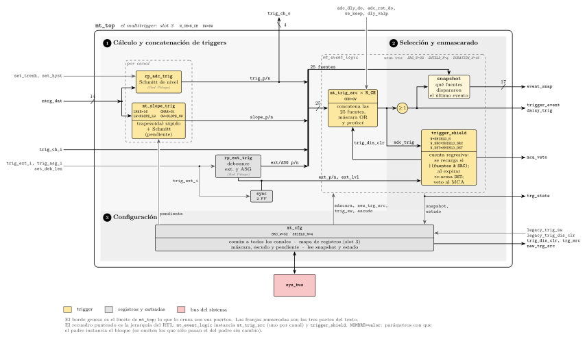

<!-- Prosa a mano del datasheet de `mt_top`: la §1.1 «Qué hace».

     Este archivo es la FUENTE. `modulos/mk/datasheet.py` lo copia dentro
     del bloque AUTO:prosa de la pagina en cada corrida, y nunca lo
     reescribe: es el unico lugar donde esta prosa se edita, y por eso vive
     afuera de la pagina generada. Estos comentarios no se copian.

       pagina:  ../datasheet_mt_top.md

     Que va aca: que problema resuelve el bloque, como encaja en la cadena y
     las dos o tres decisiones de diseno que explican por que esta hecho asi.
     Lo que se deriva del RTL —puertos, registros, relojes, Fmax, casos de
     test— NO: eso lo escribe el generador y se desactualiza solo.

     Los enlaces y las imagenes se escriben relativos a ESTE archivo, asi
     renderiza bien y el chequeo de enlaces del repo lo puede verificar; al
     copiarlos a la pagina se recalculan solos.                           -->

**Qué hace.** Es el **multitrigger entero** detrás de un solo borde: de las
muestras del tap MTRG y las entradas externas a `trigger_event`, más los
registros del slot 3. Adentro están el disparo de nivel
([`rp_adc_trig`](../../../../../rtl/classic/rp_adc_trig.v), de Red Pitaya) y el de
pendiente ([`mt_slope_trig`](../datasheet_mt_slope_trig.md)) de cada canal, el
debounce externo ([`rp_ext_trig`](../../../../../rtl/classic/rp_ext_trig.v)), la
lógica de evento ([`mt_event_logic`](../datasheet_mt_event_logic.md)) y el
esclavo del bus ([`mt_cfg`](../datasheet_mt_cfg.md)).
[`rp_scope_mt_com`](../datasheet_rp_scope_mt_com.md) lo instancia una vez.

*El borde grueso es el límite de `mt_top`; lo que lo cruza son sus puertos. Las
franjas numeradas son las tres partes del texto de `register_map_mt.md`. El
recuadro punteado es la jerarquía del RTL: `mt_event_logic` instancia
`mt_trig_src` (uno por canal) y `trigger_shield`. `NOMBRE=valor`: parámetros con
que el padre instancia el bloque (se omiten los que sólo pasan el del padre sin
cambio).*

*Por dentro:* las tres partes del texto de
[`register_map_mt.md`](../../mt/register_map_mt.md#panorama), con la tabla de
puertos y de dónde viene cada uno. Fuente TikZ en
[`panorama_mt.tex`](../../mt/figuras/panorama_mt.tex).

Hasta este módulo, el multitrigger era una **región**: sus piezas estaban
sueltas dentro de `rp_scope_mt_com`, y sólo el mapa de registros lo
delimitaba. `mt_top` es una **mudanza sin cambios de lógica**: cada instancia
tiene los mismos parámetros y conexiones que antes, y se conservan los relojes
por canal. Con estímulos al azar, el `rp_scope_mt_com` nuevo y una copia
congelada del anterior dieron las mismas salidas en cada ciclo.

Lo que cruza el borde muestra dónde termina el multitrigger y empieza el scope:

- **El tap entra ya elegido.** Qué nodo de la cadena mira el disparo lo decide
  el `dsp_tap_mux` MTRG, que es parte del ruteo del scope.
- **Parte de la configuración viene del slot 1.** El umbral y la histéresis
  del disparo de nivel y el largo del debounce son registros de `osc_cfg` que
  `librp` conoce, así que no se mudan: entran como puertos, igual que el
  puente legacy de `TRIG_SW` y `TRIG_DIS_CLR`.
- **El lazo con la captura cruza el borde.** `trigger_event` va a
  `rp_bram_sm` y `rp_axi_sm`, y vuelve el control de la captura (`adc_dly_do`,
  `adc_rst_do`, `we_keep`, `dly_valp`). `trig_dis_clr`, `trg_src` y
  `new_trg_src` también salen, porque `rp_bram_sm` y `rp_delay` los usan.
- **Los flancos externos salen y vuelven.** `rp_ext_trig` los saca por
  `trig_ext_asg_o` y la lógica de evento los toma de `trig_ext_asg_i`. El top
  une las dos puntas para poder compartirlas entre varios scopes.

[`tb_mt_top`](../../../modulos/mt/sim/tb_mt_top.sv) prueba el módulo solo, con
el tap y la captura manejados por el TB. Verifica cada camino de punta a punta:
nivel, pendiente, externo, veto, SW (por el puente y por el registro propio),
cadena, modo continuo y el lazo con la captura.
