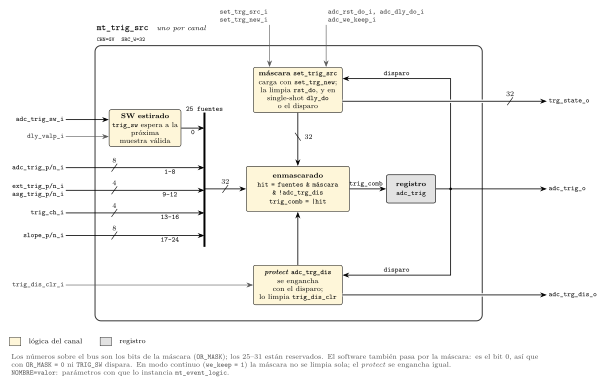

<!-- Prosa a mano del datasheet de `mt_trig_src`: la §1.1 «Qué hace».

     Este archivo es la FUENTE. `modulos/mk/datasheet.py` lo copia dentro del
     bloque AUTO:prosa de `../datasheet_mt_trig_src.md` en cada corrida, y nunca lo
     reescribe: es el unico lugar donde esta prosa se edita, y por eso vive
     afuera de la pagina generada.  Estos comentarios no se copian.

     Los enlaces y las imagenes se escriben relativos a ESTE archivo, asi
     renderiza bien y el chequeo de enlaces del repo lo puede verificar; al
     copiarlos a la pagina se recalculan solos.                         -->

**Qué hace.** Es el **selector de disparo de un canal**: toma las 29 fuentes
de trigger del sistema (los flancos de nivel de los canales del ADC, los de
pendiente de [`mt_slope_trig`](../datasheet_mt_slope_trig.md) y de polo-cero
de [`mt_pz_trig`](../datasheet_mt_pz_trig.md), la entrada
externa, el generador, la cadena desde el otro scope y el disparo por
software), las filtra con una máscara, y emite el trigger del canal. Hay una
instancia por canal dentro de
[`mt_event_logic`](../datasheet_mt_event_logic.md).

*En el estilo de `panorama_mt`: el color es la función del bloque (la leyenda),
las operaciones van con su símbolo y gris con triángulo es un registro del RTL.
Acá sí hay un vector: las fuentes entran cada una por su línea y este módulo
las concatena (la barra); los números son los bits de la máscara (`OR_MASK`), y
los 29–31 están en cero. El software también pasa por la máscara: es el bit 0,
así que con `OR_MASK = 0` ni `TRIG_SW` dispara. La máscara, salvo con el
disable enganchado, da con las fuentes el disparo, y con el armado de cada
fuente (`armado_i`) da `puede_o`: el canal puede disparar ya. «disparo» es la
salida del registro `adc_trig`, realimentada: engancha el disable y, en
single-shot (`we_keep = 0`), limpia la máscara, igual que `dly_do`; en modo
continuo la máscara no se limpia sola. `rst_do` la limpia siempre.
`NOMBRE=valor`: parámetros con que lo instancia `mt_event_logic`.*

*Por dentro:* las 29 fuentes, la máscara, el disable, `puede` y la realimentación del disparo. Fuente TikZ en [`panorama_mt_trig_src.tex`](../../mt/figuras/panorama_mt_trig_src.tex).

Es el reemplazo de `rp_trig_src.v`, y las dos diferencias con el original son
las que dan el nombre al módulo:

- **La máscara es un OR, no un selector.** En el original un registro elegía
  **una** fuente. Acá cada bit habilita una clase de fuente y la salida es el
  OR de las habilitadas, así que poner varios bits da el OR entre todas —
  pares, ternas, lo que se configure. Eso es lo que permite disparar por
  coincidencia de condiciones sin un bitstream por combinación.
- **La salida va registrada** (`adc_trig`), que es lo que el camino de captura
  necesitaba para alinearse.

**El enganche es la parte que hay que entender para usarlo.** Al disparar, el
módulo engancha `adc_trg_dis` en el mismo movimiento, y eso es lo que impide
que el flanco siguiente vuelva a disparar. Medido sobre el VCD de
`tb_mt_trig_src` en
[`mt_trig_src_enganche.svg`](../../mt/figuras/ondas/mt_trig_src_enganche.svg):
el disable engancha **1 ciclo** después del disparo y la máscara se limpia a
**1 ciclo**.

| Modo | Qué pasa con la máscara | Para volver a disparar |
|---|---|---|
| single-shot (default) | se **auto-limpia** al disparar | reescribir la máscara |
| continuo (`adc_we_keep`) | **persiste** | basta con limpiar el disable (`trig_dis_clr`) |

Esa es la única diferencia entre los dos modos, y el clear puede venir del
software (registro `0x94`) o del
[`trigger_shield`](../datasheet_trigger_shield.md) al expirar su holdoff — por eso
el escudo puede re-armar un canal sin que el PS intervenga.

El disparo por software está **gateado por `dly_valp`**: no vale por sí solo,
tiene que caer con el pulso de validez del retardo. Es lo que evita que una
escritura de registro dispare en un momento en que la cadena no está lista.

> **Candidato a formal.** «Después de un single-shot la máscara queda limpia y
> no se vuelve a disparar sin `trig_dis_clr`» es una propiedad de secuencia
> sobre una FSM chica: barata de probar y exactamente el tipo de cosa que un
> testbench cubre con casos puntuales. Ver
> [`verificacion_formal.md`](../../verificacion_formal.md).
