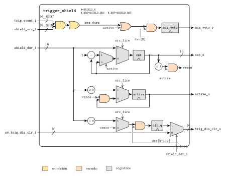

<!-- Prosa a mano del datasheet de `trigger_shield`: la §1.1 «Qué hace».

     Este archivo es la FUENTE. `modulos/mk/datasheet.py` lo copia dentro del
     bloque AUTO:prosa de `../datasheet_trigger_shield.md` en cada corrida, y nunca lo
     reescribe: es el unico lugar donde esta prosa se edita, y por eso vive
     afuera de la pagina generada.  Estos comentarios no se copian.

     Los enlaces y las imagenes se escriben relativos a ESTE archivo, asi
     renderiza bien y el chequeo de enlaces del repo lo puede verificar; al
     copiarlos a la pagina se recalculan solos.                         -->

**Qué hace.** Es el **escudo**: cuando una fuente dispara, deja inhabilitados
durante un holdoff programable a los destinos que uno elija, y al expirar los
vuelve a armar. Sirve para dos cosas distintas con el mismo contador: evitar
que un canal del scope se re-dispare con su propia cola, y darle al MCA un
**veto** mientras pasa algo que no debe entrar al espectro.

*Por dentro:* el contador de holdoff, el pulso de re-arm, el veto al MCA y el mux por canal. Fuente TikZ en [`panorama_trigger_shield.tex`](../../mt/figuras/panorama_trigger_shield.tex).

Lo que lo hace más que un holdoff por canal es que **fuentes y destinos son
vectores independientes**:

| Bits | Fuentes (`shield_src`) | Destinos (`shield_dst`) |
|---|---|---|
| `0 … N−1` | los canales del scope | los canales del scope |
| `N+0`, `N+1` | `ext_p`, `ext_n` — flancos de la entrada externa (DIO0_P) | — |
| `N+2` | `ext_lvl` — el **nivel** externo, sincronizado | — |
| `N` (dst) | — | `mca` — el analizador, como veto |

Cualquiera puede escudar a cualquiera, y la entrada externa puede vetar sin
gastar la máscara OR de un canal del scope en eso.

**Las tres formas del veto salen del mismo contador**; lo único que cambia es
qué bit de `src` se habilita y qué duración se escribe. Los tres tramos, cada
uno de una escena distinta de `tb_trigger_shield`, están medidos sobre el VCD
en [`mt_veto_tres_formas.svg`](../../mt/figuras/ondas/mt_veto_tres_formas.svg):

| Configuración | Qué veto da | Medido |
|---|---|---|
| `src = ext_lvl`, `dur = 0` | el veto **es** la línea, con un ciclo de latencia | 21 ciclos (la línea duró eso) |
| `src = ext_lvl`, `dur = 8` | la línea **más cola**: sigue 8 ciclos después de bajar | 13 ciclos |
| `src = ext_p`, `dur = 12` | ventana fija por flanco, dure lo que dure el pulso | 13 ciclos |

Con una fuente de nivel el escudo «dispara» cada ciclo que la línea está alta
y cada disparo recarga el contador: de ahí sale el veto de nivel con cola, sin
lógica dedicada.

Dos detalles de temporizado que son decisiones, no accidentes:

- **El clear sale al EXPIRAR, no al disparar.** Si saliera al disparar, el
  destino se re-armaría en medio del evento del que el escudo lo está
  protegiendo. Se ve en
  [`mt_holdoff_rearm.svg`](../../mt/figuras/ondas/mt_holdoff_rearm.svg):
  `active` se mantiene los `shield_dur` ciclos y el pulso de clear aparece al
  final.
- **El veto al MCA es un NIVEL y va registrado.** Vale mientras alguna fuente
  dispare o el holdoff corra. Termina en la lógica de apertura de pulso del MCA
  —que no abre ventanas nuevas pero **sí deja terminar la que está en curso** y
  **sí sigue corriendo el seguidor de línea de base**, ver
  [`mca_pulse_feature`](../datasheet_mca_pulse_feature.md)— así que un ciclo de
  retardo no cambia nada.

Los canales **no** escudados siguen siendo transparentes al clear de software
(`0x94`): el escudo se mete en el camino sólo de lo que se le pidió.

> **Un contador para todos.** `cnt` es **global**, no uno por destino: dos
> fuentes que disparen con solapamiento comparten el mismo holdoff y el
> segundo disparo lo recarga entero. Para el uso previsto —un escudo a la vez—
> da lo mismo, pero no es un holdoff por par src→dst y conviene no leerlo así.
>
> **Es el candidato más barato a verificación formal del módulo.** El
> testbench comprueba `n_veto` para **un** valor de `dur`; la propiedad que
> importa —el veto siempre termina, `active` no se queda pegado— es liveness
> acotada sobre una FSM diminuta, y el formal la probaría para **todos** los
> `dur`. Ver [`verificacion_formal.md`](../../verificacion_formal.md).
