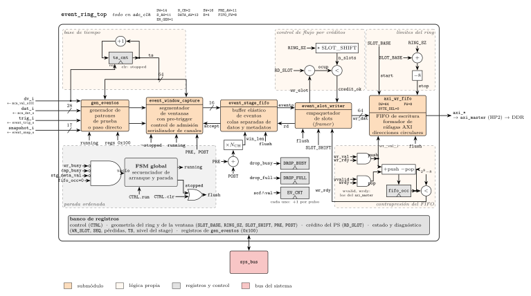
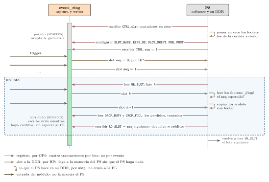

# event_ring — diseño y mapa de registros (Fase 1)

Ring de slots de evento en DDR. Reemplaza el ciclo
`capturar → congelar → que el PS lea por GP0 → re-armar` (K=1, τ = 252.7 µs) por
una cola productor/consumidor de N_SLOTS eventos. Por qué eso baja el tiempo
muerto, y la analogía con pasar de un MCP a una FIFO asincrónica, está en
[`../buffering_y_tiempo_muerto.md`](../buffering_y_tiempo_muerto.md).

> El detalle interno —señales, las tres FSMs, qué son los créditos y cómo se
> forman las transferencias AXI— está en
> [`logica_de_captura_y_axi.md`](logica_de_captura_y_axi.md), con los diagramas de
> funcionamiento y los límites medidos. La máquina que esto reemplaza está en
> [`../osc/sistema_adquisicion_original.md`](../osc/sistema_adquisicion_original.md).

## Por qué "ring" y no "arbiter"

El módulo original se llamaba `multievent_arbiter`. Un *árbitro* elige entre
solicitantes que compiten por un recurso; acá no hay competencia: hay **una cola**
con un productor (el PL) y un consumidor (el PS), y el único mecanismo es control
de flujo por créditos. El nombre `event_ring` dice lo que es y anticipa lo que hay
que verificar (wrap, lleno-vs-vacío, commit), que es la mitad del valor de un
nombre. El stub viejo quedó como
`rtl/mine/event_ring/NOTAS_diseno_original.txt`.

## Estructura



*El PS no lee ningún registro por evento: lee `WR_SLOT` una vez por lote, valida
el footer de cada slot en DDR y publica `RD_SLOT` una vez por lote. Sin créditos
el writer se frena y el descarte ocurre arriba, en la captura, por evento entero.
Cada bloque dice la función del submódulo; cómo la hace está en su panorama.
`gen_eventos` es un submódulo más del top: corre con `running`, tiene sus
registros en `0x100` del slot y, apagado, es un paso directo de la entrada.
Las redes con nombre se conectan por nombre; en MAYÚSCULAS, los registros.
`NOMBRE=valor`: parámetros con que el padre instancia el bloque (se omiten los
que sólo pasan el del padre sin cambio).*

El evento baja de izquierda a derecha. El generador de patrones de prueba deja
pasar la entrada o la reemplaza por disparos y un dato conocido. El segmentador
(la captura) saca una ventana pre + post, el buffer elástico (el stage) la guarda
entera o la rechaza entera, con `accept` en el SOF, el empaquetador (el writer)
la arma en un slot y el `axi_wr_fifo` la escribe en DDR por HP2, en ráfagas. Arriba, lo que frena al writer sin perder datos: los **créditos**
contra el `RD_SLOT` que publica el PS. Abajo, la contrapresión del FIFO, la FSM
global y los registros. La fuente es
[`figuras/panorama_event_ring_top.tex`](figuras/panorama_event_ring_top.tex)
(TikZ).

| módulo | archivo | qué hace | por dentro |
|---|---|---|---|
| `event_window_capture` | `modulos/event_ring/rtl/event_window_capture.sv` | pre-buffer circular + ventana pre/post; cuenta `drop_busy` y `drop_full` | [`panorama_event_window_capture.svg`](figuras/panorama_event_window_capture.svg) |
| `event_stage_fifo` | `.../event_stage_fifo.sv` | buffer elástico de E eventos; garantiza "evento entero o nada" | [`panorama_event_stage_fifo.svg`](figuras/panorama_event_stage_fifo.svg) |
| `event_slot_writer` | `.../event_slot_writer.sv` | layout del slot, relleno, footer de commit | [`panorama_event_slot_writer.svg`](figuras/panorama_event_slot_writer.svg) |
| `event_ring_top` | `.../event_ring_top.sv` | FSM global, créditos, contadores, bus de sistema | el panorama de arriba |

**Un solo dominio de reloj.** `rp_scope_mt_com.sv:686` hace
`assign axi_clk = adc_clk_i`, y el bus llega ya sincronizado a `adc_clk` por
`sys_bus_cdc`. Captura, writer y registros comparten `adc_clk`: **no hace falta
CDC ni codificación Gray** entre `WR_SLOT` y `RD_SLOT`.

## Recursos

Síntesis fuera de contexto de `event_ring_top` a 125 MHz, con Vivado 2021.2:

| ventana máxima | `PRE_AW` | `DATA_AW` | LUT | FF | RAMB36 | RAMB18 | bloques de BRAM |
|---|---|---|---|---|---|---|---|
| ~500 muestras (antes) | 9 | 12 | 1086 | 1008 | 3 | 2 | 4 |
| **1024 muestras (hoy)** | **11** | **12** | **1091** | **1012** | **5** | **1** | **5.5** |
| 1024, con 4 ventanas en el stage | 11 | 13 | 1097 | 1016 | 7 | 1 | 7.5 |

Agrandar la ventana cuesta casi solo memoria: el pre-buffer pasa de 1 RAMB18 a
2 RAMB36. El camino crítico no cambia. Dejando afuera los caminos de geometría, que
el bitstream lleva como multiciclo, da +0.393 ns en las tres filas (después de
síntesis, sin ruteo).

En el bitstream del 2026-11-08, ruteado, el ring ocupa 1102 LUT, 1047 FF y 5 RAMB36, y
el maestro de HP2 suma 113 LUT. Para hacerle lugar, ese bitstream no tiene la captura del
osciloscopio a DDR por AXI (`EN_AXI = 0` en `rp_scope_mt_com`), que libera 960 LUT: queda
en 14 402 LUT, 145 más que el del MCA. Ver
[`out/v3_event_ring/LEEME.md`](../../out/v3_event_ring/LEEME.md).

## Layout del slot

`SLOT_SZ = 2^SLOT_SHIFT` bytes, escrito siempre completo y en orden creciente de
dirección (el generador del `axi_wr_fifo` es lineal, sin saltos).

| offset      | contenido                                                                              |
| ----------- | -------------------------------------------------------------------------------------- |
| `0x00`      | `timestamp[63:0]` — ciclos de `adc_clk` desde el start                                 |
| `0x08`      | `{flags[7:0], n_ch[7:0], n_samp[15:0], seq[31:0]}`                                     |
| `0x10`      | `{32'b0, 15'b0, snapshot[16:0]}`; `event_id` nunca se implementó: el writer escribe 0  |
| `0x18`      | reservado                                                                              |
| `0x20…`     | muestras int16, 4 por palabra, canales **intercalados**: `ch0[k], ch1[k], ch0[k+1], …` |
| …           | relleno de ceros                                                                       |
| `SLOT_SZ-8` | **footer** `{~seq[31:0], seq[31:0]}`                                                   |

### El footer es el commit — y por qué no se usa el BRESP

El plan original decía "incrementar `wr_slot` recién con el `BRESP` del último
burst". Es correcto pero **inaplicable**: ni `axi_wr_fifo` ni `axi_master` exponen
el canal B (`axi_wr_fifo.v` sólo saca `werr`/`wrdy`), así que no hay forma de
observarlo sin tocar RTL compartido con otros proyectos.

La solución estándar de descriptor-ring es mejor y más barata: **una marca al
final**. Todas las escrituras salen por un master con un único ID hacia el mismo
esclavo, y AXI garantiza que las escrituras con el mismo ID se observan en orden.
Si el PS ve el footer del slot con el `seq` esperado, todo lo anterior ya está en
DDR.

Ventaja adicional, y es grande: **el PS no necesita leer ningún registro por GP0
en el lazo caliente**. Polea el footer directamente en DDR, que es más rápido que
una lectura de registro (2.3 µs) y saca el bus GP0 del camino crítico por
completo. `WR_SLOT` queda como diagnóstico.

El footer lleva `{~seq, seq}` para que una lectura vieja o rota se detecte
comparando las dos mitades, sin depender de que "0" sea un valor especial.

## Mapa de registros — slot 2, base `0x4020_0000`

| off             | acc | nombre       | notas                                                                                                            |
| --------------- | --- | ------------ | ---------------------------------------------------------------------------------------------------------------- |
| `0x00`          | RW  | `CTRL`       | `[0]` run, `[1]` clr (autolimpiante)                                                                             |
| `0x00`          | R   |              | `{gst[2:1], run[0]}`                                                                                             |
| `0x04`          | R   | `STATUS`     | `[1:0]` estado, `[4]` no_credit, `[5]` err_cfg, `[6]` err_slot_ovf, `[7]` fifo_ovf                               |
| `0x08`          | RW  | `SLOT_BASE`  | dirección física de DDR. **Latchea sólo en STOPPED**                                                             |
| `0x0C`          | RW  | `RING_SZ`    | bytes. **Latchea sólo en STOPPED**                                                                               |
| `0x10`          | RW  | `SLOT_SHIFT` | `log2(bytes/slot)`. **Latchea sólo en STOPPED**                                                                  |
| `0x14`          | RW  | `PRE`        | muestras antes del trigger. **STOPPED**                                                                          |
| `0x18`          | RW  | `POST`       | muestras desde el trigger. **STOPPED**                                                                           |
| `0x20`          | R   | `WR_SLOT`    | contador libre de slots escritos                                                                                 |
| `0x24`          | RW  | `RD_SLOT`    | lo publica el PS **por batch**, no por evento                                                                    |
| `0x28`          | R   | `SEQ`        | secuencia del próximo evento                                                                                     |
| `0x2C`          | R   | `N_SLOTS`    | derivado: `RING_SZ >> SLOT_SHIFT`, no es registro                                                                |
| `0x30`          | R   | `DROP_BUSY`  | trigger durante el drenaje (tiempo muerto del **PL**)                                                            |
| `0x34`          | R   | `DROP_FULL`  | sin lugar aguas abajo (tiempo muerto del **consumidor**)                                                         |
| `0x38`          | R   | `EV_CNT`     | eventos capturados                                                                                               |
| `0x3C`          | R   | `LVL`        | `{stage_lvl, ev_lvl}`                                                                                            |
| `0x40/0x44`     | R   | `TS_LO/HI`   | timestamp libre                                                                                                  |
| `0x48`          | R   | `AXI_ADDR`   | dirección corriente del `axi_wr_fifo`                                                                            |
| `0x50`          | R   | `MAGIC`      | `0x45564E54` = `"EVNT"`                                                                                          |
| `0x100`…`0x120` |     | generador    | `gen_eventos`, con `EN_GEN = 1`: disparos y dato conocido para medir la tasa. Ver [`generador.md`](generador.md) |

`DROP_BUSY` y `DROP_FULL` están separados a propósito: distinguen "el PL no dio
abasto" de "el PS no dio abasto", que llevan a decisiones opuestas.

### El invariante que antes no se podía escribir

```
EV_CNT + DROP_BUSY + DROP_FULL == triggers inyectados
```

Hoy un segundo trigger mientras el SW lee el anterior **no queda en ningún
contador** (`docs/arquitectura_adquisicion_software.md:463-478`). Con el ring la
pérdida es exacta. Lo verifica `tb_event_ring_top` test [4].

## Secuencia de uso desde el PS



*El tiempo corre hacia abajo y no está a escala: lo que fija la figura es el orden.*

([fuente](figuras/secuencia/ring_secuencia.tex))

Sólo la PL y el PS: la DDR va del lado del PS. La misma secuencia con los
registros y la DDR como actores aparte es [`ring_lote.svg`](figuras/ring_lote.svg),
y cómo se para está en la FSM global
([`logica_de_captura_y_axi.md` §7](logica_de_captura_y_axi.md#7-la-fsm-global-y-el-bus-de-registros)).
Lo que pide cada paso está en el epígrafe del datasheet de `event_ring_top`, §1.3.

```
1. CTRL ← 0              parar
2. CTRL ← 0x2            clr (limpia contadores y sticky)
3. SLOT_BASE, RING_SZ, SLOT_SHIFT, PRE, POST     (sólo funcionan en STOPPED)
4. CTRL ← 0x1            run
5. lazo:  polear el footer del slot RD_SLOT en DDR
          si seq == esperado -> consumir el batch
          publicar RD_SLOT una vez por batch
6. CTRL ← 0              stop ordenado (DRAINING termina la ventana en vuelo)
```

## Decisiones de diseño que conviene no revertir sin leer esto

- **Descartar, no sobreescribir.** Sin créditos el writer **se frena**; la
  contrapresión sube hasta la captura, que descarta el evento **entero** y lo
  cuenta. Descartar a mitad de slot dejaría basura indistinguible de un evento
  bueno.
- **`s_accept` se consulta en el SOF**, antes de emitir nada: o entra la ventana
  completa o no entra ninguna.
- **Un evento se ofrece al writer recién con su EOF.** Si se ofreciera en el SOF,
  el writer podría drenar más rápido de lo que entran las muestras.
- **`run` y `accept_trig` están separados.** En `DRAINING` se bajan los triggers
  nuevos pero sigue el drenaje, así la parada no trunca la ventana en vuelo.
- **`stop_addr` del `axi_wr_fifo` es INCLUSIVO** (`axi_wr_fifo.v:283` envuelve
  cuando `axi_waddr_o == stop_addr`, o sea escribe ahí). Por eso el top pasa
  `slot_base + ring_sz - 8`. Sin el `-8` el ring pisa la primera palabra que
  sigue a la región reservada.
- **`ctrl_trig_size_i = 4'hF`**, igual que producción (`rp_axi_sm.v:242`). Con un
  umbral más bajo el FIFO arranca ráfagas cortas y repite el último beat cuando
  se queda sin datos a mitad de ráfaga.
- **El writer no puede re-leer el metadato.** El pop se refleja en `s_meta_val`
  un ciclo después; sin el guard `!s_meta_rd_o`, al volver de `W_DONE` se escribe
  el mismo evento dos veces.

## Testbenches

```bash
cd prj/MCA/sim && make        # 13 TB, todos con RESULT: PASS
```

| TB | qué prueba |
|---|---|
| `tb_event_window_capture` | alineación pre/post por VALOR (rampa), sof/eof, drop_busy, drop_full, pre=0, ventana impar |
| `tb_event_stage_fifo` | `s_accept` como promesa, evento ofrecido sólo con EOF, orden, flush |
| `tb_event_slot_writer` | layout, empaquetado little-endian, footer al final **bajo contrapresión aleatoria**, freno por créditos, `err_slot_ovf`, una palabra cada 4 ciclos, ventana justa en el slot |
| `tb_event_ring_top` | punta a punta: wrap del ring, geometría congelada, **absorción de ráfaga + invariante de pérdida**, parada ordenada, contrapresión de AXI |
| `tb_event_ring_ventana` | la geometría del bitstream: ventanas de 1024 con la rampa entera en memoria, el borde del pre-buffer, 1014 muestras justas en 4 KB |
| [`tb_ring_sistema`](../../sim/tb_ring_sistema.sv) (en `prj/MCA/sim`) | el ring con scope, multitrigger, CDC del bus y `axi_master`, sin el MCA. Lo maneja `hw_ring_swtrig.py` sin cambios, y comprueba además todos los slots, las muestras y el snapshot. Ver [Prueba del sistema sin placa](#prueba-del-sistema-sin-placa) |

El TB de integración además vuelca la DDR a
`software/API/tests/datos_ref/ring_dump.hex`, que `test_ring_format.py` decodifica con el
mismo Python que usará el lector: un error de endianness o de intercalado se cae
en la PC, sin placa.

## Lecciones de la validación en placa (Fase 0)

Tres cosas que la simulación **no** cazó y el hardware sí. Las tres tienen ahora
un caso de regresión en los testbenches.

### 1. El trigger es un NIVEL, no un pulso

`mt_trig_src.sv:113` hace `adc_trig <= trig_comb` — un nivel
registrado — y el strobe de escritura que llega por `sys_bus_cdc` puede durar más
de un ciclo de `adc_clk`. Resultado en la placa: **cada trigger producía dos
eventos**, uno capturado y otro contado como `drop_busy` (`suma = 2 × triggers`).

`event_window_capture` ahora detecta **flanco**. Depender del ancho de un pulso
generado por un módulo que no controlamos es frágil; el flanco no.
Regresión: `tb_event_window_capture` test [7] (trigger sostenido 3 ciclos ⇒ un
solo evento).

### 2. `wr_slot`, `rd_slot` y la dirección del `axi_wr_fifo` se reinician JUNTOS

El invariante del que depende el PS es

```
dirección_física = slot_base + (wr_slot mod N_SLOTS) · SLOT_SZ
```

y sólo se sostiene si los tres se reinician con la misma condición (`flush`).
En la placa apareció el caso de reiniciar sólo `wr_slot`: `ocupados = wr − rd`
quedaba en underflow (~2³²) y el ring **descartaba todo**. El primer intento de
arreglo —hacer que los contadores sobrevivieran al stop— era peor: la dirección
del `axi_wr_fifo` sí se resetea con el flush, así que los índices quedaban
desincronizados de la memoria y el PS habría leído el slot equivocado.

El TB no lo veía porque re-publicaba `rd_slot` después de cada arranque.
Regresión: `tb_event_ring_top` test [4b].

### 3. Leer slot por slot no sirve — hay que leer en lote

Medición en placa (mmap con `O_SYNC`, no cacheable, sobre la región reservada):

| lectura | por llamada | **µs por slot de 512 B** |
|---|---|---|
| 512 B (1 slot) | 27.3 µs | 27.3 |
| 4 KB (8 slots) | 46.7 µs | 5.8 |
| **64 KB (128 slots)** | 296 µs | **2.31** |
| 1 MB (2048 slots) | 6.2 ms | 3.02 |

Un slot por vez da apenas 1.7× contra los 45.6 µs de la BRAM por GP0: domina el
overhead fijo de Python, no el ancho de banda. **La ganancia de ~20× sólo aparece
leyendo lotes de ~64 KB**, que es el punto óptimo (a 1 MB empieza a perder por
presión de cache). `RingSource` tiene que leer por lote, nunca slot por slot.

Esos números son de Python. Desde la Parte 7 del plan de libmca el lector es de C
([`osciloscope_ring.h`](../../software/libmca/include/osciloscope_ring.h)), y copia
cada slot con `memcpy` sobre el mismo mapeo: cómo conviene copiar desde C (de a slot o
de a bloque, `memcpy` o de a palabras) está por medirse en la placa.

### Región de DDR: no hizo falta tocar el device tree

Este RP OS (2.00, kernel 5.15-xilinx) ya trae regiones reservadas:

| nodo | dirección | tamaño | uso original |
|---|---|---|---|
| `buffer@1000000` | `0x0100_0000` | 2 MB | deep memory del ADC (`rp_AcqAxi`) |
| `labuf@a000000` | `0x0A00_0000` | 32 MB | buffer del analizador lógico |

La Fase 0 usa `labuf` por tamaño; `hw_ring_plumbing.py` la descubre del device
tree en vez de hardcodearla. **Es prestada**: si se corre la app de analizador
lógico al mismo tiempo, se pisan. Para producción conviene un nodo propio.

## Estado

- [x] RTL de los cuatro módulos + `event_ring_red_pitaya_top.sv` (slot 2, HP2)
- [x] 4 testbenches nuevos, 13/13 de la suite en PASS, sin regresiones
- [x] elaboración del top completa (sólo faltan primitivas Xilinx, que necesitan
      las libs de simulación)
- [x] decodificador de slots en Python + tests offline contra el volcado del RTL
- [x] **bitstream con el MCA2** (`make bitstream-event-ring`, 2026-11-08, salida en
      `out/v3_event_ring/`): el MCA del banco de trapecios más el ring, sin la captura
      AXI del osciloscopio. El top lo genera `gen_event_ring_top.py` desde el del MCA.
      El de septiembre, con el MCA1, se pisó: está en git.
- [x] **validado en placa en agosto de 2026**, antes de `osc_cfg` (`hw_ring_swtrig.py`, RESULT: PASS): el invariante
      cierra EXACTO con trigger por software, que es la única forma de conocer
      sin ambigüedad cuántos triggers entraron:

      | escenario | ev | drop_busy | drop_full | suma | triggers |
      |---|---|---|---|---|---|
      | con drenaje | 200 | 0 | 0 | **200** | 200 |
      | ráfaga sin drenar | 68 | 0 | 46 | **114** | 114 |

      Los créditos frenaron al writer justo en `ocupados = N_SLOTS`, y los 46
      eventos perdidos quedaron CONTADOS. Con la BRAM esa pérdida es invisible.
- [x] `RingSource` en `mca/ring_source.py` + tests offline (10/10)
- [x] **el lector en C** (Parte 7 del plan de libmca, 2026-11-08, sin placa):
      `osciloscope_ring_*` y `mca_mem` en libmca, `RingSource` por lote. Valida el
      footer antes de leer los datos y borra los footers al configurar. 45 tests
      contra un modelo del ring y contra `ring_dump.hex`; 15 mutaciones, todas
      atrapadas. Ver [`libmca.md`](../API/libmca.md) §4
- [ ] **sin probar en la placa:** las ventanas de 1024
      muestras y el writer acelerado. Solo están verificados en simulación
      ([`acelerar_writer.md`](acelerar_writer.md)).
- [x] **`hw_ring_swtrig.py` pasa contra el RTL, sin placa** (`tb_ring_sistema`). Encontró dos
      errores, ya corregidos: ver [Prueba del sistema sin placa](#prueba-del-sistema-sin-placa).
- [x] **timing cierra** desde el bitstream del 2026-11-08: WNS +0.013 ns, y +0.151 en el
      segundo build de ese día. Ver abajo.
- [x] **el lector de C en la placa** (2026-11-08): `make verificar-placa-ring` pasa entero.
      `test_ring_source_placa.py` da 14 de 14: 200 disparos por SW sin pérdida, la onda
      calibrada en C igual al slot crudo, la ráfaga contra 64 slots (EV + DROP = disparos)
      y los `gap` iguales a los descartes del hardware. Un TRIG_SW da un solo evento con
      la máscara en los dos canales, y `hw_ring_swtrig.py` confirma en la placa los dos
      arreglos de `tb_ring_sistema`.
- [x] **con el Rigol, el lector se cortaba.** `run_poisson_loss.py --fuente ring` terminaba en
      `MCA_EVERIFY` (`WR_SLOT` menor que lo ya entregado). La causa está en el bus, no en
      el ring: `rtl/sys_bus_cdc.sv` pasa `rdata` sin registrar de `adc_clk` a `fclk[0]` y
      un registro que cambia mientras se lo lee sale con bits mezclados (`TS_LO`, `WR_SLOT`,
      y también `wp_cur` del osciloscopio en el bitstream del MCA, ~1 de cada 1000
      lecturas). El `false_path` del XDC apunta a un `reg_rdata` que esta versión del CDC
      no tiene. **Arreglado en el RTL el mismo día** (el CDC congela el dato en el ack del
      esclavo; `tb_sys_bus_proto` lo verifica) y en un segundo bitstream del ring, md5
      `726da451…`. **En la placa (2026-11-09):** `make verificar-placa-bus` da 0 lecturas
      rotas (876 con el bitstream del MCA), y `run_poisson_loss.py --fuente ring` corre
      entero de 396 Hz a 100 kHz, con la pérdida igual al apilamiento del estímulo y
      sin descartes del ring hasta 50 kHz (tabla en
      [`arquitectura_adquisicion_software.md`](../API/arquitectura_adquisicion_software.md)).
      El bitstream del MCA del 2026-11-09 (6156e5a3, con el recorte a 3 ranuras y 3
      formas) ya trae el arreglo del bus, y el tercero del ring (e58f7888) también: en la
      placa los dos pasan `verificar-placa-bus`, y el del ring repite el
      `run_poisson_loss.py` del segundo, ahora sin descartes ni a 100 kHz.
- [x] **el último evento de cada adquisición se perdía al parar** (2026-11-09, sin placa):
      DRAINING pasaba a STOPPED con el footer del último slot todavía en el
      `axi_wr_fifo`, y el `flush` de STOPPED lo tiraba. Ahora DRAINING espera también
      `fifo_occ == 0`. Lo encontró `tb_event_ring_gen`; lo tiene el bitstream
      78e26188, que pasa `verificar-placa-ring` (no ejercita esa parada). Ver
      [`generador.md`](generador.md) §5.
- [x] **el generador de eventos** (`modulos/gen_eventos`, 2026-11-09): RTL y TB en
      verde, integrado con `EN_GEN = 1`, en el bitstream 78e26188 y en libmca
      (`osciloscope_ring_gen_*`, 0.9.0). Probado en la placa el 2026-11-09
      (`make verificar-placa-generadores`, parte C). Los modos del lector para
      medir la tasa, en libmca 0.10.0 (`osciloscope_ring_medir`), y la campaña de las
      etapas (`campanas/run_etapas_ring.py`), las dos corridas en la placa el
      2026-11-12: el techo del writer y `DROP_BUSY` dan lo de la simulación en las seis
      ventanas. Ver [`generador.md`](generador.md) §6.
- [ ] **el criterio de 10⁸ eventos** sin descartes ni errores con el ARM ocupado, y la
      etapa C por la red. En la placa el 2026-11-12, con 32 muestras: A lo cumple a
      1,4 M/s, y B a 200 k/s sin margen (ring al 81 %); a 300 k/s no, porque el lector
      de C lee 233 k/s con los dos núcleos ocupados. Falta C por la red. Ver
      [`generador.md`](generador.md) §6.
- [ ] **un disparo en los primeros `pre` ciclos** trae en el pre-trigger lo que quedó
      en el buffer de la corrida anterior. Visto en la placa con el generador
      (2026-11-09). Ver [`logica_de_captura_y_axi.md`](logica_de_captura_y_axi.md) §2.3.
- [ ] **parar con el ring lleno no termina:** `DRAINING` espera que el writer saque el
      stage, y el writer espera créditos. `CTRL ← 0x2` (clr) lo destraba, pero borra
      los contadores. `run_etapas_ring.py` lo destraba devolviendo los créditos
      (`medir('creditos')`), que no los borra.
- [ ] falta: barrido con arribos Poisson contra la predicción M/M/1/K

### Prueba del sistema sin placa

`tb_ring_sistema` corre `hw_ring_swtrig.py` sin cambios contra el RTL: scope,
multitrigger, ring, los CDC del bus y `axi_master`, con el slot 7 vacío.
[`correr_hw_ring_swtrig.py`](../../sim/correr_hw_ring_swtrig.py) solo reemplaza
`/dev/mem` y `time.sleep`.

```bash
make -C prj/MCA/sim tb_ring_sistema
```

**Qué no prueba.** No es el bitstream: no están el PS ni `axi4_slave`, la DDR es un
modelo, y no hay timing ni contención real con el PS.

**Respaldo del modelo.** Con el ack de los registros como era en agosto, da lo mismo
que la placa en ese momento: 200/0/0 y 68/0/46.

Esta prueba encontró dos errores, que ya están corregidos en el RTL pero no llegaron a
ningún bitstream, y dejó una observación abierta.

**1. Una escritura a `TRIG_SW` daba dos triggers.** Desde que `osc_cfg` y `mt_cfg` dan el
ack a los 5 ciclos, `wen` dura 6 ciclos en vez de 2. Con auto-rearme (`we_keep = 1` y
holdoff 0), `adc_trg_dis` se limpiaba mientras el pulso seguía arriba y el trigger salía
otra vez. El segundo caía como `DROP_BUSY`: 200 triggers daban 200 eventos y 200
`DROP_BUSY`. No afectaba a un single-shot, donde el primer trigger limpia la máscara, ni a
las fuentes de hardware. **Corrección:** `mt_trig_src.sv` toma `adc_trig_sw_i` por flanco.

**2. La cabecera del slot traía el snapshot del evento anterior.** `event_window_capture`
toma `snapshot_i` en el flanco del trigger, y el registro de `mt_event_logic` se actualiza
un ciclo después. Con dos fuentes alternadas, ningún evento decía la suya. Los TB de unidad
no lo veían porque usan un snapshot fijo. **Corrección:** `trig_snapshot_o` entrega el
valor nuevo en el ciclo del evento.

`tb_mt_event_logic` cubre los dos casos con el `trigger_shield` real, y falla si se quita
cualquiera de las dos correcciones. `tb_ring_sistema` da hoy 200/0/0 y 68/0/46, y 11 de 11
eventos dicen su fuente. También pasa con 150 y con 1250 ciclos entre
accesos del bus, y con 1000 triggers y la DDR frenada al 25 %.

**Observación abierta: ráfagas que cruzan 4 KB.** Si la DDR acepta el 20 % de los ciclos o
menos y el FIFO se atrasa, `axi_wr_fifo` emite ráfagas de 16 palabras desde `0x…FF8`, lo que
AXI prohíbe: 20 de 4911 ráfagas con `READY` al 20 %. Los datos llegan bien en el modelo. El
módulo es de Red Pitaya y `rp_axi_sm` usa el mismo. Qué hace el puerto HP con esto solo se
puede saber en la placa.

### Timing

| build | WNS | TNS | endpoints |
|---|---|---|---|
| MCA (previo al ring) | −0.027 ns | −0.372 ns | 22 |
| v3_event_ring, septiembre (MCA1) | −0.05 a −0.19 ns | −0.19 a −1.95 ns | 6 a 29 |
| v3_event_ring, 2026-11-08 (MCA2) | +0.013 ns | 0 | 0 |
| v3_event_ring, 2026-11-08, con el arreglo del bus | +0.151 ns | 0 | 0 |

**Desde el 2026-11-08 cierra.** El build usa el flujo del MCA: `opt_design -directive
ExploreArea`, sin `power_opt_design`, y `phys_opt` post-ruta sólo si hace falta. La ruta
dejó −0.394 ns en caminos que ya estaban justos (el mapa 2D del MCA y el disparo con
polo-cero), y el `phys_opt` post-ruta los recuperó. El peor camino del ring es el del
crédito, de `rd_slot` a `samp_left` del writer: +0.052 ns.

El segundo build agrega `reg_rdata` en el CDC del bus (232 flops) y no necesitó el
`phys_opt` post-ruta. Su peor camino de setup es de la calibración del osciloscopio
(`offset_calc_r` → DSP), no del bus, así que el WNS mejor es otra ruta y no margen
ganado: con el dispositivo al 100 % de slices eso varía de un build a otro. El peor de
hold, +0.015 ns, sí es el camino nuevo: `sys_rdata` de `i_integration` a su `reg_rdata`.

Lo que sigue es el análisis de septiembre, con el MCA1.

**Ningún endpoint en falla está dentro de `i_event_ring`** (verificado con
`report_timing -from` sobre las celdas del ring: peor slack **+0.273 ns**). Los
que fallan son preexistentes: `i_mca/g_hist_2d`, `i_mca/i_feat`, los ODDR del DAC
mudo, el `axi_master_3` de HP3 atado a cero, y el esclavo GP0.

El rango de valores entre corridas es **varianza de place & route**: hay decenas
de caminos dentro de ±0.2 ns de cero, así que cada build cae distinto con cambios
mínimos (+69 LUTs movieron el WNS de −0.05 a −0.19). Un diseño con timing
irreproducible entre corridas necesita trabajo real en esos caminos —pipeline en
`i_mca/g_hist_2d`, que tiene 15 niveles de lógica y una cadena de 10 CARRY4—, no
restricciones que los tapen.

### Deuda conocida: un multicycle que sí es load-bearing

`sdc/red_pitaya_event_ring.xdc` da 4 ciclos a los registros de geometría. Medido
sobre el diseño ruteado, tres de esos caminos **exceden un ciclo**:

| registro | datapath | ¿pasa con 1 ciclo? |
|---|---|---|
| `ring_sz` | 9.664 ns | no (−1.86) |
| `slot_shift` | 9.482 ns | no (−1.68) |
| `pre_n` | 8.325 ns | no (−0.53) |

El multicycle es *justificable* —el RTL **rechaza** las escrituras si no está en
`STOPPED`, que es más fuerte que la convención del MCA— pero la solución correcta
es acortar el camino: **registrar `n_slots` y `slot_words` al salir de `STOPPED`**
en vez de derivarlos combinacionalmente de `ring_sz >> slot_shift` en cada uso.
Eso elimina la necesidad del multicycle en vez de apoyarse en él.
