# La lógica de captura del `event_ring` — módulos, FSMs, créditos y AXI

Este documento explica **cómo funciona por dentro** el camino de captura que
reemplazó al ciclo arm/congelar/leer/re-armar: qué hace cada módulo, qué señala
cada señal, las tres FSMs involucradas, qué son exactamente los **créditos**, y
cómo se traducen los eventos en **transferencias AXI** hacia la DDR.

El *qué* y el *para qué* —mapa de registros, layout del slot, resultados de
validación— están en
[`diseno_y_register_map.md`](diseno_y_register_map.md). Acá está el *cómo*.

El punto de partida, la máquina que esto reemplaza, está descrito en
[`sistema_adquisicion_original.md`](../osc/sistema_adquisicion_original.md).

---

## 1. El cambio de forma

El scope original resuelve un evento **congelando** el buffer y esperando que el
PS lo vacíe. Eso hace del PS parte del camino crítico: τ = 252.7 µs por evento,
`K = 1`, y —lo peor— la pérdida es **invisible**, porque no hay ningún contador
que registre los triggers que llegaron con la máquina ocupada.

El ring cambia la topología, no la velocidad de ningún bloque:

```
                         ┌── se frena ──┐     ┌── se frena ──┐
trigger ─► event_window_capture ─► event_stage_fifo ─► event_slot_writer
           (ventana pre+post)      (E eventos, BRAM)   (serializa el slot)
                    │                                          │
              descarta ENTERO                            axi_wr_fifo (256×64b)
              y CUENTA                                          │
                                                          axi_master (HP2, ID=3)
                                                                │
                                                               DDR
              wr_slot ────── comparador de créditos ────── rd_slot (lo publica el PS)
```

Tres propiedades que definen todo el diseño:

1. **La captura no se puede frenar.** Las muestras post-trigger llegan cuando
   llegan; no hay forma de pedirle al ADC que espere. Por eso el descarte tiene
   que ocurrir **arriba de todo**, en el instante del trigger.
2. **Todo lo de abajo sí se frena.** El writer espera créditos y espera al FIFO
   de AXI. La contrapresión sube por la cadena hasta la captura.
3. **Un evento entra entero o no entra.** Medio evento en la DDR sería
   indistinguible de uno bueno del lado del PS.

### Cómo se encuentra un evento

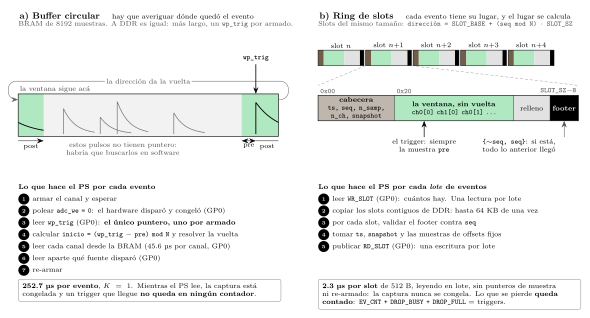

Con un buffer circular, encontrar el evento es trabajo del PS: el hardware deja un
solo puntero, `wp_trig`, y el PS tiene que restarle `pre`, resolver la vuelta del
buffer y leer canal por canal. Es **un puntero por armado**, tanto en la BRAM
(`rp_bram_sm`) como en la captura continua a DDR (`rp_axi_sm`). Los demás pulsos
que hayan quedado en el buffer no tienen ninguno: habría que buscarlos por umbral
en software.

En el ring ese trabajo desaparece por diseño. Cada evento ocupa un slot de tamaño
fijo, la dirección sale de `seq`, y dentro del slot todo está en offsets fijos: la
ventana no da la vuelta, el trigger es siempre la muestra `pre`, y `ts` y
`snapshot` vienen en la cabecera.

Lo que el ring **no** da es lo que queda fuera de las ventanas: la señal entre
eventos y los pulsos sin trigger. Para mirar eso sigue estando la captura en BRAM.

### Qué cambia en el flujo de adquisición

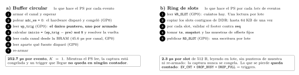

Esa diferencia de estructura es la que cambia el trabajo del PS. Con el buffer
circular el trabajo es **por evento**, y la captura queda congelada mientras el PS
lee. Con el ring es **por lote**, y la captura no se detiene nunca. El lote, paso
por paso y con la PL escribiendo a la vez, está en
[§5.3](#53-los-créditos-se-devuelven-por-lote).

---

## 2. `event_window_capture` — de trigger a stream

Reemplaza el rol de `rp_bram_sm`. La diferencia estructural: en vez de congelar
16384 muestras, **copia** la ventana a un stream y vuelve a estar listo en
`(pre+post)·N_CH` ciclos, sin que el PS intervenga.

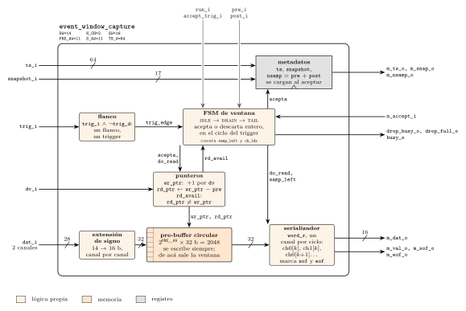

*Una sola memoria para el pre y el post: al aceptar, `rd_ptr` arranca `pre`
palabras atrás de `wr_ptr`, y desde ahí el lector consume una palabra cada
`N_CH` ciclos mientras el pre-buffer se sigue escribiendo a una por ciclo. Cada
palabra trae los dos canales y el serializador los saca de a uno. `m_accept_i`
se mira una sola vez, en el ciclo del trigger. Con `run_i = 0` la FSM vuelve a
`IDLE`, y `wr_ptr` y el detector de flanco a cero, pero el contenido del buffer
no se borra. `NOMBRE=valor`: parámetros con que lo instancia `event_ring_top`.*

([fuente](figuras/panorama_event_window_capture.tex))

### 2.1 Señales

| señal | dir | qué es |
|---|---|---|
| `run_i` | in | mantiene vivo el pre-buffer y el drenaje |
| `accept_trig_i` | in | permite **aceptar** triggers nuevos |
| `pre_i` / `post_i` | in | muestras antes / desde el trigger (por canal) |
| `dat_i` / `dv_i` | in | muestras de los `N_CH` canales, ya calibradas |
| `trig_i` | in | trigger conjunto (se toma **por flanco**) |
| `snapshot_i` | in | 17 b: qué fuente disparó |
| `ts_i` | in | contador libre de 64 b, el reloj de la corrida |
| `m_val_o` / `m_dat_o` | out | una muestra de 16 b por ciclo |
| `m_sof_o` / `m_eof_o` | out | primera / última muestra del evento |
| `m_accept_i` | in | **se muestrea sólo en el ciclo del trigger** |
| `m_ts_o`, `m_snap_o`, `m_nsamp_o` | out | metadatos, válidos junto con el SOF |
| `drop_busy_o` / `drop_full_o` | out | pulsos, las dos causas de pérdida |

`run_i` y `accept_trig_i` están **separados a propósito**: en la parada ordenada
(`DRAINING`) se bajan los triggers nuevos pero se deja correr el drenaje, así la
parada no trunca la ventana en vuelo.

### 2.2 Por qué el trigger se toma por flanco

`mt_trig_src` registra `adc_trig <= trig_comb`, o sea un **nivel**, y el
*strobe* que llega por el `sys_bus_cdc` puede durar más de un ciclo de `adc_clk`.
En la placa esto producía **dos eventos por cada trigger por software** (uno
capturado y uno contado como `drop_busy`). Se detecta flanco:

```verilog
wire trig_edge = trig_i && !trig_d;
```

Depender del ancho de un pulso generado por un módulo que no controlamos es
frágil; el flanco no. Regresión: `tb_event_window_capture` test [7].

### 2.3 Una sola memoria para el pre y el post

El pre-trigger vive en un buffer circular de `2^PRE_AW = 2048` palabras que **se
escribe siempre** mientras `run_i`, pase lo que pase con la FSM de lectura. Si
dejara de escribirse durante el drenaje, el pre-trigger del evento siguiente
tendría un hueco.

La ventana **sale del mismo buffer**: al aceptar el trigger,

```verilog
rd_ptr <= wr_ptr - pre_i[PRE_AW-1:0];
```

y a partir de ahí se lee hacia adelante. Durante el "pre" hay datos de sobra;
durante el "post" el lector va detrás del escritor y consume lo que va llegando.
`rd_avail = (rd_ptr != wr_ptr)` es lo único que sincroniza las dos mitades.

> **Los primeros `pre` ciclos.** El buffer no se borra al arrancar: sólo `wr_ptr`
> vuelve a 0. Un disparo con `ts < pre` tiene un pre-trigger que mira antes del
> arranque, y sus primeras `pre − ts` muestras son lo que quedó en el buffer de la
> corrida anterior. El resto de la ventana es correcto. Se vio en la placa
> (2026-11-09) con el generador de eventos: un disparo en `ts = 2` con `pre = 8`
> trajo 6 muestras de la corrida anterior, distintas en cada corrida, y desde `ts = 0`
> el patrón exacto. Para quien analiza: descartar los eventos con `ts < pre`, o no
> mirar sus primeras `pre − ts` muestras.

> **El rezago crece, y hay un límite.** Con `N_CH` canales la salida serializa
> una muestra por ciclo, así que el lector consume **una palabra cada `N_CH`
> ciclos** mientras el escritor produce una por ciclo. El drenaje dura
> `T = (pre+post)·N_CH` ciclos y el rezago final es
>
> ```
> rezago = (pre + post)·N_CH − post        (= 2·pre + post  para N_CH = 2)
> ```
>
> Si ese número llegara a `2^PRE_AW`, el escritor pisaría datos que el lector no
> leyó todavía, **en silencio**: **el RTL no verifica esta condición**. libmca sí
> (`osciloscope_ring_geometria`), y `RingSource` rechaza la geometría con un
> `ValueError`.
>
> `PRE_AW = 11` es lo que hace falta para ventanas de **1024 muestras**: con dos
> canales la condición es `pre + (pre + post) < 2048`, así que entran con cualquier
> `pre` hasta 1023. Medido en simulación con una rampa
> (`figuras/tiempos/ventana_max.txt`), el borde es exacto: con `2·pre + post = 2047`
> sale limpia, y con 2048 aparece un salto por evento. Lo cubre
> `tb_event_ring_ventana`, que falla si se vuelve a `PRE_AW = 9`.
>
> Una ventana de 1024 no entra en un slot de 4 KB, porque con la cabecera y el
> footer ocupa 4136 B: necesita 8 KB, y la mitad queda de relleno. Hasta 1014
> muestras (4096 B justos) alcanza con 4 KB.

### 2.4 La FSM

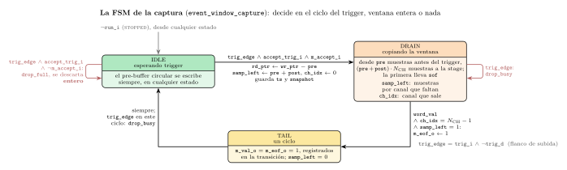

*`m_accept` lo da la stage: hay `(pre + post)·N_CH` lugares libres **y** un
lugar de metadato. Se mira una sola vez, en el ciclo del trigger, antes de que
salga la primera muestra (el SOF; ver §2.5). Desde la FSM global, `STOPPED`
(`run_i = 0`) la devuelve a `IDLE` desde cualquier estado, y `DRAINING`
(`accept_trig = 0`) no la deja aceptar triggers nuevos pero sí terminar la
ventana en vuelo. Con el ring en `RUNNING`, todo flanco queda contado: `EV_CNT +
DROP_BUSY + DROP_FULL` = triggers.*

([fuente](figuras/fsm_event_window_capture.tex))

El tiempo muerto **de la captura** es la duración de `ST_DRAIN` + `ST_TAIL`. Medido
en simulación con la ventana por defecto:

```
(pre + post)·N_CH + 2  ciclos  =  66 ciclos  =  528 ns   (S=32, N_CH=2, 125 MHz)
```

o sea un techo de ~1.9 Mev/s para este bloque, contra los 3.96 kev/s del camino
original. **No es el techo del ring**: el writer tarda más, sobre todo con slots
que llevan relleno, ver §4.5. (La
cabecera del módulo dice "~256 ns con S=32"; ese número olvida el factor `N_CH` de
la serialización.)

La ventana cuesta el doble de lo que dura, porque dos canales salen de a una
muestra de 16 b por ciclo. Y las ventanas no se solapan: un trigger durante el
drenaje no abre otra, se cuenta en `drop_busy`.

**Contado entre marcas de tiempo**, que es lo que se ve desde el software, son
`(pre + post)·N_CH + 3` ciclos. Un trigger a menos de eso de la marca del último
aceptado se cuenta en `drop_busy`, y uno descartado no extiende el tiempo muerto. Con
las marcas del generador de eventos, esa regla da exacto el `DROP_BUSY` de la placa (el
caso aleatorio a 3 MHz del 2026-11-09: 59 762 de 100 000); con `+ 2` da 59 373. Es el
modelo con que `campanas/run_etapas_ring.py` compara cada punto
([`generador.md`](generador.md) §6).

### 2.5 El handshake de aceptación, y por qué es en el SOF

`m_accept_i` se muestrea **una sola vez**, en el ciclo del trigger. Si aguas abajo
no hay lugar para la ventana **completa**, el evento se descarta entero y se
cuenta como `drop_full`. Nunca se emite media ventana.

Ésta es la decisión que hace que los contadores signifiquen algo. La alternativa
—empezar a emitir y cortar si el consumidor se llena— dejaría en la DDR un
registro truncado que el PS no puede distinguir de uno bueno.

SOF es *start of frame*, la primera muestra de la ventana en el stream (`m_sof_o`).
En rigor la pregunta se hace en el ciclo del trigger, un poco antes de que salga
el SOF. Lo que el nombre quiere decir es que se pregunta una vez por ventana y
antes de la primera muestra. `m_accept_i` es `s_accept_o` de la stage: hay
`(pre + post)·N_CH` lugares libres **y** un lugar de metadato
([`event_stage_fifo.sv:167`](../../modulos/event_ring/rtl/event_stage_fifo.sv#L167)).
No hace falta reservar ese lugar, porque mientras dura la copia sólo la captura
escribe en la stage, y el lugar libre sólo puede crecer. La FSM de la captura,
con la aceptación y los dos descartes, está en §2.4.

### 2.6 Las dos causas de pérdida, separadas

| contador | causa | qué decisión implica |
|---|---|---|
| `drop_busy` | el trigger cayó mientras se drenaba la ventana anterior | tiempo muerto del **PL**: bajar `pre+post`, o aceptar el techo |
| `drop_full` | aguas abajo no aceptó (stage llena, o sin créditos de DDR) | tiempo muerto del **consumidor**: el PS no drena, o el ring es chico |

Están separados porque llevan a acciones **opuestas**. Y su suma con `ev_cnt` es
el invariante que el sistema original no podía escribir:

```
EV_CNT + DROP_BUSY + DROP_FULL == triggers inyectados
```

### 2.7 Una sutileza que costó un off-by-one

En `ST_DRAIN`, al terminar de serializar una palabra:

```verilog
if (ch_idx == N_CH-1) begin
  ch_idx    <= '0;
  samp_left <= samp_left - 1'b1;
  word_val  <= do_read;        // <-- NO 1'b0
```

`do_read` puede dispararse en **ese mismo ciclo** (`want_word` lo permite cuando
`ch_idx == N_CH-1`). Si acá se forzara `0` a secas, el `word_val <= 1` de la rama
de lectura quedaría pisado y se perdería la palabra recién cargada: una muestra
menos por evento, silenciosamente.

---

## 3. `event_stage_fifo` — el buffer elástico

Existe porque la captura no se frena y el writer sí. Con capacidad para `E = 4`
eventos, la captura puede empezar el evento N+1 mientras el writer todavía drena
el N.

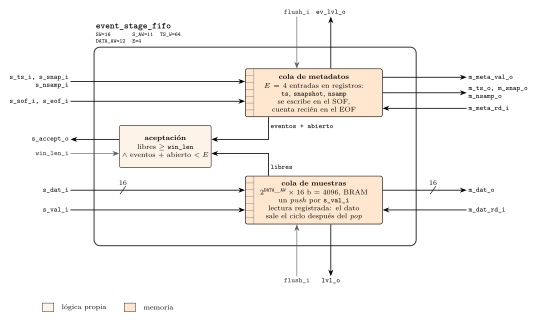

*`eventos + abierto` cuenta también el evento que está entrando, así que un
trigger nunca se acepta sobre un lugar de metadato ya prometido. `win_len_i` es
`(pre + post)·N_CH`, en muestras. `flush_i` es un solo puerto y pone en cero los
punteros de las dos colas; `lvl_o` y `ev_lvl_o` son diagnóstico. Con ventanas de
1024 muestras entran dos eventos, no cuatro. `NOMBRE=valor`: parámetros con que
lo instancia `event_ring_top`.*

([fuente](figuras/panorama_event_stage_fifo.tex))

**Dos colas en paralelo**, y ésa es la idea central:

- **muestras**: BRAM de `2^DATA_AW = 4096` palabras de 16 b, con lectura
  registrada (el dato sale el ciclo **después** del pop; el writer lo compensa con
  su registro `rd_d`);
- **metadatos**: `E` entradas en registros (`ts`, `snapshot`, `nsamp`).

El writer las consume **desacopladas**: primero lee el metadato para armar la
cabecera, después drena las muestras.

Con ventanas de 1024 muestras entran solo dos eventos, porque cada uno ocupa 2048
palabras. `DATA_AW = 13` devolvería los cuatro, pero no paga sus 2 RAMB36: con la
ventana de 1024 y el tren de §4.5, guarda lo mismo hasta 100 kcps y como mucho 1 k/s
más por encima (`figuras/tiempos/stage_8192/poisson.txt`).

### El metadato se publica en el EOF, no en el SOF

```verilog
if (s_val_i && s_sof_i) meta_open <= 1'b1;          // se escribe
if (s_val_i && s_eof_i) begin meta_wr <= meta_wr + 1; end  // recién acá cuenta
assign m_meta_val_o = (meta_lvl != 0);
```

Si el evento se ofreciera al writer en el SOF, el writer podría drenar la cola de
muestras **más rápido de lo que entran** y leer basura. `meta_lvl` cuenta sólo
eventos **completos**; `meta_open` marca el que está a medio entrar y cuenta para
la ocupación, pero no para la disponibilidad.

### `s_accept_o` — la promesa

```verilog
assign s_accept_o = (free32 >= winlen32) && !meta_full;
```

Es la respuesta a "¿entra una ventana **entera**?", y es lo que la captura
consulta en el ciclo del trigger. Las comparaciones están ensanchadas a 32 bits a
propósito: con las anchuras nativas, la relación entre `DATA_AW` y `S_AW` depende
de la parametrización y el *zero-extend* puede quedar de ancho negativo (no
compila) o, peor, truncar en silencio.

---

## 4. `event_slot_writer` — de evento a slot

Emite **exactamente** `2^(slot_shift−3)` palabras de 64 b por evento, en orden de
dirección creciente. El layout está en
[`diseno_y_register_map.md`](diseno_y_register_map.md#layout-del-slot).

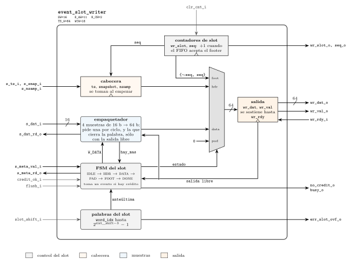

*El estado de la FSM elige qué palabra sale: cuatro de cabecera, las muestras
empaquetadas, ceros de relleno hasta la anteúltima y el footer `{~seq, seq}`.
Cada palabra se sostiene en la salida hasta que el `axi_wr_fifo` la acepta
(`wr_rdy_i`), así que la contrapresión frena al writer sin perder muestras.
`wr_slot` y `seq` suben recién cuando se acepta el footer. `clr_cnt_i` los pone
en cero y `flush_i` no, aunque en `event_ring_top` los dos vienen del mismo
`flush`. Si la ventana no entra en el slot, `err_slot_ovf_o` queda prendido y el
evento se trunca. `NOMBRE=valor`: parámetros con que lo instancia
`event_ring_top`.*

([fuente](figuras/panorama_event_slot_writer.tex))

### 4.1 La FSM

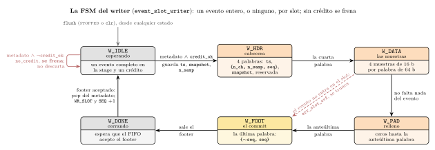

*Sin crédito el writer se queda en `W_IDLE` con `no_credit` = 1. Se frena y no
descarta: la contrapresión sube a la stage, y si hay que descartar, la captura
descarta el evento entero (§4.4). En `W_HDR`, `W_DATA`, `W_PAD` y `W_FOOT` cada
palabra espera que el `axi_wr_fifo` la acepte (`wr_rdy`): la contrapresión del
FIFO también frena, no descarta. El slot se cierra recién cuando el FIFO acepta
el footer, y ahí suben `WR_SLOT` y `SEQ`. Si la ventana no entra en el slot, por
una geometría mal configurada, el evento se trunca y el slot se cierra con su
footer y `err_slot_ovf` prendido: es preferible a pisar el slot siguiente. El
relleno hace que cada slot ocupe exactamente `2^(slot_shift−3)` palabras, así
que el generador de direcciones sigue siendo lineal.*

([fuente](figuras/fsm_event_slot_writer.tex))

### 4.2 El empaquetado

Cuatro muestras de 16 b por palabra de 64, entrando por arriba. Las tres primeras se
guardan y la cuarta sale directo:

```verilog
acc      <= {entra, acc[47:16]};   // muestras 1 a 3
wr_dat_o <= {entra, acc};          // la cuarta completa la palabra
```

La primera muestra queda en `[15:0]` — *little-endian*, para que el PS haga un
`np.frombuffer(..., '<i2')` directo, sin reordenar nada. Si la ventana no es
múltiplo de 4, la última palabra se completa con ceros por el mismo camino.

`W_DATA` pide una muestra por ciclo y arma una palabra cada 4:

| ciclo | 1 | 2 | 3 | 4 | 5 | 6 | 7 | 8 | 9 | 10 |
|---|---|---|---|---|---|---|---|---|---|---|
| pide al stage | ● | ● | ● | ● | ● | ● | ● | ● | ● | ● |
| llega la muestra | | 1 | 2 | 3 | 4 | 5 | 6 | 7 | 8 | 9 |
| sale la palabra | | | | | | **P1** | | | | **P2** |

Entre pedir y recibir hay dos ciclos, así que puede haber muestras en camino cuando
el `axi_wr_fifo` deja de aceptar. Por eso rige una regla: **la muestra que completa
una palabra solo se pide con la salida libre**. Hasta que esa muestra llegue no puede
salir otra palabra, así que la salida sigue libre y no hace falta otro registro.

```verilog
wire [2:0] pedidas = pack_cnt + s_dat_rd_o + rd_d;   // recibidas + en camino
wire       cierra  = (pedidas == 3'd3);              // la próxima completa la palabra
if (samp_left != 0 && (!cierra || salida_libre)) ... // pedir
```

Con `wr_rdy = 0` durante cinco ciclos, se frena con tres muestras guardadas y sin
perder ninguna:

| ciclo | 6 | 7 | 8 | 9 | 10 | 11 | 12 | 13 | 14 |
|---|---|---|---|---|---|---|---|---|---|
| `wr_rdy` | 0 | 0 | 0 | 0 | 0 | 1 | 1 | 1 | 1 |
| salida | P1 | P1 | P1 | P1 | P1 | P1 | | | P2 |
| pide al stage | ● | ● | | | | | ● | ● | ● |
| llega la muestra | 5 | 6 | 7 | | | | | 8 | 9 |

### 4.3 Dos guardas que no son opcionales

**`!s_meta_rd_o` en `W_IDLE`.** El pop del metadato anterior recién se refleja en
`s_meta_val_i` un ciclo **después**. Sin el guard, al volver de `W_DONE` se lee el
**mismo** evento y se escribe dos veces — y un slot duplicado es indistinguible de
uno legítimo del lado del PS.

**`err_slot_ovf_o`.** Si la cabecera + los datos pasan de la anteúltima palabra,
la ventana no entra en el slot configurado. Se levanta un *sticky*, se **trunca**
el evento y se cierra el slot con su footer. Preferible a pisar el slot siguiente
en silencio.

### 4.4 Sin créditos el writer **se frena**, no descarta

```verilog
if (s_meta_val_i && credit_ok_i && !s_meta_rd_o) ...
```

La contrapresión sube al stage, y de ahí a la captura, que descarta el evento
**entero** y lo cuenta. Descartar a mitad de slot dejaría basura en la DDR.

### 4.5 Cuánto tarda cada etapa

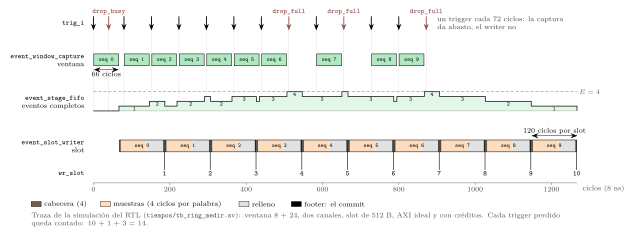

La figura es la traza del RTL con una ráfaga de catorce triggers, uno cada 72 ciclos
y uno más en medio de la primera ventana, con slots de 512 B. La captura da abasto,
pero el writer tarda 120 ciclos por slot: el stage llega a `E = 4`, y tres triggers se
pierden aunque el ring tenga lugar de sobra y AXI no frene nunca.

Por evento, en la traza:

| tramo | slot de 256 B | slot de 512 B |
|---|---|---|
| `W_HDR` | 4 | 4 |
| `W_DATA`, 16 palabras | 67 | 67 |
| `W_PAD` | 12 | 44 |
| `W_FOOT` + `W_DONE` | 3 | 3 |
| **por slot, con la vuelta a `W_IDLE`** | **88** | **120** |

Las palabras de datos salen cada 4 ciclos, porque el stage da una muestra de 16 b por
ciclo, y las de relleno, una por ciclo. Eso da unos 400 MB/s con slots a medio llenar
y 250 MB/s con el slot justo. El techo depende de la ventana. Con un tren de Poisson,
AXI ideal y créditos de sobra, o sea el mejor caso del lado de DDR:

| ventana (`pre` + `post`) | dura | slot | ciclos: captura / writer | techo del writer | guardados a 10 / 30 / 100 / 300 / 1000 kcps (k/s) |
|---|---|---|---|---|---|
| 8 + 24 = 32 | 0.26 µs | 256 B | 66 / 88 | 1420 k/s | 10 / 30 / 95 / 257 / 644 |
| 16 + 112 = 128 | 1.02 µs | 1 KB | 258 / 328 | 381 k/s | 10 / 27 / 80 / 183 / 317 |
| 16 + 240 = 256 | 2.05 µs | 2 KB | 514 / 648 | 193 k/s | 10 / 26 / 68 / 133 / 190 |
| 16 + 479 = 495 | 3.96 µs | 4 KB | 992 / 1264 | 99 k/s | 9 / 25 / 56 / 88 / 98 |
| 16 + 998 = 1014 | 8.11 µs | 4 KB | 2030 / 2041 | 61 k/s | 9 / 20 / 38 / 51 / 57 |
| 32 + 992 = 1024 | 8.19 µs | 8 KB | 2050 / 2568 | 49 k/s | 9 / 21 / 38 / 48 / 48 |

El techo es 125 MHz dividido los ciclos del writer. Con trenes periódicos es exacto:
con 32 muestras no se pierde nada desde 88 ciclos entre triggers (slot de 256 B) y
desde 120 (slot de 512 B), y sí se pierde a 86 y a 118
(`figuras/tiempos/periodico.txt`).

**En la placa es el mismo techo** (2026-11-12, etapa A de `campanas/run_etapas_ring.py`,
con el generador de eventos y un lector que sólo devuelve créditos). En las seis
ventanas de la tabla, un tren periódico de `writer` ciclos no pierde nada y uno de
`writer − 2` pierde por `drop_full`: el AXI y la DDR reales no frenan al writer. Ver
[`generador.md`](generador.md) §6.

Por debajo de esos techos, lo que más se pierde es `DROP_BUSY`, o sea el tiempo muerto
de la captura. En todas las corridas el invariante cierra exacto,
`EV_CNT + DROP_BUSY + DROP_FULL = 2000`, y la rampa llega sin saltos. Con 2000
triggers por corrida, los porcentajes guardados valen con alrededor de un punto de
error estadístico.

A estos techos falta sumarles el PS, que acá no frena. Medido en placa, lee 512 B
cada 2.31 µs en lote (~220 MB/s), sin contar lo que haga con los datos.

Todo esto es simulación del RTL: **el writer actual no se probó en la placa**. Cómo se
llegó a estos números, y qué más se podría acelerar, está en
[`acelerar_writer.md`](acelerar_writer.md).

Los números salen de [`figuras/tiempos/tb_ring_medir.sv`](figuras/tiempos/tb_ring_medir.sv),
y sus resultados están en esa misma carpeta.

---

## 5. Los créditos

Ésta es la pieza que reemplaza al "arm/congelar/re-armar", así que vale la pena
ser explícito.

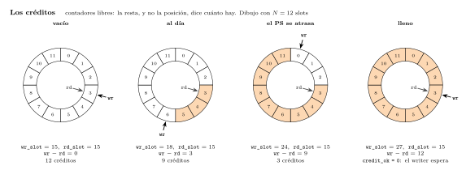

### 5.1 Qué es un crédito acá

Un crédito es **un slot libre en el ring de DDR**. El productor (el PL) sólo
escribe si tiene al menos uno; el consumidor (el PS) los devuelve avisando hasta
dónde leyó.

En vez de un *flag* de "lleno" —que exigiría comunicación en ambos sentidos por
evento— cada lado lleva **un contador monótono que nunca se resetea**:

- `wr_slot`: slots que el PL **escribió** (lo incrementa el writer al cerrar cada
  slot);
- `rd_slot`: slots que el PS **consumió** (lo publica el PS por el registro
  `0x24`).

Y la ocupación es una resta:

```verilog
wire [31:0] occupied  = wr_slot - rd_slot;
wire        credit_ok = (occupied < n_slots);
```

### 5.2 Por qué contadores libres y no punteros módulo N

Podría hacerse con punteros que envuelven en `N_SLOTS`, pero entonces
`wr == rd` significa a la vez "vacío" y "lleno" y hay que sacrificar un slot o
llevar un bit extra. Con contadores libres de 32 bits:

- la **resta en módulo 2³²** da la ocupación correcta aunque los dos contadores
  hayan dado vueltas, siempre que `N_SLOTS < 2³¹`;
- `N_SLOTS` puede ser cualquiera, no hace falta potencia de 2;
- lleno y vacío son distinguibles sin trucos.

La dirección física se deriva aparte, por aritmética pura:

```
dirección = SLOT_BASE + (wr_slot mod N_SLOTS) · SLOT_SZ
```

### 5.3 Los créditos se devuelven **por lote**

El PS publica `rd_slot` **una vez por batch**, no por evento. Publicarlo por
evento devolvería el bus GP0 al camino crítico, que es exactamente lo que este
diseño está sacando de ahí. Un batch de 128 slots devuelve 128 créditos con una
sola escritura.

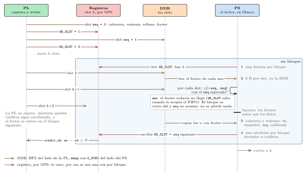

La figura sigue al lector de libmca (`osciloscope_ring_leer_lote`, desde la Parte 7
del plan de libmca): lee `WR_SLOT` una vez por bloque para saber cuántos slots hay,
lee el footer de cada uno en la DDR, pone una barrera y recién ahí copia cabecera y
ventana. La lectura de `WR_SLOT` no reemplaza al footer: ese contador sube cuando el
FIFO aceptó el footer, no cuando llegó a DDR. Si un footer todavía no llegó, el bloque
se corta ahí y el resto viene en la vuelta siguiente, sin perder nada.

El orden importa. El `RingSource` de Python copiaba el bloque y validaba cada footer
sobre la copia: un `memcpy` hacia adelante lee los datos antes que el footer del final
del slot, y un footer que llega en el medio de la copia valida datos viejos. Por la
misma razón libmca borra los footers al configurar: el slot `k` de la corrida anterior
tiene el mismo `seq` y un footer válido.

### 5.4 Los tres contadores se reinician JUNTOS

`wr_slot`, `rd_slot` y el generador de direcciones del `axi_wr_fifo` cuelgan
todos de `flush`. No es cosmético; los dos modos de falla aparecieron en la placa:

- resetear `wr_slot` **sin** `rd_slot` deja `occupied = wr − rd` en *underflow*
  (~2³²) ⇒ `credit_ok = 0` ⇒ **el ring descarta todo**;
- hacer que los contadores sobrevivan al stop **sin** resetear la dirección del
  FIFO deja el índice desincronizado de la memoria ⇒ el PS lee el slot
  equivocado.

Por eso `flush_i` y `clr_cnt_i` están separados en el writer, y el top los
maneja como pareja.

### 5.5 El segundo sistema de créditos: la sombra del `axi_wr_fifo`

Hay un control de flujo más, independiente del anterior, y por una razón
incómoda: **`axi_wr_fifo` no expone su nivel de llenado y descarta en silencio si
se empuja estando lleno** (sólo levanta `stat_overflow_o`). Así que el top lleva
su propia cuenta:

```verilog
wire fifo_push = wr_val_o && wr_rdy;
wire fifo_pop  = axi_wvalid_o && axi_wrdy_i;
assign wr_rdy  = (fifo_occ < (FIFO_N - 8));
```

Entre el pop interno del FIFO y la aceptación por el master hay una palabra en
vuelo (`data_in_reg`), así que esta cuenta **sobreestima** la ocupación real. Es
deliberado: sobreestimar frena de más, subestimar corrompe. El margen de 8
palabras cubre las que puedan estar dentro del master.

`err_fifo_ovf` es *sticky* sobre `stat_overflow_o`: si alguna vez se dispara, la
sombra tiene un bug y lo que hay en DDR es basura. Tiene que ser visible.

### 5.6 Resumen del control de flujo

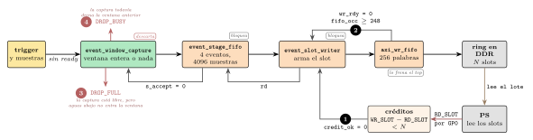

*Sólo la captura descarta: el trigger y las muestras le llegan sin ready, así
que no puede frenarlos, y el evento que no puede tomar lo pierde entero y lo
cuenta (flecha roja). El stage, el writer y el `axi_wr_fifo` sólo bloquean: las
flechas de vuelta son la contrapresión, que sube hasta la captura sin perder
nada. Los dos descartes salen de lugares distintos: `DROP_BUSY` (arriba) es el
tiempo muerto de la captura misma y pasa aunque aguas abajo sobre lugar;
`DROP_FULL` (abajo) es la contrapresión que llegó hasta arriba, con la captura
libre. Por eso se cuentan aparte: el primero baja acortando la ventana, el
segundo leyendo más rápido o con un ring más grande. Los números son las filas
de la tabla.*

| nivel | recurso | señal | qué pasa al agotarse |
|---|---|---|---|
| 1 | slots de DDR | `credit_ok` | el writer **se frena** en `W_IDLE` |
| 2 | `axi_wr_fifo` | `wr_rdy` | el writer **se frena** a mitad de slot |
| 3 | stage (muestras + metadatos) | `s_accept` | la captura **descarta entero** → `drop_full` |
| 4 | la captura misma | `busy` | trigger durante el drenaje → `drop_busy` |

Los niveles 1 y 2 **frenan**; los 3 y 4 **descartan y cuentan**. Que el descarte
ocurra sólo arriba, donde se puede descartar un evento completo, es lo que hace
que los contadores sean exactos.

---

## 6. El camino AXI

### 6.1 Lo primero: la interfaz del ring **no es AXI**

`event_ring_top` no habla AXI. Habla la interfaz simplificada de escritura de
Instrumentation Technologies —`waddr / wdata / wsel / wlen / wfixed / wvalid /
wrdy`— la misma que usa `rp_axi_sm` en el scope original. Hay dos traducciones en
el medio:

```
event_slot_writer          axi_wr_fifo              axi_master              PS/DDR
  palabras de 64 b   ──►   agrupa en rafagas  ──►   canales AW/W/B    ──►   HP2
  con wr_val/wr_rdy        y genera direcciones     de AXI3 de verdad
```

- **`axi_wr_fifo`** ([`rtl/classic/axi_wr_fifo.v`](../../../../rtl/classic/axi_wr_fifo.v))
  convierte un flujo de palabras en **ráfagas** con dirección: decide cuándo
  arrancar una, de qué largo, y lleva el puntero de escritura con envolvimiento.
- **`axi_master`** ([`rtl/classic/axi_master.v`](../../../../rtl/classic/axi_master.v))
  convierte eso en los canales AXI reales (`AW`, `W`, `B`) contra el puerto HP2
  del PS.

Reusar los dos bloques tal cual —sin tocarlos— fue una decisión explícita: son RTL
compartido con el resto del árbol, y el camino de *deep memory* del scope ya los
ejercita en producción.

### 6.2 Cómo se forman las ráfagas

El FIFO tiene `2^FW = 256` entradas de 64 b (2 KB). Arranca una ráfaga cuando

```verilog
assign new_burst = (((fifo_flush && axi_wrdy_i) || (fill_lvl >= sys_trig_size_r))
                    && !dat_cnt && |fill_lvl || single_burst_posedge) && !clear_do;
```

o sea: hay al menos `ctrl_trig_size_i` palabras acumuladas, o el flujo se cortó y
hay que vaciar lo que quedó (`fifo_flush`), o quedó **una sola** palabra atrapada
en el registro de salida (`single_burst`).

El ring pasa **`ctrl_trig_size_i = 4'hF`**, el mismo valor que producción
([`rp_axi_sm.v:246`](../../../../rtl/classic/rp_axi_sm.v#L246)). No es un número
arbitrario: con un umbral más bajo el FIFO arranca ráfagas cortas y **repite el
último beat** cuando se queda sin datos a mitad de ráfaga.

El largo (`axi_wlen_o`, que es `AWLEN`) sale de un cálculo con tres cotas
([`axi_wr_fifo.v:216-245`](../../../../rtl/classic/axi_wr_fifo.v#L216)):

| cota | expresión | qué evita |
|---|---|---|
| datos disponibles | `fill_lvl[3:0]` | prometer beats que no existen |
| frontera de alineación | `4'hF - next_address[6:3]` | cruzar un bloque de 128 B |
| dirección de fin | `sys_stop_addr_r[6:3] - next_address[6:3]` | pasarse del ring |

La segunda merece un comentario, porque es la que satisface la **regla de las
4 KB de AXI** (una ráfaga no puede cruzar un límite de 4096 B). Acá se resuelve
por construcción y con margen: las ráfagas se alinean a bloques de **128 bytes**
(16 beats × 8 B), así que ninguna puede cruzar 4 KB. No hace falta ninguna
comprobación adicional.

Máximo por ráfaga: **16 beats × 8 B = 128 B**. Un slot de 512 B son **4 ráfagas**.

El envolvimiento del ring es explícito
([`:283`](../../../../rtl/classic/axi_wr_fifo.v#L283)):

```verilog
else if (ctrl_wrap_i && new_burst && (axi_waddr_o == sys_stop_addr_r)) begin
   next_address <= sys_start_addr_r + DW/8 ;
   axi_waddr_o  <= sys_start_addr_r ;
```

> **`stop_addr` es INCLUSIVO**: el FIFO envuelve *cuando* `axi_waddr_o ==
> stop_addr`, o sea que **escribe** en esa dirección antes de volver al
> principio. Por eso el top pasa `slot_base + ring_sz − 8`. Sin el `−8` el ring
> pisa la primera palabra que sigue a la región reservada.

### 6.3 Qué sale realmente por el bus

`axi_master` está instanciado para HP2 con `ID = 3`, `DW = 64`, `LW = 4`
([`red_pitaya_ps.sv:234`](../../rtl/red_pitaya_ps.sv#L234)). Eso fija:

| señal AXI | valor | de dónde sale |
|---|---|---|
| `AWSIZE` | `3'b011` = **8 bytes/beat** | `USE_SZ=0` ⇒ `{(DW==512),1'b1,(DW==64)}` |
| `AWBURST` | `2'b01` = **INCR** | `awburst[0] = !sys_wfixed`, y el ring pide `wfixed=0` |
| `AWLEN` | 0…15 | el cálculo de §6.2 |
| `AWID` / `WID` | **3, constante** | parámetro `ID` |
| `AWCACHE` | `4'b0011` | **no cacheable**, bufferable |
| `AWPROT` | `3'b000` | dato, no privilegiado |
| `AWLOCK` | `2'b00` | normal |

Dos consecuencias que el diseño usa:

**(a) `AWCACHE = 0011` — no cacheable.** Las escrituras no pasan por la cache del
ARM. El lado del PS **tiene que mapear la región con `O_SYNC`** (mapeo no
cacheable) o vería datos viejos. Es un requisito del esquema del footer, no una
optimización.

**(b) `AWID` constante.** Todas las escrituras del ring salen con el **mismo ID**
hacia el **mismo esclavo**. AXI garantiza que las transacciones con igual ID y
mismo destino se observan **en orden**. Ése es todo el fundamento del commit por
footer.

Dentro del master hay dos FIFOs de 16 entradas (direcciones y datos) y la
contrapresión hacia el FIFO de escritura sale de

```verilog
sys_wrdy_o <= ~&axi_wfill_lvl[3:1] && ~&axi_awfill_lvl[3:1];
```

es decir, se corta cuando **cualquiera** de los dos se acerca a lleno.

Ancho de banda: una palabra de 8 B por ciclo a 125 MHz ⇒ **1 GB/s** de techo. Un
slot de 512 B podría salir en 64 ciclos, pero el writer tarda 120 (§4.5), casi todo
armando las palabras de datos. El límite es el writer, no el bus.

### 6.4 Por qué el commit es un footer y no el `BRESP`

El plan original decía "incrementar `wr_slot` recién con el `BRESP` del último
burst". Es correcto en teoría e **inaplicable** acá: ni `axi_wr_fifo` ni
`axi_master` exponen el canal B. El master pone `axi_bready_o = 1'h1` fijo y usa
la respuesta **sólo** para levantar un `sys_werr_o`
([`axi_master.v:284-292`](../../../../rtl/classic/axi_master.v#L284)):

```verilog
assign axi_bready_o = 'h1 ;
sys_werr_o <= axi_bvalid_i && (axi_bresp_i == 2'h2) ;
```

No hay forma de saber **a qué transacción** corresponde una respuesta sin tocar
RTL compartido con otros proyectos.

La solución estándar de *descriptor ring* es además más barata: **una marca al
final del slot**.

```verilog
W_FOOT: wr_dat_o <= {~seq_o, seq_o};
```

Por el argumento de ordenamiento de (b): si el PS ve el footer del slot con el
`seq` esperado, **todo lo que está antes ya está en DDR**. El footer *es* el
commit.

El valor `{~seq, seq}` permite detectar una lectura vieja o rota comparando las
dos mitades, sin depender de que "0" sea un valor especial (que en un ring recién
limpiado no lo es).

**La ventaja grande es del lado del PS**: el footer se valida en DDR, sin leer un
registro por evento. El diseño permite polear solo el footer; el lector de libmca lee
además `WR_SLOT` una vez por bloque para saber cuánto pedir (una lectura repartida
entre todo el bloque), así que GP0 sigue fuera del camino por evento.

### 6.5 Por qué slots de tamaño fijo y relleno con ceros

Escribir 43 palabras de ceros por evento (con `SLOT_SZ=512 B` y `S=32`: 4 de
cabecera + 16 de datos + 43 de relleno + 1 de footer) parece un desperdicio. Lo
es, y se paga a propósito. Las razones, en orden de peso:

1. **El generador de direcciones del `axi_wr_fifo` es un incrementador lineal.**
   No sabe saltar ni buscar: `next_address <= next_address + DW/8`. Cualquier
   layout tiene que ser un **flujo lineal de bytes**. Un slot de largo variable
   exigiría reescribir ese bloque.
2. **La dirección se calcula, no se consulta.** Con tamaño fijo, ambos lados
   derivan `base + (slot mod N)·SZ` con aritmética pura. El PS puede saltar
   directamente al slot que quiere mirar **sin leer nada** — que es lo que hace
   el poleo del footer.
3. **Acceso aleatorio y descarte.** Con registros de largo variable habría que
   parsear secuencialmente desde el principio; perder un slot arruinaría el resto
   del ring.
4. **El costo es chico.** El relleno sale a una palabra por ciclo, contra 4 de las
   muestras (§4.5), y las ráfagas alineadas a 128 B son más eficientes que ráfagas
   cortas de largo irregular.

Es la misma economía de los *descriptor rings* de una NIC: se paga memoria y
ancho de banda para que la sincronización sea aritmética en vez de mensajes.

### 6.6 El dominio de reloj de HP2

HP2 se movió a `adc_clk` (125 MHz):

```systemverilog
axi_sys_if axi2_sys (.clk(adc_clk), .rstn(adc_rstn));
```

Antes colgaba de `dac_axi_clk` (250 MHz) porque era del ASG. Dejarlo así habría
sido un **cruce de dominios sin sincronizar** sobre `wvalid`/`wrdy`: datos
corruptos sin ningún síntoma visible. El ASG ya no existe, HP2 es de uso
exclusivo del ring, y ahora es coherente con `axi0`/`axi1`, que ya usaban
`adc_clk`.

Con eso, **todo el ring vive en un solo dominio**: captura, writer, registros y
AXI. No hace falta ningún CDC ni codificación Gray entre `WR_SLOT` y `RD_SLOT`.
El bus de sistema llega ya sincronizado a `adc_clk` por el `sys_bus_cdc`.

---

## 7. La FSM global y el bus de registros

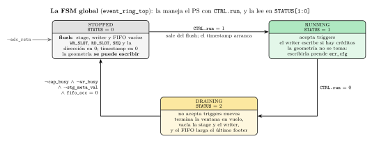

*`CTRL.clr` no cambia el estado: es un ciclo de `flush` en cualquiera de los
tres, y además pone en cero `DROP_BUSY`, `DROP_FULL`, `EV_CNT` y los errores.
libmca lo usa sólo en `STOPPED`. `RD_SLOT` se puede escribir en cualquier
estado. Por eso, si se para con el ring lleno, `DRAINING` no termina hasta que
el PS devuelve créditos, porque el writer los espera para vaciar la stage.
También se destraba con `CTRL.clr`. Llegar a `STOPPED` pone los contadores de
slot en cero: lo que quedó en la DDR ya no tiene `WR_SLOT` que lo cuente.*

([fuente](figuras/fsm_event_ring_top.tex))

`G_DRAINING` existe para no cortar un slot por la mitad. Es el estado que hace
que `run_i` y `accept_trig_i` tengan que estar separados en la captura. Pasa a
`G_STOPPED` cuando la captura y el writer están libres, la stage no tiene
eventos y el `axi_wr_fifo` está vacío (`!wr_busy && !cap_busy && !stg_meta_val
&& fifo_occ == 0`). El FIFO vacío es la condición nueva: sin ella el `flush` de
`STOPPED` tiraba el footer del último slot.

**La geometría se congela en `STOPPED`.** `SLOT_BASE`, `RING_SZ`, `SLOT_SHIFT`,
`PRE` y `POST` sólo latchean con la adquisición parada; escribirlos corriendo se
**ignora** y levanta `err_cfg` (*sticky*). Así nunca conviven dos geometrías en el
mismo ring.

**El `ack` es de latencia fija e incondicional:**

```verilog
ack_sr  <= {ack_sr[2:0], (sys_wen || sys_ren)};
sys_ack <= ack_sr[2];
```

Ninguna ruta de `ack` depende de un sub-bloque, así que ningún estado interno
puede colgar el slot del bus. Es la lección directa del bug latente de
`bram_ack[2]/[3]` en el scope
([`sistema_adquisicion_original.md` §4](../osc/sistema_adquisicion_original.md#4-rp_acq_bram--el-buffer-y-su-lectura),
[`bus_sistema_redpitaya.md` §7.1](../TOP/bus_sistema_redpitaya.md)).

---

## 8. Modos de falla y cómo se ven

| síntoma | registro | causa probable |
|---|---|---|
| `drop_busy` crece | `0x30` | tasa por encima del techo del PL: `(pre+post)·N_CH` ciclos por evento |
| `drop_full` crece | `0x34` | con `no_credit`: el PS no drena, o `RING_SZ` es chico. Sin `no_credit`: el writer no da abasto para esa tasa y esa ventana (§4.5) |
| `no_credit` = 1 | `0x04[4]` | el writer está frenado esperando que el PS publique `RD_SLOT` |
| `err_cfg` = 1 | `0x04[5]` | se intentó escribir geometría con la adquisición corriendo |
| `err_slot_ovf` = 1 | `0x04[6]` | `SLOT_SHIFT` demasiado chico para `PRE+POST`: eventos truncados |
| `err_fifo_ovf` = 1 | `0x04[7]` | la sombra de ocupación del `axi_wr_fifo` falló ⇒ **datos en DDR corruptos** |
| todo se descarta desde el arranque | `WR_SLOT`/`RD_SLOT` | *underflow* de créditos: se reinició uno sin el otro |
| el PS lee slots viejos | — | la región no se mapeó con `O_SYNC` (§6.3a) |

---

## 9. Referencias

- [`diseno_y_register_map.md`](diseno_y_register_map.md) — mapa de registros,
  layout del slot, resultados de la validación en placa y estado de *timing*.
- [`salida_por_red.md`](salida_por_red.md) — qué hace el PS con los slots.
- [`acelerar_writer.md`](acelerar_writer.md) — cómo se aceleró el writer y qué más se
  podría hacer.
- [`../osc/sistema_adquisicion_original.md`](../osc/sistema_adquisicion_original.md)
  — la máquina que esto reemplaza.
- [`../bus_sistema_redpitaya.md`](../TOP/bus_sistema_redpitaya.md) — el bus, el CDC y
  el contrato del `ack`.
- [`../../software/../docs/mca/tiempo_muerto.md`](../../software/../docs/mca/tiempo_muerto.md)
  — los modelos de tiempo muerto y las mediciones.
- RTL: [`event_window_capture.sv`](../../modulos/event_ring/rtl/event_window_capture.sv),
  [`event_stage_fifo.sv`](../../modulos/event_ring/rtl/event_stage_fifo.sv),
  [`event_slot_writer.sv`](../../modulos/event_ring/rtl/event_slot_writer.sv),
  [`event_ring_top.sv`](../../modulos/event_ring/rtl/event_ring_top.sv).
- Figuras: cada `figuras/ring_*.tex` dice en la cabecera cómo se compila.
  `ring_tiempos.tex` lo genera `figuras/tiempos/figura_tiempos.py` desde la traza
  de `tb_ring_medir.sv`, y la receta de la simulación está en la cabecera de ese TB.
- AXI: `AMBA AXI3/AXI4 Protocol Specification` (ARM IHI 0022) — §A3.4 para el
  ordenamiento por ID, §A3.4.1 para la regla de las 4 KB.
